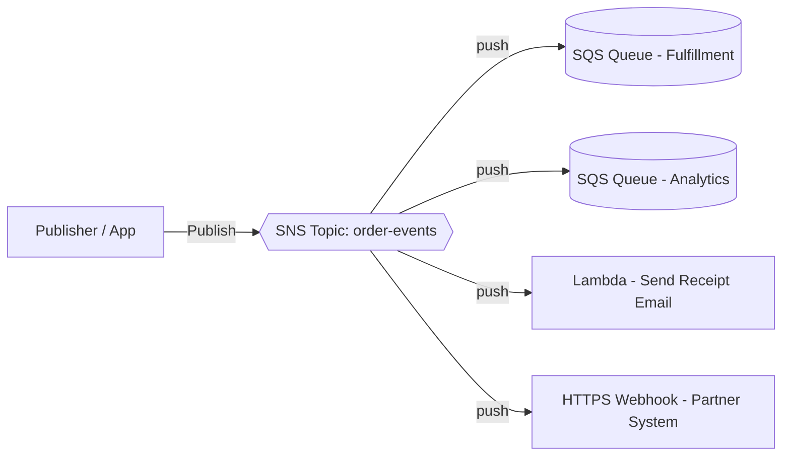
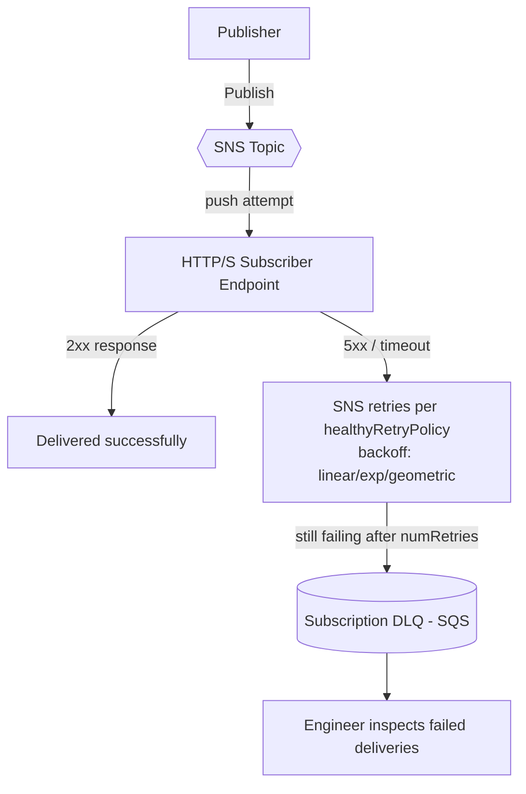
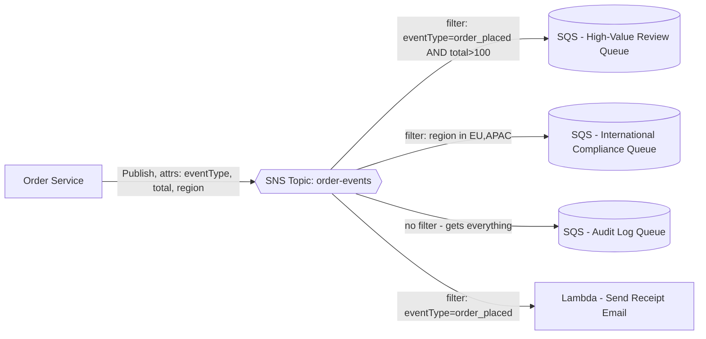
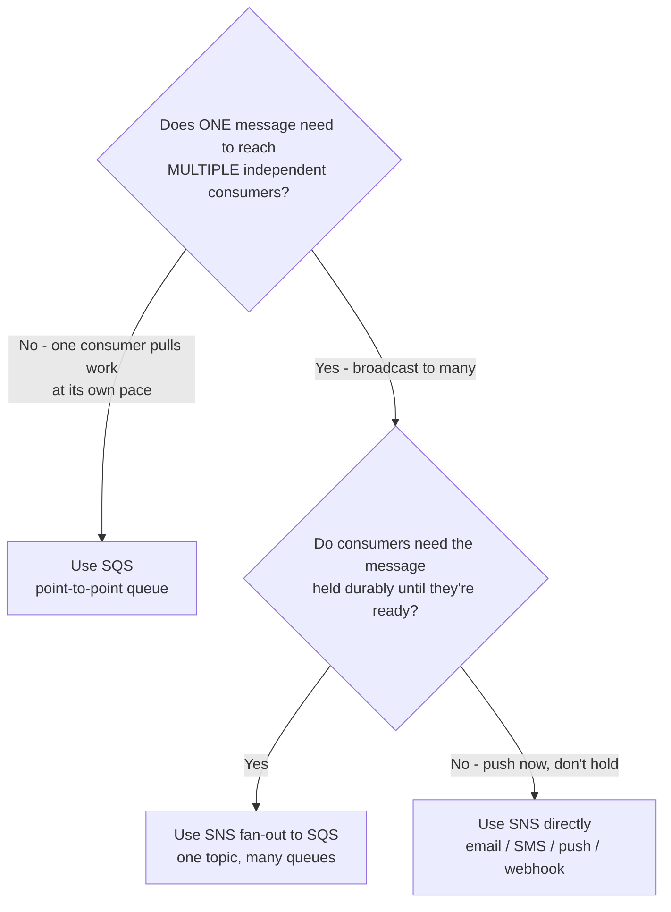
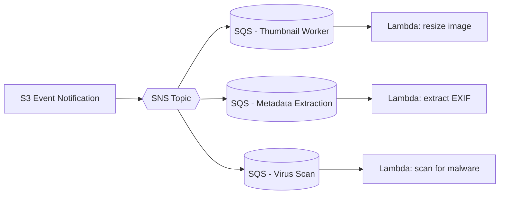
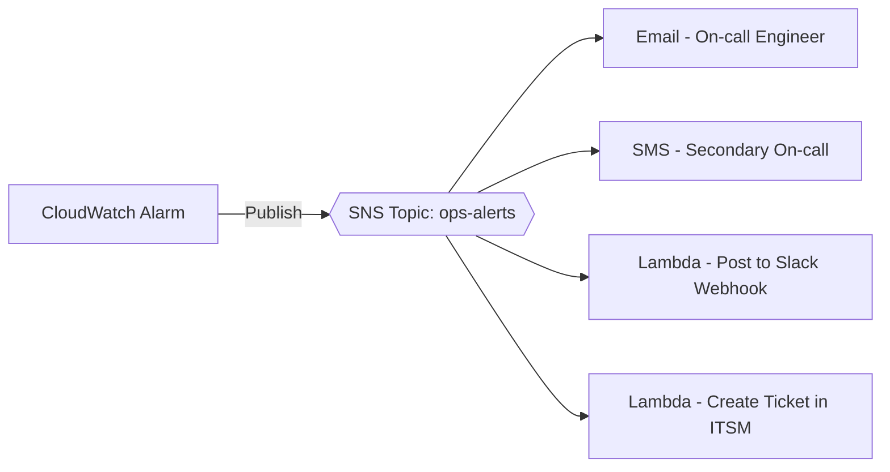
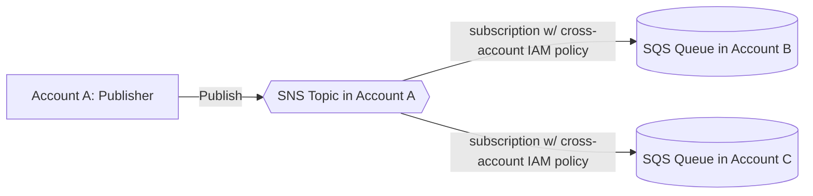
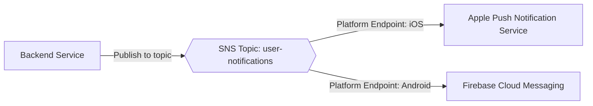

# Amazon SNS (Simple Notification Service)


<!-- If this icon 404s, pull "Simple-Notification-Service.svg" from the official AWS
Architecture Icons zip (App-Integration category) — see diagrams/README.md -->

## Definition

Amazon SNS is a fully managed **publish/subscribe (pub/sub) messaging** service. A publisher
sends one message to a **topic**, and SNS instantly delivers a copy of that message to *every*
subscriber attached to that topic — could be emails, SMS texts, mobile push notifications,
SQS queues, Lambda functions, or HTTP endpoints, all at once. Think of a topic as a radio
station: one broadcast, every tuned-in listener hears it.

## Purpose

Many real systems need to notify several different, unrelated consumers about the same event —
"an order was placed" might need to trigger an email receipt, update an analytics pipeline,
and kick off a fulfillment workflow, all independently. Before pub/sub services, this meant
the publisher had to know about and call each consumer directly (tight coupling, code changes
every time a new consumer appears). AWS built SNS so the publisher only ever talks to one
topic — subscribers can be added or removed without the publisher's code ever changing, and
each subscriber gets its own independent copy of every message, delivered in parallel and
nearly instantly (sub-second, push-based — no polling).

SNS splits naturally into two delivery families that the exam treats differently:
**application-to-application (A2A)** messaging — SQS, Lambda, HTTP(S), Kinesis Data Firehose —
used for system-to-system integration, and **application-to-person (A2P)** messaging — SMS,
mobile push, email — used to reach an actual human. The same topic mechanics apply to both, but
A2P delivery has its own pricing, opt-out/compliance rules, and regional carrier quirks that
A2A delivery doesn't.

## How It Works

A publisher sends a message to an SNS **topic** (identified by an ARN). SNS looks at every
current **subscription** on that topic and pushes a copy of the message to each one, using
whatever protocol that subscription specifies (SQS, Lambda, email, SMS, HTTPS webhook, mobile
push). Delivery to each subscriber happens independently and in parallel — one slow or failing
subscriber does not block or delay delivery to the others.



Step by step:
1. **Publish**: the app calls `Publish` once, against the topic ARN — it has no idea how many
   subscribers exist or what they do.
2. **Fan-out**: SNS immediately pushes an independent copy of the message to each subscription
   currently attached — here, two SQS queues, a Lambda function, and an external webhook.
3. **Parallel, independent delivery**: the fulfillment queue, the analytics queue, the email
   Lambda, and the partner webhook all receive their copy at roughly the same time; none of
   them waits on another.
4. **Subscription filter policies** (not drawn) can be attached per-subscriber so each one only
   receives messages matching certain attributes (e.g., the analytics queue gets *all* events,
   but the email Lambda only gets events where `eventType = "order_placed"`).
5. **Retry + DLQ**: if a push to a subscriber fails (e.g., the webhook is down), SNS retries
   with backoff, and can redirect permanently-failed deliveries to a configured dead-letter
   queue per subscription.

### Official AWS reference: fan-out scenario


*Source: AWS Documentation — [What is Amazon SNS? — Common Amazon SNS scenarios](https://docs.aws.amazon.com/sns/latest/dg/welcome.html), Amazon SNS Developer Guide. © Amazon Web Services.*


*Source: AWS Documentation — [What is Amazon SNS?](https://docs.aws.amazon.com/sns/latest/dg/welcome.html), Amazon SNS Developer Guide. © Amazon Web Services.*

## Worked Message Flow — Actual JSON Payloads

**1. Publisher sends a message with attributes** (`Publish` request):

```json
{
  "TopicArn": "arn:aws:sns:us-east-1:123456789012:order-events",
  "Message": "{\"orderId\":\"ORD-10042\",\"total\":49.98,\"region\":\"EU\"}",
  "MessageAttributes": {
    "eventType": { "DataType": "String", "StringValue": "order_placed" },
    "total":     { "DataType": "Number", "StringValue": "49.98" },
    "region":    { "DataType": "String", "StringValue": "EU" }
  }
}
```

**2. SNS's response** (just an acknowledgement, not a delivery confirmation — SNS is
fire-and-forget from the publisher's point of view):

```json
{
  "MessageId": "f3a9b2c1-7d4e-4a1f-9c3b-2e5f6a7b8c9d"
}
```

**3. What an SQS subscriber actually receives** — SNS wraps the original message in its own
envelope by default (`raw message delivery` off), which matters because consumers need to
`json.loads()` twice (once for the SQS body, once for the nested `Message` field) unless raw
delivery is enabled:

```json
{
  "Type": "Notification",
  "MessageId": "f3a9b2c1-7d4e-4a1f-9c3b-2e5f6a7b8c9d",
  "TopicArn": "arn:aws:sns:us-east-1:123456789012:order-events",
  "Message": "{\"orderId\":\"ORD-10042\",\"total\":49.98,\"region\":\"EU\"}",
  "Timestamp": "2026-11-20T18:02:00.123Z",
  "MessageAttributes": {
    "eventType": { "Type": "String", "Value": "order_placed" },
    "total":     { "Type": "Number", "Value": "49.98" },
    "region":    { "Type": "String", "Value": "EU" }
  },
  "SignatureVersion": "1",
  "Signature": "EXAMPLEpH+..==",
  "SigningCertURL": "https://sns.us-east-1.amazonaws.com/SimpleNotificationService-abc123.pem"
}
```

**4. With raw message delivery enabled** on the subscription, the SQS message body is just the
original payload — no SNS envelope — which is almost always the right setting for SQS/Lambda
subscribers (it's off by default mainly for backward compatibility):

```json
{"orderId":"ORD-10042","total":49.98,"region":"EU"}
```

### Subscription filter policy — worked example

A filter policy is attached per-subscription, not per-topic, so different subscribers can see
different slices of the same stream. This filter only delivers to a subscriber when `eventType`
is `order_placed` **and** `total` is numerically greater than 100:

```json
{
  "eventType": ["order_placed"],
  "total": [{ "numeric": [">", 100] }]
}
```

A broader filter — "any event from the EU or APAC regions" — uses simple value matching:

```json
{
  "region": ["EU", "APAC"]
}
```

A message with `region: "US"` or `total: 49.98` would **not** match either policy above and
would simply never reach that subscriber — no error, no DLQ entry, it's just filtered out
silently, which is a common source of "why isn't my subscriber getting anything?" debugging.

## Dead-Letter Queue & Retry Mechanics — In Detail

- **A DLQ on SNS is attached to the *subscription*, not the topic.** This is because delivery
  happens per-subscriber — if the email Lambda subscription fails permanently but the SQS queue
  subscription keeps succeeding, you need to know *which* endpoint's deliveries are failing, and
  a shared topic-level DLQ couldn't tell you that.
- **The DLQ itself is an ordinary SQS queue**, exactly like an SQS source-queue DLQ — SNS pushes
  the message there once its own retry policy for that subscription is exhausted.
- **Retry policy is configurable per delivery protocol.** HTTP/S endpoints get the richest
  configuration: a **health-check backoff** (how often to retry if the endpoint is marked
  unhealthy) and a **throttle policy** — you can tune the number of retries, the backoff
  function (linear, arithmetic, geometric, exponential), the max delay target, and the total
  number of retries before giving up, per delivery phase (immediate, pre-backoff, backoff,
  post-backoff).
- **Lambda and SQS deliveries** use SNS's built-in retry behavior (several immediate retries,
  then backoff) and ultimately rely on the DLQ if attached, rather than exposing the same level
  of granular tuning as HTTP(S) subscriptions.
- **Redrive policy JSON** — the config that points a subscription at its DLQ:

```json
{
  "deadLetterTargetArn": "arn:aws:sqs:us-east-1:123456789012:order-events-webhook-dlq"
}
```
  This is set via `SetSubscriptionAttributes` with `AttributeName=RedrivePolicy`.

- **Retry policy JSON** for an HTTP(S) subscription (example tuning the backoff behavior):

```json
{
  "healthyRetryPolicy": {
    "minDelayTarget": 5,
    "maxDelayTarget": 60,
    "numRetries": 10,
    "numMaxDelayRetries": 3,
    "numMinDelayRetries": 2,
    "backoffFunction": "exponential"
  },
  "throttlePolicy": {
    "maxReceivesPerSecond": 10
  }
}
```

- **SNS FIFO topics also support DLQs**, same mechanics, but a failed message must go to a FIFO
  SQS DLQ — queue-type matching applies here exactly as it does for plain SQS.
- **Important distinction from SQS DLQs**: in SQS, the DLQ captures messages a *consumer*
  repeatedly failed to finish processing. In SNS, the DLQ captures messages SNS itself couldn't
  *deliver* to a subscriber's endpoint (e.g., webhook returning 5xx, or the endpoint not existing
  any more) — it says nothing about whether the receiving application's business logic
  succeeded once it got the message.

### Retry + DLQ flow, visually



### Fan-out architecture, filtered subscribers


One publish, four independent subscriptions, each seeing a different slice of the same event
stream based purely on declarative filter policies — no branching logic in the publisher.

## Key Features / Components

- **Topics** — the named channel publishers send to and subscribers attach to. Standard or FIFO.
- **Subscriptions** — one per (topic, endpoint) pair; protocol can be SQS, Lambda, HTTP(S),
  Email/Email-JSON, SMS, or mobile push (APNs/FCM via Platform Applications).
- **Subscription filter policies** — JSON rules so a subscriber only gets messages matching
  specific message attributes (or, with `MessageBody` filtering, fields inside the body itself),
  instead of every message on the topic.
- **Fan-out pattern** — the signature use of SNS: one publish → many independent subscribers,
  commonly SNS → multiple SQS queues so each downstream service gets its own durable, pollable
  copy.
- **FIFO topics** — ordered, exactly-once delivery to FIFO SQS queue subscribers (mirrors SQS
  FIFO semantics, same message-group-id model). FIFO topics can *only* have FIFO SQS queues as
  subscribers — no Lambda, no HTTP(S), no email.
- **Message attributes** — structured key/value metadata used for filtering, separate from the
  message body.
- **Delivery retry policies** — configurable per protocol (e.g., HTTP retries with exponential
  backoff before giving up).
- **Dead-letter queues per subscription** — captures messages a subscriber failed to receive
  after all retries.
- **Message archiving and replay** (SNS FIFO) — optionally retain published messages so they can
  be replayed to a new or existing subscription.
- **Delivery status logging** — per-protocol success/failure logging to CloudWatch Logs, useful
  for debugging silent filter-policy mismatches or endpoint failures.

## Use Cases — When to Use It

- **Fan-out to multiple microservices**: one "order placed" event needs to reach billing,
  shipping, and analytics teams' systems independently — SNS → three SQS queues is the
  canonical pattern.
- **Alerting/notifications**: CloudWatch Alarms publish to an SNS topic that emails the on-call
  engineer and posts to a Slack webhook simultaneously.
- **Mobile/SMS push notifications** at scale, without building your own push-notification
  infrastructure.
- **Application-to-person (A2P) messaging**: order confirmations, OTP codes via SMS.
- **Broadcasting configuration/state changes** to many independent services at once.

## When NOT to Use It / Alternatives

- **Need the message to be durably held until a single consumer is ready to process it, with
  retry on failure** → that's an SQS job, not SNS alone; SNS delivery is push/best-effort per
  subscriber beyond its retry policy — pair SNS → SQS (fan-out pattern) if you need durability
  *and* fan-out together.
- **Need routing decisions based on complex event content, matching against many AWS service
  event sources (not just whatever you publish yourself)** → use **EventBridge**, which has a
  far richer rules/pattern-matching engine and native integrations with 200+ AWS services as
  event sources.
- **Need a replayable, ordered event log many independent readers can each consume from any
  point in time** → use **Kinesis Data Streams**; SNS has no general-purpose replay — once
  delivered, it's gone (FIFO topic archive/replay is a narrower exception, not general log
  semantics).
- **Need strict request/response or synchronous processing** — pub/sub is inherently async;
  use direct API calls (API Gateway + Lambda, or ALB) instead.

### SNS vs SQS — Decision Diagram


Walkthrough: the first fork is the question that resolves 90% of SQS-vs-SNS exam questions —
**one consumer vs many**. If many consumers need the event and each needs it to sit durably
until they individually process it (so a slow consumer doesn't lose the message), the answer
is the **fan-out pattern**: SNS topic with several SQS queues subscribed, one per consumer
service. If "many consumers" really means "notify people/systems right now" with no need for
durable retry beyond SNS's own retry policy (email, SMS, a webhook), SNS alone is enough.

## Common Architectures

### 1. Topic-queue chaining (the signature SNS pattern)


S3 can only natively target one or a few destinations per event type directly, but by routing
through SNS first, a single upload event fans out to as many independent, durable, parallel
processing pipelines as needed — the classic "process one object N different ways" pattern.

### 2. Alerting / human + system notification combo


One alarm firing reaches a human via two channels *and* automated systems simultaneously — no
custom fan-out code in the alerting pipeline itself.

### 3. Cross-account fan-out


SNS topic policies can grant other AWS accounts' SQS queues permission to subscribe, making SNS
a common mechanism for a central security/logging account to receive events (e.g., GuardDuty
findings forwarded via SNS) from many member accounts in an AWS Organization.

### 4. Mobile push fan-out (Platform Applications)


A single topic with per-device **Platform Endpoints** registered as subscribers lets a backend
push to thousands of iOS and Android devices with one `Publish` call, without directly managing
APNs/FCM connections.

## Why It's Important

**Real-world**: SNS is the backbone of "broadcast an event once, let every team build their own
reaction" architectures — it decouples the number and identity of consumers from the publisher
entirely, which is what lets large organizations add new downstream systems (a new analytics
pipeline, a new partner integration) without ever touching the original application's code.

**Exam mapping**:
- **SAA-C03 Domain 2 (Design Resilient Architectures), Task 2.1** — "loosely coupled
  architectures" questions frequently test whether the candidate recognizes a one-to-many
  broadcast requirement and reaches for SNS (often SNS→SQS fan-out) instead of wiring direct
  calls between services. Expect scenario variants: "an S3 upload must trigger three
  independent processing pipelines" (SNS fan-out to SQS, not three separate S3 event rules if
  more than the native limit is needed), "an alarm needs to notify a person by email and also
  trigger an automated remediation Lambda" (one topic, two subscriptions).
- **DVA-C03 Domain 1 (Development with AWS Services), Task 1.1** — building event-driven
  applications; expect scenarios about using SNS message filtering so a Lambda only processes
  the subset of events it cares about, and about combining SNS with SQS for durable fan-out.
  Also expect questions distinguishing raw message delivery on/off (does the subscriber need to
  unwrap an SNS envelope or not) and subscription-level DLQ configuration for failed HTTP(S)
  deliveries.

## Pricing Model (summary)

Pay per request published plus per-notification-delivered, priced per protocol (HTTP/S, email,
SMS, mobile push, SQS, Lambda each have their own delivery pricing — SMS in particular carries
per-country rates). A monthly free tier covers a baseline volume of requests and HTTP(S)
deliveries. No charge for topics or subscriptions sitting idle. See the
[official SNS pricing page](https://aws.amazon.com/sns/pricing/) for current numbers.

## Limits & Quotas

| Limit | Value | Notes |
|---|---|---|
| Max message size | 256 KB | Same ceiling as SQS; use S3 + a pointer for larger payloads |
| Max subscriptions per topic | 12,500,000 | Practically unbounded for most designs |
| Max topics per account | 100,000 (soft limit) | Can be raised via support request |
| Max message attributes | 10 per message | Used for filter policy matching |
| FIFO topic throughput (no batching) | 300 msg/s | Per topic, matches FIFO SQS semantics |
| FIFO topic throughput (batching) | 3,000 msg/s | 10 messages per `PublishBatch` call |
| SMS: default spend limit | Account-specific, starts low | Must be raised via support request before high-volume SMS sends |
| HTTP(S) subscription retry window | Configurable, up to several hours total | Via `healthyRetryPolicy` backoff settings |
| Max filter policy size | 256 characters (legacy) / larger with `FilterPolicyScope` | See current AWS docs for exact byte limits |

Always verify current values on the
[Amazon SNS quotas page](https://docs.aws.amazon.com/general/latest/gr/sns.html) — SMS spend
limits in particular are a frequent "my messages aren't sending" root cause in real deployments.

## Troubleshooting / Common Issues

- **"My subscriber isn't receiving anything, no errors anywhere."** First suspect is a filter
  policy mismatch — a non-matching message is silently dropped for that subscription, with no
  error raised anywhere. Compare the actual `MessageAttributes` sent against the subscription's
  filter policy carefully (type mismatches, like sending a string when the filter expects
  `numeric`, also silently fail to match).
  
  *Source: AWS Documentation — [Amazon EventBridge event patterns](https://docs.aws.amazon.com/eventbridge/latest/userguide/eb-event-patterns.html), Amazon EventBridge User Guide. © Amazon Web Services. (Shown here because SNS filter-policy matching and EventBridge event-pattern matching follow the same match/no-match mental model.)*
- **"My SQS consumer is failing to parse the message body."** Check whether raw message
  delivery is enabled on the subscription — without it, the body is the full SNS envelope JSON
  (with `Message` as a nested, separately-encoded JSON string), not the original payload alone.
- **"Webhook deliveries keep failing and I don't know why."** Enable delivery status logging to
  CloudWatch Logs for that protocol; it records the HTTP status code and response body SNS
  received from the endpoint on each attempt.
- **"SMS messages stopped sending after a burst of traffic."** Check the account's SMS spend
  limit — SNS enforces a monthly spending cap per account/region for SMS that must be explicitly
  raised via a support request before scaling SMS volume.
- **"I subscribed a FIFO SQS queue to a Standard SNS topic (or vice versa) and it's rejected."**
  FIFO topics can only have FIFO SQS queues as subscribers; Standard topics cannot fan out into
  a FIFO queue with ordering guarantees preserved — match topic and queue types.
  queue, or vice versa, is not a valid combination.
- **"A subscription's DLQ is empty even though I know deliveries are failing."** Confirm the
  `RedrivePolicy` attribute is actually set on the *subscription* (not the topic) via
  `SetSubscriptionAttributes` — DLQs in SNS are per-subscription, a common point of confusion
  coming from SQS's queue-level DLQ model.

## Hands-on Lab (Floci)

```bash
# Create a topic
awslocal sns create-topic --name order-events

# Create an SQS queue to receive fan-out messages
awslocal sqs create-queue --queue-name fulfillment-queue

# Subscribe the queue to the topic (ARNs from the create-topic / create-queue output)
awslocal sns subscribe \
  --topic-arn arn:aws:sns:us-east-1:000000000000:order-events \
  --protocol sqs \
  --notification-endpoint arn:aws:sqs:us-east-1:000000000000:fulfillment-queue

# Enable raw message delivery so the queue sees the plain JSON payload, not the SNS envelope
awslocal sns set-subscription-attributes \
  --subscription-arn "<subscription-arn-from-subscribe-output>" \
  --attribute-name RawMessageDelivery \
  --attribute-value "true"

# Add a filter policy so this subscriber only gets "order_placed" events
awslocal sns set-subscription-attributes \
  --subscription-arn "<subscription-arn-from-subscribe-output>" \
  --attribute-name FilterPolicy \
  --attribute-value '{"eventType": ["order_placed"]}'

# Publish a message (goes to every matching subscriber)
awslocal sns publish \
  --topic-arn arn:aws:sns:us-east-1:000000000000:order-events \
  --message '{"orderId": "1001", "total": 49.99}' \
  --message-attributes '{"eventType":{"DataType":"String","StringValue":"order_placed"}}'

# Verify delivery — receive from the subscribed queue
awslocal sqs receive-message --queue-url http://localhost:4566/000000000000/fulfillment-queue

# --- Subscription-level DLQ wiring ---
awslocal sqs create-queue --queue-name sns-delivery-dlq
awslocal sns set-subscription-attributes \
  --subscription-arn "<subscription-arn-from-subscribe-output>" \
  --attribute-name RedrivePolicy \
  --attribute-value '{"deadLetterTargetArn":"arn:aws:sqs:us-east-1:000000000000:sns-delivery-dlq"}'
```
Full fan-out walkthrough (multiple subscriber queues + filter policies + DLQ verification):
`labs-floci/README.md` lab index → application-integration section.

## Exam Tips

- **SQS vs SNS, the single question that decides it**: "does more than one consumer need this
  message?" → SNS (pub/sub, push). "Does exactly one worker need to pull and process this at
  its own pace?" → SQS (point-to-point, pull). If both — fan-out, durability AND multiple
  consumers — the answer is **SNS → multiple SQS queues**, not either one alone.
- **SNS is push, not pull** — subscribers don't poll; SNS delivers to them. This is the
  opposite of SQS and is a frequent "which one polls?" trap.
- **Filter policies** vs separate topics: the exam likes to test whether you know you can use
  one topic with multiple filtered subscriptions instead of creating a topic per event type —
  filter policies are usually the more scalable, correct answer. Also know that a message
  failing to match a filter policy is **silently dropped** for that subscriber — no error, no
  DLQ entry — which is itself a common scenario-question wrong-answer trap ("why didn't this
  message arrive" often isn't a bug, it's an intentional filter mismatch).
- **FIFO topics** exist and work only with **FIFO SQS queue subscribers** — mixing a FIFO topic
  with a Standard SQS queue, or vice versa, is not a valid combination; watch for this
  mismatch in scenario questions.
- **DLQs attach to the subscription, not the topic** — a question describing per-endpoint
  delivery failures (e.g., only the webhook subscription is failing) wants a DLQ configured on
  that specific subscription's `RedrivePolicy`.
- **Raw message delivery** is the setting that determines whether an SQS/Lambda subscriber sees
  the plain payload or the full SNS JSON envelope — relevant whenever a scenario describes a
  consumer struggling to parse the message body.
- Exam domains: **SAA-C03 Domain 2 Task 2.1**, **DVA-C03 Domain 1 Task 1.1**.

## Further Reading

- [What is Amazon SNS? (includes Fanout scenario diagram)](https://docs.aws.amazon.com/sns/latest/dg/welcome.html)
- [Fanout Amazon SNS notifications to Amazon SQS queues](https://docs.aws.amazon.com/sns/latest/dg/sns-sqs-as-subscriber.html)
- [Amazon SNS dead-letter queues](https://docs.aws.amazon.com/sns/latest/dg/sns-dead-letter-queues.html)
- [Amazon SNS message filtering](https://docs.aws.amazon.com/sns/latest/dg/sns-message-filtering.html)
- [Amazon SNS FIFO topics](https://docs.aws.amazon.com/sns/latest/dg/sns-fifo-topics.html)
- [Application integration patterns for microservices: Fan-out strategies (AWS Compute Blog)](https://aws.amazon.com/blogs/compute/application-integration-patterns-for-microservices-fan-out-strategies/)
- [Amazon SNS pricing](https://aws.amazon.com/sns/pricing/)

## Related Terms

- [`sqs.md`](./sqs.md) — the durable queue SNS commonly fans out into.
- [`eventbridge.md`](./eventbridge.md) — richer routing/filtering across many AWS-native
  event sources; see its "vs SNS" section for exactly when to pick one over the other.
- [`messaging-patterns-overview.md`](./messaging-patterns-overview.md) — pub/sub and fan-out
  in the bigger messaging mental model.
- `glossary/README.md` — Pub/Sub, Fan-Out, Topic, Subscription, Filter Policy.
