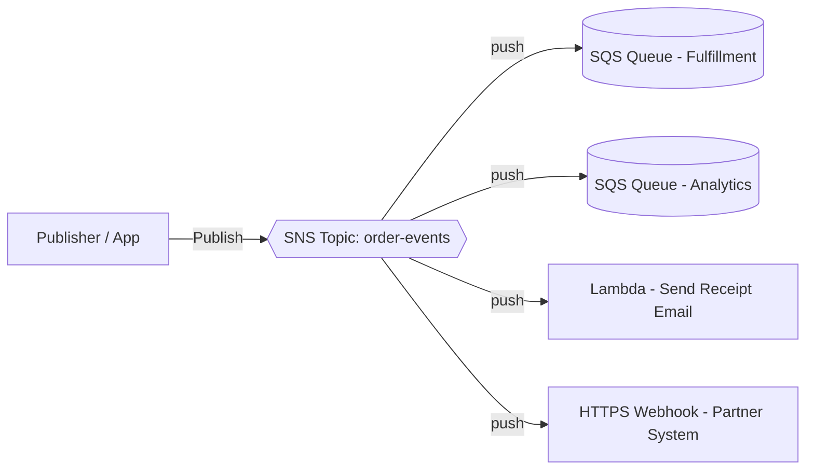
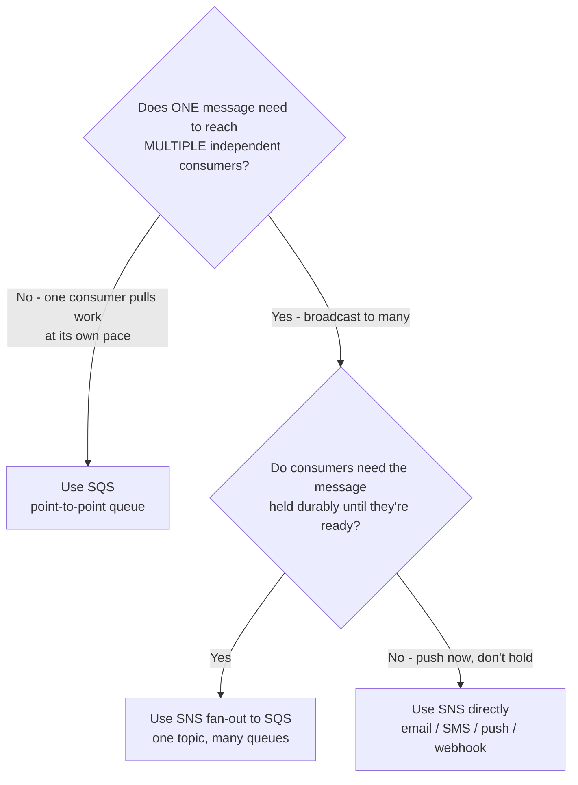

# Amazon SNS (Simple Notification Service)


<!-- If this icon 404s, pull "Simple-Notification-Service.svg" from the official AWS
Architecture Icons zip (App-Integration category) — see diagrams/README.md -->

## Definition

Amazon SNS is a fully managed **publish/subscribe (pub/sub) messaging** service. A publisher
sends one message to a **topic**, and SNS instantly delivers a copy of that message to *every*
subscriber attached to that topic — could be emails, SMS texts, mobile push notifications,
SQS queues, Lambda functions, or HTTP endpoints, all at once. Think of a topic as a radio
station: one broadcast, every tuned-in listener hears it.

## Purpose

Many real systems need to notify several different, unrelated consumers about the same event —
"an order was placed" might need to trigger an email receipt, update an analytics pipeline,
and kick off a fulfillment workflow, all independently. Before pub/sub services, this meant
the publisher had to know about and call each consumer directly (tight coupling, code changes
every time a new consumer appears). AWS built SNS so the publisher only ever talks to one
topic — subscribers can be added or removed without the publisher's code ever changing, and
each subscriber gets its own independent copy of every message, delivered in parallel and
nearly instantly (sub-second, push-based — no polling).

## How It Works

A publisher sends a message to an SNS **topic** (identified by an ARN). SNS looks at every
current **subscription** on that topic and pushes a copy of the message to each one, using
whatever protocol that subscription specifies (SQS, Lambda, email, SMS, HTTPS webhook, mobile
push). Delivery to each subscriber happens independently and in parallel — one slow or failing
subscriber does not block or delay delivery to the others.



Step by step:
1. **Publish**: the app calls `Publish` once, against the topic ARN — it has no idea how many
   subscribers exist or what they do.
2. **Fan-out**: SNS immediately pushes an independent copy of the message to each subscription
   currently attached — here, two SQS queues, a Lambda function, and an external webhook.
3. **Parallel, independent delivery**: the fulfillment queue, the analytics queue, the email
   Lambda, and the partner webhook all receive their copy at roughly the same time; none of
   them waits on another.
4. **Subscription filter policies** (not drawn) can be attached per-subscriber so each one only
   receives messages matching certain attributes (e.g., the analytics queue gets *all* events,
   but the email Lambda only gets events where `eventType = "order_placed"`).
5. **Retry + DLQ**: if a push to a subscriber fails (e.g., the webhook is down), SNS retries
   with backoff, and can redirect permanently-failed deliveries to a configured dead-letter
   queue per subscription.

## Key Features / Components

- **Topics** — the named channel publishers send to and subscribers attach to.
- **Subscriptions** — one per (topic, endpoint) pair; protocol can be SQS, Lambda, HTTP(S),
  Email/Email-JSON, SMS, or mobile push (APNs/FCM via Platform Applications).
- **Subscription filter policies** — JSON rules so a subscriber only gets messages matching
  specific message attributes, instead of every message on the topic.
- **Fan-out pattern** — the signature use of SNS: one publish → many independent subscribers,
  commonly SNS → multiple SQS queues so each downstream service gets its own durable, pollable
  copy.
- **FIFO topics** — ordered, exactly-once delivery to FIFO SQS queue subscribers (mirrors SQS
  FIFO semantics, same message-group-id model).
- **Message attributes** — structured key/value metadata used for filtering, separate from the
  message body.
- **Delivery retry policies** — configurable per protocol (e.g., HTTP retries with exponential
  backoff before giving up).
- **Dead-letter queues per subscription** — captures messages a subscriber failed to receive
  after all retries.

## Use Cases — When to Use It

- **Fan-out to multiple microservices**: one "order placed" event needs to reach billing,
  shipping, and analytics teams' systems independently — SNS → three SQS queues is the
  canonical pattern.
- **Alerting/notifications**: CloudWatch Alarms publish to an SNS topic that emails the on-call
  engineer and posts to a Slack webhook simultaneously.
- **Mobile/SMS push notifications** at scale, without building your own push-notification
  infrastructure.
- **Application-to-person (A2P) messaging**: order confirmations, OTP codes via SMS.
- **Broadcasting configuration/state changes** to many independent services at once.

## When NOT to Use It / Alternatives

- **Need the message to be durably held until a single consumer is ready to process it, with
  retry on failure** → that's an SQS job, not SNS alone; SNS delivery is push/best-effort per
  subscriber beyond its retry policy — pair SNS → SQS (fan-out pattern) if you need durability
  *and* fan-out together.
- **Need routing decisions based on complex event content, matching against many AWS service
  event sources (not just whatever you publish yourself)** → use **EventBridge**, which has a
  far richer rules/pattern-matching engine and native integrations with 200+ AWS services as
  event sources.
- **Need a replayable, ordered event log many independent readers can each consume from any
  point in time** → use **Kinesis Data Streams**; SNS has no replay — once delivered, it's gone.
- **Need strict request/response or synchronous processing** — pub/sub is inherently async;
  use direct API calls (API Gateway + Lambda, or ALB) instead.

### SNS vs SQS — Decision Diagram


Walkthrough: the first fork is the question that resolves 90% of SQS-vs-SNS exam questions —
**one consumer vs many**. If many consumers need the event and each needs it to sit durably
until they individually process it (so a slow consumer doesn't lose the message), the answer
is the **fan-out pattern**: SNS topic with several SQS queues subscribed, one per consumer
service. If "many consumers" really means "notify people/systems right now" with no need for
durable retry beyond SNS's own retry policy (email, SMS, a webhook), SNS alone is enough.

## Why It's Important

**Real-world**: SNS is the backbone of "broadcast an event once, let every team build their own
reaction" architectures — it decouples the number and identity of consumers from the publisher
entirely, which is what lets large organizations add new downstream systems (a new analytics
pipeline, a new partner integration) without ever touching the original application's code.

**Exam mapping**:
- **SAA-C03 Domain 2 (Design Resilient Architectures), Task 2.1** — "loosely coupled
  architectures" questions frequently test whether the candidate recognizes a one-to-many
  broadcast requirement and reaches for SNS (often SNS→SQS fan-out) instead of wiring direct
  calls between services.
- **DVA-C03 Domain 1 (Development with AWS Services), Task 1.1** — building event-driven
  applications; expect scenarios about using SNS message filtering so a Lambda only processes
  the subset of events it cares about, and about combining SNS with SQS for durable fan-out.

## Pricing Model (summary)

Pay per request published plus per-notification-delivered, priced per protocol (HTTP/S, email,
SMS, mobile push, SQS, Lambda each have their own delivery pricing — SMS in particular carries
per-country rates). A monthly free tier covers a baseline volume of requests and HTTP(S)
deliveries. No charge for topics or subscriptions sitting idle. See the
[official SNS pricing page](https://aws.amazon.com/sns/pricing/) for current numbers.

## Hands-on Lab (Floci)

```bash
# Create a topic
awslocal sns create-topic --name order-events

# Create an SQS queue to receive fan-out messages
awslocal sqs create-queue --queue-name fulfillment-queue

# Subscribe the queue to the topic (ARNs from the create-topic / create-queue output)
awslocal sns subscribe \
  --topic-arn arn:aws:sns:us-east-1:000000000000:order-events \
  --protocol sqs \
  --notification-endpoint arn:aws:sqs:us-east-1:000000000000:fulfillment-queue

# Add a filter policy so this subscriber only gets "order_placed" events
awslocal sns set-subscription-attributes \
  --subscription-arn "<subscription-arn-from-subscribe-output>" \
  --attribute-name FilterPolicy \
  --attribute-value '{"eventType": ["order_placed"]}'

# Publish a message (goes to every matching subscriber)
awslocal sns publish \
  --topic-arn arn:aws:sns:us-east-1:000000000000:order-events \
  --message '{"orderId": "1001", "total": 49.99}' \
  --message-attributes '{"eventType":{"DataType":"String","StringValue":"order_placed"}}'

# Verify delivery — receive from the subscribed queue
awslocal sqs receive-message --queue-url http://localhost:4566/000000000000/fulfillment-queue
```
Full fan-out walkthrough (multiple subscriber queues + filter policies): `labs-floci/README.md`
lab index → application-integration section.

## Exam Tips

- **SQS vs SNS, the single question that decides it**: "does more than one consumer need this
  message?" → SNS (pub/sub, push). "Does exactly one worker need to pull and process this at
  its own pace?" → SQS (point-to-point, pull). If both — fan-out, durability AND multiple
  consumers — the answer is **SNS → multiple SQS queues**, not either one alone.
- **SNS is push, not pull** — subscribers don't poll; SNS delivers to them. This is the
  opposite of SQS and is a frequent "which one polls?" trap.
- **Filter policies** vs separate topics: the exam likes to test whether you know you can use
  one topic with multiple filtered subscriptions instead of creating a topic per event type —
  filter policies are usually the more scalable, correct answer.
- **FIFO topics** exist and work only with **FIFO SQS queue subscribers** — mixing a FIFO topic
  with a Standard SQS queue, or vice versa, is not a valid combination; watch for this
  mismatch in scenario questions.
- Exam domains: **SAA-C03 Domain 2 Task 2.1**, **DVA-C03 Domain 1 Task 1.1**.

## Related Terms

- [`sqs.md`](./sqs.md) — the durable queue SNS commonly fans out into.
- [`eventbridge.md`](./eventbridge.md) — richer routing/filtering across many AWS-native
  event sources; see its "vs SNS" section for exactly when to pick one over the other.
- [`messaging-patterns-overview.md`](./messaging-patterns-overview.md) — pub/sub and fan-out
  in the bigger messaging mental model.
- `glossary/README.md` — Pub/Sub, Fan-Out, Topic, Subscription, Filter Policy.
