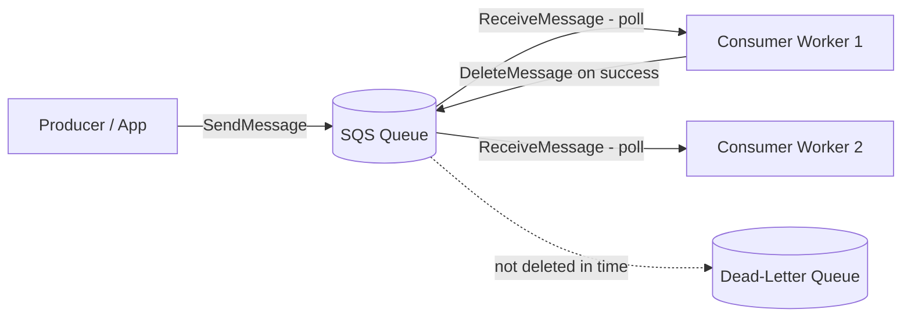

# Amazon SQS (Simple Queue Service)


<!-- If this icon 404s, pull "Simple-Queue-Service.svg" from the official AWS Architecture
Icons zip (App-Integration category) — see diagrams/README.md -->

## Definition

Amazon SQS is a fully managed **message queue**. One part of your system drops a message into
the queue, and another part picks it up and processes it later — the two sides never have to
talk to each other directly, or even be running at the same time. Think of it as a to-do list
sitting between two workers: one writes tasks onto the list, the other reads tasks off it, at
their own pace.

## Purpose

Before queues like SQS existed, if Service A called Service B directly and B was down, slow,
or overwhelmed, A's request failed or hung — and if 10,000 requests arrived at once, B fell
over. AWS built SQS to **decouple** producers from consumers: the producer just enqueues a
message and moves on (near-instant, always succeeds if the queue is reachable), and the
consumer drains the queue whenever it has capacity. This absorbs traffic spikes, survives
downstream outages, and lets each side scale independently — the foundational pattern behind
almost every resilient, serverless, or microservices architecture on AWS.

## How It Works

A producer sends a message to a named queue via the SQS API. SQS durably stores it (replicated
across multiple AZs) until a consumer asks for it. A consumer **polls** the queue (asks "any
messages for me?"), receives one or more messages, processes them, and then explicitly
**deletes** the message to confirm it's done. If the consumer crashes mid-processing and never
deletes it, the message automatically reappears after a **visibility timeout** so another
consumer (or the same one, retried) can pick it up — SQS never just drops work on a crash.



Step by step:
1. **Producer → Queue**: the app calls `SendMessage`; SQS stores the message and immediately
   returns success — the producer doesn't wait for anyone to process it.
2. **Consumers poll**: one or more worker processes call `ReceiveMessage`. SQS hands a message
   to exactly one consumer at a time (for Standard queues: *at-least-once*, meaning rarely a
   message could be delivered twice; design consumers to be idempotent).
3. **Visibility timeout**: once handed out, the message becomes invisible to other consumers
   for a configurable window (default 30s) while it's being worked on.
4. **Delete on success**: the consumer calls `DeleteMessage` once processing finishes — this is
   the "I'm done" signal. If it never arrives (crash, timeout, exception), the message becomes
   visible again automatically and gets retried.
5. **Dead-letter queue (DLQ)**: if a message fails processing (becomes visible again) more than
   a configured number of times, SQS moves it to a separate DLQ so it doesn't loop forever and
   block the queue — someone can inspect it later without losing it.

## Key Features / Components

- **Standard queue** — default type: unlimited throughput, *at-least-once* delivery, *best-effort
  ordering* (messages can arrive out of order). Good default for most workloads.
- **FIFO queue** (`.fifo` suffix required) — strict ordering and *exactly-once processing*
  within a **message group**; throughput capped (300 msg/s without batching, 3,000 msg/s with
  batching per API call, per queue).
- **Visibility timeout** — how long a received message is hidden from other consumers; must be
  set longer than your typical processing time or you'll get duplicate processing.
- **Dead-letter queue (DLQ)** — a landing zone for messages that failed too many times (`maxReceiveCount`).
- **Message retention** — how long an undelivered message is kept (default 4 days, up to 14).
- **Delay queues** — delay delivery of all new messages by up to 15 minutes.
- **Long polling** — `ReceiveMessage` waits up to 20s for a message instead of returning empty
  immediately; cuts empty-response API calls and cost.
- **Message attributes** — structured metadata attached to a message, filterable by some
  integrations (notably SNS, see `sns.md`).
- **Server-side encryption (SSE)** — via SQS-managed keys or a customer KMS key.

## Use Cases — When to Use It

- **Decoupling a web app from background work**: a user uploads an image → app enqueues a
  "resize this image" message → a fleet of Lambda/EC2 workers processes the queue — the user
  gets an instant response, work happens async.
- **Buffering traffic spikes**: an order-processing backend that can only handle 50 orders/sec
  gets 500 orders/sec at a sale launch — SQS absorbs the burst, workers drain it steadily.
- **Load leveling between microservices** so a slow downstream service doesn't crash under a
  fast upstream burst.
- **FIFO specifically**: bank transaction processing, order-of-operations-sensitive event
  pipelines (e.g., "create order" must be processed before "cancel order" for the same order ID).

## When NOT to Use It / Alternatives

- **Need many subscribers to get the same message** (one-to-many fan-out) → use **SNS** (pub/sub)
  or SNS→SQS fan-out, not SQS alone — a single SQS queue delivers each message to only one consumer.
- **Need complex routing/filtering by event content across many AWS services** → use
  **EventBridge**, which has a built-in rules engine; SQS has no routing logic of its own.
- **Need a durable, replayable event log that multiple independent consumer groups can each
  read from the beginning** → use **Kinesis Data Streams** or **MSK (Kafka)**, not SQS (SQS
  messages are consumed and gone — no replay).
- **Need sub-millisecond, in-memory pub/sub between processes on the same box** — SQS is a
  network service with latency overhead; that's the wrong tool for same-host IPC.
- **Need guaranteed, high-throughput strict ordering across millions of msg/sec** — FIFO's
  3,000 msg/s (batched) per queue may not be enough; consider partitioning across more FIFO
  queues/message groups, or Kinesis.

## Why It's Important

**Real-world**: SQS is the cheapest, simplest way to make a system resilient to partial
failure — it is often the first service introduced when a monolith is broken into services,
because it buys huge reliability for very little operational cost (no servers to patch, scales
automatically, pennies per million requests).

**Exam mapping**:
- **SAA-C03 Domain 2 (Design Resilient Architectures), Task 2.1** — "Design scalable and loosely
  coupled architectures" explicitly calls out queuing and messaging as the mechanism for
  decoupling; SQS between tiers (web → queue → worker) is the textbook answer whenever a
  question describes a system that needs to survive a downstream component failing or being slow.
- **DVA-C03 Domain 1 (Development with AWS Services), Task 1.1** — building applications using
  event-driven/loosely-coupled design is directly tested: expect scenarios about Lambda
  triggered by SQS, batch size / partial batch failure handling, and visibility timeout tuning.

## Pricing Model (summary)

Pay per request (per 64KB chunk counted as one request), no upfront cost, no idle charge.
Standard queues: first 1 million requests/month free (AWS Free Tier), then priced per million
requests. FIFO queues cost slightly more per request than Standard. Data transfer out and any
KMS calls for SSE are billed separately. Always check the
[official SQS pricing page](https://aws.amazon.com/sqs/pricing/) for current numbers — they
change.

## Hands-on Lab (Floci)

```bash
# Create a Standard queue
awslocal sqs create-queue --queue-name orders-queue

# Create a FIFO queue (note the required .fifo suffix and FifoQueue attribute)
awslocal sqs create-queue --queue-name orders-queue.fifo \
  --attributes FifoQueue=true,ContentBasedDeduplication=true

# Send a message (Standard)
awslocal sqs send-message \
  --queue-url http://localhost:4566/000000000000/orders-queue \
  --message-body '{"orderId": "1001", "action": "create"}'

# Send a message to the FIFO queue (requires a MessageGroupId)
awslocal sqs send-message \
  --queue-url http://localhost:4566/000000000000/orders-queue.fifo \
  --message-body '{"orderId": "1001", "action": "create"}' \
  --message-group-id order-1001

# Receive and then delete (simulating a consumer)
awslocal sqs receive-message --queue-url http://localhost:4566/000000000000/orders-queue
# copy the ReceiptHandle from the output, then:
awslocal sqs delete-message \
  --queue-url http://localhost:4566/000000000000/orders-queue \
  --receipt-handle "<paste-receipt-handle>"

# Inspect queue attributes (visibility timeout, message counts, etc.)
awslocal sqs get-queue-attributes \
  --queue-url http://localhost:4566/000000000000/orders-queue \
  --attribute-names All
```
Full walkthrough (DLQ wiring, Lambda event source mapping): `labs-floci/README.md` lab index →
application-integration section.

## Exam Tips

- **SQS vs SNS, the classic trap**: SQS is **pull-based, one consumer per message** (point-to-point);
  SNS is **push-based, many subscribers per message** (pub/sub). If the question says "multiple
  services need to react to the same event," the answer involves SNS (often SNS fan-out to
  multiple SQS queues), not a single SQS queue.
- **FIFO vs Standard tradeoff**: FIFO = ordering + exactly-once processing, but **lower
  throughput ceiling** and slightly higher cost. Standard = unlimited throughput, cheaper, but
  best-effort ordering and possible duplicate delivery. If the scenario says "order of
  operations matters" or "must process exactly once," pick FIFO. If it says "massive scale,
  order doesn't matter," pick Standard.
- **Visibility timeout vs retention period** — don't confuse them. Visibility timeout = how
  long a message is hidden after being received (seconds–hours). Retention period = how long
  an unprocessed message survives in the queue at all (up to 14 days). A question describing
  messages "disappearing before being fully processed" points to visibility timeout being set
  too short.
- **Dead-letter queues** are a frequent correct answer for "how do I avoid a poison-pill message
  blocking the queue forever" — remember DLQ is a separate queue, not a setting on the same queue.
- Exam domains: **SAA-C03 Domain 2 Task 2.1**, **DVA-C03 Domain 1 Task 1.1** (also touches
  DVA-C03 Domain 4 — troubleshooting stuck/duplicate messages).

## Related Terms

- [`sns.md`](./sns.md) — pub/sub fan-out counterpart; see the SNS vs SQS decision diagram there.
- [`eventbridge.md`](./eventbridge.md) — content-based routing across many event sources.
- [`messaging-patterns-overview.md`](./messaging-patterns-overview.md) — how SQS fits the
  point-to-point / fan-out / event-driven mental model.
- `glossary/README.md` — Dead-Letter Queue, Visibility Timeout, Idempotency, At-Least-Once Delivery.
