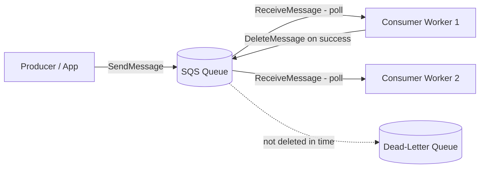
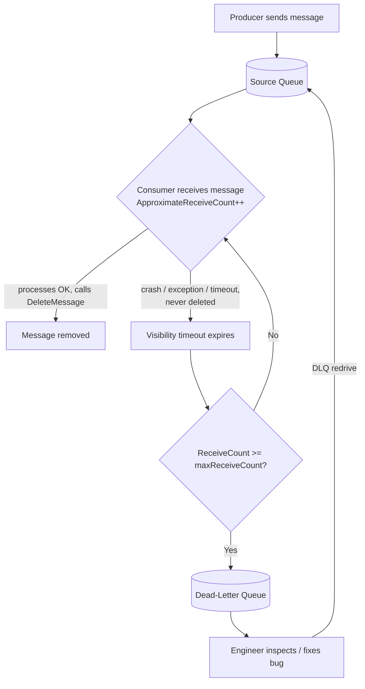
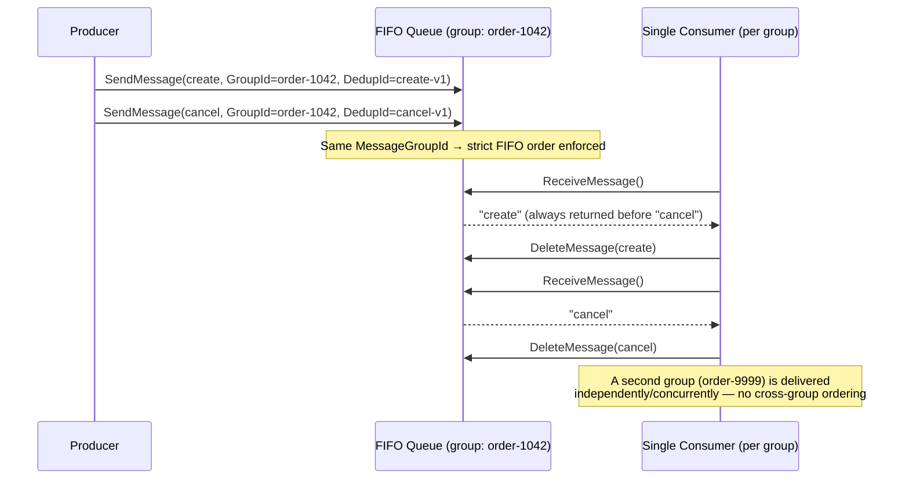
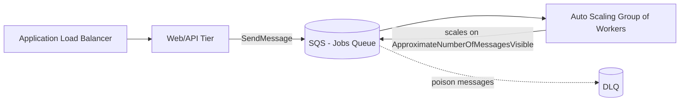
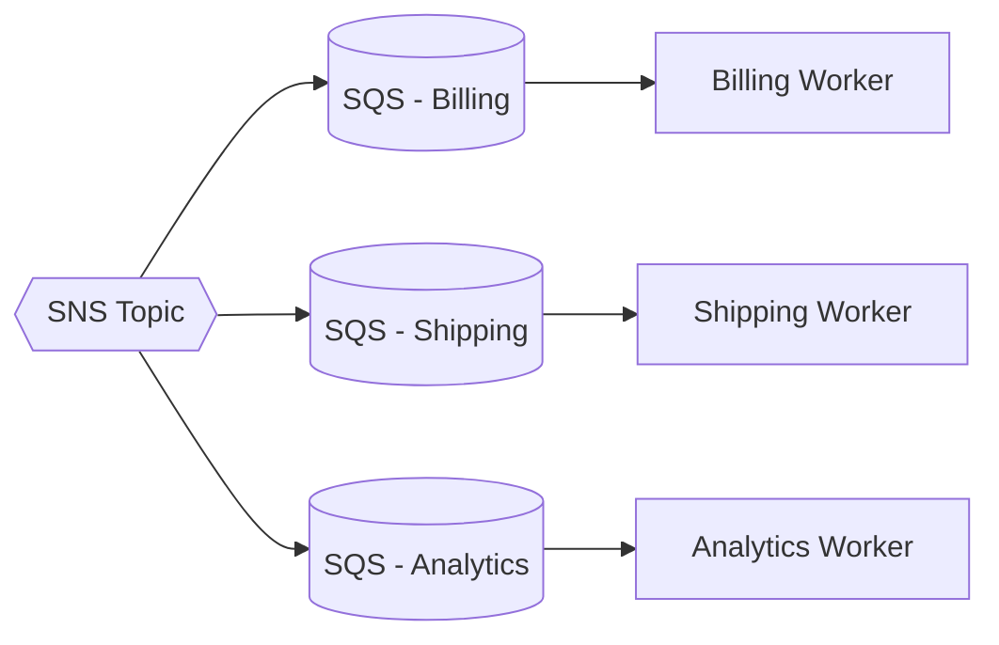
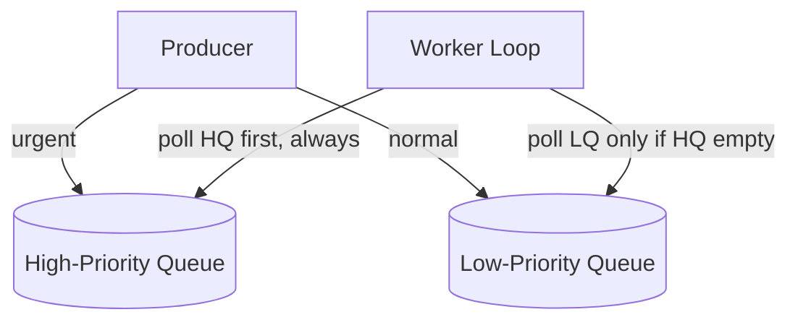
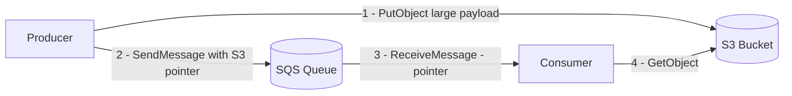

# Amazon SQS (Simple Queue Service)

> **Appears in:** [DVA-C03](../../certifications/dva-c03/README.md) · [SAA-C03](../../certifications/saa-c03/README.md)


<!-- If this icon 404s, pull "Simple-Queue-Service.svg" from the official AWS Architecture
Icons zip (App-Integration category) — see diagrams/README.md -->

## Definition

Amazon SQS is a fully managed **message queue**. One part of your system drops a message into
the queue, and another part picks it up and processes it later — the two sides never have to
talk to each other directly, or even be running at the same time. Think of it as a to-do list
sitting between two workers: one writes tasks onto the list, the other reads tasks off it, at
their own pace.

## Purpose

Before queues like SQS existed, if Service A called Service B directly and B was down, slow,
or overwhelmed, A's request failed or hung — and if 10,000 requests arrived at once, B fell
over. AWS built SQS to **decouple** producers from consumers: the producer just enqueues a
message and moves on (near-instant, always succeeds if the queue is reachable), and the
consumer drains the queue whenever it has capacity. This absorbs traffic spikes, survives
downstream outages, and lets each side scale independently — the foundational pattern behind
almost every resilient, serverless, or microservices architecture on AWS.

SQS was in fact AWS's very first public service (2004, before EC2 or S3 even launched),
precisely because Amazon's own retail systems needed durable buffering between order-taking and
order-fulfillment components. That history matters for the exam: SQS is deliberately simple —
one queue, one at-a-time (or batched) delivery to pull-based consumers — and every other
application-integration service (SNS, EventBridge, Step Functions) is built to compose *with*
SQS rather than replace it.

## How It Works

A producer sends a message to a named queue via the SQS API. SQS durably stores it (replicated
across multiple AZs) until a consumer asks for it. A consumer **polls** the queue (asks "any
messages for me?"), receives one or more messages, processes them, and then explicitly
**deletes** the message to confirm it's done. If the consumer crashes mid-processing and never
deletes it, the message automatically reappears after a **visibility timeout** so another
consumer (or the same one, retried) can pick it up — SQS never just drops work on a crash.



Step by step:
1. **Producer → Queue**: the app calls `SendMessage`; SQS stores the message and immediately
   returns success — the producer doesn't wait for anyone to process it.
2. **Consumers poll**: one or more worker processes call `ReceiveMessage`. SQS hands a message
   to exactly one consumer at a time (for Standard queues: *at-least-once*, meaning rarely a
   message could be delivered twice; design consumers to be idempotent).
3. **Visibility timeout**: once handed out, the message becomes invisible to other consumers
   for a configurable window (default 30s) while it's being worked on.
4. **Delete on success**: the consumer calls `DeleteMessage` once processing finishes — this is
   the "I'm done" signal. If it never arrives (crash, timeout, exception), the message becomes
   visible again automatically and gets retried.
5. **Dead-letter queue (DLQ)**: if a message fails processing (becomes visible again) more than
   a configured number of times, SQS moves it to a separate DLQ so it doesn't loop forever and
   block the queue — someone can inspect it later without losing it.

### Official AWS reference: message lifecycle


*Source: AWS Documentation — [What is Amazon Simple Queue Service?](https://docs.aws.amazon.com/AWSSimpleQueueService/latest/SQSDeveloperGuide/welcome.html), Amazon SQS Developer Guide. © Amazon Web Services.*


*Source: AWS Documentation — [Basic Amazon SQS architecture](https://docs.aws.amazon.com/AWSSimpleQueueService/latest/SQSDeveloperGuide/welcome.html#sqs-basic-architecture), Amazon SQS Developer Guide. © Amazon Web Services.*

## Worked Message Flow — Actual JSON Payloads

Walking through one concrete message end-to-end makes the API calls concrete. Assume an
e-commerce app enqueues an order for a fulfillment worker fleet to pick up.

**1. Producer sends the message** (`SendMessage` request):

```json
{
  "QueueUrl": "https://sqs.us-east-1.amazonaws.com/123456789012/orders-queue",
  "MessageBody": "{\"orderId\":\"ORD-10042\",\"sku\":\"SKU-99\",\"qty\":2,\"total\":49.98}",
  "MessageAttributes": {
    "eventType": { "DataType": "String", "StringValue": "order_placed" },
    "priority":  { "DataType": "Number", "StringValue": "1" }
  }
}
```

**2. SQS's response** — note the `MessageId` and the `MD5OfMessageBody`, which the client can
use to verify the message wasn't corrupted in transit:

```json
{
  "MD5OfMessageBody": "c74d97b01eae257e44aa9d5bade97baf",
  "MessageId": "d1b6e3f2-9c2a-4a39-9e9b-1a2b3c4d5e6f"
}
```

**3. Consumer polls** (`ReceiveMessage`, long polling for up to 20s):

```json
{
  "QueueUrl": "https://sqs.us-east-1.amazonaws.com/123456789012/orders-queue",
  "MaxNumberOfMessages": 5,
  "WaitTimeSeconds": 20,
  "VisibilityTimeout": 60,
  "AttributeNames": ["ApproximateReceiveCount"],
  "MessageAttributeNames": ["All"]
}
```

**4. SQS returns the message**, including a `ReceiptHandle` — a one-time token, *different from
the MessageId*, that must be presented to delete or extend visibility for this specific
delivery:

```json
{
  "Messages": [
    {
      "MessageId": "d1b6e3f2-9c2a-4a39-9e9b-1a2b3c4d5e6f",
      "ReceiptHandle": "AQEBzb3JyeV9mb3JfdGhlX2xvbmdfc3RyaW5nX2hlcmU...",
      "MD5OfBody": "c74d97b01eae257e44aa9d5bade97baf",
      "Body": "{\"orderId\":\"ORD-10042\",\"sku\":\"SKU-99\",\"qty\":2,\"total\":49.98}",
      "Attributes": { "ApproximateReceiveCount": "1" },
      "MessageAttributes": {
        "eventType": { "StringValue": "order_placed", "DataType": "String" },
        "priority":  { "StringValue": "1", "DataType": "Number" }
      }
    }
  ]
}
```

**5. Worker finishes processing successfully → deletes the message** (`DeleteMessage`):

```json
{
  "QueueUrl": "https://sqs.us-east-1.amazonaws.com/123456789012/orders-queue",
  "ReceiptHandle": "AQEBzb3JyeV9mb3JfdGhlX2xvbmdfc3RyaW5nX2hlcmU..."
}
```

**What if the worker needs more time?** It calls `ChangeMessageVisibility` with the *same*
receipt handle to push the invisibility window out, instead of risking the message reappearing
mid-processing:

```json
{
  "QueueUrl": "https://sqs.us-east-1.amazonaws.com/123456789012/orders-queue",
  "ReceiptHandle": "AQEBzb3JyeV9mb3JfdGhlX2xvbmdfc3RyaW5nX2hlcmU...",
  "VisibilityTimeout": 300
}
```

**What if the worker crashes and never calls `DeleteMessage`?** Nothing — SQS simply makes the
message visible again once the visibility timeout elapses, and the `ApproximateReceiveCount`
attribute increments by 1 the next time any consumer receives it. That counter is exactly what
the redrive policy's `maxReceiveCount` compares against.

### FIFO queue worked example — ordering + exactly-once

For a FIFO queue, two extra fields matter: `MessageGroupId` (messages in the same group are
strictly ordered; different groups are ordered independently of each other) and
`MessageDeduplicationId` (or content-based deduplication, which hashes the body automatically).

```json
{
  "QueueUrl": "https://sqs.us-east-1.amazonaws.com/123456789012/orders-queue.fifo",
  "MessageBody": "{\"orderId\":\"ORD-10042\",\"action\":\"create\"}",
  "MessageGroupId": "order-ORD-10042",
  "MessageDeduplicationId": "ORD-10042-create-v1"
}
```

A second message for the *same* order (e.g., a cancellation) uses the **same**
`MessageGroupId` so FIFO guarantees `create` is delivered and processed before `cancel`:

```json
{
  "QueueUrl": "https://sqs.us-east-1.amazonaws.com/123456789012/orders-queue.fifo",
  "MessageBody": "{\"orderId\":\"ORD-10042\",\"action\":\"cancel\"}",
  "MessageGroupId": "order-ORD-10042",
  "MessageDeduplicationId": "ORD-10042-cancel-v1"
}
```

Messages for a *different* order (`order-ORD-10099`) can be processed concurrently and in any
relative order to the `ORD-10042` group — ordering is per-group, not global across the queue,
which is what lets FIFO queues scale beyond a single serial stream.

## Dead-Letter Queue & Retry Mechanics — In Detail

This is one of the most heavily tested mechanics in both exams, and it's worth being precise
about exactly what AWS guarantees.

- **A DLQ is just another ordinary SQS queue** — SQS does not auto-create it. You create a
  second queue yourself, then attach a **redrive policy** to the *source* queue pointing at it.
- **`maxReceiveCount`** is the number of times a message can be *received* (not necessarily
  fully processed) before SQS routes it to the DLQ on the next failed attempt. A receive count
  of 1 means "fail once, go straight to the DLQ" — almost always too aggressive; typical values
  are 3–5 to allow for transient failures (a brief network blip, a cold-start timeout) without
  immediately giving up.
- **Queue types must match**: a Standard source queue needs a Standard DLQ; a FIFO source queue
  needs a FIFO DLQ. Mixing them is invalid configuration, not just bad practice.
- **The redrive allow policy** governs the DLQ side: it controls which source queues are allowed
  to target this queue as their DLQ (`allowAll`, `byQueue` with an explicit list, or `denyAll`).
  This is separate from the redrive *policy* on the source queue and is an easy trap in scenario
  questions that describe a DLQ silently not receiving messages — the allow policy is often the
  overlooked half of a two-sided configuration.
- **Redrive policy example** (set on the *source* queue):

```json
{
  "deadLetterTargetArn": "arn:aws:sqs:us-east-1:123456789012:orders-queue-dlq",
  "maxReceiveCount": 5
}
```

- **Enqueue timestamp behavior differs by queue type**: for a Standard queue, a message moved
  into the DLQ keeps its *original* enqueue timestamp (so the retention clock keeps ticking from
  when it first arrived, not from when it landed in the DLQ) — an undetected poison message can
  expire and vanish from the DLQ faster than you'd expect if DLQ retention isn't set generously.
  For FIFO queues, the enqueue timestamp **resets** when a message is moved to the DLQ.
- **DLQ redrive (the "put it back" feature)**: once you've fixed whatever bug was poisoning the
  messages, **DLQ redrive** lets you move messages from the DLQ back to the original source
  queue (or a different destination) in bulk via the console or `StartMessageMoveTask` API —
  without writing a custom drain-and-republish script.
- **Visibility timeout vs. retention vs. DLQ — three different clocks**, a classic trap:
  - *Visibility timeout* (seconds to 12 hours): how long a single received copy of a message is
    hidden from other consumers.
  - *Message retention period* (60s–14 days, default 4 days): how long an **undelivered**
    message survives in the queue at all before SQS deletes it regardless of DLQ settings.
  - *`maxReceiveCount`*: how many failed receive attempts before the message is moved to the DLQ.
    None of these three settings substitutes for another.

### Official AWS reference: visibility timeout


*Source: AWS Documentation — [Amazon SQS visibility timeout](https://docs.aws.amazon.com/AWSSimpleQueueService/latest/SQSDeveloperGuide/sqs-visibility-timeout.html), Amazon SQS Developer Guide. © Amazon Web Services.*

### DLQ and retry flow, visually



### FIFO ordering guarantee flow



### Batch failure handling (Lambda event source mapping)

When a Lambda function is subscribed to SQS via an **event source mapping**, Lambda pulls
messages in batches (up to 10,000 for Standard, up to 10 for FIFO by default) and invokes your
function once per batch. Without **partial batch response** enabled, a single failing message
in a 10-message batch causes the *entire batch* to be retried — including the 9 messages that
succeeded, risking duplicate side effects. Enabling `ReportBatchItemFailures` lets your function
tell Lambda exactly which message IDs failed, so only those are retried:

```json
{
  "batchItemFailures": [
    { "itemIdentifier": "d1b6e3f2-9c2a-4a39-9e9b-1a2b3c4d5e6f" }
  ]
}
```

This is a near-guaranteed DVA-C03 topic: "a Lambda function processing an SQS trigger is
reprocessing successful messages after one failure" points directly at missing partial batch
response configuration.

## Key Features / Components

- **Standard queue** — default type: unlimited throughput, *at-least-once* delivery, *best-effort
  ordering* (messages can arrive out of order). Good default for most workloads.
- **FIFO queue** (`.fifo` suffix required) — strict ordering and *exactly-once processing*
  within a **message group**; throughput capped (300 msg/s without batching, 3,000 msg/s with
  batching per API call, per queue; up to 70,000 msg/s per API call with **high throughput
  mode** across many message groups).
- **Visibility timeout** — how long a received message is hidden from other consumers; must be
  set longer than your typical processing time or you'll get duplicate processing. Max 12 hours.
- **Dead-letter queue (DLQ)** — a landing zone for messages that failed too many times (`maxReceiveCount`).
- **Message retention** — how long an undelivered message is kept (default 4 days, up to 14).
- **Delay queues** — delay delivery of all new messages by up to 15 minutes (queue-level), or
  per-message via `DelaySeconds` on `SendMessage` (Standard queues only, not FIFO).
- **Long polling** — `ReceiveMessage` waits up to 20s for a message instead of returning empty
  immediately; cuts empty-response API calls and cost.
- **Message attributes** — structured metadata attached to a message, filterable by some
  integrations (notably SNS, see `sns.md`). Up to 10 per message, separate from the 256KB body.
- **Server-side encryption (SSE)** — via SQS-managed keys (SSE-SQS) or a customer KMS key (SSE-KMS).
- **Message size** — up to 256KB per message natively; larger payloads use the **Amazon SQS
  Extended Client Library**, which stores the body in S3 and passes a pointer through the queue.
- **Short vs. long polling** — short polling (`WaitTimeSeconds=0`) may return an empty response
  even if messages exist (it only samples a subset of SQS's backend servers); long polling
  checks all servers and is almost always the right default.

## Use Cases — When to Use It

- **Decoupling a web app from background work**: a user uploads an image → app enqueues a
  "resize this image" message → a fleet of Lambda/EC2 workers processes the queue — the user
  gets an instant response, work happens async.
- **Buffering traffic spikes**: an order-processing backend that can only handle 50 orders/sec
  gets 500 orders/sec at a sale launch — SQS absorbs the burst, workers drain it steadily.
- **Load leveling between microservices** so a slow downstream service doesn't crash under a
  fast upstream burst.
- **FIFO specifically**: bank transaction processing, order-of-operations-sensitive event
  pipelines (e.g., "create order" must be processed before "cancel order" for the same order ID).
- **Fan-out buffering**: as the durable leg of an SNS → SQS fan-out, so each downstream
  microservice gets its own independently drained, retry-capable copy of every event.

## When NOT to Use It / Alternatives

- **Need many subscribers to get the same message** (one-to-many fan-out) → use **SNS** (pub/sub)
  or SNS→SQS fan-out, not SQS alone — a single SQS queue delivers each message to only one consumer.
- **Need complex routing/filtering by event content across many AWS services** → use
  **EventBridge**, which has a built-in rules engine; SQS has no routing logic of its own.
- **Need a durable, replayable event log that multiple independent consumer groups can each
  read from the beginning** → use **Kinesis Data Streams** or **MSK (Kafka)**, not SQS (SQS
  messages are consumed and gone — no replay).
- **Need sub-millisecond, in-memory pub/sub between processes on the same box** — SQS is a
  network service with latency overhead; that's the wrong tool for same-host IPC.
- **Need guaranteed, high-throughput strict ordering across millions of msg/sec** — FIFO's
  3,000 msg/s (batched) per queue may not be enough; consider partitioning across more FIFO
  queues/message groups (high throughput mode), or Kinesis.

## Common Architectures

### 1. Web tier → queue → worker fleet (classic decoupling)


The web tier responds to the user instantly after enqueueing; CloudWatch alarms on the queue
depth metric (`ApproximateNumberOfMessagesVisible`) drive an Auto Scaling policy for the worker
fleet, so compute scales with backlog, not guesswork.

### 2. SNS fan-out → multiple SQS queues (topic-queue chaining)


Each subscriber gets a durable, independently retryable copy — a slow shipping worker never
blocks billing. See `sns.md` for the full fan-out pattern and filter policies.

### 3. Priority queues using multiple SQS queues


SQS has no native priority field, so a common pattern is simply two (or more) queues, with
consumer logic that always drains the higher-priority queue first and only falls back to the
lower-priority one when it's empty.

### 4. Large-payload pattern (claim check) via S3 + Extended Client


Since SQS caps messages at 256KB, the **claim check pattern** stores the real payload in S3 and
sends only a reference through the queue — the Extended Client Library automates this.

## Why It's Important

**Real-world**: SQS is the cheapest, simplest way to make a system resilient to partial
failure — it is often the first service introduced when a monolith is broken into services,
because it buys huge reliability for very little operational cost (no servers to patch, scales
automatically, pennies per million requests).

**Exam mapping**:
- **SAA-C03 Domain 2 (Design Resilient Architectures), Task 2.1** — "Design scalable and loosely
  coupled architectures" explicitly calls out queuing and messaging as the mechanism for
  decoupling; SQS between tiers (web → queue → worker) is the textbook answer whenever a
  question describes a system that needs to survive a downstream component failing or being slow.
  Expect scenario variants: "a sudden burst of traffic is causing downstream failures" (buffer
  with SQS + Auto Scaling on queue depth), "duplicate order processing is occurring" (check
  visibility timeout and idempotency, not necessarily FIFO), "strict order of operations is
  required per customer" (FIFO with a per-customer message group id).
- **DVA-C03 Domain 1 (Development with AWS Services), Task 1.1** — building applications using
  event-driven/loosely-coupled design is directly tested: expect scenarios about Lambda
  triggered by SQS, batch size / partial batch failure handling, and visibility timeout tuning.
  A very common DVA-C03 scenario: "some messages in a Lambda SQS trigger batch succeed and
  others fail, and successful ones are being reprocessed" → the fix is enabling
  `ReportBatchItemFailures` (partial batch response), not simply raising `maxReceiveCount`.

## Pricing Model (summary)

Pay per request (per 64KB chunk counted as one request), no upfront cost, no idle charge.
Standard queues: first 1 million requests/month free (AWS Free Tier), then priced per million
requests. FIFO queues cost slightly more per request than Standard. Data transfer out and any
KMS calls for SSE are billed separately. Always check the
[official SQS pricing page](https://aws.amazon.com/sqs/pricing/) for current numbers — they
change.

## Limits & Quotas

| Limit | Value | Notes |
|---|---|---|
| Max message size | 256 KB | Use the Extended Client Library (S3-backed) for larger payloads |
| Max message retention | 14 days | Minimum 60 seconds; default 4 days |
| Max visibility timeout | 12 hours | Can be extended per-message via `ChangeMessageVisibility` |
| Delay queue max delay | 15 minutes | Queue-level `DelaySeconds`; per-message delay (Standard only) |
| Standard queue throughput | Effectively unlimited | Scales automatically, no pre-provisioning |
| FIFO queue throughput (no batching) | 300 msg/s per API action | Per queue |
| FIFO queue throughput (batching) | 3,000 msg/s | 10 messages per `SendMessageBatch` call |
| FIFO high throughput mode | Up to 70,000 msg/s | Spread across many message groups, no batching required |
| Max in-flight messages (Standard) | 120,000 | Messages received but not yet deleted/expired |
| Max in-flight messages (FIFO) | 20,000 | Per queue |
| Message attributes | Up to 10 per message | Separate from the body, used for filtering |
| `maxReceiveCount` range (redrive policy) | 1 to 1,000 | Common practical values: 3–5 |
| Max batch size (`SendMessageBatch`, etc.) | 10 messages | Also capped at 256KB combined payload |
| Queue name length | Up to 80 characters | FIFO queues must end in `.fifo` (counts toward the limit) |

Always verify current values on the
[Amazon SQS quotas page](https://docs.aws.amazon.com/AWSSimpleQueueService/latest/SQSDeveloperGuide/quotas-messages.html)
before an exam or a design review — AWS periodically raises soft limits (e.g., FIFO throughput
has increased multiple times since GA).

## Troubleshooting / Common Issues

- **"Messages are being processed twice."** Almost always a visibility timeout set shorter than
  actual processing time — the message becomes visible again while the first consumer is still
  working on it. Fix: raise the visibility timeout above your p99 processing time, or call
  `ChangeMessageVisibility` to extend it for long-running jobs. (Standard queues can also
  duplicate due to their at-least-once design even with a correct timeout — consumers must be
  idempotent regardless.)
- **"Messages vanish before my worker deletes them."** Check the message retention period — if
  it's shorter than your actual backlog drain time (e.g., 4-day default retention but a 5-day
  processing backlog), SQS silently deletes the oldest unprocessed messages.
- **"My DLQ never receives anything, even though I know messages are failing."** Verify both
  sides: the redrive policy on the *source* queue (correct `deadLetterTargetArn` and a sane
  `maxReceiveCount`), **and** the redrive *allow* policy on the DLQ itself (must permit this
  source queue — default is `allowAll`, but a locked-down `byQueue` policy might exclude it).
- **"`ReceiveMessage` sometimes returns nothing even though I know messages are in the queue."**
  Short polling (`WaitTimeSeconds=0`) only samples a subset of backend servers per call; switch
  to long polling (`WaitTimeSeconds` 1–20) so SQS checks all servers before returning empty.
- **"FIFO throughput is capped and my workload needs more."** Confirm you're using batched
  `SendMessageBatch`/`ReceiveMessage` calls (not single-message calls), and consider enabling
  **high throughput mode**, which removes the per-queue serialization bottleneck by processing
  distinct message groups across multiple hosts.
- **"A Lambda consuming from SQS keeps reprocessing already-successful messages in the same
  batch."** Enable `ReportBatchItemFailures` on the event source mapping and return
  `batchItemFailures` identifying only the failed message IDs.
- **"I created a FIFO DLQ for a Standard queue (or vice versa) and the redrive policy update
  fails."** Queue types must match between a source queue and its DLQ — create a same-type DLQ.
- **"Messages seem to disappear from the DLQ faster than expected."** For Standard queues, a
  message's retention clock is based on its *original* enqueue time, not when it entered the
  DLQ — a message that sat in the source queue for 3 days before failing only has 1 day left in
  a 4-day-retention DLQ. Set a longer retention period on the DLQ itself if you need more
  investigation time.

## Hands-on Lab (Floci)

```bash
# Create a Standard queue
awslocal sqs create-queue --queue-name orders-queue

# Create a FIFO queue (note the required .fifo suffix and FifoQueue attribute)
awslocal sqs create-queue --queue-name orders-queue.fifo \
  --attributes FifoQueue=true,ContentBasedDeduplication=true

# Send a message (Standard)
awslocal sqs send-message \
  --queue-url http://localhost:4566/000000000000/orders-queue \
  --message-body '{"orderId": "1001", "action": "create"}'

# Send a message to the FIFO queue (requires a MessageGroupId)
awslocal sqs send-message \
  --queue-url http://localhost:4566/000000000000/orders-queue.fifo \
  --message-body '{"orderId": "1001", "action": "create"}' \
  --message-group-id order-1001

# Receive and then delete (simulating a consumer)
awslocal sqs receive-message --queue-url http://localhost:4566/000000000000/orders-queue
# copy the ReceiptHandle from the output, then:
awslocal sqs delete-message \
  --queue-url http://localhost:4566/000000000000/orders-queue \
  --receipt-handle "<paste-receipt-handle>"

# Inspect queue attributes (visibility timeout, message counts, etc.)
awslocal sqs get-queue-attributes \
  --queue-url http://localhost:4566/000000000000/orders-queue \
  --attribute-names All

# --- DLQ wiring ---
# 1. Create the DLQ first
awslocal sqs create-queue --queue-name orders-queue-dlq

# 2. Get the DLQ's ARN
awslocal sqs get-queue-attributes \
  --queue-url http://localhost:4566/000000000000/orders-queue-dlq \
  --attribute-names QueueArn

# 3. Attach a redrive policy to the SOURCE queue
awslocal sqs set-queue-attributes \
  --queue-url http://localhost:4566/000000000000/orders-queue \
  --attributes '{"RedrivePolicy":"{\"deadLetterTargetArn\":\"arn:aws:sqs:us-east-1:000000000000:orders-queue-dlq\",\"maxReceiveCount\":\"3\"}"}'

# 4. Simulate a failing consumer: receive without deleting, 3 times, to force a DLQ move
for i in 1 2 3; do
  awslocal sqs receive-message --queue-url http://localhost:4566/000000000000/orders-queue \
    --visibility-timeout 1
  sleep 2
done

# 5. Confirm the message landed in the DLQ
awslocal sqs receive-message --queue-url http://localhost:4566/000000000000/orders-queue-dlq
```
Full walkthrough (Lambda event source mapping with partial batch response, FIFO high throughput
mode): `labs-floci/README.md` lab index → application-integration section.

## Exam Tips

- **SQS vs SNS, the classic trap**: SQS is **pull-based, one consumer per message** (point-to-point);
  SNS is **push-based, many subscribers per message** (pub/sub). If the question says "multiple
  services need to react to the same event," the answer involves SNS (often SNS fan-out to
  multiple SQS queues), not a single SQS queue.
- **FIFO vs Standard tradeoff**: FIFO = ordering + exactly-once processing, but **lower
  throughput ceiling** and slightly higher cost. Standard = unlimited throughput, cheaper, but
  best-effort ordering and possible duplicate delivery. If the scenario says "order of
  operations matters" or "must process exactly once," pick FIFO. If it says "massive scale,
  order doesn't matter," pick Standard.
- **Visibility timeout vs retention period** — don't confuse them. Visibility timeout = how
  long a message is hidden after being received (seconds–hours). Retention period = how long
  an unprocessed message survives in the queue at all (up to 14 days). A question describing
  messages "disappearing before being fully processed" points to visibility timeout being set
  too short.
- **Dead-letter queues** are a frequent correct answer for "how do I avoid a poison-pill message
  blocking the queue forever" — remember DLQ is a separate queue, not a setting on the same queue,
  and it must match the source queue's type (Standard DLQ for Standard, FIFO DLQ for FIFO).
- **`maxReceiveCount` tuning** is its own sub-topic: too low (e.g., 1) sends transient failures
  straight to the DLQ; too high delays detecting a genuinely broken message. 3–5 is the usual
  sweet spot referenced in AWS's own guidance.
- **Partial batch response (`ReportBatchItemFailures`)** for Lambda + SQS is a specific,
  nameable DVA-C03 answer whenever a scenario describes successful messages in a batch being
  needlessly reprocessed after one failure.
- **Claim-check / Extended Client Library** is the answer whenever a scenario needs to send a
  payload larger than 256KB through SQS.
- Exam domains: **SAA-C03 Domain 2 Task 2.1**, **DVA-C03 Domain 1 Task 1.1** (also touches
  DVA-C03 Domain 4 — troubleshooting stuck/duplicate messages).

## Further Reading

- [Amazon SQS Developer Guide — What is Amazon SQS?](https://docs.aws.amazon.com/AWSSimpleQueueService/latest/SQSDeveloperGuide/welcome.html)
- [Using dead-letter queues in Amazon SQS](https://docs.aws.amazon.com/AWSSimpleQueueService/latest/SQSDeveloperGuide/sqs-dead-letter-queues.html)
- [Amazon SQS visibility timeout](https://docs.aws.amazon.com/AWSSimpleQueueService/latest/SQSDeveloperGuide/sqs-visibility-timeout.html)
- [Amazon SQS FIFO queues](https://docs.aws.amazon.com/AWSSimpleQueueService/latest/SQSDeveloperGuide/FIFO-queues.html)
- [Resilience in Amazon SQS](https://docs.aws.amazon.com/AWSSimpleQueueService/latest/SQSDeveloperGuide/sqs-resilience.html)
- [Amazon SQS quotas](https://docs.aws.amazon.com/AWSSimpleQueueService/latest/SQSDeveloperGuide/quotas-messages.html)
- [AWS Lambda event source mapping for SQS — ReportBatchItemFailures](https://docs.aws.amazon.com/lambda/latest/dg/with-sqs.html)
- [Amazon SQS pricing](https://aws.amazon.com/sqs/pricing/)

## Related Terms

- [`sns.md`](./sns.md) — pub/sub fan-out counterpart; see the SNS vs SQS decision diagram there.
- [`eventbridge.md`](./eventbridge.md) — content-based routing across many event sources.
- [`messaging-patterns-overview.md`](./messaging-patterns-overview.md) — how SQS fits the
  point-to-point / fan-out / event-driven mental model.
- `glossary/README.md` — Dead-Letter Queue, Visibility Timeout, Idempotency, At-Least-Once Delivery.
