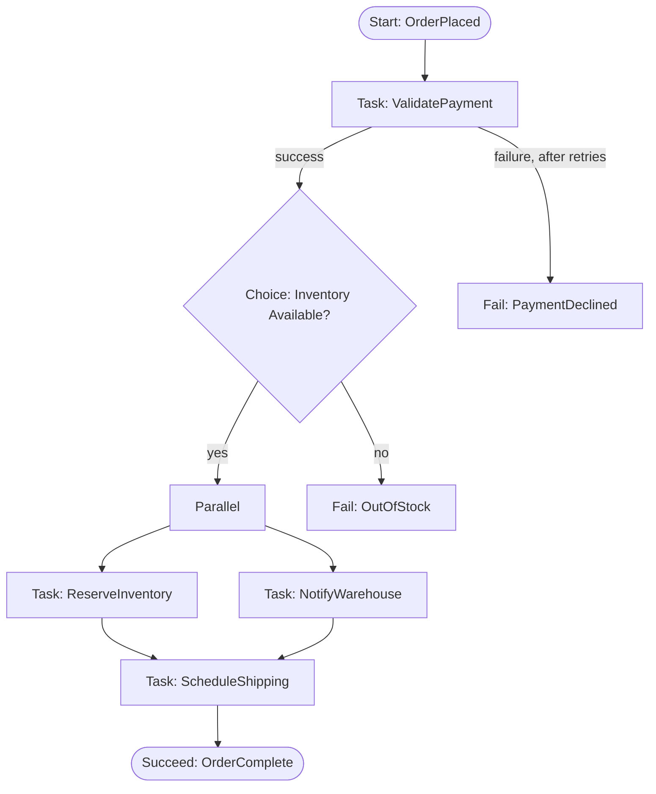
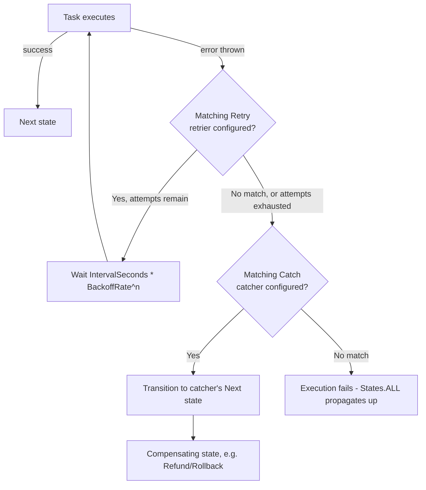
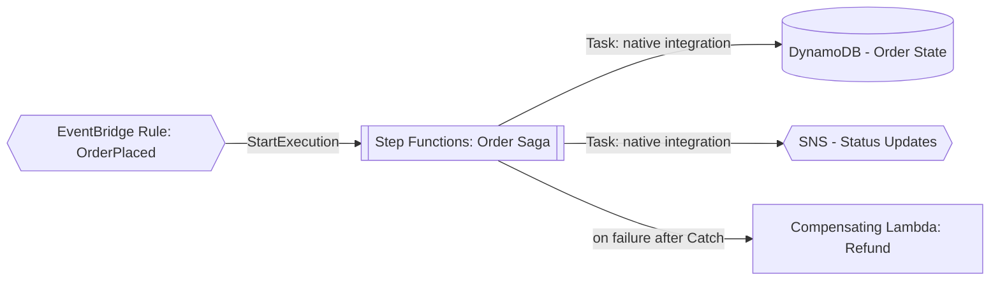
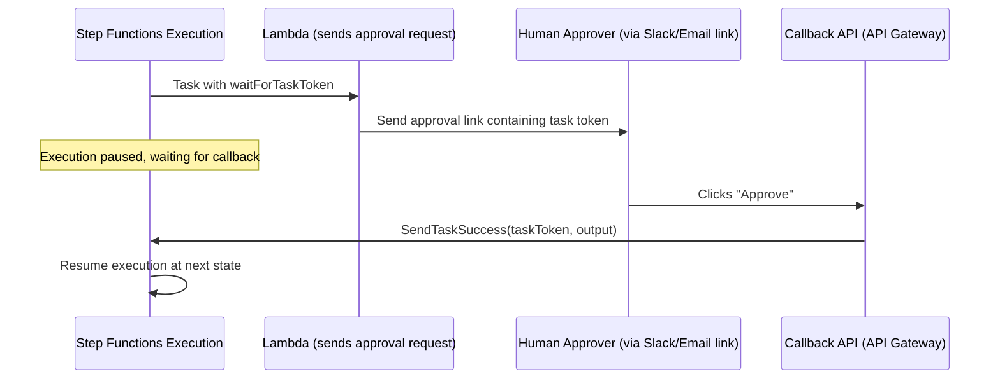
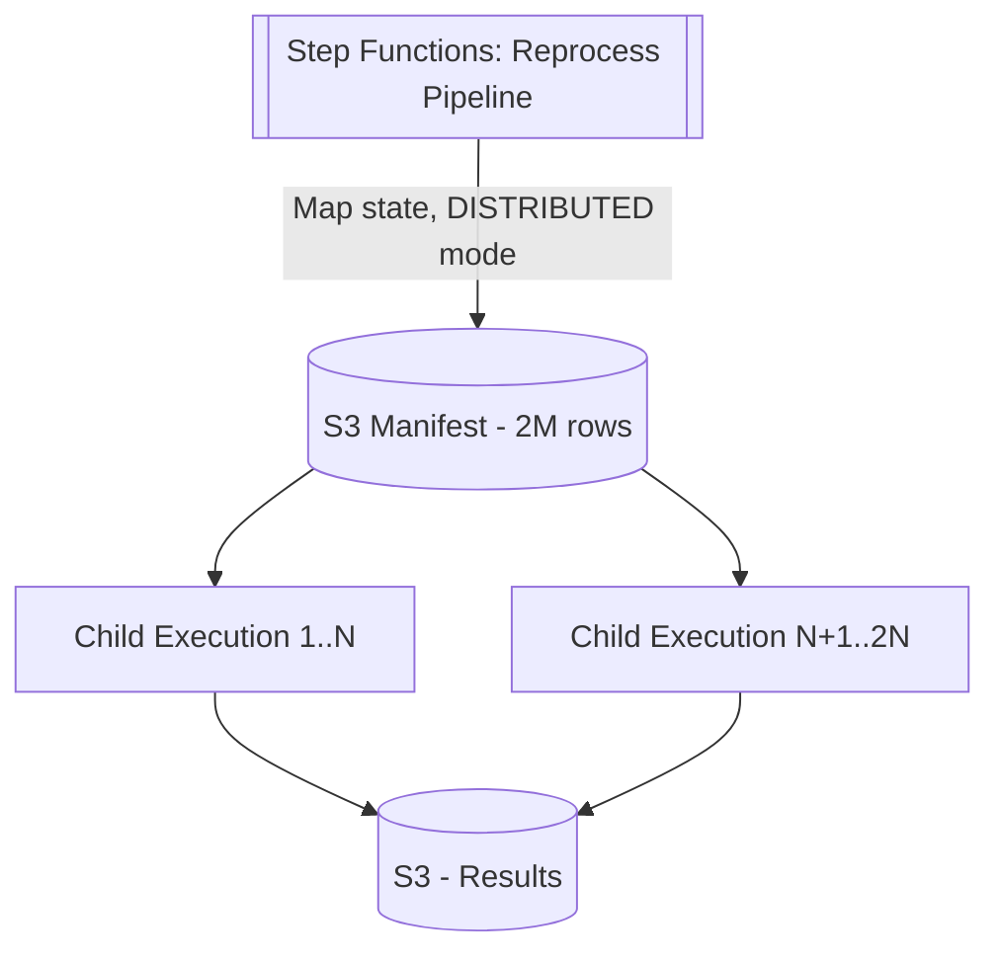
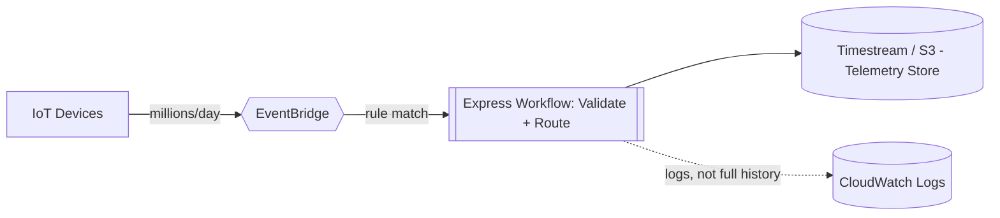

# AWS Step Functions

> **Appears in:** [DVA-C03](../../certifications/dva-c03/README.md) · [SAA-C03](../../certifications/saa-c03/README.md)


<!-- If this icon 404s, pull "Step-Functions.svg" from the official AWS Architecture Icons zip
(App-Integration category) — see diagrams/README.md -->

## Definition

AWS Step Functions is a **serverless workflow orchestrator**. You describe a multi-step process
— call this Lambda, then check a condition, then call that Lambda, retry on failure, wait for a
human approval — as a **state machine** (a diagram of steps and transitions), and Step
Functions runs it, tracks exactly where it is, handles retries/errors, and shows you the
execution history visually. Instead of writing your own "what happens after this succeeds / what
happens if this fails" glue code, you declare it.

## Purpose

Coordinating multiple services into one business process (e.g., "process an order: charge the
card, reserve inventory, schedule shipping, send confirmation — and roll back cleanly if any
step fails") traditionally meant either a giant Lambda function full of try/except chains, or a
hand-rolled queue-based saga with no central visibility into where a given order currently is.
AWS built Step Functions to make that orchestration explicit, visual, and resilient by default:
the state machine itself owns retries, timeouts, parallel branches, and error handling, and
every execution's history is inspectable step by step after the fact — essential for debugging
"why did order #4471 get stuck."

## How It Works

You define a **state machine** using **Amazon States Language (ASL)**, a JSON structure
describing **states** (steps) and the transitions between them. Step Functions executes it:
each state does something (invoke a Lambda, call another AWS service directly, wait, branch on
a condition, run branches in parallel, or stop), and the service tracks the current state,
input/output passed between states, and retry/catch behavior per state, for every execution.



Step by step:
1. **Start**: an execution begins with an input payload (e.g., the order details), usually
   triggered by EventBridge, API Gateway, or a direct SDK call.
2. **Task state — ValidatePayment**: invokes a Lambda (or calls a service API directly via
   Step Functions' native integrations); if it fails, Step Functions can automatically **retry**
   with backoff per a configured policy before giving up.
3. **Choice state**: branches the workflow based on the task's output — no custom code needed,
   it's a declarative condition in the state machine definition.
4. **Catch/Fail states**: if validation ultimately fails or inventory is unavailable, the
   execution moves to an explicit **Fail** state — recorded clearly in the execution history,
   not buried in a log line.
5. **Parallel state**: runs `ReserveInventory` and `NotifyWarehouse` at the same time, each as
   its own branch; the state machine waits for both to finish before moving on.
6. **Succeed**: once shipping is scheduled, the execution ends successfully — the entire
   history (every state entered, every input/output, every retry) is visible afterward in the
   console or via API, which is the core debugging value proposition.

### Official AWS reference: workflow diagram and error handling


*Source: AWS Documentation — [What is Step Functions?](https://docs.aws.amazon.com/step-functions/latest/dg/welcome.html), AWS Step Functions Developer Guide. © Amazon Web Services.*


*Source: AWS Documentation — [Handling error conditions in a Step Functions state machine](https://docs.aws.amazon.com/step-functions/latest/dg/tutorial-handling-error-conditions.html), AWS Step Functions Developer Guide. © Amazon Web Services.*

## ASL Worked Examples — Amazon States Language In Depth

ASL is just JSON with a small, fixed vocabulary of fields. The examples below build up from a
single retrying task to a full order-processing saga with parallel branches and compensation.

### 1. A minimal Task state with Retry and Catch

```json
{
  "Comment": "Charge a customer's card, retry on transient errors, fall back on permanent failure",
  "StartAt": "ChargeCard",
  "States": {
    "ChargeCard": {
      "Type": "Task",
      "Resource": "arn:aws:lambda:us-east-1:123456789012:function:ChargeCard",
      "Retry": [
        {
          "ErrorEquals": ["Lambda.ServiceException", "Lambda.TooManyRequestsException", "States.Timeout"],
          "IntervalSeconds": 2,
          "MaxAttempts": 3,
          "BackoffRate": 2.0,
          "JitterStrategy": "FULL"
        }
      ],
      "Catch": [
        {
          "ErrorEquals": ["CardDeclinedError"],
          "ResultPath": "$.error",
          "Next": "NotifyCustomerDeclined"
        },
        {
          "ErrorEquals": ["States.ALL"],
          "ResultPath": "$.error",
          "Next": "UnexpectedFailure"
        }
      ],
      "Next": "ReserveInventory"
    },
    "NotifyCustomerDeclined": { "Type": "Fail", "Error": "CardDeclined", "Cause": "Payment was declined by the processor" },
    "UnexpectedFailure": { "Type": "Fail", "Error": "UnhandledException" },
    "ReserveInventory": { "Type": "Succeed" }
  }
}
```

Key mechanics made explicit by this example:
- **`Retry` is tried first.** Each retrier (`ErrorEquals` + interval/backoff/max attempts) is
  scanned in array order; the first one whose `ErrorEquals` matches the thrown error name is
  used. `IntervalSeconds: 2, BackoffRate: 2.0, MaxAttempts: 3` means retries happen at
  roughly 2s, 4s, 8s after each failure — exponential backoff, not fixed-interval.
- **`JitterStrategy: "FULL"`** randomizes the actual wait within the computed interval, which
  prevents many parallel executions from retrying in lockstep and hammering a downstream service
  simultaneously (the "thundering herd" problem).
- **`Catch` only runs once `Retry` is exhausted** (or if there's no matching retrier at all) —
  Step Functions always tries every applicable retrier before ever falling through to a catcher.
- **`ErrorEquals: ["States.ALL"]`** is a catch-all that matches any error not already handled by
  an earlier, more specific catcher — order matters, since catchers (like retriers) are scanned
  top to bottom and the first match wins.
- **`ResultPath: "$.error"`** controls *where* the error information is merged into the state's
  output, so downstream states can inspect what went wrong without losing the original input.

### 2. Choice state — branching on data

```json
{
  "StartAt": "IsInventoryAvailable",
  "States": {
    "IsInventoryAvailable": {
      "Type": "Choice",
      "Choices": [
        {
          "And": [
            { "Variable": "$.inventory.available", "BooleanEquals": true },
            { "Variable": "$.order.total", "NumericGreaterThan": 0 }
          ],
          "Next": "ProcessOrder"
        },
        { "Variable": "$.inventory.available", "BooleanEquals": false, "Next": "OutOfStock" }
      ],
      "Default": "UnexpectedInventoryState"
    },
    "ProcessOrder": { "Type": "Succeed" },
    "OutOfStock": { "Type": "Fail", "Error": "OutOfStock" },
    "UnexpectedInventoryState": { "Type": "Fail", "Error": "UnexpectedState" }
  }
}
```
`Choice` states have **no retry/catch of their own** (there's nothing to retry — it's pure
branching logic); error handling belongs on the `Task` states that produce the data being
branched on. A `Default` is required unless every realistic input is covered by an explicit
`Choice` rule, or the execution fails with a `States.NoChoiceMatched` error.

### 3. Parallel state — concurrent branches that must all succeed

```json
{
  "StartAt": "FulfillOrder",
  "States": {
    "FulfillOrder": {
      "Type": "Parallel",
      "Branches": [
        {
          "StartAt": "ReserveInventory",
          "States": {
            "ReserveInventory": {
              "Type": "Task",
              "Resource": "arn:aws:lambda:us-east-1:123456789012:function:ReserveInventory",
              "End": true
            }
          }
        },
        {
          "StartAt": "NotifyWarehouse",
          "States": {
            "NotifyWarehouse": {
              "Type": "Task",
              "Resource": "arn:aws:lambda:us-east-1:123456789012:function:NotifyWarehouse",
              "End": true
            }
          }
        }
      ],
      "Catch": [
        { "ErrorEquals": ["States.ALL"], "Next": "CompensateReservation" }
      ],
      "Next": "ScheduleShipping"
    },
    "CompensateReservation": {
      "Type": "Task",
      "Resource": "arn:aws:lambda:us-east-1:123456789012:function:ReleaseInventoryHold",
      "End": true
    },
    "ScheduleShipping": { "Type": "Succeed" }
  }
}
```
If **either** branch fails (after its own internal retries, if any are defined inside the
branch), the entire `Parallel` state fails and the outer `Catch` fires — this is the basis of
the **saga/compensation pattern**: a failure partway through concurrent work routes to a
dedicated compensating action (here, releasing the inventory hold) instead of leaving the system
in an inconsistent state.

### 4. Map state — fan-out over a dataset (and distributed mode)

```json
{
  "StartAt": "ProcessLineItems",
  "States": {
    "ProcessLineItems": {
      "Type": "Map",
      "ItemsPath": "$.order.lineItems",
      "MaxConcurrency": 10,
      "ItemProcessor": {
        "ProcessorConfig": { "Mode": "INLINE" },
        "StartAt": "ValidateLineItem",
        "States": {
          "ValidateLineItem": {
            "Type": "Task",
            "Resource": "arn:aws:lambda:us-east-1:123456789012:function:ValidateLineItem",
            "Retry": [{ "ErrorEquals": ["States.ALL"], "MaxAttempts": 2 }],
            "End": true
          }
        }
      },
      "Next": "AllItemsValidated"
    },
    "AllItemsValidated": { "Type": "Succeed" }
  }
}
```
`MaxConcurrency: 10` caps how many line items are processed in parallel at once (0 means
unbounded, limited only by the account's Lambda concurrency). For truly massive datasets
(millions of items — e.g., reprocessing every row in an S3-based manifest), switching
`ProcessorConfig.Mode` to `DISTRIBUTED` runs each item as its own **child execution**, scaling
far beyond what `INLINE` mode's state-transition accounting can handle economically.

### 5. Full worked saga: order processing with retries, parallel branches, and compensation

```json
{
  "Comment": "Order processing saga with retry, parallel fulfillment, and compensating rollback",
  "StartAt": "ValidatePayment",
  "States": {
    "ValidatePayment": {
      "Type": "Task",
      "Resource": "arn:aws:lambda:us-east-1:123456789012:function:ValidatePayment",
      "Retry": [
        { "ErrorEquals": ["States.Timeout", "Lambda.ServiceException"], "IntervalSeconds": 2, "MaxAttempts": 3, "BackoffRate": 2.0 }
      ],
      "Catch": [
        { "ErrorEquals": ["CardDeclinedError"], "Next": "PaymentDeclined" }
      ],
      "Next": "CheckInventory"
    },
    "CheckInventory": {
      "Type": "Task",
      "Resource": "arn:aws:lambda:us-east-1:123456789012:function:CheckInventory",
      "Next": "IsInventoryAvailable"
    },
    "IsInventoryAvailable": {
      "Type": "Choice",
      "Choices": [{ "Variable": "$.inventory.available", "BooleanEquals": true, "Next": "FulfillOrder" }],
      "Default": "OutOfStock"
    },
    "FulfillOrder": {
      "Type": "Parallel",
      "Branches": [
        { "StartAt": "ReserveInventory", "States": {
            "ReserveInventory": { "Type": "Task", "Resource": "arn:aws:lambda:us-east-1:123456789012:function:ReserveInventory", "End": true } } },
        { "StartAt": "NotifyWarehouse", "States": {
            "NotifyWarehouse": { "Type": "Task", "Resource": "arn:aws:lambda:us-east-1:123456789012:function:NotifyWarehouse", "End": true } } }
      ],
      "Catch": [{ "ErrorEquals": ["States.ALL"], "Next": "RefundPayment" }],
      "Next": "ScheduleShipping"
    },
    "ScheduleShipping": {
      "Type": "Task",
      "Resource": "arn:aws:lambda:us-east-1:123456789012:function:ScheduleShipping",
      "Next": "OrderComplete"
    },
    "RefundPayment": {
      "Type": "Task",
      "Resource": "arn:aws:lambda:us-east-1:123456789012:function:RefundPayment",
      "Next": "FulfillmentFailed"
    },
    "FulfillmentFailed": { "Type": "Fail", "Error": "FulfillmentFailed", "Cause": "Inventory reservation or warehouse notification failed; payment refunded" },
    "PaymentDeclined": { "Type": "Fail", "Error": "PaymentDeclined" },
    "OutOfStock": { "Type": "Fail", "Error": "OutOfStock" },
    "OrderComplete": { "Type": "Succeed" }
  }
}
```
This definition is directly traceable against the "How It Works" diagram above: `ValidatePayment`
retries transient Lambda errors before giving up, a declined card routes straight to a `Fail`
state (no retry makes sense for a hard business rejection), inventory availability branches via
`Choice`, fulfillment runs two tasks in `Parallel`, and — critically — a failure in *either*
parallel branch triggers `RefundPayment` as a compensating transaction before the execution
ends in failure. This compensation step is the saga pattern in action: Step Functions has no
built-in "rollback," so compensation is always an explicit state you design into the machine.

## Error Handling Flow, Visually



## Key Features / Components

- **State machine** — the ASL JSON definition of states and transitions; the unit you deploy
  and version.
- **States** — `Task` (do work, usually invoking another AWS service), `Choice` (branch),
  `Parallel` (run branches concurrently), `Map` (run a step over each item in an array,
  optionally concurrently), `Wait` (pause for a duration or until a timestamp), `Pass` (no-op,
  reshape data), `Succeed`/`Fail` (terminal states).
- **Standard Workflows** — long-running (up to 1 year), exactly-once execution, full execution
  history retained, priced per state transition.
- **Express Workflows** — short-duration (up to 5 minutes), at-least-once execution, built for
  high-volume/high-throughput event processing, priced per invocation + duration + memory
  (like Lambda), history goes to CloudWatch Logs instead of being retained natively.
- **Native service integrations** — many AWS services (DynamoDB, SNS, SQS, ECS, Glue, SageMaker,
  and more) can be called directly from a Task state without a Lambda in between.
- **Error handling** — `Retry` (with interval, backoff rate, max attempts, jitter) and `Catch`
  (route to a fallback state) can be attached per state, declaratively.
- **Map state "distributed mode"** — process large datasets (millions of items) with massive
  concurrency, each item run as its own sub-execution.
- **Task Token (`waitForTaskToken`)** — pauses a Task state until an external system calls
  `SendTaskSuccess`/`SendTaskFailure` with the token, the mechanism behind human-approval and
  long-running external-callback workflows.
- **Variables and JSONata (newer ASL features)** — in addition to classic JSONPath-based
  input/output processing, newer state machines can use named variables and JSONata expressions
  for more flexible data transformation between states.

## Use Cases — When to Use It

1. **Multi-step order processing with rollback** — an e-commerce order needs payment validation,
   inventory reservation, and shipping scheduling, with a clean refund if any step fails
   partway. Step Functions' Parallel/Task states with Catch routing to a compensating state are
   the fit. **Tradeoff vs. one large Lambda with try/except blocks**: a single Lambda avoids
   Step Functions' per-state-transition cost, but buries retry/rollback logic in nested
   exception handling that's hard to audit after the fact — Step Functions makes every step and
   its outcome visible in an execution history.
2. **Loan approval pipelines with conditional branching** — a lending platform's approval
   process branches differently based on credit score, requires a human underwriter's sign-off
   above a certain loan amount, and must show auditors exactly which path a given application
   took. Step Functions' Choice states plus task-token-based human approval are the fit.
   **Tradeoff vs. a workflow engine built on a database status column + polling**: a status-
   column approach is simple to start, but gives no native retry/timeout handling and no visual
   execution history for audits.
3. **Orchestrating a sequence of Lambda functions without custom glue code** — a data pipeline
   needs to call Lambda A, then Lambda B only if A succeeds, then retry B up to 3 times on
   transient errors. Step Functions' declarative Retry/Catch is the fit. **Tradeoff vs. Lambda A
   invoking Lambda B directly at the end of its own code**: direct invocation chains are simpler
   initially, but each Lambda ends up re-implementing its own retry/error logic, and there's no
   single place to see the whole chain's execution state.
4. **ETL pipeline coordination with data-dependent branching** — a pipeline must run a Glue job,
   check whether the output passed a data-quality threshold, and only proceed to a downstream
   SageMaker training job if it did. Step Functions' native Glue integration plus Choice state is
   the fit. **Tradeoff vs. a Glue Workflow**: Glue Workflows are lighter-weight when orchestration
   stays entirely inside Glue, but Step Functions is the better fit here because the pipeline also
   needs to branch into SageMaker, which is outside Glue's own orchestration scope.
5. **High-volume, short-lived event transformation at scale** — an IoT platform needs to
   validate and route millions of telemetry events per day, each processed in well under 5
   minutes, without needing the full execution-history overhead of Standard Workflows. Express
   Workflows are the fit. **Tradeoff vs. Standard Workflows**: Standard gives exactly-once
   semantics and full execution history, but its per-state-transition pricing and lower
   throughput ceiling make it the wrong choice at this volume and duration.
6. **Human-in-the-loop approval spanning hours or days** — a procurement workflow needs to pause
   and wait for a manager's approval that might not arrive for two business days. The
   `waitForTaskToken` pattern on a Standard Workflow is the fit. **Tradeoff vs. polling a database
   for an "approved" flag from a separate scheduled job**: polling works but wastes invocations
   checking a flag that rarely changes, and Step Functions' task token pauses the execution with
   zero polling cost until the callback actually arrives.
7. **Saga pattern for distributed transactions across services with no native rollback** — a
   travel-booking system needs to reserve a flight, a hotel, and a rental car, and must release
   whichever of those succeeded if any one of them fails. Step Functions' Parallel state with a
   Catch routing to compensating Lambdas is the fit — there's no cross-service database
   transaction to rely on. **Tradeoff vs. a two-phase-commit-style custom protocol**: 2PC-style
   protocols exist in theory, but are notoriously hard to implement correctly across
   independently-owned services — the saga/compensation pattern is the pragmatic, widely-used
   alternative.
8. **Processing millions of records with massive parallelism** — a data migration needs to
   validate and transform every row in a 2-million-row manifest, far beyond what a single Lambda
   invocation or even a modest Map state concurrency could handle economically. Distributed Map
   mode, running each item as its own child execution, is the fit. **Tradeoff vs. an EMR Spark
   job over the same manifest**: EMR gives more control over the actual transform logic at this
   scale, but Step Functions' Distributed Map is simpler when the per-item logic is already a
   simple Lambda call that just needs to run at very high fan-out.
9. **EventBridge-triggered workflows with native service calls, no extra Lambda glue** — an
   EventBridge rule needs to start a workflow that writes directly to DynamoDB and publishes to
   SNS, without a Lambda wrapper around either call. Step Functions' native service integrations
   are the fit. **Tradeoff vs. a Lambda function that itself calls DynamoDB and SNS**: the Lambda
   approach is familiar, but adds an unnecessary compute layer (and its own cold-start/cost)
   purely to make two calls Step Functions can make natively from a Task state.
10. **Visualizing and debugging "where did this specific execution get stuck"** — a support team
    fields complaints about a specific stuck order and needs to see exactly which step it's on,
    with what input, right now. Step Functions' per-execution visual history is the fit.
    **Tradeoff vs. grepping application logs across several Lambda functions**: log grepping
    works but requires correlating timestamps and request IDs across services by hand — Step
    Functions' console shows one execution's full path end-to-end without that correlation work.

## When NOT to Use It / Alternatives

- **A single, simple function call with no branching, retries, or multi-step coordination** →
  just invoke the Lambda directly (via API Gateway, EventBridge target, or SDK) — Step
  Functions adds cost and complexity for no benefit if there's nothing to orchestrate.
- **Need one event delivered to many independent, unrelated consumers** → **SNS**/
  **EventBridge**; Step Functions represents *one* coordinated process, not a fan-out broadcast.
- **Need a durable work queue many interchangeable workers pull from** → **SQS**; Step
  Functions is about sequencing/branching a specific process, not generic queuing.
- **Extremely high-throughput (sub-100ms, massive scale) stateless transformations with no
  need for execution history** → plain Lambda or Kinesis-based stream processing may be
  cheaper and simpler than Express Workflows.
- **Cost-sensitive, very frequent, trivial workflows** on Standard Workflows — per-state-transition
  pricing adds up fast for chatty, high-frequency simple workflows; Express Workflows or a
  different design may be cheaper.

### Standard vs Express Workflows

| | Standard | Express |
|---|---|---|
| Max duration | Up to 1 year | Up to 5 minutes |
| Execution semantics | Exactly-once | At-least-once |
| Execution history | Full history retained & viewable in console | Sent to CloudWatch Logs (optional), not retained in the same way |
| Pricing | Per state transition | Per invocation + duration + memory (Lambda-like) |
| Throughput | Lower (built for durability, not raw speed) | Very high (built for event-heavy, high-volume workloads) |
| Best for | Long-running, auditable business processes | High-volume, short, frequent event processing |

## Common Architectures

### 1. EventBridge-triggered saga with compensation



### 2. Human-in-the-loop approval via task token



### 3. Distributed Map for large-scale batch processing



### 4. Express Workflow for high-volume IoT telemetry



## Why It's Important

**Real-world**: Step Functions turns "a bunch of Lambdas calling each other with custom retry
logic scattered across the codebase" into one visual, versioned, auditable definition —
dramatically cutting both bugs (declarative retry/catch beats hand-rolled try/except sprawl)
and mean-time-to-diagnose (you can see exactly which execution got stuck at which state, with
what input).

**Exam mapping**:
- **SAA-C03 Domain 2 (Design Resilient Architectures), Task 2.1** — orchestrating multi-step,
  loosely coupled serverless architectures resiliently; Step Functions is the named answer
  whenever a scenario needs coordinated retries/rollback across multiple services rather than
  one Lambda doing everything. Expect scenario variants: "a multi-step process needs to roll
  back cleanly if a later step fails" (Parallel/Task + Catch routing to a compensating state —
  the saga pattern), "an approval step by a human must pause the workflow for hours or days"
  (task token / `waitForTaskToken`, which only Standard Workflows support given Express's 5-minute cap).
- **DVA-C03 Domain 1 (Development with AWS Services), Task 1.1** — building event-driven
  applications with proper orchestration; expect direct questions on choosing Standard vs
  Express based on duration/volume/exactly-once requirements, on Task/Choice/Parallel/Map
  state semantics, and on reading/writing actual ASL `Retry`/`Catch` blocks (order of
  evaluation, `ErrorEquals` matching, `BackoffRate` math).

## Pricing Model (summary)

**Standard Workflows**: priced per state transition (each step executed in an execution counts
as one transition); no charge for idle/waiting states beyond the transition into/out of them.
**Express Workflows**: priced per number of requests (invocations) plus duration × memory
consumed, similar to Lambda billing. Both have a monthly free tier allotment. See the
[official Step Functions pricing page](https://aws.amazon.com/step-functions/pricing/) for
current numbers.

## Limits & Quotas

| Limit | Value | Notes |
|---|---|---|
| Max execution duration (Standard) | 1 year | No practical ceiling for long-running sagas/approvals |
| Max execution duration (Express) | 5 minutes | Hard cap — not configurable |
| Max execution history size (Standard) | 25,000 events | Very large/looping workflows can hit this; redesign with Map/sub-workflows if so |
| Max input/output payload size per state | 256 KB | Pass references (e.g., S3 keys), not large blobs, through state data |
| Max state machine definition size | 1 MB (ASL JSON) | Rarely a practical constraint |
| Max open executions (Standard, account-level, soft) | Very high, raisable | Relevant at extreme multi-tenant scale |
| Max `MaxAttempts` per retrier | 99,999 (practically unbounded) | Combine with sane `BackoffRate`/`MaxDelaySeconds` |
| Max branches in a Parallel state | 20 | Use Map for larger fan-out over a dataset |
| Max concurrency, Map state (INLINE) | Bounded by account Lambda concurrency | Distributed Map scales far beyond this |
| Task token validity (`waitForTaskToken`) | Up to 1 year (Standard only) | Matches Standard Workflow's max duration |

Always confirm current figures on the
[AWS Step Functions quotas page](https://docs.aws.amazon.com/step-functions/latest/dg/limits.html).

## Troubleshooting / Common Issues

- **"My workflow retries forever and never reaches the Catch block."** Check that `MaxAttempts`
  is actually set — without it, a `Retry` entry with no `MaxAttempts` defaults to a small finite
  number (not infinite), but a misconfigured very-high `MaxAttempts` combined with a tight
  `BackoffRate` can make an execution appear stuck for a long time before Catch ever triggers.
- **"An error is reaching `States.ALL` when I expected a more specific catcher to fire."**
  Catchers (and retriers) are evaluated **top to bottom, first match wins** — if a broader
  `States.ALL` entry appears before a more specific `ErrorEquals` entry in the array, the
  specific one may never be reached; order matters.
- **"A Parallel branch failure isn't triggering my compensation logic."** Confirm the `Catch` is
  attached to the `Parallel` state itself (catching failures from *any* branch), not nested
  incorrectly inside just one branch's own states.
- **"Execution history hit a size limit on a long-running loop."** Standard Workflow executions
  cap at 25,000 history events; a `Map`/retry loop that iterates far more than expected can hit
  this — consider Distributed Map mode or breaking the workflow into smaller nested state
  machines (`Start Execution` as a Task) instead of one monolithic loop.
- **"My human-approval step is timing out unexpectedly."** `waitForTaskToken` only makes sense
  on Standard Workflows (Express's 5-minute execution cap makes a multi-hour approval wait
  infeasible) — verify the workflow type matches the actual wait duration needed.
- **"Data passed between states is being silently truncated or rejected."** Each state's
  input/output payload is capped at 256 KB — pass a reference (an S3 object key, a DynamoDB
  item ID) through the state machine instead of embedding large blobs directly.
- **"I need to call a service Step Functions doesn't have a direct native integration for."**
  Fall back to a `Task` state invoking a Lambda function as a thin wrapper around that service's
  API — native integrations cover the vast majority of common AWS services but not literally all
  SDK operations on every service.

## Hands-on Lab (Floci)

```bash
# A minimal state machine definition (save as state-machine.json)
cat <<'EOF' > /tmp/state-machine.json
{
  "Comment": "Simple order validation workflow",
  "StartAt": "ValidateOrder",
  "States": {
    "ValidateOrder": {
      "Type": "Pass",
      "Result": {"status": "validated"},
      "Next": "IsValid"
    },
    "IsValid": {
      "Type": "Choice",
      "Choices": [
        {"Variable": "$.status", "StringEquals": "validated", "Next": "OrderComplete"}
      ],
      "Default": "OrderFailed"
    },
    "OrderComplete": {"Type": "Succeed"},
    "OrderFailed": {"Type": "Fail", "Error": "ValidationFailed"}
  }
}
EOF

# Create an IAM role Step Functions can assume (Floci accepts any ARN-shaped value locally)
# Create the state machine
awslocal stepfunctions create-state-machine \
  --name order-validation \
  --definition file:///tmp/state-machine.json \
  --role-arn arn:aws:iam::000000000000:role/floci-stepfunctions-role \
  --type STANDARD

# Start an execution
awslocal stepfunctions start-execution \
  --state-machine-arn arn:aws:states:us-east-1:000000000000:stateMachine:order-validation \
  --input '{"orderId": "3001"}'

# List executions and check status
awslocal stepfunctions list-executions \
  --state-machine-arn arn:aws:states:us-east-1:000000000000:stateMachine:order-validation

# Describe one execution to see its final output/history
awslocal stepfunctions describe-execution --execution-arn "<execution-arn-from-above>"

# Fetch the full execution history (every state entered, retries, catches)
awslocal stepfunctions get-execution-history --execution-arn "<execution-arn-from-above>"

# --- Retry/Catch example: deploy the ChargeCard-with-retry state machine from this doc ---
cat <<'EOF' > /tmp/retry-catch-machine.json
{
  "Comment": "Retry/Catch demo",
  "StartAt": "ChargeCard",
  "States": {
    "ChargeCard": {
      "Type": "Task",
      "Resource": "arn:aws:lambda:us-east-1:000000000000:function:ChargeCard",
      "Retry": [{"ErrorEquals": ["States.ALL"], "IntervalSeconds": 2, "MaxAttempts": 3, "BackoffRate": 2.0}],
      "Catch": [{"ErrorEquals": ["States.ALL"], "Next": "Fallback"}],
      "Next": "Done"
    },
    "Fallback": {"Type": "Fail", "Error": "ChargeFailed"},
    "Done": {"Type": "Succeed"}
  }
}
EOF
awslocal stepfunctions create-state-machine \
  --name retry-catch-demo \
  --definition file:///tmp/retry-catch-machine.json \
  --role-arn arn:aws:iam::000000000000:role/floci-stepfunctions-role \
  --type STANDARD
```
Full walkthrough (Task states invoking Lambda, Parallel/Map, Express vs Standard side by side):
`labs-floci/README.md` lab index → application-integration section.

## Exam Tips

- **Standard vs Express is a guaranteed exam topic**: duration > 5 minutes, need exactly-once,
  need full execution history in-console → Standard. High volume, short-lived, cost-sensitive
  at scale, at-least-once is acceptable → Express.
- **"Orchestration" is the keyword** that points to Step Functions in a scenario — if the
  question describes several Lambdas that must run in a specific order with conditional
  branching/retries/rollback, that's Step Functions, not a single Lambda with internal if/else.
- **Native service integrations** mean Step Functions can call DynamoDB, SNS, SQS, ECS, and
  others *directly* from a Task state — a question asking "how do I avoid writing a Lambda just
  to make one API call" often wants a native integration, not an unnecessary Lambda wrapper.
- **Map state (distributed mode)** is the answer for "process millions of files/records with
  high concurrency without managing your own fleet of workers."
- **Retry vs Catch, precisely**: `Retry` always runs first and re-attempts the *same* state;
  `Catch` only engages once retries are exhausted (or none apply) and transitions to a
  *different* state. A question describing "the workflow should attempt the operation a few
  times before giving up and doing something else" wants both configured together, not one
  instead of the other.
- **Task token (`waitForTaskToken`)** is the specific, nameable mechanism for human-in-the-loop
  or long external-callback waits — remember it effectively requires Standard Workflows given
  Express's 5-minute execution ceiling.
- **The saga/compensation pattern** (explicit rollback states reached via Catch after a
  Parallel or Task failure) is how Step Functions achieves "all-or-nothing" business outcomes
  without native transactions across multiple services — recognize this pattern in prose
  scenarios about rolling back partially-completed multi-service operations.
- Exam domains: **SAA-C03 Domain 2 Task 2.1**, **DVA-C03 Domain 1 Task 1.1**.

## Further Reading

- [What is Step Functions?](https://docs.aws.amazon.com/step-functions/latest/dg/welcome.html)
- [Amazon States Language specification](https://docs.aws.amazon.com/step-functions/latest/dg/concepts-amazon-states-language.html)
- [Handling errors in Step Functions workflows (Retry/Catch)](https://docs.aws.amazon.com/step-functions/latest/dg/concepts-error-handling.html)
- [Handling error conditions in a Step Functions state machine (tutorial)](https://docs.aws.amazon.com/step-functions/latest/dg/tutorial-handling-error-conditions.html)
- [Map state and the Distributed Map mode](https://docs.aws.amazon.com/step-functions/latest/dg/state-map.html)
- [Standard vs. Express Workflows](https://docs.aws.amazon.com/step-functions/latest/dg/concepts-standard-vs-express.html)
- [Step Functions quotas](https://docs.aws.amazon.com/step-functions/latest/dg/limits.html)
- [AWS Step Functions pricing](https://aws.amazon.com/step-functions/pricing/)

## Related Terms

- [`eventbridge.md`](./eventbridge.md) — commonly the trigger that starts a Step Functions
  execution.
- [`sqs.md`](./sqs.md) / [`sns.md`](./sns.md) — often called as native integration targets
  from within a Task state.
- [`messaging-patterns-overview.md`](./messaging-patterns-overview.md) — where orchestration
  fits relative to pure messaging/eventing.
- `glossary/README.md` — State Machine, Amazon States Language (ASL), Task Token, Saga Pattern.
