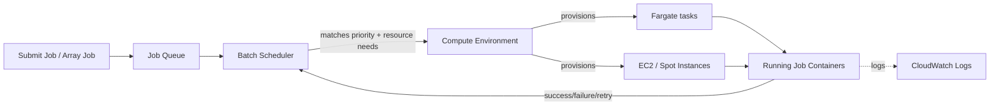

# AWS Batch


## Definition

AWS Batch runs large numbers of batch computing jobs (things like "process these 10,000 files" or
"run this simulation across 500 parameter combinations") by automatically provisioning exactly the
right amount and type of compute to run them, queuing work when capacity isn't ready yet, and
scaling that compute back down to zero when the queue is empty.

## Purpose

Batch computing — jobs that run to completion rather than serve live requests — has a different
shape of problem than a web app: you might need a single large job, or ten thousand small ones,
with wildly variable resource needs, and no requirement for them to run *right now* so much as
*efficiently and reliably eventually*. Building that scheduling and capacity-management logic
yourself (a queue, a fleet of workers that scale with backlog, retry logic for failed jobs) is a
solved problem AWS packaged as a managed service, so teams doing data processing, simulations, or
rendering don't reinvent a job scheduler from scratch.

## How It Works

In plain terms: you define a **job queue**, a **compute environment** (the pool of compute Batch
is allowed to use — either Fargate or EC2, including Spot, with a min/max vCPU range), and a **job
definition** (what container image to run, how much CPU/memory, retry/timeout behavior). You
submit **jobs** (optionally with dependencies on other jobs, or as an **array job** — the same
job definition run N times with different indices, e.g., process files 0 through 9,999) to the
queue; Batch's scheduler matches queued jobs to the compute environment, provisioning more compute
as the backlog grows and scaling it back to the configured minimum (often zero) as it empties.



Walking through it: a job (or thousands of them, via an array job) is submitted to a **job queue**,
which holds work until there's capacity to run it, and which can have a **priority** relative to
other queues sharing the same compute environment. The **scheduler** continuously looks at what's
queued and what compute is available, then asks the **compute environment** to provision more
resources (within its configured min/max vCPU bounds) if the backlog justifies it — using either
Fargate (no visible host, simpler, cost-efficient for smaller jobs) or EC2 (including Spot, for
better cost-efficiency at large scale, with GPU support that Fargate lacks). Once a job's container
finishes, Batch records success/failure, applies configured retry logic on failure, and — if this
is the last job keeping the compute environment busy — scales the environment back down, including
to zero.

## Key Features / Components

- **Job** — a single unit of work: a container image, command, resource requirements (vCPU,
  memory, optionally GPU).
- **Array job** — one job definition executed many times (e.g., 10,000 times) with an index
  variable (`AWS_BATCH_JOB_ARRAY_INDEX`) each copy can use to pick its slice of work — far simpler
  than submitting 10,000 individual jobs.
- **Job definition** — the reusable template for a job (image, vCPU/memory, IAM role, retry
  strategy, timeout).
- **Job queue** — where submitted jobs wait; has a priority and is linked to one or more compute
  environments.
- **Compute environment** — **Managed** (Batch provisions/scales EC2 or Fargate for you within
  bounds you set — the common choice) or **Unmanaged** (you provide your own pre-configured ECS
  cluster — rare, for special compliance/custom AMI needs).
- **Job dependencies** — a job can be configured to wait for another job (or N jobs) to succeed
  before starting, enabling simple DAG-style pipelines without a separate orchestrator.
- **Retry strategy** — automatic retry on failure, with exit-code-based retry conditions (e.g.,
  only retry on specific error codes, not all failures).
- **Spot support** — Batch compute environments can use Spot Instances with automatic fallback
  bidding strategies, since most batch workloads tolerate interruption/retry well.
- **GPU support** — EC2-backed compute environments can use GPU instance types for workloads like
  ML training or video transcoding batch jobs — a capability Fargate-backed Batch doesn't offer.

## Use Cases — When to Use It

- **Large-scale parallel data processing**: transform/validate millions of files, each
  independently, using an array job — classic ETL batch pattern.
- **Scientific/financial simulations** that need to run many parameter combinations overnight and
  report back, without anyone needing to babysit a job scheduler.
- **Media processing at scale** — transcoding thousands of video files, where each is an
  independent, container-packaged unit of work.
- **ML training/batch inference jobs** that need GPU instances and don't fit Lambda's time/package
  limits — a common MLA-C02-relevant pattern: train many models with different hyperparameters as
  an array job.
- **Any workload shaped like "run this container N times, as cheaply as possible, whenever
  capacity allows"** — the signature phrase pointing straight at AWS Batch on the exam.

## When NOT to Use It / Alternatives

- **Workloads needing to respond to a live user request** — Batch is for background, run-to-
  completion work; if there's a human or system waiting synchronously for a fast response, use
  **Lambda**, **Fargate**, or **EC2** behind a load balancer instead.
- **Simple, short, infrequent jobs** that don't need queueing/scheduling sophistication — a
  **scheduled Lambda via EventBridge** is much less setup for a daily 2-minute cleanup task; Batch
  earns its complexity at real scale (large job counts, GPU needs, complex retry/dependency logic).
- **Complex multi-step workflows with branching logic, human approval steps, or long-running state
  machines** — **Step Functions** is the better orchestrator for workflow logic; Batch is focused
  on raw job execution, not conditional branching between heterogeneous steps (though the two are
  often combined: Step Functions calls Batch to run the actual compute-heavy step).
- **Workloads that are naturally container orchestration (always-on services)** rather than
  run-to-completion jobs — use ECS/EKS directly instead of forcing a long-running service pattern
  into Batch's job model.

## Why It's Important

**Real world:** AWS Batch quietly removes a huge amount of custom infrastructure that data
engineering and research teams used to build themselves (a job queue, a worker autoscaler, retry
logic) — it's a genuine force multiplier for teams doing heavy parallel processing without a
dedicated platform engineering team. Its biggest real-world cost lever is Spot usage: because most
batch jobs are naturally interruption-tolerant (just re-run the failed piece), Batch + Spot
routinely delivers large real cost savings compared to always-on EC2/Fargate for the same workload.

**Exam relevance:**
- **SAA-C03** — appears under Domain 4 "Design Cost-Optimized Architectures" (Task 4.2) as the
  answer for "large-scale batch processing, cost-sensitive, interruption-tolerant" scenarios, and
  occasionally Domain 3 for high-performing compute at scale.
- **DVA-C03** — a secondary/background service rather than a primary task-statement focus, but
  can appear as a distractor against Lambda/Fargate for "run this container job" questions —
  know *why* Batch wins when duration/scale/GPU requirements rule Lambda out.
- **MLA-C02** — Domain 3 "Deployment and Orchestration" references Batch Transform-style and
  large-scale training patterns; Batch is relevant whenever a scenario describes training many
  models or running large offline inference jobs rather than a live endpoint.

## Pricing Model (summary)

**AWS Batch itself has no additional charge** — you pay only for the underlying compute it
provisions (EC2 On-Demand/Reserved/Spot rates, or Fargate per-vCPU/memory-second rates), exactly
like Elastic Beanstalk's pricing model. This makes Batch's actual cost almost entirely a function
of how aggressively you let it use Spot and how tightly you set the compute environment's min/max
vCPU bounds. Official pricing: https://aws.amazon.com/batch/pricing/ (again, mostly a pointer back
to EC2/Fargate pricing).

## Hands-on Lab (Floci)

> **Honest limitation:** AWS Batch's own control-plane API is not in Floci's officially supported
> service list (see `labs-floci/README.md` — Compute support is Lambda and EC2 specifically).
> Batch's compute environments are backed by ECS under the hood on real AWS, and ECS *is* fully
> supported by Floci — so you can practice the equivalent mechanics (queueing many containerized
> units of work, running them as ECS tasks) even without the `awslocal batch` commands themselves
> working end-to-end.

```bash
# Simulate the "array job" pattern using ECS directly, since Batch's compute
# environments are ECS clusters under the hood on real AWS:

# 1. Cluster standing in for a Batch "compute environment"
awslocal ecs create-cluster --cluster-name batch-lab-cluster

# 2. A task definition standing in for a Batch "job definition"
cat > batch-job-def.json << 'EOF'
{
  "family": "batch-lab-job",
  "requiresCompatibilities": ["FARGATE"],
  "networkMode": "awsvpc",
  "cpu": "256",
  "memory": "512",
  "containerDefinitions": [{
    "name": "worker",
    "image": "busybox",
    "command": ["sh", "-c", "echo Processing job index $JOB_INDEX"],
    "environment": [{"name": "JOB_INDEX", "value": "0"}]
  }]
}
EOF
awslocal ecs register-task-definition --cli-input-json file://batch-job-def.json

# 3. Submit "array job" items as individual run-task calls with different indices
for i in 0 1 2; do
  awslocal ecs run-task \
    --cluster batch-lab-cluster \
    --task-definition batch-lab-job \
    --launch-type FARGATE \
    --overrides "{\"containerOverrides\":[{\"name\":\"worker\",\"environment\":[{\"name\":\"JOB_INDEX\",\"value\":\"$i\"}]}]}" \
    --network-configuration '{"awsvpcConfiguration":{"subnets":["subnet-xxxxxxxx"],"assignPublicIp":"ENABLED"}}'
done

# 4. Check status of all submitted jobs/tasks
awslocal ecs list-tasks --cluster batch-lab-cluster

# 5. Clean up
awslocal ecs delete-cluster --cluster batch-lab-cluster
```

If you need to practice the actual `awslocal batch` API surface (job queues, compute environment
creation with vCPU bounds, job dependency chains), do so against real AWS in the Free Tier with
budget alerts set — Batch itself adds no charge, only the underlying compute does, so a few short
array-job runs on `BATCH_SPOT` compute stay inexpensive.

## Exam Tips

- **Signature phrase**: "run N independent jobs in parallel, cost-sensitive, can tolerate
  interruption" → **AWS Batch**, usually with Spot compute environments. If the question adds
  "complex branching workflow with multiple dependent heterogeneous steps," lean toward **Step
  Functions** (possibly orchestrating Batch as one step).
  
- **Batch vs. Lambda**: duration over 15 minutes, large dependencies/custom OS needs, or GPU
  requirement → Batch, not Lambda.
- **Batch vs. Fargate/ECS directly**: if the question is about *queueing and scheduling many jobs
  with retry/dependency logic*, that's Batch's value-add over plain ECS/Fargate (which just runs
  containers, without a job-queue/backlog-aware scheduler on top).
- **Managed vs. Unmanaged compute environment**: Managed (Batch provisions/scales for you) is the
  default correct answer almost always; Unmanaged is a niche "I already have a custom cluster"
  answer.
- **Array jobs** are the keyword match for "run the same processing logic across a large number of
  input files/parameters" — much simpler than modeling that as thousands of individually submitted
  jobs.

## Related Terms

- [`fargate.md`](fargate.md) — one of the two compute backends a Batch compute environment can use
- [`ec2.md`](ec2.md) — the other compute backend, required for GPU-based batch jobs
- [`lambda.md`](lambda.md) — the better fit for short, simple, time-bounded jobs
- `services/application-integration/` — Step Functions for complex multi-step orchestration (once written)
- `glossary/README.md` — array job, compute environment, job queue definitions
