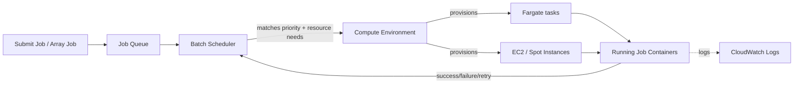
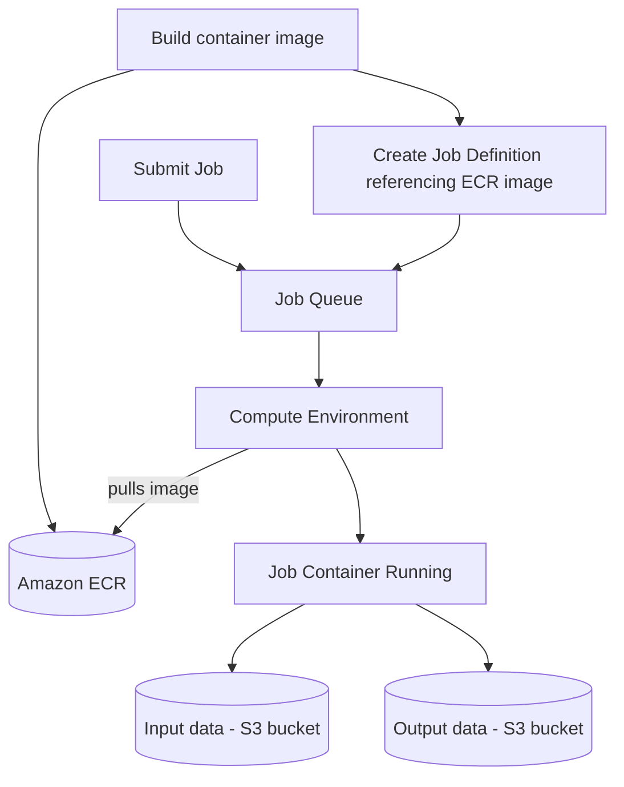
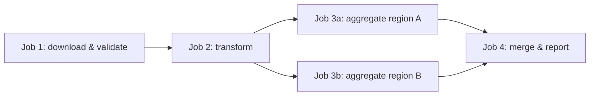
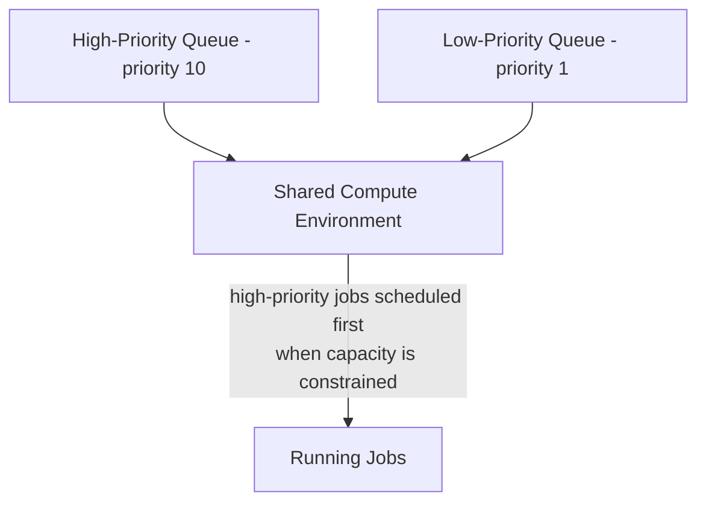
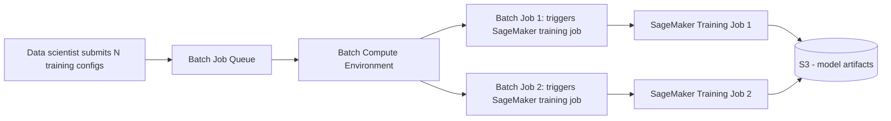

# AWS Batch

> **Appears in:** [SAA-C03](../../certifications/saa-c03/README.md)


## Definition

AWS Batch runs large numbers of batch computing jobs (things like "process these 10,000 files" or
"run this simulation across 500 parameter combinations") by automatically provisioning exactly the
right amount and type of compute to run them, queuing work when capacity isn't ready yet, and
scaling that compute back down to zero when the queue is empty.

## Purpose

Batch computing — jobs that run to completion rather than serve live requests — has a different
shape of problem than a web app: you might need a single large job, or ten thousand small ones,
with wildly variable resource needs, and no requirement for them to run *right now* so much as
*efficiently and reliably eventually*. Building that scheduling and capacity-management logic
yourself (a queue, a fleet of workers that scale with backlog, retry logic for failed jobs) is a
solved problem AWS packaged as a managed service, so teams doing data processing, simulations, or
rendering don't reinvent a job scheduler from scratch.

AWS Batch is, under the hood, a scheduling and queueing layer built *on top of* ECS (and
increasingly EKS) — it doesn't run containers itself so much as orchestrate when and where ECS
runs them, which is why its compute environments are really just ECS clusters with an
AWS-Batch-managed autoscaler attached.

## How It Works

In plain terms: you define a **job queue**, a **compute environment** (the pool of compute Batch
is allowed to use — either Fargate or EC2, including Spot, with a min/max vCPU range), and a **job
definition** (what container image to run, how much CPU/memory, retry/timeout behavior). You
submit **jobs** (optionally with dependencies on other jobs, or as an **array job** — the same
job definition run N times with different indices, e.g., process files 0 through 9,999) to the
queue; Batch's scheduler matches queued jobs to the compute environment, provisioning more compute
as the backlog grows and scaling it back to the configured minimum (often zero) as it empties.



Walking through it: a job (or thousands of them, via an array job) is submitted to a **job queue**,
which holds work until there's capacity to run it, and which can have a **priority** relative to
other queues sharing the same compute environment. The **scheduler** continuously looks at what's
queued and what compute is available, then asks the **compute environment** to provision more
resources (within its configured min/max vCPU bounds) if the backlog justifies it — using either
Fargate (no visible host, simpler, cost-efficient for smaller jobs) or EC2 (including Spot, for
better cost-efficiency at large scale, with GPU support that Fargate lacks). Once a job's container
finishes, Batch records success/failure, applies configured retry logic on failure, and — if this
is the last job keeping the compute environment busy — scales the environment back down, including
to zero.

### The layered architecture AWS Batch actually sits on top of


*This official AWS diagram makes Batch's "it's a layer, not a from-scratch compute engine" nature
explicit: your workloads sit at the top, Batch's scheduling/orchestration logic sits in the middle,
and the actual capacity (EC2, Fargate, or — increasingly — Amazon ECS Managed Instances) sits at
the bottom. Understanding this layering explains why Batch's own pricing has no separate line item
(covered in Pricing below) — the "Batch" layer is pure orchestration, and the capacity layer is
billed exactly as if you'd provisioned it directly yourself.*
**Source:** AWS Documentation — [What is AWS Batch?](https://docs.aws.amazon.com/batch/latest/userguide/what-is-batch.html), AWS Batch User Guide.

### Reference architecture: job submission to completion




*The AWS Well-Architected HPC Lens's reference architecture for a "loosely coupled" workload —
independent units of work with no inter-task communication requirement, the classic shape AWS
Batch is built for. Input and output both flow through S3, keeping the compute layer itself fully
stateless and disposable, which is exactly what allows the compute environment to scale to zero
between job runs without losing anything.*
**Source:** AWS Documentation — [Loosely coupled scenarios](https://docs.aws.amazon.com/wellarchitected/latest/high-performance-computing-lens/loosely-coupled-scenarios.html), AWS Well-Architected Framework, High Performance Computing Lens.

### Job dependency chain (simple DAG without a separate orchestrator)



### Multi-queue priority routing to one compute environment



## Key Features / Components

- **Job** — a single unit of work: a container image, command, resource requirements (vCPU,
  memory, optionally GPU).
- **Array job** — one job definition executed many times (e.g., 10,000 times) with an index
  variable (`AWS_BATCH_JOB_ARRAY_INDEX`) each copy can use to pick its slice of work — far simpler
  than submitting 10,000 individual jobs, and the array itself appears as one entry in the queue
  for monitoring purposes even though it fans out to many running containers.
- **Job definition** — the reusable template for a job (image, vCPU/memory, IAM role, retry
  strategy, timeout).
- **Job queue** — where submitted jobs wait; has a priority and is linked to one or more compute
  environments.
- **Compute environment** — **Managed** (Batch provisions/scales EC2 or Fargate for you within
  bounds you set — the common choice) or **Unmanaged** (you provide your own pre-configured ECS
  cluster — rare, for special compliance/custom AMI needs).
- **Job dependencies** — a job can be configured to wait for another job (or N jobs) to succeed
  before starting, enabling simple DAG-style pipelines without a separate orchestrator (see the
  diagram above).
- **Retry strategy** — automatic retry on failure, with exit-code-based retry conditions (e.g.,
  only retry on specific error codes, not all failures) — up to 10 attempts configurable per job
  definition.
- **Spot support** — Batch compute environments can use Spot Instances with automatic fallback
  bidding strategies, since most batch workloads tolerate interruption/retry well; the
  `SPOT_CAPACITY_OPTIMIZED` allocation strategy is the recommended default for minimizing
  interruption frequency.
- **GPU support** — EC2-backed compute environments can use GPU instance types for workloads like
  ML training or video transcoding batch jobs — a capability Fargate-backed Batch doesn't offer.
- **Fair-share scheduling** — a scheduling policy that prevents one user/project from monopolizing
  a shared compute environment, distributing capacity fairly across job queues or job groups based
  on configured share weights — valuable in multi-team/multi-tenant batch environments.
- **Multi-node parallel jobs** — a single Batch job that spans multiple EC2 instances acting as a
  tightly-coupled cluster (e.g., for MPI-based HPC workloads), with Batch handling the
  inter-instance coordination setup.

## Worked Example: Sizing a Compute Environment for an Array Job

A nightly job processes 50,000 independent image files, each taking roughly 30 seconds on a
0.25 vCPU / 512 MB Fargate task. Total work: 50,000 × 30s = 1,500,000 task-seconds ≈ 416.7
task-hours of 0.25-vCPU work, or **104.2 vCPU-hours** total.

- If the compute environment's max vCPU is set to 50, the whole array job (assuming perfect
  parallelism and no other contention) takes roughly 104.2 ÷ 50 ≈ **2.1 hours** wall-clock to
  fully drain.
- Fargate cost for that work: 104.2 vCPU-hrs × $0.04048/vCPU-hr ≈ **$4.22** in vCPU charges, plus
  memory: 50,000 tasks × 0.5 GB × (30s/3600s) × $0.004445/GB-hr ≈ **$1.85** → **~$6.07 total** for
  the entire 50,000-file nightly run.
- Raising max vCPU to 200 cuts wall-clock time to roughly 104.2 ÷ 200 ≈ **31 minutes**, at
  identical total cost (you're paying for the same total vCPU-seconds of work either way; only the
  parallelism, and therefore the completion time, changes) — a genuinely useful mental model:
  **Batch's compute environment sizing controls how fast the backlog drains, not how much the
  total job costs**, assuming the per-unit-of-work cost is fixed.

## Common Architectures

1. **Nightly ETL / data validation pipeline** — thousands of independent files processed as an
   array job, writing results to S3, often chained via job dependencies into a multi-stage
   pipeline (validate → transform → aggregate → report) exactly as shown in the DAG diagram above.
2. **ML training sweep** — dozens to hundreds of training jobs, each with different
   hyperparameters, submitted as an array job on GPU-backed EC2 compute environments, with results
   (model artifacts, metrics) written to S3 for later comparison — a common MLA-C02-relevant
   pattern for hyperparameter tuning at scale without a dedicated ML training platform.
3. **Media transcoding at scale** — a job queue fed by an S3 event (new raw video uploaded) → one
   Batch job per video → transcoded output written back to S3, typically using Spot compute for
   cost efficiency since a failed/interrupted transcode job simply retries from scratch.

## Use Cases — When to Use It

- **Large-scale parallel data processing**: transform/validate millions of files, each
  independently, using an array job — classic ETL batch pattern.
- **Scientific/financial simulations** that need to run many parameter combinations overnight and
  report back, without anyone needing to babysit a job scheduler.
- **Media processing at scale** — transcoding thousands of video files, where each is an
  independent, container-packaged unit of work.
- **ML training/batch inference jobs** that need GPU instances and don't fit Lambda's time/package
  limits — a common MLA-C02-relevant pattern: train many models with different hyperparameters as
  an array job.
- **Tightly-coupled HPC workloads** (simulations requiring inter-node communication, like MPI jobs)
  via multi-node parallel jobs, something array jobs alone (which assume independence between
  units of work) can't model.
- **Any workload shaped like "run this container N times, as cheaply as possible, whenever
  capacity allows"** — the signature phrase pointing straight at AWS Batch on the exam.

## When NOT to Use It / Alternatives

- **Workloads needing to respond to a live user request** — Batch is for background, run-to-
  completion work; if there's a human or system waiting synchronously for a fast response, use
  **Lambda**, **Fargate**, or **EC2** behind a load balancer instead.
- **Simple, short, infrequent jobs** that don't need queueing/scheduling sophistication — a
  **scheduled Lambda via EventBridge** is much less setup for a daily 2-minute cleanup task; Batch
  earns its complexity at real scale (large job counts, GPU needs, complex retry/dependency logic).
- **Complex multi-step workflows with branching logic, human approval steps, or long-running state
  machines** — **Step Functions** is the better orchestrator for workflow logic; Batch is focused
  on raw job execution, not conditional branching between heterogeneous steps (though the two are
  often combined: Step Functions calls Batch to run the actual compute-heavy step).
- **Workloads that are naturally container orchestration (always-on services)** rather than
  run-to-completion jobs — use ECS/EKS directly instead of forcing a long-running service pattern
  into Batch's job model.

## Why It's Important

**Real world:** AWS Batch quietly removes a huge amount of custom infrastructure that data
engineering and research teams used to build themselves (a job queue, a worker autoscaler, retry
logic) — it's a genuine force multiplier for teams doing heavy parallel processing without a
dedicated platform engineering team. Its biggest real-world cost lever is Spot usage: because most
batch jobs are naturally interruption-tolerant (just re-run the failed piece), Batch + Spot
routinely delivers large real cost savings compared to always-on EC2/Fargate for the same workload.

**Exam relevance:**
- **SAA-C03** — appears under Domain 4 "Design Cost-Optimized Architectures" (Task 4.2) as the
  answer for "large-scale batch processing, cost-sensitive, interruption-tolerant" scenarios, and
  occasionally Domain 3 for high-performing compute at scale.
- **DVA-C03** — a secondary/background service rather than a primary task-statement focus, but
  can appear as a distractor against Lambda/Fargate for "run this container job" questions —
  know *why* Batch wins when duration/scale/GPU requirements rule Lambda out.
- **MLA-C02** — Domain 3 "Deployment and Orchestration" references Batch Transform-style and
  large-scale training patterns; Batch is relevant whenever a scenario describes training many
  models or running large offline inference jobs rather than a live endpoint.

## Limits & Quotas

| Quota | Default | Adjustable? |
|---|---|---|
| Compute environments per Region | 50 | Yes |
| Job queues per Region | 50 | Yes |
| Job definitions per Region (active revisions) | 1,000,000 | Yes |
| Jobs submitted per array job | 10,000 | Hard limit (fixed array size cap) |
| Job dependencies per job | 20 | Yes |
| vCPUs per Managed compute environment | Set by you (min/max), bounded by underlying EC2/Fargate account quotas | Depends on compute type |
| Job timeout | Configurable per job definition, no fixed platform maximum (unlike Lambda's 15 min) | N/A |
| Job retry attempts | Up to 10 per job definition | Hard limit |

The 10,000-job array cap is a real practical constraint: a workload needing to process 50,000
independent files cannot be submitted as a single array job — it requires either multiple array
jobs of 10,000 each, or restructuring the units of work so each array element processes a batch of
5 files instead of 1, bringing the total back under the per-array limit.

## Troubleshooting / Common Issues

- **Jobs stuck in `RUNNABLE` indefinitely** — the compute environment likely can't satisfy the
  job's resource request (e.g., GPU requested on an environment with no GPU instance types
  configured, or the vCPU max is already saturated by higher-priority jobs); check the compute
  environment's configured instance types and current utilization.
- **Job fails immediately with a container-level error** — check CloudWatch Logs for the specific
  job's log stream; common causes are the container's entrypoint command not matching what the job
  definition expects, or a missing environment variable the application needs at startup.
- **Array job partially completes, some indices fail silently** — check the array job's child job
  statuses individually (the parent array job's own status reflects the aggregate, not each
  index); a retry strategy configured to retry only specific exit codes may be masking a systemic
  failure affecting a subset of indices (e.g., a specific input file that's corrupted).
- **Compute environment never scales down to zero** — verify no stuck/zombie jobs are still
  reported as running (check `RUNNING` state jobs explicitly), and confirm the compute
  environment's minimum vCPU setting isn't accidentally set above zero when zero was intended.
- **Spot-backed compute environment experiencing high interruption rates** — switch the Spot
  allocation strategy to `SPOT_CAPACITY_OPTIMIZED` (choosing pools with the most available spare
  capacity) rather than `SPOT_PRICE_CAPACITY_OPTIMIZED` or a pure lowest-price strategy if
  interruption frequency matters more than shaving the last bit of cost.

## Pricing Model (summary)

**AWS Batch itself has no additional charge** — you pay only for the underlying compute it
provisions (EC2 On-Demand/Reserved/Spot rates, or Fargate per-vCPU/memory-second rates), exactly
like Elastic Beanstalk's pricing model. This makes Batch's actual cost almost entirely a function
of how aggressively you let it use Spot and how tightly you set the compute environment's min/max
vCPU bounds. Official pricing: https://aws.amazon.com/batch/pricing/ (again, mostly a pointer back
to EC2/Fargate pricing).

### Worked example: EC2-backed Spot compute environment vs. Fargate for the same array job

Reusing the 104.2 vCPU-hour array job from the worked example above, but sized onto EC2 `c6i.large`
Spot instances (2 vCPU each, roughly $0.0298/vCPU-equivalent-hr at a ~65% Spot discount from the
$0.085/hr On-Demand `c6i.large` rate) instead of Fargate:

- EC2 Spot: 104.2 vCPU-hrs ÷ 2 vCPU per instance × $0.0298/vCPU-hr × 2 ≈ **$6.21** (roughly
  comparable to the Fargate total of ~$6.07 in this particular sizing, with EC2 Spot sometimes
  cheaper at larger scale once instance-level efficiency and bin-packing improve)
- The real differentiator at this small scale is **operational simplicity, not raw cost** — Fargate
  needs no instance-type selection or AMI management at all, while the EC2-backed compute
  environment requires choosing instance types and accepting the operational overhead of a
  (Batch-managed, but still EC2-backed) fleet. At much larger, sustained scale, EC2 Spot typically
  pulls ahead on raw cost-per-vCPU-hour as fleet utilization efficiency improves.

## Hands-on Lab (Floci)

> **Honest limitation:** AWS Batch's own control-plane API is not in Floci's officially supported
> service list (see `labs-floci/README.md` — Compute support is Lambda and EC2 specifically).
> Batch's compute environments are backed by ECS under the hood on real AWS, and ECS *is* fully
> supported by Floci — so you can practice the equivalent mechanics (queueing many containerized
> units of work, running them as ECS tasks) even without the `awslocal batch` commands themselves
> working end-to-end.

```bash
# Simulate the "array job" pattern using ECS directly, since Batch's compute
# environments are ECS clusters under the hood on real AWS:

# 1. Cluster standing in for a Batch "compute environment"
awslocal ecs create-cluster --cluster-name batch-lab-cluster

# 2. A task definition standing in for a Batch "job definition"
cat > batch-job-def.json << 'EOF'
{
  "family": "batch-lab-job",
  "requiresCompatibilities": ["FARGATE"],
  "networkMode": "awsvpc",
  "cpu": "256",
  "memory": "512",
  "containerDefinitions": [{
    "name": "worker",
    "image": "busybox",
    "command": ["sh", "-c", "echo Processing job index $JOB_INDEX"],
    "environment": [{"name": "JOB_INDEX", "value": "0"}]
  }]
}
EOF
awslocal ecs register-task-definition --cli-input-json file://batch-job-def.json

# 3. Submit "array job" items as individual run-task calls with different indices
for i in 0 1 2; do
  awslocal ecs run-task \
    --cluster batch-lab-cluster \
    --task-definition batch-lab-job \
    --launch-type FARGATE \
    --overrides "{\"containerOverrides\":[{\"name\":\"worker\",\"environment\":[{\"name\":\"JOB_INDEX\",\"value\":\"$i\"}]}]}" \
    --network-configuration '{"awsvpcConfiguration":{"subnets":["subnet-xxxxxxxx"],"assignPublicIp":"ENABLED"}}'
done

# 4. Check status of all submitted jobs/tasks
awslocal ecs list-tasks --cluster batch-lab-cluster

# 5. Clean up
awslocal ecs delete-cluster --cluster batch-lab-cluster
```

If you need to practice the actual `awslocal batch` API surface (job queues, compute environment
creation with vCPU bounds, job dependency chains), do so against real AWS in the Free Tier with
budget alerts set — Batch itself adds no charge, only the underlying compute does, so a few short
array-job runs on `BATCH_SPOT` compute stay inexpensive.

## Exam Tips

- **Signature phrase**: "run N independent jobs in parallel, cost-sensitive, can tolerate
  interruption" → **AWS Batch**, usually with Spot compute environments. If the question adds
  "complex branching workflow with multiple dependent heterogeneous steps," lean toward **Step
  Functions** (possibly orchestrating Batch as one step).
- **Batch vs. Lambda**: duration over 15 minutes, large dependencies/custom OS needs, or GPU
  requirement → Batch, not Lambda.
- **Batch vs. Fargate/ECS directly**: if the question is about *queueing and scheduling many jobs
  with retry/dependency logic*, that's Batch's value-add over plain ECS/Fargate (which just runs
  containers, without a job-queue/backlog-aware scheduler on top).
- **Managed vs. Unmanaged compute environment**: Managed (Batch provisions/scales for you) is the
  default correct answer almost always; Unmanaged is a niche "I already have a custom cluster"
  answer.
- **Array jobs** are the keyword match for "run the same processing logic across a large number of
  input files/parameters" — much simpler than modeling that as thousands of individually submitted
  jobs. Remember the 10,000-item hard cap per array.
- **GPU workloads rule out Fargate-backed Batch** — if a question needs GPU instances for a batch
  job, the compute environment must be EC2-backed, not Fargate-backed.
- **Fair-share scheduling** is the answer whenever a question describes multiple teams/projects
  sharing one compute environment and needing to prevent any single one from monopolizing it.

## Security Considerations

- **Job role vs. execution role** — Batch jobs backed by Fargate follow the same two-role model as
  plain Fargate tasks: an execution role for pulling the container image and writing logs, and a
  separate job role for what the job's own code calls AWS with. The same conflation mistake
  covered in `fargate.md` applies here directly.
- **Compute environment service role** — the AWS Batch service itself needs an IAM role (distinct
  from both job roles) to call EC2/ECS APIs on your behalf to provision and manage the underlying
  compute environment; this is usually a service-linked role created automatically, but worth
  knowing it exists as a third, separate permission boundary.
- **Private compute environments** — like Fargate tasks generally, placing a Batch compute
  environment's instances in private subnets (with a NAT gateway for outbound image pulls) is the
  standard secure default, since job containers rarely need to accept inbound connections at all.
- **Job input/output via S3 bucket policies** — since most Batch architectures read/write via S3
  (as shown in the HPC Lens diagram above), scoping job roles to only the specific S3 prefixes a
  job needs (rather than bucket-wide access) limits blast radius if a job container is ever
  compromised via a malicious dependency.

## Monitoring & Observability

- **CloudWatch Logs per job** — each job's container output streams to its own CloudWatch Logs
  stream, named predictably with the job ID, making it straightforward to script log retrieval
  across a large array job for post-mortem analysis.
- **Job state transitions** (`SUBMITTED` → `PENDING` → `RUNNABLE` → `STARTING` → `RUNNING` →
  `SUCCEEDED`/`FAILED`) are queryable via `describe-jobs` and are the first thing to check when a
  job seems stuck — `RUNNABLE` for an extended period almost always means the compute environment
  can't currently satisfy the job's resource request.
- **CloudWatch metrics for compute environment** — `age` of the oldest job in a queue is a useful
  custom signal to alarm on, since a growing backlog age indicates the compute environment's max
  vCPU bound may be too conservative for actual demand.
- **AWS Batch console's job dependency graph view** visualizes the DAG described in job
  dependencies directly, which is considerably easier to debug visually than reconstructing the
  dependency chain from individual `describe-jobs` calls.

## SageMaker Integration Pattern

A growing real-world and MLA-C02-relevant pattern pairs AWS Batch with SageMaker AI training jobs:
Batch handles the orchestration layer (job queue, scheduling, dependency management across many
training runs), while each individual Batch job's container triggers and monitors a SageMaker
training job rather than running the training directly inside the Batch-managed container. This
split lets teams keep SageMaker's training-specific tooling (built-in algorithms, managed
spot training, experiment tracking) while still getting Batch's queue-and-schedule-many-jobs
model for coordinating large hyperparameter sweeps or batch retraining pipelines across many
models.



## Further Reading

- [AWS Batch User Guide](https://docs.aws.amazon.com/batch/latest/userguide/what-is-batch.html)
- [Loosely coupled scenarios (AWS Batch reference architecture)](https://docs.aws.amazon.com/wellarchitected/latest/high-performance-computing-lens/loosely-coupled-scenarios.html)
- [AWS Batch pricing](https://aws.amazon.com/batch/pricing/)
- [AWS Batch service quotas](https://docs.aws.amazon.com/batch/latest/userguide/service_limits.html)
- [Array jobs in AWS Batch](https://docs.aws.amazon.com/batch/latest/userguide/array_jobs.html)

## Related Terms

- [`fargate.md`](fargate.md) — one of the two compute backends a Batch compute environment can use
- [`ec2.md`](ec2.md) — the other compute backend, required for GPU-based batch jobs
- [`lambda.md`](lambda.md) — the better fit for short, simple, time-bounded jobs
- `services/application-integration/` — Step Functions for complex multi-step orchestration (once written)
- `glossary/README.md` — array job, compute environment, job queue definitions
