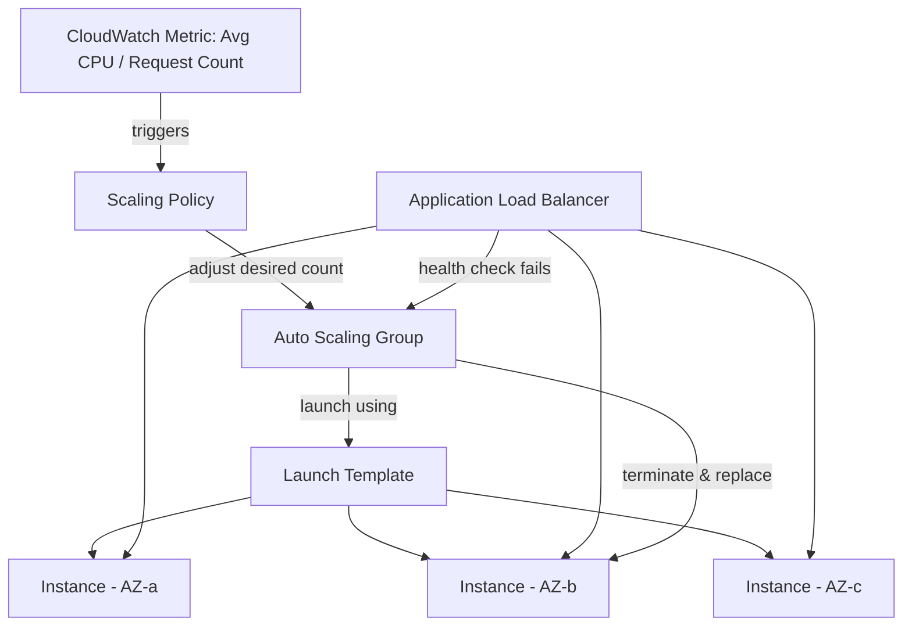

# Amazon EC2 Auto Scaling


## Definition

EC2 Auto Scaling automatically adds or removes EC2 instances from a group, based on rules you set,
so your application always has roughly the right amount of compute — not too little (and falling
over), not too much (and wasting money).

## Purpose

A fixed number of servers is wrong almost all the time: too many at 3am, too few during a launch
or sales spike. AWS built Auto Scaling so you describe the *desired state* ("keep CPU around 50%,
between 2 and 10 instances") and AWS continuously reconciles reality to match it — launching
instances when load rises, terminating them when it falls, and replacing any that fail health
checks, all without a human watching a dashboard at 3am.

## How It Works

In plain terms: you define a **launch template** (what an instance should look like — AMI,
instance type, security groups, user data) and an **Auto Scaling Group (ASG)** that references it,
with a minimum, maximum, and desired instance count, spread across one or more Availability Zones.
You then attach **scaling policies** that watch a metric (usually average CPU, or request count
per target from a load balancer) and adjust the desired count when thresholds are crossed. A
**health check** (EC2 status check, or an attached load balancer's health check) continuously
verifies each instance is actually working; a failing instance gets terminated and replaced
automatically.



Walking through it: CloudWatch continuously measures a metric relevant to load (CPU utilization is
the simplest, but request count per target or even a custom application metric works too). When
that metric crosses the threshold defined in a **scaling policy**, the policy tells the ASG to
change its desired instance count. The ASG then uses the **launch template** as the recipe to
start (or stop) instances, deliberately spreading them across the Availability Zones the ASG is
configured for, so a single AZ failure doesn't take down the whole fleet. An **Application Load
Balancer** in front of the group distributes incoming traffic only to instances currently in the
group, and continuously health-checks each one; if an instance fails that health check (app
crashed, out of memory, etc.), the ASG terminates it and launches a fresh replacement from the
same launch template — this is what makes the group "self-healing," independent of any scaling
decision.

## Key Features / Components

- **Launch Template** — the versioned, reusable definition of what a new instance looks like
  (AMI, instance type(s), security groups, key pair, user data, IAM instance profile). Replaces
  the older, now-legacy "Launch Configuration."
- **Auto Scaling Group (ASG)** — the actual pool: min/max/desired size, which subnets/AZs to use,
  which load balancer(s) to register new instances with.
- **Scaling policies**:
  - **Target tracking** — "keep average CPU at 50%" — the simplest and most commonly recommended;
    AWS does the math on how many instances that requires.
  - **Step scaling** — "if CPU > 70% add 2, if CPU > 90% add 5" — finer control over the response
    curve.
  - **Simple scaling** — one adjustment per alarm breach, with a cooldown period before the next.
  - **Scheduled scaling** — "scale to 10 instances every weekday at 8am" — for known, predictable
    traffic patterns (don't wait for a metric to react to a schedule you already know).
  - **Predictive scaling** — uses machine learning on historical load patterns to pre-provision
    capacity ahead of a recurring spike instead of reacting after the fact.
- **Health checks** — EC2 status checks (is the VM itself alive) and/or ELB health checks (is the
  *application* actually responding correctly) — ELB health checks are stricter and the common
  real-world choice.
- **Lifecycle hooks** — pause an instance in a "Pending" or "Terminating" state so you can run
  custom code (e.g., drain connections, pull logs) before it's placed in service or destroyed.
- **Warm pools** — keep pre-initialized instances in a stopped/hibernated state ready to join the
  group fast, cutting the time a scale-out event takes to actually help with load.
- **Multi-AZ distribution** — the ASG automatically balances instance count across the AZs you
  configure, a key building block for high availability.
- **Mixed instances policy** — let an ASG launch a mix of On-Demand and Spot instances (and
  multiple instance types) to balance cost and availability automatically.

## Use Cases — When to Use It

- **Web/app tier behind a load balancer** that sees daily or weekly traffic patterns — classic
  three-tier web architecture, the default "right answer" pattern on SAA-C03 resiliency questions.
- **Self-healing fleets** — even with *zero* scaling need, running a fixed-size ASG (min = max =
  desired) is still worth it purely for automatic replacement of failed instances.
- **Batch/worker fleets** that pull from a queue (SQS) — scale workers based on queue depth so
  processing throughput tracks backlog size.
- **Cost optimization via Spot mix** — run a mixed-instance ASG that prefers Spot for cost and
  falls back to On-Demand, for workloads tolerant of occasional instance replacement.
- **Scheduled capacity** for known events — Black Friday, a product launch, a recurring batch
  window — scale up ahead of time instead of reacting after users already see slowness.

## When NOT to Use It / Alternatives

- **Stateful, single-instance workloads** that can't tolerate instances coming and going (e.g., a
  single legacy database server) — Auto Scaling assumes instances are interchangeable/disposable;
  if yours aren't, fix that first (externalize state to RDS/S3/EFS) or don't use ASG for that tier.
- **Truly serverless, event-driven workloads** — if your compute need is "run this for 200ms when
  an event arrives," managing an ASG (even scaled to near-zero) is still more operational overhead
  than **Lambda**, which has no concept of "minimum fleet size" at all.
- **Container workloads** — if you're running containers, **ECS Service Auto Scaling** or
  **Karpenter/Cluster Autoscaler on EKS** operate at the container/pod level, which is usually a
  better fit than scaling raw EC2 instances directly; ECS can still use an EC2 Auto Scaling Group
  as its underlying capacity provider, but the scaling decision becomes two-layered.
- **Unpredictable, non-metric-driven bursts** where a target-tracking policy can't react fast
  enough — consider pre-warmed Lambda or combining predictive scaling with a generous buffer.

## Why It's Important

**Real world:** Auto Scaling is the mechanism that actually delivers on "the cloud scales" — not
magic, just an automated feedback loop. Getting it wrong in either direction is expensive: too
conservative and you get outages during real spikes (the 2010s-era "we didn't expect that much
traffic" failure mode); too aggressive and you pay for capacity nobody used. It's also central to
**high availability** — spreading instances across AZs and auto-replacing failed ones is how you
survive a single data center going down without anyone noticing.

**Exam relevance:**
- **SAA-C03** — central to Domain 2 "Design Resilient Architectures" (Task 2.2, highly available
  and fault-tolerant design — Multi-AZ ASGs are a textbook answer) and Domain 4 "Design
  Cost-Optimized Architectures" (Task 4.2, mixed Spot/On-Demand ASGs for cost control).
- **DVA-C03** — Domain 4 "Troubleshooting and Optimization" touches scaling behavior when
  diagnosing performance issues tied to under-provisioned fleets.
- **MLA-C02** — less central, but Domain 3 touches auto-scaling concepts when discussing
  scaling SageMaker endpoints (a managed analog to the same target-tracking idea).

## Pricing Model (summary)

EC2 Auto Scaling itself is **free** — you pay only for the underlying EC2 instances it launches
(On-Demand, Reserved, or Spot rates, whichever the launch template specifies), plus any attached
load balancer and CloudWatch alarm costs (CloudWatch has a free tier for basic alarms; detailed
monitoring at 1-minute granularity costs extra per metric).
Official pricing: https://aws.amazon.com/ec2/autoscaling/pricing/ (the page mostly points back to
EC2/ELB/CloudWatch pricing since ASG has no separate charge).

## Hands-on Lab (Floci)

```bash
# 1. Create a launch template
awslocal ec2 create-launch-template \
  --launch-template-name my-web-lt \
  --launch-template-data '{
    "ImageId": "ami-00000000",
    "InstanceType": "t3.micro",
    "SecurityGroupIds": ["sg-xxxxxxxx"]
  }'

# 2. Create the Auto Scaling Group across two AZs
awslocal autoscaling create-auto-scaling-group \
  --auto-scaling-group-name my-web-asg \
  --launch-template "LaunchTemplateName=my-web-lt,Version=\$Latest" \
  --min-size 2 --max-size 6 --desired-capacity 2 \
  --availability-zones us-east-1a us-east-1b

# 3. Attach a target-tracking scaling policy (keep CPU near 50%)
awslocal autoscaling put-scaling-policy \
  --auto-scaling-group-name my-web-asg \
  --policy-name cpu-target-tracking \
  --policy-type TargetTrackingScaling \
  --target-tracking-configuration '{
    "PredefinedMetricSpecification": {"PredefinedMetricType": "ASGAverageCPUUtilization"},
    "TargetValue": 50.0
  }'

# 4. Check the group's current state
awslocal autoscaling describe-auto-scaling-groups \
  --auto-scaling-group-names my-web-asg \
  --query "AutoScalingGroups[].{Desired:DesiredCapacity,Min:MinSize,Max:MaxSize,Instances:Instances[].InstanceId}"

# 5. Simulate manual scale-out, then clean up
awslocal autoscaling set-desired-capacity \
  --auto-scaling-group-name my-web-asg --desired-capacity 4

awslocal autoscaling delete-auto-scaling-group \
  --auto-scaling-group-name my-web-asg --force-delete
```

This mirrors the real workflow: template → group → policy → verify → adjust → tear down. Practice
reading the `describe-auto-scaling-groups` output until the min/max/desired/instance relationship
is second nature — the exam tests this relationship directly.

## Exam Tips

- **Min / Max / Desired** confusion is common: Desired is what the ASG tries to maintain *right
  now*, bounded by Min and Max. A scaling policy only ever adjusts Desired, never breaks the
  Min/Max bounds.
- **Target tracking vs. step scaling**: if a question just says "keep CPU around X%" → target
  tracking. If it gives specific tiers ("+2 instances if CPU>70%, +5 if CPU>90%") → step scaling.
- **Scheduled scaling** is the right answer whenever the question describes a *known, predictable*
  time-based pattern (don't over-think it into a metric-driven policy).
- **ELB health checks vs. EC2 health checks**: EC2 checks only prove the VM boots; ELB checks
  prove the *application* responds. If a question emphasizes catching application-level failures,
  the answer is enabling ELB health checks on the ASG, not relying on EC2 status checks alone.
- Auto Scaling Groups spanning AZs is the standard SAA-C03 "how do you achieve high availability"
  answer — pair it mentally with Multi-AZ RDS and Route 53 health checks as the three pillars of
  that topic.

## Related Terms

- [`ec2.md`](ec2.md) — the instances being scaled
- [`fargate.md`](fargate.md) — container compute that scales without managing instances at all
- `services/networking-content-delivery/` — Application Load Balancer, VPC subnets (once written)
- `services/management-governance/` — CloudWatch alarms and metrics (once written)
- `glossary/README.md` — Availability Zone, target tracking, health check definitions
