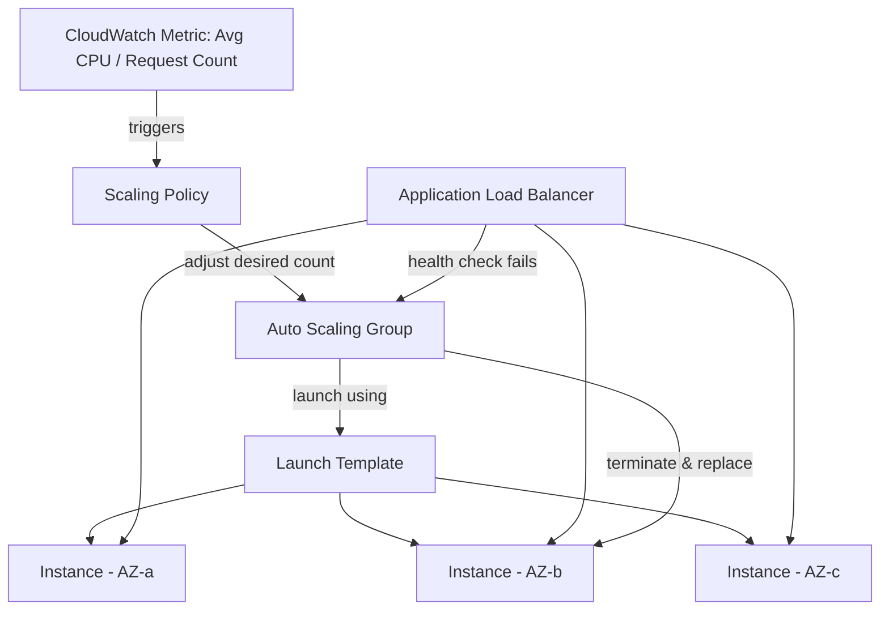
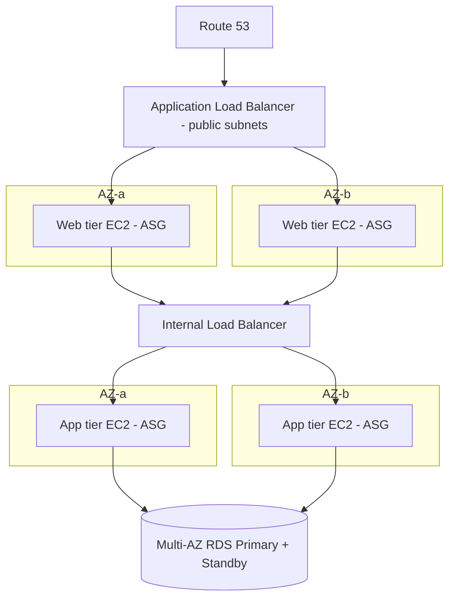
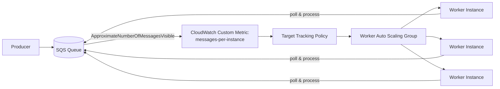
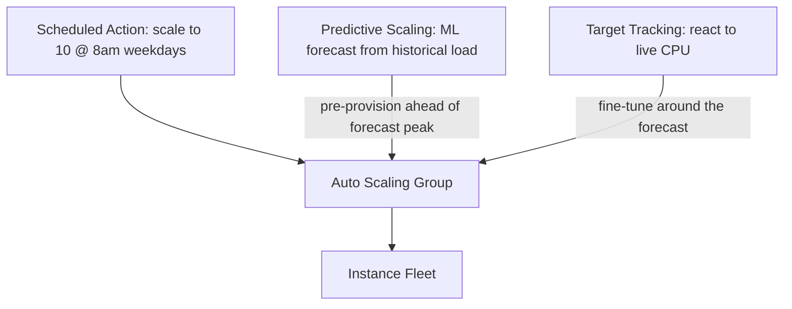
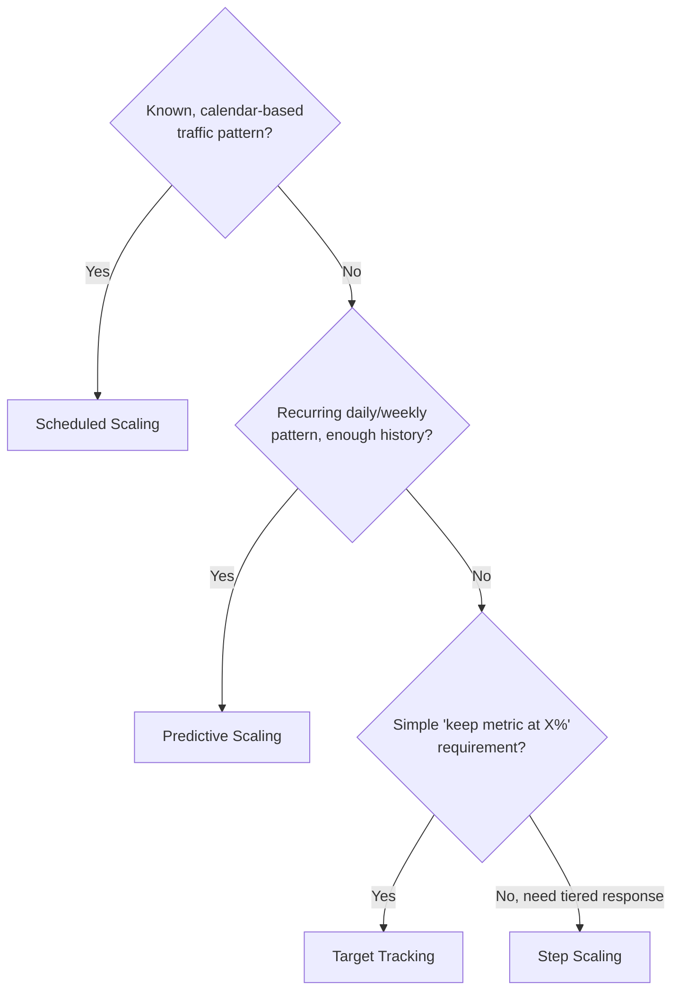

# Amazon EC2 Auto Scaling

> **Appears in:** [SAA-C03](../../certifications/saa-c03/README.md)


## Definition

EC2 Auto Scaling automatically adds or removes EC2 instances from a group, based on rules you set,
so your application always has roughly the right amount of compute — not too little (and falling
over), not too much (and wasting money).

## Purpose

A fixed number of servers is wrong almost all the time: too many at 3am, too few during a launch
or sales spike. AWS built Auto Scaling so you describe the *desired state* ("keep CPU around 50%,
between 2 and 10 instances") and AWS continuously reconciles reality to match it — launching
instances when load rises, terminating them when it falls, and replacing any that fail health
checks, all without a human watching a dashboard at 3am.

This reconciliation loop — compare desired state to actual state, take the smallest action needed
to close the gap, repeat — is the same control-loop pattern that underlies Kubernetes' own
scheduler and most modern infrastructure automation; Auto Scaling is AWS's original, EC2-specific
implementation of that idea, predating Kubernetes on AWS by years.

## How It Works

In plain terms: you define a **launch template** (what an instance should look like — AMI,
instance type, security groups, user data) and an **Auto Scaling Group (ASG)** that references it,
with a minimum, maximum, and desired instance count, spread across one or more Availability Zones.
You then attach **scaling policies** that watch a metric (usually average CPU, or request count
per target from a load balancer) and adjust the desired count when thresholds are crossed. A
**health check** (EC2 status check, or an attached load balancer's health check) continuously
verifies each instance is actually working; a failing instance gets terminated and replaced
automatically.



Walking through it: CloudWatch continuously measures a metric relevant to load (CPU utilization is
the simplest, but request count per target or even a custom application metric works too). When
that metric crosses the threshold defined in a **scaling policy**, the policy tells the ASG to
change its desired instance count. The ASG then uses the **launch template** as the recipe to
start (or stop) instances, deliberately spreading them across the Availability Zones the ASG is
configured for, so a single AZ failure doesn't take down the whole fleet. An **Application Load
Balancer** in front of the group distributes incoming traffic only to instances currently in the
group, and continuously health-checks each one; if an instance fails that health check (app
crashed, out of memory, etc.), the ASG terminates it and launches a fresh replacement from the
same launch template — this is what makes the group "self-healing," independent of any scaling
decision.

### The instance lifecycle inside an Auto Scaling group

Instances in an ASG follow a more elaborate lifecycle than a standalone EC2 instance, because the
ASG itself is making placement and health decisions on top of the normal EC2 instance states:


*This official AWS diagram shows the basic shape every ASG takes: a VPC spanning multiple
Availability Zones, with the Auto Scaling group spreading instances across them and a load
balancer (not pictured in the most basic version, but typically added) distributing traffic. The
core idea the diagram conveys is that the ASG is a logical construct spanning physical
infrastructure in several AZs — not a single resource in a single location.*
**Source:** AWS Documentation — [What is Amazon EC2 Auto Scaling?](https://docs.aws.amazon.com/autoscaling/ec2/userguide/what-is-amazon-ec2-auto-scaling.html), Amazon EC2 Auto Scaling User Guide.

An instance moves through `Pending` → `Pending:Wait`/`Pending:Proceed` (if a lifecycle hook is
configured) → `InService` → (on scale-in) `Terminating` → `Terminating:Wait`/`Terminating:Proceed`
→ `Terminated`. The `:Wait` sub-states only appear when you've attached a **lifecycle hook** — a
way to pause the instance mid-transition so custom code (register with a service mesh, pull final
logs, warm a cache) can run before the instance is fully in service or fully gone. Without a
lifecycle hook, instances move through these states automatically with no pause.

### A complete three-tier architecture with Auto Scaling




*The official AWS version of this same pattern, showing an Auto Scaling group explicitly spread
across three Availability Zones with a load balancer distributing traffic across all of them. This
is the canonical SAA-C03 "design a highly available web application" reference architecture — note
that AWS deliberately draws instances in every AZ, never concentrated in one, to make the fault
tolerance visually obvious.*
**Source:** AWS Documentation — [Auto Scaling benefits for application architecture](https://docs.aws.amazon.com/autoscaling/ec2/userguide/auto-scaling-benefits.html), Amazon EC2 Auto Scaling User Guide.

### Scaling driven by a queue backlog (worker fleet pattern)



### Scheduled + predictive scaling combined



## Scaling Policy Types — Deep Dive

- **Target tracking** — "keep average CPU at 50%" — the simplest and most commonly recommended;
  AWS does the math on how many instances that requires, using a PID-controller-like algorithm
  internally. Supported predefined metrics include `ASGAverageCPUUtilization`,
  `ALBRequestCountPerTarget`, `ASGAverageNetworkIn`/`Out`. You can also target-track a custom
  CloudWatch metric (e.g., SQS messages per instance).
- **Step scaling** — "if CPU > 70% add 2, if CPU > 90% add 5" — finer control over the response
  curve; useful when load increases aren't linear and you want a sharper response at higher
  thresholds.
- **Simple scaling** — one adjustment per alarm breach, with a cooldown period before the next
  evaluation; mostly legacy at this point, kept for backward compatibility — target tracking or
  step scaling are the modern recommended choices.
- **Scheduled scaling** — "scale to 10 instances every weekday at 8am" — for known, predictable
  traffic patterns (don't wait for a metric to react to a schedule you already know).
- **Predictive scaling** — uses machine learning on up to 14 days (and ideally weeks) of
  historical CloudWatch load data to forecast daily/weekly patterns and pre-provision capacity
  ahead of a recurring spike, instead of reacting after the fact once CPU already climbed. This
  closes the real gap target tracking has: target tracking is reactive (it waits for CPU to
  actually rise before adding capacity), while predictive scaling can add capacity minutes before
  the forecasted spike even starts.

### Choosing a scaling policy — decision flow



## Worked Example: Sizing a Target Tracking Policy

Say your web tier handles 1,000 requests/second at peak, and testing shows a single `m6i.large`
instance comfortably handles 150 req/s before CPU crosses 70%. A target tracking policy set to
"keep average CPU at 50%" (a conservative target that leaves headroom for sudden spikes) will,
roughly, provision:

- Peak capacity needed: 1,000 req/s ÷ 150 req/s per instance ≈ **7 instances** at full utilization
- With a 50% CPU target (roughly half the per-instance throughput used before the 70%-CPU ceiling
  that corresponds to 150 req/s), realistic safe throughput per instance is closer to 100 req/s,
  so: 1,000 ÷ 100 = **10 instances** at the target
- Set `MinSize=2` (baseline availability across 2 AZs even at zero load), `MaxSize=15` (headroom
  above the calculated peak for unexpected spikes), `DesiredCapacity=10` as the policy's steady
  state during the daily peak window

Monthly cost impact of the *policy choice itself*: running a fixed `DesiredCapacity=10` 24/7 at
`m6i.large` On-Demand ($0.096/hr) costs 10 × 730 × $0.096 = **$700.80/month**. If real traffic is
only at that peak 6 hours/day and the ASG legitimately scales down to 3 instances the other 18
hours, actual cost becomes (10 × 6 + 3 × 18) × 30 × $0.096 ≈ **$328.32/month** — more than **53%
cheaper** than running fixed capacity sized for peak, which is the entire financial argument for
Auto Scaling over manually-sized fixed fleets.

## Key Features / Components

- **Launch Template** — the versioned, reusable definition of what a new instance looks like
  (AMI, instance type(s), security groups, key pair, user data, IAM instance profile). Replaces
  the older, now-legacy "Launch Configuration," which cannot be updated in place (you must create
  a new one) — Launch Templates support versioning instead.
- **Auto Scaling Group (ASG)** — the actual pool: min/max/desired size, which subnets/AZs to use,
  which load balancer(s) to register new instances with.
- **Scaling policies** — see the deep-dive section above.
- **Health checks** — EC2 status checks (is the VM itself alive) and/or ELB health checks (is the
  *application* actually responding correctly) — ELB health checks are stricter and the common
  real-world choice. You can also set a **health check grace period** so new instances aren't
  prematurely killed while still booting/warming up.
- **Lifecycle hooks** — pause an instance in a "Pending" or "Terminating" state so you can run
  custom code (e.g., drain connections, pull logs) before it's placed in service or destroyed.
  Default timeout is 1 hour per hook, extendable via heartbeat calls.
- **Warm pools** — keep pre-initialized instances in a stopped/hibernated state ready to join the
  group fast, cutting the time a scale-out event takes to actually help with load — valuable when
  your AMI/boot process is slow (large application, heavy dependency installation at boot).
- **Multi-AZ distribution** — the ASG automatically balances instance count across the AZs you
  configure, a key building block for high availability.
- **Mixed instances policy** — let an ASG launch a mix of On-Demand and Spot instances (and
  multiple instance types/sizes) to balance cost and availability automatically; you can set a
  base number of On-Demand instances with the remainder filled by the cheapest available Spot
  capacity across several instance type pools, reducing the chance all instances get reclaimed at
  once.
- **Instance refresh** — roll out a new launch template version (e.g., a new AMI with a security
  patch) across the whole group gradually, replacing instances in batches while respecting a
  minimum healthy percentage, instead of a disruptive all-at-once replacement.
- **Termination policies** — control which instance the ASG picks to remove on scale-in
  (`OldestInstance`, `NewestInstance`, `OldestLaunchTemplate`, `AllocationStrategy` for cost when
  using Spot, or `Default`, which balances AZs first).

## Common Architectures

1. **Classic three-tier HA web app** — web tier ASG behind a public ALB, app tier ASG behind an
   internal load balancer, Multi-AZ RDS at the bottom — the default SAA-C03 "design for
   resilience" answer, shown in the diagram above.
2. **Queue-driven worker fleet** — an ASG of workers scaling on SQS queue depth (via a custom
   CloudWatch metric, typically `ApproximateNumberOfMessagesVisible` divided by instance count),
   processing jobs asynchronously with no direct user-facing load balancer at all.
3. **Cost-optimized mixed-instance fleet** — an ASG configured with a base of 20% On-Demand for
   guaranteed baseline capacity and 80% Spot across 4-6 instance type pools for cost, commonly
   paired with the `capacity-optimized` Spot allocation strategy to minimize interruption
   frequency — a frequent real-world and Domain-4 exam pattern for stateless web/API tiers.

## Security Considerations

- **IAM instance profile on the launch template** determines what every instance in the group can
  do — because the ASG can launch (and re-launch) instances unattended, it's worth being more
  disciplined about least-privilege here than on a one-off instance: an over-permissive role baked
  into a launch template is replicated onto every single instance the ASG ever creates.
- **Security groups belong to the launch template**, not the ASG itself — changing a security
  group doesn't retroactively apply to already-running instances; you'd need an instance refresh
  (or manual replacement) to roll the change out to the live fleet.
- **Golden AMI patching cadence** — because ASGs frequently terminate and relaunch instances from
  the same AMI, a stale AMI with known vulnerabilities gets redeployed indefinitely until you patch
  the AMI and roll an instance refresh; this is a common real-world compliance failure mode
  ("we patched the running servers but the AMI is still vulnerable, and the next scale-out event
  launched the old vulnerable image").
- **Lifecycle hook permissions** — if a hook invokes a Lambda function or publishes to SNS/SQS, the
  Auto Scaling service itself needs an IAM role with permission to do so (distinct from the
  instance's own role) — a commonly missed configuration step when first wiring up hooks.

## Worked Example: Lifecycle Hook Timing

A common production pattern: before an instance is terminated during scale-in, you want it to
finish processing any in-flight request and deregister cleanly from a service mesh. A
`autoscaling:EC2_INSTANCE_TERMINATING` lifecycle hook with a 300-second timeout gives the instance
up to 5 minutes in the `Terminating:Wait` state. During that window, a Lambda function (triggered
by the lifecycle action's EventBridge event) calls the instance's drain endpoint, polls until
in-flight requests hit zero or the timeout approaches, then calls
`complete-lifecycle-action` to let termination proceed. If the Lambda never calls
`complete-lifecycle-action` and the timeout elapses, the ASG proceeds with termination anyway
(`ABANDON` default outcome) — so a hook is a *bounded* grace period, never an indefinite pause,
which is worth remembering before assuming a hook alone guarantees zero dropped requests.

## Monitoring & Observability

- **Group-level metrics** (`GroupMinSize`, `GroupMaxSize`, `GroupDesiredCapacity`,
  `GroupInServiceInstances`, `GroupPendingInstances`, `GroupTerminatingInstances`) give you the
  shape of the fleet over time — graphing `GroupDesiredCapacity` against a traffic metric is the
  fastest way to visually confirm a scaling policy is tracking load correctly.
- **Activity History** (console) / `describe-scaling-activities` (CLI) is the first place to look
  for *why* a scaling action did or didn't happen — it records the cause (which alarm, which
  policy) and the result (success, or a specific failure reason like insufficient capacity).
- **CloudWatch alarms backing target tracking policies are created and managed automatically** —
  you'll see two alarms per target tracking policy (one for scale-out, one for scale-in) appear in
  CloudWatch without you creating them directly; don't delete them manually, as Auto Scaling
  recreates/depends on them.
- **EventBridge integration** — Auto Scaling emits lifecycle events (launch, terminate, lifecycle
  hook transitions) to EventBridge, which is how you wire custom automation (Lambda, SNS
  notifications, a Slack alert on scale-in) without polling the ASG API yourself.

## Use Cases — When to Use It

- **Web/app tier behind a load balancer** that sees daily or weekly traffic patterns — classic
  three-tier web architecture, the default "right answer" pattern on SAA-C03 resiliency questions.
- **Self-healing fleets** — even with *zero* scaling need, running a fixed-size ASG (min = max =
  desired) is still worth it purely for automatic replacement of failed instances.
- **Batch/worker fleets** that pull from a queue (SQS) — scale workers based on queue depth so
  processing throughput tracks backlog size.
- **Cost optimization via Spot mix** — run a mixed-instance ASG that prefers Spot for cost and
  falls back to On-Demand, for workloads tolerant of occasional instance replacement.
- **Scheduled capacity** for known events — Black Friday, a product launch, a recurring batch
  window — scale up ahead of time instead of reacting after users already see slowness.
- **Zero-downtime patching/rollout** — use instance refresh to roll a new AMI across a fleet in
  controlled batches instead of a manual, risky all-at-once replacement.

## When NOT to Use It / Alternatives

- **Stateful, single-instance workloads** that can't tolerate instances coming and going (e.g., a
  single legacy database server) — Auto Scaling assumes instances are interchangeable/disposable;
  if yours aren't, fix that first (externalize state to RDS/S3/EFS) or don't use ASG for that tier.
- **Truly serverless, event-driven workloads** — if your compute need is "run this for 200ms when
  an event arrives," managing an ASG (even scaled to near-zero) is still more operational overhead
  than **Lambda**, which has no concept of "minimum fleet size" at all.
- **Container workloads** — if you're running containers, **ECS Service Auto Scaling** or
  **Karpenter/Cluster Autoscaler on EKS** operate at the container/pod level, which is usually a
  better fit than scaling raw EC2 instances directly; ECS can still use an EC2 Auto Scaling Group
  as its underlying capacity provider, but the scaling decision becomes two-layered.
- **Unpredictable, non-metric-driven bursts** where a target-tracking policy can't react fast
  enough — consider pre-warmed Lambda or combining predictive scaling with a generous buffer.

## Why It's Important

**Real world:** Auto Scaling is the mechanism that actually delivers on "the cloud scales" — not
magic, just an automated feedback loop. Getting it wrong in either direction is expensive: too
conservative and you get outages during real spikes (the 2010s-era "we didn't expect that much
traffic" failure mode); too aggressive and you pay for capacity nobody used. It's also central to
**high availability** — spreading instances across AZs and auto-replacing failed ones is how you
survive a single data center going down without anyone noticing.

**Exam relevance:**
- **SAA-C03** — central to Domain 2 "Design Resilient Architectures" (Task 2.2, highly available
  and fault-tolerant design — Multi-AZ ASGs are a textbook answer) and Domain 4 "Design
  Cost-Optimized Architectures" (Task 4.2, mixed Spot/On-Demand ASGs for cost control).
- **DVA-C03** — Domain 4 "Troubleshooting and Optimization" touches scaling behavior when
  diagnosing performance issues tied to under-provisioned fleets.
- **MLA-C02** — less central, but Domain 3 touches auto-scaling concepts when discussing
  scaling SageMaker endpoints (a managed analog to the same target-tracking idea).

## Limits & Quotas

| Quota | Default | Adjustable? |
|---|---|---|
| Auto Scaling groups per Region | 500 | Yes |
| Launch templates per Region | 10,000 | Yes |
| Launch template versions per template | 10,000 | Yes |
| Instances per Auto Scaling group | Bounded only by your `MaxSize` setting and underlying EC2 quotas | N/A |
| Scaling policies per Auto Scaling group | 50 | Yes |
| Lifecycle hooks per Auto Scaling group | 50 | Yes |
| Scheduled actions per Auto Scaling group | 125 | Yes |
| Step adjustments per step scaling policy | 20 | Yes |

The practical gotcha hiding in this list: your ASG's `MaxSize` can be set arbitrarily high in the
console, but if the underlying On-Demand vCPU quota for the instance family is still at its
account default (5 vCPUs for Standard instance families on a brand-new account, see `ec2.md`), the
ASG will silently fail to scale past that point — "my ASG won't scale past N instances even though
MaxSize is higher" is almost always an EC2-level vCPU quota, not an Auto Scaling quota.

## Troubleshooting / Common Issues

- **ASG stuck at a lower count than desired** — check EC2 service quotas (vCPU limits) first, then
  check for `InsufficientInstanceCapacity` in the Activity History tab — AWS may simply be out of
  capacity for that instance type in that AZ at that moment; widening instance type diversity (a
  mixed instances policy) usually resolves this.
- **Instances launch, then immediately terminate in a loop** — almost always a failing health
  check: either the user data/bootstrap script errors out before the app starts listening, or the
  health check grace period is too short for a slow-booting application. Check the Activity
  History for the specific termination reason, and extend the grace period if boot legitimately
  takes longer than the default.
- **Scaling policy never triggers** — verify the CloudWatch alarm backing the policy is actually in
  `ALARM` state (not just the metric crossing the number you expect) and that the ASG's cooldown
  period from a previous scaling activity hasn't suppressed the new action.
- **New instances not receiving traffic from the load balancer** — check target group health
  checks separately from ASG health checks; an instance can be `InService` in the ASG's view while
  still failing the ALB's target group health check (different thresholds, different paths), which
  silently excludes it from receiving traffic without terminating it.
- **Instance refresh stuck or rolling back** — usually caused by the new launch template version
  producing instances that fail health checks; the instance refresh's minimum healthy percentage
  setting pauses/rolls back the refresh automatically to protect availability, which is a feature,
  not a bug, but needs the underlying launch template issue fixed before retrying.

## Pricing Model (summary)

EC2 Auto Scaling itself is **free** — you pay only for the underlying EC2 instances it launches
(On-Demand, Reserved, or Spot rates, whichever the launch template specifies), plus any attached
load balancer and CloudWatch alarm costs (CloudWatch has a free tier for basic alarms; detailed
monitoring at 1-minute granularity costs extra per metric, roughly $0.30/alarm/month beyond the
free tier allotment).
Official pricing: https://aws.amazon.com/ec2/autoscaling/pricing/ (the page mostly points back to
EC2/ELB/CloudWatch pricing since ASG has no separate charge).

## Hands-on Lab (Floci)

```bash
# 1. Create a launch template
awslocal ec2 create-launch-template \
  --launch-template-name my-web-lt \
  --launch-template-data '{
    "ImageId": "ami-00000000",
    "InstanceType": "t3.micro",
    "SecurityGroupIds": ["sg-xxxxxxxx"]
  }'

# 2. Create the Auto Scaling Group across two AZs
awslocal autoscaling create-auto-scaling-group \
  --auto-scaling-group-name my-web-asg \
  --launch-template "LaunchTemplateName=my-web-lt,Version=\$Latest" \
  --min-size 2 --max-size 6 --desired-capacity 2 \
  --availability-zones us-east-1a us-east-1b

# 3. Attach a target-tracking scaling policy (keep CPU near 50%)
awslocal autoscaling put-scaling-policy \
  --auto-scaling-group-name my-web-asg \
  --policy-name cpu-target-tracking \
  --policy-type TargetTrackingScaling \
  --target-tracking-configuration '{
    "PredefinedMetricSpecification": {"PredefinedMetricType": "ASGAverageCPUUtilization"},
    "TargetValue": 50.0
  }'

# 4. Check the group's current state
awslocal autoscaling describe-auto-scaling-groups \
  --auto-scaling-group-names my-web-asg \
  --query "AutoScalingGroups[].{Desired:DesiredCapacity,Min:MinSize,Max:MaxSize,Instances:Instances[].InstanceId}"

# 5. Simulate manual scale-out, then clean up
awslocal autoscaling set-desired-capacity \
  --auto-scaling-group-name my-web-asg --desired-capacity 4

awslocal autoscaling delete-auto-scaling-group \
  --auto-scaling-group-name my-web-asg --force-delete
```

This mirrors the real workflow: template → group → policy → verify → adjust → tear down. Practice
reading the `describe-auto-scaling-groups` output until the min/max/desired/instance relationship
is second nature — the exam tests this relationship directly.

### Extra practice: scheduled action

```bash
# Add a scheduled action to pre-scale ahead of a known daily peak
awslocal autoscaling put-scheduled-update-group-action \
  --auto-scaling-group-name my-web-asg \
  --scheduled-action-name morning-scale-up \
  --recurrence "0 8 * * MON-FRI" \
  --min-size 4 --max-size 10 --desired-capacity 6

awslocal autoscaling put-scheduled-update-group-action \
  --auto-scaling-group-name my-web-asg \
  --scheduled-action-name evening-scale-down \
  --recurrence "0 20 * * MON-FRI" \
  --min-size 2 --max-size 6 --desired-capacity 2
```

## Exam Tips

- **Min / Max / Desired** confusion is common: Desired is what the ASG tries to maintain *right
  now*, bounded by Min and Max. A scaling policy only ever adjusts Desired, never breaks the
  Min/Max bounds.
- **Target tracking vs. step scaling**: if a question just says "keep CPU around X%" → target
  tracking. If it gives specific tiers ("+2 instances if CPU>70%, +5 if CPU>90%") → step scaling.
- **Scheduled scaling** is the right answer whenever the question describes a *known, predictable*
  time-based pattern (don't over-think it into a metric-driven policy). **Predictive scaling** is
  the right answer when the pattern is recurring but the question emphasizes using *historical
  data/ML* to forecast it rather than a hand-set schedule.
- **ELB health checks vs. EC2 health checks**: EC2 checks only prove the VM boots; ELB checks
  prove the *application* responds. If a question emphasizes catching application-level failures,
  the answer is enabling ELB health checks on the ASG, not relying on EC2 status checks alone.
- **Lifecycle hooks** are the answer whenever a question needs custom code to run *before* an
  instance is placed in service or *before* it's terminated (e.g., "drain in-flight connections
  before removing an instance") — don't reach for user data here, since user data only runs at
  boot, not at termination.
- **Mixed instances policy + Spot allocation strategy** is the answer for "minimize cost while
  tolerating occasional Spot interruption for a stateless tier" — know that `capacity-optimized`
  minimizes interruption frequency by choosing the Spot pool with the most available capacity,
  while `lowest-price` purely chases the cheapest price and accepts more interruption risk.
- Auto Scaling Groups spanning AZs is the standard SAA-C03 "how do you achieve high availability"
  answer — pair it mentally with Multi-AZ RDS and Route 53 health checks as the three pillars of
  that topic.

## Further Reading

- [Amazon EC2 Auto Scaling User Guide](https://docs.aws.amazon.com/autoscaling/ec2/userguide/what-is-amazon-ec2-auto-scaling.html)
- [Auto Scaling benefits for application architecture](https://docs.aws.amazon.com/autoscaling/ec2/userguide/auto-scaling-benefits.html)
- [Target tracking scaling policies](https://docs.aws.amazon.com/autoscaling/ec2/userguide/ec2-auto-scaling-target-tracking.html)
- [Predictive scaling for Amazon EC2 Auto Scaling](https://docs.aws.amazon.com/autoscaling/ec2/userguide/ec2-auto-scaling-predictive-scaling.html)
- [EC2 Auto Scaling service quotas](https://docs.aws.amazon.com/autoscaling/ec2/userguide/ec2-auto-scaling-quotas.html)

## Related Terms

- [`ec2.md`](ec2.md) — the instances being scaled
- [`fargate.md`](fargate.md) — container compute that scales without managing instances at all
- `services/networking-content-delivery/` — Application Load Balancer, VPC subnets (once written)
- `services/management-governance/` — CloudWatch alarms and metrics (once written)
- `glossary/README.md` — Availability Zone, target tracking, health check definitions
