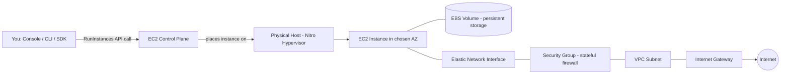

# Amazon EC2 (Elastic Compute Cloud)


## Definition

Amazon EC2 lets you rent a virtual computer in AWS's data centers, by the second, and use it like
any server — install software, open ports, store files, run a website — except you never touch
physical hardware, and you can create or destroy it in about a minute.

## Purpose

Before cloud computing, "I need a server" meant: order hardware, wait weeks for delivery, rack it,
wire it, install an OS, and hope you guessed the right size — too small and it falls over under
load, too big and you wasted money sitting idle. EC2 removes all of that. AWS already owns the
physical fleet; you just claim a slice of it (a virtual machine, called an **instance**) for as
long as you need, in whatever size fits, and give it back the moment you're done. This is the
core promise of "elastic" compute: capacity that grows and shrinks with your actual demand instead
of your best guess at peak demand.

## How It Works

In plain terms: you tell AWS four things — what software to start from (an **AMI**, Amazon Machine
Image), how big a machine you want (an **instance type**, e.g., CPU/RAM/network profile), which
network it should live in (a VPC subnet), and what traffic is allowed to reach it (a **security
group**). AWS finds physical hardware with spare capacity in the Availability Zone you picked,
boots your chosen OS image on top of its hypervisor (the **Nitro System** on modern instance
types), attaches storage, and hands you a running machine with a private IP (and a public IP if
you asked for one).



Walking through it: you call the EC2 API (directly, via CLI, or via console clicks that call the
API for you) with a `RunInstances` request. The **control plane** — AWS's own management layer —
picks a physical host in the Availability Zone you specified that has room, and boots your AMI on
it using the Nitro hypervisor, which is what makes the "virtual" machine behave like real hardware
to your OS. The instance gets at least one **Elastic Network Interface (ENI)**, which is the
virtual network card; every ENI is attached to a **security group**, a stateful firewall that
decides what traffic in and out is allowed — "stateful" meaning if you allow an inbound request,
the matching response is automatically allowed back out, you don't have to write a rule for it.
The instance's ENI lives inside a **VPC subnet**; if that subnet has a route to an **Internet
Gateway** and the instance has a public IP, it can reach (and be reached from) the internet.
Storage is separate from compute: an **EBS volume** is a virtual hard drive that persists
independently of the instance's lifecycle (stop/start/terminate), unlike the now-rare **instance
store**, which is physically attached to that one host and disappears when the instance stops.

## Key Features / Components

- **AMI (Amazon Machine Image)** — the template: OS + pre-installed software + configuration. AWS
  provides official ones (Amazon Linux, Ubuntu, Windows Server); you can also build your own
  "golden image" from a configured instance.
- **Instance type/family** — the hardware shape. `t3`/`t4g` (burstable, cheap, general purpose),
  `m5`/`m6i` (balanced general purpose), `c6i` (compute-optimized, CPU-heavy), `r6i`/`x2`
  (memory-optimized, in-memory databases/caches), `i3`/`d3` (storage-optimized, high local disk
  I/O), `p5`/`g5` (GPU-accelerated, ML training/inference, graphics).
- **EBS (Elastic Block Store) volumes** — network-attached, persistent block storage; survives
  instance stop/terminate (unless you set `DeleteOnTermination`). Types: `gp3` (general purpose
  SSD, the default choice), `io2` (high IOPS, databases), `st1`/`sc1` (throughput-optimized HDD,
  cheap, for big sequential workloads like logs).
- **Instance store** — physically local disk on the host; faster, but *ephemeral* — data is lost
  on stop or host failure. Used for caches/scratch space, never for anything you can't regenerate.
- **Security Groups** — stateful, instance-level firewall; default-deny inbound, default-allow all
  outbound; you only write *allow* rules.
- **Network ACLs (NACLs)** — stateless, subnet-level firewall (covered in the networking docs);
  you must write both inbound and outbound rules explicitly. Security groups and NACLs stack — a
  request must pass both.
- **Key Pairs** — the SSH/RDP credential used to log into the instance the first time (public key
  injected into the instance at boot, you keep the private key).
- **User Data** — a bootstrap script (bash/PowerShell) that runs once on first boot — the standard
  way to install software and configure an instance automatically at launch.
- **Elastic IP** — a static public IPv4 address you own and can re-point between instances (useful
  for failover; AWS charges for one that's allocated but not attached, to discourage hoarding).
- **Placement Groups** — control physical placement: `cluster` (pack tightly for lowest
  network latency, HPC workloads), `spread` (max 7 instances, each on different hardware, for
  critical instances that must not share a failure domain), `partition` (groups of instances
  isolated from other partitions, for large distributed systems like Kafka/Cassandra).
- **Tenancy** — `default` (shared hardware), `dedicated instance` (your own hardware, shared
  AWS account billing), `dedicated host` (you get the physical host, visible socket/core counts —
  needed for bring-your-own-license scenarios tied to physical cores).
- **IMDSv2 (Instance Metadata Service v2)** — a token-based, session-oriented way for code running
  *on* the instance to ask "what am I" (its own IP, IAM role credentials, etc.) without needing
  credentials baked into code. v2 requires a PUT request to fetch a token first, closing an SSRF
  (Server-Side Request Forgery) attack path that IMDSv1 left open.
- **Purchasing options** — On-Demand, Reserved Instances, Savings Plans, Spot (see Pricing below).

## Use Cases — When to Use It

- **Lift-and-shift of an existing app** that expects to control its own OS, install arbitrary
  system packages, or needs a specific kernel/driver — EC2 gives you that OS-level control that
  Lambda/Fargate don't.
- **Long-running, steady-state workloads** — a web server or application server that's up 24/7 —
  where you can reserve capacity and get a discount instead of paying the serverless per-invoke
  premium.
- **Custom or legacy runtime requirements** — an old Java version, a licensed commercial database
  engine installed yourself, a Windows-only app.
- **GPU workloads** — training or serving ML models on `p5`/`g5` instance families when you need
  direct control over the CUDA stack, batch size, and driver versions.
- **Self-managed databases or caches** that aren't offered as a managed service, or where you
  need tuning knobs the managed version (RDS) doesn't expose.
- **Dev/test environments** you can snapshot as an AMI and spin up identically on demand.

## When NOT to Use It / Alternatives

- **Spiky, event-driven workloads with real idle time** (a function that runs for 200ms when a
  file lands in S3) — running an EC2 instance 24/7 to wait for that event wastes money; use
  **AWS Lambda** instead, which only bills for execution time.
- **Containerized microservices where you don't want to patch/manage the underlying OS** — use
  **ECS/EKS on Fargate**, which removes host management entirely while still giving you
  container-level control.
- **A simple web app you want running with minimal ops** and a predictable low monthly bill — use
  **Elastic Beanstalk** (managed EC2 under the hood) or **Lightsail** (bundled, flat-rate VPS) to
  avoid hand-managing security groups, AMIs, and scaling policies yourself.
- **Unpredictable scale where "zero idle servers" matters more than raw cost-per-request** —
  serverless (Lambda, Fargate) scales to zero; EC2 does not (an Auto Scaling Group can scale down
  to a minimum, but rarely to literally zero while staying "warm").
- The general tradeoff: EC2 gives you maximum control at the cost of operational responsibility
  (patching, scaling, OS security) that managed/serverless options absorb for you.

## Why It's Important

**Real world:** EC2 is the oldest and still one of the most heavily used AWS services — it's the
literal foundation that higher-level services (Elastic Beanstalk, ECS, EKS, even parts of RDS) run
on top of. Two real-world failure modes dominate: **cost** (idle or oversized instances running
on On-Demand pricing 24/7 is the single most common AWS bill surprise) and **security**
(overly-permissive security groups — like `0.0.0.0/0` on port 22/3389 — are a leading cause of
real breaches). Getting instance sizing, purchasing options, and security groups right is a daily
skill for anyone operating real AWS infrastructure.

**Exam relevance:**
- **SAA-C03** — Domain 3 "Design High-Performing Architectures" (Task 3.2, choosing the right
  compute solution) and Domain 4 "Design Cost-Optimized Architectures" (Task 4.2, Spot/Reserved/
  Savings Plans tradeoffs) are both heavily EC2-centric. Domain 2 (resilience) builds directly on
  EC2 fundamentals via Auto Scaling Groups and Multi-AZ placement.
- **DVA-C03** — Domain 1 "Development with AWS Services" (Task 1.1, code hosted on compute) and
  Domain 3 "Testing and Deployment" assume you understand EC2 as a deployment target, including
  user data and IMDSv2 for secure credential retrieval.
- **MLA-C02** — Domain 3 "Deployment and Orchestration" tests choosing CPU vs. GPU instance
  families for training/inference workloads, and Spot vs. On-Demand for cost-sensitive training
  jobs.

## Pricing Model (summary)

- **On-Demand** — pay per second (minimum 60s) with no commitment; most expensive per-hour, most
  flexible.
- **Reserved Instances (RI)** — commit to 1 or 3 years for a specific instance family/region,
  up to ~72% cheaper than On-Demand; Standard RIs are inflexible on instance type, Convertible RIs
  allow changing instance family during the term.
- **Savings Plans** — commit to a $/hour spend (Compute Savings Plans) or specific instance family
  (EC2 Instance Savings Plans) for 1 or 3 years; more flexible than RIs, similar discount depth.
- **Spot Instances** — bid on AWS's spare capacity, up to ~90% cheaper, but AWS can reclaim the
  instance with a 2-minute warning when it needs the capacity back — only for fault-tolerant,
  interruptible workloads (batch jobs, CI runners, stateless web tiers behind an ASG).
- **Dedicated Hosts/Instances** — priced higher, for compliance or BYOL (bring-your-own-license)
  needs tied to physical sockets/cores.
- **Free Tier** — 750 hours/month of `t2.micro`/`t3.micro` for the first 12 months of a new
  account (subject to change — check the official page).
- Official current pricing: https://aws.amazon.com/ec2/pricing/

## Hands-on Lab (Floci)

Floci emulates the EC2 control-plane API with real Docker containers backing the instances —
good enough to practice the actual CLI workflow end-to-end.

```bash
# 1. Create a security group
awslocal ec2 create-security-group \
  --group-name my-web-sg \
  --description "Allow HTTP and SSH"

# 2. Authorize inbound traffic on it (use the GroupId returned above)
awslocal ec2 authorize-security-group-ingress \
  --group-id sg-xxxxxxxx \
  --protocol tcp --port 22 --cidr 0.0.0.0/0

awslocal ec2 authorize-security-group-ingress \
  --group-id sg-xxxxxxxx \
  --protocol tcp --port 80 --cidr 0.0.0.0/0

# 3. Create a key pair (save the private key material it returns)
awslocal ec2 create-key-pair --key-name my-lab-key \
  --query "KeyMaterial" --output text > my-lab-key.pem

# 4. Launch an instance with a bootstrap script (user data)
echo '#!/bin/bash
echo "Hello from EC2 user data" > /tmp/hello.txt' > userdata.sh

awslocal ec2 run-instances \
  --image-id ami-00000000 \
  --instance-type t3.micro \
  --key-name my-lab-key \
  --security-group-ids sg-xxxxxxxx \
  --user-data file://userdata.sh \
  --count 1

# 5. Check it's running
awslocal ec2 describe-instances \
  --query "Reservations[].Instances[].{ID:InstanceId,State:State.Name,Type:InstanceType}"

# 6. Stop and terminate when done
awslocal ec2 stop-instances --instance-ids i-xxxxxxxx
awslocal ec2 terminate-instances --instance-ids i-xxxxxxxx
```

See `labs-floci/README.md` for the shared setup (Docker + `awslocal` alias). This exercises the
full lifecycle — security group, key pair, launch, inspect, teardown — which is exactly the
workflow the exam expects you to reason about, even though the exam itself is conceptual, not
hands-on.

## Exam Tips

- **Security Group vs. NACL** is a guaranteed exam trap: Security Groups are **stateful**
  (allow-only, instance-level), NACLs are **stateless** (allow + deny rules, subnet-level, rules
  evaluated in number order). A question describing "need to explicitly block a specific IP" is
  pointing at a NACL, not a security group (security groups can't deny).
- **EBS vs. Instance Store**: EBS persists independently of the instance; instance store is
  ephemeral and tied to the physical host. If a question emphasizes "data must survive a stop" —
  that's EBS.
- **IMDSv2 requirement**: expect DVA-C03 security questions where the "more secure" answer is
  enforcing IMDSv2 (token-required) over IMDSv1 to prevent SSRF-based credential theft.
- **Spot vs. Reserved vs. Savings Plans vs. On-Demand**: the exam loves cost scenarios. Keywords:
  "interruption-tolerant batch job" → Spot. "Steady, predictable, long-term" → Reserved/Savings
  Plans. "Short-term or unknown duration" → On-Demand.
  Read the skill-recall question for whether workload can tolerate interruption before answering.
- **Placement Groups**: "lowest possible network latency between instances" → `cluster`.
  "Must not share underlying hardware with its peers for availability" → `spread`.
- Don't confuse EC2 (you manage the OS) with Elastic Beanstalk (AWS manages EC2 for you) or
  Fargate (no EC2 host at all) — exam questions test whether you pick the right abstraction level
  for the stated operational requirement.

## Related Terms

- [`ec2-auto-scaling.md`](ec2-auto-scaling.md) — scaling groups of EC2 instances automatically
- [`fargate.md`](fargate.md) — serverless container compute, the "no EC2 to manage" alternative
- [`elastic-beanstalk.md`](elastic-beanstalk.md) — managed EC2 deployment platform
- [`lightsail.md`](lightsail.md) — simplified, flat-rate EC2 for small projects
- [`ecs-eks-overview-note.md`](ecs-eks-overview-note.md) — container orchestration on top of EC2 or Fargate
- `services/networking-content-delivery/` — VPC, subnets, security groups, NACLs (once written)
- `services/storage/` — EBS volume types and snapshots (once written)
- `glossary/README.md` — IAM, AMI, Availability Zone definitions
