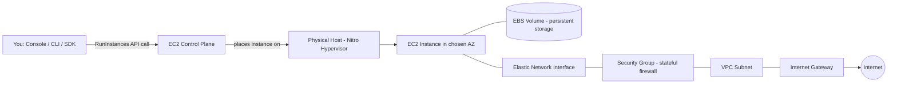
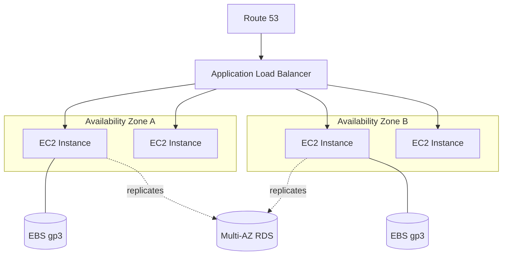
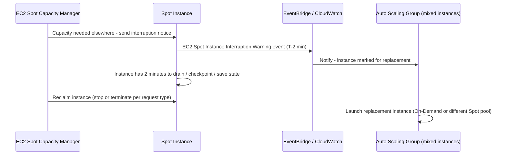
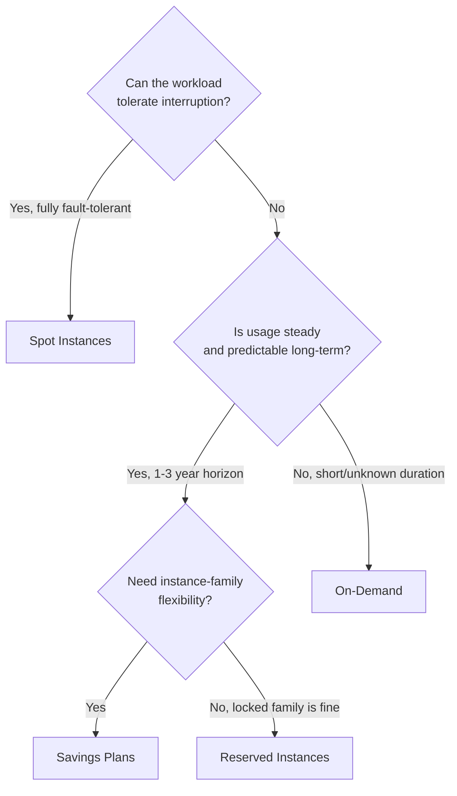

# Amazon EC2 (Elastic Compute Cloud)


## Definition

Amazon EC2 lets you rent a virtual computer in AWS's data centers, by the second, and use it like
any server — install software, open ports, store files, run a website — except you never touch
physical hardware, and you can create or destroy it in about a minute.

## Purpose

Before cloud computing, "I need a server" meant: order hardware, wait weeks for delivery, rack it,
wire it, install an OS, and hope you guessed the right size — too small and it falls over under
load, too big and you wasted money sitting idle. EC2 removes all of that. AWS already owns the
physical fleet; you just claim a slice of it (a virtual machine, called an **instance**) for as
long as you need, in whatever size fits, and give it back the moment you're done. This is the
core promise of "elastic" compute: capacity that grows and shrinks with your actual demand instead
of your best guess at peak demand.

EC2 launched in 2006 as one of AWS's first services and is still, by revenue and by breadth of
use, one of the most important compute products in the industry. Nearly every other AWS compute
service — Elastic Beanstalk, ECS/EKS (EC2 launch type), EMR, and even parts of RDS — is EC2 running
underneath a more opinionated management layer. Understanding EC2 deeply pays off everywhere else.

## How It Works

In plain terms: you tell AWS four things — what software to start from (an **AMI**, Amazon Machine
Image), how big a machine you want (an **instance type**, e.g., CPU/RAM/network profile), which
network it should live in (a VPC subnet), and what traffic is allowed to reach it (a **security
group**). AWS finds physical hardware with spare capacity in the Availability Zone you picked,
boots your chosen OS image on top of its hypervisor (the **Nitro System** on modern instance
types), attaches storage, and hands you a running machine with a private IP (and a public IP if
you asked for one).



Walking through it: you call the EC2 API (directly, via CLI, or via console clicks that call the
API for you) with a `RunInstances` request. The **control plane** — AWS's own management layer —
picks a physical host in the Availability Zone you specified that has room, and boots your AMI on
it using the Nitro hypervisor, which is what makes the "virtual" machine behave like real hardware
to your OS. The instance gets at least one **Elastic Network Interface (ENI)**, which is the
virtual network card; every ENI is attached to a **security group**, a stateful firewall that
decides what traffic in and out is allowed — "stateful" meaning if you allow an inbound request,
the matching response is automatically allowed back out, you don't have to write a rule for it.
The instance's ENI lives inside a **VPC subnet**; if that subnet has a route to an **Internet
Gateway** and the instance has a public IP, it can reach (and be reached from) the internet.
Storage is separate from compute: an **EBS volume** is a virtual hard drive that persists
independently of the instance's lifecycle (stop/start/terminate), unlike the now-rare **instance
store**, which is physically attached to that one host and disappears when the instance stops.

### The instance lifecycle in detail

An instance doesn't just exist or not exist — it moves through a defined set of states, and
whether you're billed depends on which one it's in. `pending` → `running` → (`stopping` →
`stopped` → `pending` again if you restart it) → `shutting-down` → `terminated`. You're billed
only while `running` (with the narrow exception of hibernating instances, which bill during
`stopping` too, because RAM contents are being written to the root EBS volume). A stopped instance
keeps its instance ID, private IP (unless it's a VPC without that reservation), and attached EBS
volumes, but releases its public IP and any instance-store data — this single distinction (what
survives a stop vs. a terminate) is one of the most exam-relevant facts about the service.


*This diagram, pulled directly from the AWS documentation, shows the full instance state machine:
`pending` is the only way in, `terminated` is the only way out with no return path, and
`stopping`/`stopped` form a reversible loop you can cycle through indefinitely. Notice that
`rebooting` isn't a distinct billed/unbilled state transition at all — a reboot keeps the instance
`running` the whole time, on the same host, unlike a stop/start cycle which can (and often does)
move the instance to different physical hardware.*
**Source:** AWS Documentation — [Amazon EC2 instance state changes](https://docs.aws.amazon.com/AWSEC2/latest/UserGuide/ec2-instance-lifecycle.html), Amazon EC2 User Guide.

### What the Nitro System actually changed

Every current-generation instance type runs on the **Nitro System**, a from-scratch
re-architecture AWS introduced starting with the C5 instance family in 2017. Before Nitro, a
general-purpose hypervisor (Xen) ran on the same general-purpose CPU as your workload, doing
storage/network virtualization in software and stealing CPU cycles to do it. Nitro moves nearly
all of that work — networking, storage, and the management/monitoring plane — onto dedicated,
purpose-built hardware cards that sit beside the main CPU board, leaving a minimized, firmware-like
hypervisor whose only job is thin CPU/memory virtualization. The practical result: EC2 instances on
Nitro perform almost identically to bare metal, support **Nitro Enclaves** (isolated, attestable
compute environments for sensitive data processing) and, critically for security-conscious exam
questions, make it architecturally impossible for an AWS operator to use SSH or any interactive
access to a Nitro host — the "no human can access the hardware running your workload" security
claim AWS makes for the whole EC2 fleet rests on this hardware redesign.


*The diagram separates the system main board (where your instance's OS and application actually
run, using Intel/AMD/Graviton processors) from the Nitro Cards and Nitro Security Chip, which
handle networking, storage I/O, and the hardware root of trust independently. The key takeaway
for understanding EC2's security model: your code never shares a CPU core or memory page with the
AWS control plane — they're physically separate circuits connected by a minimal, auditable
interface.*
**Source:** AWS Whitepaper — [The Security Design of the AWS Nitro System](https://docs.aws.amazon.com/whitepapers/latest/security-design-of-aws-nitro-system/security-design-of-aws-nitro-system.html).

### Multi-AZ high-availability pattern

This is the architecture the exam calls "resilient" — instances spread across AZs behind a load
balancer, with Auto Scaling replacing anything that dies:



### Spot Instance interruption handling

Understanding the interruption flow is what separates "I used Spot once" from "I can design a
Spot-safe architecture":



### Choosing a purchasing option



## Instance Type Families — Deep Dive

Instance type names follow a pattern: **family letter(s) + generation number + optional
attributes + size** — e.g., `m6i.2xlarge` is the `m` (general purpose) family, 6th generation,
`i` (Intel), size `2xlarge`. Knowing the family letters cold is worth more on the exam (and in
real cost/architecture decisions) than almost any other single EC2 fact.

| Family | Optimized for | Example types | vCPU:RAM ratio | Typical use |
|---|---|---|---|---|
| `t3`/`t4g` | Burstable, cheap baseline | `t3.micro`, `t4g.small` | 1:2 | Dev/test, low-traffic web, bursty microservices |
| `m5`/`m6i`/`m7i` | Balanced general purpose | `m6i.large`, `m6i.xlarge` | 1:4 | Most application servers, small-medium databases |
| `c6i`/`c7g` | Compute-optimized (high CPU, less RAM per vCPU) | `c6i.xlarge`, `c7g.2xlarge` | 1:2 | Batch processing, media encoding, high-traffic web front ends, HPC |
| `r6i`/`r5`/`x2gd` | Memory-optimized (high RAM per vCPU) | `r6i.xlarge`, `x2gd.xlarge` | 1:8 (r-family), much higher for x2 | In-memory caches, large relational/NoSQL databases, SAP HANA |
| `i3`/`i4i`/`d3` | Storage-optimized (fast local NVMe or dense HDD) | `i4i.xlarge`, `d3.xlarge` | varies | High-IOPS databases run on instance store, data warehousing, distributed file systems |
| `p5`/`g5`/`g4dn` | GPU-accelerated | `g4dn.xlarge`, `p5.48xlarge` | — | ML training/inference, video transcoding, 3D rendering |
| `a1`/`t4g`/`c7g`/`m7g` (Graviton) | ARM-based, better price-performance | any `g`-suffixed type | — | Same workloads as their x86 equivalents, ~20% lower cost, often faster for the same wattage |
| `hpc6a`/`hpc7g` | High performance computing, tightly networked | `hpc7g.16xlarge` | — | Tightly-coupled HPC clusters (CFD, weather modeling) needing low inter-node latency |
| `u-*` (High Memory) | Massive single-instance RAM (multiple TB) | `u-6tb1.112xlarge` | — | SAP HANA and other workloads needing huge single-node memory, no sharding |

**Reading the vCPU:RAM ratio** is the fastest way to eliminate wrong answers on a sizing question:
a question describing "CPU-bound video transcoding batch job, cost-sensitive" points at `c`-family
(cheap vCPUs, don't need the RAM); "in-memory cache holding a 60 GB working set" points at
`r`-family; "general web app, don't know the profile yet" points at `m`-family as the safe default.

### Burstable (`t`-family) CPU credits, explained with numbers

`t3`/`t4g` instances are cheap because they're *not* guaranteed full CPU all the time — they earn
**CPU credits** during idle periods and spend them during bursts. A `t3.micro` earns 6 credits/hour
and can bank up to 144 credits; one credit buys one vCPU-minute at 100% utilization. In
**Unlimited mode** (the default since 2017), if you run out of banked credits, AWS lets the
instance keep bursting above baseline and bills you **$0.05 per vCPU-hour** (Linux) for the
surplus — meaning a `t3` instance under *sustained* heavy load can silently cost more per hour than
a fixed-performance `m`-family instance of similar size. This is a real, common billing surprise:
teams see a cheap `t3.medium` ($0.0416/hr base) balloon because a backup job pegs the CPU for
hours a day, racking up CPU-credit surplus charges. The exam-relevant lesson: `t`-family is for
genuinely *bursty* workloads with real idle time between bursts, not for anything with sustained
high CPU.

## Pricing Model — Deep Dive With Worked Examples

- **On-Demand** — pay per second (minimum 60s) with no commitment; most expensive per-hour, most
  flexible. Example current (illustrative, always check the official page for live rates)
  US East (N. Virginia) Linux rates: `t3.micro` ≈ $0.0104/hr, `t3.medium` ≈ $0.0416/hr, `m6i.large`
  ≈ $0.0960/hr, `c6i.large` ≈ $0.085/hr, `r6i.large` ≈ $0.126/hr.
- **Reserved Instances (RI)** — commit to 1 or 3 years for a specific instance family/region,
  up to ~72% cheaper than On-Demand; Standard RIs are inflexible on instance type, Convertible RIs
  allow changing instance family during the term.
- **Savings Plans** — commit to a $/hour spend (Compute Savings Plans) or specific instance family
  (EC2 Instance Savings Plans) for 1 or 3 years; more flexible than RIs, similar discount depth.
- **Spot Instances** — bid on AWS's spare capacity, up to ~90% cheaper, but AWS can reclaim the
  instance with a 2-minute warning when it needs the capacity back — only for fault-tolerant,
  interruptible workloads (batch jobs, CI runners, stateless web tiers behind an ASG).
- **Dedicated Hosts/Instances** — priced higher, for compliance or BYOL (bring-your-own-license)
  needs tied to physical sockets/cores.
- **Free Tier** — 750 hours/month of `t2.micro`/`t3.micro` for the first 12 months of a new
  account (subject to change — check the official page).
- Official current pricing: https://aws.amazon.com/ec2/pricing/

### Worked cost example: three ways to run the same fleet

Say you need 4 × `m6i.large` (2 vCPU, 8 GiB) running 24/7, 365 days a year, in `us-east-1`.

| Purchase option | Rate basis | Monthly cost (4 instances, 730 hrs/mo) | Annual cost | Savings vs. On-Demand |
|---|---|---|---|---|
| On-Demand | $0.0960/hr × 4 | $280.32 | $3,363.84 | — baseline |
| 1-yr Standard RI, No Upfront (~40% off, illustrative) | ~$0.0576/hr × 4 | $168.19 | $2,018.30 | ~40% |
| 3-yr Standard RI, All Upfront (~60% off, illustrative) | ~$0.0384/hr × 4 | $112.13 (amortized) | $1,345.54 | ~60% |
| Spot (interruption-tolerant workload only, ~65% off, illustrative) | ~$0.0331/hr × 4 | $96.66 | $1,159.97 | ~65% |

The lesson this table is meant to teach: **the discount tiers roughly double from On-Demand → RI →
Spot**, and the exam question "which pricing model for a steady 24/7 production database tier that
cannot tolerate interruption" should always land on RI/Savings Plans (steady + can't interrupt),
never Spot (steady + *can* tolerate interruption would still be a judgment call, but anything
stateful and latency-sensitive rules Spot out immediately).

### Worked cost example: a batch job on Spot vs. On-Demand

A nightly ETL job needs roughly 200 `c6i.xlarge`-hours (e.g., 20 instances × 10 hours, or any
equivalent split) once per night, every night, for a month (30 nights = 6,000 instance-hours).
`c6i.xlarge` On-Demand ≈ $0.17/hr; Spot for the same type typically runs 60-70% cheaper, say
$0.0595/hr (illustrative ~65% discount).

- On-Demand: 6,000 hrs × $0.17 = **$1,020/month**
- Spot: 6,000 hrs × $0.0595 = **$357/month**, a savings of **$663/month (~65%)**

This is exactly the math that makes AWS Batch + Spot (covered in `aws-batch.md`) the default
answer for cost-sensitive, interruption-tolerant batch processing at scale.

### Networking deep-dive: ENIs, placement, and data transfer costs

Every instance's network performance and cost profile is shaped by three things that are easy to
overlook when you only think about compute:

- **Network performance by instance size** — within a family, network bandwidth scales with
  instance size (e.g., `m6i.large` gets "Up to 12.5 Gbps", `m6i.8xlarge` gets a dedicated
  12.5 Gbps, `m6i.32xlarge` gets 50 Gbps). A common real-world mistake is picking the smallest
  instance that satisfies a CPU/RAM requirement and then being surprised when network-bound
  workloads (large file transfers, replication) underperform — always check the network column,
  not just vCPU/RAM, for anything data-transfer heavy.
- **Enhanced Networking (ENA)** — all current-generation instances use the Elastic Network
  Adapter, giving higher packets-per-second and lower jitter than older software-emulated NICs;
  this is automatic on Nitro-based instances, nothing to configure.
- **Data transfer pricing** — this is the quietly expensive part of running EC2 that the hourly
  instance rate doesn't show: data transfer **into** AWS is free; data transfer **within the same
  AZ** is free; data transfer **between AZs in the same Region** is billed both ways at roughly
  $0.01/GB each direction; data transfer **out to the internet** is billed on a tiered scale
  starting around $0.09/GB for the first 10 TB/month (exact current rate: check the official
  page). A chatty multi-AZ application moving large volumes of data between tiers in different
  AZs can rack up more in cross-AZ transfer fees than in EC2 compute charges — a genuinely common
  real-world cost surprise, and a frequent SAA-C03 cost-optimization scenario ("same-AZ placement
  to reduce transfer costs" is a legitimate correct answer when latency/redundancy tradeoffs allow
  it).

### EBS volume types in more depth

| Volume type | Media | Baseline performance | Best for | Approx. price basis |
|---|---|---|---|---|
| `gp3` | SSD | 3,000 IOPS / 125 MiB/s included, scalable independently up to 16,000 IOPS / 1,000 MiB/s for an extra fee | Default choice for almost everything — boot volumes, most databases, general app storage | ~$0.08/GB-month |
| `gp2` (previous generation) | SSD | IOPS scale with volume size (3 IOPS/GB, burstable) | Legacy volumes not yet migrated to gp3 | ~$0.10/GB-month |
| `io2` / `io2 Block Express` | SSD | Up to 256,000 IOPS, 99.999% durability | Mission-critical databases needing guaranteed high IOPS independent of volume size | Higher per-GB + per-provisioned-IOPS charge |
| `st1` | HDD | Throughput-optimized, cannot be a boot volume | Big sequential workloads: log processing, data warehouses | Cheapest per-GB of the throughput tiers |
| `sc1` | HDD | Lowest cost, infrequent access | Cold data, rarely-accessed archives that still need block access | Cheapest EBS option overall |

The practical exam signal: "need the cheapest storage for infrequently accessed large sequential
data, can't use it as a boot volume" → `sc1`/`st1`. "Need guaranteed high, consistent IOPS for a
critical database regardless of volume size" → `io2`. Anything else, including "what should I
pick by default" → `gp3`.

## Key Features / Components

- **AMI (Amazon Machine Image)** — the template: OS + pre-installed software + configuration. AWS
  provides official ones (Amazon Linux, Ubuntu, Windows Server); you can also build your own
  "golden image" from a configured instance.
- **Instance type/family** — the hardware shape (see the deep-dive table above).
- **EBS (Elastic Block Store) volumes** — network-attached, persistent block storage; survives
  instance stop/terminate (unless you set `DeleteOnTermination`). Types: `gp3` (general purpose
  SSD, the default choice — 3,000 IOPS / 125 MiB/s baseline included, both scalable independently
  of size for an extra fee), `io2`/`io2 Block Express` (high IOPS, up to 256,000 IOPS, for the most
  demanding databases), `st1`/`sc1` (throughput-optimized HDD, cheap, for big sequential workloads
  like logs).
- **Instance store** — physically local disk on the host; faster, but *ephemeral* — data is lost
  on stop or host failure. Used for caches/scratch space, never for anything you can't regenerate.
- **Security Groups** — stateful, instance-level firewall; default-deny inbound, default-allow all
  outbound; you only write *allow* rules.
- **Network ACLs (NACLs)** — stateless, subnet-level firewall (covered in the networking docs);
  you must write both inbound and outbound rules explicitly. Security groups and NACLs stack — a
  request must pass both.
- **Key Pairs** — the SSH/RDP credential used to log into the instance the first time (public key
  injected into the instance at boot, you keep the private key).
- **User Data** — a bootstrap script (bash/PowerShell) that runs once on first boot — the standard
  way to install software and configure an instance automatically at launch.
- **Elastic IP** — a static public IPv4 address you own and can re-point between instances (useful
  for failover; AWS charges for one that's allocated but not attached, to discourage hoarding, and
  — since February 2024 — a small hourly charge for *every* public IPv4 address, attached or not).
- **Placement Groups** — control physical placement: `cluster` (pack tightly for lowest
  network latency, HPC workloads), `spread` (max 7 instances per AZ, each on different hardware, for
  critical instances that must not share a failure domain), `partition` (groups of instances
  isolated from other partitions, for large distributed systems like Kafka/Cassandra, up to 7
  partitions per AZ).
- **Tenancy** — `default` (shared hardware), `dedicated instance` (your own hardware, shared
  AWS account billing), `dedicated host` (you get the physical host, visible socket/core counts —
  needed for bring-your-own-license scenarios tied to physical cores).
- **IMDSv2 (Instance Metadata Service v2)** — a token-based, session-oriented way for code running
  *on* the instance to ask "what am I" (its own IP, IAM role credentials, etc.) without needing
  credentials baked into code. v2 requires a PUT request to fetch a token first, closing an SSRF
  (Server-Side Request Forgery) attack path that IMDSv1 left open.
- **Purchasing options** — On-Demand, Reserved Instances, Savings Plans, Spot (see Pricing above).
- **Capacity Reservations** — reserve capacity in a specific AZ without a long-term billing
  commitment (unlike RIs, which are a billing construct more than a capacity guarantee);
  guarantees you can launch even during a capacity crunch.
- **Hibernation** — stop an instance while preserving its in-memory (RAM) state to the root EBS
  volume, so a restart resumes exactly where it left off instead of a cold OS boot.

## Common Architectures

1. **Classic three-tier web application** — a public-facing Application Load Balancer, an Auto
   Scaling Group of `m`-family EC2 instances across 2-3 AZs running the app tier, and a Multi-AZ
   RDS database in private subnets. This is the default SAA-C03 "design a resilient, scalable web
   app" answer, and almost every other compute service in this folder is positioned as an
   alternative to some part of this pattern.
2. **Self-managed database or cache cluster** — teams running something RDS doesn't offer
   natively (an unusual database engine, a specific tuning requirement, Redis Cluster mode with
   custom configuration) run EC2 instances from the `r`/`i` families directly, often with instance
   store for the hottest data and EBS `io2` for durability-critical data, inside a placement group
   for low inter-node latency.
3. **GPU-backed ML training fleet** — `p5`/`g5` instances, frequently purchased as Spot for
   cost-sensitive experimentation and On-Demand/Reserved for production training runs with firm
   deadlines, often orchestrated by a job scheduler (see `aws-batch.md`) rather than launched
   by hand.
4. **Bastion/jump host pattern** — a single small, hardened EC2 instance (or, increasingly,
   Session Manager without a bastion at all) in a public subnet as the only SSH entry point into a
   fleet of otherwise fully private instances — a recurring security-architecture exam scenario.

## Use Cases — When to Use It

- **Lift-and-shift of an existing app** that expects to control its own OS, install arbitrary
  system packages, or needs a specific kernel/driver — EC2 gives you that OS-level control that
  Lambda/Fargate don't. This is the single most common first AWS migration pattern for
  organizations moving off physical/on-prem hardware: the application code doesn't change, only
  the box it runs on does.
- **Long-running, steady-state workloads** — a web server or application server that's up 24/7 —
  where you can reserve capacity and get a discount instead of paying the serverless per-invoke
  premium.
- **Custom or legacy runtime requirements** — an old Java version, a licensed commercial database
  engine installed yourself, a Windows-only app.
- **GPU workloads** — training or serving ML models on `p5`/`g5` instance families when you need
  direct control over the CUDA stack, batch size, and driver versions.
- **Self-managed databases or caches** that aren't offered as a managed service, or where you
  need tuning knobs the managed version (RDS) doesn't expose.
- **Dev/test environments** you can snapshot as an AMI and spin up identically on demand.
- **High Performance Computing (HPC)** — tightly-coupled simulations (computational fluid
  dynamics, genomics, weather modeling) using `hpc6a`/`hpc7g` instances in `cluster` placement
  groups for the lowest possible inter-node network latency, something no serverless offering can
  match since they don't expose node-to-node network topology at all.
- **Specialized compliance/licensing needs** — software licensed per physical core or socket
  (certain enterprise databases, some vendor appliances) requires Dedicated Hosts, which only EC2
  offers.

## When NOT to Use It / Alternatives

- **Spiky, event-driven workloads with real idle time** (a function that runs for 200ms when a
  file lands in S3) — running an EC2 instance 24/7 to wait for that event wastes money; use
  **AWS Lambda** instead, which only bills for execution time.
- **Containerized microservices where you don't want to patch/manage the underlying OS** — use
  **ECS/EKS on Fargate**, which removes host management entirely while still giving you
  container-level control.
- **A simple web app you want running with minimal ops** and a predictable low monthly bill — use
  **Elastic Beanstalk** (managed EC2 under the hood) or **Lightsail** (bundled, flat-rate VPS) to
  avoid hand-managing security groups, AMIs, and scaling policies yourself.
- **Unpredictable scale where "zero idle servers" matters more than raw cost-per-request** —
  serverless (Lambda, Fargate) scales to zero; EC2 does not (an Auto Scaling Group can scale down
  to a minimum, but rarely to literally zero while staying "warm").
- **Large-scale parallel batch processing with a job queue and complex retry needs** — use
  **AWS Batch**, which adds a scheduler/queue layer EC2 alone doesn't provide (though Batch itself
  can use EC2 as its compute backend).
- The general tradeoff: EC2 gives you maximum control at the cost of operational responsibility
  (patching, scaling, OS security) that managed/serverless options absorb for you.

## Security & Compliance Considerations

- **Patch management is entirely your responsibility** on EC2 — AWS patches the hypervisor/Nitro
  layer, you patch the guest OS. AWS Systems Manager Patch Manager is the common way to automate
  this at scale rather than SSHing into every box by hand.
- **Shared Responsibility Model**: for EC2 specifically, AWS is responsible for the physical
  hardware, the Nitro hypervisor, and the global infrastructure; you're responsible for the guest
  OS, any software you install, network configuration (security groups/NACLs), IAM policies
  attached to the instance's role, and data encryption choices. This is one of the most
  consistently tested conceptual distinctions across all three certifications covered here.
- **Instance profiles / IAM roles**, not long-lived access keys, are the correct way for code on
  an instance to call other AWS services — baking an IAM user's access key into an AMI or user
  data script is a textbook wrong answer on security-focused exam questions.
- **Encryption at rest**: EBS volumes support encryption using AWS KMS keys, transparently to the
  OS and application, with effectively no performance penalty on Nitro-based instances — "encrypt
  the EBS volume" is almost always the correct answer when a scenario asks how to protect data at
  rest on an EC2-backed workload.
- **Nitro Enclaves** provide an isolated, attestable compute environment carved out of an existing
  instance's resources, with no persistent storage, no interactive access, and only a secure local
  channel to the parent instance — designed for processing especially sensitive data (PII
  tokenization, key management) where you want provable isolation even from your own
  administrators.

## Why It's Important

**Real world:** EC2 is the oldest and still one of the most heavily used AWS services — it's the
literal foundation that higher-level services (Elastic Beanstalk, ECS, EKS, even parts of RDS) run
on top of. Two real-world failure modes dominate: **cost** (idle or oversized instances running
on On-Demand pricing 24/7 is the single most common AWS bill surprise) and **security**
(overly-permissive security groups — like `0.0.0.0/0` on port 22/3389 — are a leading cause of
real breaches). Getting instance sizing, purchasing options, and security groups right is a daily
skill for anyone operating real AWS infrastructure.

**Exam relevance:**
- **SAA-C03** — Domain 3 "Design High-Performing Architectures" (Task 3.2, choosing the right
  compute solution) and Domain 4 "Design Cost-Optimized Architectures" (Task 4.2, Spot/Reserved/
  Savings Plans tradeoffs) are both heavily EC2-centric. Domain 2 (resilience) builds directly on
  EC2 fundamentals via Auto Scaling Groups and Multi-AZ placement.
- **DVA-C03** — Domain 1 "Development with AWS Services" (Task 1.1, code hosted on compute) and
  Domain 3 "Testing and Deployment" assume you understand EC2 as a deployment target, including
  user data and IMDSv2 for secure credential retrieval.
- **MLA-C02** — Domain 3 "Deployment and Orchestration" tests choosing CPU vs. GPU instance
  families for training/inference workloads, and Spot vs. On-Demand for cost-sensitive training
  jobs.

## Limits & Quotas

These are account/Region-level defaults; most are soft limits you can raise via the Service Quotas
console or a support case.

| Quota | Default | Adjustable? |
|---|---|---|
| Running On-Demand Standard (A/C/D/H/I/M/R/T/Z family) instances | 5 **vCPUs** per Region (not 5 instances — vCPU-based) | Yes, auto-increases with usage history or via request |
| Running On-Demand G/VT (GPU/graphics) instances | 0 vCPUs by default | Yes, must be requested |
| Running On-Demand P (GPU training) instances | 0 vCPUs by default | Yes, must be requested |
| EBS volumes per instance | Depends on instance type, typically 28-40 attachable volumes | Instance-type dependent |
| Elastic IPs per Region | 5 | Yes |
| Security groups per VPC | 2,500 | Yes |
| Rules per security group | 60 inbound + 60 outbound | Yes |
| Security groups per network interface | 5 | Yes |
| Placement groups: `spread` | 7 running instances per AZ per group | Hard limit |
| Key pairs per Region | 5,000 | Yes |
| AMIs per Region | 50,000 | Yes |

The GPU-family "0 by default" quota is a common real-world gotcha: a brand-new AWS account cannot
launch a single `p5` or `g5` GPU instance until you explicitly request a quota increase — budget
time for this (often same-day, sometimes 24-48 hours) before an ML training deadline.

## Troubleshooting / Common Issues

- **"InsufficientInstanceCapacity" error on launch** — AWS genuinely ran out of spare capacity for
  that instance type in that specific AZ at that moment. Fix: try another AZ, try a different but
  similar instance type/size, or use a Capacity Reservation if this is a recurring/critical need.
- **Can't SSH/RDP into a newly launched instance** — check, in order: (1) security group allows
  port 22/3389 from your IP, (2) the subnet's route table has a route to an Internet Gateway and
  the instance has a public IP, (3) the instance passed its two status checks (system + instance)
  in the console, (4) for Linux, the correct username for the AMI (`ec2-user` for Amazon Linux,
  `ubuntu` for Ubuntu, etc.).
- **Instance launched but user data script didn't seem to run** — user data only auto-executes on
  *first* boot by default; check `/var/log/cloud-init-output.log` (Amazon Linux/Ubuntu) for errors,
  and remember changing user data on a *stopped* instance only takes effect on next start if the
  AMI's cloud-init is configured to re-run it (it isn't, by default, after first boot).
- **Unexpectedly high bill from a `t3`/`t4g` instance** — almost always CPU-credit surplus charges
  from Unlimited mode under sustained load; check CloudWatch's `CPUCreditBalance` and
  `CPUSurplusCreditBalance` metrics, and consider moving to a fixed-performance family if the
  workload's CPU profile isn't actually bursty.
- **"Data must survive a stop/terminate but it disappeared"** — almost always confusion between
  EBS-backed root volumes (persist) and instance-store volumes (ephemeral); verify the AMI/instance
  root device type (`EBS` vs. `instance-store`) before relying on survival across a stop.
- **Public IP changed after a stop/start cycle** — expected behavior for a standard (non-Elastic)
  public IP; it's released on stop and a new one assigned on start. Use an Elastic IP if you need a
  stable address across stop/start cycles.

## Pricing Model (summary)

See the Pricing Model Deep Dive section above for the full breakdown with worked numbers; in
short: On-Demand (per-second, no commitment) → Reserved/Savings Plans (steady-state discounts up
to ~72%) → Spot (interruptible, up to ~90% off) → Dedicated Hosts/Instances (compliance/BYOL,
priced at a premium). Official current pricing: https://aws.amazon.com/ec2/pricing/

## Hands-on Lab (Floci)

Floci emulates the EC2 control-plane API with real Docker containers backing the instances —
good enough to practice the actual CLI workflow end-to-end.

```bash
# 1. Create a security group
awslocal ec2 create-security-group \
  --group-name my-web-sg \
  --description "Allow HTTP and SSH"

# 2. Authorize inbound traffic on it (use the GroupId returned above)
awslocal ec2 authorize-security-group-ingress \
  --group-id sg-xxxxxxxx \
  --protocol tcp --port 22 --cidr 0.0.0.0/0

awslocal ec2 authorize-security-group-ingress \
  --group-id sg-xxxxxxxx \
  --protocol tcp --port 80 --cidr 0.0.0.0/0

# 3. Create a key pair (save the private key material it returns)
awslocal ec2 create-key-pair --key-name my-lab-key \
  --query "KeyMaterial" --output text > my-lab-key.pem

# 4. Launch an instance with a bootstrap script (user data)
echo '#!/bin/bash
echo "Hello from EC2 user data" > /tmp/hello.txt' > userdata.sh

awslocal ec2 run-instances \
  --image-id ami-00000000 \
  --instance-type t3.micro \
  --key-name my-lab-key \
  --security-group-ids sg-xxxxxxxx \
  --user-data file://userdata.sh \
  --count 1

# 5. Check it's running
awslocal ec2 describe-instances \
  --query "Reservations[].Instances[].{ID:InstanceId,State:State.Name,Type:InstanceType}"

# 6. Stop and terminate when done
awslocal ec2 stop-instances --instance-ids i-xxxxxxxx
awslocal ec2 terminate-instances --instance-ids i-xxxxxxxx
```

See `labs-floci/README.md` for the shared setup (Docker + `awslocal` alias). This exercises the
full lifecycle — security group, key pair, launch, inspect, teardown — which is exactly the
workflow the exam expects you to reason about, even though the exam itself is conceptual, not
hands-on.

### Extra practice: compare purchasing options locally

Even though Floci can't simulate real billing, it's worth running `describe-instance-types` for a
handful of families (`t3`, `m6i`, `c6i`, `r6i`) and writing down their vCPU/RAM ratios from memory
before checking — this drills the family-letter recognition the exam leans on heavily:

```bash
awslocal ec2 describe-instance-types \
  --instance-types t3.micro m6i.large c6i.large r6i.large \
  --query "InstanceTypes[].{Type:InstanceType,vCPU:VCpuInfo.DefaultVCpus,MemMiB:MemoryInfo.SizeInMiB}"
```

## Exam Tips

- **Security Group vs. NACL** is a guaranteed exam trap: Security Groups are **stateful**
  (allow-only, instance-level), NACLs are **stateless** (allow + deny rules, subnet-level, rules
  evaluated in number order). A question describing "need to explicitly block a specific IP" is
  pointing at a NACL, not a security group (security groups can't deny).
- **EBS vs. Instance Store**: EBS persists independently of the instance; instance store is
  ephemeral and tied to the physical host. If a question emphasizes "data must survive a stop" —
  that's EBS.
- **IMDSv2 requirement**: expect DVA-C03 security questions where the "more secure" answer is
  enforcing IMDSv2 (token-required) over IMDSv1 to prevent SSRF-based credential theft.
- **Spot vs. Reserved vs. Savings Plans vs. On-Demand**: the exam loves cost scenarios. Keywords:
  "interruption-tolerant batch job" → Spot. "Steady, predictable, long-term" → Reserved/Savings
  Plans. "Short-term or unknown duration" → On-Demand.
  Read the skill-recall question for whether workload can tolerate interruption before answering.
- **Placement Groups**: "lowest possible network latency between instances" → `cluster`.
  "Must not share underlying hardware with its peers for availability" → `spread`. "Large
  distributed system like Kafka/Cassandra needing partition-aware placement" → `partition`.
- **Instance family letters**: memorize `t`=burstable/cheap, `m`=balanced, `c`=compute, `r`=memory,
  `i`/`d`=storage, `p`/`g`=GPU. A question describing the workload's bottleneck resource almost
  always maps directly to one of these letters.
- **CPU credit exhaustion**: a `t`-family instance getting throttled/slow under sustained load, not
  a burst, is pointing at CPU credit exhaustion — the fix is either Unlimited mode (accept surplus
  billing) or move to a fixed-performance family.
- Don't confuse EC2 (you manage the OS) with Elastic Beanstalk (AWS manages EC2 for you) or
  Fargate (no EC2 host at all) — exam questions test whether you pick the right abstraction level
  for the stated operational requirement.

## Further Reading

- [Amazon EC2 User Guide](https://docs.aws.amazon.com/AWSEC2/latest/UserGuide/concepts.html) — official, comprehensive documentation
- [Amazon EC2 instance types](https://aws.amazon.com/ec2/instance-types/) — full, current family/size listing
- [Amazon EC2 On-Demand Pricing](https://aws.amazon.com/ec2/pricing/on-demand/) — live rate card
- [The Security Design of the AWS Nitro System (whitepaper)](https://docs.aws.amazon.com/whitepapers/latest/security-design-of-aws-nitro-system/security-design-of-aws-nitro-system.html)
- [Amazon EC2 instance type quotas](https://docs.aws.amazon.com/ec2/latest/instancetypes/ec2-instance-quotas.html) — current, authoritative limits
- [Instance purchasing options](https://docs.aws.amazon.com/AWSEC2/latest/UserGuide/instance-purchasing-options.html)

## Related Terms

- [`ec2-auto-scaling.md`](ec2-auto-scaling.md) — scaling groups of EC2 instances automatically
- [`fargate.md`](fargate.md) — serverless container compute, the "no EC2 to manage" alternative
- [`elastic-beanstalk.md`](elastic-beanstalk.md) — managed EC2 deployment platform
- [`lightsail.md`](lightsail.md) — simplified, flat-rate EC2 for small projects
- [`ecs-eks-overview-note.md`](ecs-eks-overview-note.md) — container orchestration on top of EC2 or Fargate
- `services/networking-content-delivery/` — VPC, subnets, security groups, NACLs (once written)
- `services/storage/` — EBS volume types and snapshots (once written)
- `glossary/README.md` — IAM, AMI, Availability Zone definitions
