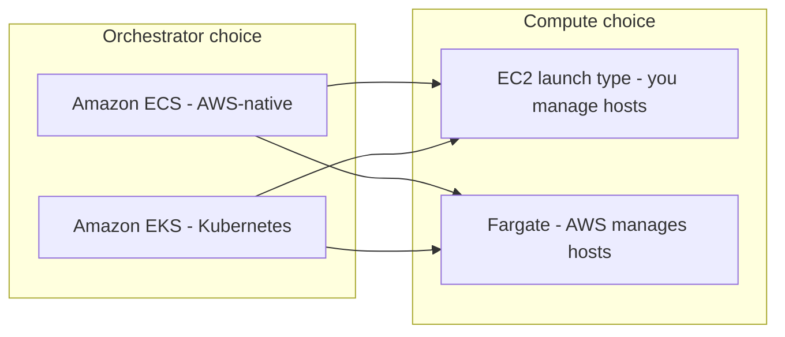

# ECS & EKS — Overview Note (see `services/containers/` for full docs)

This is a short pointer, not the canonical doc. **Amazon ECS** (Elastic Container Service) and
**Amazon EKS** (Elastic Kubernetes Service) are container **orchestrators** — they decide what
containers run, where, how many replicas, how they're networked, and how they recover from
failure. They live conceptually at the intersection of Compute and Containers in this repo; the
full architecture, task/pod scheduling, service discovery, and deep exam coverage are documented
under [`services/containers/`](../containers) once written. This note exists so compute docs
(especially [`fargate.md`](fargate.md)) have something to link to without duplicating content.

## The one-paragraph version

**ECS** is AWS's own, simpler container orchestrator — you define tasks/services using AWS-native
concepts (task definitions, clusters, services) with no Kubernetes knowledge required. **EKS** is
AWS's managed Kubernetes — the exact same Kubernetes API and ecosystem (Helm charts, kubectl,
standard YAML manifests) you'd run anywhere else, with AWS managing the Kubernetes control plane's
availability and upgrades. Both can run containers on **EC2 instances you manage** or on
**Fargate** (AWS-managed compute, no visible host) — the orchestrator (ECS/EKS) and the compute
layer (EC2/Fargate) are independent choices you combine.

Walking through it: picking ECS vs. EKS is a decision about *API and ecosystem* (AWS-native
simplicity vs. Kubernetes portability/ecosystem). Picking EC2 vs. Fargate is a separate decision
about *who manages the physical compute*. A team can mix: an EKS cluster with some workloads on
Fargate (simple, stateless web services) and others on EC2-backed node groups (GPU training jobs,
workloads needing host-level tuning).

## Quick decision guide

- **Already running/standardizing on Kubernetes**, need portability across clouds, or want the
  huge Kubernetes ecosystem (Helm, operators, service meshes) → **EKS**.
- **AWS-only, want the simplest path to "run my containers reliably"** with no Kubernetes
  learning curve → **ECS**.
- **Don't want to manage servers at all** → pair either orchestrator with **Fargate**.
- **Need GPUs, maximum cost efficiency at scale, or host-level control** → pair either
  orchestrator with the **EC2 launch type**.

## Why it's important (exam mapping)

- **SAA-C03** — Domain 2 Task 2.1 explicitly lists "containers, ECS/EKS" under scalable,
  loosely-coupled architecture design.
- **DVA-C03** — explicitly new for DVA-C03: "Containers now directly tested: ECR image build/
  tag/lifecycle, ECS/EKS/Fargate deployment" across Domain 1 and Domain 3.
- **MLA-C02** — Domain 3 covers containerizing custom ML inference code (via ECR) for deployment,
  which can target ECS/EKS as the serving orchestrator.

## Hands-on Lab (Floci)

Floci's Containers category explicitly supports **ECS and EKS**, real Docker-backed — see the
[`fargate.md`](fargate.md) lab above for ECS task/service commands (`create-cluster`,
`register-task-definition`, `run-task`, `create-service`). Full EKS lab commands (cluster
creation, node groups, Fargate profiles, kubectl against a local cluster) belong in the dedicated
`services/containers/` docs — don't duplicate them here.

## Related Terms

- [`fargate.md`](fargate.md) — the serverless compute layer both orchestrators can target
- [`ec2.md`](ec2.md) — the self-managed compute layer both orchestrators can target
- `services/containers/` — full ECS and EKS reference docs (canonical source, once written)
- `services/developer-tools/` — ECR, CI/CD pipelines deploying to ECS/EKS (once written)
