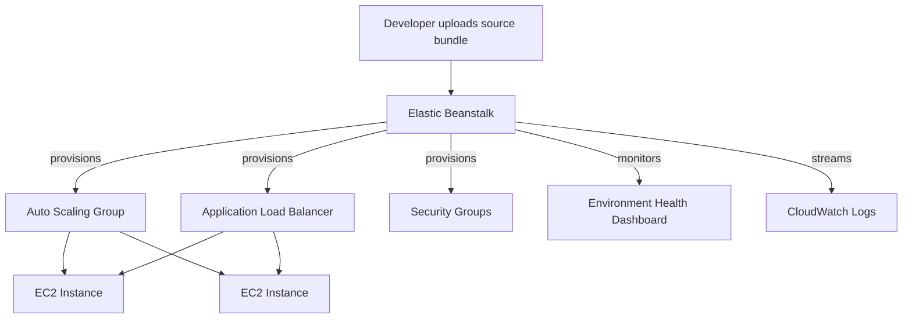

# AWS Elastic Beanstalk


## Definition

Elastic Beanstalk lets you upload your application code (a web app, an API) and AWS automatically
provisions, configures, and manages everything around it — EC2 instances, load balancer, Auto
Scaling, health monitoring — so you get a running, scalable application without manually wiring
up each of those pieces yourself.

## Purpose

Running a web app reliably on AWS "from scratch" means correctly configuring an EC2 Auto Scaling
Group, an Application Load Balancer, security groups, CloudWatch alarms, and a deployment pipeline
— real expertise, and real time, before your app even runs. Elastic Beanstalk exists for teams who
want the control and cost-efficiency of EC2 underneath, but don't want to hand-build and hand-wire
all that infrastructure themselves. You give it code (or a Docker image); it gives you a URL.

## How It Works

In plain terms: you choose a **platform** (the language/runtime stack — Java, Node.js, Python,
Ruby, Go, .NET, PHP, Docker), create an **application** (the logical container for your project),
and create an **environment** within it (an actual running deployment — e.g., `production` and
`staging` as two separate environments of the same application). You upload a source bundle (zip
of your code); Beanstalk provisions the EC2 instances, Auto Scaling Group, load balancer, and
security groups behind the scenes, deploys your code to them, and gives you a public URL. You keep
full access to the underlying EC2 instances if you need to customize anything — Beanstalk manages
the *provisioning*, not a black box that hides the infrastructure from you entirely.



Walking through it: the developer's only real action is uploading a versioned source bundle (or
pointing at an ECR image for the Docker platform). Elastic Beanstalk reads the platform
configuration and provisions an Auto Scaling Group sized per your settings, an Application Load
Balancer in front of it, and the security groups needed to let traffic flow correctly between
them — the exact stack you'd otherwise build manually with EC2 + ASG + ALB docs open in four tabs.
It then deploys your code onto those instances using one of several **deployment policies**
(all-at-once, rolling, rolling with additional batch, or immutable — trading speed against
downtime risk). Throughout the environment's life, Beanstalk continuously reports **environment
health** (Ok/Warning/Degraded/Severe, derived from instance and load balancer health checks) and
streams logs to CloudWatch, giving you an operational dashboard without configuring one yourself.

## Key Features / Components

- **Application** — the top-level project container; holds one or more environments and
  application versions.
- **Environment** — an actual running deployment of a specific application version, with its own
  URL, instances, and configuration (e.g., `myapp-prod`, `myapp-staging`).
- **Platform** — the managed runtime stack Beanstalk understands natively (Java/Corretto, Node.js,
  Python, Ruby, Go, .NET on Windows/Linux, PHP, Docker/multi-container Docker).
- **Environment tiers** — **Web server tier** (handles HTTP requests via a load balancer) vs.
  **Worker tier** (polls an SQS queue and processes messages, no public load balancer — for
  background job processing).
- **Deployment policies** — All-at-once (fastest, brief downtime), Rolling (batch by batch, no
  downtime but reduced capacity during deploy), Rolling with additional batch (adds temporary
  capacity so full capacity is maintained during deploy), Immutable (spins up an entirely new,
  parallel instance set, swaps traffic only once healthy — safest, slowest, no partial-rollout
  risk).
- **.ebextensions** — configuration files in your source bundle that let you customize the
  underlying resources (install extra packages, add environment variables, run commands) beyond
  what the console exposes.
- **Managed platform updates** — Beanstalk can auto-apply minor platform version patches on a
  schedule you choose, reducing manual patching toil.
- **Environment configuration / saved configurations** — exportable environment settings you can
  reuse to spin up an identical environment (e.g., recreate staging from production's config).
- **Blue/green-style traffic swap** — swap environment URLs (CNAME swap) between two full
  environments for a near-zero-downtime release pattern.

## Use Cases — When to Use It

- **Standard web applications/APIs** where you want EC2-level control and cost but don't want to
  hand-build the surrounding infrastructure — a startup's first production deployment is a classic
  fit.
- **Teams without dedicated DevOps/infra engineers** who still want proper Auto Scaling, load
  balancing, and health monitoring instead of a single unmonitored EC2 instance.
- **Background worker processing** via the Worker tier when you have an SQS-backed job queue and
  want managed polling/scaling without building that plumbing yourself.
- **Quick environment cloning** for staging/QA that mirrors production configuration exactly,
  using saved configurations.
- **Teams who want to "drop down" to raw EC2 occasionally** (SSH into an instance to debug) while
  still getting managed provisioning day-to-day — Beanstalk doesn't hide the EC2 layer from you.

## When NOT to Use It / Alternatives

- **Containerized microservices at real scale with custom orchestration needs** — use **ECS/EKS**
  directly; Beanstalk's Docker support is single/simple-multi-container, not a full orchestrator.
- **You want zero server management at all, including zero EC2 under the hood** — use **Fargate**
  or **Lambda**; Beanstalk's web tier is still EC2 instances you (indirectly) own and pay for
  continuously.
- **Complex, highly customized infrastructure** (multiple interconnected services, custom
  networking topologies, non-standard scaling triggers) — Beanstalk's abstraction becomes
  restrictive; use **CloudFormation/CDK** to define the exact infrastructure you need directly.
- **Teams that already have strong IaC/Terraform/CDK practices** — Beanstalk's own abstraction can
  fight with external IaC tooling trying to manage the same resources; pick one source of truth.
- **Static sites or simple serverless APIs** — using Beanstalk for a static site is overkill; use
  **S3 + CloudFront** (static) or **API Gateway + Lambda** (simple API) instead, both cheaper and
  simpler for that specific shape of app.

## Why It's Important

**Real world:** Elastic Beanstalk represents a practical middle ground that's genuinely still used
by small-to-midsize teams who want "real infrastructure, managed for me" without hiring a platform
team. The tradeoff to understand is that it's a convenience layer over EC2/ASG/ELB, not a
different pricing model or a different infrastructure — you still pay full EC2/ALB rates for what
it provisions, and the resources it creates are visible (and editable) in the normal EC2/ASG
consoles, which occasionally surprises people who assumed Beanstalk was "serverless."

**Exam relevance:**
- **SAA-C03** — appears as a quick-to-deploy option in Domain 3 (high-performing compute choices)
  and occasionally Domain 4 (cost) as the "managed EC2" middle choice between raw EC2 and fully
  serverless options.
- **DVA-C03** — Domain 3 "Testing and Deployment" (Task 3.3, deploy code via CI/CD) covers
  Beanstalk's deployment policies (rolling/immutable/blue-green via CNAME swap) as a tested
  deployment strategy pattern; it's a lighter-weight alternative to CodeDeploy pipelines for
  simpler apps.
- **MLA-C02** — rarely tested directly; ML workloads typically use SageMaker-managed deployment
  instead, but Beanstalk could appear as a generic "deploy this API" distractor option.

## Pricing Model (summary)

Elastic Beanstalk itself has **no additional charge** — you pay only for the underlying resources
it provisions: EC2 instance hours (On-Demand/Reserved/Spot, your choice), the Application/Classic
Load Balancer, EBS storage, and any S3 storage for application versions/logs. This is the single
most important pricing fact to remember: the convenience is free, the infrastructure underneath
isn't. Official pricing reference: https://aws.amazon.com/elasticbeanstalk/pricing/

## Hands-on Lab (Floci)

> **Honest limitation:** Floci's officially supported service list (see `labs-floci/README.md`)
> covers EC2 and Lambda directly, but not the Elastic Beanstalk control-plane API itself. You can
> still practice the *underlying mechanics* Beanstalk automates, since those pieces (EC2, Auto
> Scaling, security groups) are fully emulated — this builds the same muscle memory for what
> Beanstalk is doing behind the scenes.

```bash
# Simulate what Beanstalk does for you when you create a "web server tier" environment:

# 1. Security group Beanstalk would create for the environment
awslocal ec2 create-security-group \
  --group-name eb-lab-sg --description "Simulated Beanstalk env SG"
awslocal ec2 authorize-security-group-ingress \
  --group-id sg-xxxxxxxx --protocol tcp --port 80 --cidr 0.0.0.0/0

# 2. Launch template Beanstalk would use for instances in the environment
awslocal ec2 create-launch-template \
  --launch-template-name eb-lab-lt \
  --launch-template-data '{"ImageId":"ami-00000000","InstanceType":"t3.micro","SecurityGroupIds":["sg-xxxxxxxx"]}'

# 3. Auto Scaling Group Beanstalk would create and manage for you
awslocal autoscaling create-auto-scaling-group \
  --auto-scaling-group-name eb-lab-asg \
  --launch-template "LaunchTemplateName=eb-lab-lt,Version=\$Latest" \
  --min-size 1 --max-size 4 --desired-capacity 2 \
  --availability-zones us-east-1a us-east-1b

# 4. Inspect what you built — this is the stack Beanstalk hides behind one "environment" concept
awslocal autoscaling describe-auto-scaling-groups \
  --auto-scaling-group-names eb-lab-asg

# 5. Clean up
awslocal autoscaling delete-auto-scaling-group \
  --auto-scaling-group-name eb-lab-asg --force-delete
```

If you want to practice the real `eb` CLI workflow (`eb init`, `eb create`, `eb deploy`) against
actual AWS, use the AWS Free Tier directly with a tight budget alert — Beanstalk's own layer adds
no cost, only the EC2/ALB resources do, so a `t3.micro` single-instance environment stays within
or very close to Free Tier limits for short lab sessions.

## Exam Tips

- **Beanstalk is a deployment/provisioning convenience, not a different infrastructure or pricing
  model** — you still pay EC2/ALB rates; the exam sometimes tests this distinction directly
  ("does Beanstalk reduce cost compared to manually configured EC2+ASG+ALB?" — no, same resources,
  same cost, less setup time).
- **Deployment policy tradeoffs**: "zero downtime but double the capacity cost during deploy" →
  Immutable or Rolling with additional batch. "Fastest deploy, accepts brief downtime" →
  All-at-once. "No downtime, willing to run at reduced capacity temporarily" → Rolling.
- **Web tier vs. Worker tier**: a question describing "process messages from a queue in the
  background, no public endpoint needed" → Worker tier, not Web tier.
- Don't confuse Beanstalk with **CodeDeploy** — CodeDeploy is a pure deployment service that can
  target EC2, Lambda, or on-prem servers and plugs into *existing* infrastructure; Beanstalk
  provisions the infrastructure itself as part of the platform.
- Beanstalk vs. OpsWorks vs. CloudFormation: Beanstalk = opinionated, fast, limited customization.
  CloudFormation = full control, more setup effort. OpsWorks = Chef/Puppet-based config management
  (mostly legacy at this point, rarely a "correct" exam answer over the other two).

## Related Terms

- [`ec2.md`](ec2.md) — the compute layer Beanstalk provisions underneath
- [`ec2-auto-scaling.md`](ec2-auto-scaling.md) — the scaling mechanism Beanstalk configures for you
- [`fargate.md`](fargate.md) — the fully-serverless alternative with no EC2 layer to manage
- `services/developer-tools/` — CodeDeploy, CodePipeline as alternative/complementary deployment tools (once written)
- `glossary/README.md` — blue/green deployment, environment health definitions
