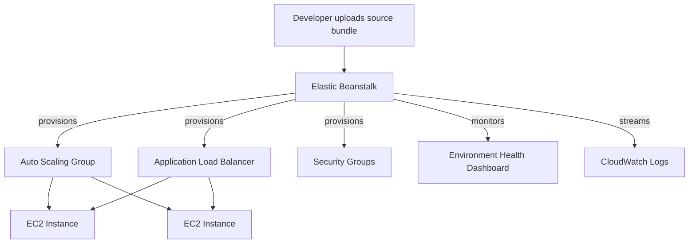
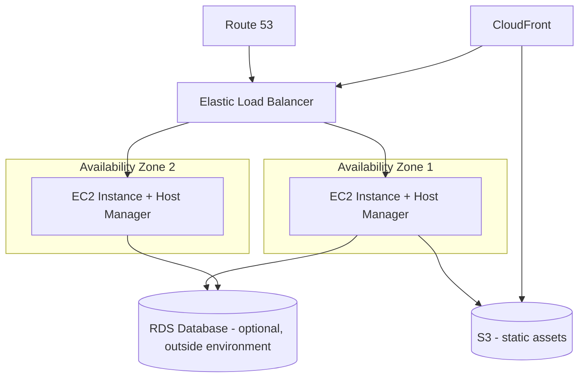
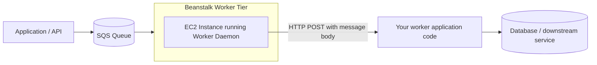
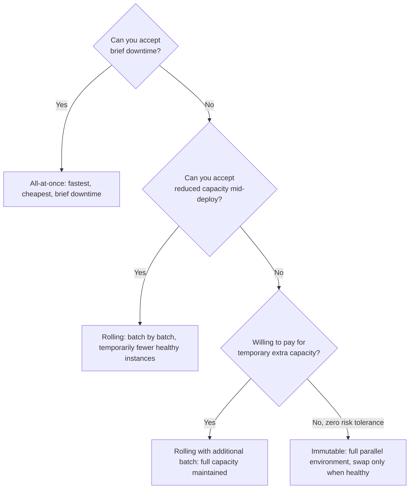

# AWS Elastic Beanstalk

> **Appears in:** [DVA-C03](../../certifications/dva-c03/README.md)


## Definition

Elastic Beanstalk lets you upload your application code (a web app, an API) and AWS automatically
provisions, configures, and manages everything around it — EC2 instances, load balancer, Auto
Scaling, health monitoring — so you get a running, scalable application without manually wiring
up each of those pieces yourself.

## Purpose

Running a web app reliably on AWS "from scratch" means correctly configuring an EC2 Auto Scaling
Group, an Application Load Balancer, security groups, CloudWatch alarms, and a deployment pipeline
— real expertise, and real time, before your app even runs. Elastic Beanstalk exists for teams who
want the control and cost-efficiency of EC2 underneath, but don't want to hand-build and hand-wire
all that infrastructure themselves. You give it code (or a Docker image); it gives you a URL.

Elastic Beanstalk is best understood as a thin, opinionated **orchestration layer over
CloudFormation** — every environment it creates is backed by a CloudFormation stack you can
inspect directly in the CloudFormation console, which is the cleanest way to understand exactly
what Beanstalk did on your behalf at any point.

## How It Works

In plain terms: you choose a **platform** (the language/runtime stack — Java, Node.js, Python,
Ruby, Go, .NET, PHP, Docker), create an **application** (the logical container for your project),
and create an **environment** within it (an actual running deployment — e.g., `production` and
`staging` as two separate environments of the same application). You upload a source bundle (zip
of your code); Beanstalk provisions the EC2 instances, Auto Scaling Group, load balancer, and
security groups behind the scenes, deploys your code to them, and gives you a public URL. You keep
full access to the underlying EC2 instances if you need to customize anything — Beanstalk manages
the *provisioning*, not a black box that hides the infrastructure from you entirely.



Walking through it: the developer's only real action is uploading a versioned source bundle (or
pointing at an ECR image for the Docker platform). Elastic Beanstalk reads the platform
configuration and provisions an Auto Scaling Group sized per your settings, an Application Load
Balancer in front of it, and the security groups needed to let traffic flow correctly between
them — the exact stack you'd otherwise build manually with EC2 + ASG + ALB docs open in four tabs.
It then deploys your code onto those instances using one of several **deployment policies**
(all-at-once, rolling, rolling with additional batch, or immutable — trading speed against
downtime risk). Throughout the environment's life, Beanstalk continuously reports **environment
health** (Ok/Warning/Degraded/Severe, derived from instance and load balancer health checks) and
streams logs to CloudWatch, giving you an operational dashboard without configuring one yourself.

### The full resource stack a web server environment actually creates


*This official AWS diagram makes visible everything Beanstalk is hiding behind the single word
"environment": a CNAME pointing at an Elastic Load Balancer, an Auto Scaling group spanning
multiple instances, a per-instance security group, and a **Host Manager** process running on every
instance that reports health, metrics, and logs back to the Beanstalk service — this Host Manager
is the piece that makes the console health dashboard possible, and it's installed automatically,
with nothing for you to configure.*
**Source:** AWS Documentation — [Elastic Beanstalk web server environments](https://docs.aws.amazon.com/elasticbeanstalk/latest/dg/concepts-webserver.html), AWS Elastic Beanstalk Developer Guide.

### Multi-AZ environment integrated with other AWS services




*The official AWS version of the same pattern, showing CloudFront and S3 handling static content
delivery while Beanstalk's load-balanced, multi-AZ EC2 fleet handles the dynamic application tier,
with RDS as a separate, independently-managed database. A frequently-tested detail embedded in
this diagram: AWS deliberately recommends keeping the RDS database **outside** the Beanstalk
environment (rather than Beanstalk-managed) for production, specifically so that terminating or
rebuilding the environment doesn't risk the database — Beanstalk-managed RDS inside an environment
is deleted along with the environment by default, a well-known gotcha covered further below.*
**Source:** AWS Documentation — [Using Elastic Beanstalk with other AWS services](https://docs.aws.amazon.com/elasticbeanstalk/latest/dg/AWSHowTo.html), AWS Elastic Beanstalk Developer Guide.

### Worker tier: background job processing



Unlike the web server tier, the worker tier has **no public load balancer** — instead, Beanstalk
installs its own daemon on each instance that long-polls the configured SQS queue and delivers
each message to your application as a local HTTP POST, letting you write the same simple "handle
an HTTP request" code for background jobs that you'd write for a web endpoint.

### Deployment policy comparison



## Key Features / Components

- **Application** — the top-level project container; holds one or more environments and
  application versions.
- **Environment** — an actual running deployment of a specific application version, with its own
  URL, instances, and configuration (e.g., `myapp-prod`, `myapp-staging`).
- **Platform** — the managed runtime stack Beanstalk understands natively (Java/Corretto, Node.js,
  Python, Ruby, Go, .NET on Windows/Linux, PHP, Docker/multi-container Docker).
- **Environment tiers** — **Web server tier** (handles HTTP requests via a load balancer) vs.
  **Worker tier** (polls an SQS queue and processes messages, no public load balancer — for
  background job processing).
- **Deployment policies** — All-at-once (fastest, brief downtime), Rolling (batch by batch, no
  downtime but reduced capacity during deploy), Rolling with additional batch (adds temporary
  capacity so full capacity is maintained during deploy), Immutable (spins up an entirely new,
  parallel instance set, swaps traffic only once healthy — safest, slowest, no partial-rollout
  risk, and the only policy that supports instant rollback by simply terminating the new set).
- **.ebextensions** — configuration files in your source bundle that let you customize the
  underlying resources (install extra packages, add environment variables, run commands) beyond
  what the console exposes; these are literally CloudFormation resource/parameter snippets merged
  into the stack Beanstalk builds.
- **Managed platform updates** — Beanstalk can auto-apply minor platform version patches on a
  schedule you choose, reducing manual patching toil.
- **Environment configuration / saved configurations** — exportable environment settings you can
  reuse to spin up an identical environment (e.g., recreate staging from production's config).
- **Blue/green-style traffic swap** — swap environment URLs (CNAME swap) between two full
  environments for a near-zero-downtime release pattern; this is distinct from the Immutable
  deployment policy (which swaps within one environment) — a CNAME swap uses two entirely separate
  environments, useful when you want to validate the new version fully before any production
  traffic touches it at all.
- **Beanstalk-managed RDS vs. standalone RDS** — Beanstalk can optionally provision an RDS
  instance *inside* the environment for convenience, but doing so ties the database's lifecycle to
  the environment's — terminating the environment terminates the database too, unless you
  explicitly detach it first. Production guidance (and exam guidance) is to always provision RDS
  **outside** the Beanstalk environment for anything that must outlive environment rebuilds.

## Security Considerations

- **IAM instance profile** — every Beanstalk environment runs instances under a service-linked
  role (for the Beanstalk service to manage resources) and a separate instance profile (for your
  application code to call other AWS services) — don't conflate the two, and scope the instance
  profile to least privilege just as you would for raw EC2.
- **HTTPS termination** — Beanstalk's load balancer can terminate TLS using an ACM certificate,
  removing the need for your application code to handle certificates directly; a common exam and
  real-world pattern is "redirect HTTP to HTTPS at the load balancer" rather than inside
  application code.
- **Environment variables** set through the Beanstalk console/CLI are visible to anyone with
  describe-environment permissions — for actual secrets, the same guidance as Lambda applies:
  Secrets Manager or Parameter Store, fetched at application startup, not plaintext environment
  variables holding credentials.
- **Managed platform updates applying automatically** can be a double-edged sword: they keep the
  underlying platform patched without manual effort, but an update that changes behavior
  unexpectedly during a maintenance window can surprise teams who didn't realize auto-updates were
  enabled — review the update window and read release notes before enabling this for
  production-critical environments.

## Monitoring & Observability

- **Environment health** (Ok / Info / Warning / Degraded / Severe) is Beanstalk's own composite
  signal, built from EC2 instance status, ELB health checks, and the Host Manager's own process/
  resource monitoring on each instance — it's a faster first signal to check than digging through
  individual CloudWatch metrics.
- **Enhanced health reporting** (the modern default) streams per-instance CPU, latency, and
  request count data to the console in near real time; "basic health reporting" (the legacy mode)
  only reports a coarse Ok/Warning/etc. status without the per-instance detail.
- **CloudWatch Logs integration** can stream instance logs directly to CloudWatch Logs
  automatically, which is the practical way to centralize logs across a multi-instance environment
  instead of SSHing into each instance individually.
- **X-Ray daemon** can be enabled per environment to trace requests through the application for
  distributed tracing, exactly as you would configure it on raw EC2 — Beanstalk just handles
  installing and running the daemon process for you.

## Worked Example: All-at-once vs. Immutable cost/risk tradeoff

A team deploying a new version to a 4-instance environment compares two policies:

- **All-at-once**: all 4 instances update simultaneously. Deployment takes ~3 minutes. During
  that window, the application is briefly unavailable (or serving errors) as instances restart.
  No extra infrastructure cost.
- **Immutable**: Beanstalk launches 4 brand-new instances with the new version in a temporary
  Auto Scaling Group, waits for them to pass health checks, then swaps traffic and terminates the
  old instances. Deployment takes ~8-10 minutes (slower). For that window, the account is running
  8 instances total (4 old + 4 new) instead of 4 — roughly **double the compute cost for the
  duration of the deploy only** (if each `t3.small` costs $0.0208/hr, that's an extra 4 ×
  $0.0208 ≈ $0.083/hr for maybe 10 minutes — in practice, a few cents per deploy), in exchange for
  zero downtime and instant rollback (just don't swap traffic, or swap back) if the new version
  fails health checks.

The practical lesson: Immutable's "cost" is real but trivially small for the safety it buys on any
environment that deploys more than a handful of times a month — which is why it's frequently the
"safest" correct answer on deployment-strategy exam questions despite technically costing more.

## Platform Support Details

Beanstalk platforms are versioned and regularly updated by AWS; each platform branch (e.g.,
"Python 3.12 running on 64bit Amazon Linux 2023") bundles a specific language runtime, web/app
server (e.g., Nginx + Gunicorn for Python, Passenger for Ruby), and the Amazon Linux base image.
A few platform-specific notes worth knowing:

- **Docker platform** supports both single-container (one Dockerfile) and, historically,
  multi-container (via `docker-compose`-like definitions) — AWS has been steadily steering users
  toward ECS/EKS directly for anything beyond a single container, since Beanstalk's Docker support
  is intentionally kept simple rather than becoming a second orchestrator.
- **.NET on Windows Server** is a common real-world choice for teams migrating legacy Windows
  applications that aren't ready for a full containerization effort.
- **Platform branches retire on a schedule** — AWS deprecates old platform versions (e.g., old
  Amazon Linux 2 branches) and environments on a retired platform stop receiving managed updates;
  checking the platform's support status periodically is a real operational task, not a
  set-and-forget configuration.

## Common Architectures

1. **Standard web server tier with external RDS** — the most common real production pattern: a
   Beanstalk web server environment (ALB + ASG + EC2) in front of an independently managed RDS
   instance, so environment terminations/recreations never risk the data — matches the
   "cross-AWS-services" diagram above.
2. **Web tier + worker tier split** — a public Beanstalk web environment accepts requests and
   drops long-running work onto an SQS queue, which a separate Beanstalk worker-tier environment
   drains asynchronously — decouples request latency from background processing time without
   hand-building the SQS/EC2/Auto Scaling wiring yourself.
3. **Blue/green release via CNAME swap** — provision a second, parallel environment running the
   new application version, validate it fully (smoke tests, manual QA) against its own URL, then
   swap CNAMEs so production traffic moves instantly, keeping the old environment around briefly
   as an instant rollback path.

## Use Cases — When to Use It

- **Standard web applications/APIs** where you want EC2-level control and cost but don't want to
  hand-build the surrounding infrastructure — a startup's first production deployment is a classic
  fit.
- **Teams without dedicated DevOps/infra engineers** who still want proper Auto Scaling, load
  balancing, and health monitoring instead of a single unmonitored EC2 instance.
- **Background worker processing** via the Worker tier when you have an SQS-backed job queue and
  want managed polling/scaling without building that plumbing yourself.
- **Quick environment cloning** for staging/QA that mirrors production configuration exactly,
  using saved configurations.
- **Teams who want to "drop down" to raw EC2 occasionally** (SSH into an instance to debug) while
  still getting managed provisioning day-to-day — Beanstalk doesn't hide the EC2 layer from you.
- **Rapid prototyping that still needs to look production-grade** — spinning up a properly
  load-balanced, auto-scaled environment in minutes for a demo or MVP, without the setup overhead
  of hand-building the same thing.

## When NOT to Use It / Alternatives

- **Containerized microservices at real scale with custom orchestration needs** — use **ECS/EKS**
  directly; Beanstalk's Docker support is single/simple-multi-container, not a full orchestrator.
- **You want zero server management at all, including zero EC2 under the hood** — use **Fargate**
  or **Lambda**; Beanstalk's web tier is still EC2 instances you (indirectly) own and pay for
  continuously.
- **Complex, highly customized infrastructure** (multiple interconnected services, custom
  networking topologies, non-standard scaling triggers) — Beanstalk's abstraction becomes
  restrictive; use **CloudFormation/CDK** to define the exact infrastructure you need directly.
- **Teams that already have strong IaC/Terraform/CDK practices** — Beanstalk's own abstraction can
  fight with external IaC tooling trying to manage the same resources; pick one source of truth.
- **Static sites or simple serverless APIs** — using Beanstalk for a static site is overkill; use
  **S3 + CloudFront** (static) or **API Gateway + Lambda** (simple API) instead, both cheaper and
  simpler for that specific shape of app.

## Why It's Important

**Real world:** Elastic Beanstalk represents a practical middle ground that's genuinely still used
by small-to-midsize teams who want "real infrastructure, managed for me" without hiring a platform
team. The tradeoff to understand is that it's a convenience layer over EC2/ASG/ELB, not a
different pricing model or a different infrastructure — you still pay full EC2/ALB rates for what
it provisions, and the resources it creates are visible (and editable) in the normal EC2/ASG
consoles, which occasionally surprises people who assumed Beanstalk was "serverless."

**Exam relevance:**
- **SAA-C03** — appears as a quick-to-deploy option in Domain 3 (high-performing compute choices)
  and occasionally Domain 4 (cost) as the "managed EC2" middle choice between raw EC2 and fully
  serverless options.
- **DVA-C03** — Domain 3 "Testing and Deployment" (Task 3.3, deploy code via CI/CD) covers
  Beanstalk's deployment policies (rolling/immutable/blue-green via CNAME swap) as a tested
  deployment strategy pattern; it's a lighter-weight alternative to CodeDeploy pipelines for
  simpler apps.
- **MLA-C02** — rarely tested directly; ML workloads typically use SageMaker-managed deployment
  instead, but Beanstalk could appear as a generic "deploy this API" distractor option.

## Limits & Quotas

| Quota | Default | Adjustable? |
|---|---|---|
| Applications per Region | 75 | Yes |
| Application versions per Region | 1,000 | Yes |
| Environments per Region (not terminated) | 200 | Yes |
| Environment name length | 4–40 characters | Hard limit |
| Source bundle size | 512 MB | Hard limit |
| .ebextensions config file size (per file) | 64 KB | Hard limit |
| Instances per environment | Bounded by the underlying Auto Scaling Group and EC2 vCPU quotas | Inherited from EC2 quotas |

Because Beanstalk itself has no distinct capacity limits beyond these catalog/bundle quotas, the
practical limits that bite in real use are almost always the *underlying* EC2/ASG/ELB quotas
(e.g., the default 5-vCPU On-Demand Standard instance quota covered in `ec2.md`) — if an
environment refuses to scale, check EC2 service quotas before assuming it's a Beanstalk-specific
limit.

## Troubleshooting / Common Issues

- **Environment health shows "Severe" or "Degraded" right after deploy** — check the environment's
  **Events** tab first; the most common causes are a deployment that failed on some instances
  (partial rollout under Rolling), a health check path returning non-200, or the application
  failing to bind to the port Beanstalk's load balancer expects (`PORT` environment variable for
  several platforms).
- **"Successfully deployed" but the app still shows old behavior** — check whether a CDN
  (CloudFront) or browser cache is serving stale content, and confirm the application version
  actually associated with the environment changed (Beanstalk sometimes "succeeds" a deployment of
  an unchanged bundle if the source didn't actually update).
- **Terminated the environment and the database disappeared** — this is the Beanstalk-managed RDS
  gotcha described above: an RDS instance provisioned *inside* a Beanstalk environment is deleted
  along with it unless explicitly detached beforehand (`Actions > Create snapshot` /
  detach-from-environment flow); always provision production databases outside the environment to
  avoid this entirely.
- **.ebextensions file changes not taking effect** — confirm the file lives under the `.ebextensions/`
  directory at the root of the source bundle (not a subdirectory) and has a valid `.config`
  extension and YAML/JSON syntax; a malformed file silently fails validation in some cases rather
  than throwing an obvious error.
- **Worker tier not processing messages** — check that the SQS queue ARN is correctly configured
  in the environment's worker settings, and that your application actually listens on the port/path
  Beanstalk's worker daemon POSTs to (commonly `/` by default, but configurable).

## CLI Workflow Deep Dive

The `eb` CLI (EB CLI, a separate install from the main AWS CLI) wraps the Beanstalk API with a
developer-friendly workflow built around a local Git-like mental model:

```bash
eb init my-app --platform python-3.12 --region us-east-1   # one-time: links a local folder to an application
eb create production --instance-type t3.small --elb-type application  # creates a new environment
eb deploy                                                    # zips the current directory, uploads, deploys
eb status                                                    # environment health, URL, version
eb logs                                                      # pull recent logs from all instances
eb ssh                                                       # SSH into an instance for debugging
eb clone production --clone-name staging                     # duplicate an environment's configuration
eb swap production -n staging                                 # CNAME swap between two environments
eb terminate staging                                          # tear down an environment
```

This mirrors exactly the console workflow, but is the practical day-to-day interface most real
teams use, since it integrates naturally into a CI/CD pipeline (`eb deploy` as a pipeline step)
far more cleanly than clicking through the console repeatedly.

## Pricing Model (summary)

Elastic Beanstalk itself has **no additional charge** — you pay only for the underlying resources
it provisions: EC2 instance hours (On-Demand/Reserved/Spot, your choice), the Application/Classic
Load Balancer, EBS storage, and any S3 storage for application versions/logs. This is the single
most important pricing fact to remember: the convenience is free, the infrastructure underneath
isn't. Official pricing reference: https://aws.amazon.com/elasticbeanstalk/pricing/

### Worked example: minimal production environment

A small production environment running 2 × `t3.small` instances (On-Demand, $0.0208/hr each)
behind an Application Load Balancer (~$0.0225/hr + LCU charges, roughly $16.20/month baseline for
light traffic), plus 20 GB of `gp3` EBS storage per instance (~$1.60/month each):

- EC2: 2 × $0.0208/hr × 730 hrs ≈ **$30.37/month**
- ALB: ≈ **$16.20/month** baseline
- EBS: 2 × $1.60 ≈ **$3.20/month**
- **Total: ~$49.77/month** — and Beanstalk itself added literally $0 to that total; it's purely the
  cost of the EC2/ALB/EBS resources it provisioned on your behalf.

## Hands-on Lab (Floci)

> **Honest limitation:** Floci's officially supported service list (see `labs-floci/README.md`)
> covers EC2 and Lambda directly, but not the Elastic Beanstalk control-plane API itself. You can
> still practice the *underlying mechanics* Beanstalk automates, since those pieces (EC2, Auto
> Scaling, security groups) are fully emulated — this builds the same muscle memory for what
> Beanstalk is doing behind the scenes.

```bash
# Simulate what Beanstalk does for you when you create a "web server tier" environment:

# 1. Security group Beanstalk would create for the environment
awslocal ec2 create-security-group \
  --group-name eb-lab-sg --description "Simulated Beanstalk env SG"
awslocal ec2 authorize-security-group-ingress \
  --group-id sg-xxxxxxxx --protocol tcp --port 80 --cidr 0.0.0.0/0

# 2. Launch template Beanstalk would use for instances in the environment
awslocal ec2 create-launch-template \
  --launch-template-name eb-lab-lt \
  --launch-template-data '{"ImageId":"ami-00000000","InstanceType":"t3.micro","SecurityGroupIds":["sg-xxxxxxxx"]}'

# 3. Auto Scaling Group Beanstalk would create and manage for you
awslocal autoscaling create-auto-scaling-group \
  --auto-scaling-group-name eb-lab-asg \
  --launch-template "LaunchTemplateName=eb-lab-lt,Version=\$Latest" \
  --min-size 1 --max-size 4 --desired-capacity 2 \
  --availability-zones us-east-1a us-east-1b

# 4. Inspect what you built — this is the stack Beanstalk hides behind one "environment" concept
awslocal autoscaling describe-auto-scaling-groups \
  --auto-scaling-group-names eb-lab-asg

# 5. Clean up
awslocal autoscaling delete-auto-scaling-group \
  --auto-scaling-group-name eb-lab-asg --force-delete
```

If you want to practice the real `eb` CLI workflow (`eb init`, `eb create`, `eb deploy`) against
actual AWS, use the AWS Free Tier directly with a tight budget alert — Beanstalk's own layer adds
no cost, only the EC2/ALB resources do, so a `t3.micro` single-instance environment stays within
or very close to Free Tier limits for short lab sessions.

## Exam Tips

- **Beanstalk is a deployment/provisioning convenience, not a different infrastructure or pricing
  model** — you still pay EC2/ALB rates; the exam sometimes tests this distinction directly
  ("does Beanstalk reduce cost compared to manually configured EC2+ASG+ALB?" — no, same resources,
  same cost, less setup time).
- **Deployment policy tradeoffs**: "zero downtime but double the capacity cost during deploy" →
  Immutable or Rolling with additional batch. "Fastest deploy, accepts brief downtime" →
  All-at-once. "No downtime, willing to run at reduced capacity temporarily" → Rolling.
- **Web tier vs. Worker tier**: a question describing "process messages from a queue in the
  background, no public endpoint needed" → Worker tier, not Web tier.
- **Beanstalk-managed RDS lifecycle trap** — a question describing "terminated the environment and
  lost the database" is pointing at the fix of provisioning RDS *outside* the environment, not a
  Beanstalk bug to work around some other way.
- Don't confuse Beanstalk with **CodeDeploy** — CodeDeploy is a pure deployment service that can
  target EC2, Lambda, or on-prem servers and plugs into *existing* infrastructure; Beanstalk
  provisions the infrastructure itself as part of the platform.
- Beanstalk vs. OpsWorks vs. CloudFormation: Beanstalk = opinionated, fast, limited customization.
  CloudFormation = full control, more setup effort. OpsWorks = Chef/Puppet-based config management
  (mostly legacy at this point, rarely a "correct" exam answer over the other two).
- **.ebextensions** are the answer whenever a question needs to customize a Beanstalk environment's
  underlying resources beyond what the console UI exposes — remember these are effectively
  CloudFormation snippets merged into Beanstalk's own stack.
- **Enhanced vs. basic health reporting** — if a scenario needs per-instance granular metrics for
  troubleshooting, the answer is confirming Enhanced health reporting is enabled, not assuming the
  default gives you that detail.

## Further Reading

- [AWS Elastic Beanstalk Developer Guide](https://docs.aws.amazon.com/elasticbeanstalk/latest/dg/Welcome.html)
- [Elastic Beanstalk web server environments](https://docs.aws.amazon.com/elasticbeanstalk/latest/dg/concepts-webserver.html)
- [Using Elastic Beanstalk with other AWS services](https://docs.aws.amazon.com/elasticbeanstalk/latest/dg/AWSHowTo.html)
- [Elastic Beanstalk pricing](https://aws.amazon.com/elasticbeanstalk/pricing/)
- [Elastic Beanstalk service quotas](https://docs.aws.amazon.com/elasticbeanstalk/latest/dg/limits.html)

## Related Terms

- [`ec2.md`](ec2.md) — the compute layer Beanstalk provisions underneath
- [`ec2-auto-scaling.md`](ec2-auto-scaling.md) — the scaling mechanism Beanstalk configures for you
- [`fargate.md`](fargate.md) — the fully-serverless alternative with no EC2 layer to manage
- `services/developer-tools/` — CodeDeploy, CodePipeline as alternative/complementary deployment tools (once written)
- `glossary/README.md` — blue/green deployment, environment health definitions
