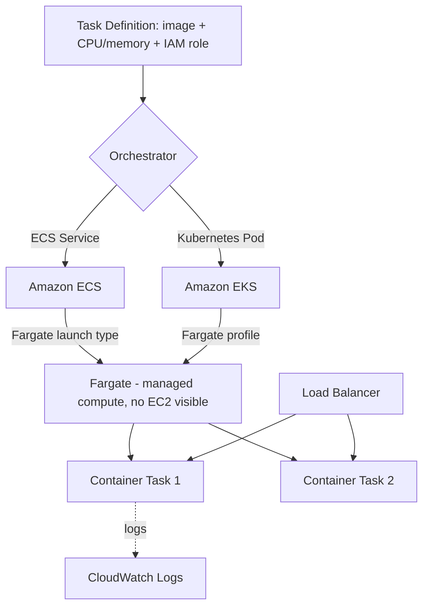
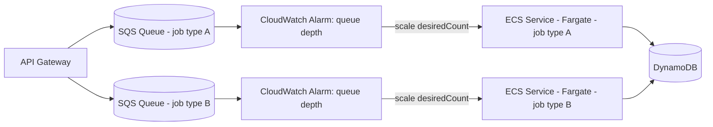
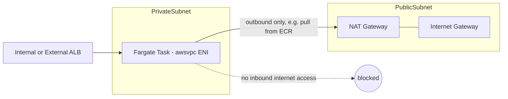
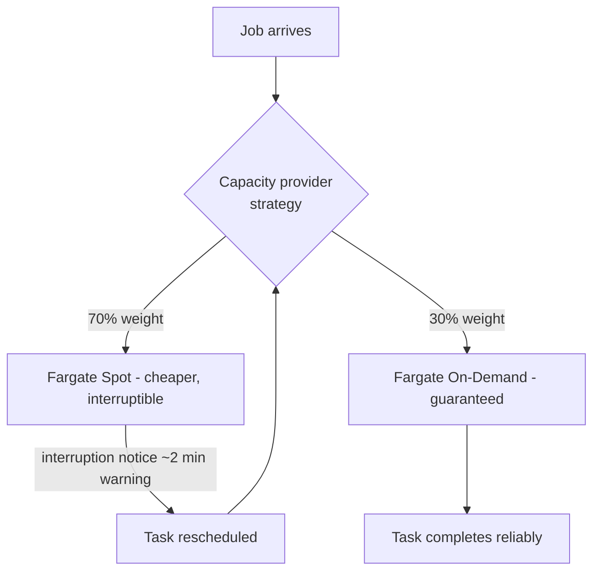

# AWS Fargate


## Definition

Fargate runs your containers for you without you ever provisioning, patching, or managing the
underlying servers (EC2 instances) — you describe the container (CPU, memory, image), and AWS
finds and manages the compute it runs on behind the scenes.

## Purpose

Running containers on ECS or EKS traditionally still meant managing an EC2 fleet to host them —
patching the OS, deciding instance sizes, right-sizing the cluster for peak load, bin-packing
containers onto hosts efficiently. Fargate removes that entire layer: you stop thinking about
*servers* and only think about *containers*. AWS built it to extend the "serverless" idea (already
proven by Lambda) to the much broader world of containerized workloads that don't fit Lambda's
15-minute/stateless constraints.

Fargate launched in 2017 specifically to answer the question "what if containers could be
serverless the way Lambda made functions serverless?" — and it's the clearest illustration of how
"serverless" as AWS uses the term really means "you never see or manage the host," not
specifically "functions only."

## How It Works

In plain terms: you define a **task definition** (what container image to run, how much CPU/memory
it needs, networking mode, IAM role) and either run it as a one-off **task** or as a long-running
**service** (desired count of tasks kept alive, optionally behind a load balancer) — using either
**ECS** or **EKS** as the orchestrator "front end." You pick the Fargate **launch type** (vs. the
EC2 launch type), and AWS provisions exactly the amount of compute your task needs, runs your
container(s) on it, and tears that compute down the moment the task stops — you never see or
manage the underlying host.



Walking through it: you author a task definition — essentially a container recipe, naming the
image (from ECR or another registry), the CPU/memory to reserve, networking (`awsvpc` mode gives
each task its own ENI, meaning its own private IP and security group), and an IAM task role for
permissions. You hand that recipe to **either ECS or EKS** as the orchestrator; both can schedule
work onto Fargate instead of EC2 — the orchestrator decides *what* runs and *where logically*
(which service, how many replicas), while Fargate decides *what physical compute* actually backs
it, entirely invisible to you. A load balancer in front of a service distributes traffic across
the running tasks exactly like it would across EC2 instances; logs stream to CloudWatch
automatically, same as Lambda.

### Autoscaling async job queues with Fargate




*This official AWS reference architecture shows exactly the pattern above at production scale:
each job type gets its own ECS service (desired count starting at zero) and its own SQS queue;
CloudWatch alarms on queue depth drive the desired count up when work arrives and back to zero
when the queue drains, meaning you pay for Fargate compute only while there's actually a backlog
to process — the containerized equivalent of Lambda's "pay only when running" model, achieved
through ECS Service Auto Scaling rather than Fargate having any native "scale to zero on its own"
behavior.*
**Source:** AWS Documentation — [Autoscaling Asynchronous Job Queues](https://docs.aws.amazon.com/reference-architecture-diagrams/latest/autoscaling-async-job-queues/autoscaling-async-job-queues.html), AWS Reference Architecture Diagrams.

### Private subnet networking for Fargate tasks




*The official ECS networking documentation diagram showing the standard secure pattern: Fargate
tasks placed in a private subnet have no direct internet route, but can still reach the internet
(e.g., to pull a container image or call an external API) through a NAT Gateway in a public
subnet. This is the default recommended pattern for anything that shouldn't be directly reachable
from the internet — a load balancer in a public subnet is the only thing that should actually face
the internet, forwarding to tasks that stay private.*
**Source:** AWS Documentation — [Connect Amazon ECS applications to the internet](https://docs.aws.amazon.com/AmazonECS/latest/developerguide/networking-outbound.html), Amazon ECS Developer Guide.

### Fargate Spot for interruption-tolerant batch workloads



## Key Features / Components

- **Task definition** — the container spec: image URI, CPU/memory (chosen from a fixed set of
  valid combinations — e.g., 0.25 vCPU pairs only with 0.5/1/2 GB memory, while 4 vCPU allows up
  to 30 GB), port mappings, environment variables, IAM task role and task execution role (two
  different roles — see Exam Tips), logging configuration.
- **Task** — one running instance of a task definition (one or more containers that share a
  network namespace).
- **Service** — keeps a desired number of tasks running continuously, replacing failed ones, and
  optionally integrates with a load balancer and with ECS Service Auto Scaling.
- **Launch type: Fargate vs. EC2** — Fargate = no visible host, pay per task resource reservation.
  EC2 launch type = you manage the underlying EC2 instances yourself (more control, potentially
  cheaper at high, steady utilization, but back to managing hosts).
- **`awsvpc` networking mode** — every Fargate task gets its own elastic network interface and
  private IP, meaning security groups apply at the *task* level, not a shared host level — a
  meaningful security/isolation improvement over tasks sharing a host's network namespace.
- **Fargate Spot** — run interruptible tasks at a discount (similar tradeoff to EC2 Spot), for
  fault-tolerant batch/background work; typically priced at roughly 70% below standard Fargate
  rates.
- **Task execution role vs. task role** — the execution role lets the Fargate agent itself pull
  your image from ECR and write logs to CloudWatch; the task role is what your *application code
  inside the container* uses to call other AWS services (e.g., read from S3). Conflating the two
  is a common real and exam-tested mistake.
- **EKS on Fargate (Fargate profiles)** — lets Kubernetes pods run on Fargate instead of
  EC2-backed worker nodes, matched by namespace/label selectors you define in a Fargate profile.
- **Platform versions** — Fargate offers managed platform versions (Amazon Linux 2, Bottlerocket,
  Windows Server) that bundle the underlying container runtime and agent software; AWS patches
  these transparently, which is the Fargate-level equivalent of "no OS patching" that Lambda
  offers at the function level.
- **Ephemeral storage per task** — 20 GiB included by default, configurable up to 200 GiB, billed
  per-GB beyond the included amount — relevant for tasks that need scratch disk space for
  temporary files beyond what fits in container memory.

## Worked Cost Example: Sizing a Service

A service running 3 tasks continuously, each with 1 vCPU / 2 GB memory, Linux x86, in `us-east-1`,
24/7 for a 30-day month:

- vCPU cost: 3 tasks × 1 vCPU × $0.04048/vCPU-hr × 730 hrs = **$88.65**
- Memory cost: 3 tasks × 2 GB × $0.004445/GB-hr × 730 hrs = **$19.47**
- **Total: ~$108.12/month** for the compute, before any load balancer or data transfer charges

Switching the same workload to **Fargate Spot** (roughly 70% discount on both rates):

- vCPU cost: 3 × 1 × $0.01215/vCPU-hr (illustrative ~70% off) × 730 ≈ **$26.61**
- Memory cost: 3 × 2 × $0.001334/GB-hr (illustrative ~70% off) × 730 ≈ **$5.85**
- **Total: ~$32.46/month — roughly 70% cheaper**, acceptable only if the workload tolerates
  occasional task interruption with a ~2-minute warning (a stateless API behind a load balancer
  with multiple replicas usually tolerates this fine; a single long-running stateful batch job
  usually does not without checkpointing logic).

Switching to **Graviton/Arm** Fargate instead of x86 (roughly 20% cheaper on both rates, on top of
either Spot or standard pricing) stacks with the Spot discount for workloads that can run on
`arm64` images, making Spot + Arm the cheapest combination available for interruption-tolerant
containerized work.

## Common Architectures

1. **Serverless containerized microservices behind an ALB** — an ECS service on Fargate, tasks in
   private subnets (reachable only via NAT for outbound), fronted by a public Application Load
   Balancer — the default modern "I want containers, no host management" architecture, replacing
   what used to be an EC2-backed ECS cluster in most new designs.
2. **Autoscaling async job-queue processing** — per-job-type SQS queues and ECS services scaled
   from (and back to) zero based on queue depth, shown in the diagram above — a common real-world
   and MLA-C02-relevant pattern for background document processing, ETL, or batch inference.
3. **Mixed capacity provider strategy** — a service split across Fargate (guaranteed, On-Demand
   baseline) and Fargate Spot (bulk, cheap, interruption-tolerant capacity), using ECS capacity
   provider strategies to set the weighted split automatically rather than managing two separate
   services by hand.

## Use Cases — When to Use It

- **Containerized microservices** where you want the portability and tooling benefits of
  containers but want zero host management — the most common modern "default" choice for new
  containerized applications on AWS.
- **Variable or spiky container workloads** where right-sizing an EC2 fleet underneath ECS/EKS is
  wasted effort — Fargate scales per-task without you pre-provisioning host capacity.
- **Batch/ETL jobs packaged as containers** that exceed Lambda's 15-minute limit or need a full
  custom OS environment/dependencies that don't fit a Lambda layer cleanly.
- **Security-sensitive multi-tenant workloads** where task-level network isolation (`awsvpc`, its
  own ENI/security group) is valuable compared to multiple containers sharing an EC2 host's
  network namespace.
- **Teams migrating from Lambda** when a workload grows past Lambda's constraints (duration,
  package size, needing a full Linux environment) but still want a serverless operational model.

## When NOT to Use It / Alternatives

- **Very short, bursty, sub-second-to-minute functions** — Lambda's per-millisecond billing and
  simpler deployment model (no container build required) usually wins for genuinely small, quick
  tasks; Fargate's per-task minimum billing and image-pull overhead make it less efficient at that
  scale.
- **Workloads needing GPUs** — Fargate does not support GPU-backed tasks (as of this writing); use
  **EC2** (with ECS/EKS EC2 launch type) for GPU container workloads.
- **Very high, sustained, predictable scale where cost-per-vCPU-hour matters most** — a
  well-utilized EC2 fleet (with Reserved Instances/Savings Plans) backing ECS/EKS can be cheaper
  per unit of compute than Fargate at scale, since Fargate charges a premium for not managing
  hosts; model both before deciding purely by cost.
- **Workloads needing privileged host-level access** (custom kernel modules, host networking mode,
  direct hardware access) — Fargate's isolation model doesn't allow this; use EC2-backed
  ECS/EKS instead.

## Why It's Important

**Real world:** Fargate is one of the clearest wins of "serverless containers" — it eliminates an
entire job function's worth of toil (capacity planning and patching an EC2 fleet backing a
container cluster) for a large share of real-world container workloads. The task execution role
vs. task role distinction is a genuinely common real-world misconfiguration (giving the execution
role too much access, or the task role too little, breaking app functionality in subtle ways).

**Exam relevance:**
- **SAA-C03** — Domain 2 (loosely-coupled, container-based architectures) and Domain 4
  (cost-optimized compute: Fargate vs. EC2-backed containers tradeoff) both reference it.
- **DVA-C03** — explicitly called out: "Containers now directly tested: ECR image build/tag/
  lifecycle, ECS/EKS/Fargate deployment" under Domain 1 and Domain 3 (deploying via CI/CD to
  ECS/EKS/Fargate).
- **MLA-C02** — Domain 3 "Deployment and Orchestration" references containerizing ML workloads
  (custom inference containers via ECR) which can run on Fargate for lightweight, CPU-only serving.

## Limits & Quotas

| Quota | Default | Adjustable? |
|---|---|---|
| Fargate On-Demand vCPUs per Region (account-level) | 100 (varies by account/Region) | Yes |
| Fargate Spot vCPUs per Region | Separate quota from On-Demand, varies | Yes |
| Tasks per service | 5,000 (desired count) | Yes |
| Container definitions per task definition | 10 | Yes |
| Task CPU | 0.25-16 vCPU, in fixed valid combinations with memory | Hard limit per combination |
| Task memory | 0.5 GB-120 GB, paired with the CPU setting | Hard limit per combination |
| Ephemeral storage per task | 20 GiB included, up to 200 GiB | Configurable, billed beyond included amount |
| Task definitions (families + revisions) per Region | 1,000,000 | Yes |

The CPU/memory combination constraint is worth internalizing: you cannot request arbitrary
combinations freely — e.g., 0.25 vCPU only pairs with 0.5/1/2 GB of memory, while 2 vCPU allows a
much wider memory range up to 16 GB. Checking the valid combination table before designing a task
definition avoids a confusing validation error at registration time.

## Troubleshooting / Common Issues

- **Task stuck in `PROVISIONING` or fails to start** — check the service's **Events** tab first;
  common causes are the task execution role lacking ECR pull permissions, the subnet lacking a
  route to pull the image (no NAT gateway in a private subnet), or a CPU/memory combination the
  account's current Fargate quota can't satisfy.
- **"Container can't call S3 from inside the app" even though the service seems to have
  permissions** — classic task role vs. task execution role confusion: verify the **task role**
  (not the execution role) has the S3 permission; the execution role only governs image pull and
  log delivery.
- **Task exits immediately after starting** — check the container's own exit code and logs in
  CloudWatch; a container designed to run a single command and exit (rather than stay in the
  foreground) will be marked as a failed/stopped task repeatedly if it's supposed to be a
  long-running service, not a one-off task.
- **Can't reach the task from the load balancer** — verify the task's security group (remember:
  with `awsvpc` mode, the security group is on the task's own ENI, not a shared host) allows
  inbound traffic from the load balancer's security group on the container port.
- **Fargate Spot task interrupted mid-job with data loss** — Spot tasks get a roughly 2-minute
  interruption warning via an ECS-emitted event; workloads need to either checkpoint progress
  periodically or be naturally idempotent/retryable from the start, since Spot capacity can be
  reclaimed at any time.

## Pricing Model (summary)

Billed **per vCPU and per GB of memory reserved by the task, per second** (minimum 1 minute),
from the moment the task starts pulling its image to the moment it stops — not per-request like
Lambda, but still with no charge for idle host capacity, since there's no host for you to see.
Current approximate US East (N. Virginia) Linux x86 rates: **$0.04048 per vCPU-hour** and
**$0.004445 per GB-hour** of memory; Linux Arm (Graviton) rates run roughly 20% lower on both
dimensions. **Fargate Spot** offers a discount (roughly 70% off, similar in spirit to EC2 Spot)
for interruptible workloads. No separate charge for ECS itself (ECS is free; EKS has an hourly
per-cluster control-plane fee regardless of Fargate vs. EC2 launch type). Official pricing:
https://aws.amazon.com/fargate/pricing/

## Hands-on Lab (Floci)

Floci's Containers support (ECS, real Docker-backed) covers the Fargate launch type since Fargate
is just a launch-type flag on the same ECS APIs.

```bash
# 1. Create an ECS cluster
awslocal ecs create-cluster --cluster-name fargate-lab-cluster

# 2. Register a task definition requiring Fargate compatibility
cat > task-def.json << 'EOF'
{
  "family": "fargate-lab-task",
  "networkMode": "awsvpc",
  "requiresCompatibilities": ["FARGATE"],
  "cpu": "256",
  "memory": "512",
  "containerDefinitions": [{
    "name": "web",
    "image": "nginx:latest",
    "portMappings": [{"containerPort": 80, "protocol": "tcp"}]
  }]
}
EOF
awslocal ecs register-task-definition --cli-input-json file://task-def.json

# 3. Run it as a one-off Fargate task
awslocal ecs run-task \
  --cluster fargate-lab-cluster \
  --task-definition fargate-lab-task \
  --launch-type FARGATE \
  --network-configuration '{"awsvpcConfiguration":{"subnets":["subnet-xxxxxxxx"],"assignPublicIp":"ENABLED"}}'

# 4. Or run it as a service (desired count kept alive)
awslocal ecs create-service \
  --cluster fargate-lab-cluster \
  --service-name fargate-lab-service \
  --task-definition fargate-lab-task \
  --desired-count 2 \
  --launch-type FARGATE \
  --network-configuration '{"awsvpcConfiguration":{"subnets":["subnet-xxxxxxxx"],"assignPublicIp":"ENABLED"}}'

# 5. Inspect running tasks
awslocal ecs list-tasks --cluster fargate-lab-cluster
awslocal ecs describe-tasks --cluster fargate-lab-cluster --tasks <task-arn>

# 6. Clean up
awslocal ecs delete-service --cluster fargate-lab-cluster --service fargate-lab-service --force
awslocal ecs delete-cluster --cluster fargate-lab-cluster
```

### Extra practice: capacity provider strategy (mixed Fargate + Fargate Spot)

```bash
awslocal ecs put-cluster-capacity-providers \
  --cluster fargate-lab-cluster \
  --capacity-providers FARGATE FARGATE_SPOT \
  --default-capacity-provider-strategy \
    capacityProvider=FARGATE,weight=1,base=1 \
    capacityProvider=FARGATE_SPOT,weight=3

# Services created without an explicit launch type will now split roughly 1:3
# between guaranteed Fargate and cheaper, interruptible Fargate Spot capacity.
```

## Exam Tips

- **Task execution role vs. task role** is a near-guaranteed DVA-C03 trap: execution role = pull
  image + write logs (infrastructure-level permission); task role = what your app code calls AWS
  with (application-level permission). A question about "container can't call S3 from inside the
  app" points at the task role being wrong, not the execution role.
- **Fargate vs. EC2 launch type**: "no desire to manage underlying instances" → Fargate.
  "Need GPUs, or want to maximize utilization/cost efficiency at high steady scale" → EC2 launch
  type.
- **`awsvpc` networking** gives every task its own ENI and security group — remember this when a
  question emphasizes per-task network isolation requirements.
- Don't confuse Fargate (a compute engine, works with ECS or EKS) with ECS/EKS themselves
  (orchestrators, which *can* also run on EC2-backed capacity) — Fargate answers "where does the
  container physically run," ECS/EKS answer "how is the container scheduled and managed."
- Fargate has **no GPU support** — rule it out immediately for any ML training/inference question
  requiring a GPU.
- **Scale-to-zero on Fargate** is achieved only via ECS Service Auto Scaling reacting to a metric
  (like SQS queue depth), not a native Fargate feature — a question asking "does Fargate itself
  scale to zero automatically" should point at "only via a configured scaling policy," same as any
  EC2 Auto Scaling Group.
- **Fargate Spot discount (~70%) vs. EC2 Spot discount (~90% max)** — know the rough magnitude
  difference when a cost-optimization question compares the two; Fargate Spot's savings are real
  but shallower than EC2 Spot's maximum discount tier.

## Security Considerations

- **Task-level isolation via `awsvpc`** is Fargate's single biggest security differentiator over
  EC2-backed containers sharing a host network namespace: each task gets its own ENI and security
  group, so one compromised container can't trivially sniff another task's traffic on the same
  host the way containers sharing a host network interface could.
- **No SSH access to the underlying host, ever** — because there is no host to access, an entire
  class of "someone SSH'd into the container host and did something unauthorized" incidents is
  structurally impossible with Fargate, a genuine security argument in its favor beyond pure
  convenience.
- **ECS Exec** (not SSH) is the supported way to get an interactive shell into a *running Fargate
  task* for debugging, routed through Systems Manager Session Manager rather than a traditional
  SSH daemon — it requires explicit IAM permissions and can be fully audited/logged, unlike
  traditional SSH access.
- **Secrets injection** — task definitions can reference Secrets Manager or Parameter Store values
  directly in the container definition's `secrets` field, injected as environment variables at
  task startup without ever appearing in the task definition's own stored JSON in plaintext — the
  correct pattern instead of hardcoding credentials in the image or environment variables block.

## Monitoring & Observability

- **CloudWatch Container Insights** aggregates CPU, memory, network, and task-count metrics across
  an entire cluster/service, which is far more useful for capacity planning than looking at
  individual task metrics one at a time.
- **ECS Service events** (visible in the console's Events tab, same mental model as Beanstalk's
  Events tab) is the first place to check when tasks aren't reaching a healthy/steady state — it
  records exactly why a task failed to launch or was stopped.
- **AWS X-Ray** works the same way with Fargate as with Lambda/EC2 — run the X-Ray daemon as a
  sidecar container in the same task definition to get distributed tracing across your
  containerized services.
- **CloudWatch Logs via `awslogs` driver** is the default and simplest way to centralize container
  stdout/stderr without configuring a separate logging agent — specified directly in the task
  definition's `logConfiguration` block.

## Sidecar Container Patterns

A single Fargate task can run multiple containers sharing the same network namespace and
(optionally) a shared ephemeral storage volume — this is how several common operational patterns
are implemented without needing a separate host-level daemon:

- **Log/metrics forwarder sidecar** — a Fluent Bit or Datadog agent container running alongside
  the application container, reading logs/metrics from a shared volume or via `localhost`, and
  forwarding them to a third-party observability platform — common in organizations not using
  CloudWatch as their primary observability tool.
- **Service mesh proxy sidecar** — an Envoy proxy container (as used by AWS App Mesh) intercepting
  all inbound/outbound traffic for the application container, enabling mutual TLS, retries, and
  traffic shaping without changing application code.
- **X-Ray daemon sidecar** — as mentioned above, a small daemon container that the application
  container sends trace segments to over `localhost`, which then forwards them to the X-Ray
  service.

Each additional sidecar container counts against the task's total CPU/memory allocation — a task
with a 0.5 vCPU app container and a 0.25 vCPU sidecar needs a task-level CPU setting of at least
0.75 vCPU (rounded up to the next valid combination), which is an easy thing to forget when first
estimating a task's resource needs and sizing cost.

## Further Reading

- [Architect for AWS Fargate for Amazon ECS](https://docs.aws.amazon.com/AmazonECS/latest/developerguide/AWS_Fargate.html)
- [Amazon ECS task networking options for Fargate](https://docs.aws.amazon.com/AmazonECS/latest/developerguide/fargate-task-networking.html)
- [AWS Fargate pricing](https://aws.amazon.com/fargate/pricing/)
- [Fargate task CPU and memory valid combinations](https://docs.aws.amazon.com/AmazonECS/latest/developerguide/task-cpu-memory-error.html)
- [Autoscaling Asynchronous Job Queues reference architecture](https://docs.aws.amazon.com/reference-architecture-diagrams/latest/autoscaling-async-job-queues/autoscaling-async-job-queues.html)

## Related Terms

- [`ecs-eks-overview-note.md`](ecs-eks-overview-note.md) — the orchestrators Fargate runs under
- [`lambda.md`](lambda.md) — serverless compute for shorter, simpler, stateless workloads
- [`ec2.md`](ec2.md) — the EC2 launch-type alternative for container compute
- [`aws-batch.md`](aws-batch.md) — batch job orchestration that can also target Fargate
- `services/containers/` — full ECS/EKS architecture, ECR, task placement strategies (once written)
- `glossary/README.md` — task definition, launch type, ENI definitions
