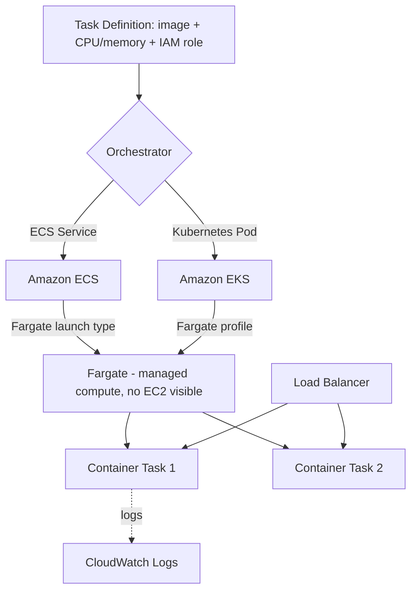

# AWS Fargate


## Definition

Fargate runs your containers for you without you ever provisioning, patching, or managing the
underlying servers (EC2 instances) — you describe the container (CPU, memory, image), and AWS
finds and manages the compute it runs on behind the scenes.

## Purpose

Running containers on ECS or EKS traditionally still meant managing an EC2 fleet to host them —
patching the OS, deciding instance sizes, right-sizing the cluster for peak load, bin-packing
containers onto hosts efficiently. Fargate removes that entire layer: you stop thinking about
*servers* and only think about *containers*. AWS built it to extend the "serverless" idea (already
proven by Lambda) to the much broader world of containerized workloads that don't fit Lambda's
15-minute/stateless constraints.

## How It Works

In plain terms: you define a **task definition** (what container image to run, how much CPU/memory
it needs, networking mode, IAM role) and either run it as a one-off **task** or as a long-running
**service** (desired count of tasks kept alive, optionally behind a load balancer) — using either
**ECS** or **EKS** as the orchestrator "front end." You pick the Fargate **launch type** (vs. the
EC2 launch type), and AWS provisions exactly the amount of compute your task needs, runs your
container(s) on it, and tears that compute down the moment the task stops — you never see or
manage the underlying host.



Walking through it: you author a task definition — essentially a container recipe, naming the
image (from ECR or another registry), the CPU/memory to reserve, networking (`awsvpc` mode gives
each task its own ENI, meaning its own private IP and security group), and an IAM task role for
permissions. You hand that recipe to **either ECS or EKS** as the orchestrator; both can schedule
work onto Fargate instead of EC2 — the orchestrator decides *what* runs and *where logically*
(which service, how many replicas), while Fargate decides *what physical compute* actually backs
it, entirely invisible to you. A load balancer in front of a service distributes traffic across
the running tasks exactly like it would across EC2 instances; logs stream to CloudWatch
automatically, same as Lambda.

## Key Features / Components

- **Task definition** — the container spec: image URI, CPU/memory (chosen from a fixed set of
  valid combinations), port mappings, environment variables, IAM task role and task execution
  role (two different roles — see Exam Tips), logging configuration.
- **Task** — one running instance of a task definition (one or more containers that share a
  network namespace).
- **Service** — keeps a desired number of tasks running continuously, replacing failed ones, and
  optionally integrates with a load balancer and with ECS Service Auto Scaling.
- **Launch type: Fargate vs. EC2** — Fargate = no visible host, pay per task resource reservation.
  EC2 launch type = you manage the underlying EC2 instances yourself (more control, potentially
  cheaper at high, steady utilization, but back to managing hosts).
- **`awsvpc` networking mode** — every Fargate task gets its own elastic network interface and
  private IP, meaning security groups apply at the *task* level, not a shared host level — a
  meaningful security/isolation improvement over tasks sharing a host's network namespace.
- **Fargate Spot** — run interruptible tasks at a discount (similar tradeoff to EC2 Spot), for
  fault-tolerant batch/background work.
- **Task execution role vs. task role** — the execution role lets the Fargate agent itself pull
  your image from ECR and write logs to CloudWatch; the task role is what your *application code
  inside the container* uses to call other AWS services (e.g., read from S3). Conflating the two
  is a common real and exam-tested mistake.
- **EKS on Fargate (Fargate profiles)** — lets Kubernetes pods run on Fargate instead of
  EC2-backed worker nodes, matched by namespace/label selectors you define in a Fargate profile.

## Use Cases — When to Use It

- **Containerized microservices** where you want the portability and tooling benefits of
  containers but want zero host management — the most common modern "default" choice for new
  containerized applications on AWS.
- **Variable or spiky container workloads** where right-sizing an EC2 fleet underneath ECS/EKS is
  wasted effort — Fargate scales per-task without you pre-provisioning host capacity.
- **Batch/ETL jobs packaged as containers** that exceed Lambda's 15-minute limit or need a full
  custom OS environment/dependencies that don't fit a Lambda layer cleanly.
- **Security-sensitive multi-tenant workloads** where task-level network isolation (`awsvpc`, its
  own ENI/security group) is valuable compared to multiple containers sharing an EC2 host's
  network namespace.
- **Teams migrating from Lambda** when a workload grows past Lambda's constraints (duration,
  package size, needing a full Linux environment) but still want a serverless operational model.

## When NOT to Use It / Alternatives

- **Very short, bursty, sub-second-to-minute functions** — Lambda's per-millisecond billing and
  simpler deployment model (no container build required) usually wins for genuinely small, quick
  tasks; Fargate's per-task minimum billing and image-pull overhead make it less efficient at that
  scale.
- **Workloads needing GPUs** — Fargate does not support GPU-backed tasks (as of this writing); use
  **EC2** (with ECS/EKS EC2 launch type) for GPU container workloads.
- **Very high, sustained, predictable scale where cost-per-vCPU-hour matters most** — a
  well-utilized EC2 fleet (with Reserved Instances/Savings Plans) backing ECS/EKS can be cheaper
  per unit of compute than Fargate at scale, since Fargate charges a premium for not managing
  hosts; model both before deciding purely by cost.
- **Workloads needing privileged host-level access** (custom kernel modules, host networking mode,
  direct hardware access) — Fargate's isolation model doesn't allow this; use EC2-backed
  ECS/EKS instead.

## Why It's Important

**Real world:** Fargate is one of the clearest wins of "serverless containers" — it eliminates an
entire job function's worth of toil (capacity planning and patching an EC2 fleet backing a
container cluster) for a large share of real-world container workloads. The task execution role
vs. task role distinction is a genuinely common real-world misconfiguration (giving the execution
role too much access, or the task role too little, breaking app functionality in subtle ways).

**Exam relevance:**
- **SAA-C03** — Domain 2 (loosely-coupled, container-based architectures) and Domain 4
  (cost-optimized compute: Fargate vs. EC2-backed containers tradeoff) both reference it.
- **DVA-C03** — explicitly called out: "Containers now directly tested: ECR image build/tag/
  lifecycle, ECS/EKS/Fargate deployment" under Domain 1 and Domain 3 (deploying via CI/CD to
  ECS/EKS/Fargate).
- **MLA-C02** — Domain 3 "Deployment and Orchestration" references containerizing ML workloads
  (custom inference containers via ECR) which can run on Fargate for lightweight, CPU-only serving.

## Pricing Model (summary)

Billed **per vCPU and per GB of memory reserved by the task, per second** (minimum 1 minute),
from the moment the task starts pulling its image to the moment it stops — not per-request like
Lambda, but still with no charge for idle host capacity, since there's no host for you to see.
**Fargate Spot** offers a discount (similar in spirit to EC2 Spot) for interruptible workloads.
No separate charge for ECS itself (ECS is free; EKS has an hourly per-cluster control-plane fee
regardless of Fargate vs. EC2 launch type). Official pricing:
https://aws.amazon.com/fargate/pricing/

## Hands-on Lab (Floci)

Floci's Containers support (ECS, real Docker-backed) covers the Fargate launch type since Fargate
is just a launch-type flag on the same ECS APIs.

```bash
# 1. Create an ECS cluster
awslocal ecs create-cluster --cluster-name fargate-lab-cluster

# 2. Register a task definition requiring Fargate compatibility
cat > task-def.json << 'EOF'
{
  "family": "fargate-lab-task",
  "networkMode": "awsvpc",
  "requiresCompatibilities": ["FARGATE"],
  "cpu": "256",
  "memory": "512",
  "containerDefinitions": [{
    "name": "web",
    "image": "nginx:latest",
    "portMappings": [{"containerPort": 80, "protocol": "tcp"}]
  }]
}
EOF
awslocal ecs register-task-definition --cli-input-json file://task-def.json

# 3. Run it as a one-off Fargate task
awslocal ecs run-task \
  --cluster fargate-lab-cluster \
  --task-definition fargate-lab-task \
  --launch-type FARGATE \
  --network-configuration '{"awsvpcConfiguration":{"subnets":["subnet-xxxxxxxx"],"assignPublicIp":"ENABLED"}}'

# 4. Or run it as a service (desired count kept alive)
awslocal ecs create-service \
  --cluster fargate-lab-cluster \
  --service-name fargate-lab-service \
  --task-definition fargate-lab-task \
  --desired-count 2 \
  --launch-type FARGATE \
  --network-configuration '{"awsvpcConfiguration":{"subnets":["subnet-xxxxxxxx"],"assignPublicIp":"ENABLED"}}'

# 5. Inspect running tasks
awslocal ecs list-tasks --cluster fargate-lab-cluster
awslocal ecs describe-tasks --cluster fargate-lab-cluster --tasks <task-arn>

# 6. Clean up
awslocal ecs delete-service --cluster fargate-lab-cluster --service fargate-lab-service --force
awslocal ecs delete-cluster --cluster fargate-lab-cluster
```

## Exam Tips

- **Task execution role vs. task role** is a near-guaranteed DVA-C03 trap: execution role = pull
  image + write logs (infrastructure-level permission); task role = what your app code calls AWS
  with (application-level permission). A question about "container can't call S3 from inside the
  app" points at the task role being wrong, not the execution role.
- **Fargate vs. EC2 launch type**: "no desire to manage underlying instances" → Fargate.
  "Need GPUs, or want to maximize utilization/cost efficiency at high steady scale" → EC2 launch
  type.
- **`awsvpc` networking** gives every task its own ENI and security group — remember this when a
  question emphasizes per-task network isolation requirements.
- Don't confuse Fargate (a compute engine, works with ECS or EKS) with ECS/EKS themselves
  (orchestrators, which *can* also run on EC2-backed capacity) — Fargate answers "where does the
  container physically run," ECS/EKS answer "how is the container scheduled and managed."
- Fargate has **no GPU support** — rule it out immediately for any ML training/inference question
  requiring a GPU.

## Related Terms

- [`ecs-eks-overview-note.md`](ecs-eks-overview-note.md) — the orchestrators Fargate runs under
- [`lambda.md`](lambda.md) — serverless compute for shorter, simpler, stateless workloads
- [`ec2.md`](ec2.md) — the EC2 launch-type alternative for container compute
- [`aws-batch.md`](aws-batch.md) — batch job orchestration that can also target Fargate
- `services/containers/` — full ECS/EKS architecture, ECR, task placement strategies (once written)
- `glossary/README.md` — task definition, launch type, ENI definitions
