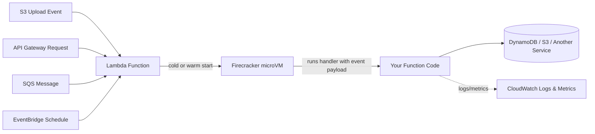

# AWS Lambda


## Definition

AWS Lambda runs your code for you without you ever provisioning or managing a server — you upload
a function, tell AWS what should trigger it, and AWS runs it only when that trigger fires, billing
you only for the milliseconds it actually executed.

## Purpose

Most applications spend most of their time idle, waiting for something to happen — a file
uploaded, an API call, a scheduled time. Running a full-time server to handle that is wasteful: you
pay 24/7 for work that happens in short bursts. AWS built Lambda to solve "I just need this specific
piece of logic to run when X happens" without any of the surrounding server lifecycle — no OS to
patch, no capacity to plan, no idle cost. This is the foundational idea of **serverless
compute**: the server still exists physically, but you never see it, manage it, or pay for it
while it's idle.

## How It Works

In plain terms: you package your code (plus any dependencies) as a **function**, choose a runtime
(Node.js, Python, Java, Go, Ruby, .NET, or a custom container image), and attach one or more
**triggers** — an event source like an S3 upload, an API Gateway request, a DynamoDB stream
record, an SQS message, or a CloudWatch Events/EventBridge schedule. When the trigger fires, AWS
spins up an isolated, lightweight execution environment (a **microVM**, via Firecracker), runs
your function's handler with the event payload passed in, and tears the environment down (or
freezes it for reuse) when your code returns.



Walking through it: an event source — S3, API Gateway, SQS, EventBridge, and dozens of others —
produces an event. Lambda receives it and either reuses an already-running execution environment
(a **warm start**, fast, because the process, memory, and any outside-the-handler initialization
code are already loaded) or creates a brand new one (a **cold start**, slower, because AWS has to
provision the microVM, load the runtime, and run your initialization code from scratch). Your
handler function runs with the event data as input, does its work (read a file, call an API, write
to a database), and returns a result (or, for async triggers, simply finishes). Throughout, Lambda
automatically streams logs and metrics to CloudWatch, without you configuring any agent — it's
built into the execution environment.

## Key Features / Components

- **Function** — your code + its handler entry point + runtime + configured memory/timeout.
- **Trigger / Event source** — what invokes the function: synchronous (API Gateway, ALB, Lambda
  Function URLs — caller waits for a response) or asynchronous (S3 events, SNS — Lambda queues and
  retries internally) or poll-based (SQS, DynamoDB Streams, Kinesis — Lambda polls the source and
  batches records).
- **Execution role (IAM)** — the permissions the function runs with; Lambda assumes this role at
  invoke time, so the function never needs hardcoded credentials.
- **Memory/CPU allocation** — you pick memory (128 MB–10,240 MB); CPU scales proportionally with
  memory, so a CPU-bound function sometimes runs *cheaper* at higher memory because it finishes
  faster.
- **Timeout** — max 15 minutes per invocation; anything longer needs Step Functions, Fargate, or
  EC2 instead.
- **Concurrency** — the number of simultaneous executions; **reserved concurrency** guarantees
  (and caps) capacity for a function, **provisioned concurrency** pre-warms environments to
  eliminate cold starts for latency-sensitive workloads.
- **Layers** — share common code/dependencies across multiple functions without bundling them into
  every deployment package.
- **Environment variables** — runtime configuration without rebuilding the deployment package.
- **VPC access** — a function can attach to a VPC (via Hyperplane ENIs) to reach private resources
  like an RDS instance inside a private subnet; this adds a small amount of latency vs. functions
  outside a VPC that only call public AWS APIs.
- **Dead Letter Queues / on-failure destinations** — where failed asynchronous invocations go for
  inspection/retry instead of silently disappearing.
- **Container image support** — package a function as an OCI/Docker image (up to 10 GB) instead of
  a zip, useful for large dependencies (ML libraries, custom binaries).

## Use Cases — When to Use It

- **Event-driven, short-lived tasks**: resize an image the moment it's uploaded to S3, validate/
  transform a record the moment it lands in a DynamoDB stream, process an SQS message.
- **APIs with spiky or unpredictable traffic** fronted by API Gateway, where paying for idle EC2
  capacity between requests makes no sense.
- **Scheduled jobs** (cron-style) via EventBridge — nightly cleanup scripts, periodic report
  generation — without a dedicated always-on server just to run a 2-minute job once a day.
- **Glue code between AWS services** — a classic pattern: S3 event → Lambda → write metadata to
  DynamoDB → notify via SNS, with zero infrastructure to provision anywhere in that chain.
- **Lightweight ML inference** for small models that fit the memory/time limits, especially behind
  an API for on-demand predictions.

## When NOT to Use It / Alternatives

- **Long-running processes** (anything over 15 minutes) — use **Fargate**, **EC2**, or break the
  work into steps orchestrated by **Step Functions**.
- **Workloads needing consistent sub-10ms latency on every single call** — cold starts (hundreds
  of milliseconds to a few seconds, worse for VPC-attached functions or large container images)
  make Lambda a poor fit unless you pay for provisioned concurrency; a persistently warm EC2/
  Fargate service may suit better.
- **High, sustained, predictable throughput** — at large enough constant scale, per-invocation
  Lambda pricing can cost more than a steady-state EC2/Fargate fleet sized to match; model both
  before committing.
- **Workloads needing specialized hardware beyond what Lambda offers**, or requiring full OS-level
  control (custom kernel modules, specific GPU driver versions) — use EC2.
- **Stateful, long-lived in-memory data** (a large cache that must persist across requests with
  guarantees) — Lambda environments can be recycled at any time; use ElastiCache/a persistent
  service instead and treat Lambda as stateless.

## Why It's Important

**Real world:** Lambda is the clearest expression of "pay for value, not for idle capacity," and
it removes an entire category of operational work (patching, capacity planning, scaling policies)
that used to consume real engineering time. It's also a common source of surprising bugs for
newcomers — cold starts, VPC networking quirks, and the 15-minute timeout all bite people who
assume it behaves like a tiny always-on server. Misconfigured Lambda IAM execution roles
(over-permissive) are a frequent real-world security finding.

**Exam relevance:**
- **SAA-C03** — Domain 2 "Design Resilient Architectures" (Task 2.1, loosely coupled/event-driven
  architectures — Lambda is the canonical compute glue) and Domain 4 (cost-optimized serverless
  compute vs. EC2).
- **DVA-C03** — an entire task statement is dedicated to it: Domain 1 Task 1.2 "Develop code for
  AWS Lambda" (VPC access patterns, layers, concurrency models, triggers) — this is one of the
  single most-tested services on DVA-C03.
- **MLA-C02** — Domain 3 "Deployment and Orchestration" covers Lambda as a lightweight inference/
  orchestration compute option alongside SageMaker endpoints, and as the typical trigger mechanism
  for retraining pipelines (e.g., new data in S3 → Lambda → kick off a SageMaker Pipeline).

## Pricing Model (summary)

- Billed per **request** (first 1M requests/month free, perpetually, as part of the Lambda Free
  Tier) plus **GB-seconds** of compute (memory allocated × execution duration, rounded to the
  nearest millisecond).
- No charge while idle — this is the defining difference from EC2/Fargate, which bill for
  allocated capacity whether or not it's doing work.
- **Provisioned concurrency** is billed separately and continuously (per GB-second it's kept warm),
  since it reserves capacity ahead of invocations — effectively trades serverless cost model for
  guaranteed low latency.
- Official pricing: https://aws.amazon.com/lambda/pricing/

## Hands-on Lab (Floci)

```bash
# 1. Write a minimal handler
mkdir -p lambda-lab && cd lambda-lab
cat > handler.py << 'EOF'
def lambda_handler(event, context):
    name = event.get("name", "world")
    return {"statusCode": 200, "body": f"Hello, {name}!"}
EOF
zip function.zip handler.py

# 2. Create an execution role (Floci accepts any ARN-shaped value for local testing)
awslocal iam create-role \
  --role-name lambda-lab-role \
  --assume-role-policy-document '{"Version":"2012-10-17","Statement":[{"Effect":"Allow","Principal":{"Service":"lambda.amazonaws.com"},"Action":"sts:AssumeRole"}]}'

# 3. Create the function
awslocal lambda create-function \
  --function-name hello-lambda \
  --runtime python3.12 \
  --handler handler.lambda_handler \
  --zip-file fileb://function.zip \
  --role arn:aws:iam::000000000000:role/lambda-lab-role

# 4. Invoke it synchronously
awslocal lambda invoke \
  --function-name hello-lambda \
  --payload '{"name": "Floci"}' \
  --cli-binary-format raw-in-base64-out \
  response.json
cat response.json

# 5. Wire it to an S3 trigger (event-driven pattern)
awslocal s3 mb s3://lab-upload-bucket
awslocal lambda add-permission \
  --function-name hello-lambda --statement-id s3invoke \
  --action lambda:InvokeFunction --principal s3.amazonaws.com \
  --source-arn arn:aws:s3:::lab-upload-bucket

awslocal s3api put-bucket-notification-configuration \
  --bucket lab-upload-bucket \
  --notification-configuration '{
    "LambdaFunctionConfigurations": [{
      "LambdaFunctionArn": "arn:aws:lambda:us-east-1:000000000000:function:hello-lambda",
      "Events": ["s3:ObjectCreated:*"]
    }]
  }'

# 6. Clean up
awslocal lambda delete-function --function-name hello-lambda
```

This exercises the two most-tested patterns: a direct synchronous `invoke` (like API Gateway would
do) and an S3-triggered asynchronous invocation (the classic event-driven glue pattern).

## Exam Tips

- **15-minute hard timeout** — any question describing a process that can run "hours" or has
  unpredictable long duration is ruling Lambda out; look for Step Functions, Fargate, or Batch.
- **Cold start vs. warm start** — know that VPC-attached functions and large packages/images
  increase cold start time; provisioned concurrency is the fix when latency SLAs are strict.
  DVA-C03 loves a "why is my Lambda slow on first invocation" diagnostic question.
- **Synchronous vs. asynchronous vs. poll-based invocation** — this determines retry/error
  behavior: sync callers (API Gateway) get the error directly, async sources (S3, SNS) get
  automatic retries + optional DLQ/destinations, poll-based sources (SQS, Kinesis, DynamoDB
  Streams) are pulled by Lambda itself in batches, and a batch failure can block the shard/queue
  until resolved (configurable with partial batch response, bisect-on-error).
- **Reserved vs. provisioned concurrency** are NOT the same thing: reserved concurrency *caps and
  guarantees* a slice of account-level concurrency for a function; provisioned concurrency
  *pre-warms* environments to avoid cold starts. A question about "stop one function from
  starving others of concurrency" → reserved concurrency. "Eliminate cold start latency for a
  critical API" → provisioned concurrency.
- **Execution role least privilege** — DVA-C03/SAA-C03 security questions frequently test
  whether you'd scope the Lambda execution role down to only the specific actions/resources it
  needs, not a wildcard.
- Lambda vs. Fargate vs. EC2 tradeoff questions hinge on: duration limit, cold start tolerance,
  and whether you need OS-level/container-level control.

## Related Terms

- [`fargate.md`](fargate.md) — serverless containers, for workloads Lambda's limits don't fit
- [`ec2.md`](ec2.md) — full control compute, the opposite end of the ops-responsibility spectrum
- [`aws-batch.md`](aws-batch.md) — for long-running batch jobs Lambda's timeout can't handle
- `services/application-integration/` — EventBridge, SQS, SNS as Lambda triggers (once written)
- `services/containers/` — Lambda container image packaging, ECR (once written)
- `glossary/README.md` — cold start, execution role, event source mapping definitions
