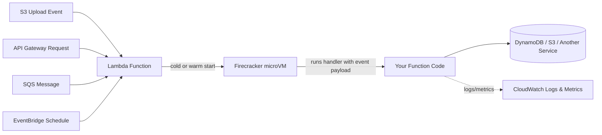
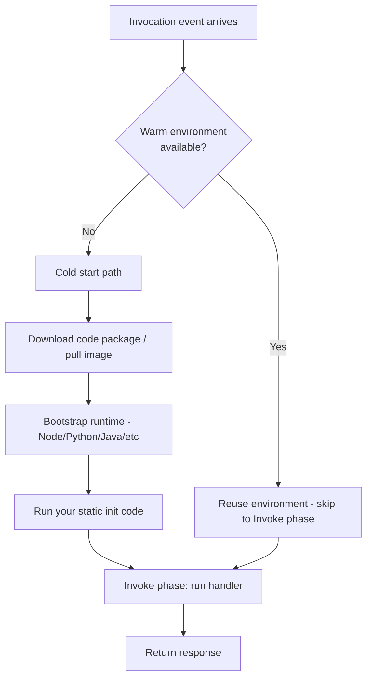
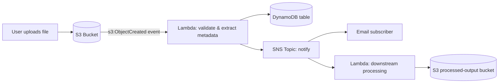

# AWS Lambda


## Definition

AWS Lambda runs your code for you without you ever provisioning or managing a server — you upload
a function, tell AWS what should trigger it, and AWS runs it only when that trigger fires, billing
you only for the milliseconds it actually executed.

## Purpose

Most applications spend most of their time idle, waiting for something to happen — a file
uploaded, an API call, a scheduled time. Running a full-time server to handle that is wasteful: you
pay 24/7 for work that happens in short bursts. AWS built Lambda to solve "I just need this specific
piece of logic to run when X happens" without any of the surrounding server lifecycle — no OS to
patch, no capacity to plan, no idle cost. This is the foundational idea of **serverless
compute**: the server still exists physically, but you never see it, manage it, or pay for it
while it's idle.

Lambda launched at re:Invent 2014 and is widely credited with popularizing "serverless" as an
industry-wide architecture pattern, not just an AWS product — every major cloud now has a
Lambda-equivalent (Azure Functions, Google Cloud Functions), and the term "FaaS" (Functions as a
Service) exists largely because of what Lambda proved was possible at scale.

## How It Works

In plain terms: you package your code (plus any dependencies) as a **function**, choose a runtime
(Node.js, Python, Java, Go, Ruby, .NET, or a custom container image), and attach one or more
**triggers** — an event source like an S3 upload, an API Gateway request, a DynamoDB stream
record, an SQS message, or a CloudWatch Events/EventBridge schedule. When the trigger fires, AWS
spins up an isolated, lightweight execution environment (a **microVM**, via Firecracker), runs
your function's handler with the event payload passed in, and tears the environment down (or
freezes it for reuse) when your code returns.



Walking through it: an event source — S3, API Gateway, SQS, EventBridge, and dozens of others —
produces an event. Lambda receives it and either reuses an already-running execution environment
(a **warm start**, fast, because the process, memory, and any outside-the-handler initialization
code are already loaded) or creates a brand new one (a **cold start**, slower, because AWS has to
provision the microVM, load the runtime, and run your initialization code from scratch). Your
handler function runs with the event data as input, does its work (read a file, call an API, write
to a database), and returns a result (or, for async triggers, simply finishes). Throughout, Lambda
automatically streams logs and metrics to CloudWatch, without you configuring any agent — it's
built into the execution environment.

### The execution environment lifecycle in detail

Lambda's own documentation breaks every invocation down into three phases: **Init**, **Invoke**,
and **Shutdown**. Understanding these three phases is the single most useful mental model for
reasoning about both cold starts and function billing.


*This diagram shows a single execution environment handling three consecutive invocations. Note
that `Init` only happens once, before the first invocation — every subsequent invocation on a
**warm** environment skips straight to `Invoke`, which is exactly why the second and third calls in
this diagram are faster than the first. `Shutdown` only happens when Lambda decides to recycle the
environment (after a period of inactivity, or during a deployment), not after every single
invocation.*
**Source:** AWS Documentation — [Understanding the Lambda execution environment lifecycle](https://docs.aws.amazon.com/lambda/latest/dg/lambda-runtime-environment.html), AWS Lambda Developer Guide.

During **Init**, Lambda does three things in order: start any configured extensions, bootstrap the
runtime itself, and run your function's static initialization code (anything outside the handler
— a database connection pool setup, loading a large ML model into memory, reading a config file).
This is why the common cold-start optimization advice is "move expensive setup outside the
handler" — code there only pays the Init cost once per environment, not once per invocation.

### Anatomy of a cold start




*AWS's own performance-optimization documentation breaks a cold start into exactly these stages:
code/image download, runtime bootstrap, and your static initialization code, all of which happen
before your handler ever runs. This is why cold-start mitigation techniques target each stage
separately — smaller deployment packages speed up download, SnapStart (Java) skips the bootstrap
and init stages entirely by resuming from a pre-initialized snapshot, and provisioned concurrency
avoids the whole cold path by keeping environments permanently warm.*
**Source:** AWS Documentation — [Understanding the Lambda execution environment lifecycle](https://docs.aws.amazon.com/lambda/latest/dg/lambda-runtime-environment.html), AWS Lambda Developer Guide (performance optimization section).

### Synchronous vs. asynchronous vs. poll-based invocation

These three invocation models behave completely differently on error, and the exam tests the
difference constantly:


### Event-driven glue architecture (classic pattern)



## Memory, CPU, and Concurrency — Deep Dive

- **Memory/CPU allocation** — you pick memory (128 MB–10,240 MB in 1 MB increments); CPU scales
  proportionally with memory (at 1,769 MB you get the equivalent of one full vCPU), so a CPU-bound
  function sometimes runs *cheaper* at higher memory because it finishes proportionally faster —
  this is counter-intuitive and worth testing explicitly rather than assuming "lower memory =
  cheaper."
- **Timeout** — max 15 minutes per invocation (default functions); anything longer needs Step
  Functions, Fargate, Batch, or EC2 instead. (Lambda also offers a separate "Managed Instances" and
  "durable functions" execution model with longer limits for specialized long-running/stateful
  workflows, but the default, most commonly tested Lambda model is the 15-minute one.)
- **Concurrency** — the number of simultaneous executions; **reserved concurrency** guarantees
  (and caps) capacity for a function — useful both to protect a critical function from being
  starved by others, and to *prevent* a function from overwhelming a downstream resource (like a
  database connection limit) by capping how many copies can run at once; **provisioned
  concurrency** pre-warms environments to eliminate cold starts for latency-sensitive workloads,
  at a continuous, separate cost.
- **Layers** — share common code/dependencies across multiple functions without bundling them into
  every deployment package; up to 5 layers per function, each layer up to 250 MB unzipped combined
  with your function code.
- **Environment variables** — runtime configuration without rebuilding the deployment package; 4 KB
  total size limit per function (combined with the values), encrypted at rest with a Lambda-owned
  or your own KMS key.
- **VPC access** — a function can attach to a VPC (via Hyperplane ENIs, a shared networking layer
  introduced specifically to remove the old per-invoke ENI creation penalty) to reach private
  resources like an RDS instance inside a private subnet; this still adds a small amount of latency
  vs. functions outside a VPC that only call public AWS APIs, though far less than in Lambda's
  early years.
- **Dead Letter Queues / on-failure destinations** — where failed asynchronous invocations go for
  inspection/retry instead of silently disappearing; destinations (the newer mechanism) can route
  to SQS, SNS, another Lambda function, or EventBridge, and capture both success and failure paths,
  unlike the older DLQ mechanism which only captures failures.
- **Container image support** — package a function as an OCI/Docker image (up to 10 GB) instead of
  a zip, useful for large dependencies (ML libraries, custom binaries) that exceed the zip package
  size limits.
- **Ephemeral storage (`/tmp`)** — configurable from 512 MB (default) up to 10,240 MB, billed
  per-GB-second like memory, useful for functions that need scratch disk space larger than the
  default (e.g., unpacking a large archive before processing it).

## Worked Cost Examples

### Example 1: A low-traffic API

A Lambda-backed API handles 2 million requests/month, averaging 200ms execution time at 512 MB
memory.

- GB-seconds: 2,000,000 requests × 0.2s × (512/1024 GB) = **200,000 GB-s**
- Compute cost: 200,000 GB-s is *under* the 400,000 GB-s free tier → **$0 compute cost**
- Request cost: 2,000,000 requests is *under* the 1,000,000 free tier... wait, it's over —
  (2,000,000 − 1,000,000 free) × $0.20/million = **$0.20**
- **Total: ~$0.20/month** — this is why Lambda is so attractive for low/moderate-traffic APIs: the
  free tier alone covers meaningful real traffic.

### Example 2: A busier API, no free tier headroom left

10 million requests/month, 300ms average execution, 1,024 MB memory.

- GB-seconds: 10,000,000 × 0.3s × 1 GB = **3,000,000 GB-s**
- Compute cost: 3,000,000 GB-s × $0.0000166667/GB-s = **$50.00**
- Request cost: 10,000,000 × $0.20/million = **$2.00**
- **Total: ~$52.00/month**

### Example 3: Provisioned concurrency for a latency-critical path

The same function from Example 2, but 5 execution environments are kept permanently warm via
provisioned concurrency to eliminate cold starts on a checkout API, running 24/7 for a 30-day
month:

- Provisioned concurrency cost: 5 environments × 1 GB × $0.0000041667/GB-s × (30 × 24 × 3600 s)
  ≈ 5 × 1 × $0.0000041667 × 2,592,000 ≈ **$54.00/month**, *on top of* the regular per-invocation
  compute/request cost above
- This roughly **doubles** the monthly cost of that function (from ~$52 to ~$106), which is the
  real-world tradeoff to weigh: provisioned concurrency buys predictable low latency at a real,
  continuous cost — it is not "free insurance," and should be scoped only to the specific
  latency-critical functions that need it, not applied broadly.

### Example 4: When Lambda stops being the cheaper option

A sustained, constant-throughput service running the equivalent of 2 vCPUs / 4 GB continuously,
24/7, for a month, costs at Lambda rates (1,769 MB ≈ 1 vCPU, so 2 vCPU ≈ 3,538 MB ≈ 3.5 GB,
rounding to 4 GB for 2 vCPU-equivalent): 4 GB × $0.0000166667/GB-s × 2,592,000s ≈ **$172.80/month**
in compute alone, excluding requests. An `m6i.large` (2 vCPU, 8 GB) EC2 instance running the same
24/7 costs **$0.096/hr × 730 ≈ $70.08/month** On-Demand, or far less with a Savings Plan. This is
the concrete, worked version of the general Lambda vs. EC2/Fargate guidance: **at sustained, high,
predictable utilization, a provisioned server is usually cheaper than paying Lambda's per-request/
per-GB-second premium continuously** — Lambda's economic advantage comes specifically from idle
time you don't pay for, and a workload with no idle time doesn't benefit from that.

## Key Features / Components

- **Function** — your code + its handler entry point + runtime + configured memory/timeout.
- **Trigger / Event source** — what invokes the function: synchronous (API Gateway, ALB, Lambda
  Function URLs — caller waits for a response) or asynchronous (S3 events, SNS — Lambda queues and
  retries internally) or poll-based (SQS, DynamoDB Streams, Kinesis — Lambda polls the source and
  batches records).
- **Execution role (IAM)** — the permissions the function runs with; Lambda assumes this role at
  invoke time, so the function never needs hardcoded credentials.
- **Memory/CPU allocation, Timeout, Concurrency, Layers, Environment variables, VPC access, DLQ/
  destinations, Container image support, Ephemeral storage** — see the deep-dive section above.
- **Lambda SnapStart** (currently Java, with growing support for other runtimes) — snapshots a
  fully initialized execution environment after the Init phase completes once, and restores new
  environments from that snapshot instead of re-running Init from scratch, cutting cold starts
  dramatically (commonly 90%+ reduction) at no extra steady-state cost, unlike provisioned
  concurrency.
- **Function URLs** — a built-in HTTPS endpoint for a function without needing API Gateway at all,
  for the simplest "I just need a webhook/HTTP endpoint" cases.
- **Versions and aliases** — publish immutable versions of a function and point a named alias
  (e.g., `prod`, `staging`) at a specific version, enabling traffic shifting (e.g., 90%/10% canary
  splits between two versions behind one alias) without changing the function's ARN that callers
  use.

## Security Considerations

- **Execution role least privilege is the single most common real-world Lambda misconfiguration**
  — teams often attach `AWSLambdaFullAccess`-style broad policies during development and never
  tighten them for production; scope the role to exactly the actions and resource ARNs the
  function actually calls.
- **Secrets should never be hardcoded in environment variables in plaintext in source control** —
  even though Lambda encrypts environment variables at rest, the values are still visible to
  anyone with `lambda:GetFunctionConfiguration` permission; use Secrets Manager or Parameter Store
  (SecureString) and fetch secrets at runtime (ideally cached across warm invocations) instead.
- **Resource-based policies** control which *other* accounts/services can invoke your function
  (e.g., allowing a specific S3 bucket or API Gateway to call it) — distinct from the execution
  role, which controls what the function itself can call outward. Confusing these two directions
  is a recurring exam trap.
- **VPC attachment does not automatically mean "more secure"** — a common misconception. Attaching
  a function to a VPC restricts its *network* reachability (useful for reaching private RDS, for
  example) but doesn't change its IAM permissions at all; least-privilege IAM is still the primary
  security control, with VPC attachment as a complementary network-layer control.
- **Code signing** — for regulated environments, Lambda supports requiring that deployment
  packages be signed by an approved signing profile before they can be deployed, preventing
  unauthorized or tampered code from reaching production functions.

## Monitoring & Observability

- **CloudWatch Logs** are created automatically per function (one log group per function, one log
  stream per container instance) — every invocation gets a `START`/`END`/`REPORT` triplet of log
  lines, and the `REPORT` line is where `Duration`, `Billed Duration`, `Memory Size`,
  `Max Memory Used`, and (on cold starts only) `Init Duration` all live — this single log line is
  usually the fastest way to diagnose both cost and latency questions about a specific invocation.
- **AWS X-Ray** integration traces a request end-to-end across Lambda and any downstream AWS
  service calls it makes, which is how you distinguish "the function itself is slow" from "the
  function is fast but waiting on a slow downstream dependency" — a distinction cold-start
  debugging alone can't answer.
- **CloudWatch Lambda Insights** (an enhanced monitoring extension) surfaces CPU, memory, and
  network metrics per invocation at a finer grain than the default `REPORT` line, useful for
  right-sizing memory allocation empirically rather than by guesswork.
- **Lambda Power Tuning** (an open-source AWS Serverless Application Repository tool, not a
  built-in console feature) runs a function at multiple memory settings against sample payloads
  and reports the cost/performance curve, directly answering "what memory setting minimizes my
  cost" — a genuinely useful exercise for optimizing CPU-bound functions where higher memory can,
  counter-intuitively, be cheaper overall.

## Runtime Support and Language Choices

Lambda provides managed runtimes for Node.js, Python, Java (Corretto), Go, Ruby, and .NET, each
receiving automatic minor-version security patches from AWS. For anything else — or for precise
control over the runtime's own patch cadence — **custom runtimes** (via the Runtime API) or
**container images** let you bring your own base image. Cold-start characteristics vary
meaningfully by language: interpreted languages with small runtimes (Python, Node.js, Go) tend to
cold-start fastest; JVM-based languages (Java, and to a lesser extent .NET) historically had the
slowest cold starts due to JIT compilation and classloading, which is the specific problem
SnapStart was built to solve for Java. A practical, frequently-tested takeaway: if a scenario
describes "extremely latency-sensitive, cannot tolerate even occasional multi-second delays," and
the team is using Java, SnapStart (or switching languages) is a more targeted answer than simply
"add more memory."

## Common Architectures

1. **Event-driven glue / microservices backend** — S3 or DynamoDB Streams trigger a Lambda that
   transforms data and writes to another store, entirely without a server anywhere in the chain —
   the signature serverless pattern shown in the diagram above.
2. **REST/HTTP API backend** — API Gateway (or a Function URL for simpler cases) in front of one
   or more Lambda functions, with DynamoDB as the persistence layer — the classic "three-tier
   serverless web app" pattern, a direct serverless analog to the EC2 three-tier pattern.
3. **Fan-out processing pipeline** — an SNS topic with multiple Lambda subscribers, each doing a
   different piece of independent processing on the same event (e.g., one updates a search index,
   another sends a notification, another updates analytics) — decoupled, parallel, and each
   consumer scales independently.

## Use Cases — When to Use It

- **Event-driven, short-lived tasks**: resize an image the moment it's uploaded to S3, validate/
  transform a record the moment it lands in a DynamoDB stream, process an SQS message.
- **APIs with spiky or unpredictable traffic** fronted by API Gateway, where paying for idle EC2
  capacity between requests makes no sense.
- **Scheduled jobs** (cron-style) via EventBridge — nightly cleanup scripts, periodic report
  generation — without a dedicated always-on server just to run a 2-minute job once a day.
- **Glue code between AWS services** — a classic pattern: S3 event → Lambda → write metadata to
  DynamoDB → notify via SNS, with zero infrastructure to provision anywhere in that chain.
- **Lightweight ML inference** for small models that fit the memory/time limits, especially behind
  an API for on-demand predictions.
- **Infrastructure automation** — custom CloudFormation resources, Config rule remediation,
  scheduled account hygiene tasks — anywhere you need a small piece of logic to run in response to
  an AWS-internal event rather than external user traffic.

## When NOT to Use It / Alternatives

- **Long-running processes** (anything over 15 minutes) — use **Fargate**, **EC2**, or break the
  work into steps orchestrated by **Step Functions**.
- **Workloads needing consistent sub-10ms latency on every single call** — cold starts (hundreds
  of milliseconds to a few seconds, worse for VPC-attached functions or large container images)
  make Lambda a poor fit unless you pay for provisioned concurrency or use SnapStart; a
  persistently warm EC2/Fargate service may suit better.
- **High, sustained, predictable throughput** — at large enough constant scale, per-invocation
  Lambda pricing can cost more than a steady-state EC2/Fargate fleet sized to match (see Worked
  Cost Example 4 above); model both before committing.
- **Workloads needing specialized hardware beyond what Lambda offers**, or requiring full OS-level
  control (custom kernel modules, specific GPU driver versions) — use EC2.
- **Stateful, long-lived in-memory data** (a large cache that must persist across requests with
  guarantees) — Lambda environments can be recycled at any time; use ElastiCache/a persistent
  service instead and treat Lambda as stateless.

## Why It's Important

**Real world:** Lambda is the clearest expression of "pay for value, not for idle capacity," and
it removes an entire category of operational work (patching, capacity planning, scaling policies)
that used to consume real engineering time. It's also a common source of surprising bugs for
newcomers — cold starts, VPC networking quirks, and the 15-minute timeout all bite people who
assume it behaves like a tiny always-on server. Misconfigured Lambda IAM execution roles
(over-permissive) are a frequent real-world security finding.

**Exam relevance:**
- **SAA-C03** — Domain 2 "Design Resilient Architectures" (Task 2.1, loosely coupled/event-driven
  architectures — Lambda is the canonical compute glue) and Domain 4 (cost-optimized serverless
  compute vs. EC2).
- **DVA-C03** — an entire task statement is dedicated to it: Domain 1 Task 1.2 "Develop code for
  AWS Lambda" (VPC access patterns, layers, concurrency models, triggers) — this is one of the
  single most-tested services on DVA-C03.
- **MLA-C02** — Domain 3 "Deployment and Orchestration" covers Lambda as a lightweight inference/
  orchestration compute option alongside SageMaker endpoints, and as the typical trigger mechanism
  for retraining pipelines (e.g., new data in S3 → Lambda → kick off a SageMaker Pipeline).

## Limits & Quotas

| Quota | Default | Adjustable? |
|---|---|---|
| Concurrent executions per Region (account-level) | 1,000 | Yes, via support request |
| Function memory | 128 MB – 10,240 MB | Configured per-function, not an account quota |
| Function timeout | 900 seconds (15 minutes) | Hard limit for default functions |
| Deployment package size (zipped, direct upload) | 50 MB | Hard limit |
| Deployment package size (unzipped, incl. layers) | 250 MB | Hard limit |
| Container image size | 10 GB | Hard limit |
| `/tmp` ephemeral storage | 512 MB default, up to 10,240 MB | Configured per-function |
| Environment variables total size | 4 KB | Hard limit |
| Layers per function | 5 | Hard limit |
| Synchronous invocation payload size | 6 MB (request and response) | Hard limit |
| Asynchronous invocation payload size | 256 KB | Hard limit |
| Burst concurrency scaling rate | Varies by Region (e.g., 500-3,000 additional concurrent executions per minute) before throttling | Region-dependent |

The synchronous **6 MB payload limit** is a frequent real-world surprise for teams returning large
JSON responses or file contents directly from a Lambda behind API Gateway — the practical fix is
writing the large payload to S3 and returning a pre-signed URL instead of the payload itself.

## Troubleshooting / Common Issues

- **`Task timed out after X seconds`** in CloudWatch Logs — the function hit its configured
  timeout; check whether the timeout is simply too low for legitimate work, or whether the
  function is hanging on a downstream call (e.g., a database connection with no timeout of its own)
  that should fail fast instead.
- **High p99 latency that doesn't match the function's actual average duration** — almost always
  cold starts hitting a fraction of invocations; check the `Init Duration` field in the
  `REPORT` log line (present only on cold starts) to confirm, then consider provisioned
  concurrency, SnapStart (Java), or trimming package size and VPC attachment overhead.
- **Function works standalone but fails when invoked via API Gateway** — check the integration
  request/response mapping and whether the function is returning the exact `{statusCode, headers,
  body}` shape API Gateway's Lambda proxy integration expects; a function returning plain data
  instead of that wrapper shape is a very common first-time mistake.
- **Async invocations silently disappearing on failure** — without a configured DLQ or
  on-failure destination, failed async invocations are retried twice more and then dropped with no
  record; always configure a destination for anything you need to debug or reprocess later.
- **SQS-triggered function stuck reprocessing the same poison-pill message** — a single
  malformed message can block an entire batch/shard if the function keeps failing on it; configure
  a maximum receive count with a dead-letter queue on the SQS side, and/or enable partial batch
  response so only the failing record is retried, not the whole batch.
- **"AccessDenied" calling another AWS service from inside the function** — check the execution
  role's permissions first (the most common cause), then check resource-based policies on the
  target resource (e.g., an S3 bucket policy that might restrict access regardless of the Lambda
  role's IAM permissions).

### Example 5: Comparing x86 vs. Arm/Graviton2 for the same workload

Taking Example 2 (10M requests/month, 300ms, 1,024 MB) and re-running it on Arm/Graviton2 instead
of x86, assuming the same execution duration (Graviton2 is typically equal or slightly faster for
equivalent code, so this is a conservative comparison):

- Arm compute rate ≈ $0.0000133334/GB-s (roughly 20% below the x86 rate)
- Compute cost: 3,000,000 GB-s × $0.0000133334 ≈ **$40.00** (vs. $50.00 on x86)
- Request cost is identical regardless of architecture: **$2.00**
- **Total: ~$42.00/month vs. ~$52.00/month on x86 — a ~19% savings** for a workload that is often a
  drop-in change (recompile/rebuild for `arm64`, no code changes needed for most interpreted
  runtimes). This is why "switch to Graviton/Arm" is a near-free-lunch answer on Domain 4
  cost-optimization questions whenever the function doesn't depend on x86-specific binaries.

## Troubleshooting / Common Issues — Additional Scenarios

- **Function works in `us-east-1` but fails after deployment to another Region** — check for
  hardcoded Region references, Region-specific service endpoints, or resources (like a layer ARN)
  that only exist in the original Region; Lambda layers and most resource ARNs are Region-scoped
  and don't automatically replicate.
- **Intermittent `ENOSPC` / out-of-disk errors** — the function or a library it uses is writing
  more to `/tmp` than the configured ephemeral storage allows (512 MB by default); either clean up
  written files within the handler or raise the configured `/tmp` size.
- **Provisioned concurrency not actually eliminating cold starts** — check that application load
  isn't exceeding the provisioned amount; traffic above the provisioned concurrency level still
  falls back to on-demand (cold-start-prone) scaling for the overflow, which is expected behavior,
  not a bug.
- **Function behaves differently locally vs. in Lambda** — almost always an environment
  difference: missing environment variables, different IAM permissions (locally you might be using
  broad personal credentials vs. the function's actual scoped execution role), or filesystem
  assumptions that don't hold in the read-only Lambda filesystem outside of `/tmp`.

## Pricing Model (summary)

- Billed per **request** (first 1M requests/month free, perpetually, as part of the Lambda Free
  Tier) plus **GB-seconds** of compute (memory allocated × execution duration, rounded to the
  nearest millisecond). Current approximate rates: $0.20 per 1 million requests;
  $0.0000166667 per GB-second (x86); Arm/Graviton2 runs roughly 20% cheaper per GB-second.
- No charge while idle — this is the defining difference from EC2/Fargate, which bill for
  allocated capacity whether or not it's doing work.
- **Provisioned concurrency** is billed separately and continuously (per GB-second it's kept warm,
  at a lower per-GB-second rate than on-demand compute but applied 24/7 regardless of invocation
  volume), since it reserves capacity ahead of invocations — effectively trades serverless cost
  model for guaranteed low latency.
- Official pricing: https://aws.amazon.com/lambda/pricing/

## Hands-on Lab (Floci)

```bash
# 1. Write a minimal handler
mkdir -p lambda-lab && cd lambda-lab
cat > handler.py << 'EOF'
def lambda_handler(event, context):
    name = event.get("name", "world")
    return {"statusCode": 200, "body": f"Hello, {name}!"}
EOF
zip function.zip handler.py

# 2. Create an execution role (Floci accepts any ARN-shaped value for local testing)
awslocal iam create-role \
  --role-name lambda-lab-role \
  --assume-role-policy-document '{"Version":"2012-10-17","Statement":[{"Effect":"Allow","Principal":{"Service":"lambda.amazonaws.com"},"Action":"sts:AssumeRole"}]}'

# 3. Create the function
awslocal lambda create-function \
  --function-name hello-lambda \
  --runtime python3.12 \
  --handler handler.lambda_handler \
  --zip-file fileb://function.zip \
  --role arn:aws:iam::000000000000:role/lambda-lab-role

# 4. Invoke it synchronously
awslocal lambda invoke \
  --function-name hello-lambda \
  --payload '{"name": "Floci"}' \
  --cli-binary-format raw-in-base64-out \
  response.json
cat response.json

# 5. Wire it to an S3 trigger (event-driven pattern)
awslocal s3 mb s3://lab-upload-bucket
awslocal lambda add-permission \
  --function-name hello-lambda --statement-id s3invoke \
  --action lambda:InvokeFunction --principal s3.amazonaws.com \
  --source-arn arn:aws:s3:::lab-upload-bucket

awslocal s3api put-bucket-notification-configuration \
  --bucket lab-upload-bucket \
  --notification-configuration '{
    "LambdaFunctionConfigurations": [{
      "LambdaFunctionArn": "arn:aws:lambda:us-east-1:000000000000:function:hello-lambda",
      "Events": ["s3:ObjectCreated:*"]
    }]
  }'

# 6. Clean up
awslocal lambda delete-function --function-name hello-lambda
```

This exercises the two most-tested patterns: a direct synchronous `invoke` (like API Gateway would
do) and an S3-triggered asynchronous invocation (the classic event-driven glue pattern).

### Extra practice: concurrency controls

```bash
# Cap this function's concurrency to protect a downstream DB connection limit
awslocal lambda put-function-concurrency \
  --function-name hello-lambda \
  --reserved-concurrent-executions 10

# Check configured concurrency
awslocal lambda get-function-concurrency --function-name hello-lambda

# Remove the cap
awslocal lambda delete-function-concurrency-config --function-name hello-lambda 2>/dev/null || true
```

## Exam Tips

- **15-minute hard timeout** — any question describing a process that can run "hours" or has
  unpredictable long duration is ruling Lambda out; look for Step Functions, Fargate, or Batch.
- **Cold start vs. warm start** — know that VPC-attached functions and large packages/images
  increase cold start time; provisioned concurrency or SnapStart is the fix when latency SLAs are
  strict. DVA-C03 loves a "why is my Lambda slow on first invocation" diagnostic question.
- **Synchronous vs. asynchronous vs. poll-based invocation** — this determines retry/error
  behavior: sync callers (API Gateway) get the error directly, async sources (S3, SNS) get
  automatic retries + optional DLQ/destinations, poll-based sources (SQS, Kinesis, DynamoDB
  Streams) are pulled by Lambda itself in batches, and a batch failure can block the shard/queue
  until resolved (configurable with partial batch response, bisect-on-error).
- **Reserved vs. provisioned concurrency** are NOT the same thing: reserved concurrency *caps and
  guarantees* a slice of account-level concurrency for a function; provisioned concurrency
  *pre-warms* environments to avoid cold starts. A question about "stop one function from
  starving others of concurrency" → reserved concurrency. "Eliminate cold start latency for a
  critical API" → provisioned concurrency (or SnapStart for Java specifically).
- **Execution role least privilege** — DVA-C03/SAA-C03 security questions frequently test
  whether you'd scope the Lambda execution role down to only the specific actions/resources it
  needs, not a wildcard.
- **6 MB synchronous payload limit** — a question describing a Lambda-backed API that needs to
  return a large file/response is pointing at "write to S3, return a pre-signed URL," not
  "increase the Lambda payload limit" (which doesn't exist as a raisable quota).
- Lambda vs. Fargate vs. EC2 tradeoff questions hinge on: duration limit, cold start tolerance,
  and whether you need OS-level/container-level control.
- **Destinations vs. DLQs**: destinations are the newer, more flexible mechanism (can route both
  success and failure, to more target types) — if a question emphasizes "route successful async
  invocations somewhere too, not just failures," that's pointing at destinations, not a DLQ.

## Further Reading

- [AWS Lambda Developer Guide](https://docs.aws.amazon.com/lambda/latest/dg/welcome.html)
- [How Lambda works](https://docs.aws.amazon.com/lambda/latest/dg/concepts-basics.html)
- [Understanding the Lambda execution environment lifecycle](https://docs.aws.amazon.com/lambda/latest/dg/lambda-runtime-environment.html)
- [Lambda quotas](https://docs.aws.amazon.com/lambda/latest/dg/gettingstarted-limits.html)
- [AWS Lambda Pricing](https://aws.amazon.com/lambda/pricing/)

## Related Terms

- [`fargate.md`](fargate.md) — serverless containers, for workloads Lambda's limits don't fit
- [`ec2.md`](ec2.md) — full control compute, the opposite end of the ops-responsibility spectrum
- [`aws-batch.md`](aws-batch.md) — for long-running batch jobs Lambda's timeout can't handle
- `services/application-integration/` — EventBridge, SQS, SNS as Lambda triggers (once written)
- `services/containers/` — Lambda container image packaging, ECR (once written)
- `glossary/README.md` — cold start, execution role, event source mapping definitions
