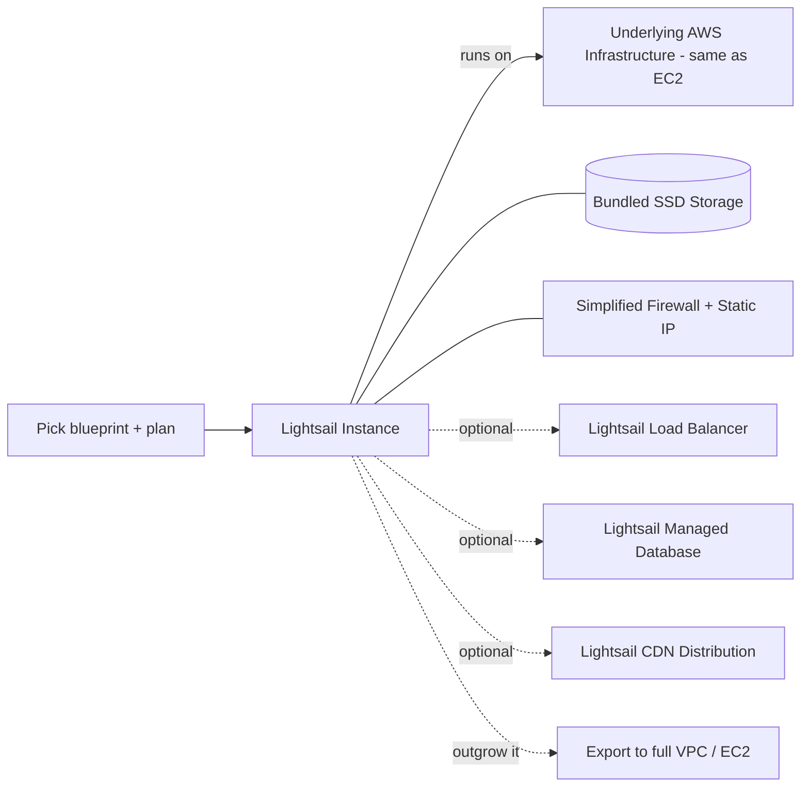
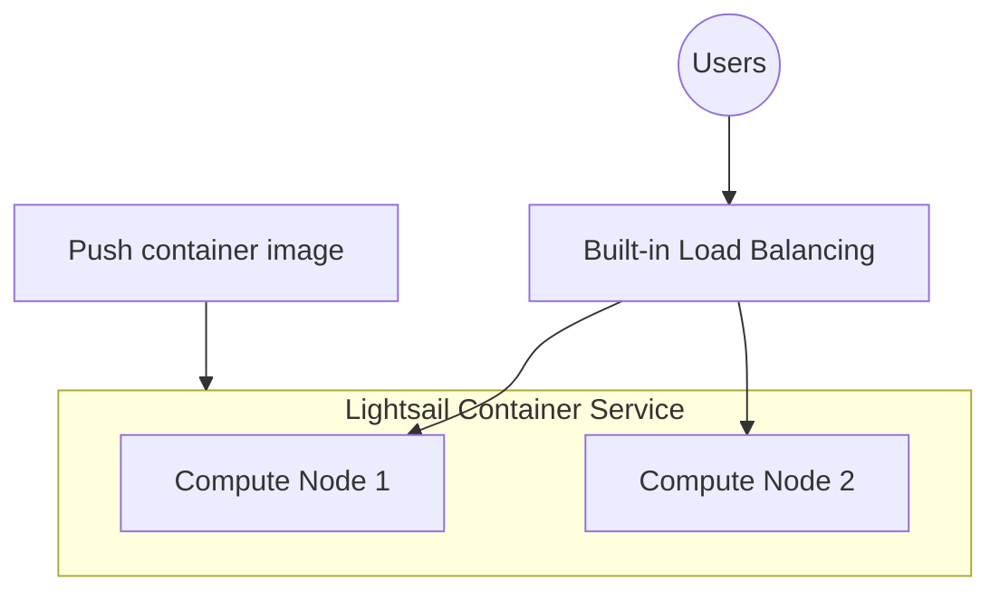
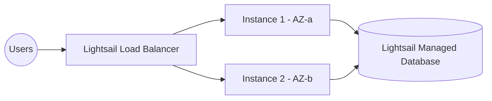
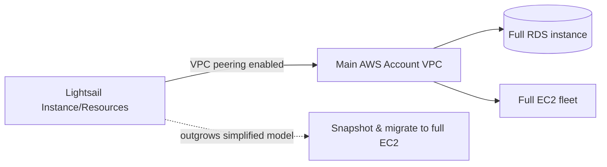

# Amazon Lightsail

> **Appears in:** Not currently in-scope for SAA-C03 / DVA-C03 / MLA-C02 (per official exam guide appendices) — included here for general AWS literacy.


## Definition

Lightsail is AWS's simplified, flat-rate virtual private server (VPS) product — a bundle of
compute, storage, and networking at one predictable monthly price, aimed at people who want "a
server" without learning the full breadth of EC2/VPC/EBS/security groups first.

## Purpose

EC2 is powerful but has a real learning curve: choosing instance types, configuring VPCs and
subnets, writing security group rules, attaching EBS volumes, understanding Elastic IPs — all
before you've deployed a single line of application code. Lightsail exists for the large number of
use cases (a personal blog, a small business website, a simple app, a dev/test box) that don't need
any of that flexibility — AWS bundles compute + a fixed amount of storage + a data transfer
allowance into one simple, predictable price, with a simplified console that hides VPC/networking
complexity by default.

AWS Principal Technologist Massimo Re Ferre wrote an influential internal/public framing of this
exact idea — that AWS offers compute at several distinct "abstraction levels" (instances,
containers, functions), each trading flexibility for AWS taking on more of the undifferentiated
operational work. Lightsail sits at the instance abstraction level, like EC2, but deliberately
narrows the *decisions* you have to make at that level, not the underlying technology.

## How It Works

In plain terms: you pick a **blueprint** (an OS image, or a pre-configured app stack like
WordPress, LAMP, or Node.js already installed and ready to go), pick a **plan** (a fixed bundle of
vCPU/RAM/SSD storage/data transfer at one monthly price), and launch an **instance**. Lightsail
runs on the same underlying AWS infrastructure as EC2 (it's EC2 under a simplified interface and
billing model), but presents a much smaller set of decisions: no separate VPC/subnet design, no
manual security group rule-writing (a simplified firewall UI instead), and bundled storage instead
of separately-priced EBS volumes.



Walking through it: choosing a blueprint gets you a ready OS or application stack without manually
installing anything (the WordPress blueprint, for instance, has WordPress, a database, and a web
server already configured). The plan you pick bundles vCPU, memory, SSD storage, and a monthly
data transfer allowance into one flat price — no separate line items for compute vs. storage vs.
bandwidth the way EC2+EBS+data-transfer billing works. Networking is simplified to a basic
firewall UI (open specific ports) and an included static IP, rather than requiring you to design a
VPC and write security group rules from scratch. If your needs grow, Lightsail offers optional
add-ons (a load balancer, a managed database, a CDN distribution) at their own flat rates, and —
notably — a **VPC peering/export path** that lets you connect a Lightsail instance into a full VPC
or even migrate it to a regular EC2 instance once you've outgrown the simplified model.

### How It Works — Step by Step: From Picking a Blueprint to a Running Server

Tracing what happens between clicking "Create instance" and having a reachable server shows how
Lightsail's simplicity is really EC2's complexity hidden behind fewer decisions, not different
underlying technology:

1. **Blueprint and plan selected.** You choose a blueprint (an AMI-equivalent, possibly with
   software like WordPress pre-installed) and a plan (a bundled vCPU/RAM/SSD/data-transfer tier at
   one flat price) — this single choice replaces EC2's separate AMI, instance-type, and EBS-volume
   decisions.
2. **Underlying EC2 instance provisioned.** Behind the scenes, Lightsail launches a real EC2
   instance from a corresponding AMI, in a Lightsail-managed VPC you never have to configure
   directly — the same placement/hypervisor/ENI/EBS mechanics from `ec2.md` all still happen, just
   without surfacing any of those choices to you.
3. **Simplified firewall applied.** Instead of writing security group rules, your port selections
   in the simplified firewall UI are translated into an actual security group attached to the
   instance's ENI — the same enforcement mechanism as EC2, with a friendlier interface.
4. **Static IP assigned.** A public IP is allocated and attached for free while the instance is
   running — functionally an Elastic IP, bundled into the plan price rather than itemized.
5. **Blueprint software starts.** If you chose an application blueprint (WordPress, LAMP), the
   pre-baked software stack (web server, database, application) starts automatically on first
   boot, with no manual installation step — this is the practical reason blueprints exist: turning
   a multi-step manual setup into "pick WordPress from a list."
6. **Metrics begin flowing.** CPU, network, and status-check metrics start appearing in the
   simplified Lightsail console immediately, backed by CloudWatch under the hood even though you
   never configure CloudWatch directly.
7. **Reachability.** The instance becomes reachable the moment its firewall allows the relevant
   port and its static IP is attached — functionally identical to the EC2 reachability conditions
   in `ec2.md`, just reached through fewer configuration screens.

The practical takeaway from this sequence: every "Lightsail doesn't support X" limitation is a
deliberately hidden EC2/VPC capability, not a technical impossibility — which is exactly why the
VPC peering and EC2-export migration paths described later in this file exist as an escape hatch.

### CDN distribution architecture


*This official AWS diagram shows a Lightsail distribution's three parts: the **origin** (your
Lightsail instance, container service, load balancer, or bucket — the definitive source of
content), the **distribution** itself (the globally distributed edge locations that cache and
serve that content, built on the same underlying infrastructure as CloudFront), and the **users**
being served from whichever edge location is closest to them. The practical takeaway: a Lightsail
distribution is CloudFront, repackaged with Lightsail's simplified setup flow and flat pricing —
you get the real global CDN technology without configuring CloudFront's fuller (and more complex)
configuration surface directly.*
**Source:** AWS Documentation — [Serve web content globally with Lightsail content delivery distributions](https://docs.aws.amazon.com/lightsail/latest/userguide/amazon-lightsail-content-delivery-network-distributions.html), Amazon Lightsail User Guide.

### Container service architecture

*The flowchart below shows the entire mental model a developer needs for Lightsail Container
Service: push an image, and traffic is automatically load-balanced across however many compute
nodes you configured — no cluster, no task definitions, no orchestrator concepts exposed at all.
The image that follows is AWS's own rendering of the identical idea.*




*Lightsail's container service abstracts away ECS/EKS/Fargate's full configuration surface into a
"scale" (number of compute nodes, up to 20) and "power" (CPU/memory per node) picker, with traffic
automatically load-balanced across all nodes. This diagram shows that simplification visually: no
task definitions, no cluster management, no capacity providers — just "how many nodes, how
powerful," which is the Lightsail philosophy applied to containers specifically.*
**Source:** AWS Documentation — [Deploy and manage containers on Amazon Lightsail](https://docs.aws.amazon.com/lightsail/latest/userguide/amazon-lightsail-container-services.html), Amazon Lightsail User Guide.

### High-availability pattern: load balancer + multiple instances



*This diagram shows the point at which a Lightsail deployment starts to resemble a scaled-down
version of the Multi-AZ three-tier pattern from `ec2.md`: a Lightsail Load Balancer spreads traffic
across two instances, both talking to a single Lightsail Managed Database, so a single instance
failure no longer takes the whole site down. The ceiling worth noting here is that this is as
sophisticated as Lightsail's availability story gets — there's no equivalent to a full EC2 Auto
Scaling Group reacting to a CloudWatch metric, just a fixed set of instances behind the load
balancer, which is exactly why a workload needing real elasticity eventually migrates off
Lightsail.*

### Growing beyond Lightsail: VPC peering export path



*This diagram shows the two distinct escape hatches out of Lightsail's simplified model, and the
reason they're drawn as separate paths matters: VPC peering (top path) is the lightweight option
when a Lightsail resource just needs to reach one additional thing in the main account's VPC,
while snapshot-and-migrate (bottom path) is the heavier option for when the workload itself has
outgrown Lightsail's plan sizes or instance-count quota entirely. Picking the lighter option first
— peering rather than a full migration — is the detail the Migration Path section later in this
file expands on.*

## Key Features / Components

- **Blueprints** — pre-built OS images or application stacks (WordPress, LAMP, Node.js, Django,
  Plesk, cPanel, plain Linux/Windows) ready to launch with no manual setup.
- **Plans** — fixed monthly bundles of vCPU, RAM, SSD storage, and data transfer allowance; the
  entry-level plan is priced low enough to be a common "learn cloud basics" or "cheap personal
  project host" choice.
- **Static IP** — a free static IP included while attached to a running instance (unlike EC2's
  Elastic IP, which can incur a small charge when unattached).
- **Simplified firewall** — a basic allow-list UI for ports/protocols, instead of writing security
  group rules directly.
- **Lightsail Load Balancer** — a simplified, flat-rate load balancer for spreading traffic across
  multiple Lightsail instances; includes a free SSL/TLS certificate provisioned and renewed
  automatically, removing a step that's manual (via ACM) on the full EC2/ALB path.
- **Lightsail Managed Database** — a simplified, flat-rate managed MySQL/PostgreSQL database,
  analogous to a stripped-down RDS, with automated backups included in the flat price.
- **Lightsail Container Service** — a simplified way to run containers without the full
  ECS/EKS/Fargate configuration surface — pick a scale (node count) and power (CPU/memory per
  node), push an image, done.
- **Snapshots** — manual or automatic backups of an instance you can restore from or use to create
  new instances; automatic daily snapshots are a toggle, not something you need to script yourself.
- **VPC peering** — connect Lightsail resources to resources in your main AWS account's VPC (e.g.,
  to reach an RDS database there), bridging the simplified and full AWS worlds when needed.
- **CDN distributions** — built on CloudFront's underlying global edge network, but configured
  through Lightsail's simplified setup flow (see diagram above), including a free HTTPS address
  without needing to register your own domain.

## Worked Cost Example: Comparing Lightsail vs. itemized EC2 for a Small Site

A small WordPress site needs roughly 1 vCPU, 2 GB RAM, 60 GB SSD storage, and expects to transfer
about 3 TB of data per month (a busier-than-typical small site, chosen deliberately to show where
the bundled pricing is most favorable).

**Lightsail** (illustrative current pricing): a mid-tier plan bundling 2 GB RAM, 1 vCPU, 60 GB SSD,
and 3 TB data transfer costs a flat **~$10/month** — one line item, no surprises.

**Equivalent itemized EC2 path**: `t3.small` On-Demand ($0.0208/hr × 730 ≈ $15.18/month) + 60 GB
`gp3` EBS (≈ $4.80/month) + 3 TB data transfer out (tiered pricing, roughly the first 100 GB free
then ~$0.09/GB for the rest ≈ 2,900 GB × $0.09 ≈ **$261/month** in data transfer alone) ≈
**~$281/month total**.

This is a deliberately chosen example to make a specific point: **Lightsail's bundled data
transfer allowance is the single biggest source of its cost advantage** for any workload with
meaningful outbound data transfer — EC2's itemized, uncapped data-transfer-out billing can
dwarf the compute cost entirely for data-heavy small sites, while Lightsail simply includes a
generous allowance in the flat price. For a *low-traffic* site (say, 50 GB/month transfer), the
gap narrows substantially, since EC2's transfer cost would be near-zero too — the bundling
advantage scales with how much data transfer you actually use.

## Common Architectures

1. **Single instance + CDN distribution** — the simplest real production pattern: one Lightsail
   instance running a blueprint (WordPress, a Node.js app), fronted by a Lightsail distribution for
   global caching and free HTTPS — covers the large majority of small business/personal site needs
   with zero separate CDN configuration.
2. **Load-balanced multi-instance + managed database** — two or more instances behind a Lightsail
   Load Balancer, backed by a Lightsail Managed Database, for sites that have outgrown a single
   instance but don't yet need full EC2/RDS flexibility — shown in the HA diagram above.
3. **Lightsail-to-VPC bridge** — a Lightsail instance (e.g., a lightweight application front end)
   peered via VPC peering to reach a resource in the main AWS account (e.g., a production RDS
   database or an internal API) that can't be re-architected onto Lightsail itself — a common
   "started simple, needs one more connection" real-world pattern.

## Use Cases — When to Use It

- **E-commerce side project / small shop storefront (retail/e-commerce).** Situation: a solo
  entrepreneur wants to launch a simple online storefront (WordPress + WooCommerce) without
  learning AWS networking first. Why Lightsail fits: the WordPress blueprint has the entire stack
  pre-configured, and the flat monthly price is easy to budget against uncertain early revenue.
  What the alternative would cost: configuring EC2 + a VPC + security groups + EBS correctly for
  a first-time AWS user risks a misconfigured, possibly insecure deployment, and itemized EC2
  billing is harder to predict for someone watching every dollar in an early-stage business.
- **Fintech compliance-training microsite (financial services).** Situation: a small fintech
  compliance team needs a simple internal microsite for annual training materials, used by a
  modest number of employees a few times a year. Why Lightsail fits: predictable, low flat-rate
  pricing for a genuinely low-traffic, low-stakes internal tool, with no need for the IAM/VPC
  sophistication a regulated production system would require. What the alternative would cost:
  provisioning full EC2+VPC infrastructure (and the security review that implies) for a seasonal
  internal microsite is disproportionate operational overhead for the actual risk/traffic involved.
- **Media/streaming creator's personal portfolio site (media & entertainment).** Situation: an
  independent video creator wants a personal portfolio/landing page with a CDN for fast global
  image loading, managed with minimal ongoing effort. Why Lightsail fits: the bundled CDN
  distribution (CloudFront underneath) with free HTTPS requires no separate CloudFront
  configuration, and the whole site fits comfortably in the entry-level plan. What the alternative
  would cost: setting up S3 + CloudFront + ACM certificates separately would work but adds setup
  steps disproportionate to a single creator's simple portfolio needs.
- **Healthcare small clinic's appointment-request form (healthcare).** Situation: a small,
  independent medical clinic needs a basic public-facing appointment-request form, with low,
  predictable traffic and a tight IT budget. Why Lightsail fits: flat, predictable pricing suits a
  small practice's budgeting needs, and the simplified firewall is easy for a non-specialist
  office manager to understand if they ever need to check it. What the alternative would cost: a
  full EC2 setup would introduce configuration complexity (VPC, NACLs, IAM) with no corresponding
  benefit for a site this simple and low-traffic.
- **Gaming indie developer's game-update/patch-notes site (gaming).** Situation: a solo or small
  indie game studio needs a simple site to host patch notes and a community forum link, alongside
  their actual (much more demanding) EC2-hosted game servers. Why Lightsail fits: the website
  itself has completely different (far lower) scale requirements than the game servers, so it
  doesn't need to share the main account's more complex VPC design. What the alternative would
  cost: hosting the simple patch-notes site on the same sophisticated EC2 infrastructure as the
  game servers adds unnecessary complexity to a piece of the stack that doesn't need it.
- **SaaS freelancer/agency hosting multiple client sites (SaaS/agency).** Situation: a small web
  agency hosts a dozen simple client websites, each needing isolation from the others but none
  individually needing much compute. Why Lightsail fits: each client gets their own small, cheap,
  isolated instance with predictable per-client billing that's easy to pass through to clients
  individually. What the alternative would cost: running all client sites on a single larger EC2
  instance to save money creates a shared-fault-domain risk (one client's traffic spike or
  compromised site affects all the others sharing the box).
- **Batch analytics internal reporting dashboard for a small team (data analytics).** Situation: a
  small analytics team needs an internal dashboard application visible to under a dozen
  colleagues, with negligible traffic. Why Lightsail fits: the lowest-tier plan comfortably
  handles this load at a predictable few dollars a month, with none of the EC2/VPC setup
  overhead for such a small audience. What the alternative would cost: standing up a full
  Beanstalk or EC2+ASG+ALB environment for a dozen internal users is significant over-provisioning
  relative to the actual need.
- **IoT hobbyist/maker project dashboard (IoT).** Situation: a hobbyist building a small
  home-automation project needs a simple dashboard server to visualize sensor data from a handful
  of devices. Why Lightsail fits: the lowest-tier plan is cheap enough for a personal project
  budget, and the simplified firewall is approachable for someone without professional AWS
  networking experience. What the alternative would cost: learning full EC2/VPC/security-group
  configuration is a meaningfully higher barrier to entry for a weekend hobby project than
  Lightsail's guided setup flow.
- **Learning cloud fundamentals (education/career development).** Situation: someone studying for
  an AWS certification or learning cloud computing for the first time wants a real, internet-facing
  server to experiment on without the risk of an expensive misconfiguration. Why Lightsail fits:
  the predictable flat price and simplified firewall make it hard to accidentally run up a large
  bill or leave a dangerously misconfigured security group, which is a real risk for a first-time
  EC2 user. What the alternative would cost: a beginner experimenting directly with EC2+VPC risks
  both unexpected itemized charges (especially data transfer) and more exposure to a genuine
  security misconfiguration while still learning the basics.
- **Small agency/freelancer client demo environments (software development/agency).** Situation: a
  freelance developer needs to spin up a quick, presentable demo environment for a client review,
  torn down shortly after. Why Lightsail fits: snapshots and fast instance creation make it trivial
  to spin up and tear down a demo environment without worrying about leftover VPC/security-group
  configuration lingering in the main AWS account. What the alternative would cost: using the full
  EC2 console for a short-lived demo introduces more configuration surface area to clean up
  afterward, and a forgotten resource is more likely to go unnoticed (and billed) in a complex VPC
  setup than in Lightsail's simpler, per-Region instance list.

## When NOT to Use It / Alternatives

- **Workloads needing fine-grained control** over networking, instance types, or storage
  configuration — use **EC2** directly, since Lightsail deliberately trades flexibility for
  simplicity.
- **Applications expecting real elasticity/auto scaling** at a sophisticated level — Lightsail's
  load balancer and scaling story is far simpler than a full EC2 Auto Scaling Group; growing,
  variable-traffic production apps usually outgrow it.
- **Enterprise workloads requiring deep integration** with the rest of a complex AWS account's VPC,
  IAM, and compliance tooling — Lightsail's simplified model is intentionally decoupled from that
  complexity; use EC2/full VPC for anything enterprise-grade.
- **Container-heavy or serverless-first architectures at real scale** — Lightsail Container
  Service is intentionally basic; use **ECS/EKS/Fargate** for anything beyond a simple container
  deployment.
- The general tradeoff: Lightsail is simplicity and predictable pricing at the cost of
  flexibility and ceiling — it's rarely the "correct" answer for a production enterprise
  architecture question on the exam, but it's a legitimate real-world choice for small/simple
  workloads.

## Why It's Important

**Real world:** Lightsail genuinely lowers the barrier to entry for small businesses, students,
and hobbyists who'd otherwise be intimidated by (or overpay for, via unoptimized EC2 configs) a
full AWS setup for a simple need. It's a real, actively-used product, not just a teaching tool —
plenty of small production websites run entirely on Lightsail.

**Exam relevance:**
- **SAA-C03** — appears mostly as a **distractor** in Domain 4 "Design Cost-Optimized
  Architectures" cost-scenario questions: if a question describes a simple, small, predictable
  workload needing a low operational/cost footprint, Lightsail can be the *correct* lightweight
  answer precisely because EC2+VPC is over-engineering for that scenario. Know it well enough to
  recognize when it's the *right* small answer, not just a trap.
- **DVA-C03** — rarely a focus service; more likely referenced only in passing as a simple
  deployment target distractor against Elastic Beanstalk/Fargate.
- **MLA-C02** — not relevant; ML workloads are covered by SageMaker and the compute services
  above it, not Lightsail.

## Limits & Quotas

| Quota | Default | Adjustable? |
|---|---|---|
| Instances per Region | 20 | Yes, via support request |
| Static IPs per Region | 5 unattached (attached ones don't count against this) | Yes |
| Load balancers per Region | 5 | Yes |
| Container services per Region | 3 | Yes |
| Container service nodes (scale) | Up to 20 per container service | Hard limit |
| Databases per Region | 5 | Yes |
| Manual snapshots retained | No fixed cap, billed per-GB of snapshot storage | N/A |
| Block storage disks per instance | 15 | Yes |

These limits are deliberately much lower than EC2's own quotas, consistent with Lightsail's
target audience of small/simple workloads rather than large fleets — a workload that needs more
than 20 instances in a Region is, almost by definition, a workload that has outgrown Lightsail and
should migrate to EC2 directly.

## Troubleshooting / Common Issues

- **Can't reach a newly launched instance on a specific port** — check the Lightsail instance's
  simplified firewall rules (Networking tab) first; unlike EC2, there's no separate NACL layer to
  also check, which simplifies this diagnostic step considerably compared to full EC2.
- **Site works over HTTP but not HTTPS** — if using a Lightsail distribution, confirm the free
  HTTPS certificate has finished provisioning (can take several minutes after creation) and that
  your DNS is actually pointed at the distribution, not directly at the instance.
- **Outgrown the bundled data transfer allowance** — check the instance's metrics/billing page for
  data transfer usage; exceeding the plan's included allowance bills the overage at a published
  per-GB rate, which is the main variable cost Lightsail's otherwise-flat pricing can still
  surprise you with at high, unexpected traffic spikes.
- **Need to reach a resource in the main AWS account's VPC** — this requires explicitly enabling
  VPC peering (it is not on by default); a Lightsail instance with no peering configured simply
  cannot resolve/reach private resources in your main account's VPC at all.
- **Snapshot restore creates an instance that can't be reached** — restoring from a snapshot
  creates a *new* instance with a new static IP by default (unless you explicitly reassign the
  original static IP to it); update DNS records pointing at the old IP after any restore.

## Pricing Model (summary)

**Flat monthly bundles** — each plan tier has one fixed price covering vCPU, RAM, SSD storage, and
a data transfer allowance; exceeding the data transfer allowance bills extra at a published
per-GB rate. This is the key pricing difference from EC2: EC2 itemizes compute, EBS storage, and
data transfer separately (and data transfer OUT can be a genuine surprise cost); Lightsail bundles
them so the entry-level cost is predictable and often cheaper for small, simple workloads (see the
Worked Cost Example above for a concrete comparison).
Optional add-ons (load balancer, managed database, CDN, container service) are each their own flat
monthly rate. Official pricing: https://aws.amazon.com/lightsail/pricing/

## Hands-on Lab (Floci)

> **Honest limitation:** Lightsail's own simplified control-plane API is not part of Floci's
> officially supported service list (see `labs-floci/README.md` — Compute support is Lambda and
> EC2 specifically). Since Lightsail instances are EC2 under the hood on real AWS, you can
> practice the *conceptual equivalent* — a single instance with a simple open-port firewall and a
> static IP — using the EC2 API that Floci does support, which builds the same mental model.

```bash
# Simulate the Lightsail experience (one instance, simple firewall, static IP)
# using the EC2 primitives Floci fully supports:

# 1. A security group standing in for Lightsail's simplified firewall
awslocal ec2 create-security-group \
  --group-name lightsail-lab-sg --description "Simulated Lightsail firewall"
awslocal ec2 authorize-security-group-ingress \
  --group-id sg-xxxxxxxx --protocol tcp --port 80 --cidr 0.0.0.0/0
awslocal ec2 authorize-security-group-ingress \
  --group-id sg-xxxxxxxx --protocol tcp --port 22 --cidr 0.0.0.0/0

# 2. Launch a single instance standing in for a Lightsail "blueprint" instance
awslocal ec2 run-instances \
  --image-id ami-00000000 \
  --instance-type t3.micro \
  --security-group-ids sg-xxxxxxxx \
  --count 1

# 3. Allocate and attach a static IP, standing in for Lightsail's included static IP
awslocal ec2 allocate-address --domain vpc
awslocal ec2 associate-address --instance-id i-xxxxxxxx --allocation-id eipalloc-xxxxxxxx

# 4. Inspect it
awslocal ec2 describe-instances \
  --query "Reservations[].Instances[].{ID:InstanceId,State:State.Name,PublicIP:PublicIpAddress}"

# 5. Clean up
awslocal ec2 terminate-instances --instance-ids i-xxxxxxxx
```

Even though these are raw EC2 commands, notice how few decisions they required compared to the
full `ec2.md` lab — one security group, one instance, one static IP — which is the actual lived
experience Lightsail's own console streamlines into roughly three clicks.

To experience the actual Lightsail console/CLI UX directly (`aws lightsail create-instances`),
try it against real AWS within the entry-level plan's cost (typically a few dollars a month,
often covered by promotional credits for new accounts) — it's cheap enough that a short real trial
is reasonable even outside Floci.

### Extra practice: what a Lightsail distribution maps to conceptually

The command below is the closest real-AWS equivalent to what clicking "Create distribution" in the
Lightsail console does behind the scenes — both ultimately create a CloudFront distribution, just
through a different front door:

```bash
# Lightsail distributions are CloudFront under the hood - while Floci/LocalStack
# support varies by edition, the conceptual CLI equivalent on real AWS is:
aws cloudfront create-distribution \
  --origin-domain-name my-lightsail-instance-public-dns \
  --default-root-object index.html
```

## Exam Tips

- **Lightsail vs. EC2** is a cost/simplicity tradeoff question, not a feature-parity one — if a
  scenario describes a simple, small, predictable workload with a non-technical owner and a tight
  budget, Lightsail is a legitimate correct answer, not automatically wrong just because it's
  "simpler."
- Lightsail instances **are EC2 under the hood** — don't be fooled into thinking it's a
  fundamentally different compute technology; it's a simplified product wrapper and flat-rate
  billing model over the same infrastructure.
- Know that Lightsail **bundles data transfer** into the plan price — this is the detail that
  makes it cheaper and more predictable than itemized EC2+EBS+data-transfer billing for small,
  low-traffic (or even moderately data-heavy) workloads, and is the usual "why" behind a correct
  cost-optimization answer.
- Lightsail **can connect into a full VPC via peering** — if a question describes "started
  simple on Lightsail, now needs to talk to resources in the main VPC," the answer is enabling
  VPC peering, not re-launching everything from scratch on EC2.
- **Lightsail distributions are CloudFront underneath** — a question contrasting Lightsail's CDN
  option against "set up CloudFront separately" is really asking whether you recognize they're the
  same underlying technology with a different setup experience, not two different CDNs.
- **Lightsail Container Service vs. ECS/EKS/Fargate** — "simple container app, minimal
  configuration, don't need a full orchestrator" → Lightsail Container Service. "Complex
  multi-service orchestration, fine-grained scaling control" → ECS/EKS/Fargate.

## Security Considerations

- **Simplified firewall is still a real firewall** — don't mistake Lightsail's easier UI for a
  weaker security boundary; the same principle of only opening the ports you actually need applies
  exactly as it would for an EC2 security group, and `0.0.0.0/0` on an administrative port (SSH/
  RDP) is just as real a risk here as on EC2.
- **No IAM-level resource policies on instances themselves** — Lightsail's simplified model trades
  away IAM's fine-grained resource policy surface; account-level IAM still governs who can manage
  Lightsail resources via the API/console, but there's no equivalent to an EC2 instance profile for
  granting the instance itself scoped AWS permissions without the VPC peering bridge.
- **HTTPS is effectively free and automatic** via a Lightsail distribution or the load balancer's
  built-in certificate, removing the excuse of "TLS setup was too much effort" for small sites —
  worth defaulting to enabling it even on the simplest Lightsail deployment.
- **Blueprint defaults aren't automatically hardened** — a WordPress or CMS blueprint still needs
  the same ongoing security hygiene (plugin updates, strong admin credentials, disabling unused
  default accounts) as a self-managed install on EC2; Lightsail manages the underlying
  infrastructure, not your application-layer security posture.

## Monitoring & Observability

- **Built-in instance metrics** (CPU utilization, network in/out, status checks) are available
  directly in the simplified Lightsail console without any separate CloudWatch configuration,
  though the same data is, under the hood, backed by CloudWatch.
- **Alarms** can be configured directly from the Lightsail console (e.g., "notify me if CPU stays
  above 90% for 5 minutes") using a simplified subset of CloudWatch alarm configuration, trading
  some flexibility for a much faster setup path than configuring CloudWatch alarms manually.
- **Lightsail does not include a built-in log aggregation service** comparable to CloudWatch Logs
  for application-level logs — for anything beyond basic instance metrics, you'd still SSH in and
  manage application logs yourself, or peer into the main VPC to forward logs to CloudWatch Logs
  directly.

## Migration Path: Growing Beyond Lightsail

A recurring real-world lifecycle: a project starts on Lightsail for simplicity, grows, and
eventually needs full EC2/VPC flexibility. The supported migration path, in order of increasing
effort:

1. **VPC peering first** (least disruptive) — if the only need is reaching one additional
   resource (a production database, an internal API) in the main account's VPC, peering alone
   solves it without touching the Lightsail instance itself at all.
2. **Snapshot and manual EC2 recreation** — take a Lightsail snapshot, export it, and launch an
   equivalent EC2 instance from it, then re-point DNS; this is the standard path when the workload
   has genuinely outgrown Lightsail's plan sizes, firewall simplicity, or per-Region instance
   quota (20 by default).
3. **Full re-architecture** — for workloads that have grown enough to need Auto Scaling, Multi-AZ
   RDS, or a proper multi-tier VPC design, the Lightsail version becomes a reference for behavior/
   configuration rather than something to lift-and-shift directly; teams typically rebuild on EC2 +
   RDS + ALB from scratch at this point, informed by what the Lightsail version already proved
   about the application's requirements.

This progression — "start simple, graduate to full control only when you actually need it" — is
exactly the kind of pragmatic, cost-aware decision-making the SAA-C03 cost-optimization domain
rewards, and it's worth recognizing Lightsail-to-EC2 migration as a legitimate, non-wasteful
engineering path rather than "starting over because Lightsail was the wrong choice."

## Worked Example: Lightsail Container Service Pricing

A small container service running a single Node.js API, sized at "Micro" power (0.25 vCPU, 0.5 GB
RAM per node) with a scale of 2 nodes for basic redundancy, costs a flat rate per node — illustrative
current pricing puts a Micro-power, 2-node container service at roughly **$20/month total**
(node price varies by power tier; higher power tiers and larger scale cost proportionally more).
Compare this to the equivalent Fargate cost for the same aggregate resources (0.5 vCPU, 1 GB total
across 2 tasks) at standard Fargate rates: 0.5 vCPU × $0.04048/vCPU-hr × 730 ≈ $14.78, plus 1 GB ×
$0.004445/GB-hr × 730 ≈ $3.24, totaling **~$18.02/month** in raw Fargate compute — slightly
cheaper than the Lightsail bundle in this specific sizing, but Fargate requires configuring an ECS
cluster, task definitions, a load balancer, and networking separately, while Lightsail's price
already includes load balancing and a simplified deploy flow with zero additional setup. This is
the recurring Lightsail theme: **slightly higher raw unit cost, in exchange for meaningfully less
setup and operational complexity** — the right tradeoff for a workload whose main scarce resource
is engineering time, not raw infrastructure dollars.

## Further Reading

- [Amazon Lightsail Documentation](https://docs.aws.amazon.com/lightsail/)
- [What is Amazon Lightsail?](https://docs.aws.amazon.com/lightsail/latest/userguide/what-is-amazon-lightsail.html)
- [Amazon Lightsail pricing](https://aws.amazon.com/lightsail/pricing/)
- [Deploy and manage containers on Amazon Lightsail](https://docs.aws.amazon.com/lightsail/latest/userguide/amazon-lightsail-container-services.html)
- [Serve web content globally with Lightsail content delivery distributions](https://docs.aws.amazon.com/lightsail/latest/userguide/amazon-lightsail-content-delivery-network-distributions.html)

## Related Terms

- [`ec2.md`](ec2.md) — the underlying technology Lightsail simplifies and bundles
- [`elastic-beanstalk.md`](elastic-beanstalk.md) — another "managed EC2" option, aimed at
  developers rather than simplicity-first users
- `services/networking-content-delivery/` — VPC peering details (once written)
- `services/database/` — RDS, the full-featured counterpart to Lightsail's managed database (once written)
- `glossary/README.md` — blueprint, static IP, data transfer allowance definitions
