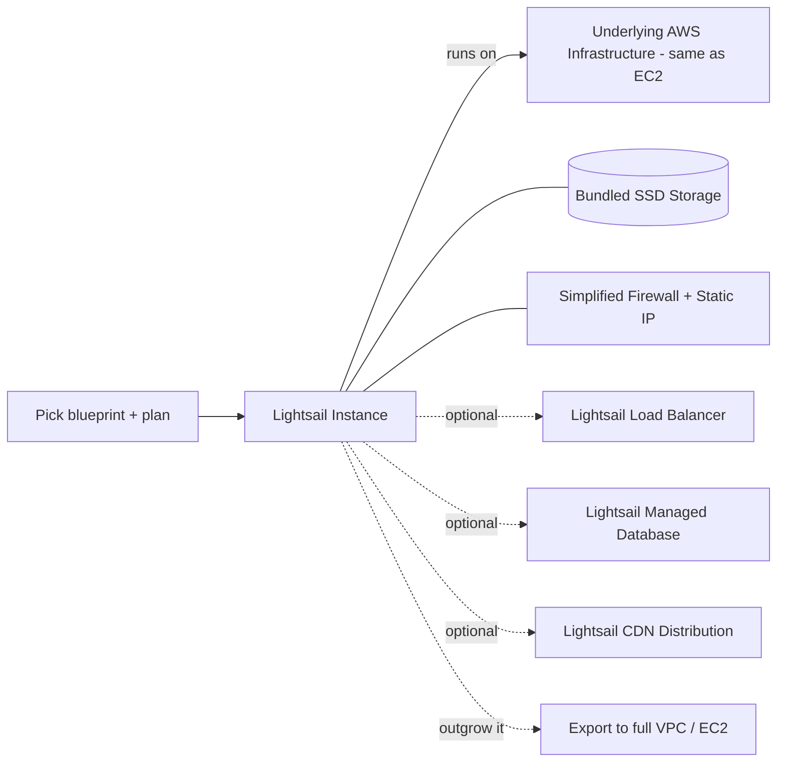

# Amazon Lightsail


## Definition

Lightsail is AWS's simplified, flat-rate virtual private server (VPS) product — a bundle of
compute, storage, and networking at one predictable monthly price, aimed at people who want "a
server" without learning the full breadth of EC2/VPC/EBS/security groups first.

## Purpose

EC2 is powerful but has a real learning curve: choosing instance types, configuring VPCs and
subnets, writing security group rules, attaching EBS volumes, understanding Elastic IPs — all
before you've deployed a single line of application code. Lightsail exists for the large number of
use cases (a personal blog, a small business website, a simple app, a dev/test box) that don't need
any of that flexibility — AWS bundles compute + a fixed amount of storage + a data transfer
allowance into one simple, predictable price, with a simplified console that hides VPC/networking
complexity by default.

## How It Works

In plain terms: you pick a **blueprint** (an OS image, or a pre-configured app stack like
WordPress, LAMP, or Node.js already installed and ready to go), pick a **plan** (a fixed bundle of
vCPU/RAM/SSD storage/data transfer at one monthly price), and launch an **instance**. Lightsail
runs on the same underlying AWS infrastructure as EC2 (it's EC2 under a simplified interface and
billing model), but presents a much smaller set of decisions: no separate VPC/subnet design, no
manual security group rule-writing (a simplified firewall UI instead), and bundled storage instead
of separately-priced EBS volumes.



Walking through it: choosing a blueprint gets you a ready OS or application stack without manually
installing anything (the WordPress blueprint, for instance, has WordPress, a database, and a web
server already configured). The plan you pick bundles vCPU, memory, SSD storage, and a monthly
data transfer allowance into one flat price — no separate line items for compute vs. storage vs.
bandwidth the way EC2+EBS+data-transfer billing works. Networking is simplified to a basic
firewall UI (open specific ports) and an included static IP, rather than requiring you to design a
VPC and write security group rules from scratch. If your needs grow, Lightsail offers optional
add-ons (a load balancer, a managed database, a CDN distribution) at their own flat rates, and —
notably — a **VPC peering/export path** that lets you connect a Lightsail instance into a full VPC
or even migrate it to a regular EC2 instance once you've outgrown the simplified model.

## Key Features / Components

- **Blueprints** — pre-built OS images or application stacks (WordPress, LAMP, Node.js, Django,
  Plesk, cPanel, plain Linux/Windows) ready to launch with no manual setup.
- **Plans** — fixed monthly bundles of vCPU, RAM, SSD storage, and data transfer allowance; the
  entry-level plan is priced low enough to be a common "learn cloud basics" or "cheap personal
  project host" choice.
- **Static IP** — a free static IP included while attached to a running instance (unlike EC2's
  Elastic IP, which can incur a small charge when unattached).
- **Simplified firewall** — a basic allow-list UI for ports/protocols, instead of writing security
  group rules directly.
- **Lightsail Load Balancer** — a simplified, flat-rate load balancer for spreading traffic across
  multiple Lightsail instances.
- **Lightsail Managed Database** — a simplified, flat-rate managed MySQL/PostgreSQL database,
  analogous to a stripped-down RDS.
- **Lightsail Container Service** — a simplified way to run containers without the full
  ECS/EKS/Fargate configuration surface.
- **Snapshots** — manual or automatic backups of an instance you can restore from or use to create
  new instances.
- **VPC peering** — connect Lightsail resources to resources in your main AWS account's VPC (e.g.,
  to reach an RDS database there), bridging the simplified and full AWS worlds when needed.

## Use Cases — When to Use It

- **Personal websites/blogs, small business sites** that need a predictable, low monthly bill and
  zero cloud expertise to set up.
- **Learning cloud fundamentals** — genuinely useful as a first "I have a real server on the
  internet" experience before tackling EC2/VPC complexity.
- **Simple dev/test environments** or quick prototypes/demos where spinning up a full
  VPC-aware EC2 setup is unnecessary overhead for a throwaway or short-lived project.
- **Predictable, low/flat traffic applications** where the bundled, flat-rate pricing is easier to
  reason about than EC2+EBS+data-transfer itemized billing.
- **Small agencies/freelancers hosting multiple simple client sites**, each on its own small,
  cheap, isolated instance.

## When NOT to Use It / Alternatives

- **Workloads needing fine-grained control** over networking, instance types, or storage
  configuration — use **EC2** directly, since Lightsail deliberately trades flexibility for
  simplicity.
- **Applications expecting real elasticity/auto scaling** at a sophisticated level — Lightsail's
  load balancer and scaling story is far simpler than a full EC2 Auto Scaling Group; growing,
  variable-traffic production apps usually outgrow it.
- **Enterprise workloads requiring deep integration** with the rest of a complex AWS account's VPC,
  IAM, and compliance tooling — Lightsail's simplified model is intentionally decoupled from that
  complexity; use EC2/full VPC for anything enterprise-grade.
- **Container-heavy or serverless-first architectures at real scale** — Lightsail Container
  Service is intentionally basic; use **ECS/EKS/Fargate** for anything beyond a simple container
  deployment.
- The general tradeoff: Lightsail is simplicity and predictable pricing at the cost of
  flexibility and ceiling — it's rarely the "correct" answer for a production enterprise
  architecture question on the exam, but it's a legitimate real-world choice for small/simple
  workloads.

## Why It's Important

**Real world:** Lightsail genuinely lowers the barrier to entry for small businesses, students,
and hobbyists who'd otherwise be intimidated by (or overpay for, via unoptimized EC2 configs) a
full AWS setup for a simple need. It's a real, actively-used product, not just a teaching tool —
plenty of small production websites run entirely on Lightsail.

**Exam relevance:**
- **SAA-C03** — appears mostly as a **distractor** in Domain 4 "Design Cost-Optimized
  Architectures" cost-scenario questions: if a question describes a simple, small, predictable
  workload needing a low operational/cost footprint, Lightsail can be the *correct* lightweight
  answer precisely because EC2+VPC is over-engineering for that scenario. Know it well enough to
  recognize when it's the *right* small answer, not just a trap.
- **DVA-C03** — rarely a focus service; more likely referenced only in passing as a simple
  deployment target distractor against Elastic Beanstalk/Fargate.
- **MLA-C02** — not relevant; ML workloads are covered by SageMaker and the compute services
  above it, not Lightsail.

## Pricing Model (summary)

**Flat monthly bundles** — each plan tier has one fixed price covering vCPU, RAM, SSD storage, and
a data transfer allowance; exceeding the data transfer allowance bills extra at a published
per-GB rate. This is the key pricing difference from EC2: EC2 itemizes compute, EBS storage, and
data transfer separately (and data transfer OUT can be a genuine surprise cost); Lightsail bundles
them so the entry-level cost is predictable and often cheaper for small, simple workloads.
Optional add-ons (load balancer, managed database, CDN, container service) are each their own flat
monthly rate. Official pricing: https://aws.amazon.com/lightsail/pricing/

## Hands-on Lab (Floci)

> **Honest limitation:** Lightsail's own simplified control-plane API is not part of Floci's
> officially supported service list (see `labs-floci/README.md` — Compute support is Lambda and
> EC2 specifically). Since Lightsail instances are EC2 under the hood on real AWS, you can
> practice the *conceptual equivalent* — a single instance with a simple open-port firewall and a
> static IP — using the EC2 API that Floci does support, which builds the same mental model.

```bash
# Simulate the Lightsail experience (one instance, simple firewall, static IP)
# using the EC2 primitives Floci fully supports:

# 1. A security group standing in for Lightsail's simplified firewall
awslocal ec2 create-security-group \
  --group-name lightsail-lab-sg --description "Simulated Lightsail firewall"
awslocal ec2 authorize-security-group-ingress \
  --group-id sg-xxxxxxxx --protocol tcp --port 80 --cidr 0.0.0.0/0
awslocal ec2 authorize-security-group-ingress \
  --group-id sg-xxxxxxxx --protocol tcp --port 22 --cidr 0.0.0.0/0

# 2. Launch a single instance standing in for a Lightsail "blueprint" instance
awslocal ec2 run-instances \
  --image-id ami-00000000 \
  --instance-type t3.micro \
  --security-group-ids sg-xxxxxxxx \
  --count 1

# 3. Allocate and attach a static IP, standing in for Lightsail's included static IP
awslocal ec2 allocate-address --domain vpc
awslocal ec2 associate-address --instance-id i-xxxxxxxx --allocation-id eipalloc-xxxxxxxx

# 4. Inspect it
awslocal ec2 describe-instances \
  --query "Reservations[].Instances[].{ID:InstanceId,State:State.Name,PublicIP:PublicIpAddress}"

# 5. Clean up
awslocal ec2 terminate-instances --instance-ids i-xxxxxxxx
```

To experience the actual Lightsail console/CLI UX directly (`aws lightsail create-instances`),
try it against real AWS within the entry-level plan's cost (typically a few dollars a month,
often covered by promotional credits for new accounts) — it's cheap enough that a short real trial
is reasonable even outside Floci.

## Exam Tips

- **Lightsail vs. EC2** is a cost/simplicity tradeoff question, not a feature-parity one — if a
  scenario describes a simple, small, predictable workload with a non-technical owner and a tight
  budget, Lightsail is a legitimate correct answer, not automatically wrong just because it's
  "simpler."
- Lightsail instances **are EC2 under the hood** — don't be fooled into thinking it's a
  fundamentally different compute technology; it's a simplified product wrapper and flat-rate
  billing model over the same infrastructure.
- Know that Lightsail **bundles data transfer** into the plan price — this is the detail that
  makes it cheaper and more predictable than itemized EC2+EBS+data-transfer billing for small,
  low-traffic workloads, and is the usual "why" behind a correct cost-optimization answer.
- Lightsail **can connect into a full VPC via peering** — if a question describes "started
  simple on Lightsail, now needs to talk to resources in the main VPC," the answer is enabling
  VPC peering, not re-launching everything from scratch on EC2.

## Related Terms

- [`ec2.md`](ec2.md) — the underlying technology Lightsail simplifies and bundles
- [`elastic-beanstalk.md`](elastic-beanstalk.md) — another "managed EC2" option, aimed at
  developers rather than simplicity-first users
- `services/networking-content-delivery/` — VPC peering details (once written)
- `services/database/` — RDS, the full-featured counterpart to Lightsail's managed database (once written)
- `glossary/README.md` — blueprint, static IP, data transfer allowance definitions
