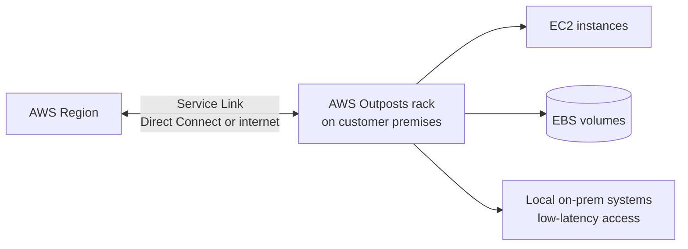
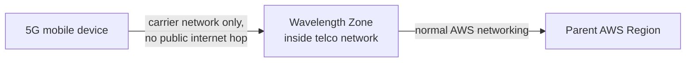
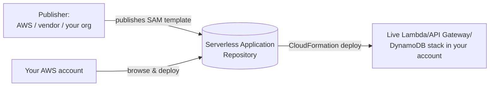
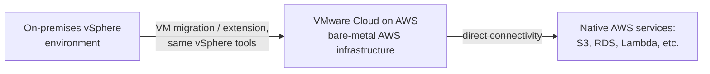

# Niche Compute Services — Outposts, Wavelength, Serverless Application Repository, VMware Cloud on AWS

> **Appears in:** [SAA-C03](../../certifications/saa-c03/README.md)

This doc consolidates four lower-exam-weight compute services that the SAA-C03 appendix lists in
scope but that don't individually carry enough exam depth to warrant a full standalone doc. Each
section is self-contained: definition, purpose, a typical use case, and the specific exam-tip
angle to remember.

## AWS Outposts

*Figure: AWS's own Outposts networking reference architecture — an Outpost physically sits
on-premises but connects back to its home AWS Region over a Direct Connect or internet-based
"service link," extending a VPC onto customer hardware. Source: AWS Reference Architecture
Diagrams (docs.aws.amazon.com/reference-architecture-diagrams).*

### Definition
AWS Outposts is a fully managed service that ships real, AWS-operated server racks (or smaller
1U/2U servers) to your own data center or colocation facility, extending an AWS Region's
infrastructure, APIs, and tools directly onto physical hardware you host on-premises.

### Purpose
Some workloads legally, technically, or operationally cannot move to a public AWS Region at
all — data residency rules requiring data stay in a specific building, ultra-low-latency local
processing (manufacturing floor control systems), or dependencies on on-premises systems that
can't be easily networked to a distant Region. Outposts exists so these workloads can still use
the *same* EC2/EBS/ECS/EKS/RDS APIs and tooling as the rest of your AWS footprint, instead of
forcing a completely separate, non-AWS on-premises stack.

### Use Case
A hospital must keep patient imaging data physically within its own building per regulatory
requirement, but wants to run the same EC2/EBS-based application stack and management tooling its
cloud team already uses elsewhere — Outposts runs that workload on AWS-managed hardware physically
inside the hospital, with the control plane still anchored to a Region.

### Exam Tip
**"Must remain on-premises," "data residency," "low-latency to local on-prem systems," but still
wants AWS-native APIs/tools** → Outposts. Contrast with **Direct Connect** (a network link to an
unchanged Region, not local compute) and with **Local Zones/Wavelength** (AWS-operated
infrastructure that's geographically close but not literally inside your building).

---

## AWS Wavelength

### Definition
AWS Wavelength embeds AWS compute and storage infrastructure directly inside telecommunications
providers' 5G networks, at the network edge, so traffic from mobile devices never has to leave
the carrier's network to reach the application.

### Purpose
Ultra-low-latency mobile applications (AR/VR, real-time gaming, connected vehicles, live video
analytics) are bottlenecked not by AWS Region performance but by the physical distance data has
to travel from a cell tower, through the carrier's core network, out to the public internet, and
to a distant Region and back. Wavelength exists specifically to cut that round trip down to just
the carrier's own network by placing AWS infrastructure at the network edge, inside the telco.

### Use Case
A cloud gaming company needs sub-20ms latency for real-time game-state updates to mobile players
on a 5G network — running the game server logic in a Wavelength Zone keeps traffic entirely inside
the carrier's network, avoiding the extra latency of routing out to a standard, more distant AWS
Region.

### Exam Tip
**"5G," "mobile edge," "ultra-low latency for mobile devices"** → Wavelength. Contrast with
**CloudFront** (edge caching for content delivery generally, not telco-network-embedded compute)
and **Local Zones** (edge compute closer to population centers generally, not specifically
embedded inside a carrier's 5G network).

---

## AWS Serverless Application Repository (SAR)

### Definition
The AWS Serverless Application Repository is a managed catalog of publicly or privately shared,
ready-to-deploy serverless applications (built on SAM/CloudFormation templates) that you can
browse and deploy directly into your own account with a few clicks instead of writing the
infrastructure from scratch.

### Purpose
Many serverless patterns (a Slack bot, an image-resizing pipeline, an alexa skill backend) are
common enough that hundreds of teams independently rebuild the same Lambda+API Gateway+S3 wiring.
SAR exists to let that wiring be published once — by AWS, a vendor, or your own organization — and
deployed by anyone else as a packaged, versioned unit, cutting duplicated serverless-infrastructure
work across teams and the broader AWS community.

### Use Case
A team needs a standard "resize uploaded images" pipeline and doesn't want to hand-write the
Lambda/S3-trigger wiring — they find a published SAR application that does exactly this, deploy
it into their account via the console or CloudFormation, and get a working, versioned pipeline
without writing the infrastructure glue themselves.

### Exam Tip
**"Pre-built serverless application," "share a SAM/CloudFormation-packaged app across teams/
accounts," "deploy a published Lambda-based application"** → SAR. It's a *distribution/catalog*
mechanism for serverless apps, not a compute service itself — the actual runtime underneath
(Lambda, API Gateway, DynamoDB) is whatever the packaged template defines.

---

## VMware Cloud on AWS

### Definition
VMware Cloud on AWS runs VMware's own virtualization stack (vSphere, vSAN, NSX) on dedicated AWS
bare-metal infrastructure, letting organizations run their existing VMware-virtualized workloads
on AWS hardware using the same VMware tools, skills, and operational model they already use
on-premises.

### Purpose
Large enterprises often have years of investment in VMware-based virtualization — tooling,
runbooks, trained staff, and VM images that assume a vSphere environment. Rebuilding all of that
to run natively on EC2 is a massive, risky undertaking. VMware Cloud on AWS exists to let that
exact VMware environment extend into AWS (or migrate wholesale) without re-architecting the
workloads or retraining staff on new tooling, while still gaining access to AWS infrastructure and
adjacent native AWS services.

### Use Case
An enterprise running a large on-premises VMware data center needs to exit a data center lease
quickly without re-platforming hundreds of VMs — VMware Cloud on AWS lets them lift-and-shift
those VMs onto AWS-hosted VMware infrastructure using the same vMotion/vSphere tooling their team
already knows, migrating at their own pace while still being "on AWS" physically.

### Exam Tip
**"Existing VMware/vSphere environment," "lift-and-shift VMware workloads to AWS without
re-architecting," "same VMware tools on AWS hardware"** → VMware Cloud on AWS. Contrast with a
native **EC2** migration (requires converting VMs to AMIs and re-architecting around native AWS
services) — VMware Cloud on AWS specifically avoids that re-architecture step as its core value.

## Related Terms

- [`../networking-content-delivery/`](../networking-content-delivery/) — Direct Connect, CloudFront,
  Local Zones, for contrast with Outposts/Wavelength's specific edge/hybrid positioning.
- [`ec2.md`](ec2.md) — the native compute model Outposts extends and VMware Cloud on AWS is an
  alternative to for already-virtualized workloads.
- [`lambda.md`](lambda.md) — the typical runtime deployed from a Serverless Application Repository
  package.
- Glossary: Edge computing, Hybrid cloud, Service link, Lift-and-shift.
