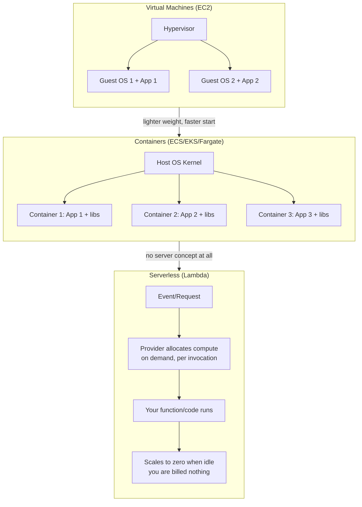
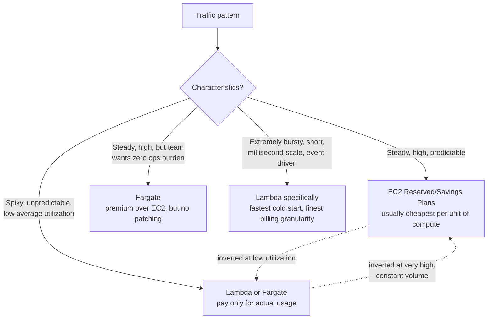
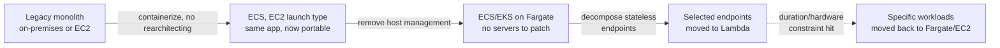

# Containers vs. VMs vs. Serverless — A Conceptual Comparison

> **Appears in:** [DVA-C03](../../certifications/dva-c03/README.md) · [SAA-C03](../../certifications/saa-c03/README.md)


<!-- Conceptual doc spanning Compute + Containers categories; see diagrams/README.md -->

## Definition

These are three different answers to the same question: **"How much of the computer do I want to
manage myself, versus hand to AWS?"**

- A **Virtual Machine (VM)** is a full emulated computer — its own OS kernel, its own installed
  packages, its own patch cycle — running on shared physical hardware.
- A **Container** packages an application and its dependencies (but *not* a full OS kernel) into
  a lightweight, portable unit that shares the host's kernel.
- **Serverless** (e.g., Lambda) removes the "server" concept almost entirely — you supply code or
  a container image, and the provider handles everything about where/how it runs, scaling it to
  zero when idle.

## Purpose

This comparison exists because every cloud architecture decision starts here: how much
infrastructure do you want to own? Each model moves the line between "what you manage" and "what
the provider manages" further toward the provider, trading control for reduced operational
burden — and each trades differently on cost, startup latency, portability, and flexibility. Exam
questions (and real design reviews) constantly hinge on picking the right point on this spectrum
for a given workload.

AWS's own internal framing (from its Architecture Blog) describes this as a progression of
**compute abstraction levels**: physical servers → virtual machines → containers → functions,
with a "bare metal" branch available at any point for workloads needing direct hardware access.
Each new abstraction level didn't replace the previous ones — it added a new point on the
spectrum, because different workloads genuinely need different tradeoffs. Understanding *why* a
workload belongs at a given level (not just which AWS service implements that level) is what both
the SAA-C03 and DVA-C03 exams actually test.

## How It Works

Plain explanation: think of it as layers of a cake. A VM virtualizes hardware, so each VM carries
its own full OS. A container virtualizes the OS, so multiple containers share one kernel but stay
isolated from each other via namespaces/cgroups — much lighter weight, faster to start. Serverless
removes the concept of a persistent unit entirely: the platform allocates compute reactively, per
invocation/task, and you never address "the machine" at all.



Step by step, reading left to right across the spectrum:
1. **VMs**: a hypervisor (on EC2, the Nitro system) partitions physical hardware into isolated
   guest machines, each running its *own full OS kernel*. You patch the OS, manage boot volumes,
   and size the instance. Strongest isolation, slowest to boot (minutes), most control.
2. **Containers**: all containers on a host share the *same* kernel, but are isolated from each
   other via Linux namespaces and cgroups. Starting a container means starting a process, not
   booting an OS — seconds, not minutes. You still choose/manage the *host* (EC2 launch type) or
   hand that off too (Fargate).
3. **Serverless**: there's no "instance" or "container" you provision ahead of time at all. The
   platform reacts to an event or request, allocates ephemeral compute, runs your code, and tears
   it down — scaling automatically to exactly zero when nothing is happening, and you pay nothing
   during idle time.

### Real-World Reference Architecture


*Figure: AWS's own "visual story" of compute abstraction levels — physical servers, virtual
machines (EC2), containers (ECS/EKS), and functions (Lambda) — showing how each successive layer
shifts more of the "undifferentiated heavy lifting" (patching, scaling, capacity planning) from
the customer side of the shared-responsibility line to the AWS side. Source:
[AWS Architecture Blog — "Compute Abstractions on AWS: A Visual Story" by Massimo Re Ferre](https://aws.amazon.com/blogs/architecture/compute-abstractions-on-aws-a-visual-story/), © Amazon Web Services.*


*Figure: The container abstraction specifically — contrasted against the VM abstraction above it,
showing that a container virtualizes the operating system (letting many isolated applications
share one kernel) rather than virtualizing hardware (which is what a hypervisor/VM does). Source:
[AWS Architecture Blog — "Compute Abstractions on AWS: A Visual Story"](https://aws.amazon.com/blogs/architecture/compute-abstractions-on-aws-a-visual-story/), © Amazon Web Services.*

The key insight from that AWS post, directly relevant to exam reasoning: these abstraction levels
are not a strict ladder where higher is always better — a workload needing direct access to
specialized hardware (GPUs with specific driver versions, custom kernel modules, licensed software
tied to a machine identity) deliberately chooses a *lower* abstraction level (EC2, or even bare
metal), trading operational convenience for control. The exam consistently rewards "match the
abstraction level to the workload's actual constraints," never "always pick the most abstracted
option."

## Worked Example: The Same Workload at Three Abstraction Levels

To make the tradeoff concrete, here is literally the same simple web API, expressed at each
abstraction level — notice what each format forces you to specify and what it lets you omit.

**As an EC2 instance (VM) — you own OS patching, scaling, load balancing yourself:**
```bash
aws ec2 run-instances \
  --image-id ami-0abcdef1234567890 \
  --instance-type t3.medium \
  --key-name my-key \
  --security-group-ids sg-0123456789abcdef0 \
  --subnet-id subnet-0123456789abcdef0 \
  --user-data file://install-and-start-app.sh
```

**As an ECS Fargate task (container) — no OS to patch, but still a persistent, running unit:**
```json
{
  "family": "web-api",
  "requiresCompatibilities": ["FARGATE"],
  "networkMode": "awsvpc",
  "cpu": "256",
  "memory": "512",
  "containerDefinitions": [
    { "name": "web-api", "image": "123456789012.dkr.ecr.us-east-1.amazonaws.com/web-api:v1" }
  ]
}
```

**As a Lambda function (serverless) — no persistent unit at all, pure event-to-response:**
```yaml
# SAM template excerpt — see sam.md for the full worked example
WebApiFunction:
  Type: AWS::Serverless::Function
  Properties:
    CodeUri: src/
    Handler: app.handler
    Runtime: python3.12
    Events:
      Api:
        Type: Api
        Properties:
          Path: /
          Method: get
```

Notice the progression: the EC2 example must specify an AMI (full OS image) and boot-time setup
script; the Fargate example specifies only the container image and resource reservation, no OS at
all; the Lambda example specifies only code and an event trigger, with no resource reservation
beyond memory (which implicitly also sets CPU share) and no notion of "capacity" whatsoever.

## Cost-at-Scale Comparison Flow



Walkthrough: there is no universally cheapest option — the crossover depends entirely on
**utilization shape**, not raw workload size. A workload that runs 24/7 at 80% CPU utilization is
almost always cheaper on Reserved EC2 instances than as Lambda invocations, because Lambda's
per-invocation pricing, multiplied by constant high-frequency traffic, adds up faster than a
steadily-utilized reserved instance. The inverse is equally true: a workload that sits idle 95% of
the time and bursts rarely is often *more* expensive on EC2 (you're paying for idle capacity around
the clock) than on Lambda or Fargate (which bill you nothing while idle). The exam tests this
inversion directly and often — "serverless is always cheaper" is a reliable wrong-answer trap.

## Migration Path Across Abstraction Levels



Walkthrough: real modernization journeys are rarely a single clean jump from VM to serverless —
they're usually incremental (containerize first without changing architecture, then remove host
management, then selectively decompose only the pieces that genuinely benefit from serverless),
and it's entirely normal and often correct for some components to move back "down" the abstraction
ladder when they hit a hard constraint (duration limits, GPU needs) that a higher abstraction level
can't satisfy — this is not a failure of the serverless approach, it's matching workload
constraints to abstraction level on a per-component basis, as emphasized throughout this doc.

## Frequently Confused Concepts (Quick-Reference)

- **"Serverless" does not mean "no servers exist" — it means you never see or manage them.**
  Lambda functions and Fargate tasks both run on real physical servers; the abstraction is that
  AWS owns the entire lifecycle of that hardware from your perspective.
- **Containers are not inherently "serverless," even on Fargate.** Fargate removes host
  management, but you still define persistent resource reservations (vCPU/memory) and the task
  keeps running continuously as long as the Service wants it to — unlike Lambda, which has no
  concept of a continuously-running unit at all.
- **"Portable" means different things at each level.** A VM image (AMI) is portable across EC2
  Regions/accounts but not across cloud providers; a container image is portable across clouds and
  on-prem (any OCI-compliant runtime); a Lambda function's code is portable as a .zip or layer, but
  its *runtime/trigger model* is AWS-specific (though container-image-packaged Lambda functions can
  often run unmodified on other container platforms too, narrowing this gap).
- **Cost comparisons must normalize for utilization, not just sticker price per hour.** A
  per-second Fargate price that looks higher than an EC2 instance-hour price divided out can still
  be cheaper in total, if the EC2 instance would otherwise sit partially idle.

## Key Features / Components

| Dimension | VM (EC2) | Container (ECS/EKS) | Serverless (Lambda) |
|---|---|---|---|
| Isolation unit | Full OS + kernel | Process + shared kernel | Ephemeral execution environment |
| Startup time | Minutes | Seconds | Milliseconds–seconds (cold start) |
| You patch the OS? | Yes | Yes, if EC2 launch type; no, if Fargate | Never |
| Scales to zero? | No (you pay while running) | No, unless desired count = 0 | Yes, natively |
| Max run duration | Unbounded | Unbounded | Bounded (Lambda: 15 min) |
| Portability | High (any hypervisor) | Very high (Docker/OCI standard) | Low (vendor-specific runtime, though container-image Lambda narrows this) |
| Typical billing | Per instance-hour | Per task/pod resource-second (Fargate) or instance-hour (EC2) | Per invocation + duration |
| GPU/specialized hardware | Yes, broad instance family support | Limited (EC2 launch type/EKS node groups only; not on Fargate) | No |
| Local/persistent disk | Full control (EBS, instance store) | Ephemeral per-task storage (Fargate) or host-attached (EC2) | Ephemeral `/tmp` only, size-capped |

## Use Cases — When to Use It

- **VMs**: legacy applications requiring a specific OS/kernel version, licensed software tied to
  a machine, workloads needing full control over networking stack or kernel modules, lift-and-
  shift migrations where re-architecting isn't yet feasible, GPU-heavy ML training.
- **Containers**: microservices, anything you want to run consistently across dev/staging/prod,
  workloads with moderate-to-long running times that still benefit from fast scaling and
  portability, teams standardizing on Docker/Kubernetes tooling.
- **Serverless**: event-driven, bursty, or unpredictable workloads; short-lived request/response
  or processing jobs; anything where "pay nothing when idle" matters (e.g., infrequent batch
  triggers, webhooks, glue code between services).

## When NOT to Use It / Alternatives

- **Don't use VMs** when the workload is stateless and fits in a container — you're paying for
  OS management overhead you don't need. Alternative: containers (ECS/EKS/Fargate).
- **Don't use containers** for extremely short, bursty, low-traffic event handling where even a
  container's few-second startup and minimum billing granularity is overkill. Alternative:
  **Lambda**.
- **Don't use serverless/Lambda** for long-running processes (>15 minutes), workloads needing
  persistent local state/specialized hardware (GPUs, at least historically), or very
  high-and-constant traffic where per-invocation billing costs more than a steady-state container
  or VM fleet. Alternative: containers (steady-state) or EC2 (specialized hardware/licensing).

## Common Architectures

**1. Full-spectrum hybrid: all three layers in one system**
A real production system rarely lives at exactly one abstraction level — e.g., a web API runs on
Fargate (containers), an async image-processing step runs on Lambda (serverless) triggered by an
S3 event, and a GPU-based nightly batch training job runs on a dedicated EC2 instance (VM) because
Fargate doesn't support GPUs. Picking the *right* abstraction level per component, not per
system, is the mature pattern.

**2. Lift-and-shift to container modernization path**
A legacy monolith starts as an EC2 Auto Scaling Group (VM level), gets containerized without
rearchitecting (same monolith, now in a Docker image, running on ECS EC2 launch type), then
migrates to Fargate once the team is comfortable, and finally specific stateless endpoints are
peeled off into Lambda functions — a realistic, incremental modernization journey rather than a
single leap.

**3. Serverless-first with a container escape hatch**
An application defaults to Lambda for all request handling, but routes any request that might
exceed Lambda's 15-minute limit or needs a persistent connection pool to a Fargate-backed service
instead — using Step Functions or API Gateway routing rules to direct traffic to whichever
compute layer actually fits the request.

**4. GPU training on EC2, inference on containers or serverless**
ML workloads frequently split abstraction levels by phase: training (GPU-heavy, long-running,
specialized hardware) runs on EC2/SageMaker training instances; inference (request/response,
potentially bursty) runs on a Fargate-backed or Lambda-backed endpoint depending on latency and
volume requirements.

**5. Hybrid decomposition with a strangler-fig pattern**
Instead of containerizing an entire monolith at once, individual routes/endpoints are peeled off
into separate Lambda functions or small Fargate services one at a time, fronted by an API Gateway
or ALB routing layer that transparently directs traffic to either the still-running legacy VM or
the new, extracted component — letting a team migrate incrementally with a working system at every
step rather than a risky big-bang cutover.

## Why It's Important

**Real-world weight:** This single decision shapes your cost structure, your team's operational
burden, your deployment speed, and your blast radius during an incident. Picking VMs when
containers would do means paying an ops tax forever; picking Lambda for a workload that runs
constantly at high volume can be *more* expensive than a steady container fleet. Getting this
right is one of the highest-leverage architecture decisions you'll make.

**Exam weight — exact mapping:**
- **SAA-C03 Domain 2, Task 2.1** ("Design scalable and loosely coupled architectures") directly
  lists "microservices, event-driven patterns... containers, ECS/EKS" alongside compute scaling
  choices — this comparison is the mental model the exam expects you to apply.
- **SAA-C03 Domain 4** (cost-optimized compute) tests the EC2 vs container vs serverless cost
  tradeoff directly.
- **DVA-C03 Domain 1, Task 1.2** (Lambda development) and **Domain 3, Task 3.1/3.3** (container
  artifact prep and ECS/EKS/Fargate deployment) both assume you can reason about which compute
  model fits a given scenario.
- **MLA-C02 Domain 3, Task 3.3** — choosing between a containerized endpoint, a serverless
  inference endpoint, or a traditional instance-backed endpoint for model serving is a direct
  application of this same spectrum.

### Expanded Exam Scenarios

**SAA-C03 Domain 4 scenario:** "An application has constant, high, predictable request volume 24/7
with no idle periods." → The exam wants you to recognize this as the *counter-intuitive* case
where **serverless is likely more expensive** than Reserved EC2/Fargate with Savings Plans —
expect this phrased as a trap where "Lambda" is a tempting but wrong answer.

**SAA-C03 Domain 2 scenario:** "A workload needs specific GPU drivers and kernel modules not
available in any managed container runtime." → Answer: **EC2** (VM level) — this immediately rules
out Fargate (no GPU/custom kernel support) and often rules out Lambda entirely, regardless of how
attractive the rest of the architecture's abstraction level is.

**DVA-C03 Domain 1 scenario:** "A function needs to run for up to 45 minutes to process a large
file." → Answer: this duration **disqualifies Lambda outright** (hard 15-minute ceiling) — the
correct compute choice moves down a level to Fargate (or EC2), not a Lambda workaround like
chaining invocations unless that's explicitly the only option presented.

**MLA-C02 Domain 3 scenario:** "A model-serving endpoint needs to scale to zero between sparse,
unpredictable inference requests, with cost being the primary driver." → Answer: a
**serverless-first** approach (Lambda or a serverless SageMaker inference option) over an
always-on, instance-backed endpoint — directly testing the "pay nothing when idle" value
proposition of the serverless abstraction level.

## Limits & Quotas

These limits are the practical boundaries that *force* a choice between abstraction levels, more
than account-level quotas:

| Dimension | VM (EC2) | Container (Fargate) | Serverless (Lambda) |
|---|---|---|---|
| Max single-unit compute | Largest instance types (hundreds of vCPUs, TBs of RAM) | 16 vCPU / 120 GB per task | 10 GB memory, proportional vCPU |
| Max execution duration | Unbounded | Unbounded | 15 minutes hard ceiling |
| Ephemeral/local storage | Full EBS/instance store | 20–200 GiB ephemeral | 10 GB `/tmp` (configurable up to that cap) |
| GPU support | Yes (broad instance family choice) | No | No (as of this writing) |

**Exam-relevant takeaway:** several exam questions are really just testing whether you know these
hard ceilings exist at all — a scenario describing a 20-minute batch job or a GPU requirement is
designed to eliminate Lambda or Fargate respectively as valid answers, independent of any other
architectural consideration.

## Troubleshooting / Common Issues

- **"Our Lambda-based system got more expensive as traffic grew, even though AWS said serverless
  scales automatically"** — this is not a bug, it's the expected cost curve: per-invocation
  billing scales linearly (or worse) with volume, unlike a fixed-capacity reserved fleet; the fix
  is re-evaluating the compute choice at the new traffic level, not debugging Lambda configuration.
- **"Our container deployment takes much longer to recover from a crash than our old VM did"** —
  usually a misconfigured health check or an image that's slow to start (large image layers, slow
  application boot sequence) rather than an inherent container weakness — containers should start
  in seconds; minutes-long container starts indicate a problem worth investigating.
- **"We moved a workload to Fargate and GPU-based model inference stopped working"** — expected;
  Fargate doesn't support GPUs at all, this isn't a configuration gap — the workload needs to move
  to EC2 or EKS with GPU node groups.
- **"Our serverless function times out on a task that used to work fine as a long-running
  process"** — Lambda's 15-minute ceiling is hard; the fix is decomposing the task (Step Functions
  orchestrating multiple shorter invocations) or moving that specific step to Fargate/EC2, not
  trying to extend Lambda's timeout further (it cannot exceed 15 minutes).

## Pricing Model (summary)

- **VM (EC2)**: pay per instance-hour (On-Demand/Reserved/Savings Plans/Spot), regardless of CPU
  utilization, as long as the instance is running.
- **Containers**: EC2 launch type bills like EC2 above; Fargate bills per-second for reserved
  vCPU/memory per task, regardless of utilization within that reservation.
- **Serverless (Lambda)**: pay per invocation plus GB-seconds of actual execution duration — true
  pay-per-use, including scaling to $0 when idle.
- See `../compute/` for EC2/Lambda pricing docs and each container doc's own pricing section.

## Hands-on Lab (Floci)

Compare all three directly against Floci:

```bash
# VM-style: launch an EC2 instance
awslocal ec2 run-instances --image-id ami-12345 --instance-type t2.micro --count 1

# Container-style: run a Fargate ECS task (see fargate.md for full example)
awslocal ecs run-task --cluster demo-cluster --task-definition fargate-demo --launch-type FARGATE

# Serverless-style: invoke a Lambda function
awslocal lambda invoke --function-name demo-fn --payload '{}' output.json

# Compare cold-start-like latency: time a fresh Lambda invoke vs. a fresh Fargate task start
time awslocal lambda invoke --function-name demo-fn --payload '{}' output.json
time awslocal ecs run-task --cluster demo-cluster --task-definition fargate-demo --launch-type FARGATE
```

Running all three back-to-back against the same local emulator makes the differences in command
shape (and, in real AWS, billing granularity and startup latency) concrete rather than theoretical.

## Exam Tips

- Classic exam phrasing: "with minimal operational overhead" or "no server management" → push
  toward serverless/Fargate; "full control over the OS/kernel" → push toward EC2/VM; "consistent
  across environments, standardized packaging" → push toward containers.
- Watch for **cost-optimization scenarios that invert intuition**: constant, high, predictable
  traffic often favors reserved EC2/containers over Lambda, because per-invocation billing adds up
  fast at scale — don't default to "serverless = always cheaper."
- A workload needing **>15 minutes of continuous execution** can never be a vanilla Lambda
  function — that's an instant disqualifier in a question's option list.
- A workload needing **GPUs or custom kernel modules** can never run on Fargate — another instant
  disqualifier, independent of how otherwise attractive Fargate's simplicity sounds in the
  scenario.
- Abstraction level is a spectrum, not a ladder to always climb — the correct exam answer is
  "match the workload's actual constraint (duration, hardware, state)," not "always pick the most
  abstracted/serverless option."
- Shows up across all three certs as the foundational compute-model mental model underneath more
  specific service questions.

## Further Reading

- [Compute Abstractions on AWS: A Visual Story](https://aws.amazon.com/blogs/architecture/compute-abstractions-on-aws-a-visual-story/) — the AWS Architecture Blog post this doc's primary image comes from
- [The role of AWS Fargate in the container world](https://aws.amazon.com/blogs/containers/the-role-of-aws-fargate-in-the-container-world/) — AWS's framing of north-bound/south-bound orchestration problems
- [AWS Well-Architected Framework — Cost Optimization Pillar](https://docs.aws.amazon.com/wellarchitected/latest/cost-optimization-pillar/welcome.html) — the broader cost-tradeoff framework this comparison feeds into
- [AWS Lambda quotas](https://docs.aws.amazon.com/lambda/latest/dg/gettingstarted-limits.html) — the official hard-limit reference for the serverless end of the spectrum

## Related Terms

- [`ecs.md`](ecs.md), [`eks.md`](eks.md), [`fargate.md`](fargate.md), [`ecr.md`](ecr.md)
- `../compute/` — EC2 and Lambda docs (VM and serverless anchors of this spectrum)
- `../../00-fundamentals/` — core AWS pricing model concepts referenced above
