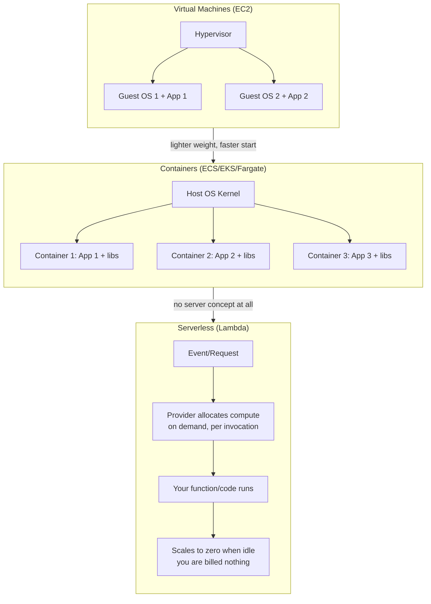

# Containers vs. VMs vs. Serverless — A Conceptual Comparison


<!-- Conceptual doc spanning Compute + Containers categories; see diagrams/README.md -->

## Definition

These are three different answers to the same question: **"How much of the computer do I want to
manage myself, versus hand to AWS?"**

- A **Virtual Machine (VM)** is a full emulated computer — its own OS kernel, its own installed
  packages, its own patch cycle — running on shared physical hardware.
- A **Container** packages an application and its dependencies (but *not* a full OS kernel) into
  a lightweight, portable unit that shares the host's kernel.
- **Serverless** (e.g., Lambda) removes the "server" concept almost entirely — you supply code or
  a container image, and the provider handles everything about where/how it runs, scaling it to
  zero when idle.

## Purpose

This comparison exists because every cloud architecture decision starts here: how much
infrastructure do you want to own? Each model moves the line between "what you manage" and "what
the provider manages" further toward the provider, trading control for reduced operational
burden — and each trades differently on cost, startup latency, portability, and flexibility. Exam
questions (and real design reviews) constantly hinge on picking the right point on this spectrum
for a given workload.

## How It Works

Plain explanation: think of it as layers of a cake. A VM virtualizes hardware, so each VM carries
its own full OS. A container virtualizes the OS, so multiple containers share one kernel but stay
isolated from each other via namespaces/cgroups — much lighter weight, faster to start. Serverless
removes the concept of a persistent unit entirely: the platform allocates compute reactively, per
invocation/task, and you never address "the machine" at all.



Step by step, reading left to right across the spectrum:
1. **VMs**: a hypervisor (on EC2, the Nitro system) partitions physical hardware into isolated
   guest machines, each running its *own full OS kernel*. You patch the OS, manage boot volumes,
   and size the instance. Strongest isolation, slowest to boot (minutes), most control.
2. **Containers**: all containers on a host share the *same* kernel, but are isolated from each
   other via Linux namespaces and cgroups. Starting a container means starting a process, not
   booting an OS — seconds, not minutes. You still choose/manage the *host* (EC2 launch type) or
   hand that off too (Fargate).
3. **Serverless**: there's no "instance" or "container" you provision ahead of time at all. The
   platform reacts to an event or request, allocates ephemeral compute, runs your code, and tears
   it down — scaling automatically to exactly zero when nothing is happening, and you pay nothing
   during idle time.

## Key Features / Components

| Dimension | VM (EC2) | Container (ECS/EKS) | Serverless (Lambda) |
|---|---|---|---|
| Isolation unit | Full OS + kernel | Process + shared kernel | Ephemeral execution environment |
| Startup time | Minutes | Seconds | Milliseconds–seconds (cold start) |
| You patch the OS? | Yes | Yes, if EC2 launch type; no, if Fargate | Never |
| Scales to zero? | No (you pay while running) | No, unless desired count = 0 | Yes, natively |
| Max run duration | Unbounded | Unbounded | Bounded (Lambda: 15 min) |
| Portability | High (any hypervisor) | Very high (Docker/OCI standard) | Low (vendor-specific runtime, though container-image Lambda narrows this) |
| Typical billing | Per instance-hour | Per task/pod resource-second (Fargate) or instance-hour (EC2) | Per invocation + duration |

## Use Cases — When to Use It

- **VMs**: legacy applications requiring a specific OS/kernel version, licensed software tied to
  a machine, workloads needing full control over networking stack or kernel modules, lift-and-
  shift migrations where re-architecting isn't yet feasible.
- **Containers**: microservices, anything you want to run consistently across dev/staging/prod,
  workloads with moderate-to-long running times that still benefit from fast scaling and
  portability, teams standardizing on Docker/Kubernetes tooling.
- **Serverless**: event-driven, bursty, or unpredictable workloads; short-lived request/response
  or processing jobs; anything where "pay nothing when idle" matters (e.g., infrequent batch
  triggers, webhooks, glue code between services).

## When NOT to Use It / Alternatives

- **Don't use VMs** when the workload is stateless and fits in a container — you're paying for
  OS management overhead you don't need. Alternative: containers (ECS/EKS/Fargate).
- **Don't use containers** for extremely short, bursty, low-traffic event handling where even a
  container's few-second startup and minimum billing granularity is overkill. Alternative:
  **Lambda**.
- **Don't use serverless/Lambda** for long-running processes (>15 minutes), workloads needing
  persistent local state/specialized hardware (GPUs, at least historically), or very
  high-and-constant traffic where per-invocation billing costs more than a steady-state container
  or VM fleet. Alternative: containers (steady-state) or EC2 (specialized hardware/licensing).

## Why It's Important

**Real-world weight:** This single decision shapes your cost structure, your team's operational
burden, your deployment speed, and your blast radius during an incident. Picking VMs when
containers would do means paying an ops tax forever; picking Lambda for a workload that runs
constantly at high volume can be *more* expensive than a steady container fleet. Getting this
right is one of the highest-leverage architecture decisions you'll make.

**Exam weight — exact mapping:**
- **SAA-C03 Domain 2, Task 2.1** ("Design scalable and loosely coupled architectures") directly
  lists "microservices, event-driven patterns... containers, ECS/EKS" alongside compute scaling
  choices — this comparison is the mental model the exam expects you to apply.
- **SAA-C03 Domain 4** (cost-optimized compute) tests the EC2 vs container vs serverless cost
  tradeoff directly.
- **DVA-C03 Domain 1, Task 1.2** (Lambda development) and **Domain 3, Task 3.1/3.3** (container
  artifact prep and ECS/EKS/Fargate deployment) both assume you can reason about which compute
  model fits a given scenario.
- **MLA-C02 Domain 3, Task 3.3** — choosing between a containerized endpoint, a serverless
  inference endpoint, or a traditional instance-backed endpoint for model serving is a direct
  application of this same spectrum.

## Pricing Model (summary)

- **VM (EC2)**: pay per instance-hour (On-Demand/Reserved/Savings Plans/Spot), regardless of CPU
  utilization, as long as the instance is running.
- **Containers**: EC2 launch type bills like EC2 above; Fargate bills per-second for reserved
  vCPU/memory per task, regardless of utilization within that reservation.
- **Serverless (Lambda)**: pay per invocation plus GB-seconds of actual execution duration — true
  pay-per-use, including scaling to $0 when idle.
- See `../compute/` for EC2/Lambda pricing docs and each container doc's own pricing section.

## Hands-on Lab (Floci)

Compare all three directly against Floci:

```bash
# VM-style: launch an EC2 instance
awslocal ec2 run-instances --image-id ami-12345 --instance-type t2.micro --count 1

# Container-style: run a Fargate ECS task (see fargate.md for full example)
awslocal ecs run-task --cluster demo-cluster --task-definition fargate-demo --launch-type FARGATE

# Serverless-style: invoke a Lambda function
awslocal lambda invoke --function-name demo-fn --payload '{}' output.json
```

Running all three back-to-back against the same local emulator makes the differences in command
shape (and, in real AWS, billing granularity) concrete rather than theoretical.

## Exam Tips

- Classic exam phrasing: "with minimal operational overhead" or "no server management" → push
  toward serverless/Fargate; "full control over the OS/kernel" → push toward EC2/VM; "consistent
  across environments, standardized packaging" → push toward containers.
- Watch for **cost-optimization scenarios that invert intuition**: constant, high, predictable
  traffic often favors reserved EC2/containers over Lambda, because per-invocation billing adds up
  fast at scale — don't default to "serverless = always cheaper."
- A workload needing **>15 minutes of continuous execution** can never be a vanilla Lambda
  function — that's an instant disqualifier in a question's option list.
- Shows up across all three certs as the foundational compute-model mental model underneath more
  specific service questions.

## Related Terms

- [`ecs.md`](ecs.md), [`eks.md`](eks.md), [`fargate.md`](fargate.md), [`ecr.md`](ecr.md)
- `../compute/` — EC2 and Lambda docs (VM and serverless anchors of this spectrum)
- `../../00-fundamentals/` — core AWS pricing model concepts referenced above
