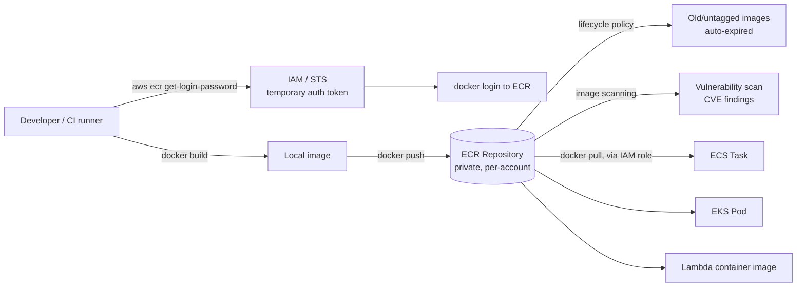

# Amazon Elastic Container Registry (ECR)


<!-- AWS Architecture Icons, Containers category; see diagrams/README.md for the convention -->

## Definition

Amazon ECR is a fully managed, private Docker/OCI container image registry — think of it as the
AWS-hosted equivalent of Docker Hub, but private by default, tightly integrated with IAM, and
built to feed container images straight into ECS, EKS, Lambda, and Fargate.

## Purpose

Container images need to live somewhere between "built by CI" and "run in production," and that
somewhere needs strong access control (you don't want your proprietary application image public
on the internet), reliability (your deployment pipeline depends on being able to pull it), and
tight integration with whatever is going to run the image. Public registries like Docker Hub have
rate limits, can be hit by outages outside your control, and require managing a separate identity
system. ECR solves this by putting the registry inside your AWS account boundary, governed by the
same IAM policies as everything else.

## How It Works

Plain explanation: you build a container image locally or in CI, tag it with your ECR
**repository URI**, authenticate Docker to ECR using temporary credentials from IAM/STS, and push
it. ECS, EKS, Lambda, or Fargate then pull that image by referencing the same URI at deployment
time, authenticated via IAM roles rather than long-lived passwords.



Step by step:
1. A developer or CI pipeline builds a Docker image from a `Dockerfile`.
2. They authenticate to ECR by exchanging IAM credentials for a short-lived Docker login token
   (`aws ecr get-login-password`) — no static registry passwords to rotate or leak.
3. The image is tagged with the ECR repository's URI
   (`<account-id>.dkr.ecr.<region>.amazonaws.com/<repo-name>:<tag>`) and pushed.
4. ECR stores the image privately, scoped to your AWS account/repository permissions.
5. **Lifecycle policies** automatically expire old or untagged images so storage costs don't grow
   unbounded.
6. **Image scanning** (basic, powered by Clair-based open-source scanning, or enhanced, powered
   by Amazon Inspector) checks the image for known CVEs and surfaces findings.
7. At deploy time, ECS/EKS/Lambda/Fargate pull the image using an IAM role with `ecr:GetDownload
   UrlForLayer`/`ecr:BatchGetImage` permissions — no credentials embedded in the deployment
   artifact itself.

## Key Features / Components

- **Private repositories** — per-account, access-controlled via IAM/resource policies; images are
  never public unless you explicitly use an **ECR Public** repository.
- **ECR Public** — a separate, free-to-host public registry (like Docker Hub) for open-source
  images you want to distribute publicly.
- **Image scanning** — basic scanning on push (free) or enhanced continuous scanning via Amazon
  Inspector integration (paid) for known vulnerabilities.
- **Lifecycle policies** — rules to automatically expire old image tags/untagged images, keeping
  storage costs and clutter down.
- **Replication** — cross-region and cross-account replication for disaster recovery or
  multi-region deployments.
- **Immutable tags** — optionally lock a tag once pushed, so `:latest`-style tag drift/overwrite
  can't silently change what a running deployment pulls.
- **Pull-through cache** — cache images from public upstream registries (like Docker Hub) through
  ECR, reducing public rate-limit exposure.

## Use Cases — When to Use It

- Any container-based workload on AWS (ECS, EKS, Fargate, Lambda container images) needs a
  registry — ECR is the default, IAM-integrated choice.
- Teams that need strict access control over who can push/pull specific images (e.g., only the CI
  pipeline's role can push; only specific service roles can pull).
- Organizations needing vulnerability scanning baked into the image lifecycle before deployment.
- Multi-region or multi-account deployments that need the same image replicated close to where
  it's consumed.

## When NOT to Use It / Alternatives

- **You're deliberately distributing open-source images to the public internet at scale** → **ECR
  Public** or **Docker Hub** are built for that use case; a private ECR repo adds no value there.
- **Your org already has an established registry (Docker Hub, GitHub Container Registry, Harbor,
  JFrog Artifactory) with existing CI integration and governance** → migrating just to use ECR
  isn't automatically worth it; ECR's main advantage is IAM-native auth for AWS compute, which
  matters most if you're running on ECS/EKS/Lambda.
- **You need a generic artifact repository for non-container artifacts (npm packages, Maven jars)
  alongside images** → **AWS CodeArtifact** or Artifactory handle multi-format artifacts; ECR is
  container-image-specific.

## Why It's Important

**Real-world weight:** The registry is the trust boundary between "code someone wrote" and "code
running in production" — a compromised or improperly-scoped registry is a direct path to
supply-chain attacks. IAM-based auth (no static passwords) and vulnerability scanning materially
reduce that risk. Lifecycle policies also prevent a very common cost leak: unbounded image storage
growth from CI pushing a new tag on every commit forever.

**Exam weight — exact mapping:**
- **DVA-C03 Domain 1, Task 1.1** and **Domain 3, Task 3.1** ("Prepare application artifacts for
  deployment") explicitly call out **"ECR container images, Dockerfiles"** as in-scope artifact
  prep — this is one of the most directly-tested container topics on DVA-C03.
- **DVA-C03 Domain 3, Task 3.3** — ECR images feed the CI/CD deployment step (ECS/EKS/Fargate
  pulling from ECR as part of the pipeline).
- **SAA-C03 Domain 2, Task 2.1** — ECR as the supporting registry for container-based scalable
  architectures.
- **MLA-C02 Domain 3, Task 3.3** — "containerize (ECR, custom containers)" is explicitly listed as
  part of ML deployment/orchestration.

## Pricing Model (summary)

- **Storage**: billed per GB-month for image data stored in private repositories (small free tier
  for new accounts).
- **Data transfer**: pulling images within the same region to AWS services is free; cross-region
  or internet-bound transfer is billed at standard data transfer rates.
- **Enhanced scanning** (Inspector-powered continuous scanning) is billed separately per image
  scanned; basic scanning is free.
- Official pricing: https://aws.amazon.com/ecr/pricing/

## Hands-on Lab (Floci)

Floci emulates ECR alongside its Docker-backed ECS/EKS support, so you can practice the full
build → push → pull loop:

```bash
# 1. Create a private repository
awslocal ecr create-repository --repository-name demo-app

# 2. Authenticate Docker to the local ECR endpoint
awslocal ecr get-login-password | docker login \
  --username AWS --password-stdin localhost:4566

# 3. Tag and push a local image
docker build -t demo-app:v1 .
docker tag demo-app:v1 localhost:4566/demo-app:v1
docker push localhost:4566/demo-app:v1

# 4. List images in the repository
awslocal ecr list-images --repository-name demo-app

# 5. Apply a lifecycle policy (expire untagged images after 1 day)
awslocal ecr put-lifecycle-policy \
  --repository-name demo-app \
  --lifecycle-policy-text '{"rules":[{"rulePriority":1,"selection":{"tagStatus":"untagged","countType":"sinceImagePushed","countUnit":"days","countNumber":1},"action":{"type":"expire"}}]}'
```

This sequence — repo creation, auth, tag/push, lifecycle policy — is identical to the real AWS
ECR workflow; only the registry endpoint differs.

## Exam Tips

- Keywords pointing to ECR: "where do container images live," "private registry," "Dockerfile,"
  "image scanning," "vulnerability scanning for containers," "lifecycle policy for images."
- Common trap: confusing ECR (image **registry**) with ECS/EKS (image **runtime/orchestrator**) —
  ECR never runs your container, it only stores and serves the image.
- Remember IAM governs push/pull — a question about "restrict which pipeline can push a specific
  image" is an IAM resource policy on the ECR repository, not a networking control.
- Appears heavily in DVA-C03 Domain 1 & 3, and in MLA-C02 Domain 3 (custom inference containers).

## Related Terms

- [`ecs.md`](ecs.md), [`eks.md`](eks.md), [`fargate.md`](fargate.md) — consumers of ECR images
- [`containers-vs-vms-vs-serverless.md`](containers-vs-vms-vs-serverless.md)
- `../developer-tools/codebuild.md` — typically builds and pushes the image to ECR as a CI step
- `../developer-tools/codepipeline.md` — orchestrates the build→push→deploy flow around ECR
