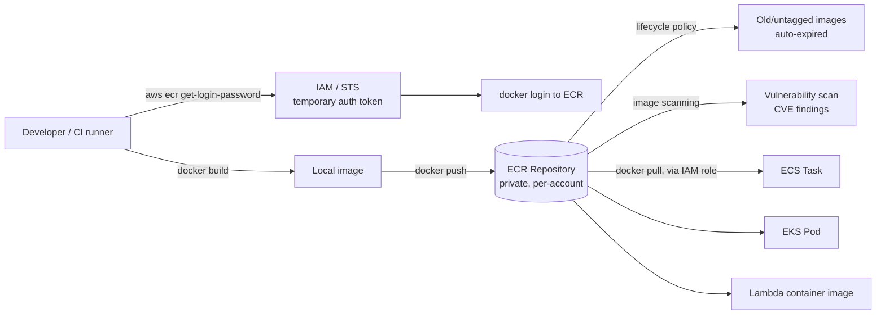
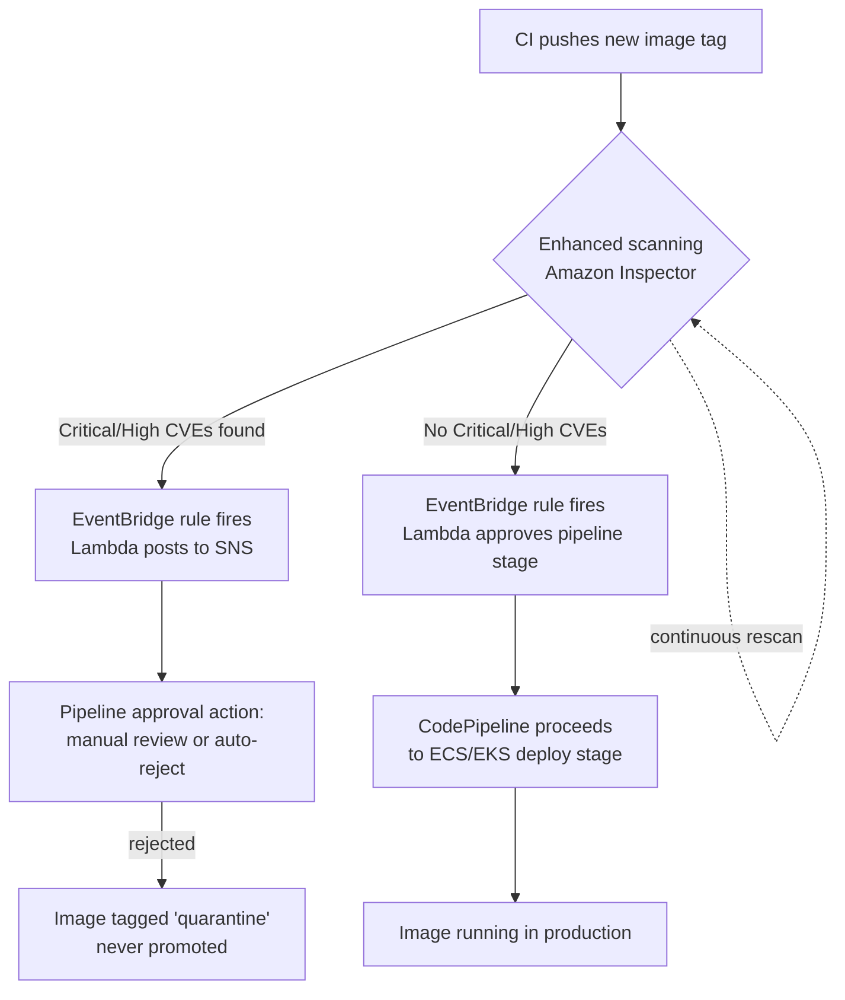
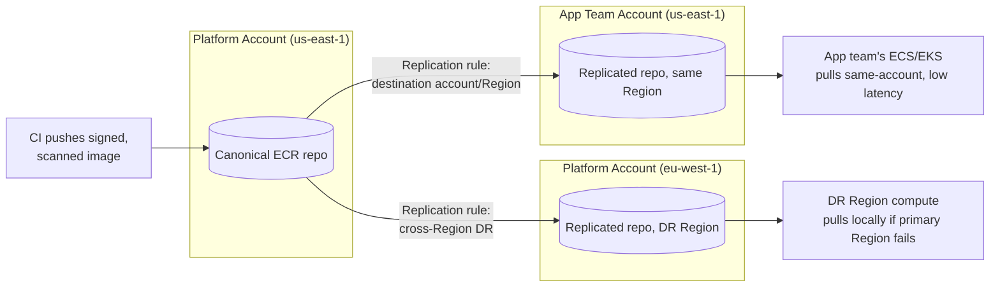

# Amazon Elastic Container Registry (ECR)

> **Appears in:** [DVA-C03](../../certifications/dva-c03/README.md) · [MLA-C02](../../certifications/mla-c02/README.md)


<!-- AWS Architecture Icons, Containers category; see diagrams/README.md for the convention -->

## Definition

Amazon ECR is a fully managed, private Docker/OCI container image registry — think of it as the
AWS-hosted equivalent of Docker Hub, but private by default, tightly integrated with IAM, and
built to feed container images straight into ECS, EKS, Lambda, and Fargate.

## Purpose

Container images need to live somewhere between "built by CI" and "run in production," and that
somewhere needs strong access control (you don't want your proprietary application image public
on the internet), reliability (your deployment pipeline depends on being able to pull it), and
tight integration with whatever is going to run the image. Public registries like Docker Hub have
rate limits, can be hit by outages outside your control, and require managing a separate identity
system. ECR solves this by putting the registry inside your AWS account boundary, governed by the
same IAM policies as everything else.

ECR is also, less visibly, a storage and content-delivery problem: image layers are actually
stored in (AWS-managed) S3 behind the scenes and served through a caching layer optimized for the
kind of large, mostly-immutable binary blobs container layers are — which is why ECR pulls from
compute inside the same Region are typically both free and fast, and why VPC endpoints for ECR
specifically also require an `s3` endpoint/route alongside the `ecr.api`/`ecr.dkr` endpoints.

## How It Works

Plain explanation: you build a container image locally or in CI, tag it with your ECR
**repository URI**, authenticate Docker to ECR using temporary credentials from IAM/STS, and push
it. ECS, EKS, Lambda, or Fargate then pull that image by referencing the same URI at deployment
time, authenticated via IAM roles rather than long-lived passwords.



Step by step:
1. A developer or CI pipeline builds a Docker image from a `Dockerfile`.
2. They authenticate to ECR by exchanging IAM credentials for a short-lived Docker login token
   (`aws ecr get-login-password`) — no static registry passwords to rotate or leak.
3. The image is tagged with the ECR repository's URI
   (`<account-id>.dkr.ecr.<region>.amazonaws.com/<repo-name>:<tag>`) and pushed.
4. ECR stores the image privately, scoped to your AWS account/repository permissions.
5. **Lifecycle policies** automatically expire old or untagged images so storage costs don't grow
   unbounded.
6. **Image scanning** (basic, powered by Clair-based open-source scanning, or enhanced, powered
   by Amazon Inspector) checks the image for known CVEs and surfaces findings.
7. At deploy time, ECS/EKS/Lambda/Fargate pull the image using an IAM role with `ecr:GetDownload
   UrlForLayer`/`ecr:BatchGetImage` permissions — no credentials embedded in the deployment
   artifact itself.

### Real-World Reference Architecture


*Figure: How an ECR lifecycle policy evaluates images against a sequence of numbered rules (each
matching on tag status/prefix and an age or count threshold) and expires the images that match, in
rule-priority order. Source:
[Amazon ECR User Guide — "Automate the cleanup of images by using lifecycle policies"](https://docs.aws.amazon.com/AmazonECR/latest/userguide/LifecyclePolicies.html), © Amazon Web Services.*


*Figure: A production financial-services microservices platform where container images for every
payment microservice are maintained in **Amazon ECR** (step 15) and pulled into an EKS cluster
whose Ingress Controller fronts requests arriving via API Gateway, Direct Connect, and the
internet — showing ECR's role as the single source of truth for what's actually running across a
large, multi-microservice estate. Source:
[AWS Reference Architecture Diagrams — "Payment System Interface Modernization on AWS"](https://docs.aws.amazon.com/reference-architecture-diagrams/latest/payment-system-interface-modernization/payment-system-interface-modernization.html), © Amazon Web Services.*

## Worked Example: A Multi-Rule Lifecycle Policy

A realistic production lifecycle policy — keep the last 10 production-tagged images, expire
untagged images after 1 day, and expire any non-production-tagged image older than 30 days:

```json
{
  "rules": [
    {
      "rulePriority": 1,
      "description": "Expire untagged images older than 1 day",
      "selection": {
        "tagStatus": "untagged",
        "countType": "sinceImagePushed",
        "countUnit": "days",
        "countNumber": 1
      },
      "action": { "type": "expire" }
    },
    {
      "rulePriority": 2,
      "description": "Keep only the last 10 production-tagged images",
      "selection": {
        "tagStatus": "tagged",
        "tagPrefixList": ["prod-"],
        "countType": "imageCountMoreThan",
        "countNumber": 10
      },
      "action": { "type": "expire" }
    },
    {
      "rulePriority": 3,
      "description": "Expire any other tagged image older than 30 days",
      "selection": {
        "tagStatus": "any",
        "countType": "sinceImagePushed",
        "countUnit": "days",
        "countNumber": 30
      },
      "action": { "type": "expire" }
    }
  ]
}
```

Rule evaluation is **priority-ordered and short-circuits** per image — once an image matches a
rule, later rules don't re-evaluate it. This is the single most common lifecycle-policy mistake in
production: writing a broad "any tag, 30 days" rule at priority 1 that silently expires images a
more specific rule (like "keep the last 10 prod- tagged images") was meant to protect, simply
because it was evaluated first.

### Worked Example: Repository Policy Restricting Push to a CI Role Only

```json
{
  "Version": "2012-10-17",
  "Statement": [
    {
      "Sid": "AllowCIPushOnly",
      "Effect": "Allow",
      "Principal": {
        "AWS": "arn:aws:iam::123456789012:role/codebuild-ci-role"
      },
      "Action": [
        "ecr:BatchCheckLayerAvailability",
        "ecr:PutImage",
        "ecr:InitiateLayerUpload",
        "ecr:UploadLayerPart",
        "ecr:CompleteLayerUpload"
      ]
    },
    {
      "Sid": "AllowAllAccountRolesPullOnly",
      "Effect": "Allow",
      "Principal": {
        "AWS": "arn:aws:iam::123456789012:root"
      },
      "Action": [
        "ecr:GetDownloadUrlForLayer",
        "ecr:BatchGetImage",
        "ecr:GetAuthorizationToken"
      ]
    }
  ]
}
```

This is a resource policy attached directly to the ECR repository (distinct from an IAM identity
policy) — it answers "a question about restricting which pipeline can push a specific image is an
IAM resource policy on the ECR repository" directly: only the named CI role can push new layers;
every other principal in the account can pull but never push, enforcing that production images
only ever originate from the CI pipeline, never from a developer's laptop.

## Full Image Vulnerability-Gated Deployment Flow



Walkthrough: enhanced scanning (the Amazon Inspector-powered tier) doesn't just scan once at push
time — it continuously rescans stored images as new CVEs are published against the open-source
database, and emits new EventBridge findings whenever a *previously clean* image is retroactively
found vulnerable. A mature pipeline treats this as a live gate, not a one-time check: a
CodePipeline manual-approval action (or a Lambda auto-approver) sits between "image scanned clean"
and "image promoted to the next environment," and the same EventBridge rule that approves a clean
scan can alert on a newly-discovered vulnerability in an image that's *already* running in
production.

## Cross-Account, Cross-Region Replication Flow



Walkthrough: replication rules are configured once at the registry level (not per-repository) and
replicate automatically on every push matching the rule's filters — there's no separate "sync"
step to run, and replicated images keep their original tags and digests, so a disaster-recovery
failover to the replica Region references the exact same image, not a rebuilt equivalent.

## Frequently Confused ECR Concepts (Quick-Reference)

- **A repository policy is not the same as an IAM identity policy.** The repository policy (shown
  in the worked example above) is attached to the ECR repository itself and governs who can act on
  it; an IAM identity policy is attached to a user/role and governs what that principal can do
  across resources. Cross-account access requires *both* to agree.
- **Image digests are immutable; tags are not (unless you enable immutability).** `image:v1` can
  be repointed to a different digest with a later push; `image@sha256:abcd...` always refers to
  exactly one, unchangeable set of bytes — production deployment pipelines that need absolute
  certainty about what's running reference the digest, not just the tag.
- **Basic scanning and enhanced scanning use different engines and different trigger models.**
  Basic scanning runs once, on push, using an open-source CVE database; enhanced scanning
  (Inspector-powered) runs continuously and re-evaluates stored images as new CVEs are published —
  they are not simply "free vs. paid tiers of the same check."
- **ECR Public and private ECR are architecturally separate registries**, not a visibility flag on
  the same repository — moving an image from private to "public" means pushing it into a
  genuinely different registry (ECR Public), not flipping a setting on the existing private repo.

## Key Features / Components

- **Private repositories** — per-account, access-controlled via IAM/resource policies; images are
  never public unless you explicitly use an **ECR Public** repository.
- **ECR Public** — a separate, free-to-host public registry (like Docker Hub) for open-source
  images you want to distribute publicly.
- **Image scanning** — basic scanning on push (free) or enhanced continuous scanning via Amazon
  Inspector integration (paid) for known vulnerabilities.
- **Lifecycle policies** — rules to automatically expire old image tags/untagged images, keeping
  storage costs and clutter down.
- **Replication** — cross-region and cross-account replication for disaster recovery or
  multi-region deployments.
- **Immutable tags** — optionally lock a tag once pushed, so `:latest`-style tag drift/overwrite
  can't silently change what a running deployment pulls.
- **Pull-through cache** — cache images from public upstream registries (like Docker Hub) through
  ECR, reducing public rate-limit exposure.
- **Repository creation templates** — define rules (naming patterns, default lifecycle/scanning
  config) that auto-apply whenever a new repository matching the pattern is created, useful for
  standardizing hundreds of microservice repositories without manual setup per repo.
- **OCI artifact support** — beyond container images, ECR can store Helm charts, SBOMs, and other
  OCI-compliant artifacts, acting as a single artifact store for the whole deployment bundle.

## Use Cases — When to Use It

Each scenario names the situation, why ECR fits, and the tradeoff accepted versus an alternative.

1. **Baseline registry for any container workload on AWS.** Situation: ECS, EKS, Fargate, or Lambda
   container images all need somewhere to live. Why ECR fits: IAM-native auth means no separate
   registry credentials to manage across every compute service that pulls images. Tradeoff: tighter
   coupling to AWS than a cloud-agnostic registry, which matters less if you're all-in on AWS
   compute anyway.
2. **Strict push/pull access control per pipeline.** Situation: only the CI pipeline's role should
   push images; developers' laptops should never be able to. Why ECR fits: a repository resource
   policy can grant push only to a named IAM role, pull to everyone else. Tradeoff: cross-account
   access needs *both* the repository policy and the external role's own identity policy to agree
   — a one-sided grant silently denies access.
3. **Vulnerability-gated deployment pipeline.** Situation: images must be scanned for CVEs before
   reaching production. Why ECR fits: enhanced scanning (Amazon Inspector) continuously rescans
   stored images, not just at push time, and EventBridge can gate promotion on findings. Tradeoff:
   enhanced scanning is billed per image scanned — basic scanning is free but only scans once, on
   push.
4. **Multi-region/multi-account disaster recovery.** Situation: a failover region needs the exact
   same image available locally if the primary region goes down. Why ECR fits: replication rules
   copy images (keeping tags and digests identical) automatically on every push, registry-wide.
   Tradeoff: cross-region replication incurs standard data transfer charges and a small propagation
   delay versus a single-region setup.
5. **Standardizing hundreds of microservice repositories.** Situation: a platform team wants
   consistent naming, scanning, and lifecycle configuration across every new microservice repo.
   Why ECR fits: repository creation templates auto-apply rules whenever a matching new repo is
   created. Tradeoff: templates only apply at creation time — retrofitting policy onto existing
   repos still needs a separate bulk update pass.
6. **Monorepo CI/CD producing many images per commit.** Situation: a monorepo build fans out into
   dozens of service images on a single pipeline run. Why ECR fits: one repository per service,
   each independently lifecycle-managed, keeps storage costs bounded as commit volume grows.
   Tradeoff: without disciplined naming conventions, repo sprawl becomes hard to audit at scale.
7. **Hotfix emergency deploys needing instant, traceable image availability.** Situation: a
   critical patch must reach production fast with zero ambiguity about which bytes are running.
   Why ECR fits: image digests are immutable — pulling by digest (or a commit-SHA tag) guarantees
   the exact image deployed, even under time pressure. Tradeoff: teams that fall back to mutable
   tags like `:latest` during a rushed release lose that guarantee entirely.
8. **Multi-tenant SaaS with per-tenant image variants.** Situation: a SaaS platform builds
   tenant-specific container variants. Why ECR fits: one repository per tenant/service, each scoped
   by its own resource policy, cleanly separates who can push/pull which variant. Tradeoff:
   repository sprawl at real scale requires active governance or it becomes unmanageable.
9. **Fully private-subnet deployments with no internet egress.** Situation: compute runs in
   subnets with no NAT Gateway or public route at all. Why ECR fits: VPC interface endpoints for
   `ecr.api`/`ecr.dkr` plus a gateway endpoint for `s3` let tasks pull images with a fully private
   network path. Tradeoff: interface endpoints carry their own hourly charge versus a NAT Gateway,
   though usually still cheaper and more secure at scale.
10. **Build-once, deploy-many promotion across environments.** Situation: the same image must move
    from dev to staging to production without being rebuilt at each stage. Why ECR fits: pulling by
    immutable digest guarantees bit-for-bit identical artifacts across every environment.
    Tradeoff: requires pipeline discipline to always reference the digest/commit-SHA, never a
    floating environment tag, or the guarantee silently breaks.
11. **Supply-chain security via image signing and attestation.** Situation: compliance requires
    proof an image genuinely came from the CI pipeline, not a manual push. Why ECR fits: OCI
    artifact support stores Cosign/Sigstore signatures and SBOMs alongside the image in the same
    registry. Tradeoff: adds verification tooling (admission controllers, signing infrastructure)
    that itself must be maintained and trusted.
12. **Reducing dependency on public base-image registries.** Situation: builds pull `python:3.12`-
    style base images directly from Docker Hub, subject to its public rate limits. Why ECR fits: a
    pull-through cache rule serves repeat pulls from inside AWS, immune to a Docker Hub outage or
    rate-limit event. Tradeoff: the very first pull of any new upstream tag still depends on the
    public registry being reachable at that moment.

## When NOT to Use It / Alternatives

- **You're deliberately distributing open-source images to the public internet at scale** → **ECR
  Public** or **Docker Hub** are built for that use case; a private ECR repo adds no value there.
- **Your org already has an established registry (Docker Hub, GitHub Container Registry, Harbor,
  JFrog Artifactory) with existing CI integration and governance** → migrating just to use ECR
  isn't automatically worth it; ECR's main advantage is IAM-native auth for AWS compute, which
  matters most if you're running on ECS/EKS/Lambda.
- **You need a generic artifact repository for non-container artifacts (npm packages, Maven jars)
  alongside images** → **AWS CodeArtifact** or Artifactory handle multi-format artifacts; ECR is
  container-image-specific (though its OCI artifact support narrows this gap somewhat).

## Common Architectures

**1. Single-account, multi-environment promotion pipeline**
One ECR repository per microservice; images tagged with a commit SHA move through `dev` →
`staging` → `prod` tags (or via multiple repos/replication) as they pass each environment's tests,
with the *same immutable image* promoted rather than rebuilt per environment — eliminating
"works in staging, fails in prod because it was rebuilt differently" class bugs.

**2. Multi-account registry with cross-account replication**
A central "Platform" account hosts the canonical, scanned images; **cross-account replication**
pushes approved images into each application team's own account automatically, so teams pull from
a local, same-account ECR repository (fast, no cross-account IAM complexity at pull time) while
the platform team retains centralized build/scan control.

**3. Pull-through cache for public base images**
Rather than every build pulling `python:3.12-slim` or similar directly from Docker Hub (subject to
Docker Hub's public rate limits), an ECR **pull-through cache rule** transparently caches the first
pull and serves subsequent pulls from inside AWS — faster, and immune to a public registry outage
or rate-limit event affecting production deploys.

**4. Vulnerability-gated promotion (shown above)**
EventBridge + Lambda + Security Hub aggregation: enhanced scanning results from every repository
across every account feed into a single Security Hub view, with EventBridge rules blocking
promotion of any image with Critical/High findings until remediated.

**5. Image signing and attestation for supply-chain security**
Images are signed (e.g., with Sigstore/Cosign) at build time, and the signature stored as an OCI
artifact alongside the image in ECR; deployment targets (ECS/EKS admission controllers) verify the
signature before running the image, ensuring only images that genuinely came from the CI pipeline
— not a manually-pushed image — are ever deployed.

**5. Software Bill of Materials (SBOM) and attestation storage alongside images**
Beyond raw container images, ECR's OCI artifact support is used to store SBOMs and
signing attestations generated at build time as sibling artifacts to the image they describe —
giving downstream tooling (admission controllers, compliance scanners) a single registry to query
for both "what's in this image" and "is this image allowed to run" without a separate artifact
store.

## Why It's Important

**Real-world weight:** The registry is the trust boundary between "code someone wrote" and "code
running in production" — a compromised or improperly-scoped registry is a direct path to
supply-chain attacks. IAM-based auth (no static passwords) and vulnerability scanning materially
reduce that risk. Lifecycle policies also prevent a very common cost leak: unbounded image storage
growth from CI pushing a new tag on every commit forever.

**Exam weight — exact mapping:**
- **DVA-C03 Domain 1, Task 1.1** and **Domain 3, Task 3.1** ("Prepare application artifacts for
  deployment") explicitly call out **"ECR container images, Dockerfiles"** as in-scope artifact
  prep — this is one of the most directly-tested container topics on DVA-C03.
- **DVA-C03 Domain 3, Task 3.3** — ECR images feed the CI/CD deployment step (ECS/EKS/Fargate
  pulling from ECR as part of the pipeline).
- **SAA-C03 Domain 2, Task 2.1** — ECR as the supporting registry for container-based scalable
  architectures.
- **MLA-C02 Domain 3, Task 3.3** — "containerize (ECR, custom containers)" is explicitly listed as
  part of ML deployment/orchestration.

### Expanded Exam Scenarios

**DVA-C03 Domain 3 scenario:** "A security team wants old, untagged image layers in ECR cleaned up
automatically after 24 hours, but production-tagged images must never be deleted regardless of
age." → Answer: a **lifecycle policy** with a higher-priority rule targeting `tagStatus:
untagged` (age-based expiry) and a lower-priority rule explicitly scoped to non-production tag
prefixes — never a single catch-all rule, since rule order and short-circuiting determine which
images are actually protected.

**DVA-C03 Domain 1 scenario:** "A CI pipeline must authenticate to ECR without storing any
long-lived credentials in the build environment." → Answer: `aws ecr get-login-password` exchanges
the CodeBuild/CI role's temporary STS credentials for a short-lived Docker login token — no
static registry password is ever created or stored.

**SAA-C03 Domain 2 scenario:** "An application running in a fully private subnet (no NAT Gateway,
no internet access) must still be able to pull its container image at deploy time." → Answer:
create **VPC interface endpoints for `ecr.api` and `ecr.dkr`**, plus a **gateway endpoint for S3**
(since image layers are served from S3) — a NAT Gateway is a valid but non-private-by-design and
costlier alternative; VPC endpoints are the fully-private answer.

**MLA-C02 Domain 3 scenario:** "A data science team wants to confirm that a custom inference
container doesn't contain known OS package vulnerabilities before it's used in a SageMaker
endpoint." → Answer: enable **ECR enhanced scanning (Amazon Inspector)** on the repository and gate
deployment on scan findings via EventBridge — basic scanning alone may be sufficient for simpler
requirements but enhanced scanning gives continuous rescanning as new CVEs are published.

## Limits & Quotas

Current defaults (verify against the
[official ECR service quotas page](https://docs.aws.amazon.com/AmazonECR/latest/userguide/service-quotas.html)):

| Quota | Default | Adjustable? |
|---|---|---|
| Repositories per Region | 10,000 | Yes |
| Images per repository | 10,000 (soft; practically governed by lifecycle policy hygiene) | Yes |
| Repository policy size | 10 KB | No |
| Lifecycle policy rules per repository | 100 | No |
| Image layer size | 10 GiB per layer | No |
| Image manifest size | 4 MiB | No |
| Pull-through cache rules per registry | 10 | Yes |

**Exam-relevant takeaway:** the exam rarely tests exact numbers here, but does test that
**lifecycle policies are the correct mechanism for storage cost control**, not manual deletion
scripts, and that repository-level access control is a **resource policy**, distinct from the
IAM identity policies attached to users/roles.

## Troubleshooting / Common Issues

- **`docker push`/`docker pull` fails with `no basic auth credentials`** — the Docker login token
  from `aws ecr get-login-password` expires after 12 hours; re-authenticate before retrying rather
  than assuming a persistent credentials issue.
- **"denied: User is not authorized to perform ecr:GetDownloadUrlForLayer"** at deployment time —
  the compute's IAM role (ECS execution role, EKS node/IRSA role, Lambda execution role) lacks ECR
  pull permissions, or a repository resource policy explicitly restricts pulls to a different
  principal.
- **Image pull is slow or times out from a private subnet** — missing `ecr.api`/`ecr.dkr`/`s3` VPC
  endpoints (or a missing NAT Gateway) means there's no network path to ECR at all; check route
  tables and endpoint security groups before assuming an ECR-side issue.
- **A tag that should be "latest" is actually an old image** — tags are mutable by default; without
  **tag immutability** enabled, a later `docker push` with the same tag silently overwrites what
  that tag points to, which is a common source of "I deployed the new code but the old version is
  still running" incidents.
- **Lifecycle policy deleted an image that was still needed** — almost always a rule-ordering bug
  (see the worked example above); use `PutLifecyclePolicyPreview` (or the console's preview
  feature) to dry-run a policy's effect before applying it.
- **Enhanced scanning shows findings that basic scanning didn't** — expected; the two scanning
  tiers use different vulnerability databases and scan depth (enhanced scanning, via Inspector,
  also continuously rescans for newly-published CVEs against already-stored images).
- **Cross-account pull denied despite a seemingly correct repository policy** — cross-account ECR
  access needs *both* the repository policy granting the external account/role access *and* that
  external role's own IAM identity policy granting `ecr:*` actions — a resource policy alone
  doesn't implicitly grant access without the identity side also allowing it.

## Pricing Model (summary)

- **Storage**: billed per GB-month for image data stored in private repositories (small free tier
  for new accounts).
- **Data transfer**: pulling images within the same region to AWS services is free; cross-region
  or internet-bound transfer is billed at standard data transfer rates.
- **Enhanced scanning** (Inspector-powered continuous scanning) is billed separately per image
  scanned; basic scanning is free.
- **Replication** incurs standard data transfer charges for the cross-region/cross-account copy.
- Official pricing: https://aws.amazon.com/ecr/pricing/

## Hands-on Lab (Floci)

Floci emulates ECR alongside its Docker-backed ECS/EKS support, so you can practice the full
build → push → pull loop:

```bash
# 1. Create a private repository
awslocal ecr create-repository --repository-name demo-app

# 2. Authenticate Docker to the local ECR endpoint
awslocal ecr get-login-password | docker login \
  --username AWS --password-stdin localhost:4566

# 3. Tag and push a local image
docker build -t demo-app:v1 .
docker tag demo-app:v1 localhost:4566/demo-app:v1
docker push localhost:4566/demo-app:v1

# 4. List images in the repository
awslocal ecr list-images --repository-name demo-app

# 5. Apply a lifecycle policy (expire untagged images after 1 day)
awslocal ecr put-lifecycle-policy \
  --repository-name demo-app \
  --lifecycle-policy-text '{"rules":[{"rulePriority":1,"selection":{"tagStatus":"untagged","countType":"sinceImagePushed","countUnit":"days","countNumber":1},"action":{"type":"expire"}}]}'

# 6. Preview what a lifecycle policy WOULD delete, before applying it for real
awslocal ecr start-lifecycle-policy-preview --repository-name demo-app
awslocal ecr get-lifecycle-policy-preview --repository-name demo-app

# 7. Attach a repository policy restricting push to one role (concept practice)
awslocal ecr set-repository-policy \
  --repository-name demo-app \
  --policy-text file://repo-policy.json
```

This sequence — repo creation, auth, tag/push, lifecycle policy, preview — is identical to the
real AWS ECR workflow; only the registry endpoint differs.

## Exam Tips

- Keywords pointing to ECR: "where do container images live," "private registry," "Dockerfile,"
  "image scanning," "vulnerability scanning for containers," "lifecycle policy for images."
- Common trap: confusing ECR (image **registry**) with ECS/EKS (image **runtime/orchestrator**) —
  ECR never runs your container, it only stores and serves the image.
- Remember IAM governs push/pull — a question about "restrict which pipeline can push a specific
  image" is an IAM **resource policy** on the ECR repository, not a networking control.
- "Fully private subnet needs to pull an image" is a recurring networking-plus-container
  crossover question — the answer is VPC endpoints for `ecr.api`, `ecr.dkr`, and `s3`, not just a
  security group change.
- Lifecycle policy rules are **priority-ordered and short-circuit per image** — a broad rule placed
  before a narrow, protective rule will win, which is the trap in several practice questions.
- Appears heavily in DVA-C03 Domain 1 & 3, and in MLA-C02 Domain 3 (custom inference containers).

## Further Reading

- [What is Amazon Elastic Container Registry?](https://docs.aws.amazon.com/AmazonECR/latest/userguide/what-is-ecr.html) — official overview
- [Automate the cleanup of images by using lifecycle policies](https://docs.aws.amazon.com/AmazonECR/latest/userguide/LifecyclePolicies.html) — the full lifecycle policy rule reference
- [Amazon ECR private repository policies](https://docs.aws.amazon.com/AmazonECR/latest/userguide/repository-policies.html) — the resource-policy model referenced above
- [Amazon ECR in Multi-Account and Multi-Region Architectures](https://aws.amazon.com/blogs/containers/amazon-ecr-in-multi-account-and-multi-region-architectures/) — AWS Containers Blog's architecture patterns for registry sprawl
- [Image scanning](https://docs.aws.amazon.com/AmazonECR/latest/userguide/image-scanning.html) — basic vs. enhanced scanning compared

## Related Terms

- [`ecs.md`](ecs.md), [`eks.md`](eks.md), [`fargate.md`](fargate.md) — consumers of ECR images
- [`containers-vs-vms-vs-serverless.md`](containers-vs-vms-vs-serverless.md)
- `../developer-tools/codebuild.md` — typically builds and pushes the image to ECR as a CI step
- `../developer-tools/codepipeline.md` — orchestrates the build→push→deploy flow around ECR
- `../networking-content-delivery/vpc-endpoints-privatelink.md` — the private-connectivity
  mechanism for pulling images without internet access
