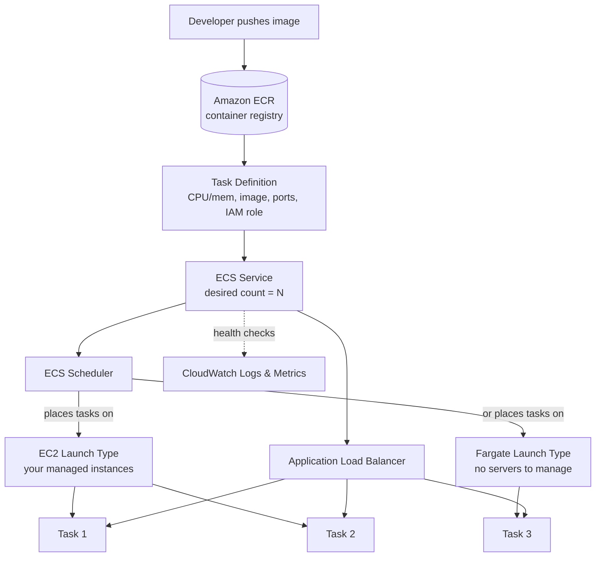

# Amazon Elastic Container Service (ECS)


<!-- AWS Architecture Icons, Containers category; see diagrams/README.md for the convention -->

## Definition

Amazon ECS is a fully managed service from AWS that runs and manages your containers (packaged
applications, usually built with Docker) on a cluster of compute, without you having to build
your own container-orchestration system. You tell it "run 3 copies of this container, keep them
healthy," and ECS does the scheduling, restarting, and load-balancer wiring for you.

## Purpose

Before container orchestrators existed, running containers at scale meant hand-rolling your own
scheduler: deciding which server runs which container, restarting crashed containers, rolling
out new versions without downtime, and wiring up service discovery and load balancing. Google
solved this internally with Borg, which inspired Kubernetes. AWS built ECS as its own
**AWS-native** answer to the same problem — deeply integrated with IAM, VPC, ELB, CloudWatch, and
(critically) Fargate — so teams who don't need Kubernetes's full feature set and complexity can
get container orchestration with a much smaller learning curve and less operational overhead.

## How It Works

Plain explanation: you describe your application as a **Task Definition** (a JSON blueprint: which
container image, how much CPU/memory, which ports, which IAM role). ECS turns that blueprint into
running **Tasks** (one or more containers scheduled together on the same host, like a Kubernetes
Pod). A **Service** keeps a target number of Tasks running, restarts failed ones, and registers
them with a load balancer. All of this runs inside a **Cluster**, which is either a group of EC2
instances you manage (the **EC2 launch type**) or no servers at all (the **Fargate launch type** —
see `fargate.md`).



Step by step:
1. A developer builds a Docker image and pushes it to **Amazon ECR** (AWS's container registry —
   see `ecr.md`).
2. A **Task Definition** references that image plus resource requirements, networking mode, and
   the IAM role the container is allowed to assume.
3. An **ECS Service** is created from that Task Definition with a "desired count" (how many
   copies should always be running).
4. The **ECS Scheduler** decides where to place each Task — either on your own EC2 fleet (you pay
   for and patch the instances) or on Fargate (AWS runs the underlying compute, you just pay per
   task).
5. The **Application Load Balancer** registers each running Task as a target and distributes
   incoming traffic across them.
6. ECS continuously health-checks Tasks; if one crashes or fails a health check, the scheduler
   replaces it automatically to maintain the desired count.
7. Logs and metrics stream to **CloudWatch** for observability.

## Key Features / Components

- **Task Definition** — the blueprint: image, CPU/memory, network mode, port mappings, IAM task
  role, environment variables, logging driver.
- **Task** — one running instance of a Task Definition (one or more tightly-coupled containers).
- **Service** — keeps N Tasks running, handles rolling deployments, integrates with load
  balancers and Service Discovery (Cloud Map).
- **Cluster** — the logical grouping of capacity (EC2 instances or Fargate) that Tasks run on.
- **Launch Types** — `EC2` (you manage the instances, cheaper at scale, more control) vs
  `Fargate` (serverless, no capacity management — see `fargate.md`).
- **Capacity Providers** — let a cluster mix EC2, Fargate, and Fargate Spot, and auto-scale
  capacity to match demand.
- **Service Auto Scaling** — scales the Service's desired count based on CloudWatch metrics (CPU,
  memory, ALB request count).
- **ECS Exec** — `aws ecs execute-command` lets you shell into a running container for debugging,
  without SSH keys or bastion hosts.
- **Deployment circuit breaker** — automatically rolls back a Service deployment if new Tasks
  keep failing health checks.

## Use Cases — When to Use It

- You're already AWS-native (IAM, VPC, ALB, CloudWatch) and don't need Kubernetes's ecosystem of
  third-party tools, operators, and Helm charts — ECS gets you running containers in production
  with far less YAML and fewer moving parts.
- Microservices architectures where each service is an independently deployable container
  (an API service, a worker process consuming from SQS, a scheduled batch job as an ECS Task).
- Lifting a legacy application into containers as a stepping stone toward serverless, without a
  full rewrite.
- Teams that want container orchestration but explicitly do NOT want to operate a Kubernetes
  control plane themselves.
- Batch/cron-style workloads using **ECS Scheduled Tasks** or one-off `RunTask` calls instead of
  a long-running Service.

## When NOT to Use It / Alternatives

- **You need multi-cloud portability or the Kubernetes ecosystem** (Helm, Istio, Argo CD,
  operators written for k8s CRDs) → use **Amazon EKS** instead; ECS's API is AWS-proprietary and
  doesn't run anywhere else.
- **You don't want to think about clusters, instances, or scaling at all, and your workload is a
  single short-lived task or event-driven function** → **AWS Lambda** is simpler and cheaper for
  short, bursty, event-driven work (see `compute/` for Lambda).
- **You need extremely fine-grained control over the underlying OS/kernel, GPUs for specialized
  ML training, or custom networking plugins** → raw **EC2** or **EKS** gives you more low-level
  control than ECS's opinionated task model.
- **Your org already has deep Kubernetes expertise and tooling investment** → standardizing on
  EKS avoids maintaining two different operational mental models.

## Why It's Important

**Real-world weight:** Containers are now the default packaging format for modern applications —
they solve "works on my machine," enable consistent deployments across dev/staging/prod, and let
teams deploy services independently. ECS removes the operational burden of running an
orchestrator yourself, which is a major cost and reliability lever: mis-configured orchestration
is a common source of outages. Getting EC2-vs-Fargate launch type choice right also directly
affects your AWS bill (idle EC2 capacity vs. precise per-task Fargate billing).

**Exam weight — exact mapping:**
- **SAA-C03 Domain 2, Task 2.1** ("Design scalable and loosely coupled architectures") explicitly
  lists containers and ECS/EKS as architecture-level building blocks for decoupled,
  horizontally-scalable systems — expect questions comparing ECS vs. ASG-of-EC2 vs. Lambda for a
  given scaling/coupling scenario.
- **DVA-C03 Domain 1, Task 1.1** ("Develop code for applications hosted on AWS") and **Domain 3,
  Task 3.1/3.3** cover building container images and deploying them via ECS/EKS/Fargate as part
  of a CI/CD pipeline — expect scenario questions about packaging an app as a container and
  wiring up CodeDeploy/CodePipeline to roll it out with blue/green or rolling strategies.
- **MLA-C02 Domain 3, Task 3.3** covers containerizing models (custom inference containers on
  ECR) and orchestrating ML workflow deployment — ECS/Fargate shows up as a lightweight option
  for serving models without the overhead of a full SageMaker endpoint when requirements are
  simpler or cost-sensitive.

## Pricing Model (summary)

- **EC2 launch type**: you pay the normal EC2 instance price for the underlying servers
  (On-Demand, Reserved, Savings Plans, or Spot) — ECS itself adds **no additional charge** for
  orchestration on EC2.
- **Fargate launch type**: billed per-second for the vCPU and memory you reserve in the Task
  Definition, regardless of utilization (see `fargate.md` for details) — no orchestration fee
  either, you just pay for the resources Fargate allocates.
- Data transfer, ALB hours, CloudWatch Logs ingestion/storage, and ECR storage are billed
  separately under their own services.
- Official pricing: https://aws.amazon.com/ecs/pricing/

## Hands-on Lab (Floci)

Floci emulates ECS with real Docker containers backing it, so you can practice the actual
task-definition → service → running-container flow for free, offline. Example using the
`awslocal` alias (`aws --endpoint-url=http://localhost:4566`):

```bash
# 1. Create a cluster
awslocal ecs create-cluster --cluster-name demo-cluster

# 2. Register a task definition (nginx, minimal example)
cat > task-def.json << 'EOF'
{
  "family": "demo-task",
  "containerDefinitions": [{
    "name": "web",
    "image": "nginx:latest",
    "memory": 128,
    "portMappings": [{"containerPort": 80, "hostPort": 80}]
  }]
}
EOF
awslocal ecs register-task-definition --cli-input-json file://task-def.json

# 3. Create a service that keeps 2 tasks running
awslocal ecs create-service \
  --cluster demo-cluster \
  --service-name demo-service \
  --task-definition demo-task \
  --desired-count 2

# 4. List running tasks
awslocal ecs list-tasks --cluster demo-cluster

# 5. Describe the service (check running count, deployments)
awslocal ecs describe-services --cluster demo-cluster --services demo-service
```

See `labs-floci/` for the full domain-mapped lab index. This CLI sequence is identical to what
you'd run against real AWS ECS — only the `--endpoint-url` differs.

## Exam Tips

- **Classic trap — ECS vs EKS vs Fargate**: these are answering two *different* questions.
  ECS vs EKS = *which orchestrator/API* (AWS-proprietary vs Kubernetes-standard). EC2 vs Fargate
  = *who manages the underlying servers* (you vs AWS), and that choice applies to **both** ECS
  and EKS. A question mentioning "Kubernetes-native tooling" or "portability across clouds" →
  EKS. A question mentioning "no desire to manage Kubernetes" or "simplest AWS-native container
  orchestration" → ECS. A question mentioning "no servers to patch/manage" → Fargate (as the
  launch type, independent of ECS vs EKS).
- Keywords pointing to ECS specifically: "AWS-native container orchestration," "Task Definition,"
  "simpler than Kubernetes," "don't want to manage a control plane."
- Remember Service vs Task vs Task Definition vs Cluster — the exam loves testing whether you
  know which layer does what (e.g., "which resource defines desired count?" → Service, not Task
  Definition).
- Shows up in SAA-C03 Domain 2 (architecture), DVA-C03 Domain 1 & 3 (build + deploy), and MLA-C02
  Domain 3 (lightweight model serving/containerized ML workflows).

## Related Terms

- [`eks.md`](eks.md) — Kubernetes-based alternative to ECS
- [`fargate.md`](fargate.md) — the serverless launch type usable by both ECS and EKS
- [`ecr.md`](ecr.md) — where the container images ECS runs come from
- [`containers-vs-vms-vs-serverless.md`](containers-vs-vms-vs-serverless.md) — conceptual
  comparison of the compute models
- `../developer-tools/codedeploy.md` — how ECS Services get updated via blue/green deployments
- `../developer-tools/codepipeline.md` — orchestrating the full CI/CD pipeline that deploys to ECS
