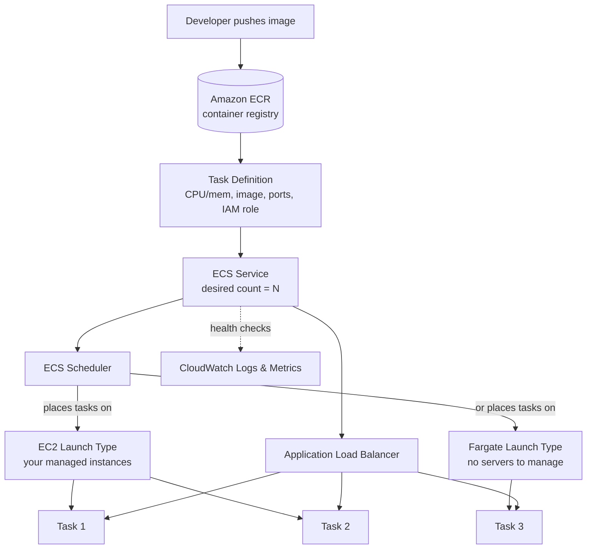
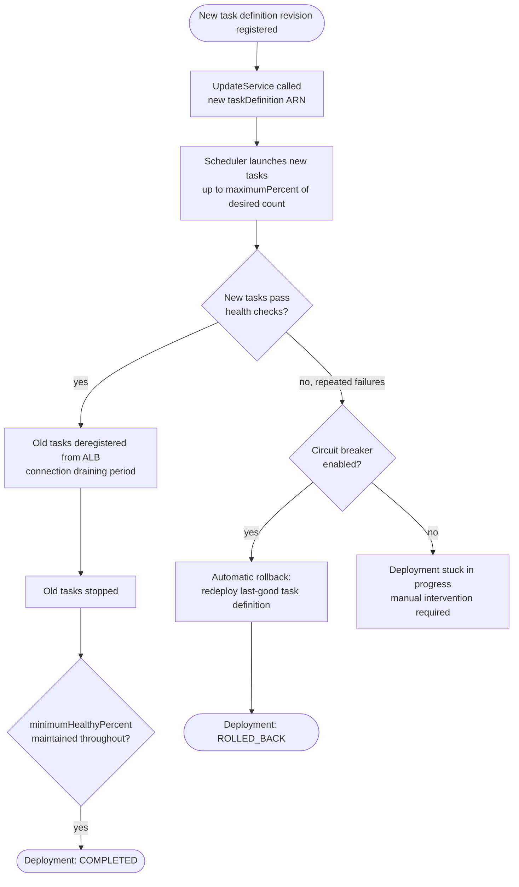
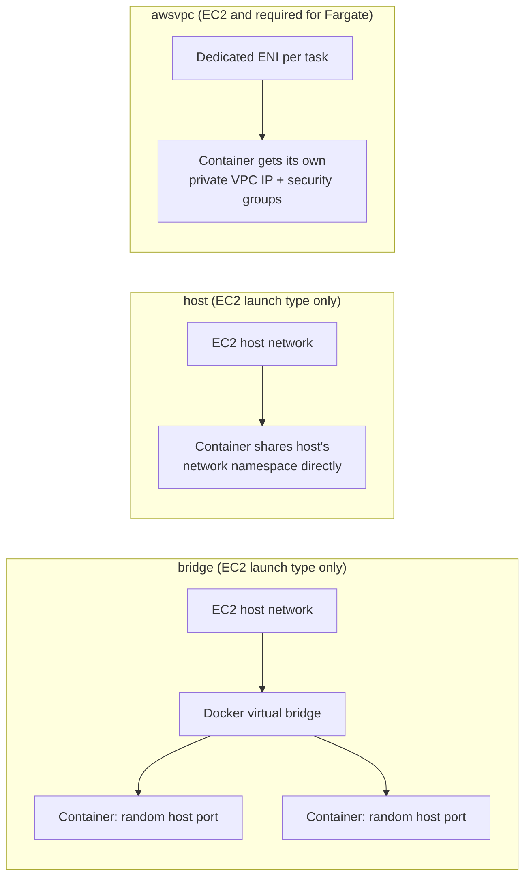
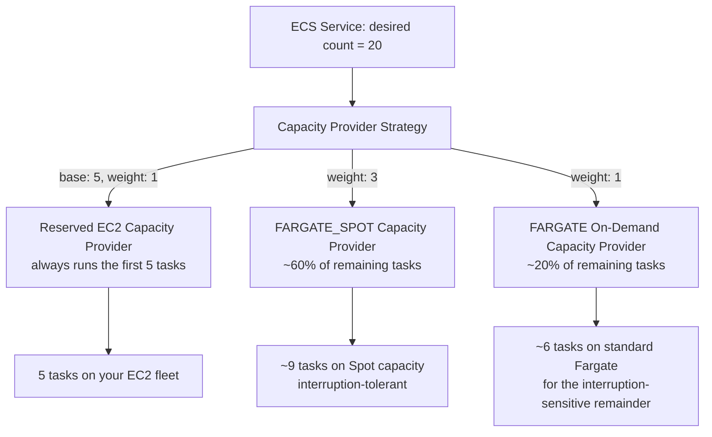

# Amazon Elastic Container Service (ECS)


<!-- AWS Architecture Icons, Containers category; see diagrams/README.md for the convention -->

## Definition

Amazon ECS is a fully managed service from AWS that runs and manages your containers (packaged
applications, usually built with Docker) on a cluster of compute, without you having to build
your own container-orchestration system. You tell it "run 3 copies of this container, keep them
healthy," and ECS does the scheduling, restarting, and load-balancer wiring for you.

## Purpose

Before container orchestrators existed, running containers at scale meant hand-rolling your own
scheduler: deciding which server runs which container, restarting crashed containers, rolling
out new versions without downtime, and wiring up service discovery and load balancing. Google
solved this internally with Borg, which inspired Kubernetes. AWS built ECS as its own
**AWS-native** answer to the same problem — deeply integrated with IAM, VPC, ELB, CloudWatch, and
(critically) Fargate — so teams who don't need Kubernetes's full feature set and complexity can
get container orchestration with a much smaller learning curve and less operational overhead.

ECS predates Kubernetes becoming the industry default (it launched in 2014, the same year
Kubernetes was open-sourced by Google). AWS made a deliberate bet that many customers would prefer
a simpler, deeply AWS-integrated orchestrator over operating a general-purpose, multi-cloud
system — and ECS remains the default recommendation for teams starting fresh on AWS who have no
existing Kubernetes investment.

## How It Works

Plain explanation: you describe your application as a **Task Definition** (a JSON blueprint: which
container image, how much CPU/memory, which ports, which IAM role). ECS turns that blueprint into
running **Tasks** (one or more containers scheduled together on the same host, like a Kubernetes
Pod). A **Service** keeps a target number of Tasks running, restarts failed ones, and registers
them with a load balancer. All of this runs inside a **Cluster**, which is either a group of EC2
instances you manage (the **EC2 launch type**) or no servers at all (the **Fargate launch type** —
see `fargate.md`).



Step by step:
1. A developer builds a Docker image and pushes it to **Amazon ECR** (AWS's container registry —
   see `ecr.md`).
2. A **Task Definition** references that image plus resource requirements, networking mode, and
   the IAM role the container is allowed to assume.
3. An **ECS Service** is created from that Task Definition with a "desired count" (how many
   copies should always be running).
4. The **ECS Scheduler** decides where to place each Task — either on your own EC2 fleet (you pay
   for and patch the instances) or on Fargate (AWS runs the underlying compute, you just pay per
   task).
5. The **Application Load Balancer** registers each running Task as a target and distributes
   incoming traffic across them.
6. ECS continuously health-checks Tasks; if one crashes or fails a health check, the scheduler
   replaces it automatically to maintain the desired count.
7. Logs and metrics stream to **CloudWatch** for observability.

### Real-World Reference Architecture


*Figure: The three logical layers of every ECS deployment — Capacity (the infrastructure, EC2 or
Fargate), Controller (the scheduler that places and manages tasks), and Provisioning (the tools
you use to talk to the scheduler: console, CLI, CloudFormation/CDK, CodePipeline). Source:
[Amazon ECS Developer Guide — "What is Amazon ECS?"](https://docs.aws.amazon.com/AmazonECS/latest/developerguide/Welcome.html), © Amazon Web Services.*

This three-layer mental model is the cleanest way to reason about ECS troubleshooting: a problem
is almost always isolable to exactly one of these layers (capacity not scaling, controller not
placing tasks, or a provisioning tool sending a malformed request), which is exactly how AWS
Support triages ECS tickets.


*Figure: A realistic multi-service ECS application spread across a cluster of EC2 container
instances — Instance 1 runs a front-end and a database container, Instances 2 and 3 run a
front-end and a back-end container each. This is the "group related containers into one Task
Definition, scale each service independently" pattern recommended by AWS. Source:
[Amazon ECS Developer Guide — "Architect for EC2 capacity"](https://docs.aws.amazon.com/AmazonECS/latest/developerguide/launch-type-ec2.html), © Amazon Web Services.*

## Worked Example: A Production-Shaped Task Definition

Below is a task definition close to what you'd actually register for a real web service — not the
minimal nginx example, but one showing the fields the exam (and real production use) actually
cares about: resource limits, IAM task role vs. execution role, secrets from Secrets Manager,
structured logging, and a container-level health check.

```json
{
  "family": "orders-api",
  "networkMode": "awsvpc",
  "requiresCompatibilities": ["FARGATE"],
  "cpu": "512",
  "memory": "1024",
  "executionRoleArn": "arn:aws:iam::123456789012:role/ecsTaskExecutionRole",
  "taskRoleArn": "arn:aws:iam::123456789012:role/ordersApiTaskRole",
  "containerDefinitions": [
    {
      "name": "orders-api",
      "image": "123456789012.dkr.ecr.us-east-1.amazonaws.com/orders-api:v1.4.2",
      "essential": true,
      "portMappings": [
        { "containerPort": 8080, "protocol": "tcp" }
      ],
      "environment": [
        { "name": "NODE_ENV", "value": "production" },
        { "name": "AWS_REGION", "value": "us-east-1" }
      ],
      "secrets": [
        {
          "name": "DB_PASSWORD",
          "valueFrom": "arn:aws:secretsmanager:us-east-1:123456789012:secret:orders-db-pw-AbCdEf"
        }
      ],
      "healthCheck": {
        "command": ["CMD-SHELL", "curl -f http://localhost:8080/healthz || exit 1"],
        "interval": 30,
        "timeout": 5,
        "retries": 3,
        "startPeriod": 60
      },
      "logConfiguration": {
        "logDriver": "awslogs",
        "options": {
          "awslogs-group": "/ecs/orders-api",
          "awslogs-region": "us-east-1",
          "awslogs-stream-prefix": "orders-api"
        }
      }
    }
  ]
}
```

What matters here for the exam and for real debugging:
- **`executionRoleArn` vs. `taskRoleArn`** is the single most-confused pair of fields on this
  exam. The **execution role** is what *ECS itself* assumes to pull the image from ECR, fetch
  secrets from Secrets Manager/Parameter Store, and write logs to CloudWatch — it's
  infrastructure-facing. The **task role** is what *your application code inside the container*
  assumes to call other AWS APIs (e.g., read from S3, write to DynamoDB) — it's
  application-facing. Mixing these up (e.g., putting S3 permissions on the execution role) is a
  classic exam distractor and a classic real "why can't my container reach S3" bug.
- **`secrets` vs. `environment`** — never put a password in `environment` (it's visible in
  `DescribeTaskDefinition` output and CloudTrail); `secrets` injects the value at container start
  time from Secrets Manager or SSM Parameter Store without ever appearing in the task definition
  itself.
- **`healthCheck`** here is a *container-level* Docker health check, distinct from the ALB target
  group health check — ECS uses this to decide if a task is healthy enough to keep running, even
  before the load balancer gets involved.
- **`awsvpc` + `FARGATE`** together mean this task gets its own ENI with a real VPC IP — this is
  mandatory for Fargate and optional (but best practice) for EC2 launch type.

### Worked Example: Service Definition with Deployment Circuit Breaker

```json
{
  "serviceName": "orders-api-svc",
  "cluster": "prod-cluster",
  "taskDefinition": "orders-api:14",
  "desiredCount": 6,
  "launchType": "FARGATE",
  "networkConfiguration": {
    "awsvpcConfiguration": {
      "subnets": ["subnet-aaa111", "subnet-bbb222"],
      "securityGroups": ["sg-0123456789abcdef0"],
      "assignPublicIp": "DISABLED"
    }
  },
  "loadBalancers": [
    {
      "targetGroupArn": "arn:aws:elasticloadbalancing:us-east-1:123456789012:targetgroup/orders-api-tg/abc123",
      "containerName": "orders-api",
      "containerPort": 8080
    }
  ],
  "deploymentConfiguration": {
    "maximumPercent": 200,
    "minimumHealthyPercent": 100,
    "deploymentCircuitBreaker": {
      "enable": true,
      "rollback": true
    }
  }
}
```

`maximumPercent: 200` / `minimumHealthyPercent: 100` describes a **rolling deployment** that never
drops below 100% of desired capacity while allowing up to double capacity mid-rollout — the
default, cost-neutral-ish rolling strategy for EC2/Fargate services that aren't using CodeDeploy
blue/green. `deploymentCircuitBreaker` is the feature that makes ECS **self-healing on bad
deploys**: if new tasks keep failing to reach a steady, healthy state, ECS automatically stops the
rollout and rolls back to the last known-good task definition revision — no human, no alarm
configuration required, which is different from (and simpler than) CodeDeploy's alarm-driven
rollback.

## Full ECS Service Deployment Flow (Rolling Update with Circuit Breaker)



Walkthrough: the scheduler never does a hard cutover. It launches new tasks *alongside* the old
ones (bounded by `maximumPercent`), waits for them to become healthy in the target group, drains
connections from the old tasks gracefully, then terminates them — all while never dropping below
`minimumHealthyPercent` of the desired count. The circuit breaker is the safety net: if the new
revision simply can't reach a steady healthy state (crash-looping, failing health checks), ECS
gives up automatically and reverts, rather than leaving the service in a half-migrated, flapping
state indefinitely.

## ECS Task Networking Modes



- **`bridge`** — the Docker default; containers share the host's network stack through a virtual
  bridge, with ports mapped (often dynamically) to the host. Security groups apply to the *host*,
  not the individual container — a real limitation for multi-tenant task placement.
- **`host`** — the container uses the host's network namespace directly, no port mapping at all;
  fastest networking, but at most one task per host can bind a given port, and you lose any
  container-level network isolation.
- **`awsvpc`** — every task gets its *own* elastic network interface (ENI) with its own private IP
  address inside your VPC, and its own security group assignment. This is **mandatory for
  Fargate** (there is no host for Fargate tasks to share) and is the AWS-recommended mode for EC2
  launch type too, because it gives you per-task security groups and makes ECS tasks look and
  behave like first-class VPC citizens — the same mental model EKS uses for Pods via the VPC CNI.

## Capacity Provider Strategy Flow



Walkthrough: `base` guarantees a minimum number of tasks always land on a specific capacity
provider (commonly used to keep a steady floor on cheaper Reserved EC2 capacity), while `weight`
distributes everything above that floor proportionally across the remaining providers. This single
feature is how production ECS clusters achieve the "mostly Reserved EC2 for the steady baseline,
burst to Fargate/Fargate Spot for spikes" cost pattern described in the Common Architectures
section above, entirely declaratively — the scheduler does the placement math, you just define the
ratios.

## Frequently Confused ECS Concepts (Quick-Reference)

- **"Desired count" lives on the Service, not the Task Definition.** The Task Definition is a
  stateless blueprint — it has no opinion about how many copies should run. Only the Service (or a
  one-off `RunTask` call) specifies a count.
- **A Task Definition revision is immutable once registered.** "Updating" a task definition always
  creates a brand-new revision number (`family:revision`, e.g. `orders-api:15`); you cannot edit
  revision 14 in place. Deployments always reference a specific revision (or the family name,
  which resolves to the latest active revision).
- **Stopping a task is not the same as deleting a service.** `StopTask` kills one running task
  (which the Service will immediately replace to maintain desired count, if the Service calling it
  still wants that many); deleting the Service stops replacing tasks and tears everything down.
- **A cluster has no inherent compute of its own.** An ECS "Cluster" is purely a logical namespace
  — it only has capacity once you register EC2 instances into it (via the ECS agent) or associate
  Fargate capacity providers with it.
- **ECS Exec is not SSH.** It tunnels through AWS Systems Manager Session Manager — no bastion
  host, no SSH key, no inbound port opened on the task — which is also why it requires specific
  IAM permissions and SSM agent connectivity, not just network reachability.

## Key Features / Components

- **Task Definition** — the blueprint: image, CPU/memory, network mode, port mappings, IAM task
  role, environment variables, logging driver.
- **Task** — one running instance of a Task Definition (one or more tightly-coupled containers).
- **Service** — keeps N Tasks running, handles rolling deployments, integrates with load
  balancers and Service Discovery (Cloud Map).
- **Cluster** — the logical grouping of capacity (EC2 instances or Fargate) that Tasks run on.
- **Launch Types** — `EC2` (you manage the instances, cheaper at scale, more control) vs
  `Fargate` (serverless, no capacity management — see `fargate.md`).
- **Capacity Providers** — let a cluster mix EC2, Fargate, and Fargate Spot, and auto-scale
  capacity to match demand.
- **Service Auto Scaling** — scales the Service's desired count based on CloudWatch metrics (CPU,
  memory, ALB request count).
- **ECS Exec** — `aws ecs execute-command` lets you shell into a running container for debugging,
  without SSH keys or bastion hosts.
- **Deployment circuit breaker** — automatically rolls back a Service deployment if new Tasks
  keep failing health checks.
- **Service Connect** — a newer, simpler service-discovery and inter-service traffic management
  layer than the older Service Discovery/Cloud Map, giving built-in traffic metrics and retry
  behavior between ECS services without a service mesh.
- **ECS Anywhere** — run the same ECS control plane and Task Definition model against your own
  on-premises servers, for hybrid workloads that can't fully move to AWS compute.

## Use Cases — When to Use It

- You're already AWS-native (IAM, VPC, ALB, CloudWatch) and don't need Kubernetes's ecosystem of
  third-party tools, operators, and Helm charts — ECS gets you running containers in production
  with far less YAML and fewer moving parts.
- Microservices architectures where each service is an independently deployable container
  (an API service, a worker process consuming from SQS, a scheduled batch job as an ECS Task).
- Lifting a legacy application into containers as a stepping stone toward serverless, without a
  full rewrite.
- Teams that want container orchestration but explicitly do NOT want to operate a Kubernetes
  control plane themselves.
- Batch/cron-style workloads using **ECS Scheduled Tasks** or one-off `RunTask` calls instead of
  a long-running Service.
- High-throughput, cost-sensitive data processing pipelines (ETL jobs, document processing) that
  need to scale containers up and down fast without Kubernetes's control-plane overhead for
  simple scheduling needs.

## When NOT to Use It / Alternatives

- **You need multi-cloud portability or the Kubernetes ecosystem** (Helm, Istio, Argo CD,
  operators written for k8s CRDs) → use **Amazon EKS** instead; ECS's API is AWS-proprietary and
  doesn't run anywhere else.
- **You don't want to think about clusters, instances, or scaling at all, and your workload is a
  single short-lived task or event-driven function** → **AWS Lambda** is simpler and cheaper for
  short, bursty, event-driven work (see `compute/` for Lambda).
- **You need extremely fine-grained control over the underlying OS/kernel, GPUs for specialized
  ML training, or custom networking plugins** → raw **EC2** or **EKS** gives you more low-level
  control than ECS's opinionated task model.
- **Your org already has deep Kubernetes expertise and tooling investment** → standardizing on
  EKS avoids maintaining two different operational mental models.

## Common Architectures

**1. Public-facing web API behind an ALB (the "hello world" production pattern)**
Internet → Route 53 → Application Load Balancer (public subnet) → ECS Service on Fargate (private
subnet, `awsvpc` mode) → RDS/DynamoDB in private subnet. This is the default starting point for
almost any containerized web service and is exactly what the DVA-C03 exam expects you to
recognize as "the standard ECS web app shape."

**2. Internal microservices mesh with Service Connect**
Multiple ECS services in the same cluster talk to each other by service name (not hardcoded IPs or
raw DNS) via **ECS Service Connect**, which also emits per-service request/latency/error metrics
automatically to CloudWatch — a lighter-weight alternative to running a full service mesh (App
Mesh/Istio) when you don't need mTLS between every hop.

**3. Mixed EC2 + Fargate + Fargate Spot capacity via Capacity Providers**
A single cluster with a **Capacity Provider Strategy** that places baseline, steady traffic on
Reserved EC2 instances (cheapest for predictable load), bursts to on-demand Fargate when EC2
capacity is exhausted, and routes fault-tolerant background work to Fargate Spot — all defined
declaratively on the Service, with ECS handling the actual placement decisions.

**4. Scheduled batch jobs via EventBridge + RunTask**
An EventBridge scheduled rule triggers `ecs:RunTask` directly (no long-running Service needed) to
run a nightly report-generation or data-sync container that starts, does its work, and exits —
the ECS-native equivalent of a cron job, billed only for the minutes it actually runs on Fargate.

**5. Blue/green production releases via CodeDeploy**
CodePipeline → CodeBuild (build + push image to ECR) → CodeDeploy ECS blue/green deployment
(stands up a parallel task set, shifts ALB traffic via a test listener and then the production
listener, keeps the old task set warm briefly for instant rollback). See `codedeploy.md` for the
full mechanics.

## Why It's Important

**Real-world weight:** Containers are now the default packaging format for modern applications —
they solve "works on my machine," enable consistent deployments across dev/staging/prod, and let
teams deploy services independently. ECS removes the operational burden of running an
orchestrator yourself, which is a major cost and reliability lever: mis-configured orchestration
is a common source of outages. Getting EC2-vs-Fargate launch type choice right also directly
affects your AWS bill (idle EC2 capacity vs. precise per-task Fargate billing).

**Exam weight — exact mapping:**
- **SAA-C03 Domain 2, Task 2.1** ("Design scalable and loosely coupled architectures") explicitly
  lists containers and ECS/EKS as architecture-level building blocks for decoupled,
  horizontally-scalable systems — expect questions comparing ECS vs. ASG-of-EC2 vs. Lambda for a
  given scaling/coupling scenario.
- **SAA-C03 Domain 2, Task 2.2** ("Design highly available and/or fault-tolerant architectures")
  tests whether you know ECS Services spread tasks across multiple AZs by default when you
  configure multiple subnets, and that the deployment circuit breaker is a fault-tolerance feature
  in its own right, not just a convenience.
- **DVA-C03 Domain 1, Task 1.1** ("Develop code for applications hosted on AWS") and **Domain 3,
  Task 3.1/3.3** cover building container images and deploying them via ECS/EKS/Fargate as part
  of a CI/CD pipeline — expect scenario questions about packaging an app as a container and
  wiring up CodeDeploy/CodePipeline to roll it out with blue/green or rolling strategies.
- **MLA-C02 Domain 3, Task 3.3** covers containerizing models (custom inference containers on
  ECR) and orchestrating ML workflow deployment — ECS/Fargate shows up as a lightweight option
  for serving models without the overhead of a full SageMaker endpoint when requirements are
  simpler or cost-sensitive.

### Expanded Exam Scenarios

**DVA-C03 Domain 3 scenario:** "A developer needs to deploy a new version of a containerized
application to an ECS service with zero downtime, automatically rolling back if the new version's
health checks fail for more than a few minutes, without configuring any CloudWatch alarms." →
Answer: enable the **ECS deployment circuit breaker with rollback** on the service's
`deploymentConfiguration` — this is the one ECS-native self-healing mechanism that needs *no*
external alarm wiring, unlike CodeDeploy's alarm-based rollback.

**DVA-C03 Domain 3 scenario:** "An application container needs to read a database password at
startup without it ever appearing in the task definition JSON or CloudTrail logs." → Answer: use
the `secrets` block in the container definition, pointing at a Secrets Manager ARN, with the
**execution role** (not the task role) granted `secretsmanager:GetSecretValue`.

**SAA-C03 Domain 2 scenario:** "A company runs a steady-state, predictable container workload at
high scale and a separate bursty, unpredictable workload on the same platform, and wants to
minimize cost across both." → Answer: a single ECS cluster using a **Capacity Provider Strategy**
mixing Reserved/On-Demand EC2 for the steady baseline and Fargate (or Fargate Spot for
interruption-tolerant portions) for the bursty portion — not two separate clusters, and not
Fargate for everything (which would overpay on the steady-state part).

**SAA-C03 Domain 2 scenario:** "An architecture needs each container to have its own IP address,
its own security group, and to be directly addressable within the VPC, similar to an EC2
instance." → Answer: `awsvpc` network mode — this is the differentiator question between
`bridge`/`host` (shared host networking) and `awsvpc` (per-task ENI).

## Limits & Quotas

These are the defaults as of this writing — always check the
[official ECS service quotas page](https://docs.aws.amazon.com/AmazonECS/latest/developerguide/service-quotas.html)
before relying on an exact number, since AWS raises soft limits over time and some are
account-specific:

| Quota | Default | Adjustable? |
|---|---|---|
| Clusters per account (per Region) | 10,000 | Yes, via Service Quotas |
| Services per cluster | 5,000 | Yes |
| Tasks per service | 5,000 | Yes |
| Container instances per cluster (EC2 launch type) | 5,000 | Yes |
| Task definitions (active revisions) per family | 1,000,000 | No (very high ceiling) |
| Containers per task definition | 10 | No |
| `awsvpc` ENIs per task | 1 (one ENI shared by all containers in the task) | Fixed by design |
| CPU units per Fargate task | 16 vCPU (platform-dependent max) | Fixed by Fargate size table |
| Memory per Fargate task | Up to 120 GB (platform-dependent max) | Fixed by Fargate size table |

**Exam-relevant takeaway:** the exam doesn't usually ask you to memorize exact numbers, but it
does test whether you know these are **soft limits you can request increases for** via Service
Quotas (not hard ceilings requiring an architecture redesign) — a common distractor is "you must
split into multiple accounts" when "request a quota increase" is the actually-correct, much
simpler answer.

## Troubleshooting / Common Issues

- **Task stuck in `PENDING`, never reaches `RUNNING`** — almost always a networking problem for
  Fargate/`awsvpc` tasks: the subnet has no route to pull the image (no NAT Gateway for a private
  subnet, or no VPC endpoint for ECR), or the security group blocks outbound HTTPS. Check
  `stoppedReason` via `DescribeTasks` first.
- **Task starts then immediately stops (`CannotPullContainerError`)** — the execution role lacks
  `ecr:GetAuthorizationToken` / `ecr:BatchGetImage` / `ecr:GetDownloadUrlForLayer`, or the image
  URI/tag is wrong, or (for private images) there's no network path to ECR.
  `ResourceInitializationError` pointing at Secrets Manager means the execution role lacks
  `secretsmanager:GetSecretValue` for that specific secret ARN.
  "stopped reason" inspection with `aws ecs describe-tasks` is the first diagnostic step.
  Also unverified for container
  code bugs — check CloudWatch Logs under the configured `awslogs-group` next.
- **Service stuck "in progress" forever, never reaches steady state** — new tasks are failing
  health checks repeatedly; without the **deployment circuit breaker** enabled, ECS will keep
  retrying indefinitely rather than rolling back automatically. Enable the circuit breaker, or
  manually force a rollback to the previous task definition revision.
- **ALB returns 503/no healthy targets** — the container's health check path/port doesn't match
  the target group's configured health check, or the security group on the task doesn't allow
  inbound traffic from the ALB's security group (a very common "forgot to add the SG rule"
  misconfiguration).
- **"ResourceNotFoundException" when updating a service** — the task definition family/revision
  referenced doesn't exist or was deregistered; always reference a specific revision (or `:latest`
  carefully) rather than assuming a prior deploy's revision number still exists.
- **Tasks evicted unexpectedly on EC2 launch type** — the cluster's EC2 instances ran out of
  CPU/memory for the Task Definition's reservations; check Capacity Provider auto-scaling
  configuration, or that the Auto Scaling Group has room to launch more instances.
- **ECS Exec ("shell into a running container") fails** — requires the task role to have the SSM
  messaging permissions, the task definition's `enableExecuteCommand` flag set at service creation
  time (it can't be toggled on an already-running task), and the Session Manager plugin installed
  locally.

## Pricing Model (summary)

- **EC2 launch type**: you pay the normal EC2 instance price for the underlying servers
  (On-Demand, Reserved, Savings Plans, or Spot) — ECS itself adds **no additional charge** for
  orchestration on EC2.
- **Fargate launch type**: billed per-second for the vCPU and memory you reserve in the Task
  Definition, regardless of utilization (see `fargate.md` for details) — no orchestration fee
  either, you just pay for the resources Fargate allocates.
- Data transfer, ALB hours, CloudWatch Logs ingestion/storage, and ECR storage are billed
  separately under their own services.
- Official pricing: https://aws.amazon.com/ecs/pricing/

## Hands-on Lab (Floci)

Floci emulates ECS with real Docker containers backing it, so you can practice the actual
task-definition → service → running-container flow for free, offline. Example using the
`awslocal` alias (`aws --endpoint-url=http://localhost:4566`):

```bash
# 1. Create a cluster
awslocal ecs create-cluster --cluster-name demo-cluster

# 2. Register a task definition (nginx, minimal example)
cat > task-def.json << 'EOF'
{
  "family": "demo-task",
  "containerDefinitions": [{
    "name": "web",
    "image": "nginx:latest",
    "memory": 128,
    "portMappings": [{"containerPort": 80, "hostPort": 80}]
  }]
}
EOF
awslocal ecs register-task-definition --cli-input-json file://task-def.json

# 3. Create a service that keeps 2 tasks running
awslocal ecs create-service \
  --cluster demo-cluster \
  --service-name demo-service \
  --task-definition demo-task \
  --desired-count 2

# 4. List running tasks
awslocal ecs list-tasks --cluster demo-cluster

# 5. Describe the service (check running count, deployments)
awslocal ecs describe-services --cluster demo-cluster --services demo-service

# 6. Simulate a rolling deployment to a new task definition revision
awslocal ecs register-task-definition --cli-input-json file://task-def-v2.json
awslocal ecs update-service \
  --cluster demo-cluster \
  --service demo-service \
  --task-definition demo-task:2 \
  --force-new-deployment

# 7. Scale the service via Service Auto Scaling target tracking (concept practice;
#    Floci's autoscaling emulation is partial, so verify manually with describe-services)
awslocal application-autoscaling register-scalable-target \
  --service-namespace ecs \
  --resource-id service/demo-cluster/demo-service \
  --scalable-dimension ecs:service:DesiredCount \
  --min-capacity 2 --max-capacity 10
```

See `labs-floci/` for the full domain-mapped lab index. This CLI sequence is identical to what
you'd run against real AWS ECS — only the `--endpoint-url` differs.

## Exam Tips

- **Classic trap — ECS vs EKS vs Fargate**: these are answering two *different* questions.
  ECS vs EKS = *which orchestrator/API* (AWS-proprietary vs Kubernetes-standard). EC2 vs Fargate
  = *who manages the underlying servers* (you vs AWS), and that choice applies to **both** ECS
  and EKS. A question mentioning "Kubernetes-native tooling" or "portability across clouds" →
  EKS. A question mentioning "no desire to manage Kubernetes" or "simplest AWS-native container
  orchestration" → ECS. A question mentioning "no servers to patch/manage" → Fargate (as the
  launch type, independent of ECS vs EKS).
- Keywords pointing to ECS specifically: "AWS-native container orchestration," "Task Definition,"
  "simpler than Kubernetes," "don't want to manage a control plane."
- Remember Service vs Task vs Task Definition vs Cluster — the exam loves testing whether you
  know which layer does what (e.g., "which resource defines desired count?" → Service, not Task
  Definition).
- **Execution role vs. task role** is tested directly and is a frequent source of wrong answers —
  memorize: execution role = ECS pulling images/secrets/writing logs; task role = your app code
  calling AWS APIs.
- The **deployment circuit breaker** is an ECS-native, alarm-free rollback mechanism — don't
  confuse it with CodeDeploy's CloudWatch-alarm-triggered rollback, which is a separate mechanism
  used specifically for blue/green deployments.
- Shows up in SAA-C03 Domain 2 (architecture), DVA-C03 Domain 1 & 3 (build + deploy), and MLA-C02
  Domain 3 (lightweight model serving/containerized ML workflows).

## Further Reading

- [What is Amazon Elastic Container Service?](https://docs.aws.amazon.com/AmazonECS/latest/developerguide/Welcome.html) — official developer guide, including the three-layer architecture model
- [Amazon ECS task definitions](https://docs.aws.amazon.com/AmazonECS/latest/developerguide/task_definitions.html) — the full task definition parameter reference
- [Amazon ECS service quotas](https://docs.aws.amazon.com/AmazonECS/latest/developerguide/service-quotas.html) — current, authoritative limits
- [Amazon ECS deployment types](https://docs.aws.amazon.com/AmazonECS/latest/developerguide/deployment-types.html) — rolling, blue/green, and external deployment controllers compared
- [AWS Compute Blog — Building Blocks of Amazon ECS](https://aws.amazon.com/blogs/compute/building-blocks-of-amazon-ecs/) — a plain-English tour of containers, tasks, clusters, and services
- [AWS Blue/Green Deployments to Amazon ECS using CloudFormation and CodeDeploy](https://aws.amazon.com/blogs/devops/blue-green-deployments-to-amazon-ecs-using-aws-cloudformation-and-aws-codedeploy/) — a full reference CI/CD pipeline for ECS

## Related Terms

- [`eks.md`](eks.md) — Kubernetes-based alternative to ECS
- [`fargate.md`](fargate.md) — the serverless launch type usable by both ECS and EKS
- [`ecr.md`](ecr.md) — where the container images ECS runs come from
- [`containers-vs-vms-vs-serverless.md`](containers-vs-vms-vs-serverless.md) — conceptual
  comparison of the compute models
- `../developer-tools/codedeploy.md` — how ECS Services get updated via blue/green deployments
- `../developer-tools/codepipeline.md` — orchestrating the full CI/CD pipeline that deploys to ECS
- `../developer-tools/codebuild.md` — builds and pushes the image ECS pulls at deploy time
