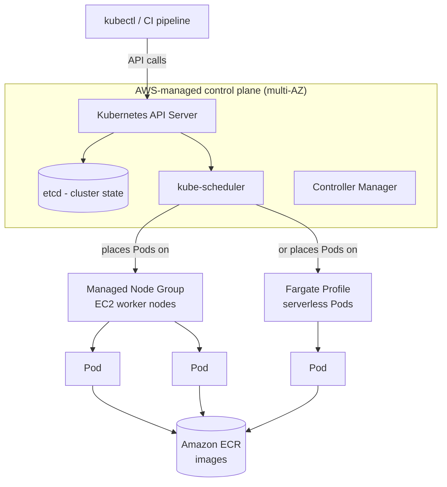
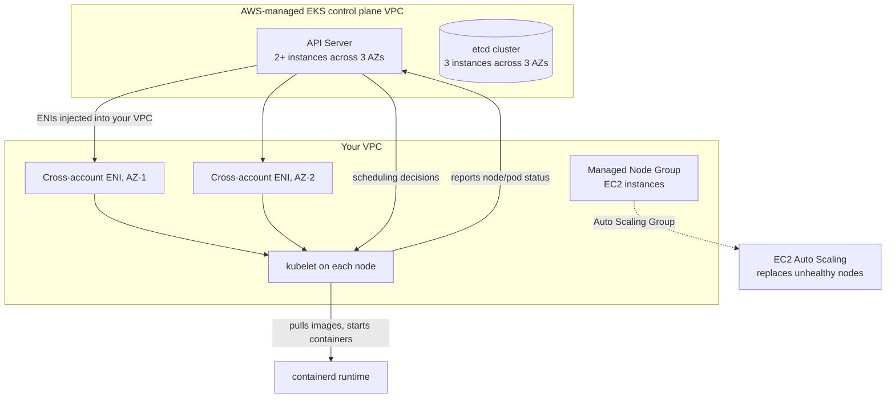
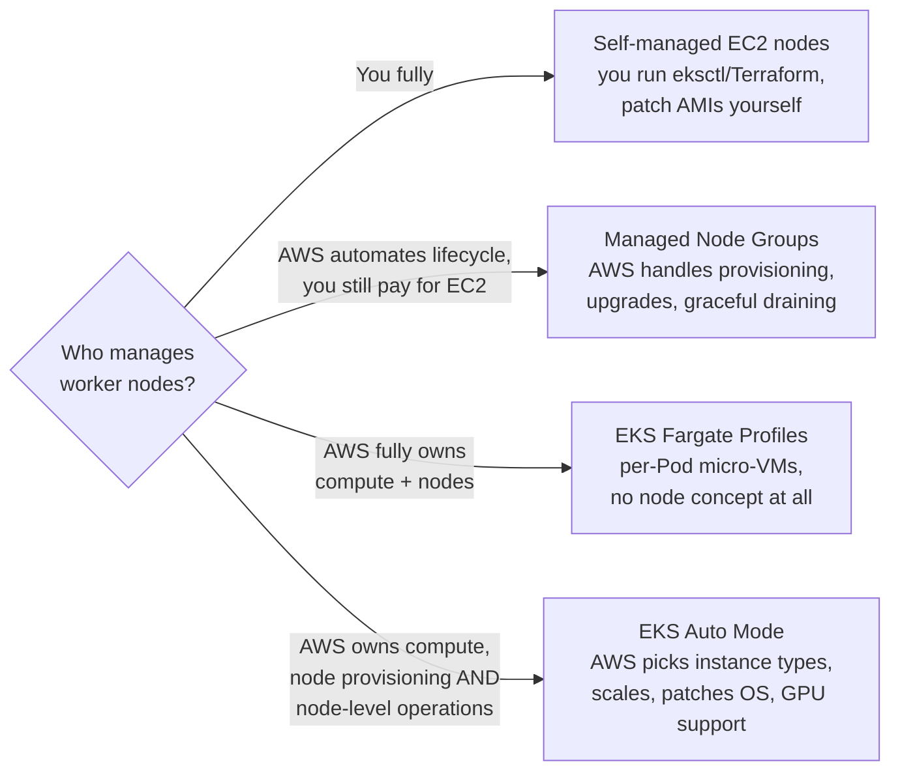
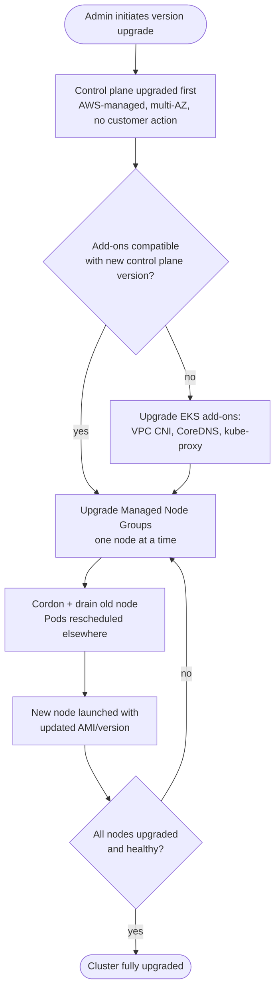

# Amazon Elastic Kubernetes Service (EKS)

> **Appears in:** [DVA-C03](../../certifications/dva-c03/README.md) · [MLA-C02](../../certifications/mla-c02/README.md) · [SAA-C03](../../certifications/saa-c03/README.md)


<!-- AWS Architecture Icons, Containers category; see diagrams/README.md for the convention -->

## Definition

Amazon EKS is a fully managed service that runs **upstream, certified Kubernetes** for you on
AWS. Kubernetes is the open-source industry-standard system for running and managing containers
at scale; EKS takes away the painful part — running and patching the Kubernetes control plane
(the "brain" that schedules and manages everything) — while you keep the standard Kubernetes API,
tooling, and ecosystem.

## Purpose

Kubernetes became the de-facto standard for container orchestration across the industry — not
just AWS. Many organizations already have Kubernetes expertise, Helm charts, operators, and
multi-cloud or on-prem Kubernetes clusters, and want the *same* API and tooling on AWS rather than
learning AWS's own proprietary orchestrator (ECS). Running Kubernetes' control plane yourself
(etcd, API server, scheduler, controller manager) is genuinely hard to do reliably and securely.
EKS exists so you get real, conformant Kubernetes with AWS managing the hardest, most
failure-sensitive part for you, plus deep integration with IAM, VPC networking (via the AWS VPC
CNI plugin), and other AWS services.

AWS is a member of the Cloud Native Computing Foundation (CNCF) and ensures EKS passes the
official Kubernetes conformance tests for every supported version — meaning a Helm chart, a
`kubectl` manifest, or an Operator that works on GKE or self-managed Kubernetes works on EKS
unmodified. This conformance guarantee is EKS's entire value proposition versus ECS: you are never
locked into an AWS-proprietary API at the workload-definition layer, only at the infrastructure
layer (how the control plane and nodes are provisioned and billed).

## How It Works

Plain explanation: AWS runs and manages the Kubernetes **control plane** (API server, etcd,
scheduler) for you across multiple Availability Zones for high availability. You only manage the
**data plane** — the worker nodes that actually run your containers (Pods) — and even those can be
fully serverless via **EKS Fargate profiles**, or managed semi-automatically via **Managed Node
Groups**, or fully manually via self-managed EC2 nodes, or (newest) handed off entirely to AWS via
**EKS Auto Mode**.



Step by step:
1. You (or a CI/CD pipeline) talk to the cluster via `kubectl`/the Kubernetes API — standard
   Kubernetes manifests (Deployments, Services, Ingress), no AWS-specific syntax required.
2. AWS runs the **control plane** (API server, etcd, scheduler, controller manager) across
   multiple AZs; you don't manage or patch these components — that's the entire value proposition.
3. The **scheduler** decides which worker node runs which Pod, based on resource requests and
   constraints, exactly like standard Kubernetes.
4. Worker capacity is either a **Managed Node Group** (AWS automates provisioning/updating EC2
   nodes, you still pay for the instances), self-managed EC2, or a **Fargate profile** (fully
   serverless Pods, no nodes at all).
5. Pods pull container images from **Amazon ECR** (or any registry reachable from the VPC).
6. The AWS VPC CNI plugin gives each Pod a real VPC IP address, so standard AWS networking
   constructs (security groups, VPC endpoints) apply directly to Pods.

### Real-World Reference Architecture


*Figure: A legacy-application-modernization reference architecture showing EKS clusters for
dev/test/production, fronted by a Network Load Balancer and Route 53, with a complete CI/CD
pipeline: a developer commits to CodeCommit, which triggers CodePipeline; CodeBuild builds and
pushes a Docker image to ECR, then uses `kubectl` to update the image tag in the Kubernetes
Deployment manifest, which triggers a native Kubernetes rolling update of the Pods. Source:
[AWS Reference Architecture Diagrams — "Modernize Applications with Microservices Using Amazon EKS"](https://docs.aws.amazon.com/reference-architecture-diagrams/latest/modernize-applications-with-microservices-using-amazon-eks/modernize-applications-with-microservices-using-amazon-eks.html), © Amazon Web Services.*

Notice step 10/11 in that reference architecture: CodeBuild doesn't call an AWS container API to
redeploy — it runs `kubectl set image` (or applies an updated manifest) against the Kubernetes
API server, and *Kubernetes itself* performs the rolling update. This is the core practical
difference from ECS: with EKS, your CI/CD pipeline's deploy step ends at "tell Kubernetes what I
want," and Kubernetes' own reconciliation loop does the rest — AWS CodeDeploy is not typically in
the loop for native Kubernetes-manifest deployments (CodeDeploy's ECS and Lambda compute platforms
don't include an EKS-native integration the way they do for ECS task sets).

## Worked Example: A Production Pod Spec and Deployment

```yaml
apiVersion: apps/v1
kind: Deployment
metadata:
  name: orders-api
  namespace: production
spec:
  replicas: 6
  selector:
    matchLabels:
      app: orders-api
  strategy:
    type: RollingUpdate
    rollingUpdate:
      maxSurge: 2
      maxUnavailable: 0
  template:
    metadata:
      labels:
        app: orders-api
    spec:
      serviceAccountName: orders-api-sa
      containers:
        - name: orders-api
          image: 123456789012.dkr.ecr.us-east-1.amazonaws.com/orders-api:v1.4.2
          ports:
            - containerPort: 8080
          resources:
            requests:
              cpu: "250m"
              memory: "256Mi"
            limits:
              cpu: "500m"
              memory: "512Mi"
          readinessProbe:
            httpGet:
              path: /healthz
              port: 8080
            initialDelaySeconds: 10
            periodSeconds: 10
          livenessProbe:
            httpGet:
              path: /healthz
              port: 8080
            initialDelaySeconds: 30
            periodSeconds: 20
          envFrom:
            - secretRef:
                name: orders-api-secrets
---
apiVersion: v1
kind: ServiceAccount
metadata:
  name: orders-api-sa
  namespace: production
  annotations:
    eks.amazonaws.com/role-arn: arn:aws:iam::123456789012:role/orders-api-irsa-role
---
apiVersion: v1
kind: Service
metadata:
  name: orders-api-svc
  namespace: production
spec:
  selector:
    app: orders-api
  ports:
    - port: 80
      targetPort: 8080
  type: ClusterIP
```

What matters here versus an ECS task definition:
- **`resources.requests` vs. `resources.limits`** is the Kubernetes equivalent of ECS's single
  CPU/memory reservation, but split in two: `requests` is what the scheduler uses to decide node
  placement (guaranteed minimum), `limits` is the hard ceiling the container is throttled/OOM-killed
  at. ECS's Fargate model collapses these into one number; Kubernetes gives you a burst range.
- **`readinessProbe` vs. `livenessProbe`** is the Kubernetes analogue of ECS's single
  `healthCheck`, but split by *purpose*: readiness controls whether the Pod receives traffic right
  now (a Pod can be "alive but not ready," e.g., still warming a cache); liveness controls whether
  Kubernetes should kill and restart the container entirely. Confusing these two is a very common
  real-world Kubernetes bug (a failing liveness probe during a slow startup causes a restart loop
  that readiness alone would have handled gracefully).
- **`serviceAccountName` + the `eks.amazonaws.com/role-arn` annotation** is **IRSA** (IAM Roles
  for Service Accounts) — the EKS equivalent of ECS's task role. It lets *this specific Pod*
  assume a scoped IAM role, instead of giving the whole worker node broad permissions that every
  Pod scheduled on it would inherit.
- There is no "execution role" concept in Kubernetes — pulling images from ECR is handled by the
  **node's** IAM role (or an image pull secret), which is architecturally closer to ECS's EC2
  launch type (where the instance profile grants ECR pull access) than to ECS's per-task execution
  role model.

## EKS Control-Plane-to-Worker-Node Flow (Detailed)



Walkthrough: the control plane doesn't live in *your* VPC at all — it lives in an
AWS-owned, AWS-managed VPC, and reaches into your VPC via **cross-account elastic network
interfaces (ENIs)** that EKS provisions in your subnets at cluster creation. This is why creating
an EKS cluster asks for subnet IDs even though you never see or manage the control plane's actual
compute: those ENIs are the only network path between the API server and your worker nodes'
`kubelet` processes. The worker nodes themselves sit in an EC2 Auto Scaling Group (for Managed
Node Groups), which EKS automates the lifecycle of — draining and replacing nodes during version
upgrades, for example — without you writing the underlying Auto Scaling configuration by hand.

## EKS Compute Options Compared



- **Self-managed nodes** — maximum control (custom AMIs, kernel modules, specific instance
  families) at maximum operational cost; you own AMI patch cadence and node lifecycle entirely.
- **Managed Node Groups** — AWS automates EC2 provisioning and the mechanics of rolling node
  upgrades/replacements, but you still choose instance types and still pay standard EC2 pricing;
  the most common production choice when you need more node-level control than Fargate allows
  (e.g., DaemonSets, GPU instances, specific storage drivers).
- **Fargate profiles** — no node concept exists at all; each Pod gets its own right-sized
  micro-VM, billed per-second like ECS Fargate. Limitations: no DaemonSets, no privileged
  containers, no GPU support (historically), and every Pod matching a Fargate profile's selector
  criteria (namespace + optional labels) runs on Fargate.
- **EKS Auto Mode** (newer) — extends AWS management into the data plane itself: AWS picks
  instance types, handles autoscaling, OS patching, and even built-in load balancing/DNS/storage
  components, aiming to reduce EKS's operational surface closer to ECS Fargate's simplicity while
  keeping the full Kubernetes API.

## EKS Cluster Upgrade Flow



Walkthrough: EKS enforces upgrading the **control plane before** the worker nodes (you cannot run
nodes on a newer Kubernetes minor version than the control plane), and Managed Node Group upgrades
are handled as a rolling, one-node-at-a-time replacement that cordons and gracefully drains each
node before replacing it — the same `PodDisruptionBudget`-aware mechanics a careful manual
Kubernetes upgrade would use, just automated. Skipping more than one minor version at a time is not
supported; the exam occasionally tests this as "you cannot jump from 1.27 directly to 1.30 — you
must upgrade sequentially through each minor version."

## Frequently Confused EKS Concepts (Quick-Reference)

- **A "cluster" has a control plane the moment it's created — nodes are a separate, later step.**
  Unlike ECS (where a cluster is an empty namespace until you add capacity), an EKS cluster
  immediately has a running, billed control plane even with zero worker nodes attached.
- **"Nodes" and "Pods" are not interchangeable with ECS's "instances" and "tasks," even though
  they're conceptually parallel.** A node can run many unrelated Pods from many different
  Deployments; an EC2 container instance in ECS similarly runs many tasks, but the *scheduling and
  networking APIs* differ completely — Kubernetes manifests have no ECS equivalent translation
  without a tool like `kompose`.
- **A Service (Kubernetes) is not the same object as an ECS Service**, despite the name overlap —
  a Kubernetes `Service` is a stable network endpoint/load-balancing abstraction for a set of
  Pods; the Deployment (not the Service) is what manages replica count and rollout strategy,
  unlike ECS where the Service itself owns desired count.
- **Fargate profiles match on namespace and optional labels, not individual Pod names** — a
  common point of confusion when a Pod unexpectedly lands on Fargate (or doesn't) because its
  namespace matched a profile selector.

## Key Features / Components

- **Control plane (managed)** — API server, etcd, scheduler; AWS handles HA, patching, and
  upgrades of this layer.
- **Managed Node Groups** — AWS-automated EC2 worker node provisioning, OS patch management, and
  graceful node draining/replacement.
- **Fargate profiles** — run specific Pods with no EC2 nodes at all (serverless Kubernetes).
- **EKS Auto Mode** — AWS-managed data plane too: automated node provisioning, scaling, patching,
  and built-in networking/storage/load-balancing components.
- **AWS VPC CNI** — gives each Pod a routable VPC IP, so Pods get native integration with security
  groups and VPC networking (unlike most other Kubernetes platforms' overlay networking).
- **IAM Roles for Service Accounts (IRSA)** — lets individual Pods assume fine-grained IAM roles,
  instead of giving the whole node broad permissions.
- **EKS add-ons** — managed installs of common cluster components (CoreDNS, kube-proxy, VPC CNI,
  EBS/EFS CSI drivers) that AWS patches for you.
- **Kubernetes-native tooling compatibility** — Helm, kustomize, Argo CD/Flux (GitOps), service
  meshes like Istio/App Mesh, Kubernetes Operators — the entire open ecosystem works unmodified.
- **EKS Pod Identity** — a newer, simpler alternative to IRSA for associating IAM roles with
  service accounts, removing some of IRSA's OIDC-provider setup friction.

## Use Cases — When to Use It

- Organizations with existing Kubernetes expertise, manifests, Helm charts, or multi-cloud/hybrid
  Kubernetes clusters who want a consistent operating model when moving workloads to AWS.
- Workloads that need Kubernetes-specific features or ecosystem tools not available on ECS:
  custom controllers/operators, service meshes, complex scheduling policies, GitOps workflows.
- Multi-cloud or cloud-exit strategies — Kubernetes manifests are portable; ECS Task Definitions
  are not.
- Large, complex microservice estates where the flexibility of the Kubernetes API (CRDs, admission
  controllers, fine-grained RBAC) pays for its added complexity.
- ML/data engineering teams standardizing on Kubernetes-native frameworks (Kubeflow, Spark on
  Kubernetes, Ray) that assume a real Kubernetes API underneath.

## When NOT to Use It / Alternatives

- **You don't have Kubernetes expertise on the team and don't need multi-cloud portability** →
  **ECS** gets you most of the same orchestration benefit with a much smaller learning curve and
  less YAML/operational surface area.
- **Your workload is simple, event-driven, or short-lived** → **AWS Lambda** avoids container
  orchestration entirely.
- **You want the absolute least operational overhead for running containers** → **Fargate** (as a
  launch type under either ECS or EKS) removes node management, but you still pick ECS vs EKS for
  the *API* you want to use.
- Running your **own self-managed Kubernetes control plane on raw EC2** is almost never justified
  over EKS anymore — you'd be paying the same (or more, in ops time) for a less reliable control
  plane than AWS runs for you.

## Common Architectures

**1. Multi-environment cluster-per-stage pattern**
Separate EKS clusters for dev/test/production (as shown in the reference architecture above),
each with its own Managed Node Group sizing, connected to a shared CI/CD pipeline that promotes
the same container image (pinned by digest) across environments as it passes each stage's tests —
never rebuilding the image per environment.

**2. Ingress-fronted microservices with an Application Load Balancer controller**
The **AWS Load Balancer Controller** (an EKS add-on) watches Kubernetes `Ingress` resources and
automatically provisions/configures a real ALB for them — giving Kubernetes-native `Ingress`
objects the same production-grade load balancing ECS gets via native `loadBalancers` config on a
Service, without a separate NLB-per-microservice sprawl.

**3. Mixed node group + Fargate profile cluster**
Stateful or DaemonSet-dependent workloads (log collectors, node-level monitoring agents) run on a
Managed Node Group, while simple stateless microservices run via a Fargate profile scoped to a
specific namespace — getting Fargate's zero node-management benefit for the workloads that can
tolerate its constraints, while keeping node-level flexibility where it's actually needed.

**4. GitOps continuous deployment with Argo CD**
Instead of CodePipeline/CodeBuild pushing changes directly via `kubectl`, an Argo CD controller
running *inside* the cluster continuously reconciles the cluster's actual state against a Git
repository's desired state — CI only needs to update a manifest in Git; the cluster pulls and
applies the change itself. This pull-based model is a distinctly Kubernetes-ecosystem pattern with
no ECS equivalent.

**5. IRSA-scoped least-privilege microservices**
Each microservice's Pods run under their own `ServiceAccount` bound (via IRSA or EKS Pod Identity)
to a narrowly-scoped IAM role — e.g., the `orders-api` Pods can read a specific DynamoDB table and
nothing else, even though they share worker nodes with Pods from other services that have entirely
different permissions.

## Why It's Important

**Real-world weight:** Kubernetes skills are broadly transferable across cloud providers and
on-prem, making EKS valuable for organizations avoiding vendor lock-in or running hybrid/
multi-cloud. Misconfigured Kubernetes RBAC, exposed dashboards, and overly broad node IAM roles
are a recurring source of real security incidents — IRSA and EKS's IAM integration directly
address that class of risk.

**Exam weight — exact mapping:**
- **SAA-C03 Domain 2, Task 2.1** ("Design scalable and loosely coupled architectures") includes
  EKS as an architecture option for container-based microservices — expect questions contrasting
  EKS's portability/ecosystem benefits against ECS's simplicity.
- **SAA-C03 Domain 2, Task 2.2** (resilience) tests that EKS's control plane runs across multiple
  AZs by default and that AWS automatically replaces unhealthy control plane instances — a
  resilience property you get "for free" with no configuration on your part.
- **DVA-C03 Domain 1, Task 1.1** and **Domain 3, Task 3.1/3.3** — EKS/Fargate deployment of
  container images is explicitly in scope ("new: Containers now directly tested: ECR image
  build/tag/lifecycle, ECS/EKS/Fargate deployment").
- **MLA-C02 Domain 3, Task 3.3** — containerized ML workloads and custom inference containers may
  run on EKS when teams need Kubernetes-native ML tooling (e.g., Kubeflow) rather than SageMaker's
  managed abstractions.

### Expanded Exam Scenarios

**SAA-C03 Domain 2 scenario:** "A company is migrating workloads from an on-premises Kubernetes
cluster to AWS and wants to reuse existing Helm charts and operators without rewriting deployment
manifests." → Answer: **EKS** — ECS's task-definition model has no Helm/operator compatibility;
this is the single clearest EKS-vs-ECS signal the exam uses.

**DVA-C03 Domain 3 scenario:** "A Pod needs permission to read from a specific S3 bucket, but
other Pods on the same worker node must not have that permission." → Answer: **IRSA** (or EKS Pod
Identity) scoped to that Pod's `ServiceAccount` — giving the node's IAM instance profile broad S3
access would violate least privilege and is the wrong, distractor answer.

**SAA-C03 Domain 2 scenario:** "An organization wants its container platform to survive an entire
AWS Region's Kubernetes control plane needing a security patch, without any customer-visible
downtime or action." → Answer: this is **already true by default on EKS** — the control plane
patching and multi-AZ HA is managed by AWS; the trap is answering with a customer-side HA
mechanism (like running multiple clusters) when the question is really testing whether you know
what EKS already handles.

**DVA-C03 Domain 3 scenario:** "A team wants Pod-level readiness checks that stop a slow-starting
Pod from receiving traffic, without that same check causing Kubernetes to kill and restart the
container." → Answer: define a `readinessProbe` **without** also mirroring the same check as the
`livenessProbe` (or give the liveness probe a longer `initialDelaySeconds`) — conflating the two
probes is the trap.

## Limits & Quotas

Current defaults (verify against the
[official EKS service quotas page](https://docs.aws.amazon.com/eks/latest/userguide/service-quotas.html)
since these are periodically raised):

| Quota | Default | Adjustable? |
|---|---|---|
| Managed clusters per Region | 100 | Yes, via Service Quotas |
| Managed Node Groups per cluster | 30 | Yes |
| Nodes per Managed Node Group | 450 | Yes |
| Fargate profiles per cluster | 10 | Yes |
| Pods per Fargate profile selector | No hard cap (bounded by cluster-wide Pod limits) | — |
| Max Pods per node | Depends on instance type/ENI count (e.g., ~17–737) | Fixed by instance networking |
| Self-managed/Managed Node Group EC2 instance types | Most EC2 instance families supported | — |

**Exam-relevant takeaway:** unlike ECS (where Task count and Service count are the main scaling
levers), EKS's practical ceiling is usually **Pods-per-node** (governed by ENI/IP address limits
per instance type) rather than a cluster-level API quota — a detail that matters when a scenario
describes "running out of capacity to schedule more Pods" despite nodes showing low CPU/memory
utilization (the real constraint is IP addresses, solvable via `prefix delegation` in the VPC CNI
or switching instance types with more ENIs).

## Troubleshooting / Common Issues

- **Pods stuck in `Pending`** — either no node has enough allocatable CPU/memory for the Pod's
  `requests` (check Node Group scaling), or (a very common and non-obvious EKS-specific cause) the
  node has run out of **IP addresses** for new Pods under the VPC CNI's default allocation —
  `kubectl describe pod` will show a scheduling event with the real reason.
  the real reason.
- **`CrashLoopBackOff`** — almost always an application-level failure (bad config, missing
  environment variable/secret, wrong entrypoint) rather than an EKS platform issue; check
  `kubectl logs <pod> --previous` for the last crash's output.
- **IRSA Pod can't call an AWS API despite a correctly-scoped IAM role** — check that the
  `ServiceAccount`'s annotation ARN matches exactly, that the IAM role's trust policy references
  the cluster's OIDC provider correctly, and that the Pod was actually scheduled *after* the
  `ServiceAccount` existed (changing the annotation doesn't retroactively affect already-running
  Pods — they must be recreated).
- **`kubectl` "Unauthorized" against a cluster you know exists** — EKS authentication maps IAM
  principals to Kubernetes RBAC via the `aws-auth` ConfigMap (or, in newer clusters, EKS access
  entries); your IAM identity must be explicitly mapped there even if you created the cluster,
  which is a frequent "I'm the account owner, why can't I access my own cluster" support ticket.
- **Node fails to join the cluster** — check the node IAM role has the required
  `AmazonEKSWorkerNodePolicy`/`AmazonEC2ContainerRegistryReadOnly` policies attached, and that the
  node's security group allows the control plane's cross-account ENIs to reach it on the
  required ports.
- **Rolling update never finishes** — `maxUnavailable: 0` combined with insufficient node capacity
  for `maxSurge` extra Pods means the new ReplicaSet can never schedule; either free up node
  capacity or relax the rollout strategy.
- **Add-on version mismatch after a cluster version upgrade** — EKS add-ons (VPC CNI, CoreDNS,
  kube-proxy) have their own version compatibility matrix against the control plane version; an
  upgrade can silently leave an incompatible add-on version in place if it wasn't also upgraded.

## Pricing Model (summary)

- **EKS cluster fee**: a fixed hourly charge per cluster for the managed control plane (separate
  from worker node cost).
- **Worker nodes**: billed as whatever compute backs them — EC2 On-Demand/Reserved/Spot for
  Managed Node Groups/self-managed nodes, or Fargate's per-second vCPU/memory billing for Fargate
  profiles.
- **EKS Auto Mode** adds a small additional per-vCPU/memory management fee on top of the
  underlying EC2 compute price, in exchange for AWS managing more of the data plane.
- No extra per-Pod orchestration fee beyond the cluster fee and the compute you consume.
- Official pricing: https://aws.amazon.com/eks/pricing/

## Hands-on Lab (Floci)

Floci backs ECS/EKS with real Docker containers, letting you practice cluster and workload
operations for free. EKS's control-plane emulation in Floci is lighter than ECS's — practice the
control-plane-facing API calls here, and pair with a local `kind`/`minikube` cluster or GitHub
Actions for full `kubectl`/Helm workflow practice:

```bash
# 1. Create an EKS cluster (control-plane object)
awslocal eks create-cluster \
  --name demo-eks \
  --role-arn arn:aws:iam::000000000000:role/eks-service-role \
  --resources-vpc-config subnetIds=subnet-123,subnet-456

# 2. List clusters
awslocal eks list-clusters

# 3. Describe the cluster (endpoint, status, version)
awslocal eks describe-cluster --name demo-eks

# 4. Create a managed node group
awslocal eks create-nodegroup \
  --cluster-name demo-eks \
  --nodegroup-name demo-nodes \
  --subnets subnet-123 subnet-456 \
  --node-role arn:aws:iam::000000000000:role/eks-node-role

# 5. Create a Fargate profile (concept practice)
awslocal eks create-fargate-profile \
  --cluster-name demo-eks \
  --fargate-profile-name demo-fargate \
  --pod-execution-role-arn arn:aws:iam::000000000000:role/eks-fargate-pod-role \
  --selectors namespace=production
```

For the actual Kubernetes workload layer (deploying Pods/Services with `kubectl`), pair this with
a free local Kubernetes cluster (`kind` or `minikube`) since Floci emulates the AWS control-plane
API, not a full Kubernetes API server. See `labs-floci/README.md`'s honest-limitations note. A
genuinely free full-stack practice loop: run `kind create cluster`, apply the worked Deployment
manifest above (pointed at a public image instead of a private ECR one), and practice `kubectl
rollout status`/`kubectl rollout undo` to feel the rolling-update mechanics firsthand.

## Exam Tips

- **Classic trap — ECS vs EKS vs Fargate**: EKS is chosen when the question signals
  "Kubernetes," "portability," "multi-cloud," "Helm," "existing k8s manifests," or "open-source
  ecosystem." ECS is chosen for "AWS-native, simplest option, no Kubernetes expertise needed."
  Fargate is an orthogonal axis — it answers "who manages the servers," and can pair with *either*
  ECS or EKS.
- Remember: EKS still has a cluster-hour cost even with Fargate profiles (the control plane fee
  never disappears) — a trick some cost-optimization questions use.
- IRSA (IAM Roles for Service Accounts) is a favorite security-scenario distractor/solution for
  "how do you give a specific Pod least-privilege AWS access without giving the whole node broad
  permissions?"
- `readinessProbe` vs `livenessProbe` is a Kubernetes-specific concept with no ECS equivalent (ECS
  only has one `healthCheck`) — a question explicitly using both probe names is signaling EKS,
  not ECS.
- `requests` vs `limits` on Pod resources is another EKS-only split that ECS's single CPU/memory
  value doesn't have — know that `requests` drives scheduling and `limits` drives throttling/OOM.
- Appears in SAA-C03 Domain 2, DVA-C03 Domain 1 & 3, and MLA-C02 Domain 3.

## Further Reading

- [Amazon EKS architecture](https://docs.aws.amazon.com/eks/latest/userguide/eks-architecture.html) — official control-plane and data-plane architecture reference
- [EKS Control Plane — Best Practices Guide](https://docs.aws.amazon.com/eks/latest/best-practices/control-plane.html) — deep dive on multi-AZ control plane design
- [IAM roles for service accounts](https://docs.aws.amazon.com/eks/latest/userguide/iam-roles-for-service-accounts.html) — the official IRSA reference
- [Modernize Applications with Microservices Using Amazon EKS](https://docs.aws.amazon.com/reference-architecture-diagrams/latest/modernize-applications-with-microservices-using-amazon-eks/modernize-applications-with-microservices-using-amazon-eks.html) — the reference architecture used above
- [Amazon EKS best practices guides](https://docs.aws.amazon.com/eks/latest/best-practices/introduction.html) — official, continually-updated operational guidance

## Related Terms

- [`ecs.md`](ecs.md) — AWS-native alternative orchestrator
- [`fargate.md`](fargate.md) — serverless compute layer usable under EKS
- [`ecr.md`](ecr.md) — registry that stores the images EKS Pods run
- [`containers-vs-vms-vs-serverless.md`](containers-vs-vms-vs-serverless.md)
- `../security-identity-compliance/` — IAM/IRSA concepts referenced above
- `../developer-tools/codebuild.md` — typically runs `kubectl`/Helm deploy commands against EKS
