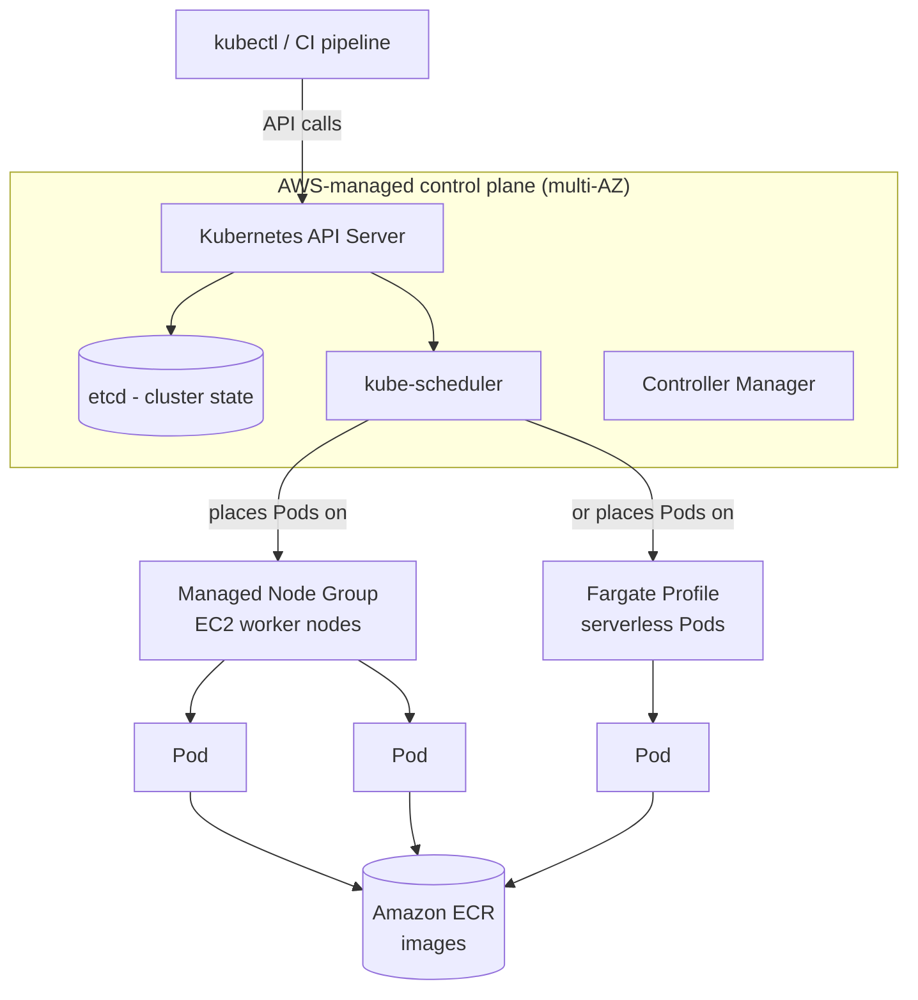

# Amazon Elastic Kubernetes Service (EKS)


<!-- AWS Architecture Icons, Containers category; see diagrams/README.md for the convention -->

## Definition

Amazon EKS is a fully managed service that runs **upstream, certified Kubernetes** for you on
AWS. Kubernetes is the open-source industry-standard system for running and managing containers
at scale; EKS takes away the painful part — running and patching the Kubernetes control plane
(the "brain" that schedules and manages everything) — while you keep the standard Kubernetes API,
tooling, and ecosystem.

## Purpose

Kubernetes became the de-facto standard for container orchestration across the industry — not
just AWS. Many organizations already have Kubernetes expertise, Helm charts, operators, and
multi-cloud or on-prem Kubernetes clusters, and want the *same* API and tooling on AWS rather than
learning AWS's own proprietary orchestrator (ECS). Running Kubernetes' control plane yourself
(etcd, API server, scheduler, controller manager) is genuinely hard to do reliably and securely.
EKS exists so you get real, conformant Kubernetes with AWS managing the hardest, most
failure-sensitive part for you, plus deep integration with IAM, VPC networking (via the AWS VPC
CNI plugin), and other AWS services.

## How It Works

Plain explanation: AWS runs and manages the Kubernetes **control plane** (API server, etcd,
scheduler) for you across multiple Availability Zones for high availability. You only manage the
**data plane** — the worker nodes that actually run your containers (Pods) — and even those can be
fully serverless via **EKS Fargate profiles**, or managed semi-automatically via **Managed Node
Groups**, or fully manually via self-managed EC2 nodes.



Step by step:
1. You (or a CI/CD pipeline) talk to the cluster via `kubectl`/the Kubernetes API — standard
   Kubernetes manifests (Deployments, Services, Ingress), no AWS-specific syntax required.
2. AWS runs the **control plane** (API server, etcd, scheduler, controller manager) across
   multiple AZs; you don't manage or patch these components — that's the entire value proposition.
3. The **scheduler** decides which worker node runs which Pod, based on resource requests and
   constraints, exactly like standard Kubernetes.
4. Worker capacity is either a **Managed Node Group** (AWS automates provisioning/updating EC2
   nodes, you still pay for the instances), self-managed EC2, or a **Fargate profile** (fully
   serverless Pods, no nodes at all).
5. Pods pull container images from **Amazon ECR** (or any registry reachable from the VPC).
6. The AWS VPC CNI plugin gives each Pod a real VPC IP address, so standard AWS networking
   constructs (security groups, VPC endpoints) apply directly to Pods.

## Key Features / Components

- **Control plane (managed)** — API server, etcd, scheduler; AWS handles HA, patching, and
  upgrades of this layer.
- **Managed Node Groups** — AWS-automated EC2 worker node provisioning, OS patch management, and
  graceful node draining/replacement.
- **Fargate profiles** — run specific Pods with no EC2 nodes at all (serverless Kubernetes).
- **AWS VPC CNI** — gives each Pod a routable VPC IP, so Pods get native integration with security
  groups and VPC networking (unlike most other Kubernetes platforms' overlay networking).
- **IAM Roles for Service Accounts (IRSA)** — lets individual Pods assume fine-grained IAM roles,
  instead of giving the whole node broad permissions.
- **EKS add-ons** — managed installs of common cluster components (CoreDNS, kube-proxy, VPC CNI,
  EBS/EFS CSI drivers) that AWS patches for you.
- **Kubernetes-native tooling compatibility** — Helm, kustomize, Argo CD/Flux (GitOps), service
  meshes like Istio/App Mesh, Kubernetes Operators — the entire open ecosystem works unmodified.

## Use Cases — When to Use It

- Organizations with existing Kubernetes expertise, manifests, Helm charts, or multi-cloud/hybrid
  Kubernetes clusters who want a consistent operating model when moving workloads to AWS.
- Workloads that need Kubernetes-specific features or ecosystem tools not available on ECS:
  custom controllers/operators, service meshes, complex scheduling policies, GitOps workflows.
- Multi-cloud or cloud-exit strategies — Kubernetes manifests are portable; ECS Task Definitions
  are not.
- Large, complex microservice estates where the flexibility of the Kubernetes API (CRDs, admission
  controllers, fine-grained RBAC) pays for its added complexity.

## When NOT to Use It / Alternatives

- **You don't have Kubernetes expertise on the team and don't need multi-cloud portability** →
  **ECS** gets you most of the same orchestration benefit with a much smaller learning curve and
  less YAML/operational surface area.
- **Your workload is simple, event-driven, or short-lived** → **AWS Lambda** avoids container
  orchestration entirely.
- **You want the absolute least operational overhead for running containers** → **Fargate** (as a
  launch type under either ECS or EKS) removes node management, but you still pick ECS vs EKS for
  the *API* you want to use.
- Running your **own self-managed Kubernetes control plane on raw EC2** is almost never justified
  over EKS anymore — you'd be paying the same (or more, in ops time) for a less reliable control
  plane than AWS runs for you.

## Why It's Important

**Real-world weight:** Kubernetes skills are broadly transferable across cloud providers and
on-prem, making EKS valuable for organizations avoiding vendor lock-in or running hybrid/
multi-cloud. Misconfigured Kubernetes RBAC, exposed dashboards, and overly broad node IAM roles
are a recurring source of real security incidents — IRSA and EKS's IAM integration directly
address that class of risk.

**Exam weight — exact mapping:**
- **SAA-C03 Domain 2, Task 2.1** ("Design scalable and loosely coupled architectures") includes
  EKS as an architecture option for container-based microservices — expect questions contrasting
  EKS's portability/ecosystem benefits against ECS's simplicity.
- **DVA-C03 Domain 1, Task 1.1** and **Domain 3, Task 3.1/3.3** — EKS/Fargate deployment of
  container images is explicitly in scope ("new: Containers now directly tested: ECR image
  build/tag/lifecycle, ECS/EKS/Fargate deployment").
- **MLA-C02 Domain 3, Task 3.3** — containerized ML workloads and custom inference containers may
  run on EKS when teams need Kubernetes-native ML tooling (e.g., Kubeflow) rather than SageMaker's
  managed abstractions.

## Pricing Model (summary)

- **EKS cluster fee**: a fixed hourly charge per cluster for the managed control plane (separate
  from worker node cost).
- **Worker nodes**: billed as whatever compute backs them — EC2 On-Demand/Reserved/Spot for
  Managed Node Groups/self-managed nodes, or Fargate's per-second vCPU/memory billing for Fargate
  profiles.
- No extra per-Pod orchestration fee beyond the cluster fee and the compute you consume.
- Official pricing: https://aws.amazon.com/eks/pricing/

## Hands-on Lab (Floci)

Floci backs ECS/EKS with real Docker containers, letting you practice cluster and workload
operations for free. EKS's control-plane emulation in Floci is lighter than ECS's — practice the
control-plane-facing API calls here, and pair with a local `kind`/`minikube` cluster or GitHub
Actions for full `kubectl`/Helm workflow practice:

```bash
# 1. Create an EKS cluster (control-plane object)
awslocal eks create-cluster \
  --name demo-eks \
  --role-arn arn:aws:iam::000000000000:role/eks-service-role \
  --resources-vpc-config subnetIds=subnet-123,subnet-456

# 2. List clusters
awslocal eks list-clusters

# 3. Describe the cluster (endpoint, status, version)
awslocal eks describe-cluster --name demo-eks

# 4. Create a managed node group
awslocal eks create-nodegroup \
  --cluster-name demo-eks \
  --nodegroup-name demo-nodes \
  --subnets subnet-123 subnet-456 \
  --node-role arn:aws:iam::000000000000:role/eks-node-role
```

For the actual Kubernetes workload layer (deploying Pods/Services with `kubectl`), pair this with
a free local Kubernetes cluster (`kind` or `minikube`) since Floci emulates the AWS control-plane
API, not a full Kubernetes API server. See `labs-floci/README.md`'s honest-limitations note.

## Exam Tips

- **Classic trap — ECS vs EKS vs Fargate**: EKS is chosen when the question signals
  "Kubernetes," "portability," "multi-cloud," "Helm," "existing k8s manifests," or "open-source
  ecosystem." ECS is chosen for "AWS-native, simplest option, no Kubernetes expertise needed."
  Fargate is an orthogonal axis — it answers "who manages the servers," and can pair with *either*
  ECS or EKS.
- Remember: EKS still has a cluster-hour cost even with Fargate profiles (the control plane fee
  never disappears) — a trick some cost-optimization questions use.
- IRSA (IAM Roles for Service Accounts) is a favorite security-scenario distractor/solution for
  "how do you give a specific Pod least-privilege AWS access without giving the whole node broad
  permissions?"
- Appears in SAA-C03 Domain 2, DVA-C03 Domain 1 & 3, and MLA-C02 Domain 3.

## Related Terms

- [`ecs.md`](ecs.md) — AWS-native alternative orchestrator
- [`fargate.md`](fargate.md) — serverless compute layer usable under EKS
- [`ecr.md`](ecr.md) — registry that stores the images EKS Pods run
- [`containers-vs-vms-vs-serverless.md`](containers-vs-vms-vs-serverless.md)
- `../security-identity-compliance/` — IAM/IRSA concepts referenced above
