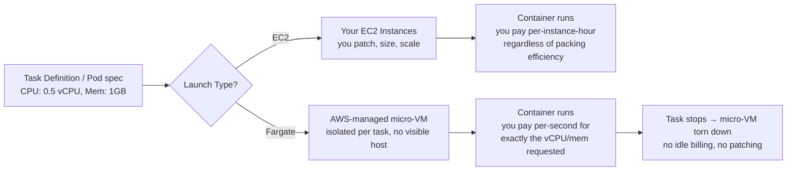

# AWS Fargate


<!-- AWS Architecture Icons, Containers category; see diagrams/README.md for the convention -->

## Definition

AWS Fargate is a serverless compute engine for containers. It lets you run ECS or EKS workloads
**without provisioning, patching, or managing any EC2 servers at all** — you specify how much
CPU and memory each container needs, and AWS runs it on infrastructure you never see.

## Purpose

Even after ECS and EKS removed the need to build your own orchestrator, teams still had to size,
patch, scale, and secure the EC2 instances that containers actually ran on — "server management"
didn't disappear, it just moved one layer down. Fargate was built to remove that remaining layer:
you describe the container's resource needs, and AWS handles capacity, placement, isolation, and
the host OS entirely. It's the container equivalent of what Lambda did for functions — "run my
code/container, I don't want to think about servers."

## How It Works

Plain explanation: Fargate is not a standalone service you call directly for everyday use — it's
a **launch type** (a "who runs the hardware" choice) selectable inside ECS or EKS. When you pick
Fargate, instead of your Task/Pod landing on an EC2 instance from your own fleet, AWS
transparently provisions right-sized, isolated micro-VMs behind the scenes, runs your container
there, and tears it down when the Task stops.



Step by step:
1. You define resource needs (vCPU, memory) in the ECS Task Definition or EKS Fargate profile —
   the same artifact you'd use for the EC2 launch type, just with `requiresCompatibilities:
   FARGATE` (ECS) or a matching Fargate profile selector (EKS).
2. At launch time, you choose the **Fargate** launch type instead of EC2.
3. AWS provisions an isolated, right-sized unit of compute (AWS describes this internally as a
   micro-VM, isolated per task, so one tenant's task can never see another's) just for that task
   — you never see or manage this host.
4. Your container runs there; CloudWatch Logs, networking (via ENIs attached per task — "awsvpc"
   network mode), and IAM roles work exactly as they would with EC2-backed ECS.
5. When the task stops (scaled in, deployment replaced, or job finished), the underlying capacity
   is torn down — you are billed only for the seconds it actually ran.
6. There is no host-level patching, no AMI management, no capacity planning — AWS owns all of it.

## Key Features / Components

- **Per-task/per-pod isolation** — no noisy-neighbor risk from other customers' workloads sharing
  a host you can see.
- **Fine-grained billing** — pay for exactly the vCPU/memory you reserved, per second, no
  over-provisioned idle instances.
- **awsvpc networking** — every Fargate task gets its own elastic network interface (ENI) with
  its own private IP in your VPC, enabling security groups per task.
- **Fargate Spot** — run interruptible, fault-tolerant tasks at up to ~70% discount vs. standard
  Fargate pricing, same mechanism as EC2 Spot.
- **No OS/AMI management** — AWS handles the underlying host OS patching entirely; you only
  manage your container image.
- **Works under both ECS and EKS** — it's a compute layer choice, not tied to one orchestrator.

## Use Cases — When to Use It

- Spiky or unpredictable workloads where keeping a fleet of EC2 instances warm (and paying for
  idle capacity) doesn't make economic sense.
- Teams that want containers in production with zero host-level operational burden — no patching
  cadence, no AMI pipeline, no capacity planning meetings.
- Multi-tenant or security-sensitive workloads where per-task isolation (vs. sharing a host across
  many tasks) matters.
- Batch jobs, scheduled tasks, and CI/CD build runners that spin up, do work, and disappear.
- Startups/small teams without dedicated infrastructure/ops staff to manage an EC2 fleet.

## When NOT to Use It / Alternatives

- **You run dense, steady-state workloads at high, predictable scale** → **EC2 launch type** with
  Reserved Instances/Savings Plans is typically cheaper per unit of compute, because you can pack
  many tasks tightly onto fewer, larger, fully-utilized instances — Fargate's per-task isolation
  and convenience carries a price premium.
- **You need GPU instances for ML training/inference, custom kernel modules, or privileged/
  host-level access** → Fargate doesn't support custom AMIs, GPUs (historically limited/absent
  support), or host-level customization — use **EC2 launch type** or **EKS with self-managed/
  GPU node groups**.
- **You need the absolute lowest cost at very large, predictable scale and can tolerate the ops
  overhead** → EC2 Spot fleets managed carefully can beat Fargate Spot on raw price for some
  workloads.
- **Extremely short, bursty, stateless, event-driven invocations measured in milliseconds** →
  **Lambda** has faster cold starts for lightweight functions and an even simpler billing model
  (per-invocation + duration) than Fargate's per-task billing.

## Why It's Important

**Real-world weight:** Fargate shifts the "undifferentiated heavy lifting" of patching and
capacity planning entirely to AWS, which is a genuine reduction in operational risk (unpatched
hosts are a top real-world breach vector) and lets small teams run production container workloads
without a dedicated platform/SRE function. The cost tradeoff (convenience vs. raw compute price)
is a recurring real decision engineers make when sizing infrastructure budgets.

**Exam weight — exact mapping:**
- **SAA-C03 Domain 2, Task 2.1** — Fargate is a named example of scalable, loosely-coupled compute
  that removes server management from the architecture.
- **SAA-C03 Domain 4 (cost-optimized compute)** — Fargate vs EC2 launch type cost tradeoff is a
  direct cost-optimization scenario.
- **DVA-C03 Domain 3, Task 3.3** — deploying code via ECS/EKS/Fargate as part of CI/CD is
  explicitly listed.
- **MLA-C02 Domain 3, Task 3.3** — Fargate is a lightweight serving option for containerized
  inference when a full SageMaker endpoint is overkill.

## Pricing Model (summary)

- Billed per second (with a minimum billing duration) for the **vCPU and memory** you reserve in
  the Task Definition/Pod spec — not for underlying hardware utilization.
- **Fargate Spot** offers a steep discount (historically up to ~70% off standard pricing) for
  interruption-tolerant workloads, with the tradeoff that AWS can reclaim capacity with
  short notice (similar risk profile to EC2 Spot).
- No separate orchestration fee from ECS; under EKS, the EKS cluster-hour fee still applies on
  top of Fargate's compute billing.
- Official pricing: https://aws.amazon.com/fargate/pricing/

## Hands-on Lab (Floci)

Floci's ECS emulation is Docker-backed; practicing the Fargate *launch type selection* in the
Task Definition is the realistic, portable skill to drill (Floci doesn't meaningfully distinguish
underlying micro-VM provisioning, since that's an AWS-internal implementation detail anyway):

```bash
# 1. Register a Fargate-compatible task definition
cat > fargate-task.json << 'EOF'
{
  "family": "fargate-demo",
  "requiresCompatibilities": ["FARGATE"],
  "networkMode": "awsvpc",
  "cpu": "256",
  "memory": "512",
  "containerDefinitions": [{
    "name": "web",
    "image": "nginx:latest",
    "portMappings": [{"containerPort": 80}]
  }]
}
EOF
awslocal ecs register-task-definition --cli-input-json file://fargate-task.json

# 2. Run it with launchType FARGATE
awslocal ecs run-task \
  --cluster demo-cluster \
  --task-definition fargate-demo \
  --launch-type FARGATE \
  --network-configuration "awsvpcConfiguration={subnets=[subnet-123],assignPublicIp=ENABLED}"

# 3. Check task status
awslocal ecs describe-tasks --cluster demo-cluster --tasks <task-arn-from-run-task>
```

This mirrors the exact CLI shape you'd use against real AWS Fargate — the key learning is the
`requiresCompatibilities`, `networkMode: awsvpc`, and `--launch-type FARGATE` fields, which are
identical in production.

## Exam Tips

- **Classic trap — ECS vs EKS vs Fargate**: a question that says "no servers to manage" is testing
  Fargate *specifically as the launch type*, which is orthogonal to whether the orchestrator is
  ECS or EKS. Don't let "no servers to manage" push you toward picking "EKS" or "ECS" as the
  answer when the real axis being tested is EC2-vs-Fargate.
- Watch for cost-optimization scenarios: "predictable, steady, high-volume workload" → EC2 launch
  type (cheaper at scale); "spiky, unpredictable, or small team with no ops capacity" → Fargate.
- Fargate Spot vs EC2 Spot — same interruption risk model, different billing target (task vs
  instance).
- Appears across SAA-C03 (Domains 2 & 4), DVA-C03 (Domain 3), and MLA-C02 (Domain 3).

## Related Terms

- [`ecs.md`](ecs.md) — one of the two orchestrators Fargate can run under
- [`eks.md`](eks.md) — the other orchestrator Fargate can run under
- [`ecr.md`](ecr.md) — registry for the images Fargate tasks pull
- [`containers-vs-vms-vs-serverless.md`](containers-vs-vms-vs-serverless.md) — where Fargate sits
  on the server-management spectrum
