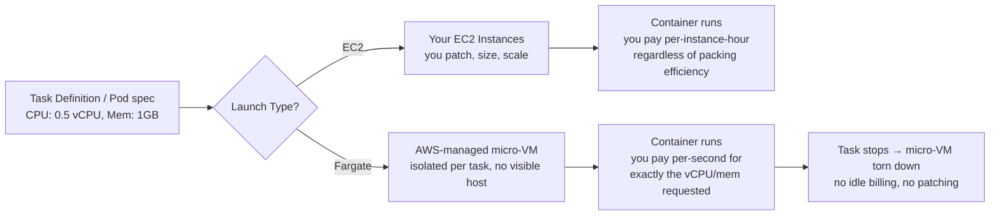
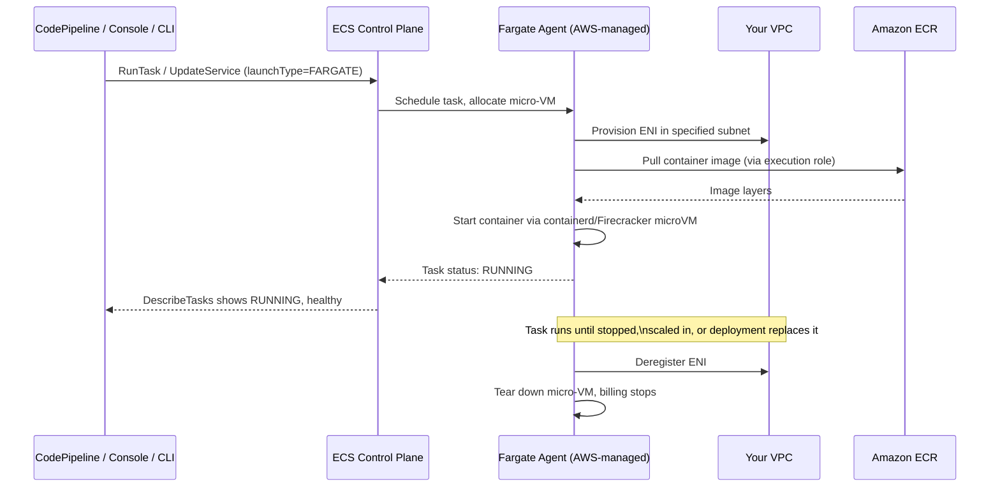
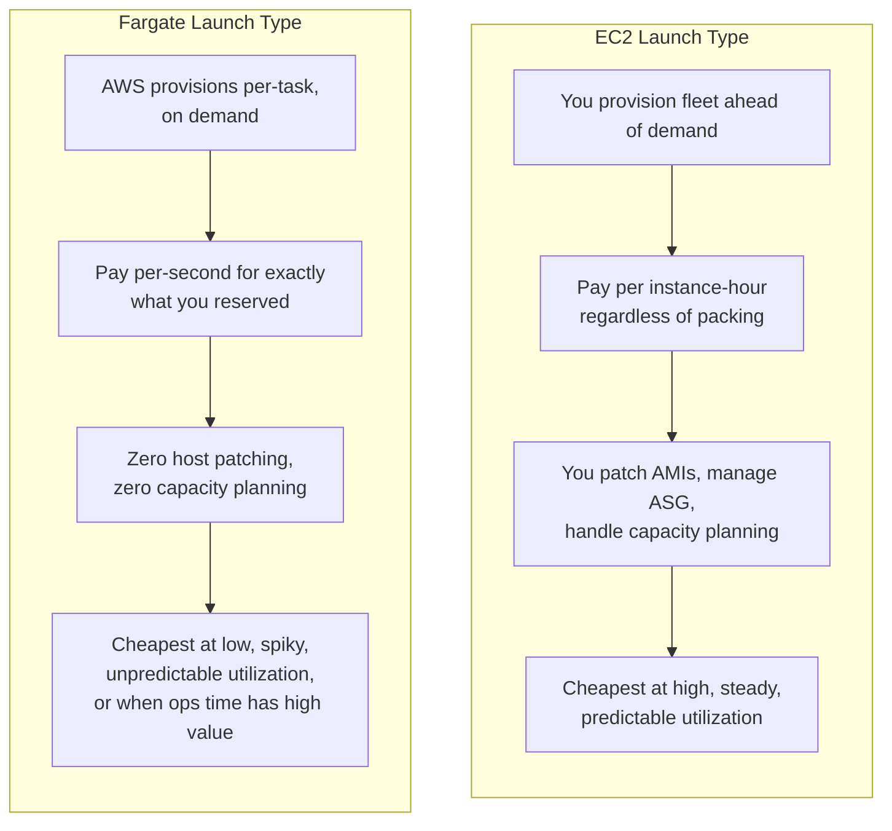
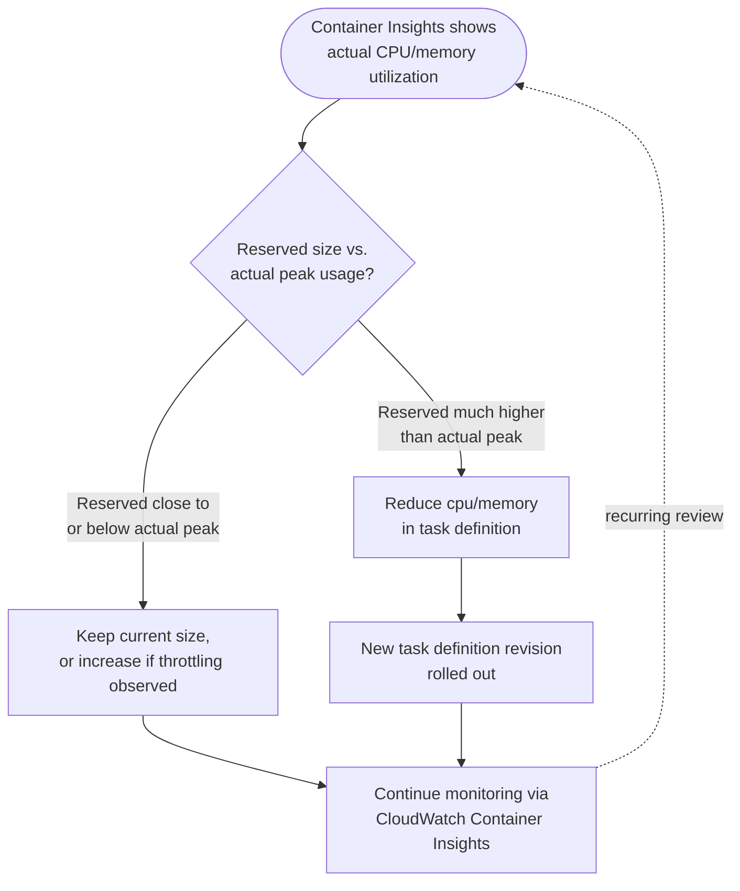

# AWS Fargate

> **Appears in:** [DVA-C03](../../certifications/dva-c03/README.md) · [SAA-C03](../../certifications/saa-c03/README.md)


<!-- AWS Architecture Icons, Containers category; see diagrams/README.md for the convention -->

## Definition

AWS Fargate is a serverless compute engine for containers. It lets you run ECS or EKS workloads
**without provisioning, patching, or managing any EC2 servers at all** — you specify how much
CPU and memory each container needs, and AWS runs it on infrastructure you never see.

## Purpose

Even after ECS and EKS removed the need to build your own orchestrator, teams still had to size,
patch, scale, and secure the EC2 instances that containers actually ran on — "server management"
didn't disappear, it just moved one layer down. Fargate was built to remove that remaining layer:
you describe the container's resource needs, and AWS handles capacity, placement, isolation, and
the host OS entirely. It's the container equivalent of what Lambda did for functions — "run my
code/container, I don't want to think about servers."

Fargate launched in 2017, three years after ECS, specifically because customer feedback on ECS
consistently cited "I still have to manage an EC2 fleet" as the biggest remaining friction. AWS's
internal framing (echoed in its own engineering blog posts) is that container orchestrators solve
two separable problems: a **north-bound** problem (how do I describe and schedule my
services/deployments?) and a **south-bound** problem (how do I turn a pool of servers into
flexible, schedulable capacity?). ECS and EKS solve the north-bound problem; Fargate solves the
south-bound problem for both of them.

## How It Works

Plain explanation: Fargate is not a standalone service you call directly for everyday use — it's
a **launch type** (a "who runs the hardware" choice) selectable inside ECS or EKS. When you pick
Fargate, instead of your Task/Pod landing on an EC2 instance from your own fleet, AWS
transparently provisions right-sized, isolated micro-VMs behind the scenes, runs your container
there, and tears it down when the Task stops.



Step by step:
1. You define resource needs (vCPU, memory) in the ECS Task Definition or EKS Fargate profile —
   the same artifact you'd use for the EC2 launch type, just with `requiresCompatibilities:
   FARGATE` (ECS) or a matching Fargate profile selector (EKS).
2. At launch time, you choose the **Fargate** launch type instead of EC2.
3. AWS provisions an isolated, right-sized unit of compute (AWS describes this internally as a
   micro-VM, isolated per task, so one tenant's task can never see another's) just for that task
   — you never see or manage this host.
4. Your container runs there; CloudWatch Logs, networking (via ENIs attached per task — "awsvpc"
   network mode), and IAM roles work exactly as they would with EC2-backed ECS.
5. When the task stops (scaled in, deployment replaced, or job finished), the underlying capacity
   is torn down — you are billed only for the seconds it actually ran.
6. There is no host-level patching, no AMI management, no capacity planning — AWS owns all of it.

### Real-World Reference Architecture


*Figure: A modern serverless mobile/web application in which the backend processing layer runs as
an **ECS on Fargate** service behind a Network Load Balancer, reached privately from API Gateway
via AWS PrivateLink, with container images pulled from ECR through an interface VPC endpoint (no
NAT Gateway or public internet path required for image pulls) and CI/CD deploying new images to
Fargate across multiple Availability Zones. Source:
[AWS Reference Architecture Diagrams — "Modern Serverless Mobile/Web Application Architecture"](https://docs.aws.amazon.com/reference-architecture-diagrams/latest/modern-serverless-mobile-web/modern-serverless-mobile-web.md), © Amazon Web Services.*

This architecture is a good worked answer to a recurring exam pattern: "serverless front end
(AppSync/API Gateway/Lambda) calling a backend that needs a long-running process/connection pool
Lambda's 15-minute limit doesn't fit" — Fargate is the piece that fills that gap without
introducing EC2 fleet management into an otherwise fully serverless architecture.

## Worked Example: Fargate-Specific Task Definition Fields

The fields that *only* make sense (or are *mandatory*) for Fargate, layered onto the same
task-definition shape used in `ecs.md`:

```json
{
  "family": "orders-worker",
  "requiresCompatibilities": ["FARGATE"],
  "networkMode": "awsvpc",
  "cpu": "1024",
  "memory": "2048",
  "runtimePlatform": {
    "cpuArchitecture": "ARM64",
    "operatingSystemFamily": "LINUX"
  },
  "ephemeralStorage": {
    "sizeInGiB": 50
  },
  "executionRoleArn": "arn:aws:iam::123456789012:role/ecsTaskExecutionRole",
  "taskRoleArn": "arn:aws:iam::123456789012:role/ordersWorkerTaskRole",
  "containerDefinitions": [
    {
      "name": "orders-worker",
      "image": "123456789012.dkr.ecr.us-east-1.amazonaws.com/orders-worker:v2.0.0",
      "essential": true,
      "logConfiguration": {
        "logDriver": "awslogs",
        "options": {
          "awslogs-group": "/ecs/orders-worker",
          "awslogs-region": "us-east-1",
          "awslogs-stream-prefix": "orders-worker"
        }
      }
    }
  ]
}
```

Notes specific to Fargate:
- **`requiresCompatibilities: ["FARGATE"]`** and **`networkMode: "awsvpc"`** are both mandatory —
  Fargate has no concept of `bridge`/`host` networking since there's no shared host to speak of.
- **`cpu`/`memory` at the task level** (not per-container, unlike EC2 launch type where you can
  also set per-container limits more loosely) must match one of Fargate's fixed valid
  CPU/memory combinations (e.g., 0.25 vCPU only pairs with 0.5–2 GB memory; 4 vCPU pairs with
  8–30 GB, etc.) — the API rejects combinations outside the supported table.
- **`runtimePlatform.cpuArchitecture: "ARM64"`** lets you run Fargate tasks on AWS Graviton
  processors, typically ~20% cheaper per vCPU-second than the x86_64 default — a direct,
  no-downside cost optimization if your container image has an ARM64 build (most modern base
  images do).
- **`ephemeralStorage`** configures the task's local scratch disk (default 20 GiB, configurable up
  to 200 GiB) — relevant for anything writing large temp files, since Fargate tasks have no
  persistent local disk beyond this ephemeral allocation.

## Fargate Launch Flow: From RunTask to Running Container



Walkthrough: unlike the EC2 launch type (where ECS places a task onto *already-running* capacity
you provisioned ahead of time), Fargate's scheduler step *triggers new capacity creation* as part
of placing the task — there's no pre-existing fleet to schedule onto. This is why Fargate task
start times (tens of seconds) are typically a bit slower than placing onto an already-warm EC2
instance, but why idle Fargate capacity costs you literally nothing — there's no concept of "idle"
at all.

## Fargate vs. EC2 Launch Type: Cost and Operational Tradeoff



The crossover point in practice: once your EC2 fleet's average utilization consistently stays
above roughly 60–70% (meaning you're not paying much for idle capacity anyway), the raw compute
cost of EC2 (especially with Reserved Instances or Savings Plans) usually undercuts Fargate's
convenience premium. Below that utilization, Fargate's "pay for exactly what ran" model usually
wins even before counting the ops-time savings of never patching a host OS.

## Fargate Right-Sizing Decision Flow



Walkthrough: because Fargate bills for the **full reservation**, not actual usage, right-sizing is
a recurring cost-optimization task, not a one-time setup step — CloudWatch Container Insights
(or third-party tools) surfaces the gap between what you reserved and what the container actually
uses, and the fix is always a new task definition revision (since existing ones are immutable),
rolled out the same way any other deployment would be.

## Frequently Confused Fargate Concepts (Quick-Reference)

- **Fargate is a launch type, not a separate orchestrator.** There is no "Fargate API" you call
  independently of ECS or EKS — every Fargate interaction happens through ECS's or EKS's own APIs
  with Fargate selected as the compute target.
- **Fargate Spot is not the same risk/billing model as On-Demand Fargate, but uses identical task
  definitions.** The only difference is the capacity provider/launch configuration choice; your
  container image and task definition need no changes to run on Fargate Spot versus standard
  Fargate.
- **"No servers to manage" does not mean "no sizing decisions to make."** You still choose
  vCPU/memory per task — Fargate removes *host* management, not *capacity planning* at the task
  level.
- **Ephemeral storage is not the same as EBS.** Fargate tasks get a configurable local scratch
  disk, but it disappears entirely when the task stops — there is no Fargate equivalent of an EBS
  volume you can detach and reattach elsewhere (EFS can be mounted into Fargate tasks for genuine
  persistent, shared storage, but that's a distinct AWS service, not a Fargate-native disk).

## Key Features / Components

- **Per-task/per-pod isolation** — no noisy-neighbor risk from other customers' workloads sharing
  a host you can see.
- **Fine-grained billing** — pay for exactly the vCPU/memory you reserved, per second, no
  over-provisioned idle instances.
- **awsvpc networking** — every Fargate task gets its own elastic network interface (ENI) with
  its own private IP in your VPC, enabling security groups per task.
- **Fargate Spot** — run interruptible, fault-tolerant tasks at up to ~70% discount vs. standard
  Fargate pricing, same mechanism as EC2 Spot.
- **No OS/AMI management** — AWS handles the underlying host OS patching entirely; you only
  manage your container image.
- **Works under both ECS and EKS** — it's a compute layer choice, not tied to one orchestrator.
- **Graviton (ARM64) support** — run Fargate tasks on AWS's own Arm-based processors for a
  meaningful per-vCPU cost reduction with no other architecture changes beyond a compatible image.
- **Configurable ephemeral storage** — per-task scratch disk size from the 20 GiB default up to
  200 GiB, billed separately beyond the free included allocation.

## Use Cases — When to Use It

Each scenario names the situation, why Fargate fits, and the tradeoff accepted versus EC2 launch
type or Lambda.

1. **Spiky, unpredictable traffic.** Situation: a workload bursts unpredictably with long idle gaps
   between bursts. Why Fargate fits: per-second billing with zero idle cost means you never pay
   for warm-but-unused EC2 capacity. Tradeoff: a per-task price premium versus a well-utilized
   Reserved EC2 fleet at high, steady volume.
2. **Teams with zero dedicated ops/platform staff.** Situation: a small team wants containers in
   production without a patch cadence or AMI pipeline. Why Fargate fits: AWS owns all host-level
   patching and capacity planning. Tradeoff: less low-level control — no custom AMI, kernel module,
   or privileged-container access.
3. **Multi-tenant SaaS isolation boundary.** Situation: a SaaS platform needs hard compute isolation
   between tenants' workloads. Why Fargate fits: each task gets its own micro-VM and ENI, with no
   shared host across tenants. Tradeoff: running many small, individually-billed tasks can cost
   more at scale than densely-packed EC2 once tenant volume grows large and steady.
4. **Batch jobs and scheduled tasks via `RunTask`.** Situation: nightly ETL, report generation, or
   document-processing jobs that start, finish, and exit. Why Fargate fits: billed only for actual
   run duration, with zero idle fleet cost between runs. Tradeoff: cold-start latency (tens of
   seconds) versus placing onto already-warm EC2 capacity.
5. **Self-hosted CI/CD build runners.** Situation: a team wants to avoid maintaining a permanently
   running EC2 build fleet. Why Fargate fits: runner tasks start on-demand per CI job and
   disappear afterward. Tradeoff: layer/dependency caching across builds is harder to keep warm
   than with a persistent, always-on runner.
6. **Filling the gap beyond Lambda's 15-minute ceiling.** Situation: a processing step (large file
   transform, long external API polling loop) might exceed Lambda's duration limit. Why Fargate
   fits: `RunTask` via Step Functions has no duration cap at all. Tradeoff: slower startup and
   coarser per-task billing granularity than Lambda for genuinely short-lived work.
7. **Scheduled scale-to-zero dev/test environments.** Situation: non-production environments sit
   idle outside business hours. Why Fargate fits: `desiredCount: 0` truly costs nothing, unlike a
   stopped EC2 instance that still bills for attached EBS volumes. Tradeoff: the environment takes
   time to cold-start back up versus an always-on instance.
8. **Lightweight ML inference behind an ALB.** Situation: bursty inference traffic where the team
   doesn't want a SageMaker endpoint's always-on instance cost. Why Fargate fits: an ECS Service on
   Fargate scaled on request count via Application Auto Scaling. Tradeoff: loses SageMaker's
   model-specific MLOps tooling (multi-model endpoints, built-in A/B testing).
9. **Hotfix emergency redeploys with circuit-breaker safety.** Situation: a critical fix must reach
   production fast with an automatic safety net. Why Fargate fits: new tasks redeploy in
   seconds-to-minutes, and ECS's deployment circuit breaker auto-rolls back a crash-looping
   revision. Tradeoff: still bound by Fargate's fixed vCPU/memory combinations — a hotfix that
   changes resource needs may require resizing the task definition first.
10. **Monorepo microservices, each independently deployed.** Situation: many small services share
    one repository. Why Fargate fits: each service gets its own task definition/Service with
    independent per-second billing and no shared-host blast radius between services. Tradeoff:
    per-service ENI and networking overhead adds up operationally as the number of services grows.
11. **Blue/green production rollout via CodeDeploy.** Situation: a production release needs
    zero-downtime cutover. Why Fargate fits: standing up a parallel task set only costs the brief
    overlap window, with no EC2 capacity pre-planning required. Tradeoff: temporarily doubles the
    per-second compute bill during the cutover.
12. **Cost-tunable data processing with Graviton and ephemeral storage.** Situation: an ETL
    pipeline has irregular, large-data processing jobs. Why Fargate fits: ARM64/Graviton pricing
    plus configurable ephemeral storage let you tune cost precisely per job. Tradeoff: Fargate's
    16 vCPU / 120 GB ceiling disqualifies genuinely large single-container jobs outright.

## When NOT to Use It / Alternatives

- **You run dense, steady-state workloads at high, predictable scale** → **EC2 launch type** with
  Reserved Instances/Savings Plans is typically cheaper per unit of compute, because you can pack
  many tasks tightly onto fewer, larger, fully-utilized instances — Fargate's per-task isolation
  and convenience carries a price premium.
- **You need GPU instances for ML training/inference, custom kernel modules, or privileged/
  host-level access** → Fargate doesn't support custom AMIs, GPUs (historically limited/absent
  support), or host-level customization — use **EC2 launch type** or **EKS with self-managed/
  GPU node groups**.
- **You need the absolute lowest cost at very large, predictable scale and can tolerate the ops
  overhead** → EC2 Spot fleets managed carefully can beat Fargate Spot on raw price for some
  workloads.
- **Extremely short, bursty, stateless, event-driven invocations measured in milliseconds** →
  **Lambda** has faster cold starts for lightweight functions and an even simpler billing model
  (per-invocation + duration) than Fargate's per-task billing.
- **You need DaemonSets on EKS (one Pod per node for logging/monitoring agents)** → Fargate has no
  node concept, so DaemonSets are architecturally impossible there; use a Managed Node Group.

## Common Architectures

**1. ALB-fronted web service, fully serverless from edge to compute**
CloudFront/ALB → ECS Service on Fargate (private subnets) → RDS/DynamoDB. Zero EC2 instances
anywhere in the request path. This is the default "serverless containers" reference architecture
and the most commonly tested Fargate shape on both SAA-C03 and DVA-C03.

**2. Event-driven batch processing with Fargate + SQS**
An SQS queue of work items triggers Fargate tasks via `RunTask` (often orchestrated by a Lambda
function polling the queue, or Step Functions) — each task processes a batch and exits, billed
only for the processing duration, with Fargate Spot used for cost reduction when jobs are
idempotent and interruption-tolerant.

**3. Fargate as the Lambda-duration-limit escape hatch**
A Step Functions state machine starts with Lambda for the fast, short steps of a workflow and
calls out to a Fargate task (via the ECS `RunTask` Step Functions integration) for any step that
might run longer than Lambda's 15-minute ceiling — e.g., a large file transformation or long
external API polling loop.

**4. CI/CD build runners on Fargate**
Self-hosted GitHub Actions or GitLab CI runners deployed as Fargate tasks that start on-demand per
CI job and terminate afterward — avoiding both a permanently-running EC2 build fleet and
CodeBuild's per-minute pricing when an org already has runner tooling built around containers.

**5. Multi-tenant SaaS isolation boundary**
Each tenant's workload runs in its own Fargate task with its own ENI/security group, giving
network-level isolation between tenants without needing separate EC2 instances or VPCs per
tenant — a common pattern for SaaS platforms with per-customer compute requirements.

**6. Scheduled scale-to-zero dev/test environments**
Non-production Fargate services are scaled to `desiredCount: 0` outside business hours via an
EventBridge Scheduler rule calling `UpdateService`, eliminating idle compute cost for environments
that don't need to run 24/7 — a pattern that has no clean equivalent on EC2 launch type, since
stopped-but-not-terminated EC2 instances still incur EBS storage charges and a slower restart path.

## Why It's Important

**Real-world weight:** Fargate shifts the "undifferentiated heavy lifting" of patching and
capacity planning entirely to AWS, which is a genuine reduction in operational risk (unpatched
hosts are a top real-world breach vector) and lets small teams run production container workloads
without a dedicated platform/SRE function. The cost tradeoff (convenience vs. raw compute price)
is a recurring real decision engineers make when sizing infrastructure budgets.

**Exam weight — exact mapping:**
- **SAA-C03 Domain 2, Task 2.1** — Fargate is a named example of scalable, loosely-coupled compute
  that removes server management from the architecture.
- **SAA-C03 Domain 4 (cost-optimized compute)** — Fargate vs EC2 launch type cost tradeoff is a
  direct cost-optimization scenario.
- **DVA-C03 Domain 3, Task 3.3** — deploying code via ECS/EKS/Fargate as part of CI/CD is
  explicitly listed.
- **MLA-C02 Domain 3, Task 3.3** — Fargate is a lightweight serving option for containerized
  inference when a full SageMaker endpoint is overkill.

### Expanded Exam Scenarios

**SAA-C03 Domain 4 scenario:** "A workload has highly variable, unpredictable traffic with long
idle periods between bursts, and the team has no dedicated operations staff." → Answer:
**Fargate** — the "no ops staff" detail rules out EC2 launch type (which requires patch/capacity
management), and the "unpredictable, idle periods" detail rules out Reserved/Savings-Plan EC2
being cost-effective.

**SAA-C03 Domain 4 scenario (inverted trap):** "A workload runs 24/7 at consistently high,
predictable utilization and the team already has strong EC2 operational practices." → Answer:
**EC2 launch type with Savings Plans**, *not* Fargate — this is the question designed to catch
people who default to "serverless is always cheaper."

**DVA-C03 Domain 3 scenario:** "A batch job sometimes needs more than 15 minutes to complete and
must not be limited by Lambda's maximum execution duration, but should still be billed only for
actual run time with no idle infrastructure." → Answer: **ECS RunTask on Fargate**, often
orchestrated via Step Functions — not EC2 (which would leave idle capacity) and not Lambda (which
is duration-capped).

**MLA-C02 Domain 3 scenario:** "A team needs to serve a custom inference container with
unpredictable, bursty request volume and doesn't want to manage a SageMaker endpoint's always-on
instance." → Answer: ECS Service on **Fargate** behind an ALB, scaled by Application Auto Scaling
on request count — a legitimate lighter-weight alternative to a SageMaker real-time endpoint for
simpler inference workloads.

## Limits & Quotas

Current defaults (verify against the
[Fargate quotas section of the ECS service quotas page](https://docs.aws.amazon.com/AmazonECS/latest/developerguide/service-quotas.html)):

| Quota | Default | Notes |
|---|---|---|
| vCPU per Fargate task (max) | 16 vCPU | Fixed combinations with memory |
| Memory per Fargate task (max) | 120 GB | Fixed combinations with vCPU |
| Ephemeral storage per task | 20 GiB (default) – 200 GiB (max) | Billed beyond the free 20 GiB |
| On-Demand Fargate vCPUs per Region (account default) | 100s, varies by account/Region | Adjustable via Service Quotas |
| Fargate Spot vCPUs per Region | Separate quota from On-Demand | Adjustable |
| ENIs per Fargate task | 1 (mandatory `awsvpc` mode) | Fixed by design |

**Exam-relevant takeaway:** the exam cares less about exact numbers here and more about knowing
that **Fargate has a maximum task size** (currently up to 16 vCPU / 120 GB) — a question
describing a workload needing, say, 64 vCPUs in a single container is signaling "this can't run on
Fargate as a single task, consider EC2 launch type or splitting the workload."

## Troubleshooting / Common Issues

- **Task fails with `RESOURCE:ENI` or networking-related stopped reason** — the subnet specified
  has run out of available IP addresses, or the security group/NACL blocks required traffic;
  Fargate tasks cannot start without a successfully provisioned ENI.
- **`CannotPullContainerError` specific to Fargate** — frequently caused by a **private subnet
  with no NAT Gateway and no ECR VPC interface endpoints** — Fargate tasks in fully private
  subnets need either a NAT Gateway (for internet-routed ECR) or VPC endpoints for
  `ecr.api`/`ecr.dkr`/`s3` (image layers are actually served from S3 behind the scenes) to pull
  images at all.
- **Task exceeds ephemeral storage and fails** — increase `ephemeralStorage.sizeInGiB` in the task
  definition; the default 20 GiB is easy to exceed with workloads writing large temp/cache files.
- **Unexpectedly high cost compared to EC2 launch type estimate** — usually a sizing mismatch:
  requesting a larger CPU/memory combination "just in case" rather than right-sizing against
  actual utilization metrics from CloudWatch Container Insights.
  Fargate bills for the full reservation regardless of actual usage, same as EC2 — right-sizing
  matters just as much.
- **Fargate Spot task interrupted mid-job with no graceful handling** — same risk profile as EC2
  Spot; the application must handle `SIGTERM` within the ~2-minute interruption notice window, or
  work should be checkpointed/idempotent so a retry on different capacity is safe.
- **GPU workload can't run on Fargate** — Fargate does not support GPU-backed tasks; this is a hard
  platform limitation, not a configuration issue — the fix is EC2 launch type or EKS with GPU node
  groups, not a Fargate setting.

## Pricing Model (summary)

- Billed per second (with a minimum billing duration) for the **vCPU and memory** you reserve in
  the Task Definition/Pod spec — not for underlying hardware utilization.
- **Fargate Spot** offers a steep discount (historically up to ~70% off standard pricing) for
  interruption-tolerant workloads, with the tradeoff that AWS can reclaim capacity with
  short notice (similar risk profile to EC2 Spot).
- **Graviton (ARM64) Fargate tasks** are priced lower per vCPU-second than x86_64 tasks.
- No separate orchestration fee from ECS; under EKS, the EKS cluster-hour fee still applies on
  top of Fargate's compute billing.
- Official pricing: https://aws.amazon.com/fargate/pricing/

## Hands-on Lab (Floci)

Floci's ECS emulation is Docker-backed; practicing the Fargate *launch type selection* in the
Task Definition is the realistic, portable skill to drill (Floci doesn't meaningfully distinguish
underlying micro-VM provisioning, since that's an AWS-internal implementation detail anyway):

```bash
# 1. Register a Fargate-compatible task definition
cat > fargate-task.json << 'EOF'
{
  "family": "fargate-demo",
  "requiresCompatibilities": ["FARGATE"],
  "networkMode": "awsvpc",
  "cpu": "256",
  "memory": "512",
  "containerDefinitions": [{
    "name": "web",
    "image": "nginx:latest",
    "portMappings": [{"containerPort": 80}]
  }]
}
EOF
awslocal ecs register-task-definition --cli-input-json file://fargate-task.json

# 2. Run it with launchType FARGATE
awslocal ecs run-task \
  --cluster demo-cluster \
  --task-definition fargate-demo \
  --launch-type FARGATE \
  --network-configuration "awsvpcConfiguration={subnets=[subnet-123],assignPublicIp=ENABLED}"

# 3. Check task status
awslocal ecs describe-tasks --cluster demo-cluster --tasks <task-arn-from-run-task>

# 4. Practice a Fargate Spot capacity provider strategy (concept-level; Floci's
#    capacity-provider emulation is partial, verify behavior against real AWS before relying on it)
awslocal ecs put-cluster-capacity-providers \
  --cluster demo-cluster \
  --capacity-providers FARGATE FARGATE_SPOT \
  --default-capacity-provider-strategy capacityProvider=FARGATE_SPOT,weight=3 capacityProvider=FARGATE,weight=1
```

This mirrors the exact CLI shape you'd use against real AWS Fargate — the key learning is the
`requiresCompatibilities`, `networkMode: awsvpc`, and `--launch-type FARGATE` fields, which are
identical in production.

## Exam Tips

- **Classic trap — ECS vs EKS vs Fargate**: a question that says "no servers to manage" is testing
  Fargate *specifically as the launch type*, which is orthogonal to whether the orchestrator is
  ECS or EKS. Don't let "no servers to manage" push you toward picking "EKS" or "ECS" as the
  answer when the real axis being tested is EC2-vs-Fargate.
- Watch for cost-optimization scenarios: "predictable, steady, high-volume workload" → EC2 launch
  type (cheaper at scale); "spiky, unpredictable, or small team with no ops capacity" → Fargate.
- Fargate Spot vs EC2 Spot — same interruption risk model, different billing target (task vs
  instance).
- Fargate has a **hard maximum task size** (currently 16 vCPU / 120 GB) and **no GPU support** —
  a scenario describing GPU or very large single-container resource needs disqualifies Fargate
  outright, regardless of how attractive its operational simplicity sounds.
- Appears across SAA-C03 (Domains 2 & 4), DVA-C03 (Domain 3), and MLA-C02 (Domain 3).

## Further Reading

- [Under the hood: AWS Fargate data plane](https://aws.amazon.com/blogs/containers/under-the-hood-fargate-data-plane/) — AWS Containers Blog's technical deep dive into how Fargate actually runs containers
- [The role of AWS Fargate in the container world](https://aws.amazon.com/blogs/containers/the-role-of-aws-fargate-in-the-container-world/) — AWS's own framing of north-bound vs. south-bound orchestration problems
- [AWS Fargate pricing](https://aws.amazon.com/fargate/pricing/) — official, current pricing including Spot discounts
- [Amazon ECS on AWS Fargate developer guide](https://docs.aws.amazon.com/AmazonECS/latest/developerguide/AWS_Fargate.html) — official configuration reference
- [Amazon EKS on Fargate](https://docs.aws.amazon.com/eks/latest/userguide/fargate.html) — official EKS Fargate profile documentation

## Related Terms

- [`ecs.md`](ecs.md) — one of the two orchestrators Fargate can run under
- [`eks.md`](eks.md) — the other orchestrator Fargate can run under
- [`ecr.md`](ecr.md) — registry for the images Fargate tasks pull
- [`containers-vs-vms-vs-serverless.md`](containers-vs-vms-vs-serverless.md) — where Fargate sits
  on the server-management spectrum
- `../compute/lambda.md` — the function-level serverless compute Fargate complements for
  longer-running workloads
