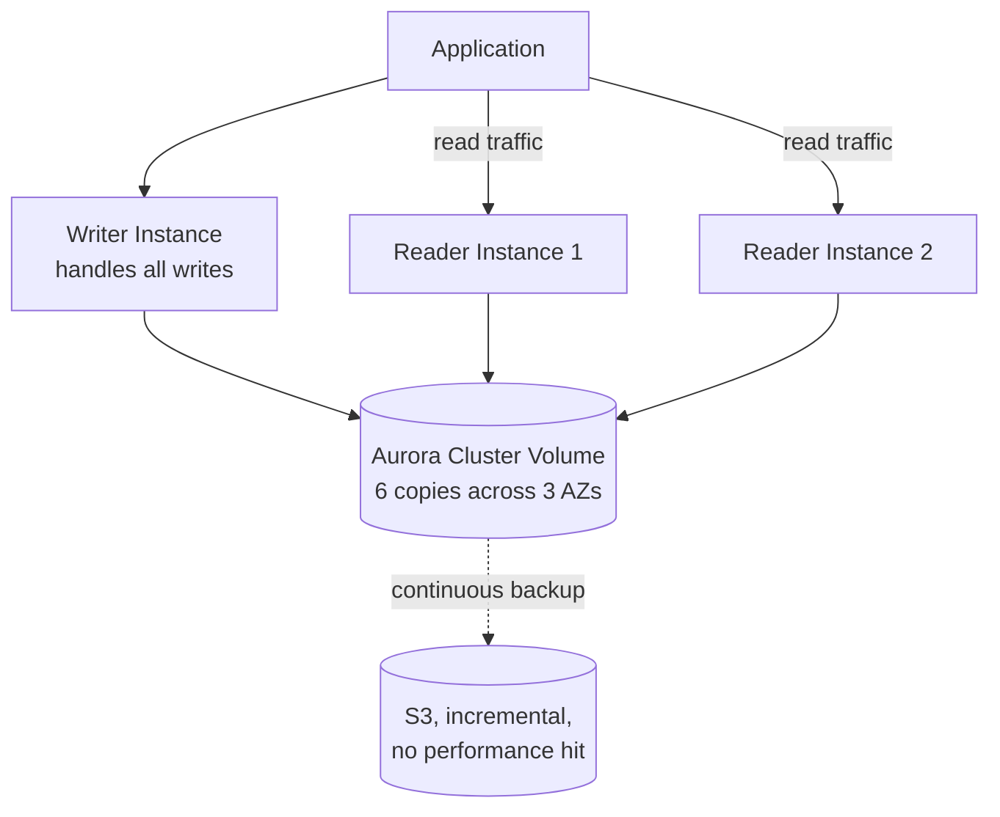
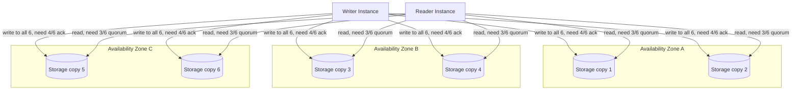
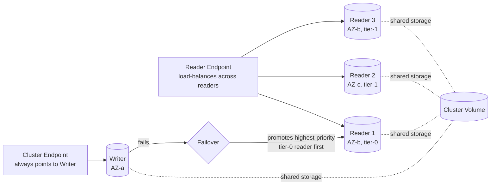
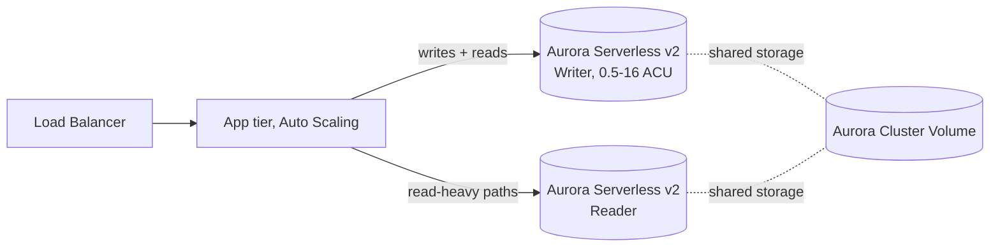
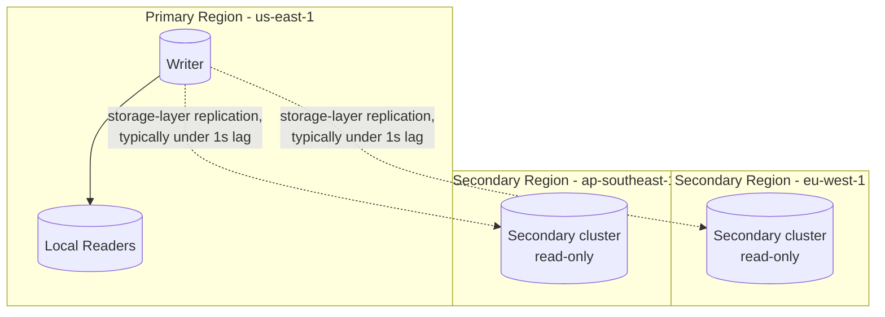

# Amazon Aurora


## Definition

Amazon Aurora is AWS's own relational database engine, built to be "wire-compatible" with MySQL
and PostgreSQL (your existing drivers, ORMs, and SQL all just work) but re-engineered underneath
to be faster, self-healing, and far more elastic than running MySQL/PostgreSQL yourself. It ships
as part of the Amazon RDS family — you create and manage Aurora clusters through the same RDS
console/API as regular RDS — but the storage engine underneath is entirely AWS's own design.

## Purpose

AWS noticed that classic relational databases (including RDS's own MySQL/PostgreSQL offerings)
were bottlenecked by a storage architecture designed in the 1990s: the database engine and
storage are tightly coupled, replication is slow because it ships whole data pages around, and
recovery after a crash can take minutes. Aurora was built from scratch to decouple compute from
storage, distribute storage across many nodes and Availability Zones automatically, and replicate
only the minimal log records needed — eliminating most of the pain points of traditional
relational databases at scale, while keeping 100% SQL compatibility so nothing about your
application code has to change.

The deeper engineering insight: in a traditional database, a write has to be durably persisted
*and* applied to the actual data pages before it's safe to replicate — that's slow, because it
couples "durable" with "applied." Aurora separates these: the write-ahead log record is shipped
to the distributed storage layer and considered durable the moment a quorum of storage nodes
acknowledge it; applying that log to actual data pages happens later, asynchronously, and in
parallel across the storage fleet. This single architectural decision is responsible for most of
Aurora's throughput and failover-speed advantage over classic RDS.

## How It Works

Aurora's defining trick is its storage layer: a single logical "cluster volume" that is actually
6 copies of your data, spread across 3 Availability Zones, decoupled from the compute instances
that run queries.



Step by step:
1. **One Writer instance** accepts all writes. Unlike standard RDS, Aurora ships only the
   redo-log stream to storage — not entire data pages — which is dramatically less network traffic.
2. **The storage layer is shared**, not per-instance. All reader instances read from the *same*
   underlying cluster volume, so adding a reader doesn't require copying the whole dataset —
   it can be added in minutes, not hours.
3. **6 copies across 3 AZs** means Aurora tolerates losing an entire AZ plus one more copy without
   losing data or write availability, and can lose up to 3 copies without losing read availability.
4. **Readers can be promoted to writer** automatically during failover, typically in under 30
   seconds — much faster than classic RDS Multi-AZ failover.
5. **Continuous backup to S3** happens in the background with no measurable performance impact,
   enabling point-in-time restore to any second in the last 35 days.
6. **Aurora Serverless v2** adds a mode where compute capacity scales up/down automatically in
   fine-grained increments based on load, including scaling to a low minimum during idle periods —
   useful for spiky or unpredictable workloads where you don't want to manage instance sizing.

### The Quorum Model: Why 6 Copies, 3 AZs, Specifically

The numbers aren't arbitrary — they're chosen to tolerate the loss of an entire Availability Zone
*plus* one additional storage node failure, without any interruption to write availability, and
without losing data.



- **Writes require a quorum of 4 out of 6 copies** to acknowledge before the write is considered
  durable. This tolerates losing an entire AZ (2 copies) plus one more copy elsewhere and still
  reaching quorum (4 of the remaining 4).
- **Reads require a quorum of 3 out of 6 copies**, which tolerates losing an entire AZ and one
  more copy while still being able to serve consistent reads.
- This is why Aurora's marketing claim "survives the loss of an entire AZ without downtime" is a
  precise, mechanically-grounded statement, not just a slogan — it's a direct consequence of the
  quorum math, not a vague promise.

### Replica Topology and Failover Priority



- Each Aurora Replica has a **promotion tier** (0–15, default varies) — during failover, Aurora
  promotes the healthiest replica in the lowest (highest-priority) tier first. You can explicitly
  set a specific replica as the preferred failover target by giving it tier 0.
- The **Cluster endpoint** always resolves to the current writer — your application's write path
  should use this endpoint exclusively.
- The **Reader endpoint** load-balances connections across all available Aurora Replicas — use
  this for read-only queries so new replicas are picked up automatically without app config
  changes.
- A **Custom Endpoint** lets you define your own subset of instances (e.g., route heavy
  analytical reads only to two beefier replicas, keeping the rest for lightweight app reads).

### Data Modeling Patterns for Aurora

Because Aurora is wire-compatible with MySQL/PostgreSQL, data modeling discipline is identical to
RDS (normalize for correctness, index deliberately, model cascades deliberately — see `rds.md`
for the shared fundamentals). What's specifically different and worth designing around in Aurora:

- **Favor larger, less frequent writes over many tiny ones where possible.** Because Aurora bills
  separately for storage I/O requests, a write pattern that issues one `UPDATE ... WHERE id IN
  (...)` touching 500 rows is both faster and cheaper than 500 separate single-row updates —
  this is a real cost-shape difference from RDS, where instance-hour cost dominates and I/O-count
  is comparatively invisible.
- **Use Aurora's fast cloning for pre-production environments**, rather than literally exporting
  and reimporting a full dataset — a clone shares the underlying storage pages copy-on-write, so
  it's created in seconds/minutes regardless of the source database's size, and only diverging
  pages consume extra storage.
- **Design read-heavy reporting queries to use the Reader endpoint or a Custom Endpoint**, never
  the Cluster (writer) endpoint — a common real-world mistake is an analyst's BI tool connecting
  directly to the writer endpoint "because that's the connection string everyone has," quietly
  competing with production writes for the same instance's CPU/memory.
- **Aurora Serverless v2 capacity planning is about ACU ranges, not fixed instance sizes.** Model
  your min/max ACU bounds around your actual traffic variance (e.g., min 0.5 ACU overnight, max 16
  ACU during peak), not a single "typical" number — the entire value proposition is in that range.

## Key Features / Components

- **MySQL & PostgreSQL compatibility** — your app, driver, and SQL stay the same; swapping RDS
  MySQL for Aurora MySQL is usually a snapshot-and-restore operation, not a rewrite.
- **Aurora Serverless v2** — automatic, fine-grained compute scaling (measured in Aurora Capacity
  Units, ACUs) including near-zero idle cost for dev/test workloads.
- **Up to 15 read replicas** (vs 5 on standard RDS), all sharing the same storage layer, each
  addable in minutes.
- **Aurora Global Database** — a primary cluster in one Region with secondary read clusters in up
  to 5 other Regions (newer limits allow up to 10 secondary Regions), with typical replication lag
  under 1 second, and fast cross-Region failover for disaster recovery. Promotion of a secondary
  Region to primary (a "managed planned failover" or unplanned failover) is measured in minutes,
  not hours — this is the headline reason teams choose Global Database over cross-Region read
  replicas on plain RDS.
- **Backtrack** (MySQL-compatible Aurora only) — rewind a cluster to a previous point in time
  without restoring from a full backup, useful for quick recovery from a bad migration/mistake.
- **Fast cloning** — create a new cluster that shares the same underlying storage pages
  copy-on-write, so clones for testing are near-instant and cheap.
- **Automatic storage scaling** — storage grows in 10 GB increments up to 128 TB (newer engine
  versions extend this further), no manual resize.
- **Aurora Serverless + Data API** — lets Lambda and other serverless compute query Aurora over
  HTTP without managing persistent DB connections (pairs with avoiding connection exhaustion).
- **Parallel Query (Aurora MySQL)** — pushes parts of analytical-style scan/aggregate queries down
  into the distributed storage layer itself, running them in parallel across storage nodes instead
  of pulling all the raw data up to the single compute instance first — a meaningful speedup for
  reporting-style queries that would otherwise bottleneck on the writer's own CPU.
- **Zero-ETL integration with Redshift** — continuous, near-real-time replication of Aurora data
  into Redshift for analytics without hand-built ETL pipelines.

## Common Architectures

**1. Multi-tier SaaS app on Aurora with Serverless v2.** Compute capacity scales with real
traffic rather than being provisioned for a guessed peak — a classic reason mid-size SaaS
companies prefer Aurora Serverless v2 over fixed-size RDS: the same application code, but billed
closer to actual usage, and no manual resize operations during traffic spikes.



**2. Global, low-latency reads with Aurora Global Database.** A primary cluster in us-east-1
handles writes; secondary clusters in eu-west-1 and ap-southeast-1 serve local reads with
sub-second lag, and can be promoted to primary during a regional disaster.



**3. Zero-ETL analytics pipeline.** Aurora serves live transactional traffic; a zero-ETL
integration continuously replicates changes into Redshift, where BI tools and data scientists run
heavy aggregations without ever touching the OLTP cluster.

**4. Dev/test fleet via fast cloning.** A shared "golden" Aurora cluster with realistic data is
cloned on demand for each feature branch's integration tests — each clone starts from the same
storage pages (copy-on-write) and only pays for pages that diverge, making dozens of parallel test
environments cheap and fast to spin up/tear down.

## Security & Compliance Considerations

- **Same network/IAM security model as RDS** — private subnets, security groups scoped to the
  app tier, IAM database authentication for MySQL/PostgreSQL-compatible Aurora, Secrets Manager
  for credential rotation. If you've secured an RDS instance correctly, securing an Aurora cluster
  is the same checklist, not a different one.
- **Encryption is cluster-wide, decided at creation**, exactly like RDS — you cannot retroactively
  encrypt an existing unencrypted Aurora cluster; the same snapshot → encrypted copy → restore
  path applies.
- **IAM authentication tokens are 15-minute-lived**, removing long-lived database passwords from
  application config entirely for supported engines — pairs naturally with Lambda/Data API
  architectures that already avoid persistent credentials.
- **Global Database cross-Region traffic** is AWS-managed dedicated infrastructure, not the public
  internet, which matters for compliance conversations about data residency and transit security
  — but it does **not** exempt you from data-residency obligations about *where* a copy of the
  data physically lives once it's replicated to a secondary Region.
- **Backtrack and clones inherit the source cluster's security posture** (encryption, VPC
  placement) by default — but always verify a clone's security group/subnet assignment explicitly
  rather than assuming it matches the source, especially for test environments that may be more
  loosely locked down.

## Monitoring & Observability

- **The same CloudWatch, Enhanced Monitoring, and Performance Insights tooling as RDS applies to
  Aurora** — no separate mental model needed for metrics collection.
- **Aurora-specific metrics worth alarming on**: `AuroraReplicaLag` (per-reader replication lag,
  normally sub-10ms but worth alerting if it climbs), `VolumeBytesUsed` (actual storage consumed
  — useful for catching unexpected growth from clone divergence or runaway writes), and
  `ServerlessDatabaseCapacity` (current ACU usage, essential for tuning Serverless v2 min/max
  bounds based on real observed load rather than guesses).
- **CloudWatch Database Insights** (the newer, cross-metric correlation view) is worth enabling
  for Aurora specifically because its distributed storage layer introduces metrics (I/O, quorum
  health) that a purely instance-level view doesn't fully explain on its own.

## Choosing Aurora vs Plain RDS — A Concrete Checklist

This is the single most-asked real architecture question between the two services, and it's
worth a direct checklist rather than leaving it implicit:

| Signal | Lean RDS | Lean Aurora |
|---|---|---|
| Traffic volume | Low/steady, fits comfortably on one instance | High, or growing past a single instance's ceiling |
| Read scaling needs | 0-2 replicas is plenty | Need many replicas (up to 15), added frequently |
| Failover speed requirement | 60-120s acceptable | Need sub-30s failover |
| Budget sensitivity at small scale | Aurora's I/O billing + premium isn't justified yet | Scale has grown past the point where the premium pays for itself |
| Engine requirement | Oracle or SQL Server specifically | MySQL or PostgreSQL compatible only |
| Multi-Region requirements | Cross-Region read replica is sufficient | Need Aurora Global Database's sub-second lag and fast promotion |
| Traffic shape | Flat and predictable | Spiky/unpredictable (pairs with Serverless v2) |
| Dev/test environment churn | Infrequent, snapshot/restore is fine | Frequent, need fast/cheap cloning |

If you're unsure which side of this table a given scenario lands on, the exam (and real
architecture reviews) usually give you at least two of these signals explicitly — identify them
before picking an answer rather than defaulting to "Aurora is just strictly better" (it isn't,
at small scale, due to cost).

## Use Cases — When to Use It

- You want MySQL/PostgreSQL's relational model and SQL compatibility but your workload has
  outgrown standard RDS performance (high transaction volume, heavy read replica fan-out).
- SaaS applications with unpredictable or spiky traffic, where **Aurora Serverless v2** avoids
  over-provisioning for peak while still auto-scaling down to save cost off-peak.
- Global applications needing low-latency reads in multiple Regions with a single source of
  truth (**Aurora Global Database**).
- Teams migrating off expensive commercial databases (Oracle/SQL Server) to a cheaper,
  open-source-compatible engine without losing relational guarantees (via AWS Schema Conversion
  Tool + DMS).
- Dev/test environments that need frequent, cheap, near-instant database clones.

## When NOT to Use It / Alternatives

- **Workload is simple, small, and cost-sensitive with steady low traffic** → plain **RDS** MySQL/
  PostgreSQL is usually cheaper; Aurora's minimum instance pricing and storage I/O charges aren't
  worth it at small scale (though Aurora Serverless v2 narrows this gap).
- **You need NoSQL flexible schema and massive horizontal write scale (millions of ops/sec)** →
  **DynamoDB** — Aurora, even scaled up, is still a single logical relational database.
- **Need Oracle or SQL Server specifically (licensing/compliance)** → Aurora doesn't support
  those engines; stay on **RDS** for Oracle/SQL Server.
- **Need an in-memory, sub-millisecond cache in front of your database** → **ElastiCache** — Aurora
  is fast relational storage, not a cache.
- **Need to run heavy analytical/OLAP queries across huge historical datasets** → **Redshift** —
  Aurora is optimized for OLTP, not big analytical scans (though Aurora + Redshift Federated
  Query / zero-ETL integrations can bridge the two).

## Real-World Pricing Examples

**Example 1 — Provisioned Aurora MySQL, moderate production workload:**
- Writer: `db.r6g.xlarge` (4 vCPU, 32 GB) at roughly $0.58/hr ≈ **~$423/month**.
- One reader at the same class ≈ **~$423/month**.
- Storage: 200 GB at roughly $0.10/GB-month ≈ **$20/month**.
- I/O: assume ~200 million I/O requests/month at roughly $0.20 per million ≈ **$40/month** — this
  line item is easy to forget when estimating Aurora cost versus RDS, and write-heavy workloads
  can make it a meaningfully larger share of the bill than storage itself.
- **Rough total: ~$906/month** for writer + 1 reader + storage + I/O.

**Example 2 — Aurora Serverless v2 for a spiky SaaS workload:**
- Scaling between 0.5 ACU (overnight minimum) and 8 ACU (business-hours peak), at roughly
  $0.12/ACU-hour.
- Rough weighted average across a day might land around 2 ACU-hours average → **~$0.24/hr →
  ~$175/month** compute — notably cheaper than provisioning a fixed instance sized for the 8 ACU
  peak 24/7, which would cost roughly 4x as much for capacity mostly sitting idle outside peak
  hours.
- This is the concrete argument for Serverless v2 over fixed instances specifically for
  *unpredictable or spiky* load — for flat, steady load, provisioned instances are usually
  cheaper because Serverless carries a per-ACU premium over the equivalent dedicated vCPU rate.

**Example 3 — Aurora Global Database cross-Region cost:**
- Add a secondary Region cluster (its own instance-hour + storage costs, same as a standalone
  cluster) **plus** cross-Region replicated data transfer, billed per GB — for a write-heavy
  cluster with large row sizes, this data transfer line item can be a genuinely significant,
  easy-to-underestimate addition to the bill; budget for it explicitly rather than assuming
  Global Database is "the primary cluster cost plus a little."

- Exact current rates: https://aws.amazon.com/rds/aurora/pricing/

## Limits & Quotas (Real, Current — Verify Before Relying On Them)

- **Max cluster storage**: up to **128 TiB** (newer engine versions on some configurations extend
  this further — check current engine-version-specific limits before assuming a hard ceiling).
- **Max Aurora Replicas per cluster**: **15**.
- **Max Aurora Global Database secondary Regions**: **5** (check current docs — this has been
  raised over time; don't assume the original limit without verifying).
- **Backtrack window (MySQL-compatible only)**: up to **72 hours**, configurable, consuming
  additional storage proportional to the window length and write volume.
- **Typical failover time (within-Region, replica promotion)**: **under 30 seconds**.
- **Typical Global Database cross-Region replication lag**: **under 1 second** under normal
  conditions (can increase under very heavy write bursts or network degradation).
- **Aurora Serverless v2 ACU range**: minimum as low as **0.5 ACU**, maximum up to **128 ACU** per
  instance (verify current ceiling — this has increased since v2's initial release).
- **Max DB instances per Aurora cluster**: **1 writer + up to 15 readers = 16 total**.

## Troubleshooting / Common Issues

- **"Why is my bill higher than an equivalent RDS instance?"** → almost always the separately
  billed I/O requests; a write-heavy workload with many small transactions generates far more
  billable I/O than the same logical work batched into fewer, larger transactions.
- **Application connects to the writer endpoint for read-only reporting, overloading the primary**
  → classic misconfiguration; route read traffic through the Reader or a Custom Endpoint instead.
- **Aurora Serverless v2 scaling feels "laggy" under a sudden traffic spike** → scaling isn't
  instantaneous; it ramps within configured ACU bounds over seconds, not milliseconds — size the
  minimum ACU high enough to absorb the first moments of a spike if sub-second responsiveness to
  bursts matters.
- **Global Database secondary cluster reads look stale during a regional network event** →
  expected: Global Database read replication is asynchronous across Regions; if your application
  needs strict read consistency, reads should go to the primary Region, with secondaries used only
  for genuinely latency-tolerant read paths or DR standby.
- **Clone diverges unexpectedly in storage cost over time** → clones are copy-on-write, so heavy
  write activity on either the clone or the source after cloning causes pages to diverge and
  consume real additional storage — a clone used as a long-lived environment (not a short-lived
  test) eventually costs close to a full additional copy.
- **Backtrack "restored" data that doesn't match expectations** → Backtrack rewinds the *entire*
  cluster to a point in time; it cannot selectively undo one table/transaction while preserving
  others — for partial recovery, a logical export/restore or point-in-time restore to a *new*
  cluster is the right tool instead.

## Why It's Important

**Real world:** Aurora is frequently the default "just use this" recommendation for new
relational workloads on AWS because it combines open-source compatibility (no lock-in to a
proprietary query language) with significantly better throughput, faster failover, and cheaper
read-scaling than plain RDS — at a modest price premium. Understanding when that premium is worth
it (vs plain RDS) is a real cost-architecture decision, not just an exam topic.

**Exam mapping:**
- **SAA-C03** — Domain 3.3 (Determine high-performing database solutions — Aurora vs RDS vs
  DynamoDB tradeoffs is one of the most tested comparisons) and Domain 2.2 (Aurora Global
  Database for multi-Region resilience) and Domain 4.3 (Aurora Serverless for cost-optimized,
  spiky workloads).
- **DVA-C03** — Task 1.3 (Use data stores in application development — Aurora Serverless + Data
  API as a Lambda-friendly relational option without connection pool exhaustion).
- **MLA-C02** — Domain 1 (Data Preparation) — Aurora zero-ETL integration with Redshift is a
  modern pattern for feeding analytical/ML pipelines without custom ETL jobs.

**Expanded exam scenarios:**
- *"A relational workload needs to survive the complete loss of an Availability Zone with zero
  data loss and minimal write-availability interruption."* → Aurora's 6-copies/3-AZ quorum
  design is purpose-built for exactly this; classic RDS Multi-AZ also survives AZ loss but with a
  longer failover window and no quorum-based read guarantee.
- *"An application's traffic is extremely unpredictable — long idle periods interrupted by sudden
  10x spikes — and the team doesn't want to manage capacity."* → Aurora Serverless v2, not a
  fixed-size instance sized for the spike (wasteful) or the idle period (will throttle/fail
  during spikes).
- *"A global company needs read access to the same relational dataset with low latency from three
  continents, with a single authoritative write Region."* → Aurora Global Database, not simply
  "add read replicas in other Regions" on plain RDS — the question is testing whether you know
  Global Database's sub-second cross-Region replication is a distinct, purpose-built feature.
- *"A dev team needs dozens of near-identical database environments for parallel feature branch
  testing, refreshed frequently, without ballooning storage cost."* → Aurora's fast cloning
  (copy-on-write) is the textbook answer; manually snapshotting/restoring a full database for
  every branch is the distractor "it technically works but is the wrong tool" answer.
- *"A nightly analytics job needs recent transactional data without impacting the live Aurora
  cluster or building a custom ETL pipeline."* → Zero-ETL integration with Redshift.

## Pricing Model (summary)

- **Instance-based mode** — billed per hour per instance class, similar structure to RDS but
  typically ~20% higher per-vCPU rate in exchange for the storage architecture benefits.
- **Serverless v2** — billed per Aurora Capacity Unit (ACU)-hour, scaling with actual load; no
  charge for capacity you're not using once scaled down.
- **Storage** — billed per GB-month, consumed automatically as data grows (no pre-provisioning).
- **I/O requests** — Aurora separately bills for the number of I/O requests to the storage layer
  (a real cost driver for write-heavy workloads — budget for this, it surprises people; see the
  worked examples above for the concrete shape of this).
- **Backup storage** beyond the free allotment, and cross-Region replication data transfer for
  Global Database, are additional line items.
- Exact current rates: https://aws.amazon.com/rds/aurora/pricing/

## Hands-on Lab (Floci)

Aurora clusters are created through the same RDS API (`create-db-cluster`), just with an
`aurora-mysql` or `aurora-postgresql` engine. Floci's RDS support is Docker-backed for standard
MySQL/Postgres; its Aurora-specific cluster semantics (storage-layer sharing, fast cloning,
Serverless v2 scaling) are **control-plane only** — commands succeed and return realistic
responses, but you won't see Aurora's actual multi-copy storage behavior locally. Use this lab to
build CLI muscle memory for cluster/instance separation, not to validate Aurora's performance
characteristics.

```bash
# 1. Create an Aurora MySQL-compatible cluster
awslocal rds create-db-cluster \
  --db-cluster-identifier study-aurora \
  --engine aurora-mysql \
  --engine-version 8.0.mysql_aurora.3.04.0 \
  --master-username dbadmin \
  --master-user-password ChangeMe123!

# 2. Add a writer instance to the cluster
awslocal rds create-db-instance \
  --db-instance-identifier study-aurora-writer \
  --db-instance-class db.r6g.large \
  --engine aurora-mysql \
  --db-cluster-identifier study-aurora

# 3. Add a reader instance (shares the cluster's storage in real Aurora)
awslocal rds create-db-instance \
  --db-instance-identifier study-aurora-reader \
  --db-instance-class db.r6g.large \
  --engine aurora-mysql \
  --db-cluster-identifier study-aurora

# 4. Inspect the cluster
awslocal rds describe-db-clusters --db-cluster-identifier study-aurora

# 5. Clean up
awslocal rds delete-db-instance --db-instance-identifier study-aurora-reader --skip-final-snapshot
awslocal rds delete-db-instance --db-instance-identifier study-aurora-writer --skip-final-snapshot
awslocal rds delete-db-cluster --db-cluster-identifier study-aurora --skip-final-snapshot
```

For real performance/behavior validation, pair this lab with AWS Free Tier (`db.t3.micro` Aurora
instance, within free-tier hours) or just read AWS's own Aurora storage architecture whitepaper.

## Exam Tips

- The exam loves the phrase **"MySQL/PostgreSQL compatible, needs better performance and
  availability than RDS, minimal application changes"** — that's Aurora, not DynamoDB (DynamoDB
  requires schema/access-pattern redesign, which isn't "minimal changes").
- Know the **storage model**: 6 copies / 3 AZs / quorum writes (4 of 6) and reads (3 of 6) — this
  is why Aurora tolerates AZ failure without downtime.
- **Aurora Serverless v2** is the answer to "unpredictable/spiky traffic, don't want to manage
  capacity, relational data" — contrast with DynamoDB on-demand mode (NoSQL) and Fargate
  (compute, not database).
- **Aurora Global Database** = the answer for "sub-second cross-Region read replication, disaster
  recovery across Regions, relational data" questions.
- Don't confuse Aurora Replicas (read scaling within a cluster) with Aurora Global Database
  (cross-Region) — different features solving different problems.
- **Cluster endpoint vs Reader endpoint vs Custom endpoint** — know all three exist and which
  traffic type belongs on which; a question describing reporting traffic hitting the writer is
  testing whether you'd route it to the Reader endpoint instead.
- **Backtrack is MySQL-compatible Aurora only** — don't apply it as an answer for Aurora
  PostgreSQL scenarios; point-in-time restore to a new cluster is the PostgreSQL-compatible
  equivalent recovery tool.
- **Fast cloning is copy-on-write, not a full copy** — if a question emphasizes "quick, cheap,
  many parallel test environments from the same large dataset," that's the cloning trigger phrase.

## Further Reading

- [What is Amazon Aurora?](https://docs.aws.amazon.com/AmazonRDS/latest/AuroraUserGuide/CHAP_AuroraOverview.html) —
  official overview.
- [Amazon Aurora DB clusters](https://docs.aws.amazon.com/AmazonRDS/latest/AuroraUserGuide/Aurora.Overview.html) —
  the authoritative description of the cluster/storage model referenced above.
- [Using Amazon Aurora Global Database](https://docs.aws.amazon.com/AmazonRDS/latest/AuroraUserGuide/aurora-global-database.html) —
  cross-Region replication mechanics in detail.
- [Understand Amazon Aurora high availability and disaster recovery](https://aws.amazon.com/blogs/database/understand-amazon-aurora-high-availability-and-disaster-recovery-from-an-oracle-perspective/) —
  AWS Database Blog deep dive on the HA/DR model.
- [Amazon Aurora pricing](https://aws.amazon.com/rds/aurora/pricing/) — current, authoritative rates.

## Related Terms

- [`rds.md`](rds.md) — the non-Aurora relational engines Aurora is compatible with and compared to.
- [`dynamodb.md`](dynamodb.md) — the NoSQL alternative when relational no longer fits.
- [`redshift.md`](redshift.md) — the analytical counterpart; zero-ETL integration connects the two.
- [`database-selection-guide.md`](database-selection-guide.md) — full decision tree.
- Glossary: Quorum, RPO/RTO, Read Replica, Serverless, Cluster Volume.

---

**Image credit:** "Amazon Aurora DB cluster architecture" and "Aurora Global Database" — official
diagrams from the AWS Aurora User Guide, Amazon Web Services, Inc. Source:
https://docs.aws.amazon.com/AmazonRDS/latest/AuroraUserGuide/images/aurora_architecture.png and
https://docs.aws.amazon.com/AmazonRDS/latest/AuroraUserGuide/images/aurora-global-databases-conceptual-illo.png


*Figure: Aurora's cluster volume is shared by the writer and all readers — adding a reader does not require copying data. Source: AWS Aurora User Guide (docs.aws.amazon.com).*


*Figure: Aurora Global Database — one primary Region for writes, up to several secondary Regions for low-latency local reads. Source: AWS Aurora User Guide (docs.aws.amazon.com).*
