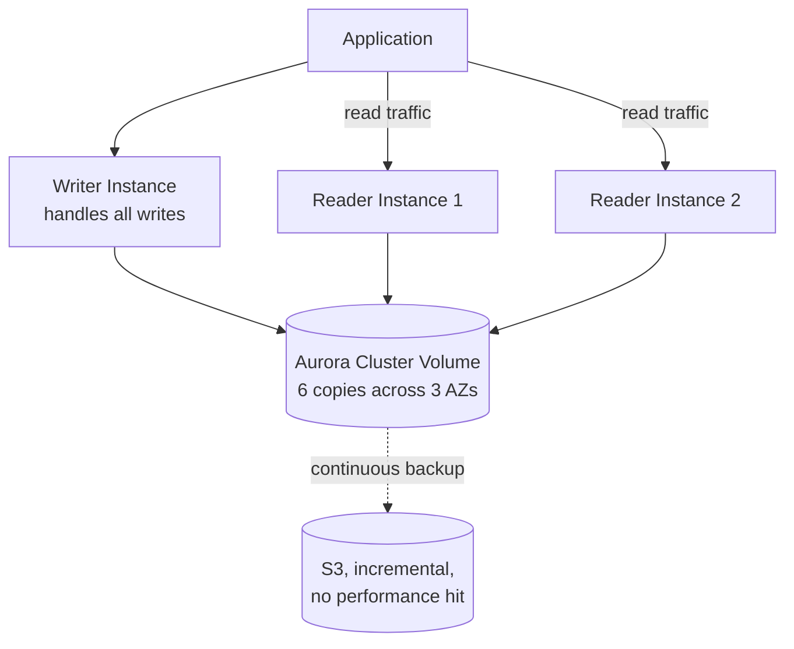

# Amazon Aurora


## Definition

Amazon Aurora is AWS's own relational database engine, built to be "wire-compatible" with MySQL
and PostgreSQL (your existing drivers, ORMs, and SQL all just work) but re-engineered underneath
to be faster, self-healing, and far more elastic than running MySQL/PostgreSQL yourself.

## Purpose

AWS noticed that classic relational databases (including RDS's own MySQL/PostgreSQL offerings)
were bottlenecked by a storage architecture designed in the 1990s: the database engine and
storage are tightly coupled, replication is slow because it ships whole data pages around, and
recovery after a crash can take minutes. Aurora was built from scratch to decouple compute from
storage, distribute storage across many nodes and Availability Zones automatically, and replicate
only the minimal log records needed — eliminating most of the pain points of traditional
relational databases at scale, while keeping 100% SQL compatibility so nothing about your
application code has to change.

## How It Works

Aurora's defining trick is its storage layer: a single logical "cluster volume" that is actually
6 copies of your data, spread across 3 Availability Zones, decoupled from the compute instances
that run queries.



Step by step:
1. **One Writer instance** accepts all writes. Unlike standard RDS, Aurora ships only the
   redo-log stream to storage — not entire data pages — which is dramatically less network traffic.
2. **The storage layer is shared**, not per-instance. All reader instances read from the *same*
   underlying cluster volume, so adding a reader doesn't require copying the whole dataset —
   it can be added in minutes, not hours.
3. **6 copies across 3 AZs** means Aurora tolerates losing an entire AZ plus one more copy without
   losing data or write availability, and can lose up to 3 copies without losing read availability.
4. **Readers can be promoted to writer** automatically during failover, typically in under 30
   seconds — much faster than classic RDS Multi-AZ failover.
5. **Continuous backup to S3** happens in the background with no measurable performance impact,
   enabling point-in-time restore to any second in the last 35 days.
6. **Aurora Serverless v2** adds a mode where compute capacity scales up/down automatically in
   fine-grained increments based on load, including scaling to a low minimum during idle periods —
   useful for spiky or unpredictable workloads where you don't want to manage instance sizing.

## Key Features / Components

- **MySQL & PostgreSQL compatibility** — your app, driver, and SQL stay the same; swapping RDS
  MySQL for Aurora MySQL is usually a snapshot-and-restore operation, not a rewrite.
- **Aurora Serverless v2** — automatic, fine-grained compute scaling (measured in Aurora Capacity
  Units, ACUs) including near-zero idle cost for dev/test workloads.
- **Up to 15 read replicas** (vs 5 on standard RDS), all sharing the same storage layer, each
  addable in minutes.
- **Aurora Global Database** — a primary cluster in one Region with secondary read clusters in up
  to 5 other Regions, with typical replication lag under 1 second, and fast cross-Region failover
  for disaster recovery.
- **Backtrack** (MySQL-compatible Aurora only) — rewind a cluster to a previous point in time
  without restoring from a full backup, useful for quick recovery from a bad migration/mistake.
- **Fast cloning** — create a new cluster that shares the same underlying storage pages
  copy-on-write, so clones for testing are near-instant and cheap.
- **Automatic storage scaling** — storage grows in 10 GB increments up to 128 TB, no manual resize.
- **Aurora Serverless + Data API** — lets Lambda and other serverless compute query Aurora over
  HTTP without managing persistent DB connections (pairs with avoiding connection exhaustion).

## Use Cases — When to Use It

- You want MySQL/PostgreSQL's relational model and SQL compatibility but your workload has
  outgrown standard RDS performance (high transaction volume, heavy read replica fan-out).
- SaaS applications with unpredictable or spiky traffic, where **Aurora Serverless v2** avoids
  over-provisioning for peak while still auto-scaling down to save cost off-peak.
- Global applications needing low-latency reads in multiple Regions with a single source of
  truth (**Aurora Global Database**).
- Teams migrating off expensive commercial databases (Oracle/SQL Server) to a cheaper,
  open-source-compatible engine without losing relational guarantees (via AWS Schema Conversion
  Tool + DMS).
- Dev/test environments that need frequent, cheap, near-instant database clones.

## When NOT to Use It / Alternatives

- **Workload is simple, small, and cost-sensitive with steady low traffic** → plain **RDS** MySQL/
  PostgreSQL is usually cheaper; Aurora's minimum instance pricing and storage I/O charges aren't
  worth it at small scale (though Aurora Serverless v2 narrows this gap).
- **You need NoSQL flexible schema and massive horizontal write scale (millions of ops/sec)** →
  **DynamoDB** — Aurora, even scaled up, is still a single logical relational database.
- **Need Oracle or SQL Server specifically (licensing/compliance)** → Aurora doesn't support
  those engines; stay on **RDS** for Oracle/SQL Server.
- **Need an in-memory, sub-millisecond cache in front of your database** → **ElastiCache** — Aurora
  is fast relational storage, not a cache.
- **Need to run heavy analytical/OLAP queries across huge historical datasets** → **Redshift** —
  Aurora is optimized for OLTP, not big analytical scans (though Aurora + Redshift Federated
  Query / zero-ETL integrations can bridge the two).

## Why It's Important

**Real world:** Aurora is frequently the default "just use this" recommendation for new
relational workloads on AWS because it combines open-source compatibility (no lock-in to a
proprietary query language) with significantly better throughput, faster failover, and cheaper
read-scaling than plain RDS — at a modest price premium. Understanding when that premium is worth
it (vs plain RDS) is a real cost-architecture decision, not just an exam topic.

**Exam mapping:**
- **SAA-C03** — Domain 3.3 (Determine high-performing database solutions — Aurora vs RDS vs
  DynamoDB tradeoffs is one of the most tested comparisons) and Domain 2.2 (Aurora Global
  Database for multi-Region resilience) and Domain 4.3 (Aurora Serverless for cost-optimized,
  spiky workloads).
- **DVA-C03** — Task 1.3 (Use data stores in application development — Aurora Serverless + Data
  API as a Lambda-friendly relational option without connection pool exhaustion).
- **MLA-C02** — Domain 1 (Data Preparation) — Aurora zero-ETL integration with Redshift is a
  modern pattern for feeding analytical/ML pipelines without custom ETL jobs.

## Pricing Model (summary)

- **Instance-based mode** — billed per hour per instance class, similar structure to RDS but
  typically ~20% higher per-vCPU rate in exchange for the storage architecture benefits.
- **Serverless v2** — billed per Aurora Capacity Unit (ACU)-hour, scaling with actual load; no
  charge for capacity you're not using once scaled down.
- **Storage** — billed per GB-month, consumed automatically as data grows (no pre-provisioning).
- **I/O requests** — Aurora separately bills for the number of I/O requests to the storage layer
  (a real cost driver for write-heavy workloads — budget for this, it surprises people).
- **Backup storage** beyond the free allotment, and cross-Region replication data transfer for
  Global Database, are additional line items.
- Exact current rates: https://aws.amazon.com/rds/aurora/pricing/

## Hands-on Lab (Floci)

Aurora clusters are created through the same RDS API (`create-db-cluster`), just with an
`aurora-mysql` or `aurora-postgresql` engine. Floci's RDS support is Docker-backed for standard
MySQL/Postgres; its Aurora-specific cluster semantics (storage-layer sharing, fast cloning,
Serverless v2 scaling) are **control-plane only** — commands succeed and return realistic
responses, but you won't see Aurora's actual multi-copy storage behavior locally. Use this lab to
build CLI muscle memory for cluster/instance separation, not to validate Aurora's performance
characteristics.

```bash
# 1. Create an Aurora MySQL-compatible cluster
awslocal rds create-db-cluster \
  --db-cluster-identifier study-aurora \
  --engine aurora-mysql \
  --engine-version 8.0.mysql_aurora.3.04.0 \
  --master-username dbadmin \
  --master-user-password ChangeMe123!

# 2. Add a writer instance to the cluster
awslocal rds create-db-instance \
  --db-instance-identifier study-aurora-writer \
  --db-instance-class db.r6g.large \
  --engine aurora-mysql \
  --db-cluster-identifier study-aurora

# 3. Add a reader instance (shares the cluster's storage in real Aurora)
awslocal rds create-db-instance \
  --db-instance-identifier study-aurora-reader \
  --db-instance-class db.r6g.large \
  --engine aurora-mysql \
  --db-cluster-identifier study-aurora

# 4. Inspect the cluster
awslocal rds describe-db-clusters --db-cluster-identifier study-aurora

# 5. Clean up
awslocal rds delete-db-instance --db-instance-identifier study-aurora-reader --skip-final-snapshot
awslocal rds delete-db-instance --db-instance-identifier study-aurora-writer --skip-final-snapshot
awslocal rds delete-db-cluster --db-cluster-identifier study-aurora --skip-final-snapshot
```

For real performance/behavior validation, pair this lab with AWS Free Tier (`db.t3.micro` Aurora
instance, within free-tier hours) or just read AWS's own Aurora storage architecture whitepaper.

## Exam Tips

- The exam loves the phrase **"MySQL/PostgreSQL compatible, needs better performance and
  availability than RDS, minimal application changes"** — that's Aurora, not DynamoDB (DynamoDB
  requires schema/access-pattern redesign, which isn't "minimal changes").
- Know the **storage model**: 6 copies / 3 AZs / quorum writes (4 of 6) and reads (3 of 6) — this
  is why Aurora tolerates AZ failure without downtime.
- **Aurora Serverless v2** is the answer to "unpredictable/spiky traffic, don't want to manage
  capacity, relational data" — contrast with DynamoDB on-demand mode (NoSQL) and Fargate
  (compute, not database).
- **Aurora Global Database** = the answer for "sub-second cross-Region read replication, disaster
  recovery across Regions, relational data" questions.
- Don't confuse Aurora Replicas (read scaling within a cluster) with Aurora Global Database
  (cross-Region) — different features solving different problems.

## Related Terms

- [`rds.md`](rds.md) — the non-Aurora relational engines Aurora is compatible with and compared to.
- [`dynamodb.md`](dynamodb.md) — the NoSQL alternative when relational no longer fits.
- [`redshift.md`](redshift.md) — the analytical counterpart; zero-ETL integration connects the two.
- [`database-selection-guide.md`](database-selection-guide.md) — full decision tree.
- Glossary: Quorum, RPO/RTO, Read Replica, Serverless, Cluster Volume.
