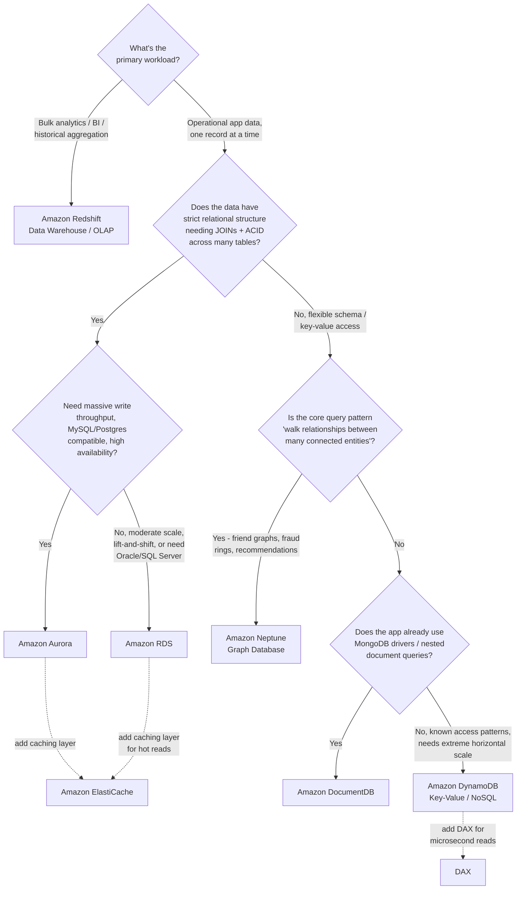

# Database Selection Guide — Choosing the Right AWS Database


## Definition

This isn't a single service — it's the decision framework for picking *which* AWS database to
use for a given workload: relational (RDS/Aurora), key-value/NoSQL (DynamoDB), in-memory
(ElastiCache), document (DocumentDB), graph (Neptune), or analytical/data warehouse (Redshift).

## Purpose

AWS deliberately offers many different databases instead of one "does everything" database
because different workloads have genuinely different needs that trade off against each other —
you cannot simultaneously optimize for unlimited horizontal write scale, complex ad-hoc joins,
strict ACID transactions across many tables, sub-millisecond latency, and petabyte-scale
analytical aggregation in a single engine. This guide exists because "which database should I
use" is one of the most common real architecture questions *and* one of the most heavily tested
exam skills across SAA-C03, DVA-C03, and MLA-C02 — getting it right is less about memorizing
features and more about correctly identifying the **shape of the workload** first.

## How It Works — The Decision Tree

The fastest way to narrow down the right database is to ask, in order: (1) is this data mostly
read/written one record at a time by an app (operational), or queried in bulk for analysis
(analytical)? (2) if operational, does it need strict relational structure/joins, or is it
simpler key-value/document access? (3) is relationship-traversal the actual core query pattern?
(4) is raw read speed from a cache the bottleneck, layered on top of one of the above?



Step by step through the tree:
1. **First fork — operational vs analytical.** If the workload is "run a report/dashboard over
   millions of historical rows," stop here — that's **Redshift**, regardless of what the
   underlying operational system is. Analytical workloads are a different shape entirely and
   should almost never share infrastructure with your live transactional database.
2. **Second fork — relational structure needed?** If your data genuinely has entities connected
   by foreign keys, needs multi-table transactions to stay consistent (e.g., debit one account,
   credit another, atomically), and the queries are naturally expressed as SQL JOINs, you're in
   relational territory.
3. **Third fork (within relational) — how much scale/availability do you need?** If you're
   migrating an existing engine as-is (Oracle, SQL Server, or just "keep it simple"), **RDS** is
   usually sufficient and cheaper. If you need Aurora's extra throughput, faster failover, up to
   15 read replicas, Global Database, or Serverless scaling, choose **Aurora**.
4. **Fourth fork (non-relational) — is this fundamentally about relationships/traversal?** If the
   core query is "starting from this node, walk N hops of connections" (social graphs, fraud
   rings, recommendations), that's a graph-shaped problem — **Neptune** — even though the data
   could technically be forced into tables or key-value items.
5. **Fifth fork — document vs key-value.** If your team/app already speaks MongoDB (drivers,
   aggregation pipeline, nested document queries), **DocumentDB** avoids a rewrite. If you're
   starting fresh and your access patterns are well-known and simple (get-by-key, query-by-sort-key),
   **DynamoDB** scales further and costs less at extreme scale.
6. **Caching is an overlay, not a replacement.** Whatever operational database you land on,
   **ElastiCache** (or **DAX** specifically for DynamoDB) sits in front of it when read latency or
   database load becomes the bottleneck — it's never the *primary* store of truth.

## Key Features / Components — Quick Comparison Table

| Database | Data Model | Scaling | Consistency | Query Style | Best For |
|---|---|---|---|---|---|
| **RDS** | Relational (rows/tables) | Vertical + read replicas | Strong (ACID) | SQL, JOINs | Lift-and-shift, licensed engines, moderate scale |
| **Aurora** | Relational (MySQL/Postgres compatible) | Vertical + up to 15 replicas + Serverless | Strong (ACID) | SQL, JOINs | High-throughput relational, global reads, spiky load |
| **DynamoDB** | Key-value / document | Horizontal, near-unlimited | Eventual (default) or strong (opt-in) | Key lookups, limited queries via indexes | Massive scale, known access patterns, serverless apps |
| **ElastiCache** | In-memory key-value | Horizontal (cluster mode) | Not authoritative — a cache | Simple key ops | Sub-ms reads, session store, leaderboards |
| **Redshift** | Columnar / relational (OLAP) | MPP across compute nodes | Strong, but not transactional workload | SQL, heavy aggregation | BI dashboards, historical analytics, data warehousing |
| **DocumentDB** | Document (BSON) | Vertical + up to 15 replicas | Strong (ACID within doc) | MongoDB query/aggregation API | Existing MongoDB workloads, flexible nested schema |
| **Neptune** | Graph (property graph / RDF) | Vertical + up to 15 replicas | Strong | Gremlin / openCypher / SPARQL traversal | Relationship-heavy data: social, fraud, recommendations |

## Use Cases — When to Use Each (At a Glance)

- **E-commerce order system, banking ledger** → RDS or Aurora (strict relational consistency, JOINs).
- **Global SaaS app with spiky traffic, needs relational data** → Aurora Serverless v2.
- **Shopping cart, gaming leaderboard, IoT device state at massive scale** → DynamoDB.
- **Session store, product catalog cache, rate limiting** → ElastiCache.
- **Quarterly revenue report across 3 years of sales data** → Redshift.
- **Content management system already built on MongoDB** → DocumentDB.
- **Fraud ring detection, "people you may know," recommendation engine** → Neptune.

## When NOT to Use (Cross-Service Anti-Patterns)

- **Don't put analytical workloads on your OLTP database** — a monthly report shouldn't be able
  to slow down checkout. Separate the systems (Redshift, or Athena for occasional queries).
- **Don't force a graph problem into relational tables past 2–3 hops of traversal** — the JOIN
  chains become unreadable and slow; that's what Neptune is for.
- **Don't choose DynamoDB because it's "the scalable one" if your access patterns are still
  unknown/evolving** — DynamoDB punishes late schema changes far more than a relational database
  does; prototype with RDS/Aurora first if requirements are still shifting.
- **Don't add a cache (ElastiCache/DAX) before you've confirmed the database is actually the
  bottleneck** — it's additional operational complexity (invalidation, staleness) that isn't
  "free" performance.
- **Don't pick DocumentDB just because data is JSON-shaped** — if you have no existing MongoDB
  investment, DynamoDB is usually cheaper and scales further for the same "flexible schema" need.

## Why It's Important

**Real world:** The single most expensive and hardest-to-reverse architecture decision in most
systems is the choice of primary data store — migrating from one database family to another
after the fact (relational to NoSQL, or vice versa) often means redesigning the entire data
access layer, not just swapping a connection string. Getting the first-pass shape right (by
correctly identifying OLTP vs OLAP, relational vs key-value vs graph) prevents painful, costly
re-architecture later.

**Exam mapping — this is directly tested, not incidental:**
- **SAA-C03** — Domain 3.3 ("Determine high-performing database solutions") *is this decision
  tree*, almost verbatim — the exam gives a scenario and expects you to map it to RDS vs Aurora
  vs DynamoDB vs Redshift vs ElastiCache vs DocumentDB vs Neptune correctly. Domain 4.3
  ("Design cost-optimized database solutions") layers cost tradeoffs (On-Demand vs Reserved,
  Aurora Serverless vs provisioned, DynamoDB On-Demand vs Provisioned) on top of this same tree.
- **DVA-C03** — Task 1.3 ("Use data stores in application development") expects you to recognize
  which database an application's described access pattern implies, and code/SDK-level
  consequences of that choice (consistency models, connection pooling via RDS Proxy, DynamoDB
  SDK operations).
- **MLA-C02** — Domain 1 (Data Preparation for ML and AI) frequently frames a scenario as "where
  should this data live before/during the ML pipeline" — relational sources feeding Redshift via
  zero-ETL, DynamoDB as a low-latency feature store, Neptune ML for graph-based model features.

## Pricing Model (summary)

Pricing philosophy differs by category, and picking the wrong *category* (not just the wrong
service) is the most common real cost mistake:
- **Provisioned/instance-based** (RDS, Aurora, DocumentDB, Neptune, provisioned Redshift) — you
  pay per hour for capacity whether you use it or not; right-sizing and Reserved commitments
  matter most here.
- **Request/usage-based** (DynamoDB On-Demand, Redshift Serverless, ElastiCache Serverless) — you
  pay for what you actually use, better for unpredictable or low/intermittent traffic, can be
  *more* expensive than provisioned at sustained high, predictable load.
- **Storage is (almost) always billed separately from compute** across every one of these
  services — don't forget to budget for it when estimating cost.
- See each service's own doc for exact billing dimensions and the official pricing page.

## Hands-on Lab (Floci)

Cross-reference lab: provision the two most-used services side by side to feel the API/data-model
difference directly.

```bash
# Relational: RDS Postgres (strict schema, SQL JOINs)
awslocal rds create-db-instance \
  --db-instance-identifier compare-rds \
  --db-instance-class db.t3.micro --engine postgres \
  --master-username dbadmin --master-user-password ChangeMe123! \
  --allocated-storage 20

# Key-value/NoSQL: DynamoDB (flexible schema, key-based access)
awslocal dynamodb create-table \
  --table-name CompareTable \
  --attribute-definitions AttributeName=Id,AttributeType=S \
  --key-schema AttributeName=Id,KeyType=HASH \
  --billing-mode PAY_PER_REQUEST

# Notice: RDS required you to define columns/types upfront via SQL DDL (not shown — you'd run
# CREATE TABLE after connecting); DynamoDB required only a key schema — every item can otherwise
# carry totally different attributes. That difference IS the relational-vs-NoSQL decision made real.

# Clean up
awslocal rds delete-db-instance --db-instance-identifier compare-rds --skip-final-snapshot
awslocal dynamodb delete-table --table-name CompareTable
```

For services Floci doesn't yet emulate (ElastiCache, Redshift, DocumentDB, Neptune), see each
individual service doc's lab section for the documented fallback (local Redis/Postgres/Mongo/
Gremlin containers) — this guide's job is the decision, not re-running every lab.

## Exam Tips

- **Read the scenario for the workload shape before the service names.** "Thousands of small
  concurrent transactions" ≠ "one big nightly report" ≠ "walk a social graph" — identify the
  shape first, then match to the service family.
- **If two services both seem plausible, re-read for the tie-breaker keyword**: "MySQL/Postgres
  compatible" → Aurora over DynamoDB; "already using MongoDB" → DocumentDB over DynamoDB;
  "relationships, hops, connections" → Neptune over everything else; "historical, aggregate,
  dashboard" → Redshift over Aurora/RDS even though both are SQL.
- **Cost-optimization questions (Domain 4) reuse this same tree** — they just add "...and it
  needs to be cheap/predictable," which usually means Reserved Instances for provisioned
  services, or On-Demand/Serverless for spiky ones.
- **Don't overthink graph questions** — if Neptune isn't explicitly named or strongly implied
  (multi-hop relationship traversal is the literal query), it's probably not the answer; it's a
  less common but very recognizable pattern once you've seen it.

## Related Terms

- [`rds.md`](rds.md), [`aurora.md`](aurora.md), [`dynamodb.md`](dynamodb.md),
  [`elasticache.md`](elasticache.md), [`redshift.md`](redshift.md), [`documentdb.md`](documentdb.md),
  [`neptune.md`](neptune.md) — full detail on each service referenced above.
- Glossary: OLTP, OLAP, ACID, Eventual Consistency, Horizontal vs Vertical Scaling, Data Warehouse.
