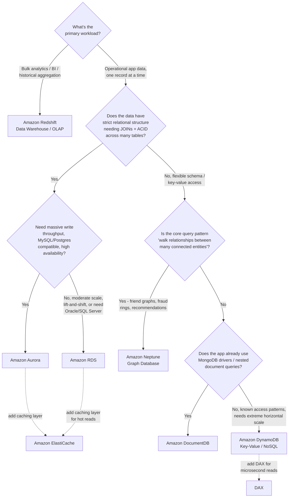
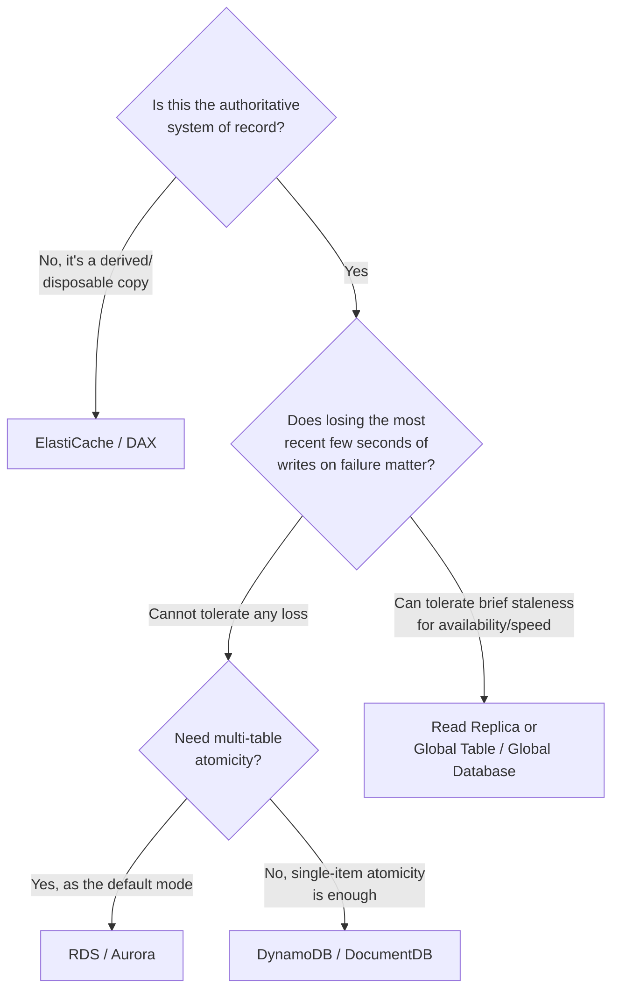

# Database Selection Guide — Choosing the Right AWS Database

> **Appears in:** [DVA-C03](../../certifications/dva-c03/README.md) · [SAA-C03](../../certifications/saa-c03/README.md)


## Definition

This isn't a single service — it's the decision framework for picking *which* AWS database to
use for a given workload: relational (RDS/Aurora), key-value/NoSQL (DynamoDB), in-memory
(ElastiCache), document (DocumentDB), graph (Neptune), or analytical/data warehouse (Redshift).

## Purpose

AWS deliberately offers many different databases instead of one "does everything" database
because different workloads have genuinely different needs that trade off against each other —
you cannot simultaneously optimize for unlimited horizontal write scale, complex ad-hoc joins,
strict ACID transactions across many tables, sub-millisecond latency, and petabyte-scale
analytical aggregation in a single engine. This guide exists because "which database should I
use" is one of the most common real architecture questions *and* one of the most heavily tested
exam skills across SAA-C03, DVA-C03, and MLA-C02 — getting it right is less about memorizing
features and more about correctly identifying the **shape of the workload** first.

This is sometimes called "polyglot persistence" — using multiple purpose-built databases within
one system, each handling the part of the workload it's actually good at, rather than forcing
every workload through a single general-purpose database. A single real-world application
commonly uses three or four of these services simultaneously (e.g., Aurora for transactional
data, ElastiCache for session storage, Redshift for analytics, and S3 for file storage) — the
skill being tested is routing each *piece* of the workload to its right home, not picking one
winner for the whole system.

## How It Works — The Decision Tree

The fastest way to narrow down the right database is to ask, in order: (1) is this data mostly
read/written one record at a time by an app (operational), or queried in bulk for analysis
(analytical)? (2) if operational, does it need strict relational structure/joins, or is it
simpler key-value/document access? (3) is relationship-traversal the actual core query pattern?
(4) is raw read speed from a cache the bottleneck, layered on top of one of the above?



Step by step through the tree:
1. **First fork — operational vs analytical.** If the workload is "run a report/dashboard over
   millions of historical rows," stop here — that's **Redshift**, regardless of what the
   underlying operational system is. Analytical workloads are a different shape entirely and
   should almost never share infrastructure with your live transactional database.
2. **Second fork — relational structure needed?** If your data genuinely has entities connected
   by foreign keys, needs multi-table transactions to stay consistent (e.g., debit one account,
   credit another, atomically), and the queries are naturally expressed as SQL JOINs, you're in
   relational territory.
3. **Third fork (within relational) — how much scale/availability do you need?** If you're
   migrating an existing engine as-is (Oracle, SQL Server, or just "keep it simple"), **RDS** is
   usually sufficient and cheaper. If you need Aurora's extra throughput, faster failover, up to
   15 read replicas, Global Database, or Serverless scaling, choose **Aurora**.
4. **Fourth fork (non-relational) — is this fundamentally about relationships/traversal?** If the
   core query is "starting from this node, walk N hops of connections" (social graphs, fraud
   rings, recommendations), that's a graph-shaped problem — **Neptune** — even though the data
   could technically be forced into tables or key-value items.
5. **Fifth fork — document vs key-value.** If your team/app already speaks MongoDB (drivers,
   aggregation pipeline, nested document queries), **DocumentDB** avoids a rewrite. If you're
   starting fresh and your access patterns are well-known and simple (get-by-key, query-by-sort-key),
   **DynamoDB** scales further and costs less at extreme scale.
6. **Caching is an overlay, not a replacement.** Whatever operational database you land on,
   **ElastiCache** (or **DAX** specifically for DynamoDB) sits in front of it when read latency or
   database load becomes the bottleneck — it's never the *primary* store of truth.

### A Second Lens: Decision by Consistency and Durability Requirement

The workload-shape tree above is the primary lens, but a second, complementary lens — "how much
consistency/durability does this specific piece of data genuinely need" — resolves cases where
the first tree still leaves two plausible answers.



This lens is especially useful for Domain 2 (resilient architectures) scenarios where the
question is really about RPO/RTO tradeoffs rather than data shape — e.g., "can this read be a few
seconds stale in exchange for lower latency and higher availability" is a different question than
"is this data relational," and exam scenarios sometimes test both simultaneously.

## Key Features / Components — Quick Comparison Table

| Database | Data Model | Scaling | Consistency | Query Style | Best For |
|---|---|---|---|---|---|
| **RDS** | Relational (rows/tables) | Vertical + read replicas | Strong (ACID) | SQL, JOINs | Lift-and-shift, licensed engines, moderate scale |
| **Aurora** | Relational (MySQL/Postgres compatible) | Vertical + up to 15 replicas + Serverless | Strong (ACID) | SQL, JOINs | High-throughput relational, global reads, spiky load |
| **DynamoDB** | Key-value / document | Horizontal, near-unlimited | Eventual (default) or strong (opt-in) | Key lookups, limited queries via indexes | Massive scale, known access patterns, serverless apps |
| **ElastiCache** | In-memory key-value | Horizontal (cluster mode) | Not authoritative — a cache | Simple key ops | Sub-ms reads, session store, leaderboards |
| **Redshift** | Columnar / relational (OLAP) | MPP across compute nodes | Strong, but not transactional workload | SQL, heavy aggregation | BI dashboards, historical analytics, data warehousing |
| **DocumentDB** | Document (BSON) | Vertical + up to 15 replicas | Strong (ACID within doc) | MongoDB query/aggregation API | Existing MongoDB workloads, flexible nested schema |
| **Neptune** | Graph (property graph / RDF) | Vertical + up to 15 replicas | Strong | Gremlin / openCypher / SPARQL traversal | Relationship-heavy data: social, fraud, recommendations |

### Worked Decision Scenarios

The quick-reference table above is a lookup aid, not a substitute for actually reasoning through
a scenario. These worked examples show the full reasoning path, not just the answer:

**Scenario A — "An e-commerce platform needs a shopping cart that scales to millions of
concurrent users during a flash sale, with sub-10ms response times."**
Reasoning: operational (not analytical) → not strictly relational (a cart doesn't need
multi-table JOINs, mostly key-based get/update) → not a graph/traversal problem → no existing
MongoDB dependency mentioned → access pattern (get/update cart by user ID) is simple and known.
**Answer: DynamoDB**, likely with On-Demand mode given the unpredictable flash-sale spike.

**Scenario B — "A bank's core ledger system needs to debit one account and credit another
atomically, with strict multi-table consistency, moderate and predictable transaction volume."**
Reasoning: operational → strictly relational, multi-table ACID as the *default* mode of
operation (not an occasional exception) → moderate/predictable scale doesn't obviously require
Aurora's extra throughput. **Answer: RDS** (or Aurora if the organization specifically also wants
faster failover/read-scaling headroom — the "moderate and predictable" framing leans RDS, but
either is defensible with the right additional detail).

**Scenario C — "A gaming company wants a global, real-time 'friends who are also playing right
now' feature, and separately, a leaderboard with microsecond read latency."**
Reasoning: two distinct needs bundled in one scenario — (1) "friends who are playing" is a
relationship-traversal problem → **Neptune**; (2) "leaderboard with microsecond reads" is cache-
shaped, specifically a sorted/ranked read pattern → **ElastiCache (Redis Sorted Sets)**, not
Neptune. Recognize when a scenario is actually two separate database decisions, not one.

**Scenario D — "A content platform already runs on MongoDB and wants to migrate to AWS with
minimal application rewrite, keeping its existing aggregation pipeline queries."**
Reasoning: operational, document-shaped, and critically, *existing MongoDB investment* is
explicitly named. **Answer: DocumentDB** — DynamoDB would require redesigning access patterns and
abandoning the aggregation pipeline, which directly contradicts "minimal application rewrite."

**Scenario E — "A retailer wants a single quarterly report showing total revenue by region,
category, and month across three years of sales history, pulled from five different regional
RDS databases."**
Reasoning: explicitly analytical, explicitly historical aggregation, explicitly multi-source
consolidation. **Answer: Redshift**, fed by either scheduled ETL (Glue) or zero-ETL integrations
from the regional RDS/Aurora sources if they were Aurora instead of plain RDS.

**Scenario F — "A fraud team currently models account relationships as a DynamoDB adjacency list,
but traversal queries beyond 2 hops have become impossible to express efficiently."**
Reasoning: this is explicitly a case where the *current* tool has hit its structural limit — the
access pattern genuinely outgrew DynamoDB's 1-2 hop comfort zone. **Answer: migrate the
relationship-traversal portion specifically to Neptune**, while potentially leaving simple
account-attribute lookups in DynamoDB — a polyglot-persistence answer, not an all-or-nothing
migration.

**Scenario G — "A SaaS company's traffic is extremely spiky (10x spikes during customer-specific
business hours across many time zones), relational data, team doesn't want to manage capacity."**
Reasoning: relational + explicitly spiky/unpredictable + explicit aversion to capacity management.
**Answer: Aurora Serverless v2** — the specific feature name the scenario is testing, not just
"Aurora" generically.

**Scenario H — "A startup's early-stage MVP has completely unknown, likely-to-change access
patterns, moderate but growing data volume, and a small team that wants to move fast without
redesigning the database every sprint."**
Reasoning: "unknown, likely-to-change access patterns" is the specific, deliberate tie-breaker
phrase pointing *away* from DynamoDB (which punishes late access-pattern changes) and *toward*
relational, where SQL's ad-hoc query flexibility accommodates evolving requirements cheaply.
**Answer: RDS or Aurora**, with a note that the team should revisit DynamoDB once access patterns
stabilize and scale genuinely demands it — a frequent real-world trajectory, not a mistake to
avoid making early.

**Scenario I — "A media company stores both structured metadata (title, duration, release date)
and large video files for its catalog, and needs to query the metadata flexibly while serving
the files efficiently."**
Reasoning: this is a trap that tests whether you'll force everything into one database. The
metadata is a straightforward relational or document modeling problem (RDS/Aurora or DynamoDB
depending on query flexibility needs); the video files themselves do not belong in *any* of
these databases at all — they belong in S3, with the database holding only a reference/URL.
**Answer: split the workload** — metadata in RDS/DynamoDB, binary assets in S3, referenced by
key/URL from the metadata record. Recognize when a scenario is quietly testing whether you'd put
large binary blobs directly into a database (a real, common anti-pattern) rather than which
specific database to use.

**Scenario J — "An insurance company needs to detect potentially fraudulent claims by identifying
clusters of claims sharing unusual combinations of claimants, repair shops, and addresses, often
discovered several relationship-hops apart, and separately wants a fast dashboard showing claims
volume by region and month for the last five years."**
Reasoning: two distinct needs again, like Scenario C — (1) multi-hop entity-relationship
clustering is a graph-traversal problem → **Neptune**; (2) a historical, aggregate-heavy
dashboard spanning years of data → **Redshift**. The claims data itself likely still lives in an
operational store (RDS/Aurora) as the system of record, with both Neptune and Redshift fed from
it — three services collaborating on one business problem, each handling the piece it's actually
suited for.

## Migration Paths Between Database Families

Database choice isn't always a one-time, permanent decision — real systems migrate between
families as they grow or as requirements clarify. Knowing the realistic migration paths (and
their actual cost in effort) is itself a planning skill:

- **RDS → Aurora**: typically the cheapest migration on this list — usually a snapshot-and-restore
  into an Aurora cluster of the same engine, since both speak the same SQL dialect and wire
  protocol. Application code rarely needs to change at all.
- **RDS/Aurora → DynamoDB**: typically the most expensive migration on this list — it requires
  redesigning the data model around known access patterns from scratch (see `dynamodb.md`'s
  single-table design section), not just moving data. Budget for this as a genuine redesign
  project, not a data-transfer task.
- **Self-managed MongoDB → DocumentDB**: usually a low-effort migration if the application
  already uses standard MongoDB driver operations — the main risk is discovering a specific
  MongoDB feature in use that DocumentDB doesn't support, which should be audited *before*
  committing to a migration date, not discovered during cutover.
- **DynamoDB adjacency list → Neptune**: happens when relationship-traversal needs outgrow
  DynamoDB's practical 1-2 hop comfort zone (see Scenario F above) — usually a partial migration,
  moving only the relationship-traversal portion of the data model to Neptune while other
  entity-attribute data stays where it was.
- **RDS/Aurora → Redshift (for analytics, not a replacement)**: not really a migration in the
  usual sense — it's an *addition*, typically via zero-ETL integration (Aurora) or scheduled
  Glue/DMS jobs (RDS), with the operational database continuing to serve live traffic
  unchanged. This is the most common "migration" on this list, precisely because it isn't
  destructive to the source system.
- **Oracle/SQL Server → Aurora PostgreSQL/MySQL**: a licensing-cost-driven migration using the
  AWS Schema Conversion Tool (SCT) to translate schema/stored procedures and DMS for data/ongoing
  replication during cutover — genuinely significant effort (stored procedure conversion is
  rarely 100% automatic), but a common and well-supported migration path AWS invests heavily in
  tooling for.

## Checklist for New Projects

A compact, practical checklist for approaching a brand-new system's database decision, pulling
together everything above into an actionable order of operations:

1. **List the distinct data needs separately** — don't assume one database must serve the whole
   system; most real systems have 2-4 genuinely different data shapes (transactional, cache,
   analytical, relationship-heavy) even if it's tempting to reach for one tool.
2. **For each data need, run the decision tree above** — operational vs analytical first, then
   relational vs key-value vs graph vs document.
3. **For anything still ambiguous, ask about access-pattern stability** — if requirements are
   still shifting, default toward relational (RDS/Aurora) for the flexibility to adapt via SQL,
   and defer committing to DynamoDB/Neptune's upfront-design-heavy models until patterns settle.
4. **Only add a cache (ElastiCache/DAX) after measuring an actual bottleneck** — never
   speculatively, per the anti-pattern list above.
5. **Separate binary/large-object storage (S3) from every database decision** — none of these
   seven services should be storing large files directly; they should hold references to S3
   instead (see Worked Scenario I above).
6. **Revisit the decision at real inflection points** (10x traffic growth, a newly stable access
   pattern, a newly required multi-Region story) rather than either over-engineering for scale
   you don't have yet, or ignoring genuine signals that the current choice has hit its ceiling.

## Use Cases — When to Use Each (At a Glance)

Each entry below follows the same situation + why-it-fits + tradeoff format used in every
individual service doc, condensed to one line per service so this guide stays a fast lookup
while still carrying the actual reasoning, not just a bare service name.

- **E-commerce order system, banking ledger** → **RDS or Aurora**. Why: strict relational
  consistency and multi-table JOINs are the default mode of operation, not an exception. Tradeoff:
  you give up DynamoDB's near-unlimited horizontal write scale in exchange for ACID-by-default.
- **Global SaaS app with spiky traffic, needs relational data** → **Aurora Serverless v2**. Why:
  compute scales automatically within ACU bounds, avoiding both over-provisioning for peak and
  manual resize operations. Tradeoff: a per-ACU premium over a fixed instance makes this the wrong
  choice for flat, steady traffic, where provisioned Aurora/RDS is cheaper.
- **Shopping cart, gaming leaderboard, IoT device state at massive scale** → **DynamoDB**. Why:
  flat single-digit-millisecond latency regardless of table size, with known/simple access
  patterns. Tradeoff: you lose ad-hoc querying and must redesign keys if access patterns change
  significantly later — a real cost if requirements are still unstable.
- **Session store, product catalog cache, rate limiting** → **ElastiCache**. Why: sub-millisecond
  reads from RAM, with Redis's native data structures (Sorted Sets, atomic counters) matching
  specific access patterns directly. Tradeoff: it's a second copy of the truth — every write path
  must handle cache invalidation explicitly, which is real ongoing complexity, not a one-time cost.
- **Quarterly revenue report across 3 years of sales data** → **Redshift**. Why: columnar storage
  and MPP make wide, aggregate-heavy queries over billions of rows fast. Tradeoff: Redshift is not
  built for high-frequency small transactional writes — don't route OLTP traffic through it.
- **Content management system already built on MongoDB** → **DocumentDB**. Why: MongoDB wire
  protocol compatibility means existing driver code/queries/aggregation pipelines work unchanged.
  Tradeoff: DocumentDB trails upstream MongoDB's newest features — verify specific feature
  support before committing to a migration if the app relies on very recent MongoDB capabilities.
- **Fraud ring detection, "people you may know," recommendation engine** → **Neptune**. Why:
  multi-hop traversal cost scales with actual graph connectivity, not combinatorial JOIN blowup,
  making 3+ hop relationship queries tractable. Tradeoff: don't reach for Neptune on shallow
  one-to-many relationships — that's unneeded operational complexity for no real traversal benefit.
- **Startup MVP with unknown, evolving access patterns** → **RDS or Aurora, deliberately not
  DynamoDB yet**. Why: SQL's ad-hoc query flexibility accommodates requirements that are still
  shifting; DynamoDB punishes late access-pattern changes far more than relational does. Tradeoff:
  you're accepting relational's eventual horizontal-scaling ceiling in exchange for near-term
  flexibility — revisit DynamoDB once patterns stabilize and scale genuinely demands it.
- **Financial feature store serving ML inference in real time** → **DynamoDB** (serving) **fed
  by Redshift** (computation). Why: DynamoDB's GetItem is predictably fast for online serving;
  Redshift is where the features get computed in batch over historical data. Tradeoff: this is
  two services collaborating, not a single winner — don't try to force one service to do both jobs.
- **Multi-Region active-active application needing writes accepted anywhere** → **DynamoDB
  Global Tables** (key-value) or **Aurora Global Database** (relational, single write Region).
  Why: match the data shape first, then pick the cross-Region feature that fits it. Tradeoff:
  Aurora Global Database has one authoritative write Region (simpler conflict model, but all
  writes funnel through it); DynamoDB Global Tables accept writes anywhere but require
  understanding its last-writer-wins conflict resolution before relying on it.
- **Mixed workload: structured metadata plus large binary files** → **split across services**:
  metadata in RDS/DynamoDB, files in S3, database holds only a reference. Why: no database in this
  family is built to store large binary blobs efficiently. Tradeoff: this adds one more moving
  piece (S3) to the architecture, but the alternative — blobs inside the database — degrades
  backup/restore time, replication bandwidth, and query performance for everyone using that table.
- **Two genuinely separate needs bundled in one system (e.g., social graph + leaderboard)** →
  **Neptune for the graph piece, ElastiCache for the leaderboard piece**, not one database forced
  to do both. Why: recognizing a scenario as "two decisions, not one" is itself the skill being
  tested, both on the exam and in real system design. Tradeoff: running two specialized services
  costs more in operational surface area than one generalist database, but avoids a bad-fit
  compromise on both access patterns.

## When NOT to Use (Cross-Service Anti-Patterns)

- **Don't put analytical workloads on your OLTP database** — a monthly report shouldn't be able
  to slow down checkout. Separate the systems (Redshift, or Athena for occasional queries).
- **Don't force a graph problem into relational tables past 2–3 hops of traversal** — the JOIN
  chains become unreadable and slow; that's what Neptune is for.
- **Don't choose DynamoDB because it's "the scalable one" if your access patterns are still
  unknown/evolving** — DynamoDB punishes late schema changes far more than a relational database
  does; prototype with RDS/Aurora first if requirements are still shifting.
- **Don't add a cache (ElastiCache/DAX) before you've confirmed the database is actually the
  bottleneck** — it's additional operational complexity (invalidation, staleness) that isn't
  "free" performance.
- **Don't pick DocumentDB just because data is JSON-shaped** — if you have no existing MongoDB
  investment, DynamoDB is usually cheaper and scales further for the same "flexible schema" need.
- **Don't assume "NoSQL" is a single category with one right tool** — DynamoDB (key-value),
  DocumentDB (document/MongoDB-API), and Neptune (graph) are all "NoSQL" by the loose popular
  definition but solve entirely different problems; treating "NoSQL" as a single decision
  collapses three genuinely different tools into one, which is itself a modeling mistake.
- **Don't split a single logical transaction across two different database services** just
  because each service is individually a good fit for part of the data — cross-service atomicity
  is hard to get right (no native two-phase commit across RDS and DynamoDB, for example); keep
  transactional boundaries within one system of record.

## Why It's Important

**Real world:** The single most expensive and hardest-to-reverse architecture decision in most
systems is the choice of primary data store — migrating from one database family to another
after the fact (relational to NoSQL, or vice versa) often means redesigning the entire data
access layer, not just swapping a connection string. Getting the first-pass shape right (by
correctly identifying OLTP vs OLAP, relational vs key-value vs graph) prevents painful, costly
re-architecture later.

**Exam mapping — this is directly tested, not incidental:**
- **SAA-C03** — Domain 3.3 ("Determine high-performing database solutions") *is this decision
  tree*, almost verbatim — the exam gives a scenario and expects you to map it to RDS vs Aurora
  vs DynamoDB vs Redshift vs ElastiCache vs DocumentDB vs Neptune correctly. Domain 4.3
  ("Design cost-optimized database solutions") layers cost tradeoffs (On-Demand vs Reserved,
  Aurora Serverless vs provisioned, DynamoDB On-Demand vs Provisioned) on top of this same tree.
- **DVA-C03** — Task 1.3 ("Use data stores in application development") expects you to recognize
  which database an application's described access pattern implies, and code/SDK-level
  consequences of that choice (consistency models, connection pooling via RDS Proxy, DynamoDB
  SDK operations).
- **MLA-C02** — Domain 1 (Data Preparation for ML and AI) frequently frames a scenario as "where
  should this data live before/during the ML pipeline" — relational sources feeding Redshift via
  zero-ETL, DynamoDB as a low-latency feature store, Neptune ML for graph-based model features.

## Pricing Model (summary)

Pricing philosophy differs by category, and picking the wrong *category* (not just the wrong
service) is the most common real cost mistake:
- **Provisioned/instance-based** (RDS, Aurora, DocumentDB, Neptune, provisioned Redshift) — you
  pay per hour for capacity whether you use it or not; right-sizing and Reserved commitments
  matter most here.
- **Request/usage-based** (DynamoDB On-Demand, Redshift Serverless, ElastiCache Serverless) — you
  pay for what you actually use, better for unpredictable or low/intermittent traffic, can be
  *more* expensive than provisioned at sustained high, predictable load.
- **Storage is (almost) always billed separately from compute** across every one of these
  services — don't forget to budget for it when estimating cost.
- **I/O-request billing** (Aurora, DocumentDB, Neptune, DynamoDB's request-unit model) is a
  separate, often-underestimated line item distinct from both compute and storage — a
  write-heavy workload on any of these services should model this explicitly, not as an
  afterthought.
- See each service's own doc for exact billing dimensions, worked numeric examples, and the
  official pricing page.

## Limits & Quotas — Cross-Service Quick Reference

A single-glance comparison of the headline numbers that most often distinguish services in exam
scenarios (see each service's own doc for the full, authoritative limit list):

| Limit | RDS | Aurora | DynamoDB | DocumentDB | Neptune | Redshift |
|---|---|---|---|---|---|---|
| Max read replicas | 5 | 15 | N/A (horizontal partitions instead) | 15 | 15 | N/A (MPP nodes instead) |
| Typical failover time | 60-120s | <30s | N/A (no single point of failure) | <30s (per instance) | <30s (per instance) | N/A |
| Max item/row/document size | Engine-dependent, generally large | Engine-dependent | 400 KB | 16 MB | ~55,000 chars/property | N/A (columnar) |
| Backup/PITR window | 1-35 days | 1-35 days | up to 35 days | up to 35 days | N/A (snapshot-based) | N/A (snapshot-based) |
| Max storage | up to 64 TiB | up to 128 TiB+ | effectively unlimited | up to 128 TiB+ | up to 128 TiB | effectively unlimited (RA3 managed storage) |

## Further Decision Factors: Compliance, Residency, and Team Skillset

Beyond workload shape, a few additional factors legitimately change the answer even when the
data-shape reasoning points one direction:

- **Data residency requirements** (e.g., a regulation requiring certain data never leave a
  specific country/Region) can rule out Global Tables, Aurora Global Database, or Neptune Global
  Database replication to other Regions entirely, regardless of how well they'd otherwise fit —
  always check this constraint before recommending a cross-Region feature.
- **Existing team skillset is a real, legitimate input, not just inertia.** A team with deep
  MongoDB expertise and shallow DynamoDB experience may genuinely ship a more reliable system on
  DocumentDB even where DynamoDB would theoretically scale further — "the team already knows this
  tool well" is a defensible factor in a real architecture decision, distinct from the exam's
  usually skillset-agnostic framing.
- **Vendor/engine-specific compliance certifications** (e.g., a specific regulatory framework
  that has only been validated against a named database engine) occasionally constrain the choice
  independent of workload shape — this shows up more in real RFP/compliance processes than in
  exam questions, but it's a genuine real-world consideration worth remembering outside the test.
- **Total cost of ownership over the multi-year lifetime**, not just month-one pricing — a
  cheaper-today choice that requires a disruptive migration in 18 months once scale forces the
  issue may cost more in aggregate than starting with the right-sized tool, even at a higher
  initial sticker price.

## Troubleshooting / Common Issues (Cross-Service)

- **"We picked the wrong database and now access patterns don't fit"** → the single most
  expensive real-world database mistake; the fix is almost never a quick migration — budget for
  a genuine redesign of the data access layer, and treat early-stage database choice as a
  deliberately reversible decision (favor RDS/Aurora when requirements are still unstable) rather
  than over-committing to a more specialized tool too early.
- **"Our analytical queries are slowing down production"** → the OLTP/OLAP separation wasn't
  made early enough; introduce Redshift (or Athena for lower volume) and migrate reporting
  traffic off the live database, rather than trying to tune the OLTP database into tolerating
  OLAP-shaped queries.
- **"We're paying for multiple databases and it feels redundant"** → this is often not actually
  a problem — polyglot persistence (RDS + ElastiCache + Redshift, for example) is the expected,
  recommended pattern, not redundancy; the real question is whether each piece of data is in the
  *right* store for its own access pattern, not whether the count of services is minimized.
- **"A feature needs data that spans two different database services and we can't keep them in
  sync"** → this usually signals the data was split across services at the wrong boundary;
  revisit whether the two pieces of data are actually independent enough to live in separate
  systems, or whether they belong in one system of record with the other service only holding a
  derived/cached copy.

## Hands-on Lab (Floci)

Cross-reference lab: provision the two most-used services side by side to feel the API/data-model
difference directly.

```bash
# Relational: RDS Postgres (strict schema, SQL JOINs)
awslocal rds create-db-instance \
  --db-instance-identifier compare-rds \
  --db-instance-class db.t3.micro --engine postgres \
  --master-username dbadmin --master-user-password ChangeMe123! \
  --allocated-storage 20

# Key-value/NoSQL: DynamoDB (flexible schema, key-based access)
awslocal dynamodb create-table \
  --table-name CompareTable \
  --attribute-definitions AttributeName=Id,AttributeType=S \
  --key-schema AttributeName=Id,KeyType=HASH \
  --billing-mode PAY_PER_REQUEST

# Notice: RDS required you to define columns/types upfront via SQL DDL (not shown — you'd run
# CREATE TABLE after connecting); DynamoDB required only a key schema — every item can otherwise
# carry totally different attributes. That difference IS the relational-vs-NoSQL decision made real.

# Clean up
awslocal rds delete-db-instance --db-instance-identifier compare-rds --skip-final-snapshot
awslocal dynamodb delete-table --table-name CompareTable
```

For services Floci doesn't yet emulate (ElastiCache, Redshift, DocumentDB, Neptune), see each
individual service doc's lab section for the documented fallback (local Redis/Postgres/Mongo/
Gremlin containers) — this guide's job is the decision, not re-running every lab.

## Exam Tips

- **Read the scenario for the workload shape before the service names.** "Thousands of small
  concurrent transactions" ≠ "one big nightly report" ≠ "walk a social graph" — identify the
  shape first, then match to the service family.
- **If two services both seem plausible, re-read for the tie-breaker keyword**: "MySQL/Postgres
  compatible" → Aurora over DynamoDB; "already using MongoDB" → DocumentDB over DynamoDB;
  "relationships, hops, connections" → Neptune over everything else; "historical, aggregate,
  dashboard" → Redshift over Aurora/RDS even though both are SQL.
- **Cost-optimization questions (Domain 4) reuse this same tree** — they just add "...and it
  needs to be cheap/predictable," which usually means Reserved Instances for provisioned
  services, or On-Demand/Serverless for spiky ones.
- **Don't overthink graph questions** — if Neptune isn't explicitly named or strongly implied
  (multi-hop relationship traversal is the literal query), it's probably not the answer; it's a
  less common but very recognizable pattern once you've seen it.
- **Watch for scenarios bundling two separate decisions into one question** — see Worked Scenario
  C above; don't force a single-service answer onto a question that's actually describing two
  distinct data needs.
- **"Unknown or evolving access patterns" is a deliberate anti-DynamoDB signal** — don't default
  to DynamoDB just because a question mentions scale; re-read for whether access patterns are
  actually described as stable and known.
- **Polyglot persistence is an expected, correct answer**, not a hedge — a scenario describing a
  system with multiple distinct data needs often has the correct answer be "two or three of these
  services together," not a single winner.

## Quick Self-Test (Rapid-Fire Recognition)

A fast drill for pattern-matching trigger phrases to services — cover the right-hand column and
check yourself:

1. "Need Oracle licensing with minimal rewrite" → **RDS**
2. "MySQL-compatible, need 15 read replicas added in minutes" → **Aurora**
3. "New product launch, no historical traffic data, must not throttle" → **DynamoDB (On-Demand)**
4. "Sub-millisecond leaderboard, atomic rank updates" → **ElastiCache (Redis Sorted Sets)**
5. "Five years of sales history, BI dashboard, columnar" → **Redshift**
6. "Existing MongoDB driver code, minimal rewrite" → **DocumentDB**
7. "Fraud ring, four hops of shared devices/payment methods" → **Neptune**
8. "Spiky SaaS traffic, relational data, no capacity management desired" → **Aurora Serverless v2**
9. "Microsecond DynamoDB reads, no custom invalidation code" → **DAX**
10. "Multi-Region active-active writes, automatic conflict resolution, key-value" → **DynamoDB Global Tables**

If any of these took more than a few seconds to answer, revisit that service's own doc's
"Exam Tips" section before moving on.

## Further Reading

- [AWS Databases — Cloud Databases on AWS](https://aws.amazon.com/products/databases/) — AWS's
  own current categorization of purpose-built database types and example use cases.
- [AWS Cloud Databases (Overview Whitepaper)](https://docs.aws.amazon.com/whitepapers/latest/aws-overview/database.html) —
  a single-document overview of the full database portfolio.
- Each individual service's own "Further Reading" section — [`rds.md`](rds.md),
  [`aurora.md`](aurora.md), [`dynamodb.md`](dynamodb.md), [`elasticache.md`](elasticache.md),
  [`redshift.md`](redshift.md), [`documentdb.md`](documentdb.md), [`neptune.md`](neptune.md) —
  links to the authoritative AWS documentation for each service's architecture and limits.

## Related Terms

- [`rds.md`](rds.md), [`aurora.md`](aurora.md), [`dynamodb.md`](dynamodb.md),
  [`elasticache.md`](elasticache.md), [`redshift.md`](redshift.md), [`documentdb.md`](documentdb.md),
  [`neptune.md`](neptune.md) — full detail on each service referenced above.
- Glossary: OLTP, OLAP, ACID, Eventual Consistency, Horizontal vs Vertical Scaling, Data Warehouse,
  Polyglot Persistence.

---

**Image credit:** This guide illustrates the OLTP/OLAP architectural split using two of the
official AWS diagrams also referenced in the individual service docs — a Multi-AZ RDS instance
(representing the operational/OLTP shape) and the Redshift data processing flow (representing the
analytical/OLAP shape) — both from Amazon Web Services, Inc. official documentation.


*Figure: The operational (OLTP) shape — fast, small, individual-record reads/writes against a transactional database. Source: AWS RDS User Guide (docs.aws.amazon.com); see `rds.md` for full detail.*


*Figure: The analytical (OLAP) shape — bulk ingestion, columnar storage, and massively parallel aggregation across historical data. Source: AWS Redshift Getting Started Guide (docs.aws.amazon.com); see `redshift.md` for full detail.*
