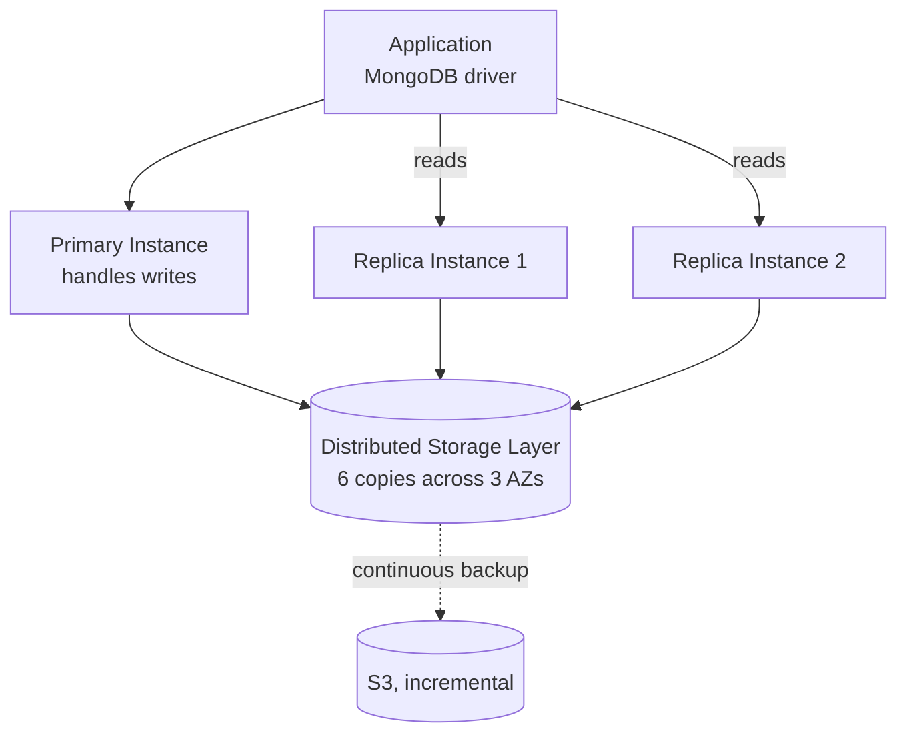
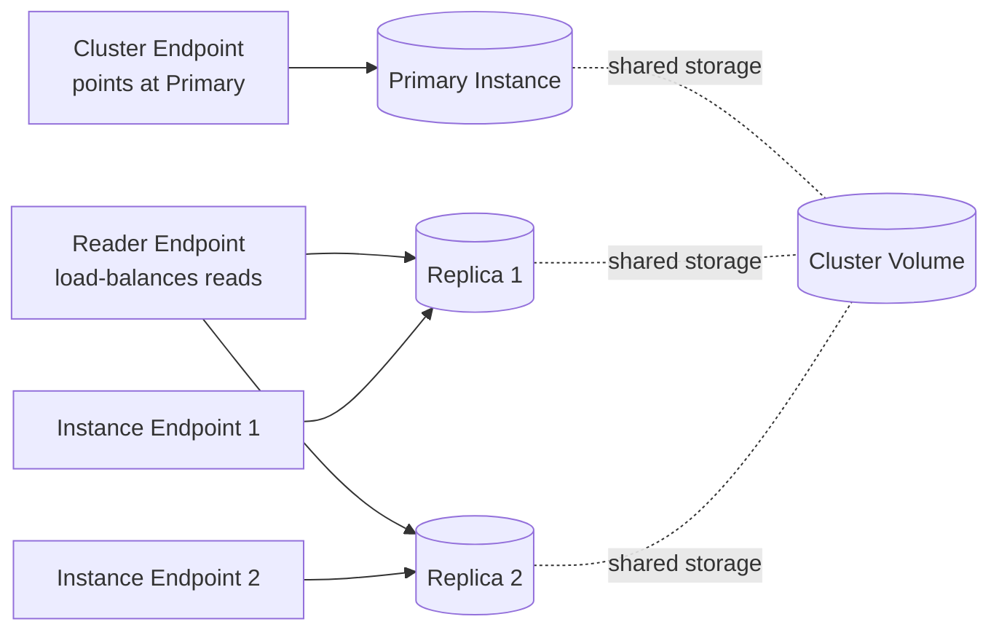
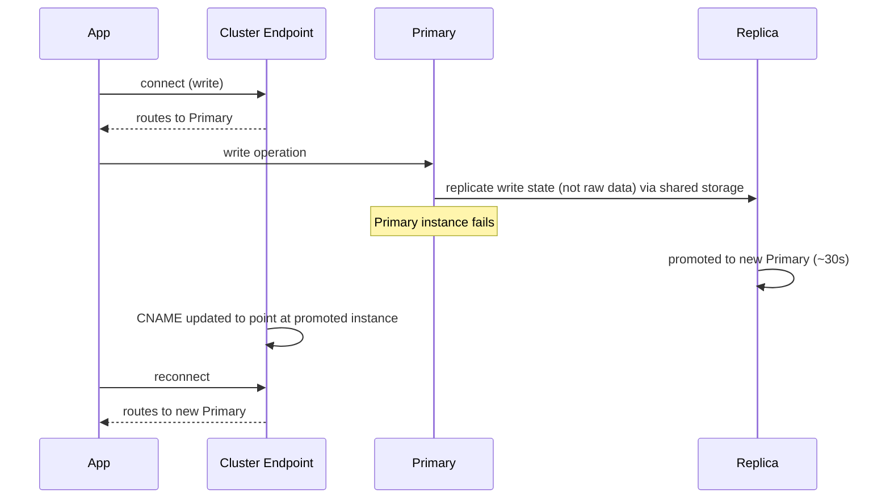
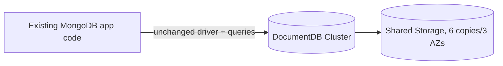

# Amazon DocumentDB (with MongoDB compatibility)


## Definition

Amazon DocumentDB is a managed **document database** that speaks the MongoDB wire protocol —
meaning your existing MongoDB drivers, queries, and tools work against it — while AWS handles
the underlying infrastructure, scaling, backups, and patching for you.

## Purpose

Many applications naturally model their data as flexible, nested JSON-like documents rather than
rigid rows and columns — a user profile with an arbitrary set of preferences, a product catalog
with wildly different attributes per category, a content-management document with nested blocks.
MongoDB became the dominant engine for this style of modeling, but self-hosting (or using
MongoDB's own managed Atlas) means managing replica sets, sharding, and failover yourself.
DocumentDB exists to give teams already invested in MongoDB's document model and query API a
fully managed, AWS-native option — similar in spirit to how Aurora gives MySQL/PostgreSQL users
a managed, re-architected alternative.

The important nuance to internalize up front: DocumentDB implements the MongoDB *wire protocol
and query API surface*, built on AWS's own distributed storage engine — it is not literally
running MongoDB's own server code underneath. This means driver/query compatibility is generally
excellent for common operations, but DocumentDB's supported MongoDB API version and specific
feature coverage trail upstream MongoDB, and a handful of newer or more exotic MongoDB features
may simply not exist. Teams that assume 1:1 feature parity have been surprised by this in real
migrations — verify specific feature support before committing to a cutover.

## How It Works

Architecturally, DocumentDB borrows Aurora's "decouple compute from storage" design: a
distributed, self-healing storage layer sits underneath MongoDB-API-compatible compute instances.



Step by step:
1. **Your application connects using a standard MongoDB driver** (Node.js, Python's PyMongo,
   Java, etc.) — as far as the driver is concerned, it's talking to MongoDB; DocumentDB
   implements enough of the MongoDB 4.0/5.0/6.0 API surface to serve most common operations.
2. **The primary instance handles all writes** — inserts, updates, deletes to documents (stored
   as BSON, same as MongoDB).
3. **Storage is decoupled and shared**, like Aurora: 6 copies of your data spread across 3
   Availability Zones, so replica instances read from the same underlying storage rather than
   needing a full separate copy — making it fast to add read capacity.
4. **Replica instances** serve read traffic and can be promoted to primary automatically on
   failure, typically within 30 seconds.
5. **Backups are continuous and incremental** to S3, enabling point-in-time restore without
   impacting live performance — the same model as Aurora.
6. Unlike self-hosted MongoDB, **you don't manage replica set elections, sharding config servers,
   or manual failover logic** — AWS operates all of that behind the DocumentDB API.

### Endpoint Topology: Cluster, Reader, and Instance Endpoints



- The **cluster endpoint** is a CNAME that always points at the current primary — write traffic
  and connection-as-a-replica-set operations should use this.
- The **reader endpoint** load-balances read-only connections across all available replicas,
  automatically picking up newly added replicas without application config changes.
- **Instance endpoints** connect to one *specific* instance directly — useful for diagnostics or
  pinning a particular read workload to a particular replica, but bypasses the automatic
  load-balancing and failover-awareness the other two endpoints provide.
- Connecting with `?replicaSet=rs0` in the MongoDB connection string lets the driver discover the
  full cluster topology and apply its own `readPreference` logic (e.g., `secondaryPreferred`) —
  this is the recommended way to get automatic read/write routing behavior.

### Failover Sequence



Because DocumentDB replicas share the same underlying storage volume as the primary, promotion is
fast — the promoted replica doesn't need to "catch up" on data it doesn't already have, unlike a
traditional MongoDB replica set where secondaries hold their own full data copy and must apply
the oplog to stay current.

### Data Modeling Patterns for DocumentDB

- **Embed vs reference, the classic MongoDB-family decision, still applies.** Embed related data
  directly in a document when it's always read together and doesn't grow unbounded (e.g., a
  blog post's comments if the post has a handful, not thousands); reference via a separate
  collection + manual "join" (application-side, since there's no native multi-collection JOIN)
  when the related data is large, grows unbounded, or is frequently accessed independently.
- **Index deliberately, just like any database.** DocumentDB supports single-field, compound, and
  (within current supported-version limits) multi-key indexes on array fields — an un-indexed
  query on a large collection results in a full collection scan, the same fundamental problem as
  a missing index in any other database family.
- **Schema validation is optional but valuable.** DocumentDB's flexible schema doesn't mean "no
  schema discipline" — using MongoDB-style schema validation rules at the collection level
  catches malformed documents at write time rather than discovering inconsistent document shapes
  during a later read, which is a common real-world pain point in loosely-governed document
  stores.
- **Change streams for event-driven reactions**, analogous to DynamoDB Streams — subscribe to a
  collection's change stream to trigger downstream processing (search index updates, cache
  invalidation, notifications) without polling.

## Key Features / Components

- **MongoDB API compatibility** — supports a large subset of MongoDB's query language,
  aggregation pipeline, and indexing (not 100% feature parity with the latest native MongoDB —
  check current supported-operations docs before assuming a specific feature exists).
- **Decoupled, auto-scaling storage** — grows automatically in 10 GB increments up to 128 TB (newer
  engine versions extend this further), shared across all instances in a cluster, same
  architecture family as Aurora.
- **Up to 15 read replicas** sharing the same storage layer, addable in minutes.
- **Automatic failover** — a replica is promoted to primary in under a minute if the primary fails.
- **Elastic Clusters** — horizontally scale DocumentDB across multiple shards for workloads that
  outgrow a single cluster's write throughput.
- **Encryption at rest (KMS) and in transit (TLS)** by default options.
- **Continuous backup with point-in-time recovery**, same model as Aurora/RDS.
- **Change streams** — subscribe to real-time document-level changes, similar in spirit to
  DynamoDB Streams, for event-driven architectures.
- **Global Clusters** — cross-Region replication for globally distributed reads and disaster
  recovery, mirroring Aurora Global Database's model.

## Common Architectures

**1. Lift-and-shift from self-managed MongoDB.** An existing MongoDB-backed application points
its connection string at a DocumentDB cluster endpoint instead; the driver code, queries, and
aggregation pipelines are unchanged, only the operational burden (replica set management,
patching, backups) moves to AWS.



**2. Content management system with flexible document schema.** Articles, pages, and media
metadata — each with a different shape depending on content type — live as documents in one or a
few collections, with change streams feeding a search index (e.g., OpenSearch) kept in sync.

**3. Multi-Region read scaling with Global Clusters.** A primary cluster handles writes in one
Region; secondary clusters in other Regions serve local reads with low replication lag, promotable
during a regional failure.

**4. Elastic Clusters for workloads outgrowing a single cluster's write capacity.** Data is
sharded across multiple underlying clusters, each handling a portion of the overall write
throughput — the DocumentDB answer to "we've outgrown vertical scaling of a single primary."

## Security & Compliance Considerations

- **Network isolation**: DocumentDB clusters live inside a VPC by default and are not
  publicly accessible without deliberate configuration — the same private-subnet, scoped
  security-group discipline as RDS/Aurora applies directly.
- **TLS is enabled by default** for connections, and can be enforced (rejecting non-TLS
  connections) — verify your driver's TLS configuration explicitly rather than assuming it's
  negotiated automatically, since some MongoDB drivers default to TLS-off unless told otherwise.
- **IAM-based authorization for cluster management** (who can create/modify/delete clusters)
  is standard IAM policy, separate from in-database MongoDB-style role-based access control
  (who can read/write specific collections) — these are two different authorization layers and
  both need deliberate configuration for a properly locked-down deployment.
- **Audit logging** via `audit` log exports to CloudWatch Logs — not enabled by default, and
  frequently a compliance requirement that teams forget to turn on until an audit asks for it.

## Monitoring & Observability

- **CloudWatch metrics** cover the same categories as Aurora/RDS: CPU, memory, connections,
  storage, I/O, plus DocumentDB-specific metrics like `DatabaseCursorsTimedOut` (a symptom of
  slow/unindexed queries holding cursors open too long) and replica lag.
- **Profiler** (the MongoDB-style slow-query profiler) can be enabled to log operations exceeding
  a configurable duration threshold — the first tool to reach for when "some query is slow" needs
  to become "this specific query, with this specific execution plan, is slow."
- **`explain()`** on a suspect query is the fastest way to confirm whether an index is actually
  being used, or whether the query is silently falling back to a full collection scan.

## Use Cases — When to Use It

- Teams already running MongoDB (self-managed or Atlas) who want to migrate to a fully managed
  AWS-native service without rewriting application queries/drivers.
- Content management systems, catalogs, user profiles, or any workload where each record
  naturally has a different, evolving shape (some fields present, some not) rather than a fixed
  relational schema.
- Applications needing deep nested document structures (arrays of sub-objects, flexible metadata)
  that would require many JOINs or a sparse/wide table design in a relational database.
- Real-time applications reacting to document changes via change streams.

## When NOT to Use It / Alternatives

- **No existing MongoDB investment, starting fresh** → consider whether your access patterns fit
  **DynamoDB** instead — DynamoDB scales further (essentially unlimited horizontal write
  throughput) and is cheaper at very large scale, though its query flexibility (no rich
  aggregation pipeline, strict access-pattern design) is more limited than MongoDB's.
  DocumentDB's value proposition is specifically "you already know/use MongoDB."
- **Data is genuinely relational (foreign keys, strict schema, multi-table transactions)** →
  **RDS/Aurora** — modeling relational data as documents fights the tool.
- **Need the very latest native MongoDB features** (DocumentDB trails upstream MongoDB version
  support and doesn't implement 100% of the API) → self-managed MongoDB or **MongoDB Atlas**
  (MongoDB's own managed offering) if cutting-edge feature parity matters more than AWS-native
  integration.
- **Need graph traversal / relationship-centric queries** → **Neptune**.

## Real-World Pricing Examples

**Example 1 — small production cluster, 1 primary + 1 replica:**
- Two `db.r6g.large` instances at roughly $0.277/hr each ≈ **$0.554/hr → ~$404/month** compute.
- 100 GB storage at roughly $0.10/GB-month ≈ **$10/month**.
- I/O: roughly 100 million requests/month at approximately $0.20/million ≈ **$20/month**.
- **Rough total: ~$434/month**.

**Example 2 — scaling read capacity for a traffic spike:**
- Adding 2 more `db.r6g.large` replicas (same storage layer, no data copy needed) ≈
  **+$404/month** compute for double the read capacity, provisioned in minutes rather than hours
  — the concrete operational payoff of the shared-storage architecture versus traditional MongoDB
  replica sets, where adding a secondary means copying the full dataset first.

**Example 3 — Elastic Clusters for a write-heavy workload outgrowing a single primary:**
- Sharded across multiple underlying instance groups, each billed as its own set of instance-hours
  plus storage/I/O — cost scales roughly linearly with shard count, which is the expected and
  reasonable tradeoff for breaking past a single-primary write ceiling.

- Exact current rates: https://aws.amazon.com/documentdb/pricing/

## Limits & Quotas (Real, Current — Verify Before Relying On Them)

- **Max cluster storage**: up to **128 TiB** per cluster volume (verify current ceiling for newer
  engine versions, which may extend this).
- **Max instances per cluster**: **16** (1 primary + up to 15 replicas).
- **Max document size**: **16 MB** (the same limit as native MongoDB's BSON document size cap —
  a document larger than this must be split, or large binary content should be stored in S3 with
  a reference kept in the document).
- **Max collections per database / databases per cluster**: large practical limits, but always
  check current docs rather than assuming unlimited — DocumentDB imposes soft limits that scale
  with instance class in some dimensions.
- **PITR retention**: continuous backups restorable to any second in the last **35 days**, same
  model as Aurora/RDS.
- **Max indexes per collection**: **64**, matching MongoDB's own historical limit.
- **Change streams retention**: events are retained for a configurable window (commonly a few
  hours to a few days depending on configuration) — a consumer that falls behind that window
  permanently loses the ability to replay missed events and must resync from a full read instead.

## Troubleshooting / Common Issues

- **A MongoDB feature used in application code throws an "unsupported operation" error after
  migration** → check the current DocumentDB MongoDB API compatibility documentation for the
  specific operator/aggregation stage; this is the single most common real migration surprise,
  and it's almost never a bug — it's a genuine, documented compatibility gap.
- **Read replica returns stale data immediately after a write** → DocumentDB replicas read from
  the same shared storage, but there is still a small propagation delay for the *state* of a
  write to be visible to replicas — read-after-write-critical logic should read from the primary
  (via the cluster endpoint), not the reader endpoint.
- **Collection scan performance degrades as the collection grows** → missing index on the
  queried field(s); run `explain()` on the slow query to confirm a `COLLSCAN` is happening, then
  add the appropriate single-field or compound index.
- **Change stream consumer misses events after being offline** → the change stream retention
  window has a finite length; a consumer that's down longer than that window has a genuine gap
  and must perform a full resync, not just "catch up" from where it left off.
- **Connection storms during failover** → same root cause as RDS/Aurora: clients caching stale
  DNS or not retrying on connection reset; ensure the driver is configured with appropriate
  retry/reconnect logic and is using the cluster/reader endpoints rather than a cached instance
  IP.
- **Document size approaching the 16 MB limit** → almost always a sign that large binary content
  (images, files) is being stored inline instead of in S3 with a reference — refactor before
  hitting the hard limit in production.

## Why It's Important

**Real world:** "We already use MongoDB, now we want AWS to manage it" is an extremely common
migration conversation, and DocumentDB is AWS's direct answer — but engineers need to know it's
*MongoDB-compatible*, not literally MongoDB, so some advanced/newest MongoDB features may not be
available, which has caused real migration surprises when teams assumed 1:1 parity.

**Exam mapping:**
- **SAA-C03** — Domain 3.3 (Determine high-performing database solutions — DocumentDB appears as
  the "document workload, MongoDB compatibility" option among the database family comparisons).
- **DVA-C03** — Task 1.3 (Use data stores in application development) — recognizing when an
  application's existing MongoDB driver code points to DocumentDB as the migration target rather
  than a DynamoDB redesign.
- **MLA-C02** — Less central, but can appear in Domain 1 (Data Preparation) if a scenario
  describes ingesting semi-structured JSON documents as an ML pipeline source.

**Expanded exam scenarios:**
- *"A company wants to move its existing MongoDB-backed application to AWS with minimal code
  changes."* → DocumentDB, not DynamoDB — "existing MongoDB driver/query code" is the specific
  trigger phrase distinguishing it from a DynamoDB redesign.
- *"A team needs to scale read capacity for a document database quickly during a traffic spike,
  without a lengthy data-copy process."* → DocumentDB's shared-storage replica architecture adds
  read capacity in minutes; contrast with traditional (self-managed or Atlas) MongoDB replica
  sets, which must copy the full dataset to each new secondary.
- *"An application relies on a MongoDB feature introduced in a very recent MongoDB version."* →
  This is a trap testing whether you know DocumentDB may not support the newest MongoDB features
  — the answer may be "verify compatibility first," not an automatic DocumentDB recommendation.
- *"A global application needs low-latency document reads from multiple Regions with disaster
  recovery."* → DocumentDB Global Clusters — know this exists as the document-database analog to
  Aurora Global Database.

## Pricing Model (summary)

- **Instance hours** — billed per hour per instance class, similar structure to Aurora.
- **I/O requests** — billed per million I/O requests against the storage layer (same cost model
  family as Aurora — budget for write-heavy workloads; see the worked examples above).
- **Storage** — billed per GB-month, auto-scaling as data grows.
- **Backup storage** beyond the included free allotment, billed per GB-month.
- **Elastic Clusters** bill based on configured shard/vCPU capacity.
- Exact current rates: https://aws.amazon.com/documentdb/pricing/

## Hands-on Lab (Floci)

**Honest limitation:** DocumentDB is **not** listed among Floci's supported services
(`labs-floci/README.md` lists only DynamoDB and RDS under "Database"). `awslocal docdb` commands
are likely to return "not implemented." The commands below show the real control-plane shape;
for actual hands-on document-query practice, run a real MongoDB container locally — the query
syntax transfers directly to DocumentDB since it implements the same wire protocol.

```bash
# Real AWS CLI shape — try against Floci, expect possible "not implemented"
awslocal docdb create-db-cluster \
  --db-cluster-identifier study-docdb \
  --engine docdb \
  --master-username dbadmin \
  --master-user-password ChangeMe123!

awslocal docdb describe-db-clusters --db-cluster-identifier study-docdb

# Fallback for real hands-on document query practice: MongoDB container
docker run -d --name study-mongo -p 27017:27017 mongo:7

mongosh --port 27017 --eval '
  db.products.insertMany([
    { name: "Widget", category: "hardware", tags: ["sale","new"], price: 9.99 },
    { name: "Gadget", category: "electronics", specs: { battery: "4h" }, price: 29.99 }
  ]);
  db.products.find({ category: "electronics" });
  db.products.aggregate([{ $group: { _id: "$category", avgPrice: { $avg: "$price" } } }]);
  db.products.createIndex({ category: 1 });   // avoid a collection scan on this query
'

# Clean up
docker rm -f study-mongo
```

This exercises the exact query/aggregation style DocumentDB supports, even though the
control-plane cluster lifecycle itself isn't locally emulated yet.

## Exam Tips

- **"MongoDB-compatible," "document database," "flexible/nested JSON schema," "migrate existing
  MongoDB workload"** are the DocumentDB trigger phrases.
- Don't confuse DocumentDB (MongoDB-API document store) with DynamoDB (AWS-native key-value/
  document store with a completely different API and access-pattern model) — they solve
  overlapping problems but are not interchangeable in exam answers.
- Remember DocumentDB is **API-compatible, not identical** — questions testing "latest MongoDB
  feature X" availability are testing whether you know DocumentDB trails native MongoDB versions.
- Architecturally it's "Aurora for MongoDB" — same decoupled storage, same Multi-AZ/read-replica
  pattern, same automatic failover under a minute — useful memory hook.
- **Cluster endpoint vs reader endpoint** — same distinction as Aurora; route writes/strict-read
  traffic to the cluster endpoint, load-balanced reads to the reader endpoint.
- **16 MB document size limit** is a specific, exam-testable number inherited directly from
  MongoDB's own BSON limit — large binary content belongs in S3, referenced from the document.

## Further Reading

- [Amazon DocumentDB: how it works](https://docs.aws.amazon.com/documentdb/latest/devguide/how-it-works.html) —
  the authoritative description of the cluster/storage/replica model referenced above.
- [Connecting to Amazon DocumentDB as a replica set](https://docs.aws.amazon.com/documentdb/latest/devguide/connect-to-replica-set.html) —
  endpoint types and driver-level read routing, straight from AWS.
- [Amazon DocumentDB architecture (whitepaper)](https://docs.aws.amazon.com/whitepapers/latest/get-started-documentdb/amazon-documentdb-architecture.html) —
  diagram and component breakdown.
- [Understanding Amazon DocumentDB clusters](https://docs.aws.amazon.com/documentdb/latest/devguide/db-clusters-understanding.html) —
  endpoint and instance terminology reference.
- [Amazon DocumentDB pricing](https://aws.amazon.com/documentdb/pricing/) — current, authoritative rates.

## Related Terms

- [`aurora.md`](aurora.md) — shares the same decoupled storage architecture pattern.
- [`dynamodb.md`](dynamodb.md) — the AWS-native alternative for document/key-value workloads.
- [`database-selection-guide.md`](database-selection-guide.md) — full decision tree.
- Glossary: BSON, Wire Protocol, Change Stream, Document Database, Replica Set.

---

**Image credit:** "Diagram showing Amazon DocumentDB endpoints including the cluster, reader, and
instance endpoints" — official diagram from the AWS DocumentDB Developer Guide, Amazon Web
Services, Inc. Source:
https://docs.aws.amazon.com/documentdb/latest/devguide/images/docdb-endpoint-types.png


*Figure: DocumentDB's three endpoint types — the cluster endpoint always points at the current primary, the reader endpoint load-balances across replicas, and instance endpoints target one specific instance. Source: AWS DocumentDB Developer Guide (docs.aws.amazon.com).*
