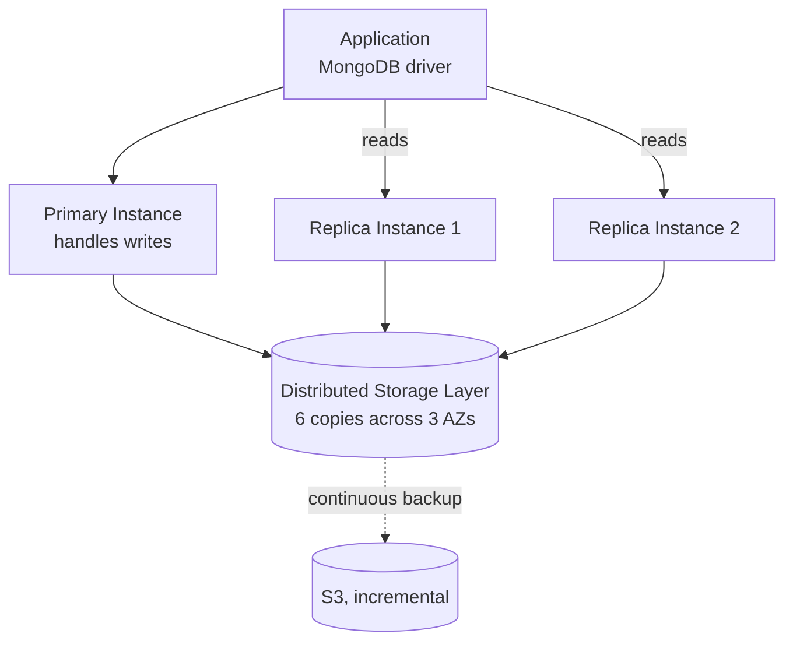

# Amazon DocumentDB (with MongoDB compatibility)


## Definition

Amazon DocumentDB is a managed **document database** that speaks the MongoDB wire protocol —
meaning your existing MongoDB drivers, queries, and tools work against it — while AWS handles
the underlying infrastructure, scaling, backups, and patching for you.

## Purpose

Many applications naturally model their data as flexible, nested JSON-like documents rather than
rigid rows and columns — a user profile with an arbitrary set of preferences, a product catalog
with wildly different attributes per category, a content-management document with nested blocks.
MongoDB became the dominant engine for this style of modeling, but self-hosting (or using
MongoDB's own managed Atlas) means managing replica sets, sharding, and failover yourself.
DocumentDB exists to give teams already invested in MongoDB's document model and query API a
fully managed, AWS-native option — similar in spirit to how Aurora gives MySQL/PostgreSQL users
a managed, re-architected alternative.

## How It Works

Architecturally, DocumentDB borrows Aurora's "decouple compute from storage" design: a
distributed, self-healing storage layer sits underneath MongoDB-API-compatible compute instances.



Step by step:
1. **Your application connects using a standard MongoDB driver** (Node.js, Python's PyMongo,
   Java, etc.) — as far as the driver is concerned, it's talking to MongoDB; DocumentDB
   implements enough of the MongoDB 4.0/5.0/6.0 API surface to serve most common operations.
2. **The primary instance handles all writes** — inserts, updates, deletes to documents (stored
   as BSON, same as MongoDB).
3. **Storage is decoupled and shared**, like Aurora: 6 copies of your data spread across 3
   Availability Zones, so replica instances read from the same underlying storage rather than
   needing a full separate copy — making it fast to add read capacity.
4. **Replica instances** serve read traffic and can be promoted to primary automatically on
   failure, typically within 30 seconds.
5. **Backups are continuous and incremental** to S3, enabling point-in-time restore without
   impacting live performance — the same model as Aurora.
6. Unlike self-hosted MongoDB, **you don't manage replica set elections, sharding config servers,
   or manual failover logic** — AWS operates all of that behind the DocumentDB API.

## Key Features / Components

- **MongoDB API compatibility** — supports a large subset of MongoDB's query language,
  aggregation pipeline, and indexing (not 100% feature parity with the latest native MongoDB —
  check current supported-operations docs before assuming a specific feature exists).
- **Decoupled, auto-scaling storage** — grows automatically in 10 GB increments up to 128 TB,
  shared across all instances in a cluster, same architecture family as Aurora.
- **Up to 15 read replicas** sharing the same storage layer, addable in minutes.
- **Automatic failover** — a replica is promoted to primary in under a minute if the primary fails.
- **Elastic Clusters** — horizontally scale DocumentDB across multiple shards for workloads that
  outgrow a single cluster's write throughput.
- **Encryption at rest (KMS) and in transit (TLS)** by default options.
- **Continuous backup with point-in-time recovery**, same model as Aurora/RDS.
- **Change streams** — subscribe to real-time document-level changes, similar in spirit to
  DynamoDB Streams, for event-driven architectures.

## Use Cases — When to Use It

- Teams already running MongoDB (self-managed or Atlas) who want to migrate to a fully managed
  AWS-native service without rewriting application queries/drivers.
- Content management systems, catalogs, user profiles, or any workload where each record
  naturally has a different, evolving shape (some fields present, some not) rather than a fixed
  relational schema.
- Applications needing deep nested document structures (arrays of sub-objects, flexible metadata)
  that would require many JOINs or a sparse/wide table design in a relational database.
- Real-time applications reacting to document changes via change streams.

## When NOT to Use It / Alternatives

- **No existing MongoDB investment, starting fresh** → consider whether your access patterns fit
  **DynamoDB** instead — DynamoDB scales further (essentially unlimited horizontal write
  throughput) and is cheaper at very large scale, though its query flexibility (no rich
  aggregation pipeline, strict access-pattern design) is more limited than MongoDB's.
  DocumentDB's value proposition is specifically "you already know/use MongoDB."
- **Data is genuinely relational (foreign keys, strict schema, multi-table transactions)** →
  **RDS/Aurora** — modeling relational data as documents fights the tool.
- **Need the very latest native MongoDB features** (DocumentDB trails upstream MongoDB version
  support and doesn't implement 100% of the API) → self-managed MongoDB or **MongoDB Atlas**
  (MongoDB's own managed offering) if cutting-edge feature parity matters more than AWS-native
  integration.
- **Need graph traversal / relationship-centric queries** → **Neptune**.

## Why It's Important

**Real world:** "We already use MongoDB, now we want AWS to manage it" is an extremely common
migration conversation, and DocumentDB is AWS's direct answer — but engineers need to know it's
*MongoDB-compatible*, not literally MongoDB, so some advanced/newest MongoDB features may not be
available, which has caused real migration surprises when teams assumed 1:1 parity.

**Exam mapping:**
- **SAA-C03** — Domain 3.3 (Determine high-performing database solutions — DocumentDB appears as
  the "document workload, MongoDB compatibility" option among the database family comparisons).
- **DVA-C03** — Task 1.3 (Use data stores in application development) — recognizing when an
  application's existing MongoDB driver code points to DocumentDB as the migration target rather
  than a DynamoDB redesign.
- **MLA-C02** — Less central, but can appear in Domain 1 (Data Preparation) if a scenario
  describes ingesting semi-structured JSON documents as an ML pipeline source.

## Pricing Model (summary)

- **Instance hours** — billed per hour per instance class, similar structure to Aurora.
- **I/O requests** — billed per million I/O requests against the storage layer (same cost model
  family as Aurora — budget for write-heavy workloads).
- **Storage** — billed per GB-month, auto-scaling as data grows.
- **Backup storage** beyond the included free allotment, billed per GB-month.
- **Elastic Clusters** bill based on configured shard/vCPU capacity.
- Exact current rates: https://aws.amazon.com/documentdb/pricing/

## Hands-on Lab (Floci)

**Honest limitation:** DocumentDB is **not** listed among Floci's supported services
(`labs-floci/README.md` lists only DynamoDB and RDS under "Database"). `awslocal docdb` commands
are likely to return "not implemented." The commands below show the real control-plane shape;
for actual hands-on document-query practice, run a real MongoDB container locally — the query
syntax transfers directly to DocumentDB since it implements the same wire protocol.

```bash
# Real AWS CLI shape — try against Floci, expect possible "not implemented"
awslocal docdb create-db-cluster \
  --db-cluster-identifier study-docdb \
  --engine docdb \
  --master-username dbadmin \
  --master-user-password ChangeMe123!

awslocal docdb describe-db-clusters --db-cluster-identifier study-docdb

# Fallback for real hands-on document query practice: MongoDB container
docker run -d --name study-mongo -p 27017:27017 mongo:7

mongosh --port 27017 --eval '
  db.products.insertMany([
    { name: "Widget", category: "hardware", tags: ["sale","new"], price: 9.99 },
    { name: "Gadget", category: "electronics", specs: { battery: "4h" }, price: 29.99 }
  ]);
  db.products.find({ category: "electronics" });
  db.products.aggregate([{ $group: { _id: "$category", avgPrice: { $avg: "$price" } } }]);
'

# Clean up
docker rm -f study-mongo
```

This exercises the exact query/aggregation style DocumentDB supports, even though the
control-plane cluster lifecycle itself isn't locally emulated yet.

## Exam Tips

- **"MongoDB-compatible," "document database," "flexible/nested JSON schema," "migrate existing
  MongoDB workload"** are the DocumentDB trigger phrases.
- Don't confuse DocumentDB (MongoDB-API document store) with DynamoDB (AWS-native key-value/
  document store with a completely different API and access-pattern model) — they solve
  overlapping problems but are not interchangeable in exam answers.
- Remember DocumentDB is **API-compatible, not identical** — questions testing "latest MongoDB
  feature X" availability are testing whether you know DocumentDB trails native MongoDB versions.
- Architecturally it's "Aurora for MongoDB" — same decoupled storage, same Multi-AZ/read-replica
  pattern, same automatic failover under a minute — useful memory hook.

## Related Terms

- [`aurora.md`](aurora.md) — shares the same decoupled storage architecture pattern.
- [`dynamodb.md`](dynamodb.md) — the AWS-native alternative for document/key-value workloads.
- [`database-selection-guide.md`](database-selection-guide.md) — full decision tree.
- Glossary: BSON, Wire Protocol, Change Stream, Document Database.
