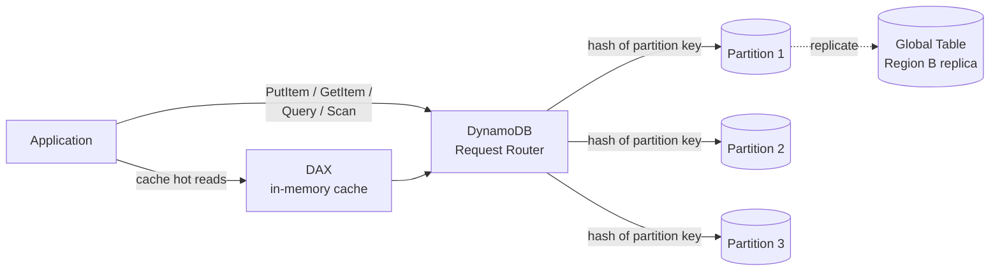

# Amazon DynamoDB


## Definition

Amazon DynamoDB is a fully managed NoSQL key-value and document database that stores data as
items identified by a key, scales automatically to essentially unlimited size and request rate,
and responds in single-digit milliseconds no matter how big your table gets.

## Purpose

Relational databases hit real limits at internet scale: sharding a SQL database across many
servers is hard, slow, and operationally painful, and a single primary instance can only take so
many writes per second no matter how big you make it. Amazon built DynamoDB (publicly described
in their 2007 Dynamo paper, productized as a managed service in 2012) to give applications the
ability to scale horizontally without limit, with predictable low-latency performance, by giving
up the things that make horizontal scaling hard in SQL — ad-hoc joins, complex multi-row
transactions across arbitrary tables, and strict upfront schema.

## How It Works

Every item lives in a table and is located by a **partition key** (and optionally a **sort key**).
DynamoDB hashes the partition key to decide which internal partition (physical storage node)
holds the item, so load spreads across many partitions as your table grows.



Step by step:
1. **You define a partition key** (e.g., `userId`) when creating a table. Every item's key is
   hashed; the hash determines which partition stores it. A good key spreads writes evenly
   (avoiding "hot partitions") — this is the single most important DynamoDB design decision.
2. **Reads/writes go straight to the right partition** via the request router — no query planner,
   no index scan across the whole table, which is *why* latency stays flat (single-digit ms)
   whether your table has 100 items or 100 billion.
3. **Optional sort key** lets you store multiple related items under one partition key (e.g.,
   `userId` + `orderDate`), enabling efficient range queries ("all of this user's orders after
   March 1st") without scanning unrelated data.
4. **DAX (DynamoDB Accelerator)** is an optional in-memory cache layer in front of DynamoDB for
   read-heavy workloads needing microsecond latency, without your app managing a separate cache.
5. **Global Tables** replicate a table across multiple Regions with multi-active writes (any
   Region can write, conflicts resolved automatically), for globally distributed low-latency apps.
6. **Capacity modes**: On-Demand (pay per request, scales instantly, best for unpredictable
   traffic) or Provisioned (you set read/write capacity units, cheaper at steady predictable load,
   can use Auto Scaling to adjust).

## Key Features / Components

- **Partition key / Sort key (composite primary key)** — the only way to directly fetch an item;
  everything else requires a Query, Scan, or secondary index.
- **Global Secondary Index (GSI)** — query by an attribute other than the primary key, with its
  own partition/sort key, eventually consistent, created/deleted independently of the table.
- **Local Secondary Index (LSI)** — alternate sort key within the *same* partition key, must be
  created at table creation time, strongly consistent reads supported.
- **On-Demand vs Provisioned capacity** — on-demand auto-scales instantly for spiky/unknown
  traffic; provisioned is cheaper for flat, predictable traffic.
- **DynamoDB Streams** — a time-ordered log of item-level changes, consumable by Lambda for
  event-driven processing (e.g., trigger a notification whenever an order status changes).
- **TTL (Time To Live)** — auto-delete items after a set timestamp, free of charge, great for
  session data or expiring records.
- **DAX** — managed in-memory cache for microsecond read latency, API-compatible with DynamoDB SDK.
- **Global Tables** — multi-Region, multi-active replication for global low-latency apps and
  disaster recovery.
- **Transactions** — ACID transactions across up to 100 items/25 tables within a Region, for
  the subset of operations that genuinely need all-or-nothing semantics.
- **Point-in-time recovery (PITR) & on-demand backups** — continuous backups restorable to any
  second in the last 35 days.
- **Encryption at rest by default** (AWS-owned or customer-managed KMS keys).

## Use Cases — When to Use It

- High-traffic, high-scale applications where latency must stay flat as traffic grows: shopping
  carts, gaming leaderboards, session stores, IoT device state.
- Access patterns are known upfront and simple — "get this item by its key," "get all items for
  this user" — rather than ad-hoc, evolving analytical queries.
- Serverless architectures (Lambda + API Gateway + DynamoDB) where you want no servers, no
  connection pool management, and pay-per-request billing that scales to zero.
- Need multi-Region active-active writes with automatic conflict resolution (Global Tables).
- Event-driven systems that react to data changes in real time via DynamoDB Streams + Lambda.

## When NOT to Use It / Alternatives

- **Need complex JOINs across many entities, ad-hoc reporting queries, or a schema that changes
  access patterns often** → **RDS** or **Aurora** — DynamoDB requires you to design your table
  around known access patterns *in advance*; changing patterns later often means redesigning keys.
- **Need strong multi-row, multi-table ACID transactions as the default (not the exception)** →
  relational databases (RDS/Aurora) model this far more naturally.
- **Need to run heavy analytical aggregation (SUM/AVG/GROUP BY across millions of rows) directly
  against the live data** → export to **Redshift** or query via Athena/EMR; DynamoDB Scans for
  this are slow and expensive.
- **Data is document-shaped but you specifically need MongoDB APIs/drivers** → **DocumentDB**.
- **Data is fundamentally about relationships/traversals (friend-of-a-friend, fraud rings)** →
  **Neptune** — modeling graph traversals as DynamoDB queries is painful past 1–2 hops.

## Why It's Important

**Real world:** DynamoDB underpins some of the highest-traffic systems in the world (it was born
from Amazon.com's own shopping cart scaling problems). The real-world skill it tests is
*access-pattern-first design* — unlike SQL where you can bolt on a new query later, DynamoDB
forces you to know your queries before you design your table, which is a genuinely different
(and for many engineers, initially uncomfortable) way of modeling data.

**Exam mapping:**
- **SAA-C03** — Domain 3.3 (Determine high-performing database solutions — DynamoDB vs RDS/Aurora
  is a top-tested comparison) and Domain 2.1 (loosely coupled, serverless architectures with
  DynamoDB Streams + Lambda) and Domain 4.3 (On-Demand vs Provisioned capacity cost tradeoffs).
- **DVA-C03** — Task 1.3 (Use data stores in application development: DynamoDB SDK operations,
  consistency models — eventually vs strongly consistent reads, GSIs vs LSIs) is one of the most
  concretely tested service APIs in the whole exam.
- **MLA-C02** — Domain 1 (Data Preparation): DynamoDB as a low-latency feature store or
  real-time inference input/output store; DynamoDB Streams feeding feature pipelines.

## Pricing Model (summary)

- **On-Demand mode** — pay per million read/write request units actually consumed, no capacity
  planning, scales instantly; best when traffic is unpredictable or new.
- **Provisioned mode** — you specify Read/Write Capacity Units (RCUs/WCUs) ahead of time, billed
  hourly whether consumed or not; cheaper at steady, well-understood load, pairable with Auto
  Scaling and Reserved Capacity for further savings.
- **Storage** — billed per GB-month.
- **DAX, Streams, Global Tables, backups** — each billed separately as add-ons.
- Free tier: 25 GB storage + 25 provisioned RCU/WCU always free (not time-limited).
- Exact current rates: https://aws.amazon.com/dynamodb/pricing/

## Hands-on Lab (Floci)

DynamoDB is one of Floci's most completely emulated services — full API support, no caveats.

```bash
# 1. Create a table with a composite primary key
awslocal dynamodb create-table \
  --table-name Orders \
  --attribute-definitions \
      AttributeName=CustomerId,AttributeType=S \
      AttributeName=OrderDate,AttributeType=S \
  --key-schema \
      AttributeName=CustomerId,KeyType=HASH \
      AttributeName=OrderDate,KeyType=RANGE \
  --billing-mode PAY_PER_REQUEST

# 2. Put an item
awslocal dynamodb put-item \
  --table-name Orders \
  --item '{
    "CustomerId": {"S": "cust-001"},
    "OrderDate": {"S": "2026-11-20"},
    "Total": {"N": "89.99"},
    "Status": {"S": "SHIPPED"}
  }'

# 3. Get the item back by its key
awslocal dynamodb get-item \
  --table-name Orders \
  --key '{"CustomerId": {"S": "cust-001"}, "OrderDate": {"S": "2026-11-20"}}'

# 4. Query all orders for one customer (uses the sort key range)
awslocal dynamodb query \
  --table-name Orders \
  --key-condition-expression "CustomerId = :cid" \
  --expression-attribute-values '{":cid": {"S": "cust-001"}}'

# 5. Add a Global Secondary Index to query by Status instead
awslocal dynamodb update-table \
  --table-name Orders \
  --attribute-definitions AttributeName=Status,AttributeType=S \
  --global-secondary-index-updates \
    '[{"Create": {"IndexName": "StatusIndex", "KeySchema": [{"AttributeName":"Status","KeyType":"HASH"}], "Projection": {"ProjectionType":"ALL"}}}]'

# 6. Clean up
awslocal dynamodb delete-table --table-name Orders
```

## Exam Tips

- **"Massive scale, unpredictable traffic, single-digit millisecond latency, flexible schema"** is
  the DynamoDB trigger phrase combo. If the question also mentions "complex joins" or "ad-hoc
  reporting," that's a trap pointing away from DynamoDB.
- Know the difference: **eventually consistent reads** (default, cheaper, may be a few hundred ms
  stale) vs **strongly consistent reads** (explicit flag, always latest, costs 2x the read
  capacity, not available on GSIs).
- **GSI vs LSI**: GSI = different partition key, created/deleted anytime, eventually consistent
  only. LSI = same partition key, different sort key, must exist at table creation, can be
  strongly consistent.
- **Hot partition** is a classic exam scenario — a poorly chosen partition key (e.g., a fixed
  "status" value for most items) causes throttling; the fix is a higher-cardinality key or
  write-sharding.
- DynamoDB Streams + Lambda = the standard "react to data changes in real time" pattern.
- On-Demand vs Provisioned is directly a Domain 4 (cost) exam topic — Provisioned + Auto Scaling
  is cheaper for steady traffic; On-Demand removes capacity-planning risk for spiky/new workloads.

## Related Terms

- [`rds.md`](rds.md) / [`aurora.md`](aurora.md) — relational alternatives when joins/ACID across
  tables matter more than horizontal scale.
- [`elasticache.md`](elasticache.md) — DAX is DynamoDB-specific caching; ElastiCache is general-purpose.
- [`database-selection-guide.md`](database-selection-guide.md) — full decision tree.
- Glossary: Partition Key, Sort Key, Eventually/Strongly Consistent Read, GSI, LSI, Hot Partition.
