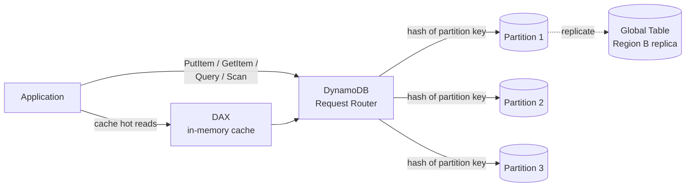
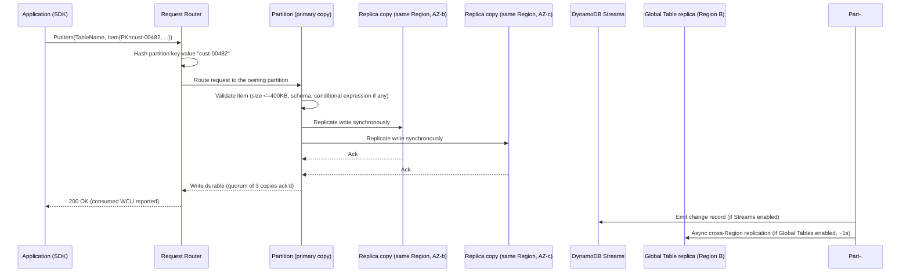
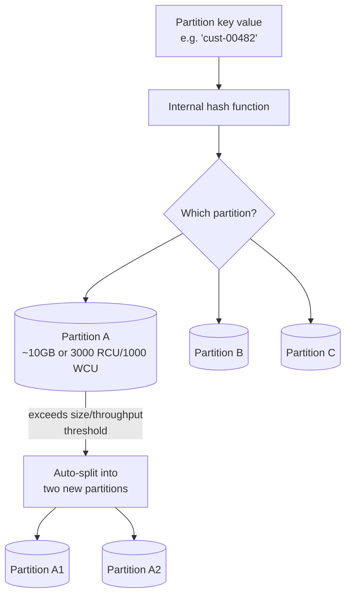
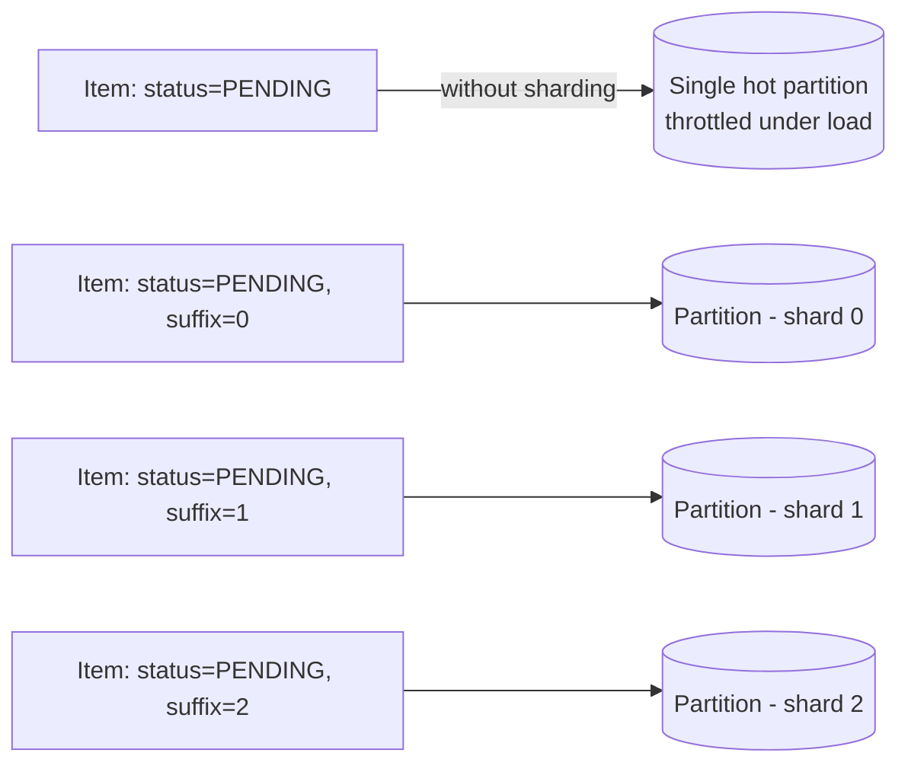
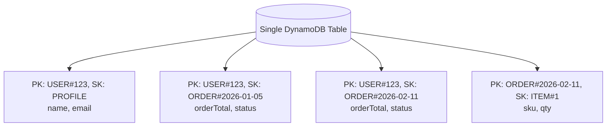
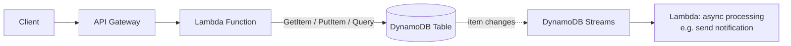
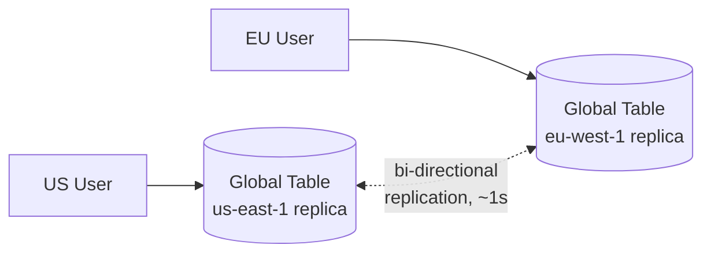

# Amazon DynamoDB

> **Appears in:** [DVA-C03](../../certifications/dva-c03/README.md) · [SAA-C03](../../certifications/saa-c03/README.md)


## Definition

Amazon DynamoDB is a fully managed NoSQL key-value and document database that stores data as
items identified by a key, scales automatically to essentially unlimited size and request rate,
and responds in single-digit milliseconds no matter how big your table gets.

## Purpose

Relational databases hit real limits at internet scale: sharding a SQL database across many
servers is hard, slow, and operationally painful, and a single primary instance can only take so
many writes per second no matter how big you make it. Amazon built DynamoDB (publicly described
in their 2007 Dynamo paper, productized as a managed service in 2012) to give applications the
ability to scale horizontally without limit, with predictable low-latency performance, by giving
up the things that make horizontal scaling hard in SQL — ad-hoc joins, complex multi-row
transactions across arbitrary tables, and strict upfront schema.

The trade DynamoDB asks you to make is blunt and worth stating directly: you give up the ability
to ask new questions of your data cheaply later, in exchange for being able to answer the
questions you *do* know about at effectively unlimited scale and flat latency forever. This is
why DynamoDB's single hardest discipline is **access-pattern-first design** — you must know your
queries before you design your table, the opposite order from relational modeling, where you
design the schema first and let SQL answer whatever question comes up later.

## How It Works

Every item lives in a table and is located by a **partition key** (and optionally a **sort key**).
DynamoDB hashes the partition key to decide which internal partition (physical storage node)
holds the item, so load spreads across many partitions as your table grows.



Step by step:
1. **You define a partition key** (e.g., `userId`) when creating a table. Every item's key is
   hashed; the hash determines which partition stores it. A good key spreads writes evenly
   (avoiding "hot partitions") — this is the single most important DynamoDB design decision.
2. **Reads/writes go straight to the right partition** via the request router — no query planner,
   no index scan across the whole table, which is *why* latency stays flat (single-digit ms)
   whether your table has 100 items or 100 billion.
3. **Optional sort key** lets you store multiple related items under one partition key (e.g.,
   `userId` + `orderDate`), enabling efficient range queries ("all of this user's orders after
   March 1st") without scanning unrelated data.
4. **DAX (DynamoDB Accelerator)** is an optional in-memory cache layer in front of DynamoDB for
   read-heavy workloads needing microsecond latency, without your app managing a separate cache.
5. **Global Tables** replicate a table across multiple Regions with multi-active writes (any
   Region can write, conflicts resolved automatically), for globally distributed low-latency apps.
6. **Capacity modes**: On-Demand (pay per request, scales instantly, best for unpredictable
   traffic) or Provisioned (you set read/write capacity units, cheaper at steady predictable load,
   can use Auto Scaling to adjust).

### What Actually Happens on a PutItem Request — Full Lifecycle

The diagram and step list above describe the architecture; this section walks through one
specific, concrete request end-to-end, because "what happens when I call PutItem" is both a
common interview/exam question and the fastest way to make the hashing/replication/consistency
concepts above feel real rather than abstract.



1. **The SDK call is just an HTTPS POST.** Unlike RDS/Aurora, there's no persistent database
   connection to manage — `PutItem` is a stateless API call authenticated via IAM (Signature V4),
   which is *why* Lambda functions can call DynamoDB without any connection-pool exhaustion risk
   that plagues Lambda-to-RDS architectures.
2. **The request router hashes the partition key value** (e.g., `"cust-00482"`) using an internal
   hash function. This hash — not the literal key value — determines which physical partition
   owns the item. Two keys that look "close" alphabetically (e.g., `cust-00482` and `cust-00483`)
   typically land on *completely different* partitions, because the hash output is effectively
   randomized; this is deliberate, and it's what spreads load evenly across the table.
3. **The owning partition validates the item**: total item size (attribute names + values) must
   be under 400 KB, and if the call included a `ConditionExpression` (e.g., "only write if this
   item doesn't already exist" for idempotent order creation), that condition is evaluated here,
   before anything is persisted — a failed condition returns `ConditionalCheckFailedException`
   without writing anything.
4. **Within the Region, the write is synchronously replicated to 2 additional copies** across
   different Availability Zones before DynamoDB acknowledges success back to the application —
   this is why a single-Region DynamoDB table already survives an AZ failure without data loss,
   with no Multi-AZ configuration step required (unlike RDS, where Multi-AZ is an explicit,
   separate setting).
5. **The SDK call returns once a quorum of the 3 in-Region copies has acknowledged the write.**
   This is the moment "the write is durable" — from the application's point of view, the
   `PutItem` call simply returns successfully; all of the hashing, routing, and replication above
   is invisible machinery the application never has to reason about directly.
6. **If DynamoDB Streams is enabled**, a change record describing the write (new image, old
   image, or both, depending on configuration) is appended to the table's stream, available for a
   Lambda consumer to process within roughly a second — this is what powers the event-driven
   order-pipeline pattern described in Common Architectures below.
7. **If Global Tables is enabled**, the write is also propagated asynchronously to every other
   replica Region, typically landing within about a second. This replication is *not* part of the
   original acknowledgment — the write is already durable and already returned to the caller in
   the home Region before cross-Region propagation even starts, which is the direct, mechanical
   reason Global Tables reads in a different Region can briefly show slightly older data.
8. **Consistency model for subsequent reads**: a `GetItem`/`Query` immediately after this write,
   if issued against the *same* Region with `ConsistentRead=true`, is guaranteed to see this
   write (DynamoDB reads from a copy that has definitely applied it). The default — eventually
   consistent reads — may briefly read from a copy that hasn't caught up yet (typically within
   milliseconds), trading a small staleness window for roughly half the read cost and marginally
   lower latency. GSI reads are *always* eventually consistent, with no strongly consistent option
   at all, because a GSI update is itself propagated asynchronously after the base table write.

### Partition Key Design: Hashing, Splits, and Hot Partitions



- DynamoDB automatically splits a partition when it exceeds roughly **10 GB** of storage, or when
  its throughput demand consistently exceeds a single partition's share of capacity — this
  happens transparently, without downtime, but it's a *consequence* of key design, not something
  you control directly.
- A **hot partition** happens when one partition key value (or a small set of them) receives a
  disproportionate share of traffic — e.g., a `status` attribute used as the partition key, where
  90% of items are `"PENDING"`. All traffic for `"PENDING"` items lands on the same partition no
  matter how many total partitions the table has, and that partition throttles while the rest of
  the table sits idle.
- **Write sharding** is the standard fix: append a random or calculated suffix to the partition
  key (e.g., `"PENDING#3"` where `3` is `hash(itemId) % N`) to spread what would otherwise be one
  hot key across N partitions, then fan out reads across all N suffixes and merge results in the
  application.



### Data Modeling: Single-Table Design

Unlike relational modeling (many tables, joined at query time), DynamoDB's most common
production pattern is **single-table design**: storing multiple different entity types in one
table, distinguished by key prefixes, so that a single `Query` call can retrieve everything a
screen needs in one request instead of many.



A `Query` for `PK = "USER#123"` returns the user's profile *and* every order in one request,
sorted by sort key — the equivalent relational query would be a JOIN across `users` and `orders`
tables. The cost of this flexibility is design-time complexity: you must enumerate your access
patterns upfront (get user profile, get user's orders, get an order's line items, get orders by
status via GSI) and design keys that satisfy all of them, because there's no ad-hoc querying
fallback later the way SQL's `WHERE` clause provides.

- **Vertical partitioning**: break what would be one large relational row (a document with many
  nested entities) into multiple DynamoDB items under the same partition key, rather than one
  giant item — this keeps individual item sizes well under the 400 KB item limit and lets you
  fetch only the specific sub-entity you need instead of always pulling the whole document.
- **Overloaded GSIs**: reuse the same GSI partition/sort key attribute names across different
  entity types with different semantic meaning per type, so one GSI can serve multiple distinct
  access patterns — an advanced but common single-table-design technique.
- **Adjacency list pattern for relationships**: model one-to-many or many-to-many relationships
  (e.g., "which groups does this user belong to") as additional items with the relationship
  encoded directly in the key, rather than a separate join table — workable for shallow
  relationships; genuinely deep/multi-hop relationship traversal is Neptune's job, not
  DynamoDB's (see `neptune.md`).

### Working with DynamoDB via boto3 (Python)

The CLI commands in the Hands-on Lab section below show the raw API shape; most real
applications talk to DynamoDB through an SDK instead. Here's the same `Orders` table workflow in
Python using boto3, with the higher-level `resource` API (which handles type marshaling for you,
unlike the low-level `client` API used by the AWS CLI's JSON syntax above):

```python
import boto3
from boto3.dynamodb.conditions import Key
from botocore.exceptions import ClientError

# resource() gives you a Pythonic interface (plain dicts/strings/numbers);
# client() would require explicit {"S": "..."} / {"N": "..."} type wrappers like the CLI does.
dynamodb = boto3.resource("dynamodb", region_name="us-east-1")
table = dynamodb.Table("Orders")

# --- Write a new order, idempotently ---
# ConditionExpression prevents accidentally overwriting an existing order if this Lambda
# invocation is retried after a transient network error (a common serverless failure mode).
try:
    table.put_item(
        Item={
            "CustomerId": "cust-001",
            "OrderDate": "2026-11-20",
            "Total": 89.99,
            "Status": "SHIPPED",
            "LineItems": [
                {"Sku": "WIDGET-1", "Qty": 2},
                {"Sku": "GADGET-9", "Qty": 1},
            ],
        },
        ConditionExpression="attribute_not_exists(CustomerId)",
    )
except ClientError as e:
    if e.response["Error"]["Code"] == "ConditionalCheckFailedException":
        print("Order already exists — this PutItem was a safe, idempotent no-op retry")
    else:
        raise  # a real error (throttling, validation) — don't swallow it

# --- Read a single order back by its exact key (fastest possible DynamoDB operation) ---
response = table.get_item(
    Key={"CustomerId": "cust-001", "OrderDate": "2026-11-20"},
    ConsistentRead=True,  # guarantees we see the write above immediately, at 2x the RCU cost
)
order = response.get("Item")

# --- Query: all orders for one customer after a given date (uses the sort key range) ---
# This is a single partition lookup, not a table scan — it stays fast regardless of table size.
response = table.query(
    KeyConditionExpression=Key("CustomerId").eq("cust-001") & Key("OrderDate").gte("2026-01-01"),
)
for item in response["Items"]:
    print(item["OrderDate"], item["Status"], item["Total"])

# --- Atomic counter update: increment a view counter without a read-modify-write race ---
# UpdateItem's ADD is atomic server-side — two concurrent requests both land correctly,
# unlike "read value, add 1, write value back" which can lose updates under concurrency.
table.update_item(
    Key={"CustomerId": "cust-001", "OrderDate": "2026-11-20"},
    UpdateExpression="ADD ViewCount :inc",
    ExpressionAttributeValues={":inc": 1},
)
```

## Key Features / Components

- **Partition key / Sort key (composite primary key)** — the only way to directly fetch an item;
  everything else requires a Query, Scan, or secondary index.
- **Global Secondary Index (GSI)** — query by an attribute other than the primary key, with its
  own partition/sort key, eventually consistent, created/deleted independently of the table.
- **Local Secondary Index (LSI)** — alternate sort key within the *same* partition key, must be
  created at table creation time, strongly consistent reads supported.
- **On-Demand vs Provisioned capacity** — on-demand auto-scales instantly for spiky/unknown
  traffic; provisioned is cheaper for flat, predictable traffic.
- **DynamoDB Streams** — a time-ordered log of item-level changes, consumable by Lambda for
  event-driven processing (e.g., trigger a notification whenever an order status changes).
- **TTL (Time To Live)** — auto-delete items after a set timestamp, free of charge, great for
  session data or expiring records.
- **DAX** — managed in-memory cache for microsecond read latency, API-compatible with DynamoDB SDK.
- **Global Tables** — multi-Region, multi-active replication for global low-latency apps and
  disaster recovery.
- **Transactions** — ACID transactions across up to 100 items/25 tables within a Region, for
  the subset of operations that genuinely need all-or-nothing semantics.
- **Point-in-time recovery (PITR) & on-demand backups** — continuous backups restorable to any
  second in the last 35 days.
- **Encryption at rest by default** (AWS-owned or customer-managed KMS keys).
- **PartiQL** — a SQL-compatible query syntax layered over DynamoDB's existing data model, useful
  for teams more comfortable reading/writing SQL-like statements, though it doesn't grant SQL's
  underlying JOIN/ad-hoc capabilities — it's a syntax convenience, not a capability change.

## Common Architectures

**1. Serverless web app: API Gateway + Lambda + DynamoDB.** The textbook "no servers anywhere"
pattern — API Gateway routes requests to Lambda, Lambda reads/writes DynamoDB directly (no
connection pooling problem, unlike RDS, because DynamoDB is a managed HTTP API, not a persistent
connection protocol), and everything scales independently and automatically.



**2. Shopping cart / session store with TTL.** Each cart is one item (or a small item collection)
keyed by `userId`, with a TTL attribute set to auto-expire abandoned carts without a cleanup job.

**3. Global Tables for a multi-Region active-active app.** Users in the US and EU write to their
local Region's table replica; DynamoDB replicates changes to all other Regions (typically within
a second), with last-writer-wins conflict resolution by default.



**4. Read-heavy leaderboard with DAX.** A gaming leaderboard is read far more often than written;
DAX sits in front of the table serving the overwhelming majority of reads from an in-memory cache,
with writes still going through to DynamoDB for durability.

**5. Event-driven order pipeline via DynamoDB Streams.** An `Orders` table's status changes
trigger a Lambda consumer via Streams, which updates an inventory table, sends a customer
notification, and writes an audit record — all reacting to the single source-of-truth write
rather than the application fanning out writes to multiple systems itself.

## Security & Compliance Considerations

- **Fine-grained access control via IAM condition keys** — `dynamodb:LeadingKeys` lets you scope
  an IAM policy so a caller can only access items whose partition key matches their own identity
  (e.g., a mobile app user can only read/write their own `userId` partition) — this is the
  standard pattern for direct mobile/web client access to DynamoDB without a backend API in
  between.
- **Encryption at rest is on by default** (AWS-owned key, or customer-managed KMS key for more
  control over key rotation/audit) — unlike RDS/Aurora, there's no "decide at creation and never
  again" trap here; DynamoDB lets you switch the KMS key associated with a table afterward.
- **VPC endpoints** (Gateway endpoint type) let traffic from a VPC reach DynamoDB without
  traversing the public internet or needing a NAT gateway — a meaningful cost and security
  improvement for VPC-hosted compute that talks to DynamoDB frequently.
- **PITR vs backups for ransomware/accidental-deletion recovery** — PITR's 35-day window handles
  "someone deleted the wrong items an hour ago"; for longer retention or compliance-driven
  archival, on-demand backups (kept indefinitely) are the right complementary tool, not a
  replacement for PITR.

## Monitoring & Observability

- **Core CloudWatch metrics**: `ConsumedReadCapacityUnits`/`ConsumedWriteCapacityUnits` against
  provisioned capacity, `ThrottledRequests`, and `SystemErrors` are the minimum alerting baseline.
- **Contributor Insights** surfaces the actual "most accessed" and "most throttled" partition keys
  directly — this is the fastest practical way to confirm a hot-partition hypothesis instead of
  guessing from access patterns alone.
- **CloudWatch alarms on `UserErrors`** (4xx-class, e.g., validation failures, missing
  attributes) catch application-level bugs early — a sudden spike usually means a recent
  deployment introduced a schema/attribute-naming mismatch, not a DynamoDB-side problem.

## DynamoDB vs Relational — A Concrete Checklist

| Signal | Lean Relational (RDS/Aurora) | Lean DynamoDB |
|---|---|---|
| Access patterns | Unknown, evolving, need ad-hoc queries | Known upfront, stable, enumerable |
| Scale | Fits on one (or a few replicated) instances | Needs to scale horizontally without ceiling |
| Consistency needs | Multi-table ACID transactions as the default | Single-item atomicity is enough; transactions are the exception |
| Query complexity | Multi-table JOINs, aggregations, reporting | Key lookups, simple range queries |
| Schema stability | Changes often, team wants flexibility via SQL | Stable enough to commit to key design upfront |
| Operational model | Fine with managing instance sizing/replicas | Wants pay-per-request, zero capacity planning (On-Demand) |

If a scenario explicitly says "access patterns may change" or "need ad-hoc reporting," that is
intentionally steering away from DynamoDB — recognize it as a tie-breaker phrase, not just
flavor text.

## Use Cases — When to Use It

- **E-commerce shopping cart / checkout state.** Carts are keyed by `userId`, updated on every
  add/remove-from-cart click, and must stay fast during flash-sale traffic spikes. DynamoDB fits
  because the access pattern is a pure key lookup with flat latency regardless of concurrent
  shoppers. Tradeoff vs RDS: you give up the ability to atomically join cart + inventory +
  pricing in one SQL transaction as the default mode — that logic has to be built explicitly
  (DynamoDB Transactions, or application-level orchestration) rather than falling out of a JOIN.
- **Session store for web/mobile apps.** Tens of millions of concurrent login sessions, read and
  written on nearly every request, with a TTL attribute auto-expiring logged-out/stale sessions
  for free. Tradeoff vs ElastiCache: Redis is faster (true in-memory, sub-millisecond) and is the
  better fit if raw speed is the bottleneck, but DynamoDB is itself durable storage — no separate
  cache-invalidation logic to write, because there's no second copy of the truth to keep in sync.
- **Gaming leaderboard with real-time rank updates.** Millions of players, extremely read-heavy
  (everyone checks rank far more than they score), paired with DAX for microsecond reads.
  Tradeoff vs ElastiCache Sorted Sets: Redis gives you ranking "for free" from a native data
  structure (`ZRANGE`) with no secondary index design; DynamoDB needs a GSI on score plus the DAX
  add-on cost to match that read speed, but gains DynamoDB's own durability and backup model
  without a separate persistence strategy.
- **IoT device state and recent telemetry.** Millions of devices reporting status every few
  seconds, keyed by `deviceId` with a `timestamp` sort key, TTL auto-expiring old readings.
  Tradeoff vs Timestream/Redshift: DynamoDB is ideal for "what is device X's current state" and
  short recent-window queries; genuine time-series rollups/analytics across years of history for
  millions of devices belong in a purpose-built time-series store or an exported OLAP warehouse,
  not repeated Scans against DynamoDB.
- **Social "likes"/"follows" counters.** High-frequency atomic increments (`UpdateItem` with
  `ADD`) across huge numbers of objects, with no locking needed because the increment is atomic
  server-side. Tradeoff vs Neptune: simple counts/relationships as flat attributes fit DynamoDB
  cleanly; actual multi-hop graph traversal ("friends of friends who also liked this") belongs in
  Neptune once you're past 1–2 hops.
- **Serverless API backend (API Gateway + Lambda + DynamoDB).** An event-driven microservice with
  spiky, hard-to-predict traffic. DynamoDB's HTTP-API nature means no connection pool to exhaust
  across thousands of concurrent Lambda invocations. Tradeoff vs RDS + RDS Proxy: you avoid the
  proxy's cost/complexity entirely, but lose ad-hoc SQL querying — every access pattern must be
  known and designed for upfront.
- **Financial transaction ledger / per-account audit trail.** An append-only log of account
  events keyed by `accountId` + `timestamp`, supporting fast range queries like "all transactions
  for account X this month," with Streams feeding a downstream reconciliation job. Tradeoff vs
  RDS: you give up cross-account atomic multi-row transactions as the default mode of operation
  (DynamoDB Transactions handle the occasional all-or-nothing case, up to 100 items/25 tables, but
  ongoing double-entry bookkeeping *across many accounts* is more naturally modeled relationally).
- **Globally distributed product catalog with local writes.** A retail catalog read constantly
  from the US, EU, and APAC, with occasional local price updates needing to propagate everywhere.
  Global Tables give true multi-writer active-active replication with automatic conflict
  resolution. Tradeoff vs Aurora Global Database: Aurora Global DB has one authoritative write
  Region (fast promotion on failure, but writes funnel through one place); choose DynamoDB Global
  Tables specifically when multiple Regions must accept writes concurrently, not just serve reads.
- **Real-time feature store for ML inference.** A low-latency key-value lookup serving
  pre-computed ML features or recommendations at the moment of inference. DynamoDB's `GetItem` is
  predictably fast regardless of load, which matters for online serving (relevant to MLA-C02).
  Tradeoff vs Redshift: Redshift is where the features get *computed* in batch (OLAP-shaped);
  DynamoDB is where they get *served* at request time — they're complementary, not competing.
- **Event-driven order-processing pipeline.** An `Orders` table's status changes need to trigger
  inventory decrements, customer notifications, and audit logging. DynamoDB Streams + Lambda
  reacts to the write itself with no polling. Tradeoff vs EventBridge/SNS: Streams is simpler and
  free when the trigger is specifically "this table changed"; a dedicated message bus is the
  better choice once non-DynamoDB producers/consumers or more complex routing rules are involved.
- **Multiplayer game session / matchmaking state.** Ephemeral, extremely latency-sensitive match
  state during active play, with TTL cleaning up abandoned matches automatically. Tradeoff vs
  ElastiCache: similar reasoning to session stores — pick DynamoDB when the state must durably
  survive a cache-node failure without extra replication configuration, pick Redis when raw
  in-memory speed is the dominant requirement and brief data loss on a node failure is tolerable.
- **Configuration / feature-flag store behind a mostly-static site.** A small, cheap,
  flexible-schema table of config values or A/B test assignments. Tradeoff vs RDS: at genuinely
  low traffic and complexity, a small RDS instance (which a team already fluent in SQL may find
  simpler to reason about) can be just as adequate — DynamoDB's scaling advantage only clearly
  pays for itself once traffic or access-pattern stability actually demands it, not by default.

## When NOT to Use It / Alternatives

- **Need complex JOINs across many entities, ad-hoc reporting queries, or a schema that changes
  access patterns often** → **RDS** or **Aurora** — DynamoDB requires you to design your table
  around known access patterns *in advance*; changing patterns later often means redesigning keys.
- **Need strong multi-row, multi-table ACID transactions as the default (not the exception)** →
  relational databases (RDS/Aurora) model this far more naturally.
- **Need to run heavy analytical aggregation (SUM/AVG/GROUP BY across millions of rows) directly
  against the live data** → export to **Redshift** or query via Athena/EMR; DynamoDB Scans for
  this are slow and expensive.
- **Data is document-shaped but you specifically need MongoDB APIs/drivers** → **DocumentDB**.
- **Data is fundamentally about relationships/traversals (friend-of-a-friend, fraud rings)** →
  **Neptune** — modeling graph traversals as DynamoDB queries is painful past 1–2 hops.

## Real-World Pricing Examples

**Example 1 — On-Demand mode, moderate traffic app:**
- 10 million reads/month (eventually consistent) at roughly $0.25 per million read request units
  ≈ **$2.50/month**.
- 2 million writes/month at roughly $1.25 per million write request units ≈ **$2.50/month**.
- 20 GB storage at roughly $0.25/GB-month ≈ **$5/month**.
- **Rough total: ~$10/month** — this is the concrete reason On-Demand is the default
  recommendation for new/low-traffic/unpredictable workloads: there's no capacity to
  over-provision, and the absolute cost at modest scale is genuinely low.

**Example 2 — Provisioned mode, steady high-traffic app:**
- 500 WCU and 1500 RCU provisioned continuously, at roughly $0.00065/WCU-hr and $0.00013/RCU-hr →
  WCU: 500 × 0.00065 × 730 hours ≈ **$237/month**; RCU: 1500 × 0.00013 × 730 ≈ **$142/month**.
- **Rough total: ~$379/month** compute, **before** Auto Scaling adjustments — for a workload this
  steady and well-understood, Provisioned with Reserved Capacity (a further 1/3-year commitment
  discount) is typically cheaper than the equivalent On-Demand cost at the same request volume;
  On-Demand becomes more expensive than well-tuned Provisioned once traffic is steady and
  predictable, which is the opposite intuition from "On-Demand is always safer."

**Example 3 — adding DAX for a read-heavy workload:**
- A `dax.r5.large` node costs roughly $0.269/hr ≈ **~$196/month** per node, and a production DAX
  cluster typically needs at least 3 nodes for HA ≈ **~$588/month** — a real, non-trivial addition
  that only pays for itself once database read load/latency is the actual measured bottleneck,
  not a precautionary add-on.

- Free tier: 25 GB storage + 25 provisioned RCU/WCU always free (not time-limited).
- Exact current rates: https://aws.amazon.com/dynamodb/pricing/

## Limits & Quotas (Real, Current — Verify Before Relying On Them)

- **Max item size**: **400 KB** (including attribute names and values) — this is a hard ceiling,
  not a soft recommendation; items larger than this must be split (e.g., store large payloads in
  S3 and keep only a reference/pointer in the DynamoDB item).
- **Max partition size (triggers auto-split)**: roughly **10 GB** per partition before DynamoDB
  automatically splits it.
- **Provisioned capacity per partition**: roughly **3,000 RCU or 1,000 WCU** per partition —
  exceeding this on a single partition key's traffic causes throttling regardless of the table's
  overall provisioned capacity.
- **Max GSIs per table**: **20**. **Max LSIs per table**: **5** (and LSIs must be defined at table
  creation — cannot be added later).
- **Transactions**: up to **100 unique items**, and up to **4 MB** total payload, per
  `TransactWriteItems`/`TransactGetItems` call, across up to **25 tables**.
- **PITR retention window**: continuous backups restorable to any second in the last **35 days**.
- **BatchGetItem**: up to **100 items** or **16 MB** per call. **BatchWriteItem**: up to **25
  items** or **16 MB** per call.
- **Query/Scan result size**: a single `Query` or `Scan` call returns at most **1 MB** of data
  before you must paginate with `LastEvaluatedKey`.
- **Table name length**: 3–255 characters. **Attribute name length**: up to 255 characters (64 KB
  for certain index key attributes — always check current docs for the specific sub-limit).

## Troubleshooting / Common Issues

- **`ProvisionedThroughputExceededException` / throttling under Provisioned mode** → check for a
  hot partition first (CloudWatch's per-partition metrics, or simply reviewing your partition key
  cardinality) before assuming you just need more total capacity — adding capacity doesn't fix an
  uneven key design.
- **Unexpectedly high bill under On-Demand mode** → check for `Scan` operations in a hot code
  path; a full table scan consumes read capacity proportional to the entire table's size, not the
  few items you actually wanted — almost always fixable with a GSI designed around the actual
  access pattern.
- **GSI query returns stale data** → GSIs are **eventually consistent only** (no strongly
  consistent read option, unlike the base table or LSIs) — if your application logic assumes
  read-your-own-write consistency through a GSI, that assumption is wrong by design.
- **Item write silently rejected / validation exception** → almost always the 400 KB item size
  limit; check if a single attribute (often a large JSON blob or base64-encoded binary) is the
  actual culprit, and consider offloading it to S3.
- **Transaction fails intermittently under concurrent updates** → `TransactWriteItems` uses
  optimistic concurrency; a `TransactionCanceledException` under contention is expected behavior,
  not a bug — the application must retry, ideally with backoff, rather than treating the first
  failure as final.
- **Global Table replica diverges / "last write wins" surprises** → Global Tables resolve
  conflicting concurrent writes to the same item across Regions using last-writer-wins based on
  timestamp; if your application needs different conflict resolution semantics, that logic must
  be built at the application layer, because DynamoDB won't do anything more sophisticated for you.
- **DAX returns stale data after an update** → DAX's write-through cache updates the cache on
  writes that go *through* DAX, but writes made directly against DynamoDB (bypassing DAX) won't
  be reflected until the DAX item TTL expires — ensure all write paths actually go through DAX if
  you need cache coherency.

## Why It's Important

**Real world:** DynamoDB underpins some of the highest-traffic systems in the world (it was born
from Amazon.com's own shopping cart scaling problems). The real-world skill it tests is
*access-pattern-first design* — unlike SQL where you can bolt on a new query later, DynamoDB
forces you to know your queries before you design your table, which is a genuinely different
(and for many engineers, initially uncomfortable) way of modeling data.

**Exam mapping:**
- **SAA-C03** — Domain 3.3 (Determine high-performing database solutions — DynamoDB vs RDS/Aurora
  is a top-tested comparison) and Domain 2.1 (loosely coupled, serverless architectures with
  DynamoDB Streams + Lambda) and Domain 4.3 (On-Demand vs Provisioned capacity cost tradeoffs).
- **DVA-C03** — Task 1.3 (Use data stores in application development: DynamoDB SDK operations,
  consistency models — eventually vs strongly consistent reads, GSIs vs LSIs) is one of the most
  concretely tested service APIs in the whole exam.
- **MLA-C02** — Domain 1 (Data Preparation): DynamoDB as a low-latency feature store or
  real-time inference input/output store; DynamoDB Streams feeding feature pipelines.

**Expanded exam scenarios:**
- *"A table's partition key is the order status (PENDING, SHIPPED, DELIVERED), and the table
  throttles under load even though overall provisioned capacity looks sufficient."* → Classic hot
  partition from low-cardinality key design; the fix is write sharding or redesigning the key
  (e.g., composite key including a high-cardinality attribute), not simply raising capacity.
- *"An application needs to query items by an attribute that isn't the primary key, created after
  the table was already in production, without downtime."* → GSI — created/deleted independently
  of the table, unlike an LSI, which must exist at creation time.
- *"A workload needs all-or-nothing updates across a small number of related items in the same
  Region."* → DynamoDB Transactions (`TransactWriteItems`), explicitly scoped (up to 100 items/25
  tables) — this is the exception-case tool, not the default mode of interacting with the table.
- *"An application experiences a huge, unpredictable traffic spike for a brand-new product launch
  and the team has no historical traffic data to size capacity against."* → On-Demand mode — the
  textbook answer whenever "new," "unpredictable," or "unknown traffic pattern" appears together.
- *"A gaming leaderboard needs microsecond read latency under extremely high read volume, and the
  team doesn't want to build custom cache-invalidation logic."* → DAX, not ElastiCache — DAX is
  purpose-built and API-compatible with the DynamoDB SDK, versus ElastiCache's general-purpose
  caching, which would require hand-rolled invalidation logic.
- *"Data needs to be replicated across three AWS Regions with writes accepted in any Region and
  automatic conflict handling."* → Global Tables, not DynamoDB Streams + custom cross-Region
  replication code — recognize the purpose-built feature name.

## Pricing Model (summary)

- **On-Demand mode** — pay per million read/write request units actually consumed, no capacity
  planning, scales instantly; best when traffic is unpredictable or new.
- **Provisioned mode** — you specify Read/Write Capacity Units (RCUs/WCUs) ahead of time, billed
  hourly whether consumed or not; cheaper at steady, well-understood load, pairable with Auto
  Scaling and Reserved Capacity for further savings.
- **Storage** — billed per GB-month.
- **DAX, Streams, Global Tables, backups** — each billed separately as add-ons.
- See the worked examples above for how these combine at different traffic shapes.
- Free tier: 25 GB storage + 25 provisioned RCU/WCU always free (not time-limited).
- Exact current rates: https://aws.amazon.com/dynamodb/pricing/

## Hands-on Lab (Floci)

DynamoDB is one of Floci's most completely emulated services — full API support, no caveats.

```bash
# 1. Create a table with a composite primary key
awslocal dynamodb create-table \
  --table-name Orders \
  --attribute-definitions \
      AttributeName=CustomerId,AttributeType=S \
      AttributeName=OrderDate,AttributeType=S \
  --key-schema \
      AttributeName=CustomerId,KeyType=HASH \
      AttributeName=OrderDate,KeyType=RANGE \
  --billing-mode PAY_PER_REQUEST

# 2. Put an item
awslocal dynamodb put-item \
  --table-name Orders \
  --item '{
    "CustomerId": {"S": "cust-001"},
    "OrderDate": {"S": "2026-11-20"},
    "Total": {"N": "89.99"},
    "Status": {"S": "SHIPPED"}
  }'

# 3. Get the item back by its key
awslocal dynamodb get-item \
  --table-name Orders \
  --key '{"CustomerId": {"S": "cust-001"}, "OrderDate": {"S": "2026-11-20"}}'

# 4. Query all orders for one customer (uses the sort key range)
awslocal dynamodb query \
  --table-name Orders \
  --key-condition-expression "CustomerId = :cid" \
  --expression-attribute-values '{":cid": {"S": "cust-001"}}'

# 5. Add a Global Secondary Index to query by Status instead
awslocal dynamodb update-table \
  --table-name Orders \
  --attribute-definitions AttributeName=Status,AttributeType=S \
  --global-secondary-index-updates \
    '[{"Create": {"IndexName": "StatusIndex", "KeySchema": [{"AttributeName":"Status","KeyType":"HASH"}], "Projection": {"ProjectionType":"ALL"}}}]'

# 6. Clean up
awslocal dynamodb delete-table --table-name Orders
```

## Exam Tips

- **"Massive scale, unpredictable traffic, single-digit millisecond latency, flexible schema"** is
  the DynamoDB trigger phrase combo. If the question also mentions "complex joins" or "ad-hoc
  reporting," that's a trap pointing away from DynamoDB.
- Know the difference: **eventually consistent reads** (default, cheaper, may be a few hundred ms
  stale) vs **strongly consistent reads** (explicit flag, always latest, costs 2x the read
  capacity, not available on GSIs).
- **GSI vs LSI**: GSI = different partition key, created/deleted anytime, eventually consistent
  only. LSI = same partition key, different sort key, must exist at table creation, can be
  strongly consistent.
- **Hot partition** is a classic exam scenario — a poorly chosen partition key (e.g., a fixed
  "status" value for most items) causes throttling; the fix is a higher-cardinality key or
  write-sharding.
- DynamoDB Streams + Lambda = the standard "react to data changes in real time" pattern.
- On-Demand vs Provisioned is directly a Domain 4 (cost) exam topic — Provisioned + Auto Scaling
  is cheaper for steady traffic; On-Demand removes capacity-planning risk for spiky/new workloads.
- **Single-table design** is an advanced but increasingly tested concept — recognize a scenario
  describing "retrieve a user's profile and their recent orders in one request" as pointing at a
  single `Query` against a well-designed composite key, not multiple separate table lookups.
- **400 KB item size limit** is a specific, hard, exam-testable number — a scenario describing
  large binary attachments stored directly in DynamoDB items is a trap; the correct pattern is
  storing the object in S3 and keeping a reference in the item.

## Further Reading

- [Amazon DynamoDB: How it works](https://docs.aws.amazon.com/amazondynamodb/latest/developerguide/HowItWorks.html) —
  the authoritative description of partitions and request routing.
- [Partitions and data distribution in DynamoDB](https://docs.aws.amazon.com/amazondynamodb/latest/developerguide/HowItWorks.Partitions.html) —
  the hashing/splitting mechanics referenced above.
- [Data modeling building blocks in DynamoDB](https://docs.aws.amazon.com/amazondynamodb/latest/developerguide/data-modeling-blocks.html) —
  single-table design and write sharding, straight from AWS.
- [Best practices for designing and using partition keys effectively](https://docs.aws.amazon.com/amazondynamodb/latest/developerguide/bp-partition-key-design.html) —
  AWS's own hot-partition avoidance guidance.
- [Amazon DynamoDB pricing](https://aws.amazon.com/dynamodb/pricing/) — current, authoritative rates.

## Related Terms

- [`rds.md`](rds.md) / [`aurora.md`](aurora.md) — relational alternatives when joins/ACID across
  tables matter more than horizontal scale.
- [`elasticache.md`](elasticache.md) — DAX is DynamoDB-specific caching; ElastiCache is general-purpose.
- [`database-selection-guide.md`](database-selection-guide.md) — full decision tree.
- Glossary: Partition Key, Sort Key, Eventually/Strongly Consistent Read, GSI, LSI, Hot Partition.

---

**Image credit:** "DynamoDB's distribution of table items across partitions based on the partition
key's hash value" and "write sharding to prevent throttling from spikes in traffic" — official
diagrams from the AWS DynamoDB Developer Guide, Amazon Web Services, Inc. Source:
https://docs.aws.amazon.com/amazondynamodb/latest/developerguide/images/HowItWorksPartitionKey.png
and
https://docs.aws.amazon.com/amazondynamodb/latest/developerguide/images/DataModeling/WriteShardingProblem.png


*Figure: DynamoDB hashes the partition key to determine which internal partition stores the item — items are not stored in sorted order across the table. Source: AWS DynamoDB Developer Guide (docs.aws.amazon.com).*


*Figure: Write sharding — appending a calculated suffix to a low-cardinality partition key spreads traffic across multiple partitions instead of concentrating it on one hot key. Source: AWS DynamoDB Developer Guide (docs.aws.amazon.com).*
