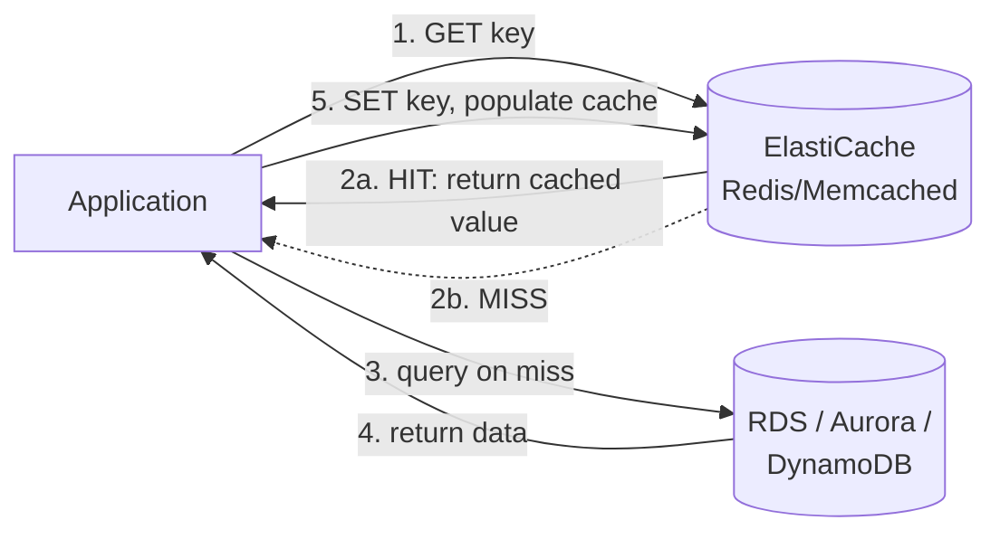

# Amazon ElastiCache


## Definition

Amazon ElastiCache is a managed, in-memory data store service — running either Redis or
Memcached — that keeps frequently accessed data in RAM so applications can read it back in
sub-millisecond time instead of hitting a slower disk-based database every time.

## Purpose

Databases (even fast ones like Aurora or DynamoDB) read from disk-backed or network-attached
storage, which, compared to RAM, is slow — low single-digit milliseconds at best. For data that's
read far more often than it changes (a product catalog, a user's session, a leaderboard, a
trending-posts list), re-fetching it from the database on every single request wastes both
latency budget and database capacity. ElastiCache exists to put a thin, managed, horizontally
scalable layer of pure RAM in front of (or beside) your database, so "hot" data can be served in
microseconds and your primary database is freed up for the writes and queries that actually need it.

## How It Works

The most common pattern is **cache-aside** (a.k.a. lazy loading): the application checks the
cache first, and only goes to the database on a cache miss, after which it populates the cache
for next time.



Step by step:
1. The app asks the cache for a key first — this is nearly always the fastest possible path
   (sub-millisecond, in-memory).
2. **Cache hit**: the cached value is returned immediately; the database is never touched for
   this request.
3. **Cache miss** (key doesn't exist or expired): the app falls through to the real database.
4. The database returns the authoritative data (slower, but correct).
5. The app writes that data back into the cache (often with a TTL/expiration) so the *next*
   request for the same key is a hit. Over time, the cache "warms up" to hold the data that's
   actually being requested.

For **Redis** specifically, ElastiCache also supports a **replication group** topology: a primary
node accepts writes, replica nodes serve reads and provide automatic failover if the primary
fails — conceptually similar to RDS Multi-AZ, but entirely in-memory and far faster to fail over.

## Key Features / Components

- **Redis engine** — supports rich data structures (lists, sets, sorted sets, hashes, streams,
  pub/sub), persistence (snapshot + append-only file), replication, Multi-AZ automatic failover,
  and cluster mode for sharding across multiple nodes.
- **Memcached engine** — simpler, purely in-memory key-value store, multi-threaded, no
  persistence/replication built in — chosen when you need raw simplicity and horizontal sharding
  without Redis's extra features.
- **ElastiCache Serverless** — on-demand, auto-scaling cache capacity with no node/shard
  management, billed by actual usage.
- **Cluster Mode (Redis)** — shards data across multiple node groups for horizontal write/read
  scaling beyond a single node's memory/throughput limit.
- **Global Datastore (Redis)** — cross-Region replication for globally distributed reads and
  disaster recovery.
- **Encryption** — at-rest and in-transit (TLS), plus Redis AUTH/ACLs for access control.
- **TTL (expiration)** — keys can auto-expire, keeping the cache from growing stale or unbounded.

## Use Cases — When to Use It

- Reducing database load and latency for frequently-read, rarely-changed data: product catalogs,
  configuration data, leaderboards, trending content.
- Session storage for web applications — fast reads/writes, natural TTL expiration for
  logged-out/expired sessions.
- Real-time analytics and counters (Redis `INCR`, sorted sets for leaderboards) where sub-ms
  updates matter.
- Pub/Sub messaging for lightweight real-time features (chat presence, live notifications) via Redis.
- Rate limiting and throttling logic that needs atomic, extremely fast counters.

## When NOT to Use It / Alternatives

- **Need durable, authoritative storage of your data — not just a copy of something else** →
  a real database (RDS/Aurora/DynamoDB). ElastiCache (especially Memcached) is not meant to be
  your source of truth; even Redis's persistence is a safety net, not a guarantee like a proper
  database's durability model.
- **Need DynamoDB-specific microsecond caching with zero cache-invalidation logic to write
  yourself** → **DAX** (DynamoDB Accelerator) is purpose-built for that and is API-compatible
  with the DynamoDB SDK, requiring less custom cache logic than ElastiCache.
- **Workload needs complex relational queries, not just key lookups** → ElastiCache has no
  concept of joins/schema; use RDS/Aurora directly (ElastiCache sits *in front of*, not instead of).
- **Budget is tight and the read load isn't actually a bottleneck yet** → don't add a cache layer
  speculatively; it's extra infrastructure, extra invalidation complexity, and extra cost for a
  problem you may not have. Measure first.

## Why It's Important

**Real world:** Cache invalidation is famously one of the two hard problems in computer science
(the other being naming things). Adding a cache layer buys speed but adds a new question to every
write path: "did I just make the cache stale?" Real production incidents happen when teams add
caching for performance but don't think through invalidation, serving stale prices, stale
inventory counts, or stale permissions. Understanding ElastiCache means understanding *when* the
tradeoff (speed for staleness-risk and added complexity) is worth it.

**Exam mapping:**
- **SAA-C03** — Domain 3.3 (Determine high-performing database solutions — caching strategy as
  part of overall database performance design) and Domain 3.4/3.1 (reducing load on backend tiers
  for high-performing, scalable architectures).
- **DVA-C03** — Task 1.1/1.3 (Develop code for applications hosted on AWS / use data stores —
  implementing cache-aside logic, handling cache misses and TTL correctly in application code).
- **MLA-C02** — Domain 3 (Deployment & Orchestration): caching for low-latency real-time
  inference results, and Domain 4 (Operating/Monitoring): feature store read latency optimization.

## Pricing Model (summary)

- **Node-based** — billed per hour per node type (memory size + vCPU), similar structure to EC2;
  Redis replication groups multiply this by the number of primary + replica nodes.
- **ElastiCache Serverless** — billed by actual cache usage (GB-hours + ECPUs consumed), no
  pre-provisioned nodes to pay for.
- **Data transfer** — cross-AZ/cross-Region replication traffic is billed; same-AZ traffic to
  app servers typically isn't.
- **Reserved Nodes** — 1 or 3-year commitment for steady workloads, meaningful savings over
  On-Demand node pricing.
- Exact current rates: https://aws.amazon.com/elasticache/pricing/

## Hands-on Lab (Floci)

**Honest limitation:** as of this writing, ElastiCache is **not** in Floci's documented
service-support table (only DynamoDB and RDS are listed under "Database" — see
`labs-floci/README.md`). `awslocal elasticache` commands may return a "not implemented" error
depending on the Floci version you're running. Treat any control-plane commands below as "try it,
and if it's not yet supported, this is the shape the real AWS CLI commands take" — then fall back
to running Redis directly via Docker for the actual data-access practice.

```bash
# Attempt the control-plane call first (may or may not be implemented in your Floci version)
awslocal elasticache create-cache-cluster \
  --cache-cluster-id study-redis \
  --engine redis \
  --cache-node-type cache.t3.micro \
  --num-cache-nodes 1

awslocal elasticache describe-cache-clusters --cache-cluster-id study-redis

# Fallback for the actual cache-aside data practice: run real Redis locally
docker run -d --name study-redis -p 6379:6379 redis:7

# Practice cache-aside logic against it with redis-cli
redis-cli -p 6379 SET product:123 '{"name":"Widget","price":9.99}' EX 300
redis-cli -p 6379 GET product:123
redis-cli -p 6379 TTL product:123     # confirm the TTL is counting down
redis-cli -p 6379 DEL product:123     # simulate invalidation on a product update

# Clean up
docker rm -f study-redis
```

This mirrors the repo's documented Floci limitation: it emulates control-plane APIs, not every
managed service's internals — use the real Redis container to build the actual mental model of
cache-aside reads/writes/TTL/invalidation.

## Exam Tips

- **"Reduce read load on the database" / "sub-millisecond latency" / "session store"** are the
  classic ElastiCache trigger phrases.
- Know **Redis vs Memcached**: Redis = persistence, replication, richer data types, pub/sub,
  cluster mode sharding. Memcached = simpler, multi-threaded, no persistence/replication, pure
  horizontal sharding of simple key-value pairs. If the question mentions "need to survive a
  reboot" or "replication" or "pub/sub," it's Redis.
- **ElastiCache for DynamoDB vs DAX** — if the question specifically says DynamoDB, prefer DAX
  (purpose-built, no custom invalidation code); ElastiCache is the general-purpose answer for
  RDS/Aurora or custom caching needs.
- Cache-aside pattern and TTL-based expiration are the default assumed pattern unless the
  question describes write-through caching specifically.
- Don't confuse ElastiCache (cache layer) with Aurora/RDS read replicas (still full database
  reads, just offloaded) — caches serve from memory with no query processing at all.

## Related Terms

- [`dynamodb.md`](dynamodb.md) — DAX is the DynamoDB-specific equivalent of this caching pattern.
- [`rds.md`](rds.md) / [`aurora.md`](aurora.md) — the typical "source of truth" databases ElastiCache
  sits in front of.
- [`database-selection-guide.md`](database-selection-guide.md) — full decision tree.
- Glossary: Cache-Aside, Write-Through, TTL, Cache Invalidation, Hot Key.
