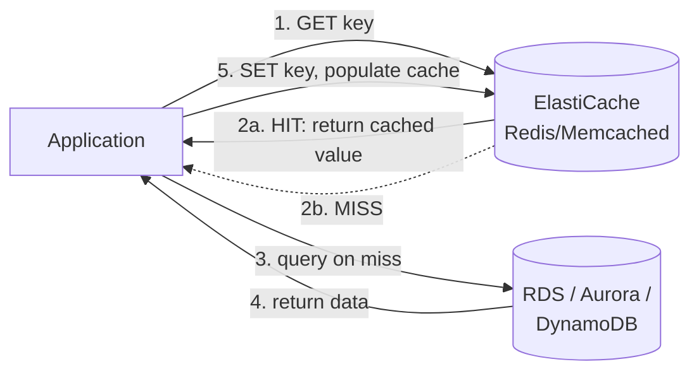
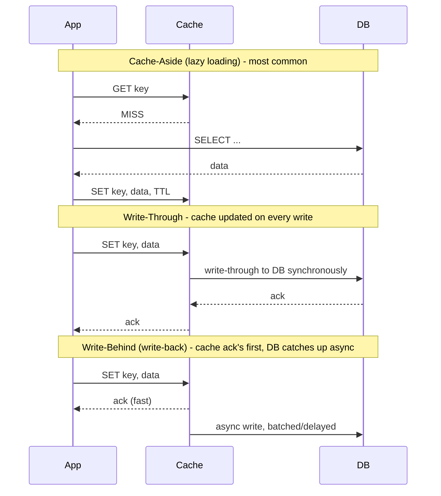
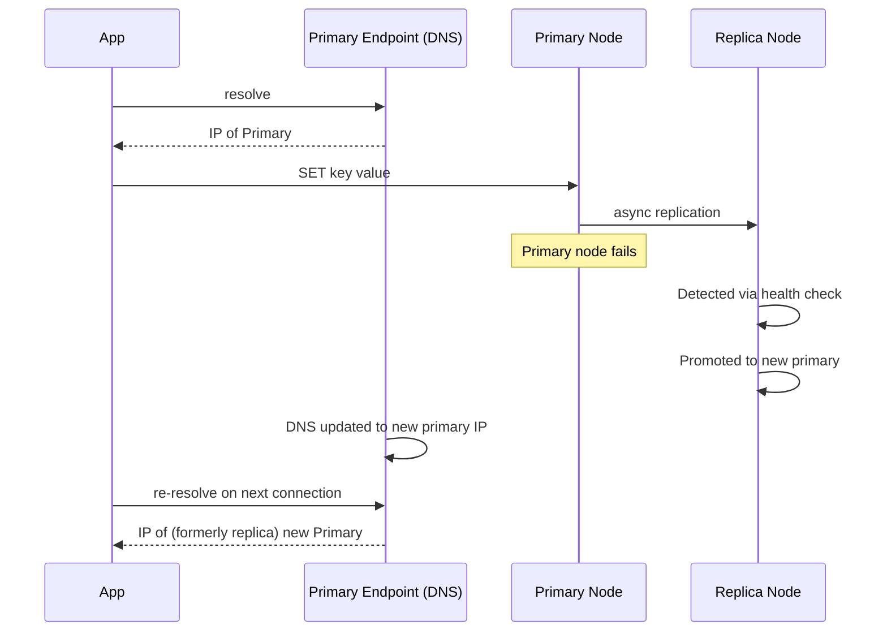
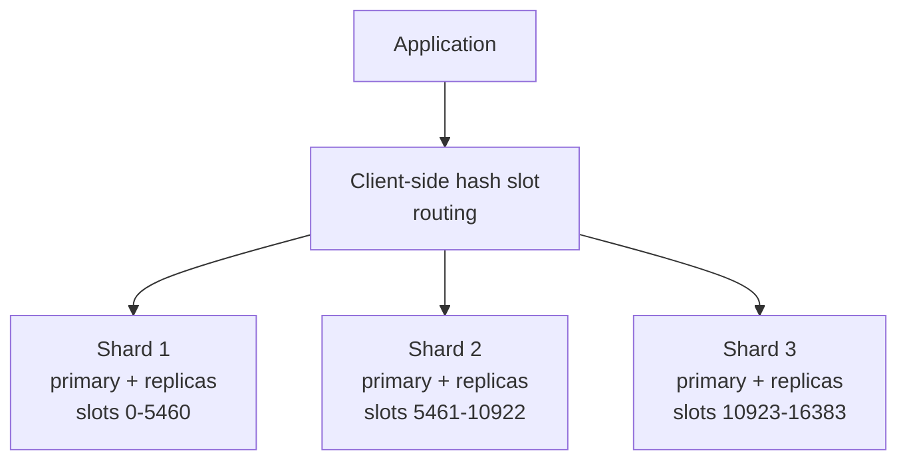
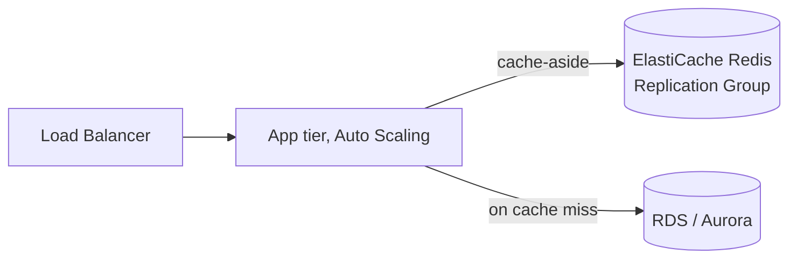
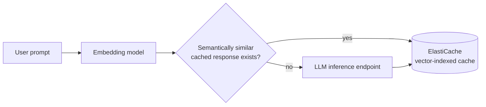

# Amazon ElastiCache

> **Appears in:** [DVA-C03](../../certifications/dva-c03/README.md) · [SAA-C03](../../certifications/saa-c03/README.md)


## Definition

Amazon ElastiCache is a managed, in-memory data store service — running either Redis (or the
open-source-compatible Valkey fork) or Memcached — that keeps frequently accessed data in RAM so
applications can read it back in sub-millisecond time instead of hitting a slower disk-based
database every time.

## Purpose

Databases (even fast ones like Aurora or DynamoDB) read from disk-backed or network-attached
storage, which, compared to RAM, is slow — low single-digit milliseconds at best. For data that's
read far more often than it changes (a product catalog, a user's session, a leaderboard, a
trending-posts list), re-fetching it from the database on every single request wastes both
latency budget and database capacity. ElastiCache exists to put a thin, managed, horizontally
scalable layer of pure RAM in front of (or beside) your database, so "hot" data can be served in
microseconds and your primary database is freed up for the writes and queries that actually need it.

The deeper tradeoff worth internalizing: every cache introduces a second copy of the truth. The
moment you have two copies of anything, you've taken on the job of keeping them in sync — and
that job doesn't disappear just because the cache is "managed." ElastiCache manages the
infrastructure (nodes, replication, failover); it does not manage your invalidation logic. That
remains entirely the application's responsibility, and it's the single biggest source of real
production bugs attributable to caching.

## How It Works

The most common pattern is **cache-aside** (a.k.a. lazy loading): the application checks the
cache first, and only goes to the database on a cache miss, after which it populates the cache
for next time.



Step by step:
1. The app asks the cache for a key first — this is nearly always the fastest possible path
   (sub-millisecond, in-memory).
2. **Cache hit**: the cached value is returned immediately; the database is never touched for
   this request.
3. **Cache miss** (key doesn't exist or expired): the app falls through to the real database.
4. The database returns the authoritative data (slower, but correct).
5. The app writes that data back into the cache (often with a TTL/expiration) so the *next*
   request for the same key is a hit. Over time, the cache "warms up" to hold the data that's
   actually being requested.

For **Redis** specifically, ElastiCache also supports a **replication group** topology: a primary
node accepts writes, replica nodes serve reads and provide automatic failover if the primary
fails — conceptually similar to RDS Multi-AZ, but entirely in-memory and far faster to fail over.

### Cache-Aside vs Write-Through vs Write-Behind



- **Cache-aside** is the default assumed pattern unless a question specifically describes
  something else — reads populate the cache lazily, and the cache can legitimately be empty/cold
  at any time without breaking correctness (just hurting performance until it warms up).
- **Write-through** keeps the cache always consistent with the database because every write goes
  through the cache first, but adds write latency (the write isn't "done" until both layers are
  updated) and wastes cache space on data that's written but rarely read.
- **Write-behind (write-back)** optimizes for write latency by acknowledging immediately and
  flushing to the database asynchronously, at the cost of a real durability gap — if the cache
  node fails before the async flush completes, that write is lost. This pattern needs an explicit,
  deliberate durability-risk conversation before adopting it in production.

### Redis Replication Group Failover (Sequence)



Because Redis replication is asynchronous, a failover during a write burst can lose the most
recent, not-yet-replicated writes — this is the one meaningful durability tradeoff versus a true
database, and it's why ElastiCache should never be treated as your system of record.

### Sharding / Cluster Mode for Horizontal Scale



Redis Cluster Mode partitions the full 16,384 hash-slot keyspace across shards (node groups),
each with its own primary + replicas — this is how ElastiCache for Redis scales beyond a single
node's memory/throughput ceiling, conceptually parallel to DynamoDB's partitioning, but entirely
in-memory and with a fixed, known slot count rather than dynamic partition splitting.

### Data Modeling / Key Design Patterns

- **Key naming conventions matter at scale.** A consistent pattern like `product:{id}` or
  `session:{userId}` makes cache invalidation logic predictable and lets you use `SCAN` with a
  pattern match for bulk operations (carefully — `KEYS *` on a large production cache blocks the
  single-threaded Redis event loop and is a well-known way to cause a self-inflicted outage).
- **Use Redis's richer data structures deliberately, not just strings.** A leaderboard stored as
  a Sorted Set (`ZADD`/`ZRANGE`) gets ranking "for free" from Redis's own data structure, instead
  of fetching all scores into the application and sorting them yourself — this is the actual
  reason Redis is chosen over Memcached far more often than "it has persistence."
  - Hashes (`HSET`/`HGETALL`) model a single object's fields efficiently, letting you update one
    field without rewriting the whole serialized blob.
  - Lists (`LPUSH`/`RPOP`) model queues/recent-activity feeds with native, atomic operations.
- **TTL discipline**: almost every cached key should have an explicit TTL, even a long one — an
  unbounded cache with no eviction policy for keys that are never explicitly deleted will
  eventually consume all available memory, at which point behavior depends on the configured
  eviction policy (`maxmemory-policy`), which is itself a decision worth making deliberately
  (e.g., `allkeys-lru` vs `volatile-ttl`) rather than leaving at the default.

### Implementing Cache-Aside in Application Code (Python, redis-py)

```python
import json
import redis
import boto3

# In production, discover the endpoint from an environment variable set at deploy time,
# and point it at the Primary Endpoint of the replication group (writes), with reads
# optionally split to the Reader Endpoint for read-heavy traffic.
cache = redis.Redis(
    host="my-cluster.xxxxx.cache.amazonaws.com",
    port=6379,
    ssl=True,              # in-transit encryption — don't leave this off in production
    decode_responses=True,
    socket_timeout=2,       # fail fast rather than hanging the request if the cache is unreachable
)

dynamodb = boto3.resource("dynamodb")
products_table = dynamodb.Table("Products")


def get_product(product_id: str) -> dict:
    """Cache-aside read: check Redis first, fall back to DynamoDB, repopulate on miss."""
    cache_key = f"product:{product_id}"

    cached = cache.get(cache_key)
    if cached is not None:
        return json.loads(cached)  # cache hit — sub-millisecond, database never touched

    # Cache miss — fall through to the authoritative store.
    response = products_table.get_item(Key={"ProductId": product_id})
    product = response.get("Item")
    if product is None:
        return None

    # Populate the cache for the next request, with a TTL so stale entries self-expire
    # even if we forget to invalidate them explicitly on every write path.
    cache.set(cache_key, json.dumps(product), ex=300)  # 5-minute TTL
    return product


def update_product_price(product_id: str, new_price: float) -> None:
    """Write path: update the source of truth, then invalidate (don't just hope TTL catches it)."""
    products_table.update_item(
        Key={"ProductId": product_id},
        UpdateExpression="SET Price = :p",
        ExpressionAttributeValues={":p": new_price},
    )
    # Explicit invalidation — relying on the 5-minute TTL alone would mean customers could see
    # a stale price for up to 5 minutes after a deliberate price change, which is a real bug.
    cache.delete(f"product:{product_id}")


def record_leaderboard_score(player_id: str, score: int) -> None:
    """Sorted Set usage: ranking comes from the data structure itself, not application code."""
    cache.zadd("leaderboard:global", {player_id: score})


def get_top_players(n: int = 10) -> list:
    # ZREVRANGE with scores — descending rank, O(log N) per call regardless of leaderboard size.
    return cache.zrevrange("leaderboard:global", 0, n - 1, withscores=True)
```

## Key Features / Components

- **Redis/Valkey engine** — supports rich data structures (lists, sets, sorted sets, hashes,
  streams, pub/sub), persistence (snapshot + append-only file), replication, Multi-AZ automatic
  failover, and cluster mode for sharding across multiple nodes.
- **Memcached engine** — simpler, purely in-memory key-value store, multi-threaded, no
  persistence/replication built in — chosen when you need raw simplicity and horizontal sharding
  without Redis's extra features.
- **ElastiCache Serverless** — on-demand, auto-scaling cache capacity with no node/shard
  management, billed by actual usage.
- **Cluster Mode (Redis/Valkey)** — shards data across multiple node groups for horizontal write/
  read scaling beyond a single node's memory/throughput limit.
- **Global Datastore (Redis/Valkey)** — cross-Region replication for globally distributed reads
  and disaster recovery.
- **Encryption** — at-rest and in-transit (TLS), plus Redis AUTH/ACLs for access control.
- **TTL (expiration)** — keys can auto-expire, keeping the cache from growing stale or unbounded.
- **Eviction policies** — `maxmemory-policy` options (LRU, LFU, random, TTL-based) decide what
  happens when the cache is full — a deliberate operational choice, not a default to ignore.
- **Semantic caching for generative AI workloads** — a newer pattern where ElastiCache caches
  vector-similarity-matched LLM responses (not exact-key matches), reducing redundant model
  inference calls for semantically similar prompts.

## Common Architectures

**1. Classic web app cache-aside tier.** EC2/ECS/Lambda app instances behind a load balancer each
check ElastiCache before falling through to RDS/Aurora — the textbook deployment, and still the
most common real-world shape.



**2. Session store with Multi-AZ Redis.** User sessions live in Redis with a TTL matching the
session timeout; Multi-AZ failover means a node failure doesn't force every logged-in user to
re-authenticate.

**3. Real-time leaderboard using Sorted Sets.** Game servers `ZINCRBY` a player's score on every
event; leaderboard reads are `ZREVRANGE` calls against the same sorted set — no application-side
sorting logic needed, and updates/reads are both O(log N).

**4. Rate limiting / API throttling.** A sliding-window or token-bucket rate limiter implemented
with Redis atomic counters (`INCR` + `EXPIRE`) — the atomicity guarantee is what makes this safe
under concurrent requests without a separate locking mechanism.

**5. Semantic cache in front of an LLM inference endpoint.** Prompts are embedded, and
ElastiCache is queried for a semantically similar cached prior prompt/response pair before
calling the (expensive, slower) model endpoint — cutting both latency and inference cost for
repeated or similar questions.



## Use Cases — When to Use It

- **Product catalog cache for a high-traffic e-commerce site.** Product details are read millions
  of times for every one time they change (a price update, a restock). Cache-aside with a TTL
  serves the overwhelming majority of reads from memory. Tradeoff vs reading RDS/Aurora directly:
  a read replica still runs the full query against disk-backed storage; a cache serves from RAM
  with no query processing at all — meaningfully faster, but now every write path must remember
  to invalidate the cached entry, a real ongoing maintenance cost a replica doesn't impose.
- **Session store for a web/mobile application.** User sessions read/written on nearly every
  request, with Multi-AZ Redis failover meaning a node failure doesn't force mass re-login.
  Tradeoff vs DynamoDB as the session store: DynamoDB is itself durable (no separate invalidation
  logic needed since there's no second copy of the truth), while Redis is faster but asynchronous
  replication means a failover can lose the very latest writes — pick based on whether "every user
  stays logged in, no exceptions" or "sub-millisecond session reads" matters more for this app.
- **Real-time gaming leaderboard with atomic rank updates.** Redis Sorted Sets (`ZADD`/`ZREVRANGE`)
  give ranking natively, without the application sorting scores itself. Tradeoff vs DynamoDB +
  DAX: DAX is purpose-built for DynamoDB and needs no custom cache-invalidation code, but lacks
  Redis's native ranked-data-structure semantics — ElastiCache wins specifically when the
  *data structure* (sorted sets), not just raw read speed, is the actual requirement.
- **API rate limiting / request throttling.** A sliding-window or token-bucket limiter built on
  Redis's atomic `INCR` + `EXPIRE` — the atomicity is what makes this safe under concurrent
  requests without a separate distributed lock. Tradeoff vs API Gateway's built-in throttling:
  API Gateway handles simple global/per-key rate limits declaratively; a Redis-based limiter is
  the right tool when limiting logic needs custom business rules (e.g., tiered limits per plan).
- **Pub/Sub for lightweight real-time features (chat presence, live notifications).** Redis
  Pub/Sub delivers messages to subscribed clients with minimal latency and no infrastructure to
  provision beyond the cache itself. Tradeoff vs a dedicated messaging service (SNS/EventBridge):
  Pub/Sub is fire-and-forget (no persistence, no replay, no durability guarantee) — fine for
  ephemeral presence/notification data, wrong choice if a lost message is a real business problem.
- **Semantic caching in front of an LLM inference endpoint.** Caching responses to semantically
  similar (not just identical) prompts cuts both latency and expensive model inference calls.
  Tradeoff vs always calling the model: the cache trades a small risk of returning a
  near-but-not-exact-match response for meaningfully lower cost/latency on repeated or similar
  queries — appropriate when slight response variation is acceptable, not for deterministic needs.
- **Database read-load offloading for a reporting dashboard that's still too chatty for a
  replica.** Frequently-recomputed aggregate values (e.g., "today's order count") cached with a
  short TTL instead of recalculated on every dashboard refresh. Tradeoff vs a materialized view in
  the database itself: a materialized view stays inside the database's consistency model, while a
  cache adds a second copy of the truth — appropriate when the read frequency vastly exceeds what
  even a materialized view's refresh cadence can economically support.
- **Distributed locking for coordination across multiple app instances.** Redis's `SET key value
  NX EX ttl` pattern implements a simple distributed lock (e.g., "only one instance processes this
  batch job at a time"). Tradeoff vs a dedicated coordination service (DynamoDB conditional writes,
  or Step Functions for workflow coordination): Redis locking is fast and simple for short-lived
  locks, but isn't as battle-tested for complex distributed-consensus scenarios as a purpose-built
  coordination primitive.
- **Caching computed ML inference results for repeated identical requests.** A recommendation or
  scoring result cached by input hash so an identical downstream request doesn't re-invoke a
  (slower, costlier) model endpoint. Tradeoff vs DAX (if the backing store is DynamoDB): DAX is
  the better fit specifically when DynamoDB is the source of truth; ElastiCache fits when the
  computed result itself (not a DynamoDB read) is what's expensive and worth caching.
- **Multiplayer game ephemeral match state needing the fastest possible read/write latency.**
  Active match state updated many times per second during gameplay. Tradeoff vs DynamoDB: Redis
  is faster for this specific access pattern, but a cache node failure before replication catches
  up can lose the most recent state — acceptable for ephemeral match data where the match itself
  can restart, less acceptable for data that must never be lost.
- **Geospatial queries for "nearby" features (ride-hailing, store locator).** Redis's geospatial
  commands (`GEOADD`/`GEOSEARCH`) answer "what's within 5km of this point" natively. Tradeoff vs
  PostGIS in RDS/Aurora PostgreSQL: PostGIS supports much richer spatial queries and stays inside
  the relational consistency model; Redis's geo commands are faster for simple proximity lookups
  at high read volume but offer far less spatial query sophistication.
- **Reducing cold-start latency for serverless functions needing shared, fast-access state.** A
  Lambda function reads shared configuration or computed state from ElastiCache instead of
  recomputing it or re-reading a slower source on every invocation. Tradeoff vs Lambda's own
  execution-environment reuse/caching: in-memory caching within a single warm Lambda instance is
  even faster but isn't shared across concurrent invocations — ElastiCache is needed when many
  concurrent Lambda executions must share the same cached state consistently.

## When NOT to Use It / Alternatives

- **Need durable, authoritative storage of your data — not just a copy of something else** →
  a real database (RDS/Aurora/DynamoDB). ElastiCache (especially Memcached) is not meant to be
  your source of truth; even Redis's persistence is a safety net, not a guarantee like a proper
  database's durability model.
- **Need DynamoDB-specific microsecond caching with zero cache-invalidation logic to write
  yourself** → **DAX** (DynamoDB Accelerator) is purpose-built for that and is API-compatible
  with the DynamoDB SDK, requiring less custom cache logic than ElastiCache.
- **Workload needs complex relational queries, not just key lookups** → ElastiCache has no
  concept of joins/schema; use RDS/Aurora directly (ElastiCache sits *in front of*, not instead of).
- **Budget is tight and the read load isn't actually a bottleneck yet** → don't add a cache layer
  speculatively; it's extra infrastructure, extra invalidation complexity, and extra cost for a
  problem you may not have. Measure first.

## Real-World Pricing Examples

**Example 1 — small Redis replication group for session storage:**
- Primary + 1 replica, both `cache.t3.micro` at roughly $0.017/hr each ≈
  **$0.034/hr → ~$25/month** combined — genuinely cheap at small scale, which is part of why
  caching is so easy to over-adopt without measuring need first.

**Example 2 — production-scale Redis cluster mode, 3 shards with 1 replica each:**
- 6 total nodes (3 primary + 3 replica) at `cache.r6g.large` (~$0.151/hr each) ≈
  **$0.906/hr → ~$661/month** — a real, meaningful line item once you're sharding for scale, which
  is the concrete reason "don't add caching speculatively" is practical advice, not just caution.

**Example 3 — ElastiCache Serverless for a spiky workload:**
- Billed by GB-hours of data stored plus ECPUs (ElastiCache Processing Units) consumed, with no
  minimum node to provision — for a workload with highly variable cache usage (e.g., a seasonal
  retail site), this avoids paying for a fixed-size cluster sized for peak traffic that then sits
  mostly idle 10 months of the year.

- Exact current rates: https://aws.amazon.com/elasticache/pricing/

## Limits & Quotas (Real, Current — Verify Before Relying On Them)

- **Max value size (Redis/Valkey string)**: **512 MB** per value, though in practice values this
  large are almost always a design smell — most production workloads should keep individual
  cached values well under 1 MB for latency reasons alone.
- **Redis Cluster Mode hash slots**: a fixed **16,384** slots, distributed across shards — this
  number is architectural, not configurable.
- **Max shards per Redis (cluster mode enabled) replication group**: up to **500** shards (raised
  over time from an original lower limit — verify the current ceiling before relying on it).
- **Max replicas per shard**: up to **5** read replicas per primary in a shard.
- **Max nodes per cluster (cluster mode disabled)**: up to **6** (1 primary + 5 replicas).
- **Memcached nodes per cluster**: 1–60 nodes.
- **Global Datastore secondary Regions**: multiple secondary Regions supported for cross-Region
  replication — verify the current maximum before architecting around a specific count.
- **TLS and AUTH**: both optional but strongly recommended; enabling in-transit encryption after
  cluster creation on some older configurations may require a new cluster — check current
  engine-version-specific behavior.

## Troubleshooting / Common Issues

- **Application reads stale data after an update** → classic cache-invalidation bug: the write
  path updated the database but not the cache (or vice versa) — audit every write path for
  symmetric cache invalidation, not just the "happy path" write.
- **`KEYS *` or a large `SCAN` call causes a latency spike cluster-wide** → Redis is
  single-threaded for command execution; an expensive blocking command on one node stalls every
  other command queued behind it — use `SCAN` with a small `COUNT` and never run `KEYS *` against
  a production-sized dataset.
- **Memory usage grows until eviction/OOM** → check `maxmemory-policy`; if it's set to a
  non-eviction policy (or left at a default that doesn't suit the workload) and keys lack TTLs,
  the cache will fill up and either evict unpredictably or reject new writes with an
  out-of-memory error.
- **Failover caused a burst of cache misses and briefly hammered the database** → expected
  behavior: a promoted replica starts with whatever data it already had, but a full primary
  replacement (not a promotion) starts cold — size the database tier to survive a cold-cache
  burst, don't assume the cache will always be warm.
- **Read replica lag causes read-your-own-write inconsistency** → Redis replication is
  asynchronous; an application that writes then immediately reads from a replica can see stale
  data for a brief window — read-after-write-critical paths should read from the primary.
- **Pub/Sub messages "lost" during a node failure** → Redis Pub/Sub is fire-and-forget, not
  persisted or replayable — if message durability matters, Pub/Sub is the wrong tool; consider
  Redis Streams (which do persist) or a dedicated messaging service instead.

## Why It's Important

**Real world:** Cache invalidation is famously one of the two hard problems in computer science
(the other being naming things). Adding a cache layer buys speed but adds a new question to every
write path: "did I just make the cache stale?" Real production incidents happen when teams add
caching for performance but don't think through invalidation, serving stale prices, stale
inventory counts, or stale permissions. Understanding ElastiCache means understanding *when* the
tradeoff (speed for staleness-risk and added complexity) is worth it.

**Exam mapping:**
- **SAA-C03** — Domain 3.3 (Determine high-performing database solutions — caching strategy as
  part of overall database performance design) and Domain 3.4/3.1 (reducing load on backend tiers
  for high-performing, scalable architectures).
- **DVA-C03** — Task 1.1/1.3 (Develop code for applications hosted on AWS / use data stores —
  implementing cache-aside logic, handling cache misses and TTL correctly in application code).
- **MLA-C02** — Domain 3 (Deployment & Orchestration): caching for low-latency real-time
  inference results, and Domain 4 (Operating/Monitoring): feature store read latency optimization.

**Expanded exam scenarios:**
- *"A database is experiencing high read load from repeatedly fetching the same slow-changing
  product catalog data."* → ElastiCache cache-aside, not a read replica (replicas still run the
  full query against disk-backed storage; a cache serves from memory with no query processing
  at all — meaningfully faster).
- *"User sessions must survive a single cache node failure without forcing logout."* → Redis
  with Multi-AZ automatic failover, not Memcached (no replication/persistence) and not a single
  unreplicated Redis node.
- *"An application needs atomic, real-time leaderboard ranking updates under high write
  concurrency."* → Redis Sorted Sets — the exam increasingly expects you to know the *specific
  data structure*, not just "use Redis."
- *"A workload needs horizontal cache scaling beyond a single node's memory capacity."* → Redis
  Cluster Mode (sharding across node groups), not simply a bigger single node — there's a ceiling
  on vertical scaling that cluster mode exists specifically to break through.
- *"A team wants DynamoDB read latency reduced to microseconds without writing custom cache
  invalidation code."* → DAX, not ElastiCache — recognize when the question explicitly steers
  toward the DynamoDB-specific purpose-built tool instead of the general-purpose one.

## Pricing Model (summary)

- **Node-based** — billed per hour per node type (memory size + vCPU), similar structure to EC2;
  Redis replication groups multiply this by the number of primary + replica nodes.
- **ElastiCache Serverless** — billed by actual cache usage (GB-hours + ECPUs consumed), no
  pre-provisioned nodes to pay for.
- **Data transfer** — cross-AZ/cross-Region replication traffic is billed; same-AZ traffic to
  app servers typically isn't.
- **Reserved Nodes** — 1 or 3-year commitment for steady workloads, meaningful savings over
  On-Demand node pricing.
- See the worked examples above for how node count and type drive real monthly cost.
- Exact current rates: https://aws.amazon.com/elasticache/pricing/

## Hands-on Lab (Floci)

**Honest limitation:** as of this writing, ElastiCache is **not** in Floci's documented
service-support table (only DynamoDB and RDS are listed under "Database" — see
`labs-floci/README.md`). `awslocal elasticache` commands may return a "not implemented" error
depending on the Floci version you're running. Treat any control-plane commands below as "try it,
and if it's not yet supported, this is the shape the real AWS CLI commands take" — then fall back
to running Redis directly via Docker for the actual data-access practice.

```bash
# Attempt the control-plane call first (may or may not be implemented in your Floci version)
awslocal elasticache create-cache-cluster \
  --cache-cluster-id study-redis \
  --engine redis \
  --cache-node-type cache.t3.micro \
  --num-cache-nodes 1

awslocal elasticache describe-cache-clusters --cache-cluster-id study-redis

# Fallback for the actual cache-aside data practice: run real Redis locally
docker run -d --name study-redis -p 6379:6379 redis:7

# Practice cache-aside logic against it with redis-cli
redis-cli -p 6379 SET product:123 '{"name":"Widget","price":9.99}' EX 300
redis-cli -p 6379 GET product:123
redis-cli -p 6379 TTL product:123     # confirm the TTL is counting down
redis-cli -p 6379 DEL product:123     # simulate invalidation on a product update

# Practice a Sorted Set leaderboard
redis-cli -p 6379 ZADD leaderboard 100 player1 250 player2 90 player3
redis-cli -p 6379 ZREVRANGE leaderboard 0 2 WITHSCORES   # top 3, descending

# Clean up
docker rm -f study-redis
```

This mirrors the repo's documented Floci limitation: it emulates control-plane APIs, not every
managed service's internals — use the real Redis container to build the actual mental model of
cache-aside reads/writes/TTL/invalidation.

## Exam Tips

- **"Reduce read load on the database" / "sub-millisecond latency" / "session store"** are the
  classic ElastiCache trigger phrases.
- Know **Redis vs Memcached**: Redis = persistence, replication, richer data types, pub/sub,
  cluster mode sharding. Memcached = simpler, multi-threaded, no persistence/replication, pure
  horizontal sharding of simple key-value pairs. If the question mentions "need to survive a
  reboot" or "replication" or "pub/sub," it's Redis.
- **ElastiCache for DynamoDB vs DAX** — if the question specifically says DynamoDB, prefer DAX
  (purpose-built, no custom invalidation code); ElastiCache is the general-purpose answer for
  RDS/Aurora or custom caching needs.
- Cache-aside pattern and TTL-based expiration are the default assumed pattern unless the
  question describes write-through caching specifically.
- Don't confuse ElastiCache (cache layer) with Aurora/RDS read replicas (still full database
  reads, just offloaded) — caches serve from memory with no query processing at all.
- **Sorted Sets for leaderboards/rankings** is a specific, recognizable Redis data-structure
  trigger — don't default to "just use Redis" without matching the data structure to the pattern.
- **Write-behind caching trades durability for write latency** — a question emphasizing "fastest
  possible write acknowledgment, some data loss on failure acceptable" points here; "every write
  must be durable immediately" points away from it.

## Further Reading

- [What is Amazon ElastiCache?](https://docs.aws.amazon.com/AmazonElastiCache/latest/dg/WhatIs.html) —
  official service overview.
- [High availability using replication groups](https://docs.aws.amazon.com/AmazonElastiCache/latest/dg/Replication.html) —
  the failover mechanics referenced above, straight from AWS.
- [ElastiCache components and features](https://docs.aws.amazon.com/AmazonElastiCache/latest/dg/WhatIs.Components.html) —
  shards, clusters, and node groups explained.
- [Performance at Scale with Amazon ElastiCache](https://docs.aws.amazon.com/whitepapers/latest/scale-performance-elasticache/welcome.html) —
  AWS's own whitepaper on caching strategy and architecture patterns.
- [Amazon ElastiCache pricing](https://aws.amazon.com/elasticache/pricing/) — current, authoritative rates.

## Related Terms

- [`dynamodb.md`](dynamodb.md) — DAX is the DynamoDB-specific equivalent of this caching pattern.
- [`rds.md`](rds.md) / [`aurora.md`](aurora.md) — the typical "source of truth" databases ElastiCache
  sits in front of.
- [`database-selection-guide.md`](database-selection-guide.md) — full decision tree.
- Glossary: Cache-Aside, Write-Through, Write-Behind, TTL, Cache Invalidation, Hot Key, Eviction Policy.

---

**Image credit:** "Typical Valkey and Redis OSS Clusters" and "Valkey or Redis OSS (cluster mode
disabled) cluster has one shard and 0 to 5 replica nodes" — official diagrams from the AWS
ElastiCache Developer/User Guide, Amazon Web Services, Inc. Source:
https://docs.aws.amazon.com/AmazonElastiCache/latest/dg/images/ElastiCache-Cluster-Redis.png and
https://docs.aws.amazon.com/AmazonElastiCache/latest/dg/images/ElastiCacheClusters-CSN-Redis-Replicas.png


*Figure: A typical Redis/Valkey cluster — one or more shards, each potentially containing a primary and replica nodes. Source: AWS ElastiCache Developer Guide (docs.aws.amazon.com).*


*Figure: Replication group topology — a single primary with up to 5 read replicas, the basis for Multi-AZ automatic failover. Source: AWS ElastiCache Developer Guide (docs.aws.amazon.com).*
