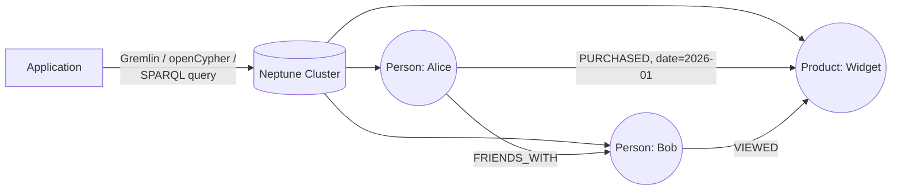
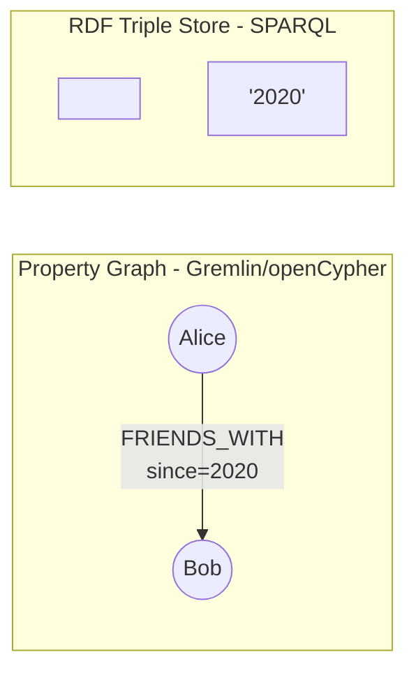
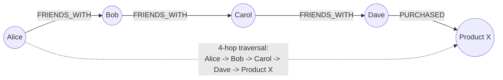
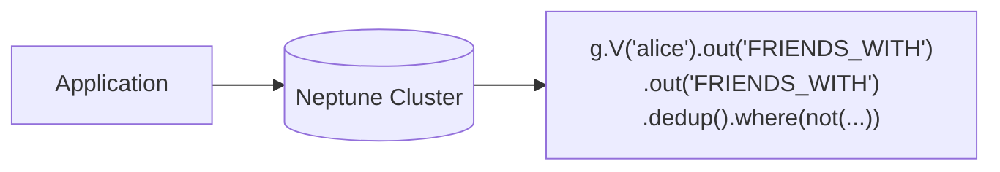
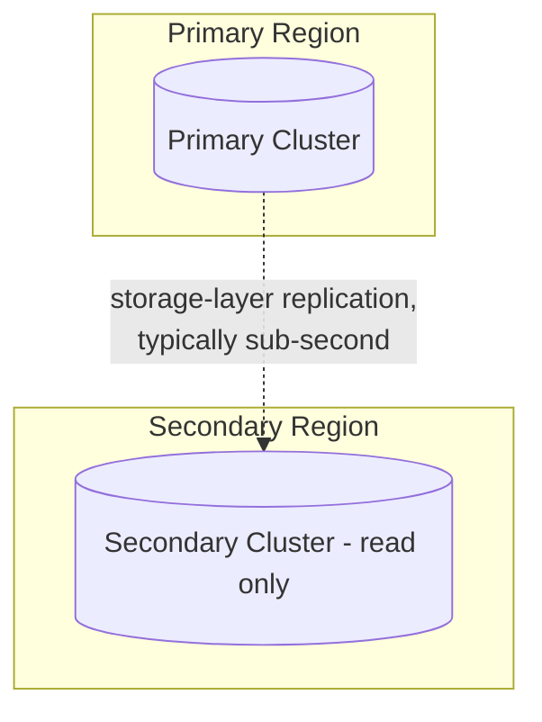

# Amazon Neptune


## Definition

Amazon Neptune is a managed **graph database** — built to store and rapidly traverse data that's
fundamentally about relationships between things (who knows whom, what connects to what, who
bought what and when) rather than rows, documents, or key-value pairs.

## Purpose

Some data is naturally relational in the *graph* sense, not the SQL sense: social networks
(people connected to people), fraud detection (accounts connected through shared devices/IPs/
payment methods), recommendation engines (users connected to products they liked, products
connected to other products bought together), and knowledge graphs (concepts connected to related
concepts). Modeling this in a SQL database means endless self-joins and junction tables that get
slower and harder to reason about with every additional "hop" in the relationship chain ("friends
of friends of friends who also liked X"). Neptune exists because graph traversal — "starting from
this node, walk these kinds of edges N hops out" — is a fundamentally different computational
problem that a purpose-built graph engine solves far more efficiently than relational JOINs ever
can at scale.

The computational reason this matters: a relational JOIN at depth N requires the query planner to
compute and materialize intermediate result sets at every hop, and that intermediate set can grow
combinatorially with each additional join. A graph engine instead walks edges directly from
node to node using adjacency information maintained specifically for that purpose — the cost of
each hop stays roughly constant regardless of how many hops came before, which is why Neptune
queries that would be computationally infeasible as a 5-table SQL self-join chain return in
milliseconds.

## How It Works

Neptune stores data as **nodes** (entities) and **edges** (relationships between entities, which
can themselves have properties), and executes queries by traversing edges directly rather than
computing table joins.



Step by step:
1. **Data is modeled as nodes and edges** — "Alice" and "Bob" are nodes with a `Person` label;
   "Widget" is a node with a `Product` label; the relationships between them ("FRIENDS_WITH,"
   "PURCHASED," "VIEWED") are edges, which can carry their own properties (like a purchase date).
2. **You query by traversal, not by join**: "find all products purchased by friends of Alice who
   haven't purchased it themselves" is expressed as "start at Alice → walk FRIENDS_WITH edges →
   walk PURCHASED edges from those friends → filter out products Alice already has." Neptune
   walks this directly through the graph structure.
3. **Three query languages are supported**: Apache TinkerPop **Gremlin** (step-based traversal
   language), **openCypher** (declarative, pattern-matching syntax popularized by Neo4j), and
   **SPARQL** (for RDF-triple-store style knowledge graphs/semantic web use cases) — pick based
   on your team's existing familiarity or the specific graph model (property graph vs RDF).
4. **The cluster architecture** mirrors Aurora/DocumentDB: a primary handles writes, up to 15
   replicas serve reads, storage is distributed and auto-healing across multiple Availability
   Zones, with automatic failover.
5. **As the graph grows**, Neptune's specialized indexing for adjacency (which nodes connect to
   which) keeps multi-hop traversals fast — this is the core performance advantage over trying to
   do the same thing with repeated SQL self-joins, which get exponentially slower with each hop.

### Property Graph vs RDF: Two Different Data Models



- **Property graphs** (queried via Gremlin or openCypher) attach arbitrary key-value properties
  directly to both nodes and edges — "FRIENDS_WITH since 2020" is one edge with a `since`
  property. This is the more intuitive model for most application-style graph use cases (social
  networks, recommendation engines, fraud detection).
- **RDF (Resource Description Framework)** represents everything as subject-predicate-object
  *triples* — "Alice knows Bob" and "Alice knowsSince 2020" become two separate triples rather
  than one edge with a property. This model is the standard for formal knowledge graphs, semantic
  web applications, and scenarios requiring strict ontologies and standardized vocabularies
  (common in life sciences, government linked-data, and regulatory/compliance knowledge graphs).
- **You choose one model (and its corresponding query languages) per Neptune cluster** — a single
  cluster is either optimized for property-graph queries (Gremlin/openCypher) or RDF queries
  (SPARQL), not freely interchangeable within the same dataset.

### Multi-Hop Traversal Performance, Concretely



A query like "find products purchased by friends-of-friends-of-friends" is a 4-hop traversal.
In Neptune, this is a direct walk along existing adjacency structures — cost scales roughly with
the number of edges actually traversed (bounded by the graph's real connectivity, i.e., how many
friends each person has), not with the total size of the dataset. The same query expressed as SQL
would require 3-4 self-joins against a `friendships` table and one more against a `purchases`
table — each join's intermediate result set can balloon well past what's actually useful, and
query planners increasingly struggle to optimize this well past 2-3 joins.

### Data Modeling Patterns for Neptune

- **Model entities as nodes with a clear label, and relationships as typed edges — don't encode
  relationship meaning in node properties.** "Alice FRIENDS_WITH Bob" should be an edge, not an
  array property on Alice listing friend IDs — the latter forces application-side joins instead
  of letting Neptune's traversal engine do the work.
- **Give edges meaningful properties when the relationship itself has attributes** (a purchase's
  date and amount, a friendship's start date) rather than creating awkward intermediate nodes to
  hold that data.
- **Design around your actual traversal patterns, not a theoretically "complete" graph.** Just
  like DynamoDB's access-pattern-first design, a Neptune schema should be shaped by the specific
  multi-hop queries the application actually needs to run fast, not by modeling every
  conceivable relationship just because the data technically supports it.
- **Avoid supernodes where possible.** A node with an extremely high number of edges (e.g., a
  single celebrity account followed by millions of users) can become a traversal bottleneck
  analogous to a hot partition — queries that traverse through a supernode pay a real cost
  proportional to its edge count, and this is a known, real-world Neptune performance
  consideration for social-graph-shaped data.

## Key Features / Components

- **Property graph model** — nodes and edges each with arbitrary key-value properties, queried
  via Gremlin or openCypher.
- **RDF / triple-store model** — subject-predicate-object triples, queried via SPARQL, suited to
  formal knowledge graphs and semantic web / linked-data use cases.
- **Neptune ML** — built-in integration with Amazon SageMaker to train graph neural network (GNN)
  models directly on your graph data for tasks like link prediction or node classification
  (e.g., "predict which users are likely to connect" or "classify this transaction as fraud").
  Relevant overlap with MLA-C02.
- **High availability** — up to 15 read replicas sharing distributed, auto-healing storage across
  3 Availability Zones, automatic failover.
- **Neptune Streams** — a change-data-capture log of graph mutations, for event-driven
  architectures reacting to graph changes.
- **Neptune Analytics** — a separate analytics engine for running graph algorithms (PageRank,
  community detection, shortest path) across the whole graph at once, distinct from Neptune
  Database's low-latency single-traversal queries.
- **Neptune Global Database** — a primary cluster in one Region with up to several secondary
  read-only clusters in other Regions, replicated with typically sub-second lag, for global low-
  latency reads and disaster recovery — the graph-database analog to Aurora Global Database.
- **Encryption at rest (KMS) and in transit (TLS)**, IAM database authentication.
- **Neptune Workbench** — Jupyter-notebook-based querying and visualization, useful for
  interactively exploring and debugging graph traversal results, including visual rendering of
  query paths.

## Common Architectures

**1. Social graph with friend-of-friend recommendations.** User nodes connected by FRIENDS_WITH
edges; a "people you may know" feature traverses 2-3 hops out from a given user, filtering out
existing connections — a textbook Neptune use case, typically implemented in Gremlin.



**2. Fraud ring detection.** Accounts, devices, IP addresses, and payment instruments are all
nodes; shared-device or shared-payment-method edges let a query find clusters of accounts that
are suspiciously interconnected — a pattern that's genuinely hard to express efficiently in SQL
past 2-3 hops but natural in Gremlin/openCypher.

**3. Neptune ML for link prediction.** A graph neural network trained via Neptune ML on an
existing transaction/account graph predicts the likelihood of a new, not-yet-observed connection
(e.g., "is this new account likely linked to a known fraud ring") — feeding model inference back
into the application's real-time risk scoring.

**4. Global knowledge graph with RDF/SPARQL.** A regulatory or life-sciences organization models
a formal ontology (standardized relationships between concepts, drugs, regulations, entities) as
RDF triples, queried via SPARQL for semantic search and compliance mapping.

**5. Multi-Region read scaling with Neptune Global Database.** A primary cluster accepts all
writes in one Region; secondary clusters in other Regions serve low-latency local reads for a
globally distributed application, promotable during a regional disaster.



## Use Cases — When to Use It

- Social networking features: friend/follow graphs, "people you may know," mutual-connections queries.
- Fraud detection: finding rings of accounts connected through shared devices, IPs, or payment
  instruments — a classic multi-hop graph traversal problem.
- Recommendation engines: "customers who bought X also bought Y," collaborative filtering based
  on graph proximity.
- Knowledge graphs and semantic search: representing and querying richly interconnected concept
  relationships (life sciences, content taxonomies, regulatory/compliance mapping).
- Network/IT topology mapping: understanding dependency chains ("what breaks if this server goes down").

## When NOT to Use It / Alternatives

- **Data isn't really about relationships — it's standard transactional records** → **RDS/Aurora**
  — don't model simple one-to-many data as a graph just because it sounds more sophisticated;
  that's needless complexity.
- **Need simple key-value lookups at massive scale with no traversal logic** → **DynamoDB** — far
  cheaper and simpler if you're not actually walking multi-hop relationships.
- **Need flexible document storage without relationship-heavy queries** → **DocumentDB** or
  **DynamoDB** — Neptune's value is specifically the traversal engine; don't pay for it if you
  won't use it.
- **Occasional, ad-hoc graph-like analysis on data that's mostly used for other things** → it may
  be cheaper to model the relationships as a secondary index or adjacency list in DynamoDB/RDS for
  simple 1–2 hop cases, reserving Neptune for genuinely deep/complex traversal needs.

## Real-World Pricing Examples

**Example 1 — small production cluster, primary + 1 replica:**
- Two `db.r6g.large` instances at roughly $0.348/hr each ≈ **$0.696/hr → ~$508/month** compute.
- Storage: 50 GB at roughly $0.10/GB-month ≈ **$5/month**.
- I/O: roughly 50 million requests/month at approximately $0.20/million ≈ **$10/month**.
- **Rough total: ~$523/month** — Neptune's per-instance rate is comparable to Aurora/DocumentDB
  instance classes, which is worth knowing when comparing the total cost of "model this as a
  graph" against "model this as an adjacency list in DynamoDB," since the latter is frequently
  far cheaper for genuinely shallow relationship needs.

**Example 2 — Neptune Analytics for periodic graph-algorithm batch jobs:**
- Billed separately based on the memory/compute allocated for the analytics workload — a
  monthly PageRank/community-detection batch run over the full graph is a distinct cost line
  from the always-on Neptune Database cluster serving live traversal queries; budgeting for both
  separately avoids an unpleasant surprise when the analytics job turns out to need a
  meaningfully larger memory footprint than the serving cluster.

**Example 3 — Neptune ML training cost:**
- Training a GNN via Neptune ML provisions SageMaker training infrastructure under the hood,
  billed per the underlying SageMaker instance-hours used for training/export, separate from
  Neptune's own instance/storage costs — treat it as "Neptune cost + a SageMaker training job
  cost," not a single bundled number.

- Exact current rates: https://aws.amazon.com/neptune/pricing/

## Limits & Quotas (Real, Current — Verify Before Relying On Them)

- **Max read replicas per cluster**: **15**.
- **Max storage per cluster**: up to **128 TiB**, auto-scaling.
- **Max property value size**: up to **55,000 characters** for a single string property value
  (verify current limit — Neptune has specific per-property-type size ceilings that are easy to
  overlook when migrating large text fields from another system).
- **Query timeout defaults**: configurable per-query/per-cluster; long-running traversals
  (e.g., poorly bounded multi-hop queries without a hop limit) should have explicit timeouts
  set, since an unbounded traversal over a densely connected graph can run far longer than
  expected.
- **Max concurrent queries**: scales with instance class; a workload with many concurrent
  traversal queries should size the instance class around concurrency needs, not just dataset
  size.
- **Neptune Global Database secondary Regions**: multiple secondary Regions supported — verify
  the current maximum before architecting around a specific count.
- **Bulk loader (`neptune-loader`) supported formats**: CSV (for property graphs), N-Triples/
  N-Quads/Turtle/RDF-XML (for RDF) — data must be in one of these formats (or transformed into
  one) for the high-throughput bulk load path; row-by-row inserts via the API are far slower for
  large initial loads.

## Troubleshooting / Common Issues

- **A traversal query that worked fine in testing is extremely slow in production** → almost
  always an unbounded or poorly scoped traversal hitting a **supernode** (a node with an
  unusually high edge count) that didn't exist in the smaller test dataset — profile the query
  and check for nodes with abnormally high degree before assuming it's a general performance
  issue.
- **SPARQL query returns unexpected/empty results** → check that the data was actually loaded in
  a consistent RDF model (correct namespaces/prefixes) — a common real mistake is mixing
  inconsistent URI conventions across different data loads, which silently breaks pattern
  matching.
- **Gremlin query returns duplicate results** → missing `.dedup()` step; unlike SQL's implicit
  set semantics in some contexts, Gremlin traversals can legitimately revisit the same node via
  multiple paths and will return it multiple times unless explicitly deduplicated.
- **Bulk load fails or is extremely slow** → verify the source data is in one of the supported
  bulk-load formats (CSV for property graphs, RDF formats for triples); row-by-row API inserts
  for a large initial dataset load will be orders of magnitude slower than using the bulk loader.
- **Neptune ML training produces poor-quality predictions** → check whether the underlying graph
  has sufficient connectivity/density for the GNN to learn meaningful structure — a very sparse
  or disconnected graph gives a graph neural network little signal to work with, regardless of
  model tuning.
- **Read replica lag during heavy write bursts** → same shared-storage replication model as
  Aurora/DocumentDB; a sustained heavy write burst can cause replicas to lag briefly — read-after-
  write-critical traversal queries should target the primary, not a replica.

## Why It's Important

**Real world:** Fraud rings, recommendation quality, and social-graph features are genuinely
high-value business problems that are either barely tractable or outright impractical with
repeated SQL self-joins past 2–3 hops of relationship depth. Choosing Neptune (or not) is a real
architectural decision about whether your core data model is fundamentally graph-shaped — forcing
the wrong model (graph-as-relational or relational-as-graph) creates lasting technical debt.

**Exam mapping:**
- **SAA-C03** — Domain 3.3 (Determine high-performing database solutions) — Neptune is the
  "purpose-built graph database" option in the full database-family comparison; exam questions
  test recognizing graph-shaped scenarios (fraud detection, social networks, recommendations) as
  the Neptune trigger.
- **DVA-C03** — Rarely central but can appear in Task 1.3 (use data stores in application
  development) if a scenario names Gremlin/openCypher/SPARQL explicitly.
- **MLA-C02** — Domain 2 (Model Development): Neptune ML / graph neural networks as a modeling
  approach for link-prediction and node-classification tasks is a direct, specific intersection
  with this service.

**Expanded exam scenarios:**
- *"A fraud team needs to identify clusters of accounts connected through shared devices and
  payment methods, several hops removed from a known fraudulent account."* → Neptune — the
  textbook multi-hop fraud-ring trigger.
- *"A social app needs a 'people you may know' feature based on mutual friends."* → Neptune with
  a Gremlin or openCypher 2-hop traversal, not a DynamoDB adjacency-list query if the hop depth
  or connectivity density makes that impractical.
- *"A regulatory compliance team needs to query a formal ontology of interconnected regulations
  and entities using standardized semantic web vocabularies."* → RDF model, SPARQL query
  language — recognize the "formal ontology"/"semantic web" language as the RDF trigger, distinct
  from the more general property-graph trigger phrases.
- *"A data science team wants to predict likely future connections in an existing graph dataset
  without exporting the data to a separate ML pipeline."* → Neptune ML — recognize the specific
  "train directly on graph data via SageMaker integration" framing.
- *"A simple one-to-many relationship (a user has many orders) is being modeled as a graph
  because the team wants to 'future-proof' the data model."* → This is a trap — a shallow,
  well-understood one-to-many relationship doesn't need a graph database; recommend RDS/
  DynamoDB instead and flag the "future-proofing" justification as not a sufficient reason on
  its own.

## Pricing Model (summary)

- **Instance hours** — billed per hour per instance class, same billing shape as RDS/Aurora.
- **Storage** — billed per GB-month, auto-scaling as the graph grows.
- **I/O requests** — billed per million requests against the storage layer.
- **Neptune Analytics** — billed separately based on memory/compute allocated for graph algorithm
  workloads.
- **Neptune ML** — billed as the underlying SageMaker training/hosting cost, separate from
  Neptune Database's own instance/storage/I/O costs.
- **Backup storage** beyond the included free allotment, billed per GB-month.
- Exact current rates: https://aws.amazon.com/neptune/pricing/

## Hands-on Lab (Floci)

**Honest limitation:** Neptune is **not** in Floci's supported-services table
(`labs-floci/README.md` lists only DynamoDB and RDS under "Database"), and there's no widely used
open-source local emulator for Neptune's managed control plane specifically. The commands below
show the real AWS CLI shape for muscle memory; for actual hands-on graph-traversal practice, run
an open-source Gremlin-compatible graph database locally (Apache TinkerPop's own reference
server) — the query language transfers directly since Neptune implements the Gremlin standard.

```bash
# Real AWS CLI shape — try against Floci, expect "not implemented"
awslocal neptune create-db-cluster \
  --db-cluster-identifier study-neptune \
  --engine neptune

awslocal neptune describe-db-clusters --db-cluster-identifier study-neptune

# Fallback for real hands-on Gremlin traversal practice
docker run -d --name study-gremlin -p 8182:8182 tinkerpop/gremlin-server

# Connect with the Gremlin console (separate tinkerpop/gremlin-console image) and run:
#   g.addV('Person').property('name','Alice').as('a').
#     addV('Person').property('name','Bob').as('b').
#     addE('FRIENDS_WITH').from('a').to('b').iterate()
#   g.addV('Person').property('name','Carol').as('c').
#     V().has('name','Bob').addE('FRIENDS_WITH').to('c').iterate()
#   # 2-hop traversal: friends of Alice's friends, excluding Alice herself
#   g.V().has('name','Alice').out('FRIENDS_WITH').out('FRIENDS_WITH')
#     .dedup().where(not(has('name','Alice'))).values('name')
# (returns "Carol" — a two-hop traversal, the same pattern Neptune queries use at scale)

# Clean up
docker rm -f study-gremlin
```

## Exam Tips

- **"Graph," "relationships," "friend-of-a-friend," "fraud ring," "recommendation engine,"
  "shortest path," "social network"** are Neptune trigger phrases.
- Know the **three query languages** exist and which model they pair with: Gremlin/openCypher =
  property graph (nodes/edges with properties); SPARQL = RDF triple store (subject-predicate-object).
- Don't pick Neptune just because a question mentions "connections" loosely — check whether the
  scenario actually needs multi-hop traversal; simple one-to-many relationships are still better
  served by RDS/DynamoDB.
- **Neptune ML** is the specific cross-over point with MLA-C02 — recognize it as "train a GNN
  directly on your graph data via SageMaker integration," distinct from exporting data elsewhere
  to train separately.
- **Supernodes** (unusually high-degree nodes) are a specific, real Neptune performance
  consideration worth knowing by name — a question describing unexpectedly slow traversal
  through a highly-connected hub node (a celebrity account, a popular product) is pointing here.
- **Neptune Global Database** mirrors Aurora Global Database's cross-Region pattern — same
  mental model, different data model underneath.

## Further Reading

- [What Is Amazon Neptune?](https://docs.aws.amazon.com/neptune/latest/userguide/intro.html) —
  official overview and key service components.
- [Getting started with Amazon Neptune](https://docs.aws.amazon.com/neptune/latest/userguide/graph-get-started.html) —
  property graph vs RDF, and the three query languages, explained by AWS directly.
- [Using Amazon Neptune with a global database](https://docs.aws.amazon.com/neptune/latest/userguide/neptune-global-database.html) —
  cross-Region replication mechanics referenced above.
- [AWS Reference Architectures for Using Graph Databases](https://github.com/aws-samples/aws-dbs-refarch-graph) —
  AWS's own graph data modeling and reference deployment guidance.
- [Amazon Neptune pricing](https://aws.amazon.com/neptune/pricing/) — current, authoritative rates.

## Related Terms

- [`database-selection-guide.md`](database-selection-guide.md) — full decision tree including
  when graph beats relational/NoSQL.
- [`dynamodb.md`](dynamodb.md) — cheaper alternative for shallow (1–2 hop) relationship modeling.
- Glossary: Node, Edge, Traversal, Property Graph, RDF Triple, Gremlin, openCypher, SPARQL, Supernode.

---

**Image credit:** "A Neptune global database has one primary DB cluster and one or more secondary
DB clusters" and a Gremlin query graph visualization — official diagrams from the AWS Neptune
User Guide, Amazon Web Services, Inc. Source:
https://docs.aws.amazon.com/neptune/latest/userguide/images/neptune-gdb-example.png and
https://docs.aws.amazon.com/neptune/latest/userguide/images/graph-visualization-example.png


*Figure: Neptune Global Database — a primary cluster for writes, with one or more secondary, read-only clusters replicated across Regions. Source: AWS Neptune User Guide (docs.aws.amazon.com).*


*Figure: A Gremlin traversal query's results visualized as a graph in the Neptune Workbench — useful for interactively exploring and debugging multi-hop queries. Source: AWS Neptune User Guide (docs.aws.amazon.com).*
