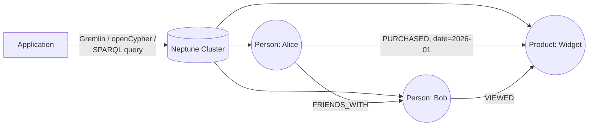

# Amazon Neptune


## Definition

Amazon Neptune is a managed **graph database** — built to store and rapidly traverse data that's
fundamentally about relationships between things (who knows whom, what connects to what, who
bought what and when) rather than rows, documents, or key-value pairs.

## Purpose

Some data is naturally relational in the *graph* sense, not the SQL sense: social networks
(people connected to people), fraud detection (accounts connected through shared devices/IPs/
payment methods), recommendation engines (users connected to products they liked, products
connected to other products bought together), and knowledge graphs (concepts connected to related
concepts). Modeling this in a SQL database means endless self-joins and junction tables that get
slower and harder to reason about with every additional "hop" in the relationship chain ("friends
of friends of friends who also liked X"). Neptune exists because graph traversal — "starting from
this node, walk these kinds of edges N hops out" — is a fundamentally different computational
problem that a purpose-built graph engine solves far more efficiently than relational JOINs ever
can at scale.

## How It Works

Neptune stores data as **nodes** (entities) and **edges** (relationships between entities, which
can themselves have properties), and executes queries by traversing edges directly rather than
computing table joins.



Step by step:
1. **Data is modeled as nodes and edges** — "Alice" and "Bob" are nodes with a `Person` label;
   "Widget" is a node with a `Product` label; the relationships between them ("FRIENDS_WITH,"
   "PURCHASED," "VIEWED") are edges, which can carry their own properties (like a purchase date).
2. **You query by traversal, not by join**: "find all products purchased by friends of Alice who
   haven't purchased it themselves" is expressed as "start at Alice → walk FRIENDS_WITH edges →
   walk PURCHASED edges from those friends → filter out products Alice already has." Neptune
   walks this directly through the graph structure.
3. **Three query languages are supported**: Apache TinkerPop **Gremlin** (step-based traversal
   language), **openCypher** (declarative, pattern-matching syntax popularized by Neo4j), and
   **SPARQL** (for RDF-triple-store style knowledge graphs/semantic web use cases) — pick based
   on your team's existing familiarity or the specific graph model (property graph vs RDF).
4. **The cluster architecture** mirrors Aurora/DocumentDB: a primary handles writes, up to 15
   replicas serve reads, storage is distributed and auto-healing across multiple Availability
   Zones, with automatic failover.
5. **As the graph grows**, Neptune's specialized indexing for adjacency (which nodes connect to
   which) keeps multi-hop traversals fast — this is the core performance advantage over trying to
   do the same thing with repeated SQL self-joins, which get exponentially slower with each hop.

## Key Features / Components

- **Property graph model** — nodes and edges each with arbitrary key-value properties, queried
  via Gremlin or openCypher.
- **RDF / triple-store model** — subject-predicate-object triples, queried via SPARQL, suited to
  formal knowledge graphs and semantic web / linked-data use cases.
- **Neptune ML** — built-in integration with Amazon SageMaker to train graph neural network (GNN)
  models directly on your graph data for tasks like link prediction or node classification
  (e.g., "predict which users are likely to connect" or "classify this transaction as fraud").
  Relevant overlap with MLA-C02.
- **High availability** — up to 15 read replicas sharing distributed, auto-healing storage across
  3 Availability Zones, automatic failover.
- **Neptune Streams** — a change-data-capture log of graph mutations, for event-driven
  architectures reacting to graph changes.
- **Neptune Analytics** — a separate analytics engine for running graph algorithms (PageRank,
  community detection, shortest path) across the whole graph at once, distinct from Neptune
  Database's low-latency single-traversal queries.
- **Encryption at rest (KMS) and in transit (TLS)**, IAM database authentication.

## Use Cases — When to Use It

- Social networking features: friend/follow graphs, "people you may know," mutual-connections queries.
- Fraud detection: finding rings of accounts connected through shared devices, IPs, or payment
  instruments — a classic multi-hop graph traversal problem.
- Recommendation engines: "customers who bought X also bought Y," collaborative filtering based
  on graph proximity.
- Knowledge graphs and semantic search: representing and querying richly interconnected concept
  relationships (life sciences, content taxonomies, regulatory/compliance mapping).
- Network/IT topology mapping: understanding dependency chains ("what breaks if this server goes down").

## When NOT to Use It / Alternatives

- **Data isn't really about relationships — it's standard transactional records** → **RDS/Aurora**
  — don't model simple one-to-many data as a graph just because it sounds more sophisticated;
  that's needless complexity.
- **Need simple key-value lookups at massive scale with no traversal logic** → **DynamoDB** — far
  cheaper and simpler if you're not actually walking multi-hop relationships.
- **Need flexible document storage without relationship-heavy queries** → **DocumentDB** or
  **DynamoDB** — Neptune's value is specifically the traversal engine; don't pay for it if you
  won't use it.
- **Occasional, ad-hoc graph-like analysis on data that's mostly used for other things** → it may
  be cheaper to model the relationships as a secondary index or adjacency list in DynamoDB/RDS for
  simple 1–2 hop cases, reserving Neptune for genuinely deep/complex traversal needs.

## Why It's Important

**Real world:** Fraud rings, recommendation quality, and social-graph features are genuinely
high-value business problems that are either barely tractable or outright impractical with
repeated SQL self-joins past 2–3 hops of relationship depth. Choosing Neptune (or not) is a real
architectural decision about whether your core data model is fundamentally graph-shaped — forcing
the wrong model (graph-as-relational or relational-as-graph) creates lasting technical debt.

**Exam mapping:**
- **SAA-C03** — Domain 3.3 (Determine high-performing database solutions) — Neptune is the
  "purpose-built graph database" option in the full database-family comparison; exam questions
  test recognizing graph-shaped scenarios (fraud detection, social networks, recommendations) as
  the Neptune trigger.
- **DVA-C03** — Rarely central but can appear in Task 1.3 (use data stores in application
  development) if a scenario names Gremlin/openCypher/SPARQL explicitly.
- **MLA-C02** — Domain 2 (Model Development): Neptune ML / graph neural networks as a modeling
  approach for link-prediction and node-classification tasks is a direct, specific intersection
  with this service.

## Pricing Model (summary)

- **Instance hours** — billed per hour per instance class, same billing shape as RDS/Aurora.
- **Storage** — billed per GB-month, auto-scaling as the graph grows.
- **I/O requests** — billed per million requests against the storage layer.
- **Neptune Analytics** — billed separately based on memory/compute allocated for graph algorithm
  workloads.
- **Backup storage** beyond the included free allotment, billed per GB-month.
- Exact current rates: https://aws.amazon.com/neptune/pricing/

## Hands-on Lab (Floci)

**Honest limitation:** Neptune is **not** in Floci's supported-services table
(`labs-floci/README.md` lists only DynamoDB and RDS under "Database"), and there's no widely used
open-source local emulator for Neptune's managed control plane specifically. The commands below
show the real AWS CLI shape for muscle memory; for actual hands-on graph-traversal practice, run
an open-source Gremlin-compatible graph database locally (Apache TinkerPop's own reference
server) — the query language transfers directly since Neptune implements the Gremlin standard.

```bash
# Real AWS CLI shape — try against Floci, expect "not implemented"
awslocal neptune create-db-cluster \
  --db-cluster-identifier study-neptune \
  --engine neptune

awslocal neptune describe-db-clusters --db-cluster-identifier study-neptune

# Fallback for real hands-on Gremlin traversal practice
docker run -d --name study-gremlin -p 8182:8182 tinkerpop/gremlin-server

# Connect with the Gremlin console (separate tinkerpop/gremlin-console image) and run:
#   g.addV('Person').property('name','Alice').as('a').
#     addV('Person').property('name','Bob').as('b').
#     addE('FRIENDS_WITH').from('a').to('b').iterate()
#   g.V().has('name','Alice').out('FRIENDS_WITH').values('name')
# (returns "Bob" — a one-hop traversal, the same pattern Neptune queries use at scale)

# Clean up
docker rm -f study-gremlin
```

## Exam Tips

- **"Graph," "relationships," "friend-of-a-friend," "fraud ring," "recommendation engine,"
  "shortest path," "social network"** are Neptune trigger phrases.
- Know the **three query languages** exist and which model they pair with: Gremlin/openCypher =
  property graph (nodes/edges with properties); SPARQL = RDF triple store (subject-predicate-object).
- Don't pick Neptune just because a question mentions "connections" loosely — check whether the
  scenario actually needs multi-hop traversal; simple one-to-many relationships are still better
  served by RDS/DynamoDB.
- **Neptune ML** is the specific cross-over point with MLA-C02 — recognize it as "train a GNN
  directly on your graph data via SageMaker integration," distinct from exporting data elsewhere
  to train separately.

## Related Terms

- [`database-selection-guide.md`](database-selection-guide.md) — full decision tree including
  when graph beats relational/NoSQL.
- [`dynamodb.md`](dynamodb.md) — cheaper alternative for shallow (1–2 hop) relationship modeling.
- Glossary: Node, Edge, Traversal, Property Graph, RDF Triple, Gremlin, openCypher, SPARQL.
