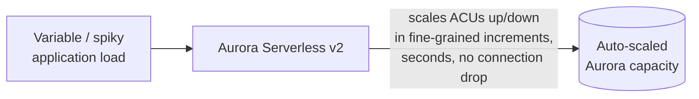
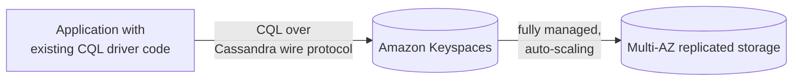
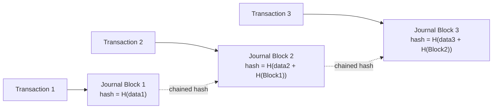

# Niche Database Services — Aurora Serverless, Amazon Keyspaces, Amazon QLDB

> **Appears in:** [SAA-C03](../../certifications/saa-c03/README.md)

This doc consolidates three lower-exam-weight database services confirmed in the SAA-C03 appendix
with no existing standalone doc. Each section covers definition, purpose, a concrete use case, and
the specific exam-trigger phrasing to recognize.

## Aurora Serverless (v1 and v2)

### Definition
Aurora Serverless is an on-demand, auto-scaling configuration of **Amazon Aurora** (see
[`aurora.md`](aurora.md) for the full Aurora deep dive) that scales database compute capacity up
and down automatically based on load — including scaling to near-zero during idle periods — instead
of running a fixed-size provisioned instance around the clock.

### Purpose
A provisioned Aurora instance is sized for peak load and keeps costing that rate even at 3am when
almost nothing is happening — fine for steady, predictable traffic, wasteful for spiky or
intermittent workloads (a dev/test database used a few hours a day, an infrequently-used internal
tool, a new application with unknown and highly variable traffic). Aurora Serverless exists to let
the database itself absorb that variability, billing for actual capacity consumed rather than a
fixed reservation.

**v1 vs v2 — the distinction that matters on the exam:** Aurora Serverless **v1** scales in
discrete steps and has a genuine **cold-start pause/resume** behavior (the database can pause
entirely when idle and takes tens of seconds to resume on the next connection) — fine for
infrequent, latency-tolerant workloads but a real problem for anything needing consistent
low-latency availability. Aurora Serverless **v2** scales in much finer-grained increments
(fractional Aurora Capacity Units), scales in *seconds* without dropping connections, and
explicitly targets production-variable workloads, not just dev/test — it does not have v1's
full pause-to-zero cold-start model in the same way. A question contrasting "unpredictable spiky
production traffic needing no connection drops" against "intermittent dev/test workload tolerant
of a cold-start delay" is testing v2 vs v1 specifically.

### Use Case
A SaaS company's new product has highly unpredictable adoption — traffic could be flat or could
spike 20x with no warning after a marketing push. Aurora Serverless v2 scales compute capacity up
within seconds as load increases and back down afterward, avoiding both a large fixed provisioned
instance sized for a spike that may never come and a manual resize operation during a live traffic
surge.

### Exam Tip
**"Infrequent," "unpredictable," "variable workload," "pay only for what you use," "scale to
zero"** → Aurora Serverless. Know it's a *capacity mode of Aurora*, not a separate database
engine — same MySQL/PostgreSQL compatibility as provisioned Aurora. Distinguish v1's cold-start
pause behavior from v2's fine-grained, no-drop scaling when a question's details hinge on exactly
that difference. Cross-reference [`aurora.md`](aurora.md) for the full engine-level detail this
doc intentionally doesn't repeat.

---

## Amazon Keyspaces (for Apache Cassandra)

### Definition
Amazon Keyspaces is a managed, serverless, wire-protocol-compatible database for Apache
Cassandra workloads — you point your existing Cassandra Query Language (CQL) drivers and
application code at it, and AWS runs the actual storage/replication/scaling infrastructure behind
the compatible API.

### Purpose
Cassandra is a well-established wide-column NoSQL database with a large existing ecosystem of
applications, drivers, and operational expertise — but running Cassandra yourself means managing
its notoriously involved operational model (ring topology, repair jobs, compaction tuning, node
replacement). Keyspaces exists to let teams keep their existing Cassandra-shaped application code
and CQL queries while AWS absorbs the operational burden entirely, the same value proposition
DocumentDB offers for MongoDB-compatible workloads.

### Use Case
A company already has a Cassandra-based application (e.g., a high-write-throughput IoT sensor
data store) and wants to stop operating Cassandra clusters by hand — migrating to Keyspaces lets
the exact same CQL queries and driver code keep running, now against a fully managed, auto-scaling
backend with no cluster/node management left for the team to do.

### Exam Tip
**"Apache Cassandra," "CQL," "wide-column," "existing Cassandra workload" + "want it managed"** →
Amazon Keyspaces. It's the direct Cassandra-compatibility analog to DocumentDB (MongoDB-compatible)
and Aurora (MySQL/PostgreSQL-compatible) — recognize the pattern: "existing \<engine\> workload,
same API, fully managed" across all three.

---

## Amazon QLDB (Quantum Ledger Database)

### Definition
Amazon QLDB is a managed **ledger database** — it records a complete, immutable, cryptographically
verifiable history of every change ever made to your data, so you can prove exactly what the data
looked like at any past point in time and that no entry was altered or deleted after the fact.

### Purpose
Some data absolutely must be provably trustworthy after the fact — financial transaction records,
supply-chain custody logs, insurance claim histories — where "we're pretty sure nobody edited this
record" isn't good enough; you need mathematical proof. A regular relational database can log
changes via triggers/audit tables, but those logs are themselves just more rows that *could* be
edited by someone with sufficient access — there's no cryptographic guarantee against tampering.
QLDB exists specifically to provide that guarantee as a managed database feature rather than a
bolt-on audit table.

Each journal block's hash incorporates the previous block's hash — exactly the hash-chaining
pattern used in blockchains — so altering any past entry would break every subsequent hash in the
chain, making tampering mathematically detectable rather than merely procedurally discouraged.
QLDB exposes a cryptographic **digest** you can request at any time and independently verify
against the chain, proving the ledger hasn't been altered.

### Use Case
An insurance company needs an auditable, tamper-evident history of every change made to a claim
record — who changed what status, when, and in what order — that regulators and auditors can
independently verify was never altered after the fact. QLDB's hash-chained journal provides that
proof natively, instead of the company building and trusting its own audit-log table.

### Exam Tip
**"Immutable," "cryptographically verifiable," "tamper-evident," "complete history of every
change," "ledger"** → Amazon QLDB. Don't confuse with a plain audit-log table in RDS/DynamoDB (no
cryptographic tamper-evidence) or with Amazon Managed Blockchain (QLDB is a *centralized* ledger
owned by one party; a blockchain is *decentralized* across multiple parties who don't fully trust
each other — a question emphasizing "single company," "one source of truth owned by us" points to
QLDB, while "multiple independent organizations, no single trusted party" points to blockchain).

## Related Terms

- [`aurora.md`](aurora.md) — the full Aurora deep dive; Aurora Serverless is a capacity mode of
  this same engine, not a separate database.
- [`dynamodb.md`](dynamodb.md) / [`documentdb.md`](documentdb.md) — other NoSQL options Keyspaces
  sits alongside; compare wide-column (Keyspaces/Cassandra) vs document (DocumentDB) vs key-value
  (DynamoDB) data models.
- [`database-selection-guide.md`](database-selection-guide.md) — full decision tree across every
  database service in this repo, including where these three niche services fit.
- Glossary: ACU (Aurora Capacity Unit), CQL, Hash chaining, Ledger, Wide-column store.
