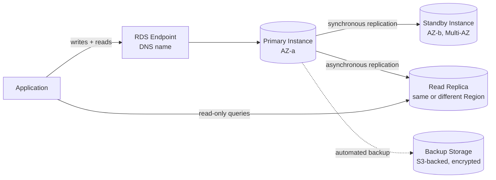
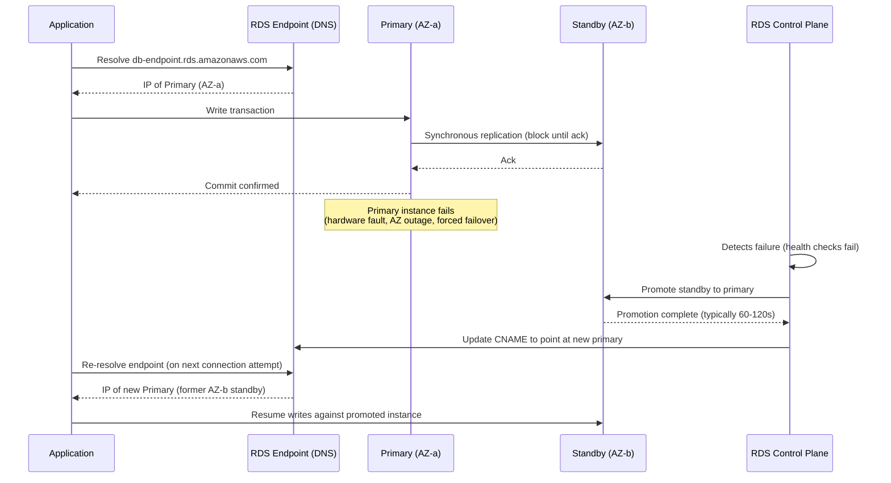
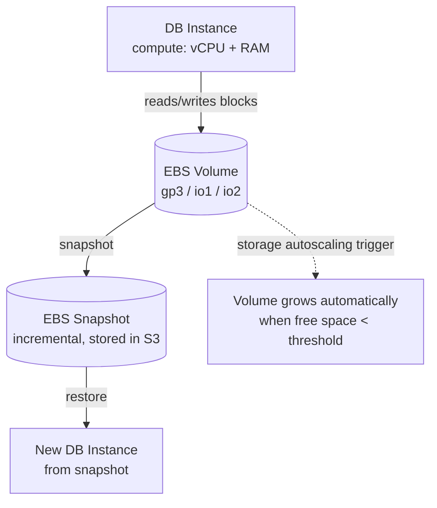
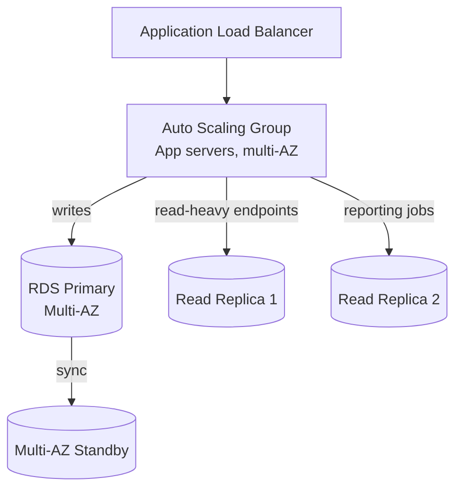
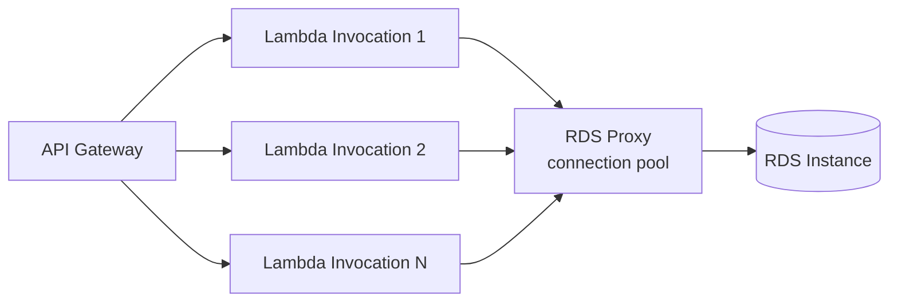
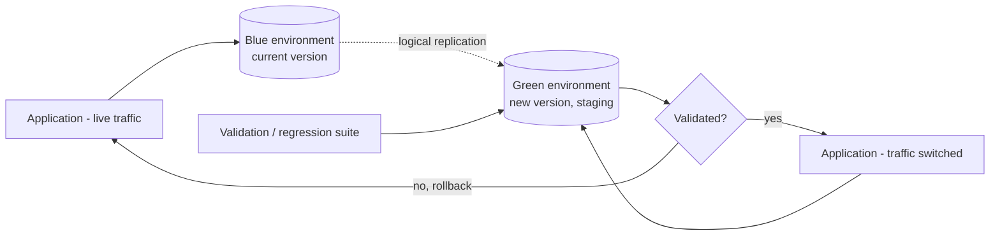

# Amazon RDS (Relational Database Service)


## Definition

Amazon RDS is a managed service that runs a traditional relational (SQL) database for you —
MySQL, PostgreSQL, MariaDB, Oracle, or SQL Server — without you having to install, patch, back
up, or babysit the database server yourself. You still design your schema, write your SQL, and
tune your queries exactly as you would on a self-managed server; what RDS takes off your plate is
everything below the SQL layer: the OS, the storage, the patch cadence, the backup jobs, and the
failover wiring.

## Purpose

Before RDS, running a relational database meant: provision a server, install the DB engine,
configure storage, write backup scripts, apply security patches on a schedule, build a failover
system, and monitor all of it — all before writing a single line of application code. AWS built
RDS to take that entire operational burden ("undifferentiated heavy lifting") off engineering
teams, while still giving them the full relational engine they already know (the same SQL,
the same drivers, the same ORMs). You get the database you're used to, minus the 2 AM pager
duty for disk-full errors and failed patches.

The deeper reason this matters: relational databases encode business rules in their schema
(foreign keys, uniqueness constraints, check constraints) and in their transaction guarantees
(ACID). Those guarantees are only as good as the infrastructure underneath them — a primary
server with no redundancy is a single point of failure for every rule the schema is meant to
enforce. RDS's job is to make "the database never lies, and rarely goes down" operationally
cheap instead of operationally heroic.

## How It Works

At its core, RDS provisions one or more EC2-class instances running your chosen database engine,
attaches EBS-backed storage, and wraps it with automation: backups, patching, monitoring, and
(optionally) a standby copy in a second Availability Zone for high availability.



Step by step:
1. **App connects to an endpoint, not a server IP.** RDS gives you a stable DNS endpoint; the
   actual instance behind it can change (e.g., during failover) without your app's config changing.
2. **The primary instance handles all writes and, usually, reads.** It's a real database engine
   process on a real (AWS-managed) instance.
3. **In Multi-AZ mode**, every write is also sent **synchronously** to a standby instance in a
   different Availability Zone before the write is acknowledged. This protects against an AZ
   failure (power, network, hardware) — if the primary dies, RDS automatically fails over to the
   standby and repoints the endpoint DNS, typically within 60–120 seconds.
4. **Read replicas** are separate, optional copies that replicate **asynchronously** (so they can
   lag a little). Their job isn't availability — it's offloading read traffic from the primary so
   it isn't the bottleneck for reporting, analytics, or read-heavy app pages.
5. **Backups** happen automatically to AWS-managed storage, enabling point-in-time restore to any
   second within the retention window (1–35 days), plus manual snapshots you keep indefinitely.

### Multi-AZ Failover, Step by Step (Sequence Diagram)

The thing that actually happens during a failover is a tightly choreographed sequence between
RDS's control plane, the two instances, and DNS — not magic, just automation applied fast.



What actually causes the 60–120 second window: DNS propagation (RDS keeps TTLs low specifically
for this), and the promoted standby needing to come fully online and start accepting connections.
Applications that cache DNS resolutions aggressively, or hold long-lived connections without
retry logic, are the most common cause of failovers lasting far longer *from the app's
perspective* than they actually did on the database side. This is why RDS Proxy (discussed
below) exists — it absorbs the reconnect storm so the app doesn't have to.

### Data Modeling Patterns for RDS

RDS doesn't change *how* you model relational data — it's the same normalization and indexing
discipline you'd use on any MySQL/PostgreSQL/SQL Server/Oracle instance — but a few patterns show
up constantly in real RDS-backed systems:

- **Normalize for correctness, denormalize for read speed, deliberately.** Start at 3NF
  (third normal form) for your core transactional tables (orders, customers, line items) so that
  updates can't create contradictory data. Once a specific read path is measurably slow, consider
  a denormalized reporting table or materialized view fed by a trigger or scheduled job — don't
  denormalize speculatively.
- **Index the columns your WHERE/JOIN/ORDER BY clauses actually use**, not every column that
  looks important. Every index speeds reads but slows every write to that table (each insert/
  update must also update every index) — a classic RDS performance bug is a table with 12 indexes
  that nobody is using, silently taxing every write.
- **Connection-per-request anti-pattern.** A Lambda function, or a web app configured to open a
  new DB connection per request, exhausts `max_connections` (a finite number tied to instance
  size — e.g., `db.t3.micro` MySQL defaults to roughly 66 connections) far faster than most
  engineers expect. The fix is connection pooling at the app tier (PgBouncer, HikariCP) or,
  for serverless compute, **RDS Proxy**.
- **Foreign keys and cascading deletes are a design decision, not a default.** `ON DELETE CASCADE`
  is convenient until someone deletes a customer row expecting to also silently delete every
  order, invoice, and support ticket referencing them — model cascades deliberately per
  relationship, not uniformly.
- **UUID vs auto-increment primary keys.** Auto-increment integers are smaller and faster to
  index but leak sequential information and don't work well for multi-region/offline-generated
  records; UUIDs solve both but bloat index size and hurt insert locality (random UUIDs scatter
  writes across the B-tree) unless you use a sequential/time-ordered UUID variant (e.g., UUIDv7).

### Storage Internals: What's Actually Under a DB Instance

RDS instances (non-Aurora) are backed by **Amazon EBS** volumes — the same durable block storage
EC2 uses, just managed for you. This matters for two reasons: (1) EBS volumes have their own
IOPS/throughput ceilings depending on volume type (gp3, io1, io2) and size, which is a real,
hard performance ceiling independent of your instance class; and (2) storage and compute scale
*somewhat* independently — you can provision more IOPS on gp3/io1/io2 without resizing the
instance class, but you cannot outrun a storage-bound workload by just picking a bigger CPU.



## Key Features / Components

- **Multi-engine support** — MySQL, PostgreSQL, MariaDB, Oracle, Microsoft SQL Server (Aurora is
  a separate, AWS-built engine with its own doc — see `aurora.md`).
- **Multi-AZ deployments** — synchronous standby in another AZ for automatic failover (high
  availability, *not* read scaling). **Multi-AZ DB clusters** (a newer variant) add two readable
  standbys instead of one unreadable one, giving you both faster failover (quorum-based, often
  under 35 seconds) and read capacity from the standbys.
- **Read Replicas** — up to 5 (15 for Aurora) async copies for read scaling; can be promoted to
  a standalone primary if needed; can even replicate cross-Region.
- **Automated backups & point-in-time recovery (PITR)** — restore to any second within the
  retention window.
- **Manual snapshots** — user-triggered, kept until you delete them, usable to clone a new instance.
- **Storage auto scaling** — storage grows automatically as data grows, no manual resize.
- **Encryption** — at rest via KMS, in transit via SSL/TLS; can't be added after creation
  without a snapshot/restore cycle, so decide upfront.
- **IAM database authentication** — short-lived auth tokens instead of long-lived DB passwords
  (MySQL/PostgreSQL only).
- **RDS Proxy** — a managed connection pooler sitting in front of RDS, crucial for Lambda-heavy
  architectures where thousands of short-lived functions would otherwise exhaust DB connections.
  It also smooths over failovers: the proxy holds a warm connection pool to the database and
  transparently reroutes to the new primary, so your app's individual connections don't all need
  to reconnect/retry at once.
- **Performance Insights & Enhanced Monitoring** — query-level and OS-level performance metrics;
  Performance Insights specifically surfaces "top SQL by load" which is usually the fastest way to
  find the one bad query dragging down an entire instance.
- **Maintenance windows** — you control *when* AWS applies mandatory patches, not *whether*.
- **Blue/Green Deployments** — create a full staging copy, test an upgrade safely, then switch over
  with minimal downtime (typically under a minute) using logical replication under the hood.
- **Parameter groups & option groups** — the RDS-managed equivalent of editing `my.cnf` or
  `postgresql.conf` directly; changes to "static" parameters require a reboot, "dynamic" ones apply
  immediately — a frequent exam and real-world gotcha.

## Common Architectures

**1. Three-tier web app with Multi-AZ RDS and a read replica fleet.** Web/app tier in an Auto
Scaling group across multiple AZs, writes go to the Multi-AZ primary, reporting/analytics queries
are routed (often via a read-only connection string or a smart ORM) to 1–3 read replicas. This is
the default "boring, reliable" pattern for most transactional web applications.



**2. Lambda + API Gateway + RDS Proxy.** Serverless compute scales to hundreds of concurrent
executions almost instantly; without a pooler, each one opening its own DB connection would
exhaust `max_connections` in seconds. RDS Proxy sits between Lambda and RDS, multiplexing many
Lambda invocations over a smaller, stable pool of real DB connections.



**3. Cross-Region disaster recovery with a cross-Region read replica.** A read replica in a
second Region, promotable to a standalone primary if the primary Region becomes unavailable.
Lower RPO than restoring from backup, higher RPO than Multi-AZ (replication is asynchronous
across Regions, so some recent writes can be lost in a true regional disaster).

**4. Blue/Green deployment for a major version upgrade.** A full "green" environment (new
version) is created and kept in sync with the "blue" (current) environment via logical
replication; traffic cuts over only after the green environment is validated, with an easy
rollback path if something looks wrong.

**5. Blue/Green major-version upgrade with automated rollback plan.** Beyond the brief mention
above, the operational shape looks like this: create the Green environment, let logical
replication catch it up to Blue, run your full regression suite against Green using production-
like traffic (safely, since Green isn't serving real users yet), then switch over. If something
is wrong post-cutover, Blue is still intact and can be switched back to — this is the single
biggest reason Blue/Green exists: major version upgrades were historically a "point of no return"
operation, and this pattern removes that risk.



## Security & Compliance Considerations

- **Network isolation**: place RDS instances in private subnets with no public IP, reachable only
  from application-tier security groups — not from `0.0.0.0/0`. "Publicly accessible: Yes" on an
  RDS instance is a recurring real-world misconfiguration finding, not a theoretical risk.
- **Secrets management**: store master credentials in AWS Secrets Manager (with automatic
  rotation) rather than hardcoding them in app config or environment variables; Secrets Manager
  integrates natively with RDS to support credential rotation without application downtime.
  IAM database authentication removes the long-lived password entirely for supported engines.
  (SQL Server IAM authentication is not supported; use Secrets Manager with rotation instead.)
- **Auditing**: enable `pgAudit` (PostgreSQL) or the equivalent native audit plugin per engine, and
  ship logs to CloudWatch Logs for retention and alerting — this is frequently a compliance
  (SOC2/HIPAA/PCI-DSS) requirement, not an optional nicety.
- **Encryption in transit**: enforce SSL/TLS-only connections (`rds.force_ssl=1` on PostgreSQL,
  `require_secure_transport=ON` on MySQL) rather than leaving it optional — otherwise some
  clients will silently connect in plaintext.
- **Snapshot sharing**: manual snapshots can be shared across accounts/Regions, which is useful
  for cross-account environments (staging mirrors prod data) but is also a real exfiltration risk
  if misconfigured as public — RDS blocks public snapshot sharing on encrypted snapshots by
  design, which is itself a reason to always encrypt.

## Use Cases — When to Use It

- You're migrating an existing on-prem MySQL/PostgreSQL/Oracle/SQL Server app to AWS with minimal
  rewrite ("lift and shift").
- Your data is inherently relational: orders linked to customers linked to products, with
  transactions needing strict ACID guarantees (e.g., an e-commerce checkout, a banking ledger).
- Your team already knows SQL and your app's ORM (Django ORM, Hibernate, ActiveRecord) expects a
  relational backend.
- You need complex multi-table JOINs, foreign key constraints, and strong consistency without
  building that logic yourself.
- Licensing requirements force Oracle or SQL Server specifically (RDS supports both, License
  Included or Bring-Your-Own-License).

## When NOT to Use It / Alternatives

- **Need to scale writes horizontally across many nodes, or handle unpredictable, bursty,
  massive-scale traffic** → Amazon **DynamoDB** (NoSQL, near-infinite horizontal scale, single-digit
  millisecond latency at any scale) — but you give up JOINs and ad-hoc querying flexibility.
- **Want MySQL/PostgreSQL compatibility but need 5x the throughput, storage up to 128 TB, and
  serverless scale-to-zero** → **Aurora** / **Aurora Serverless v2** — same wire protocol, different
  (and faster, self-healing) storage engine underneath.
- **Need sub-millisecond caching in front of a database to cut read load/latency** → **ElastiCache**
  (Redis/Memcached) — RDS read replicas reduce load but add 10s of ms latency, not sub-ms.
- **Need to run analytical queries across billions of rows for BI dashboards** → **Redshift** (a data
  warehouse, columnar storage, not built for high-frequency transactional writes).
- **Your app uses the MongoDB driver/API and documents, not rows** → **DocumentDB**.
- **Your data is fundamentally about relationships (social graphs, fraud rings, recommendation
  engines)** → **Neptune** — graph traversal in RDS SQL quickly becomes unreadable, slow JOIN chains.

## Real-World Pricing Examples

These are illustrative worked examples using representative On-Demand, us-east-1-style rates to
show how the pricing *dimensions* interact — always check the pricing page link below for current
numbers before budgeting a real project.

**Example 1 — small startup Postgres, Multi-AZ:**
- Instance: `db.t3.medium` (2 vCPU, 4 GB RAM), Multi-AZ → ~$0.146/hr non-Multi-AZ rate, doubled for
  the standby ≈ **$0.29/hr → ~$211/month** just for compute.
- Storage: 100 GB gp3 at roughly $0.115/GB-month ≈ **$11.50/month**.
- Backup storage: free up to 100 GB (equal to allocated storage), so **$0 extra** at this size.
- **Rough total: ~$225/month** before data transfer.

**Example 2 — the same workload with a Reserved Instance (1-year, no upfront):**
- Reserved pricing for `db.t3.medium` Multi-AZ typically runs ~30-40% below On-Demand for a
  1-year term → compute drops to roughly **$135–150/month**, same storage cost, for a workload
  whose capacity is known and stable for the next year.

**Example 3 — read-heavy reporting workload, adding replicas:**
- Primary `db.r6g.xlarge` Multi-AZ (4 vCPU, 32 GB) ≈ $0.504/hr non-Multi-AZ, doubled ≈
  **$1.008/hr → ~$735/month**.
- Two `db.r6g.xlarge` read replicas (not Multi-AZ themselves) at $0.504/hr each ≈
  **$735/month combined** for both replicas.
- **Rough total for primary + 2 replicas: ~$1,470/month** compute alone — the kind of number that
  makes "do we actually need 2 replicas, or would a cache in front of 1 replica be cheaper"
  a real architecture conversation, not just an exam question.

**Example 4 — Oracle/SQL Server licensing model comparison:**
- **License Included**: AWS bundles the engine license into the hourly instance rate — simplest,
  but the per-hour rate for an Oracle Standard Edition 2 `db.r6i.xlarge` can run meaningfully
  higher than the equivalent open-source-engine rate (often 2-4x), because you're paying for the
  Oracle license every hour the instance runs, whether busy or idle.
- **Bring-Your-Own-License (BYOL)**: you supply existing Oracle/SQL Server licenses (with their
  own compliance obligations — core counts, Software Assurance, etc.), and RDS charges only the
  base infrastructure rate — cheaper per hour if you already own sufficient licenses, but you now
  own the licensing compliance burden RDS was otherwise absorbing for you.
- The real decision driver is almost never "which is cheaper in isolation" — it's whether the
  organization already has unused/transferable licenses. This is a recurring Domain 4
  (cost-optimization) exam scenario: "a company has existing Oracle licenses it wants to use in
  the cloud" → BYOL, not License Included.

- Exact current rates: https://aws.amazon.com/rds/pricing/

## Limits & Quotas (Real, Current — Verify Before Relying On Them)

- **Max storage per instance**: up to **64 TiB** for most engines on Provisioned IOPS SSD/gp3/gp2
  storage (varies by engine — SQL Server historically capped lower; always check the specific
  engine's current limit).
- **Max DB instances per Region (default soft limit)**: **40** (combined RDS instances, can be
  raised via a service quota increase request).
- **Max read replicas per source instance**: **5** for standard RDS engines (Aurora allows 15).
- **Backup retention window**: **1–35 days** for automated backups; manual snapshots are retained
  indefinitely (until you delete them) with no equivalent 35-day ceiling.
- **Max DB connections**: engine- and instance-size-dependent, computed from instance memory
  (e.g., roughly `{DBInstanceClassMemory/12582880}` for MySQL by default) — a `db.t3.micro` MySQL
  instance defaults to roughly 66 connections, a `db.r6g.xlarge` to several thousand.
- **Multi-AZ failover time**: typically **60–120 seconds** for single-standby Multi-AZ; Multi-AZ
  DB clusters typically fail over in **under 35 seconds**.
- **Maintenance window**: a minimum **30-minute** weekly window you choose; mandatory patches
  (e.g., security-critical ones) can still be applied outside it in rare cases.

## Troubleshooting / Common Issues

- **"Too many connections" errors under Lambda/serverless load** → almost always missing RDS
  Proxy or application-level pooling; check `max_connections` against actual concurrent callers,
  not against expected traffic.
- **Failover takes "forever" from the app's perspective** → usually a DNS caching problem (JVM's
  default infinite DNS cache is a classic culprit) or an app that doesn't retry on connection
  reset; fix the client, not just the database.
- **Storage autoscaling triggered unexpectedly, bill spiked** → a runaway query generating huge
  temp tables/logs, or a missed `VACUUM`/index bloat issue (PostgreSQL) silently consuming space;
  check `pg_stat_user_tables` / equivalent before assuming it's "just growth."
- **Replica lag growing under load** → a single-threaded replication stream (classic MySQL/
  PostgreSQL logical replication limitation) can't always keep up with a heavily parallel primary;
  consider fewer, larger write transactions, or moving to Aurora's lower-lag replication model.
- **Parameter change "didn't take effect"** → static parameters require an instance reboot;
  dynamic parameters apply immediately — check the parameter's `ApplyType` before assuming a bug.
- **Can't enable encryption on an existing unencrypted instance** → this is not a bug, it's a
  real platform limitation; the only path is snapshot → copy snapshot with `--kms-key-id` → restore
  from the encrypted copy as a new instance.
- **Read replica silently falls further and further behind, never catches up** → check for DDL
  operations (schema changes) on the primary, which can block replication threads on some engines;
  also check the replica's own instance size isn't simply undersized relative to the primary.
- **Storage full / "disk full" errors despite autoscaling being enabled** → autoscaling has an
  upper bound (`MaxAllocatedStorage`) that may be set lower than you think, and it also won't
  trigger fast enough to save you from a sudden runaway write burst — set alarms on free storage
  percentage well before the autoscaling threshold, not instead of it.
- **CPU pegged at 100% with low query volume** → check for a missing index causing full table
  scans on a frequently-run query (Performance Insights' "top SQL by load" view is the fastest
  way to find it), or a `VACUUM`/autovacuum storm on PostgreSQL competing with live traffic.
- **Restored-from-snapshot instance has a different endpoint than the original** → this is
  expected, not a bug — a restore creates a *new* instance with a new endpoint; update your
  application configuration or, better, point a Route 53 record at the endpoint so only DNS needs
  updating during a real recovery.

## Monitoring & Observability

- **CloudWatch default metrics** (CPU, memory, storage, IOPS, connections) are enabled
  automatically at no extra cost — set alarms on `FreeStorageSpace`, `DatabaseConnections`, and
  `CPUUtilization` as the minimum viable alerting baseline before anything fancier.
- **Enhanced Monitoring** goes below the hypervisor to OS-level metrics (down to 1-second
  granularity) — useful when CloudWatch's standard metrics don't explain a symptom (e.g., high
  CPU with no obvious query cause might be OS-level swapping).
- **Performance Insights** is query-level: it answers "which SQL statements are consuming the
  most database load right now," which is usually the fastest path from "the database is slow"
  to "this specific query is slow, and here's why."
- **Event subscriptions** (via SNS) notify you of maintenance, failover, and backup events without
  polling — set these up for anything you'd otherwise find out about from an angry user instead.

## Why It's Important

**Real world:** Relational databases still run the majority of the world's business-critical
transactional systems. The difference between a well-configured Multi-AZ RDS instance and a
single unmanaged database server is the difference between a 2-minute automatic failover and a
multi-hour outage (or worse, unrecoverable data loss) when hardware fails — which it eventually
does. Choosing the wrong engine, instance size, or skipping Multi-AZ is one of the most common
and costly real-world mistakes in cloud architecture.

**Exam mapping:**
- **SAA-C03** — Domain 2.2 (Design highly available/fault-tolerant architectures: Multi-AZ,
  failover, backup/DR strategy) and Domain 3.3 (Determine high-performing database solutions:
  RDS vs Aurora vs DynamoDB tradeoffs) and Domain 4.3 (cost-optimized database solutions:
  Reserved Instances vs On-Demand, right-sizing engine choice).
- **DVA-C03** — Task 1.3 (Use data stores in application development: connecting apps to RDS,
  understanding consistency, using RDS Proxy with Lambda to avoid connection exhaustion).
- **MLA-C02** — Domain 1 (Data Preparation for ML and AI): RDS is frequently a *source* system
  that gets extracted via DMS or Glue into S3/feature stores for ML training pipelines.

**Expanded exam scenarios:**
- *"An application experiences intermittent connection failures after a database failover event
  that completed successfully according to CloudWatch."* → The database is fine; the application
  is caching stale DNS or not retrying. Answer points to client-side connection handling or RDS
  Proxy, not a database-layer fix.
- *"A reporting team's queries are slowing down checkout page load times."* → Classic OLTP-vs-
  reporting contention. Answer is a read replica (if it's still genuinely relational reporting)
  or Redshift (if it's become genuinely analytical/aggregate-heavy).
- *"Compliance requires encryption at rest on a database that was launched two years ago without
  it, with minimal downtime."* → Snapshot → copy with encryption → restore → cut over. There is
  no "enable encryption" button; this is a deliberate exam trap testing whether you know that.
- *"Need to migrate from on-premises Oracle to AWS with the least application code change and
  lowest licensing cost."* → RDS for Oracle (License Included) if staying on Oracle, or RDS/
  Aurora PostgreSQL via Schema Conversion Tool + DMS if the organization is open to changing
  engines for licensing savings — recognize that "least code change" and "lowest licensing cost"
  can point to different answers, and the question's actual priority decides which wins.
- *"A security audit flags that the production database is reachable from the internet."* →
  The fix is setting the instance to not publicly accessible and restricting its security group
  to the application tier's security group — not a database engine change, not Multi-AZ, not
  encryption. Exam questions sometimes bundle a real finding with distractor "database feature"
  answers; recognize when the fix is actually a networking/security-group fix.
- *"An application team wants to test a major engine version upgrade without risking the
  production database, and wants an easy rollback if anything goes wrong."* → Blue/Green
  Deployments, not a snapshot-restore-and-swap manual process — the exam increasingly expects you
  to know the purpose-built feature name, not just the manual workaround.
- *"Queries against a reporting replica are returning data that's several minutes stale, and the
  business wants to know why."* → This is expected, not a bug: read replicas replicate
  asynchronously. If the business genuinely needs near-zero staleness for reads, that is itself
  a signal the workload may need Aurora's faster replication, or a redesign where the "report"
  reads from the primary during low-traffic windows instead.

## Pricing Model (summary)

- **Instance hours** — billed per hour (or per second after the first minute) for the instance
  class (e.g., `db.t3.micro`, `db.r6g.xlarge`) you choose; Multi-AZ roughly doubles this since
  you're paying for the standby too.
- **Storage** — per GB-month for gp3/io1/io2 EBS-backed storage, plus provisioned IOPS if used.
- **Backup storage** — free up to 100% of your total DB storage; beyond that, billed per GB-month.
- **Data transfer** — outbound data transfer to the internet is billed; same-AZ/same-Region
  traffic to app servers is typically free or discounted.
- **Reserved Instances** — commit to 1 or 3 years for up to ~60% savings over On-Demand if usage
  is steady and predictable.
- See the worked examples above for how these dimensions combine in practice.
- Exact current rates: https://aws.amazon.com/rds/pricing/

## Hands-on Lab (Floci)

Floci backs RDS with real Docker containers running Postgres/MySQL, so these commands actually
provision working databases locally — no AWS account or bill.

```bash
# 1. Create a PostgreSQL instance
awslocal rds create-db-instance \
  --db-instance-identifier study-pg \
  --db-instance-class db.t3.micro \
  --engine postgres \
  --master-username dbadmin \
  --master-user-password ChangeMe123! \
  --allocated-storage 20

# 2. Check status until it reports "available"
awslocal rds describe-db-instances \
  --db-instance-identifier study-pg \
  --query 'DBInstances[0].DBInstanceStatus'

# 3. Get the connection endpoint
awslocal rds describe-db-instances \
  --db-instance-identifier study-pg \
  --query 'DBInstances[0].Endpoint'

# 4. Connect with psql (host/port come from step 3)
psql -h localhost -p <port> -U dbadmin -d postgres

# 5. Take a manual snapshot
awslocal rds create-db-snapshot \
  --db-instance-identifier study-pg \
  --db-snapshot-identifier study-pg-snap-1

# 6. Clean up
awslocal rds delete-db-instance \
  --db-instance-identifier study-pg \
  --skip-final-snapshot
```

See `labs-floci/README.md` for the one-time Floci setup (Docker + `awslocal` alias).

## Exam Tips

- **Multi-AZ ≠ read scaling.** It's purely for availability/failover. If a question says "improve
  read performance," the answer is a **Read Replica**, not Multi-AZ.
- **"Lift and shift an on-prem SQL Server/Oracle database"** is the classic RDS trigger phrase —
  if the question adds "with minimal code changes" and "same engine," it's RDS, not Aurora/DynamoDB.
- Know RTO/RPO vocabulary: Multi-AZ gives a low RTO (automatic failover) but your RPO depends on
  what was in-flight at failure (synchronous replication means near-zero data loss).
- Encryption at rest **cannot be enabled on an existing unencrypted instance** — you must snapshot,
  copy the snapshot with encryption enabled, then restore. This is a common exam trap.
- Read replicas can be promoted to standalone instances (breaking replication) — useful for
  disaster recovery or migrating workloads.
- RDS Proxy is the answer whenever Lambda + RDS connection exhaustion is described.
- **Multi-AZ DB cluster vs Multi-AZ DB instance deployment** — know these are different features:
  the classic Multi-AZ instance deployment has one unreadable standby; the newer Multi-AZ DB
  cluster deployment has two readable standbys and faster, quorum-based failover. If a question
  emphasizes "readable standby" or "faster failover than classic Multi-AZ," it's pointing at
  Multi-AZ DB clusters specifically.
- **Parameter groups**: static parameters need a reboot to apply, dynamic ones don't — if a
  question describes a setting change "not taking effect until a scheduled maintenance window,"
  that's a static parameter, and the fix is an immediate reboot if you can't wait.

## Choosing an Instance Class

- **Burstable (`db.t*`)** — cheapest, suitable for dev/test or genuinely low, spiky workloads;
  CPU credits can be exhausted under sustained load, causing throttling that looks like a mystery
  slowdown if you don't know to check `CPUCreditBalance`.
  Don't use `db.t*` for a production workload with sustained CPU demand — it's the single most
  common RDS "why is production randomly slow" root cause for teams that started on `t3.micro`
  in dev and never resized before launch.
- **General purpose (`db.m*`)** — balanced vCPU:RAM ratio, the default safe choice for most
  standard OLTP workloads without a strong CPU- or memory-bound bias.
- **Memory-optimized (`db.r*`/`db.x*`)** — more RAM per vCPU, favored for workloads with large
  working sets that benefit from more buffer pool / page cache (most real-world relational
  workloads are more memory-bound than CPU-bound once past a certain data size).
- **Graviton (ARM, `db.*g.*` suffix)** — AWS's own ARM processors, typically 10-20% cheaper per
  unit of performance than the equivalent Intel/AMD instance class for supported engines — a
  frequent "free" cost optimization once you confirm your engine version supports it.

## Further Reading

- [What is Amazon RDS?](https://docs.aws.amazon.com/AmazonRDS/latest/UserGuide/Welcome.html) —
  official overview and architecture diagrams.
- [Multi-AZ deployments for Amazon RDS](https://docs.aws.amazon.com/AmazonRDS/latest/UserGuide/Concepts.MultiAZ.html) —
  the authoritative description of failover mechanics referenced above.
- [Best practices for Amazon RDS](https://docs.aws.amazon.com/AmazonRDS/latest/UserGuide/CHAP_BestPractices.html) —
  AWS's own operational guidance, including connection management and maintenance planning.
- [Using Amazon RDS Proxy](https://docs.aws.amazon.com/AmazonRDS/latest/UserGuide/rds-proxy.html) —
  setup and failover-smoothing behavior in detail.
- [Amazon RDS pricing](https://aws.amazon.com/rds/pricing/) — current, authoritative rates.

## Related Terms

- [`aurora.md`](aurora.md) — AWS's own MySQL/PostgreSQL-compatible engine, faster & more elastic.
- [`dynamodb.md`](dynamodb.md) — NoSQL alternative for massive horizontal scale.
- [`elasticache.md`](elasticache.md) — in-memory caching layer often placed in front of RDS.
- [`database-selection-guide.md`](database-selection-guide.md) — decision tree across all database types.
- Glossary: Multi-AZ, Read Replica, RTO, RPO, KMS, IAM Database Authentication.

---

**Image credit:** "High availability scenario for a Multi-AZ instance deployment" and "Cross-Region
read replica configuration" — official diagrams from the AWS RDS User Guide, Amazon Web Services, Inc.
Source: https://docs.aws.amazon.com/AmazonRDS/latest/UserGuide/images/con-multi-AZ.png and
https://docs.aws.amazon.com/AmazonRDS/latest/UserGuide/images/read-replica-cross-region.png


*Figure: Multi-AZ instance deployment — Amazon RDS automatically provisions and maintains a synchronous standby in a different AZ. Source: AWS RDS User Guide (docs.aws.amazon.com).*


*Figure: Cross-Region read replica — used for disaster recovery and low-latency reads closer to a secondary user base. Source: AWS RDS User Guide (docs.aws.amazon.com).*
