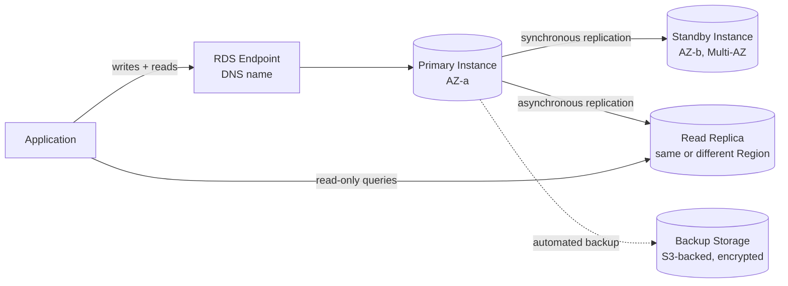

# Amazon RDS (Relational Database Service)


## Definition

Amazon RDS is a managed service that runs a traditional relational (SQL) database for you —
MySQL, PostgreSQL, MariaDB, Oracle, or SQL Server — without you having to install, patch, back
up, or babysit the database server yourself.

## Purpose

Before RDS, running a relational database meant: provision a server, install the DB engine,
configure storage, write backup scripts, apply security patches on a schedule, build a failover
system, and monitor all of it — all before writing a single line of application code. AWS built
RDS to take that entire operational burden ("undifferentiated heavy lifting") off engineering
teams, while still giving them the full relational engine they already know (the same SQL,
the same drivers, the same ORMs). You get the database you're used to, minus the 2 AM pager
duty for disk-full errors and failed patches.

## How It Works

At its core, RDS provisions one or more EC2-class instances running your chosen database engine,
attaches EBS-backed storage, and wraps it with automation: backups, patching, monitoring, and
(optionally) a standby copy in a second Availability Zone for high availability.



Step by step:
1. **App connects to an endpoint, not a server IP.** RDS gives you a stable DNS endpoint; the
   actual instance behind it can change (e.g., during failover) without your app's config changing.
2. **The primary instance handles all writes and, usually, reads.** It's a real database engine
   process on a real (AWS-managed) instance.
3. **In Multi-AZ mode**, every write is also sent **synchronously** to a standby instance in a
   different Availability Zone before the write is acknowledged. This protects against an AZ
   failure (power, network, hardware) — if the primary dies, RDS automatically fails over to the
   standby and repoints the endpoint DNS, typically within 60–120 seconds.
4. **Read replicas** are separate, optional copies that replicate **asynchronously** (so they can
   lag a little). Their job isn't availability — it's offloading read traffic from the primary so
   it isn't the bottleneck for reporting, analytics, or read-heavy app pages.
5. **Backups** happen automatically to AWS-managed storage, enabling point-in-time restore to any
   second within the retention window (1–35 days), plus manual snapshots you keep indefinitely.

## Key Features / Components

- **Multi-engine support** — MySQL, PostgreSQL, MariaDB, Oracle, Microsoft SQL Server (Aurora is
  a separate, AWS-built engine with its own doc — see `aurora.md`).
- **Multi-AZ deployments** — synchronous standby in another AZ for automatic failover (high
  availability, *not* read scaling).
- **Read Replicas** — up to 5 (15 for Aurora) async copies for read scaling; can be promoted to
  a standalone primary if needed; can even replicate cross-Region.
- **Automated backups & point-in-time recovery (PITR)** — restore to any second within the
  retention window.
- **Manual snapshots** — user-triggered, kept until you delete them, usable to clone a new instance.
- **Storage auto scaling** — storage grows automatically as data grows, no manual resize.
- **Encryption** — at rest via KMS, in transit via SSL/TLS; can't be added after creation
  without a snapshot/restore cycle, so decide upfront.
- **IAM database authentication** — short-lived auth tokens instead of long-lived DB passwords
  (MySQL/PostgreSQL only).
- **RDS Proxy** — a managed connection pooler sitting in front of RDS, crucial for Lambda-heavy
  architectures where thousands of short-lived functions would otherwise exhaust DB connections.
- **Performance Insights & Enhanced Monitoring** — query-level and OS-level performance metrics.
- **Maintenance windows** — you control *when* AWS applies mandatory patches, not *whether*.
- **Blue/Green Deployments** — create a full staging copy, test an upgrade safely, then switch over.

## Use Cases — When to Use It

- You're migrating an existing on-prem MySQL/PostgreSQL/Oracle/SQL Server app to AWS with minimal
  rewrite ("lift and shift").
- Your data is inherently relational: orders linked to customers linked to products, with
  transactions needing strict ACID guarantees (e.g., an e-commerce checkout, a banking ledger).
- Your team already knows SQL and your app's ORM (Django ORM, Hibernate, ActiveRecord) expects a
  relational backend.
- You need complex multi-table JOINs, foreign key constraints, and strong consistency without
  building that logic yourself.
- Licensing requirements force Oracle or SQL Server specifically (RDS supports both, License
  Included or Bring-Your-Own-License).

## When NOT to Use It / Alternatives

- **Need to scale writes horizontally across many nodes, or handle unpredictable, bursty,
  massive-scale traffic** → Amazon **DynamoDB** (NoSQL, near-infinite horizontal scale, single-digit
  millisecond latency at any scale) — but you give up JOINs and ad-hoc querying flexibility.
- **Want MySQL/PostgreSQL compatibility but need 5x the throughput, storage up to 128 TB, and
  serverless scale-to-zero** → **Aurora** / **Aurora Serverless v2** — same wire protocol, different
  (and faster, self-healing) storage engine underneath.
- **Need sub-millisecond caching in front of a database to cut read load/latency** → **ElastiCache**
  (Redis/Memcached) — RDS read replicas reduce load but add 10s of ms latency, not sub-ms.
- **Need to run analytical queries across billions of rows for BI dashboards** → **Redshift** (a data
  warehouse, columnar storage, not built for high-frequency transactional writes).
- **Your app uses the MongoDB driver/API and documents, not rows** → **DocumentDB**.
- **Your data is fundamentally about relationships (social graphs, fraud rings, recommendation
  engines)** → **Neptune** — graph traversal in RDS SQL quickly becomes unreadable, slow JOIN chains.

## Why It's Important

**Real world:** Relational databases still run the majority of the world's business-critical
transactional systems. The difference between a well-configured Multi-AZ RDS instance and a
single unmanaged database server is the difference between a 2-minute automatic failover and a
multi-hour outage (or worse, unrecoverable data loss) when hardware fails — which it eventually
does. Choosing the wrong engine, instance size, or skipping Multi-AZ is one of the most common
and costly real-world mistakes in cloud architecture.

**Exam mapping:**
- **SAA-C03** — Domain 2.2 (Design highly available/fault-tolerant architectures: Multi-AZ,
  failover, backup/DR strategy) and Domain 3.3 (Determine high-performing database solutions:
  RDS vs Aurora vs DynamoDB tradeoffs) and Domain 4.3 (cost-optimized database solutions:
  Reserved Instances vs On-Demand, right-sizing engine choice).
- **DVA-C03** — Task 1.3 (Use data stores in application development: connecting apps to RDS,
  understanding consistency, using RDS Proxy with Lambda to avoid connection exhaustion).
- **MLA-C02** — Domain 1 (Data Preparation for ML and AI): RDS is frequently a *source* system
  that gets extracted via DMS or Glue into S3/feature stores for ML training pipelines.

## Pricing Model (summary)

- **Instance hours** — billed per hour (or per second after the first minute) for the instance
  class (e.g., `db.t3.micro`, `db.r6g.xlarge`) you choose; Multi-AZ roughly doubles this since
  you're paying for the standby too.
- **Storage** — per GB-month for gp3/io1/io2 EBS-backed storage, plus provisioned IOPS if used.
- **Backup storage** — free up to 100% of your total DB storage; beyond that, billed per GB-month.
- **Data transfer** — outbound data transfer to the internet is billed; same-AZ/same-Region
  traffic to app servers is typically free or discounted.
- **Reserved Instances** — commit to 1 or 3 years for up to ~60% savings over On-Demand if usage
  is steady and predictable.
- Exact current rates: https://aws.amazon.com/rds/pricing/

## Hands-on Lab (Floci)

Floci backs RDS with real Docker containers running Postgres/MySQL, so these commands actually
provision working databases locally — no AWS account or bill.

```bash
# 1. Create a PostgreSQL instance
awslocal rds create-db-instance \
  --db-instance-identifier study-pg \
  --db-instance-class db.t3.micro \
  --engine postgres \
  --master-username dbadmin \
  --master-user-password ChangeMe123! \
  --allocated-storage 20

# 2. Check status until it reports "available"
awslocal rds describe-db-instances \
  --db-instance-identifier study-pg \
  --query 'DBInstances[0].DBInstanceStatus'

# 3. Get the connection endpoint
awslocal rds describe-db-instances \
  --db-instance-identifier study-pg \
  --query 'DBInstances[0].Endpoint'

# 4. Connect with psql (host/port come from step 3)
psql -h localhost -p <port> -U dbadmin -d postgres

# 5. Take a manual snapshot
awslocal rds create-db-snapshot \
  --db-instance-identifier study-pg \
  --db-snapshot-identifier study-pg-snap-1

# 6. Clean up
awslocal rds delete-db-instance \
  --db-instance-identifier study-pg \
  --skip-final-snapshot
```

See `labs-floci/README.md` for the one-time Floci setup (Docker + `awslocal` alias).

## Exam Tips

- **Multi-AZ ≠ read scaling.** It's purely for availability/failover. If a question says "improve
  read performance," the answer is a **Read Replica**, not Multi-AZ.
- **"Lift and shift an on-prem SQL Server/Oracle database"** is the classic RDS trigger phrase —
  if the question adds "with minimal code changes" and "same engine," it's RDS, not Aurora/DynamoDB.
- Know RTO/RPO vocabulary: Multi-AZ gives a low RTO (automatic failover) but your RPO depends on
  what was in-flight at failure (synchronous replication means near-zero data loss).
- Encryption at rest **cannot be enabled on an existing unencrypted instance** — you must snapshot,
  copy the snapshot with encryption enabled, then restore. This is a common exam trap.
- Read replicas can be promoted to standalone instances (breaking replication) — useful for
  disaster recovery or migrating workloads.
- RDS Proxy is the answer whenever Lambda + RDS connection exhaustion is described.

## Related Terms

- [`aurora.md`](aurora.md) — AWS's own MySQL/PostgreSQL-compatible engine, faster & more elastic.
- [`dynamodb.md`](dynamodb.md) — NoSQL alternative for massive horizontal scale.
- [`elasticache.md`](elasticache.md) — in-memory caching layer often placed in front of RDS.
- [`database-selection-guide.md`](database-selection-guide.md) — decision tree across all database types.
- Glossary: Multi-AZ, Read Replica, RTO, RPO, KMS, IAM Database Authentication.
