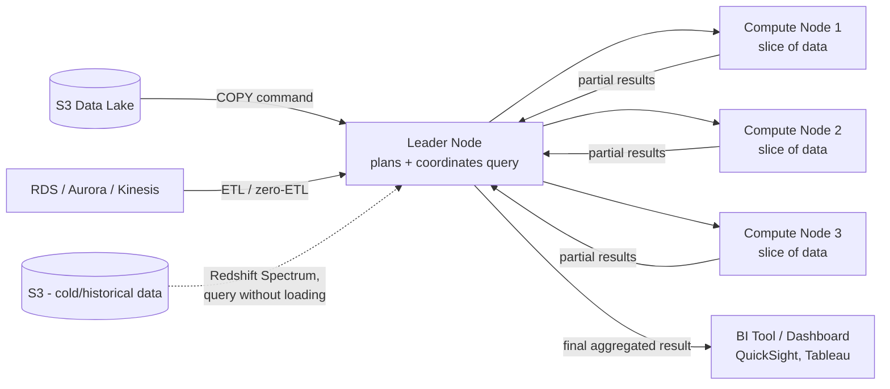
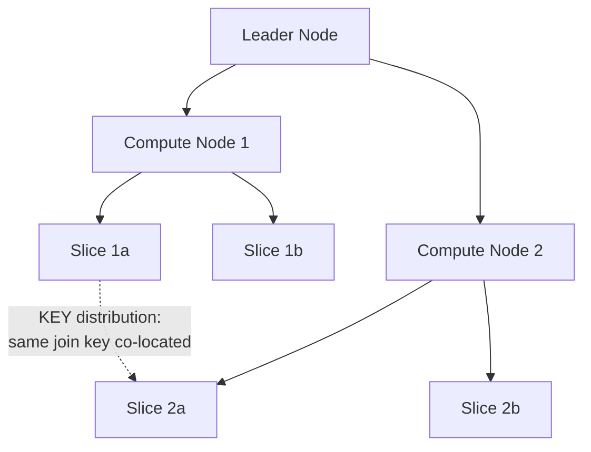
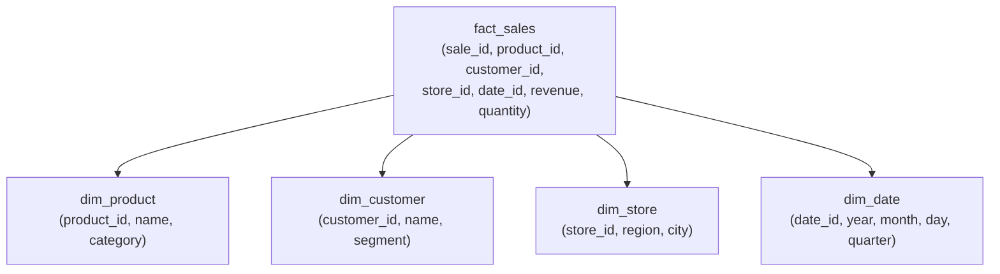
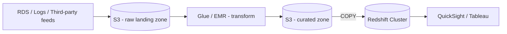
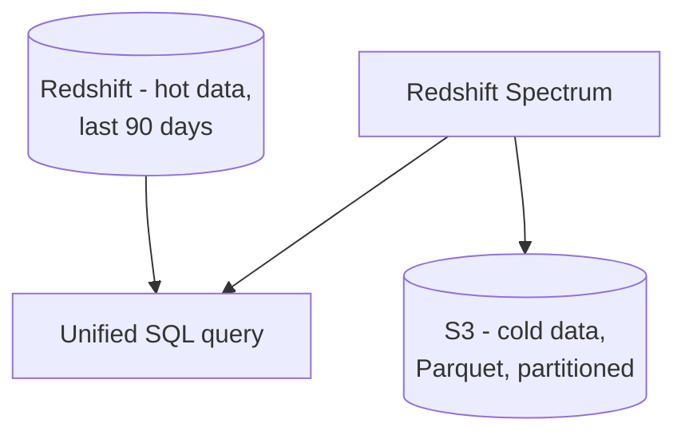

# Amazon Redshift

> **Appears in:** [SAA-C03](../../certifications/saa-c03/README.md)


## Definition

Amazon Redshift is a managed **data warehouse** — a database built specifically to run complex
analytical queries (aggregations, trends, reports) across billions of rows of historical data
quickly, rather than to handle the fast, small transactions a regular app database handles.

## Purpose

Operational databases (RDS, Aurora, DynamoDB) are optimized for OLTP — lots of small, fast
reads/writes of individual records (one order, one user). Business analysts and data teams need
the opposite: a handful of huge, complex queries that scan and aggregate *millions or billions*
of historical rows at once ("total revenue by region by month for the last 3 years"). Running
that kind of query against a live OLTP database would be slow and would compete with production
traffic for resources. Redshift exists to be a separate, purpose-built system — a data warehouse
— where large-scale historical analytics run fast without touching your live application database.

The architectural insight worth internalizing: OLTP and OLAP workloads have opposite I/O shapes.
An OLTP query typically touches a handful of columns across one or a few rows (row-store storage
is efficient for this). An OLAP query typically touches a handful of columns across *millions* of
rows (column-store storage is efficient for this instead). Trying to make one storage engine
excellent at both shapes simultaneously is why "just run the report against production" always
eventually becomes a real operational problem — the storage layout itself is fighting the query.

## How It Works

Redshift's speed comes from two architectural choices: **columnar storage** (data is stored
column-by-column, not row-by-row) and **massively parallel processing (MPP)** (a query is split
across many compute nodes that each scan their own slice of data simultaneously).



Step by step:
1. **Data lands in Redshift** either via the `COPY` command loading from S3 in bulk, streaming
   ingestion from Kinesis, or **zero-ETL integrations** that continuously replicate from Aurora/RDS
   without you writing custom pipeline code.
2. **Columnar storage**: because analytical queries typically only touch a few columns out of
   many (e.g., `SUM(revenue) GROUP BY region`), storing data column-by-column means Redshift only
   reads the columns the query actually needs — far less disk I/O than reading whole rows.
3. **The Leader Node** receives the SQL query, builds an execution plan, and splits the work
   across **Compute Nodes**.
4. **Each Compute Node** scans only its own slice of the data (data is distributed across nodes
   via a distribution style) and computes a partial result — this parallelism is why Redshift can
   scan billions of rows in seconds rather than minutes/hours.
5. **The Leader Node aggregates the partial results** into the final answer and returns it to
   whatever's asking — a BI dashboard tool (QuickSight, Tableau), a scheduled report, or a
   data scientist's notebook.
6. **Redshift Spectrum** lets you query data sitting directly in S3 (without loading it into
   Redshift first) — useful for querying cold/historical data you don't want to pay to store
   twice.

### Query Execution Internals: Slices and Distribution Styles



Each compute node is further divided into **slices** — each slice gets a fraction of the node's
memory/disk and processes its own portion of the data in parallel with the other slices. How data
lands on which slice is controlled by the table's **distribution style**:
- **KEY distribution**: rows are distributed based on a specified column's hash — choosing the
  column two large tables are frequently joined on means matching rows land on the *same* slice,
  avoiding expensive cross-node data shuffling during the join.
- **ALL distribution**: a full copy of a (typically small) table is stored on every node — ideal
  for small dimension tables (e.g., a `countries` lookup table) that are joined against constantly,
  trading storage duplication for zero join-time network shuffling.
- **EVEN distribution**: rows are spread round-robin regardless of value — the default, fine when
  there's no obvious join-heavy key or the table isn't frequently joined.
- **Choosing the wrong distribution style is the single most common real-world Redshift
  performance problem** — a poorly chosen key causes **data skew** (most rows land on one node,
  which then becomes the bottleneck for every query touching that table), conceptually the same
  underlying failure mode as a DynamoDB hot partition, just in a columnar MPP context instead of
  a key-value one.

### Sort Keys and Zone Maps

Beyond distribution, **sort keys** determine the physical order rows are stored in within each
slice. Redshift maintains **zone maps** — min/max value metadata per storage block — so a query
with a `WHERE` clause on the sort key column can skip entire blocks that can't possibly contain
matching rows, without ever reading them from disk. A `date`-based sort key on a huge fact table
is the single highest-leverage schema decision for a query pattern that's almost always filtered
by a date range — skipping irrelevant historical blocks entirely rather than scanning them.

### Data Modeling: Star Schema and Fact/Dimension Tables

Data warehouses conventionally model data as a **star schema**: a large central **fact table**
(one row per event — a sale, a click, a shipment) surrounded by smaller **dimension tables**
(descriptive attributes — product details, customer details, store location) that the fact table
references by key.



- **Fact tables grow huge, fast** (every sale, every click) — these are the tables where
  distribution style, sort keys, and compression matter most.
- **Dimension tables are relatively small and change slowly** — classic candidates for `ALL`
  distribution so every node has a local copy and joins against the fact table never need to
  shuffle data across the network.
- This design is deliberately denormalized relative to a strict OLTP schema — a dimension table
  might repeat descriptive attributes that a normalized OLTP schema would split further, because
  analytical queries favor fewer joins over storage efficiency.

## Key Features / Components

- **Columnar storage** — stores and compresses data column-by-column, dramatically reducing I/O
  for analytical (wide-table, few-columns-per-query) workloads.
- **Massively Parallel Processing (MPP)** — splits query execution across many nodes
  simultaneously.
- **Redshift Serverless** — automatically provisions and scales compute capacity, billed by
  usage, no cluster to manage — good for unpredictable or intermittent analytical workloads.
- **Redshift Spectrum** — query exabytes of data directly in S3 without loading it, paying only
  for the data scanned.
- **Concurrency Scaling** — automatically adds transient capacity during bursts of concurrent
  queries so one busy period doesn't slow down everyone else.
- **Zero-ETL integrations** — continuous, code-free replication from Aurora/RDS into Redshift for
  near-real-time analytics without custom pipelines.
- **Materialized views** — pre-computed, auto-refreshed query results for frequently-run
  aggregations, trading storage/freshness for query speed.
- **Result caching** — repeated identical queries can be served instantly from cache.
- **Workload Management (WLM) / query queues** — prioritize critical dashboards over ad-hoc
  exploratory queries sharing the same cluster.
- **RA3 node types** — separate compute from managed storage, so you can scale each independently
  rather than being forced to add compute nodes just to get more storage, or vice versa.
- **Automatic compression (ENCODE)** — Redshift analyzes column data and applies an appropriate
  compression encoding automatically on `COPY`, often shrinking storage and I/O dramatically with
  no manual tuning.

## Common Architectures

**1. Classic BI/reporting warehouse fed by nightly ETL.** Source systems (RDS, application logs,
third-party data) land in S3; a scheduled Glue/EMR job transforms and loads into Redshift via
`COPY`; BI tools query Redshift directly each morning on fresh data.



**2. Zero-ETL from Aurora for near-real-time analytics.** Rather than building/maintaining a
custom ETL pipeline, a zero-ETL integration continuously replicates changes from an Aurora OLTP
cluster into Redshift, with analytics running minutes (not a full ETL cycle) behind live data.

**3. Lake House: Redshift + Spectrum over an S3 data lake.** Hot, frequently-queried data lives
natively in Redshift; cold/historical data stays in S3 in Parquet format and is queried in place
via Spectrum — avoiding the cost of storing (and loading) everything twice.



**4. Redshift Serverless for intermittent analytics.** A finance team runs heavy quarterly
reporting queries but nothing in between — Serverless avoids paying for a provisioned cluster
sitting idle 11 weeks out of every 13.

**5. Multi-tenant BI with Workload Management queues.** A single cluster serves multiple business
units; WLM queues ensure a long-running ad-hoc query from one analyst doesn't starve a
time-sensitive executive dashboard refresh running concurrently.

## Security & Compliance Considerations

- **VPC placement and security groups**: Redshift clusters should live in private subnets, with
  inbound access restricted to the BI tools/application servers/analyst VPN that actually need
  query access — not left publicly accessible for console convenience.
- **Column-level and row-level security**: Redshift supports granting SELECT at the column level
  (useful for hiding PII columns from broad analyst access) and dynamic data masking policies,
  which matter for compliance scenarios where different roles need different visibility into the
  same table.
- **Encryption**: at-rest via KMS, in-transit via SSL — similar model to RDS/Aurora; audit
  logging (`ENABLE_USER_ACTIVITY_LOGGING`) should be turned on explicitly for compliance
  environments, as it is not default-on.
- **Cross-account data sharing**: Redshift's data sharing feature lets one cluster's data be
  queried live by another cluster/account without copying it — convenient for a central data team
  sharing curated datasets with business-unit-specific clusters, but it needs deliberate grant
  scoping just like any other cross-account access pattern.

## Monitoring & Observability

- **Query monitoring rules (QMR)** within WLM can automatically abort or log queries that exceed
  defined thresholds (execution time, rows scanned, CPU usage) — this is the practical mechanism
  for preventing one runaway analyst query from degrading the whole cluster, beyond just queue
  prioritization.
- **`SVL_QUERY_SUMMARY` / `STL_QUERY` system tables** (and the newer Redshift console query
  monitoring UI) are the first place to look when a specific query is slow — they show per-step
  execution time and row counts, which usually points directly at a skew or missing-sort-key
  problem.
- **CloudWatch cluster metrics** (CPU, disk space, read/write IOPS, query duration) should be
  alarmed on `PercentageDiskSpaceUsed` in particular — a full disk blocks new loads and can be an
  unpleasant surprise if storage growth isn't tracked proactively.

## Use Cases — When to Use It

- Business intelligence dashboards aggregating sales, usage, or operational metrics across years
  of historical data.
- Centralizing data from many operational systems (multiple RDS databases, app logs, S3 data
  lake) into one place analysts and data scientists can query with standard SQL.
- Running the "big slow query" (quarterly revenue report, year-over-year cohort analysis) that
  would otherwise tie up a production OLTP database.
- Feeding ML feature engineering and data preparation pipelines that need SQL-based aggregation
  across large historical datasets (relevant to MLA-C02's Domain 1).

## When NOT to Use It / Alternatives

- **Need fast lookups/updates of individual records for a live application** → **RDS/Aurora/
  DynamoDB** — Redshift is not built for high-frequency small transactional writes; forcing
  OLTP-style traffic onto it is slow and expensive.
- **Only occasionally query data already sitting in S3, don't want to manage/pay for a
  cluster at all** → **Athena** (serverless, pay-per-query-scanned, zero infrastructure) — simpler
  for ad-hoc, infrequent analytics; Redshift makes more sense once query volume/complexity/user
  count justifies a dedicated warehouse.
- **Need unstructured/semi-structured big-data processing with custom code (Spark jobs)** →
  **EMR** — Redshift is SQL-first; EMR is for when you need Spark/Hadoop-style custom
  transformation logic.
- **Budget-constrained with low, unpredictable analytical query volume** → **Redshift Serverless**
  or **Athena** before committing to a provisioned cluster — provisioned Redshift clusters bill
  by the hour whether queried or not.

## Real-World Pricing Examples

**Example 1 — small provisioned cluster, steady BI workload:**
- 2x `ra3.xlplus` nodes at roughly $1.086/hr each ≈ **$2.17/hr → ~$1,585/month** compute.
- Managed storage billed separately per GB-month on top of this, decoupled from the node price —
  for a modest 2 TB warehouse at roughly $0.024/GB-month ≈ **~$48/month** additional.
- **Rough total: ~$1,633/month** — a real, fixed cost that makes "is this actually a steady,
  justified-by-volume workload, or could Serverless/Athena be cheaper" a genuine first-pass
  decision, not an afterthought.

**Example 2 — Redshift Serverless for intermittent analytics:**
- Billed per Redshift Processing Unit (RPU)-second of actual query execution, roughly $0.36/RPU-hour
  equivalent — a finance team running heavy queries only during a 2-week quarterly close might
  spend **a few hundred dollars** that quarter instead of paying for a provisioned cluster
  sitting mostly idle the other 11 weeks.

**Example 3 — Redshift Spectrum querying a large S3 data lake:**
- Billed per TB scanned, roughly $5/TB — a query that scans 2 TB of unpartitioned, uncompressed
  CSV data costs **~$10**; the same logical query against the same data stored as partitioned,
  compressed Parquet might scan only 50 GB (because of partition pruning + columnar skipping),
  costing **~$0.25** — this is the concrete, large-multiplier argument for partitioning and
  columnar formats in a data lake, not just a theoretical best practice.

- Exact current rates: https://aws.amazon.com/redshift/pricing/

## Limits & Quotas (Real, Current — Verify Before Relying On Them)

- **Max nodes per cluster**: varies by node type; RA3 cluster configurations commonly support up
  to **128 nodes** depending on node size — verify the current ceiling for your specific node type.
- **Max databases per cluster**: **60** (verify against current docs; this has changed over
  cluster-version history).
- **Max concurrent user connections**: a few hundred to low thousands depending on node type and
  WLM configuration — concurrency-heavy, many-small-client workloads should evaluate Concurrency
  Scaling or Serverless rather than assuming unlimited connections.
- **Max table columns**: **1,600** columns per table.
- **Max database size**: effectively unbounded with RA3's managed storage (scales independently
  of compute) — the practical ceiling is cost and query performance, not a hard byte limit.
- **Redshift Spectrum**: billed per TB scanned, with no hard ceiling on data lake size queried,
  though partition pruning dramatically changes the *effective* (billed) scan size.
- **COPY command file size**: individual files are most efficient between roughly 1 MB and 1 GB
  compressed per file, split for parallel load across slices — a single enormous file undermines
  the parallelism that makes `COPY` fast.

## Troubleshooting / Common Issues

- **Query is slow despite a "big enough" cluster** → check distribution style first; data skew
  (most rows landing on one node due to a poor distribution key) means most of the cluster sits
  idle while one node does all the work — `SVV_TABLE_INFO` and `STL_DIST` tables, or the simpler
  Redshift console advisor, surface skew directly.
- **Queries scan far more data than expected (slow and/or expensive via Spectrum)** → missing
  partitioning or a sort key that doesn't match the actual filter pattern; zone maps can't skip
  blocks if the data isn't physically ordered by the filtered column.
- **A single long-running ad-hoc query slows down dashboards for everyone** → missing or
  misconfigured Workload Management queues; route interactive/dashboard queries and heavy
  ad-hoc/batch queries into separate queues with appropriate priority and memory allocation.
- **`COPY` command fails or runs much slower than expected** → check for a single huge
  uncompressed file instead of multiple appropriately-sized, compressed files — `COPY`
  parallelizes across slices only when the input is already split into enough files.
- **Materialized view results look stale** → materialized views refresh on a schedule or
  manually, not instantaneously on every underlying change — if the business needs guaranteed
  freshness, either force a refresh before critical reporting windows or reconsider whether a
  materialized view (vs a live query) is the right tool for that specific dashboard.
- **Storage costs growing faster than expected on RA3** → managed storage bills independently of
  compute, so historical data nobody prunes just keeps accumulating cost — this is the textbook
  argument for moving genuinely cold historical data out to S3 and querying it via Spectrum
  instead of leaving it in managed storage indefinitely.

## Why It's Important

**Real world:** The decision between "just run this report against production" and "stand up a
proper data warehouse" is a real inflection point every growing company hits — usually the hard
way, after a big analytical query slows down the checkout page at the worst possible moment.
Redshift (and the broader OLTP-vs-OLAP split) represents a genuinely important architectural
principle: separate your systems by *workload shape*, not just by data type.

**Exam mapping:**
- **SAA-C03** — Domain 3.5 (Determine high-performing data ingestion and transformation
  solutions: Redshift alongside Kinesis/Glue/EMR in data pipeline design) and Domain 3.3
  (database solutions — recognizing OLAP vs OLTP as a selection criterion).
- **DVA-C03** — less central, but Task 1.1 (developing code that writes to / integrates with
  analytical data stores as part of an application's data pipeline) can reference Redshift.
- **MLA-C02** — Domain 1 (Data Preparation for ML and AI): Redshift as a structured-data source
  for feature engineering pipelines, and zero-ETL from Aurora as a modern ingestion pattern.

**Expanded exam scenarios:**
- *"A dashboard query joins a 2-billion-row sales table with a 200-row countries table, and
  performance is poor."* → `ALL` distribution on the tiny countries table (so every node has a
  local copy) is the textbook fix — co-locating the join without network shuffling.
- *"A company wants to query 50 TB of historical log data in S3 only a few times a month without
  maintaining a warehouse cluster."* → Athena, not Redshift — the signal is "infrequent" and
  "doesn't want to maintain infrastructure."
- *"An analytics team needs access to near-real-time data from a production Aurora cluster
  without building custom replication code."* → Zero-ETL integration.
- *"A fact table is always filtered by date range in reporting queries, but scans are reading far
  more data than the filtered range should require."* → Missing or incorrect sort key on the
  date column — zone maps can't skip blocks the data isn't physically sorted by.
- *"Multiple teams share one Redshift cluster, and a data scientist's exploratory query is
  delaying an executive's scheduled morning dashboard."* → Workload Management queues with
  separate priority/queue assignment, not a bigger cluster — the problem is contention/priority,
  not raw capacity.

## Pricing Model (summary)

- **Provisioned clusters** — billed per node-hour based on node type (RA3 nodes separate compute
  from storage, allowing independent scaling of each).
- **Redshift Serverless** — billed by Redshift Processing Units (RPUs) consumed per query/second
  of use, no charge when idle.
- **Redshift Spectrum** — billed per TB of data scanned from S3 (encourages partitioning/columnar
  formats like Parquet to minimize scanned bytes — see the worked example above for the actual
  cost multiplier this produces).
- **Storage (RA3 nodes)** — billed separately per GB-month in managed storage, decoupled from
  compute node pricing.
- **Concurrency Scaling** — free credits accrue daily; usage beyond that is billed per-second.
- Exact current rates: https://aws.amazon.com/redshift/pricing/

## Hands-on Lab (Floci)

**Honest limitation:** Redshift is **not** listed in Floci's supported-services table (only
DynamoDB and RDS appear under "Database" in `labs-floci/README.md`). The control-plane commands
below show the real AWS CLI shape so you build muscle memory, but expect them to return a
"not implemented" style error against Floci today — this is a known gap, not a mistake in your
setup. For the actual SQL/analytics practice, use a local Postgres container (Redshift's SQL
dialect is Postgres-derived) to rehearse columnar-style aggregation queries conceptually.

```bash
# Real AWS CLI shape — try against Floci, expect possible "not implemented"
awslocal redshift create-cluster \
  --cluster-identifier study-redshift \
  --node-type dc2.large \
  --number-of-nodes 2 \
  --master-username dbadmin \
  --master-user-password ChangeMe123! \
  --db-name analytics

awslocal redshift describe-clusters --cluster-identifier study-redshift

# Fallback for hands-on SQL practice: Postgres container standing in for Redshift's SQL dialect
docker run -d --name study-warehouse -e POSTGRES_PASSWORD=pass -p 5433:5432 postgres:16

psql -h localhost -p 5433 -U postgres -c "
  CREATE TABLE sales (region TEXT, month TEXT, revenue NUMERIC);
  INSERT INTO sales VALUES
    ('EU','2026-01',120000), ('EU','2026-02',135000),
    ('US','2026-01',210000), ('US','2026-02',198000);
  SELECT region, SUM(revenue) AS total_revenue
  FROM sales GROUP BY region ORDER BY total_revenue DESC;
"

# Clean up
docker rm -f study-warehouse
```

## Exam Tips

- **"Data warehouse," "BI dashboard," "aggregate years of historical data," "columnar"** are the
  Redshift trigger phrases. If the question instead says "query data in S3 occasionally, no
  infrastructure to manage," that's **Athena**, not Redshift.
- Know **OLTP vs OLAP** cold: OLTP = many small fast transactions (RDS/Aurora/DynamoDB); OLAP =
  fewer, larger, aggregate-heavy queries (Redshift). This distinction alone resolves a large
  fraction of "which database" exam questions.
- **Redshift Spectrum** = query S3 data without loading it first — the answer when a question
  wants analytics on data that lives in a data lake without duplicating storage cost.
- **Zero-ETL integration** (Aurora/RDS → Redshift) is a newer, frequently-tested pattern for
  "near real-time analytics without building a custom pipeline."
- **Distribution style and sort keys directly affect query performance** — know `KEY` (co-locate
  joins), `ALL` (duplicate small dimension tables everywhere), and `EVEN` (default, no obvious
  join pattern); poor distribution causes data skew and slow queries, conceptually similar to
  DynamoDB's hot-partition problem.
- **Sort keys enable zone-map block skipping** — a question describing slow date-range-filtered
  queries on a huge fact table is testing whether you'd add/fix a sort key on the date column.
- **Star schema (fact + dimension tables)** is the expected data model vocabulary — recognize a
  "sales fact table joined to product/customer/date dimension tables" description as standard
  warehouse modeling, not something unusual.

## Further Reading

- [Amazon Redshift: What is a data warehouse?](https://docs.aws.amazon.com/redshift/latest/gsg/getting-started.html) —
  official getting-started concepts.
- [Data warehouse system architecture](https://docs.aws.amazon.com/redshift/latest/dg/c_high_level_system_architecture.html) —
  the leader/compute node/slice mechanics referenced above, straight from AWS.
- [Architecture components of an Amazon Redshift data warehouse](https://docs.aws.amazon.com/prescriptive-guidance/latest/query-best-practices-redshift/data-warehouse-arch-components.html) —
  AWS Prescriptive Guidance on distribution styles and performance tuning.
- [Amazon Redshift Spectrum](https://docs.aws.amazon.com/redshift/latest/dg/c-using-spectrum.html) —
  querying S3 data lakes directly.
- [Amazon Redshift pricing](https://aws.amazon.com/redshift/pricing/) — current, authoritative rates.

## Related Terms

- [`rds.md`](rds.md) / [`aurora.md`](aurora.md) — the OLTP sources that typically feed Redshift.
- [`database-selection-guide.md`](database-selection-guide.md) — full OLTP vs OLAP decision tree.
- Glossary: OLAP, OLTP, Columnar Storage, MPP, Data Lake, Zero-ETL, Distribution Style, Sort Key, Zone Map.

---

**Image credit:** "Diagram showing the flow of data in Amazon Redshift" — official diagram from the
AWS Redshift Getting Started Guide, Amazon Web Services, Inc.
Source: https://docs.aws.amazon.com/redshift/latest/gsg/images/architecture.png


*Figure: Typical Redshift data flow — ingestion from source systems, processing/loading into the cluster, and consumption via SQL clients and BI tools. Source: AWS Redshift Getting Started Guide (docs.aws.amazon.com).*
