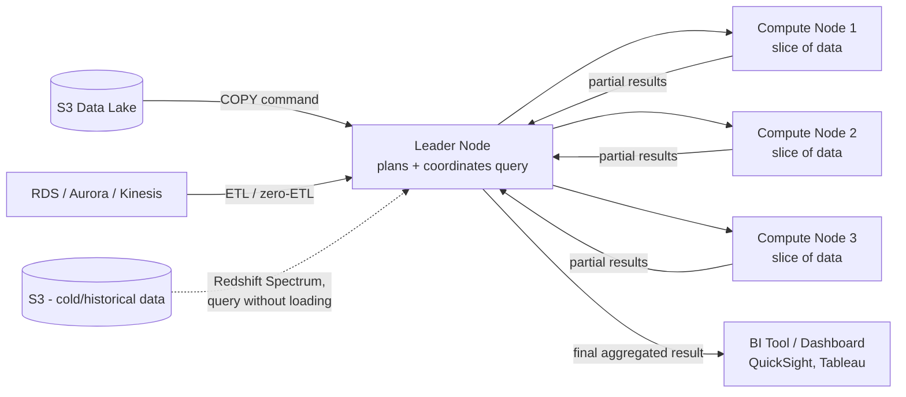

# Amazon Redshift


## Definition

Amazon Redshift is a managed **data warehouse** — a database built specifically to run complex
analytical queries (aggregations, trends, reports) across billions of rows of historical data
quickly, rather than to handle the fast, small transactions a regular app database handles.

## Purpose

Operational databases (RDS, Aurora, DynamoDB) are optimized for OLTP — lots of small, fast
reads/writes of individual records (one order, one user). Business analysts and data teams need
the opposite: a handful of huge, complex queries that scan and aggregate *millions or billions*
of historical rows at once ("total revenue by region by month for the last 3 years"). Running
that kind of query against a live OLTP database would be slow and would compete with production
traffic for resources. Redshift exists to be a separate, purpose-built system — a data warehouse
— where large-scale historical analytics run fast without touching your live application database.

## How It Works

Redshift's speed comes from two architectural choices: **columnar storage** (data is stored
column-by-column, not row-by-row) and **massively parallel processing (MPP)** (a query is split
across many compute nodes that each scan their own slice of data simultaneously).



Step by step:
1. **Data lands in Redshift** either via the `COPY` command loading from S3 in bulk, streaming
   ingestion from Kinesis, or **zero-ETL integrations** that continuously replicate from Aurora/RDS
   without you writing custom pipeline code.
2. **Columnar storage**: because analytical queries typically only touch a few columns out of
   many (e.g., `SUM(revenue) GROUP BY region`), storing data column-by-column means Redshift only
   reads the columns the query actually needs — far less disk I/O than reading whole rows.
3. **The Leader Node** receives the SQL query, builds an execution plan, and splits the work
   across **Compute Nodes**.
4. **Each Compute Node** scans only its own slice of the data (data is distributed across nodes
   via a distribution style) and computes a partial result — this parallelism is why Redshift can
   scan billions of rows in seconds rather than minutes/hours.
5. **The Leader Node aggregates the partial results** into the final answer and returns it to
   whatever's asking — a BI dashboard tool (QuickSight, Tableau), a scheduled report, or a
   data scientist's notebook.
6. **Redshift Spectrum** lets you query data sitting directly in S3 (without loading it into
   Redshift first) — useful for querying cold/historical data you don't want to pay to store
   twice.

## Key Features / Components

- **Columnar storage** — stores and compresses data column-by-column, dramatically reducing I/O
  for analytical (wide-table, few-columns-per-query) workloads.
- **Massively Parallel Processing (MPP)** — splits query execution across many nodes
  simultaneously.
- **Redshift Serverless** — automatically provisions and scales compute capacity, billed by
  usage, no cluster to manage — good for unpredictable or intermittent analytical workloads.
- **Redshift Spectrum** — query exabytes of data directly in S3 without loading it, paying only
  for the data scanned.
- **Concurrency Scaling** — automatically adds transient capacity during bursts of concurrent
  queries so one busy period doesn't slow down everyone else.
- **Zero-ETL integrations** — continuous, code-free replication from Aurora/RDS into Redshift for
  near-real-time analytics without custom pipelines.
- **Materialized views** — pre-computed, auto-refreshed query results for frequently-run
  aggregations, trading storage/freshness for query speed.
- **Result caching** — repeated identical queries can be served instantly from cache.
- **Workload Management (WLM) / query queues** — prioritize critical dashboards over ad-hoc
  exploratory queries sharing the same cluster.

## Use Cases — When to Use It

- Business intelligence dashboards aggregating sales, usage, or operational metrics across years
  of historical data.
- Centralizing data from many operational systems (multiple RDS databases, app logs, S3 data
  lake) into one place analysts and data scientists can query with standard SQL.
- Running the "big slow query" (quarterly revenue report, year-over-year cohort analysis) that
  would otherwise tie up a production OLTP database.
- Feeding ML feature engineering and data preparation pipelines that need SQL-based aggregation
  across large historical datasets (relevant to MLA-C02's Domain 1).

## When NOT to Use It / Alternatives

- **Need fast lookups/updates of individual records for a live application** → **RDS/Aurora/
  DynamoDB** — Redshift is not built for high-frequency small transactional writes; forcing
  OLTP-style traffic onto it is slow and expensive.
- **Only occasionally query data already sitting in S3, don't want to manage/pay for a
  cluster at all** → **Athena** (serverless, pay-per-query-scanned, zero infrastructure) — simpler
  for ad-hoc, infrequent analytics; Redshift makes more sense once query volume/complexity/user
  count justifies a dedicated warehouse.
- **Need unstructured/semi-structured big-data processing with custom code (Spark jobs)** →
  **EMR** — Redshift is SQL-first; EMR is for when you need Spark/Hadoop-style custom
  transformation logic.
- **Budget-constrained with low, unpredictable analytical query volume** → **Redshift Serverless**
  or **Athena** before committing to a provisioned cluster — provisioned Redshift clusters bill
  by the hour whether queried or not.

## Why It's Important

**Real world:** The decision between "just run this report against production" and "stand up a
proper data warehouse" is a real inflection point every growing company hits — usually the hard
way, after a big analytical query slows down the checkout page at the worst possible moment.
Redshift (and the broader OLTP-vs-OLAP split) represents a genuinely important architectural
principle: separate your systems by *workload shape*, not just by data type.

**Exam mapping:**
- **SAA-C03** — Domain 3.5 (Determine high-performing data ingestion and transformation
  solutions: Redshift alongside Kinesis/Glue/EMR in data pipeline design) and Domain 3.3
  (database solutions — recognizing OLAP vs OLTP as a selection criterion).
- **DVA-C03** — less central, but Task 1.1 (developing code that writes to / integrates with
  analytical data stores as part of an application's data pipeline) can reference Redshift.
- **MLA-C02** — Domain 1 (Data Preparation for ML and AI): Redshift as a structured-data source
  for feature engineering pipelines, and zero-ETL from Aurora as a modern ingestion pattern.

## Pricing Model (summary)

- **Provisioned clusters** — billed per node-hour based on node type (RA3 nodes separate compute
  from storage, allowing independent scaling of each).
- **Redshift Serverless** — billed by Redshift Processing Units (RPUs) consumed per query/second
  of use, no charge when idle.
- **Redshift Spectrum** — billed per TB of data scanned from S3 (encourages partitioning/columnar
  formats like Parquet to minimize scanned bytes).
- **Storage (RA3 nodes)** — billed separately per GB-month in managed storage, decoupled from
  compute node pricing.
- **Concurrency Scaling** — free credits accrue daily; usage beyond that is billed per-second.
- Exact current rates: https://aws.amazon.com/redshift/pricing/

## Hands-on Lab (Floci)

**Honest limitation:** Redshift is **not** listed in Floci's supported-services table (only
DynamoDB and RDS appear under "Database" in `labs-floci/README.md`). The control-plane commands
below show the real AWS CLI shape so you build muscle memory, but expect them to return a
"not implemented" style error against Floci today — this is a known gap, not a mistake in your
setup. For the actual SQL/analytics practice, use a local Postgres container (Redshift's SQL
dialect is Postgres-derived) to rehearse columnar-style aggregation queries conceptually.

```bash
# Real AWS CLI shape — try against Floci, expect possible "not implemented"
awslocal redshift create-cluster \
  --cluster-identifier study-redshift \
  --node-type dc2.large \
  --number-of-nodes 2 \
  --master-username dbadmin \
  --master-user-password ChangeMe123! \
  --db-name analytics

awslocal redshift describe-clusters --cluster-identifier study-redshift

# Fallback for hands-on SQL practice: Postgres container standing in for Redshift's SQL dialect
docker run -d --name study-warehouse -e POSTGRES_PASSWORD=pass -p 5433:5432 postgres:16

psql -h localhost -p 5433 -U postgres -c "
  CREATE TABLE sales (region TEXT, month TEXT, revenue NUMERIC);
  INSERT INTO sales VALUES
    ('EU','2026-01',120000), ('EU','2026-02',135000),
    ('US','2026-01',210000), ('US','2026-02',198000);
  SELECT region, SUM(revenue) AS total_revenue
  FROM sales GROUP BY region ORDER BY total_revenue DESC;
"

# Clean up
docker rm -f study-warehouse
```

## Exam Tips

- **"Data warehouse," "BI dashboard," "aggregate years of historical data," "columnar"** are the
  Redshift trigger phrases. If the question instead says "query data in S3 occasionally, no
  infrastructure to manage," that's **Athena**, not Redshift.
- Know **OLTP vs OLAP** cold: OLTP = many small fast transactions (RDS/Aurora/DynamoDB); OLAP =
  fewer, larger, aggregate-heavy queries (Redshift). This distinction alone resolves a large
  fraction of "which database" exam questions.
- **Redshift Spectrum** = query S3 data without loading it first — the answer when a question
  wants analytics on data that lives in a data lake without duplicating storage cost.
- **Zero-ETL integration** (Aurora/RDS → Redshift) is a newer, frequently-tested pattern for
  "near real-time analytics without building a custom pipeline."
- Distribution style and sort keys (not covered deeply here) affect query performance —
  know that poor distribution causes data skew and slow queries, conceptually similar to
  DynamoDB's hot-partition problem.

## Related Terms

- [`rds.md`](rds.md) / [`aurora.md`](aurora.md) — the OLTP sources that typically feed Redshift.
- [`database-selection-guide.md`](database-selection-guide.md) — full OLTP vs OLAP decision tree.
- Glossary: OLAP, OLTP, Columnar Storage, MPP, Data Lake, Zero-ETL.
