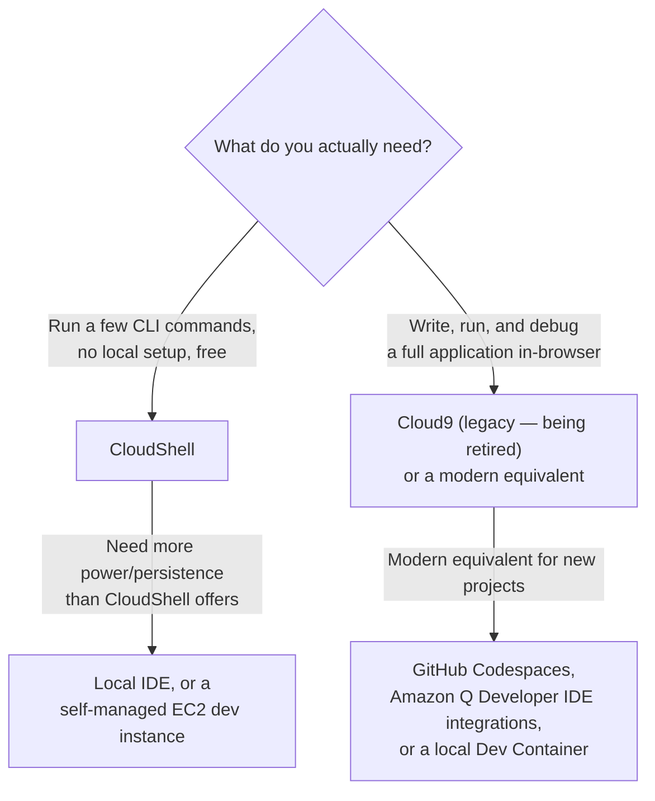
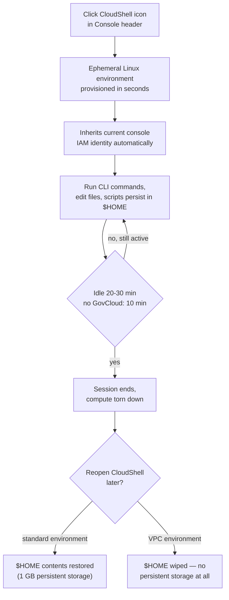
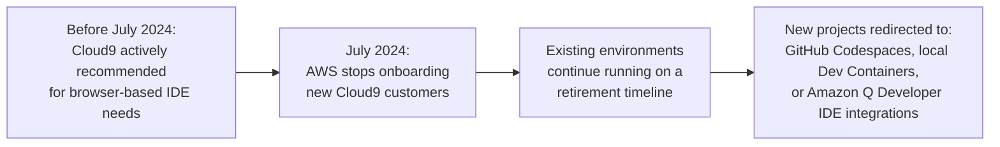

# AWS Cloud9 & AWS CloudShell


<!-- AWS Architecture Icons, Developer Tools category; see diagrams/README.md for the convention -->

## Definition

**AWS CloudShell** is a free, browser-based terminal pre-authenticated with your AWS console
credentials and pre-loaded with the AWS CLI and common tools (Python, Node, Git, SAM CLI) — no
setup, no local install. **AWS Cloud9** was a full browser-based IDE (code editor, debugger,
terminal, EC2-backed) for writing, running, and debugging code entirely in the browser.

> **Status note:** AWS stopped onboarding new Cloud9 customers as of July 2024 and existing
> environments were set to be retired; AWS's current "cloud IDE in the browser" direction has
> shifted toward **Amazon Q Developer's** agentic coding experience and SageMaker/other
> notebook-style browser environments rather than a general-purpose Cloud9 IDE. It's documented
> here because it still appears in exam content and legacy environments, and because contrasting
> it with CloudShell clarifies what each tool is actually for.

## Purpose

Both tools solve "I need to run commands/write code against AWS, but I don't want to (or can't)
set up a local environment" — just at different depths. **CloudShell** exists purely so you
always have a correctly-configured CLI terminal, from any browser, with zero local setup and
already-authenticated credentials — useful for quick CLI tasks, troubleshooting, or working from
a machine where you can't install the AWS CLI. **Cloud9** existed to go further: a full IDE
(editor, debugger, terminal, running on an actual EC2 instance you could configure) so you could
write *and run* an entire application in the browser, useful for workshops, pair programming, and
environments where installing a local dev toolchain wasn't practical.

The distinction between these two tools is a clean, concrete illustration of a recurring AWS
pattern: **"zero-setup convenience" and "full control" are usually two different products, not
two modes of the same product.** CloudShell deliberately gives you no persistent compute to
configure (you get a terminal, nothing more); Cloud9 deliberately gave you a real, billable,
configurable EC2 instance underneath an IDE UI. Recognizing which of these two needs a scenario
is describing — "I just need to run a few CLI commands" versus "I need to write, run, and debug
an entire application" — is the entire exam-relevant skill here.

## How It Works

Plain explanation: CloudShell spins up a small, temporary, managed Linux environment attached to
your console session, pre-loaded with the CLI and your IAM credentials already configured — you
just open it and start typing. Cloud9 was heavier: it actually provisioned an EC2 instance (or
ran against SSH-accessible existing infrastructure) and served a full VS Code–like editor UI from
your browser, backed by that real instance.

```mermaid
flowchart TD
    Browser[AWS Console: Browser] -->|click "CloudShell" icon| CS[CloudShell session
ephemeral, managed, free]
    CS --> CLI[AWS CLI pre-authenticated
via your console IAM session]
    CS --> Tools[Pre-installed: Python, Node,
Git, SAM CLI, kubectl]
    Browser -->|legacy: open Cloud9 env| C9[Cloud9 IDE in browser]
    C9 --> EC2[Backed by an EC2 instance
you could size/configure]
    EC2 --> Editor[Full code editor + debugger + terminal]
    EC2 --> Run[Run/debug your app directly
on that instance]
```

Step by step:
1. **CloudShell**: click the terminal icon in the AWS Console top bar → a session launches in
   seconds, already authenticated as your current console identity (same IAM permissions you're
   logged in with) → run `aws`, `git`, `python`, `sam`, etc. immediately, with 1 GB of persistent
   `$HOME` storage per region carried between sessions.
2. **Cloud9 (legacy)**: you created an "environment," which provisioned a small EC2 instance (or
   connected to existing SSH-accessible infra) → the browser served a full IDE UI (file tree,
   editor, integrated terminal, debugger) running against that instance → you could install any
   package, run any server process, and preview a running web app directly from the IDE.

### Real-World Reference Architecture


*Figure: The actual AWS CloudShell interface as it appears after launch — a pre-authenticated
Bash/PowerShell/Z shell terminal with a terminal-tab bar, an Actions menu (file upload/download,
restart, delete environment), an "open in new browser tab" option, and shell preferences, all
running directly in the AWS Management Console with no local installation step. Source:
[AWS CloudShell User Guide — "What is AWS CloudShell?"](https://docs.aws.amazon.com/cloudshell/latest/userguide/welcome.html), © Amazon Web Services.*

Notice what's conspicuously absent from this screenshot compared to what a Cloud9 screenshot would
show: there's no file tree, no code editor pane, no "run/debug" button — CloudShell is
*deliberately* just a terminal. This is the clearest visual confirmation of the core distinction
this document is built around: CloudShell gives you a shell, Cloud9 gave you an IDE.

## Worked Example: A Realistic CloudShell Session for Incident Response

A common real scenario — investigating a production issue from a laptop that doesn't have the AWS
CLI configured (or isn't trusted to hold long-lived credentials at all):

```bash
# 1. Open CloudShell from the console — already authenticated as your console identity,
#    no 'aws configure' step needed at all
whoami  # confirm you're in the CloudShell environment
aws sts get-caller-identity  # confirm which IAM identity CloudShell inherited

# 2. Investigate a failing ECS service directly
aws ecs describe-services --cluster prod-cluster --services orders-api-svc \
  --query 'services[0].events[0:5]'

# 3. Tail recent CloudWatch Logs for the failing task
aws logs tail /ecs/orders-api --since 15m --follow

# 4. Pull down a problematic CloudFormation stack's events for diagnosis
aws cloudformation describe-stack-events --stack-name orders-api-stack \
  --query 'StackEvents[?ResourceStatus==`UPDATE_FAILED`]'

# 5. If a quick script is needed, write and run it directly — Python is pre-installed
cat > check_health.py << 'EOF'
import boto3
ecs = boto3.client('ecs')
resp = ecs.describe_services(cluster='prod-cluster', services=['orders-api-svc'])
print(resp['services'][0]['runningCount'], '/', resp['services'][0]['desiredCount'])
EOF
python3 check_health.py
```

What matters here: every one of these commands works **immediately**, with zero setup, because
CloudShell inherited the console session's IAM identity automatically — this is precisely the
"incident response from a borrowed/locked-down machine" use case the exam and real operational
practice both emphasize. No credentials were typed, no CLI was installed, and the Python script
used `boto3` (also pre-installed) without any `pip install` step.

## Cloud9 vs. CloudShell: Decision Flow



Walkthrough: this isn't really a two-option decision anymore given Cloud9's deprecation — for new
projects, the real choice is "CloudShell for quick CLI work" versus "a modern alternative (GitHub
Codespaces, a local Dev Container, or Q Developer's IDE integrations) for a full development
environment." The exam's Cloud9 content reflects a snapshot of AWS's tooling history more than a
forward-looking recommendation, which is explicitly why this doc's status note exists.

## CloudShell Session Lifecycle



Walkthrough: the distinction between a standard CloudShell session and a **VPC environment** isn't
just about network reachability — it also changes the storage-persistence guarantee entirely.
This is a frequently-missed detail: a developer who stores a script in `$HOME` during a VPC
environment session, expecting the usual 1 GB persistence, will find it gone on their next
session, because VPC environments explicitly don't carry the standard persistent-storage feature.

## Cloud9's Deprecation Path (Legacy Context)



Walkthrough: this timeline matters for exam-question dating as much as for real environments — a
question phrased as current guidance recommending Cloud9 for a *new* project is almost certainly
testing outdated material or deliberately probing whether you know the deprecation status;
legitimate current exam content treats Cloud9 as legacy/historical, consistent with this doc's
status note at the top.

## Key Features / Components

**CloudShell:**
- Zero setup — pre-authenticated, pre-installed common tooling, free.
- Persistent 1 GB `$HOME` storage per AWS Region, so dotfiles/scripts survive between sessions.
- File upload/download directly through the browser UI.
- Available directly from the AWS Console header, in most commercial regions.
- **CloudShell VPC environments** — a newer capability letting a CloudShell session run inside
  your own VPC (assigned a subnet and security groups), so it can reach private resources
  (an internal database, an internal API) that a standard internet-facing CloudShell session
  cannot.
- **Session restore** — reopening CloudShell after closing the browser restores the latest
  terminal output and running processes in each tab (not available in mobile apps).

**Cloud9 (legacy):**
- Full code editor with syntax highlighting, debugger, and integrated terminal.
- Backed by a real (configurable) EC2 instance — you could install anything, run long processes,
  preview running web servers.
- Built-in collaboration — multiple users could view/edit the same environment simultaneously
  (useful for workshops/pair programming).
- Pre-configured AWS credentials inside the environment, same console-identity convenience as
  CloudShell.

## Use Cases — When to Use It

- **CloudShell**: quick CLI operations from any machine/browser without wanting to configure the
  AWS CLI locally; troubleshooting production issues from a borrowed/locked-down machine;
  lightweight scripting that doesn't need a full IDE; running `sam`/`cdk`/`eksctl` commands from
  any browser during a workshop without asking attendees to install anything locally.
- **CloudShell VPC environments**: running CLI/scripting tasks that need to reach a resource only
  accessible from inside a specific VPC (e.g., testing connectivity to a private RDS instance)
  without standing up a bastion host.
- **Cloud9 (where still in use)**: workshops/training environments needing a consistent,
  zero-local-setup dev environment for every participant; legacy projects already built around
  existing Cloud9 environments.

## When NOT to Use It / Alternatives

- **You need a persistent, powerful, long-running development environment with lots of local
  tooling and extensions** → a **local IDE** (VS Code, JetBrains) on your own machine, or a
  **local Dev Container**, generally gives more power, persistence, and customization than
  CloudShell's ephemeral, resource-light session.
- **You want a modern browser-based IDE going forward (not CloudShell, not legacy Cloud9)** →
  look at **Amazon Q Developer's** IDE integrations/agentic features, or stick with GitHub
  Codespaces (a direct, actively-developed Cloud9 alternative with a similar "IDE in the browser"
  value proposition) for new projects.
- **You need GPU-backed, heavy compute for the "environment" itself** (e.g., ML experimentation)
  → **SageMaker Studio/notebook instances** are the purpose-built browser-based environment for
  that workload, not CloudShell or Cloud9.
- **You need a build server that runs unattended, triggered by CI events, rather than an
  interactive session a human drives** → neither tool fits this; that's **CodeBuild**'s job (see
  `codebuild.md`).

## Common Architectures

**1. Zero-trust incident response terminal**
Operations staff investigate production incidents exclusively through CloudShell from the AWS
Console (never installing the CLI on personal laptops), relying entirely on IAM Identity
Center/SSO session permissions — reducing the attack surface of long-lived local credentials
scattered across individual machines.

**2. Workshop/training environment at scale**
A training event provisions one CloudShell session per attendee implicitly (no provisioning step
at all — it's available the moment they're logged into an AWS account with console access),
avoiding the "half the room can't get their laptop's CLI working" failure mode common to in-person
AWS workshops before CloudShell existed.

**3. CloudShell VPC environment for private resource access**
A CloudShell VPC environment configured with a specific subnet and security group is used to run
`psql`/`mysql` CLI commands directly against a private RDS instance for one-off diagnostic queries
— without needing a bastion host, a Session Manager port-forward, or a VPN connection.

**4. SAM/CDK scripting without local toolchain setup**
A developer without the AWS CLI, Docker, or Node.js installed locally uses CloudShell (which has
all three pre-installed) to run `sam build`/`sam deploy` or `cdk deploy` directly from the browser
for a quick one-off deployment or troubleshooting session.

## Why It's Important

**Real-world weight:** these tools remove "I can't access/configure a terminal/IDE right now" as a
blocker — genuinely useful during incident response (jump into CloudShell from any machine with
your console login and immediately have a working, authenticated CLI) and for onboarding/training
scenarios where consistent environments matter more than raw power.

**Exam weight — exact mapping:**
- **DVA-C03 Domain 1, Task 1.1** ("Develop code for applications hosted on AWS") — CloudShell is a
  practical, no-setup way to run AWS SDK/CLI commands during development and is referenced as a
  developer convenience tool.
- **SAA-C03/DVA-C03** generally — both exams expect you to know CloudShell is **free** and
  pre-authenticated, as a distractor-eliminator against options involving manual local CLI setup
  or standing up EC2 just to run a few commands.
- Cloud9 appears mostly in **legacy exam content and existing environments** — know what it was
  for even though AWS has moved away from onboarding new users to it.

### Expanded Exam Scenarios

**DVA-C03 Domain 1 scenario:** "A developer needs to run a handful of AWS CLI commands from a
shared, locked-down workstation where installing software isn't permitted, using their existing
console login." → Answer: **AWS CloudShell** — no installation required, and it inherits the
console session's IAM identity automatically; standing up an EC2 instance or requesting local
admin rights are both unnecessarily heavy-handed distractor answers.

**SAA-C03 Domain 2 scenario (networking crossover):** "A one-off diagnostic script must query a
database that only has a private IP address inside a VPC, with no bastion host or VPN
infrastructure currently provisioned." → Answer: a **CloudShell VPC environment**, configured with
the relevant subnet/security group — this is the specific, newer CloudShell capability that
answers this exact private-connectivity gap without standing up new infrastructure.

**DVA-C03 Domain 1 scenario (legacy/Cloud9 recognition):** "An older exam question or legacy
environment describes a browser-based IDE backed by an EC2 instance, with a file tree, debugger,
and the ability to preview a running web server directly in-browser." → Answer: **Cloud9** — the
EC2-backed, full-IDE description is the specific signal that distinguishes it from CloudShell's
terminal-only scope, even though both are console-session-authenticated and browser-based.

## Limits & Quotas

Current defaults (verify against the
[official CloudShell quotas/limits documentation](https://docs.aws.amazon.com/cloudshell/latest/userguide/limits.html)):

| Quota | Default | Notes |
|---|---|---|
| Persistent storage per Region | 1 GB | Home directory only; not meant for large build artifacts |
| Session idle timeout | 20–30 minutes (10 minutes in AWS GovCloud) | Session ends, `$HOME` persists (except VPC environments) |
| Concurrent CloudShell sessions | Typically 1 active tab set per Region per user | Varies; multiple terminal tabs within one session are supported |
| CloudShell VPC environments | No persistent storage | `$HOME` is deleted when the VPC environment times out, is deleted, or restarted |

**Exam-relevant takeaway:** the 1 GB persistent storage limit and the fact that **VPC
environments have no persistent storage at all** are both specific, testable details — a
scenario describing needing large, persistent build artifacts stored directly in the CLI
environment is signaling that CloudShell is the wrong tool (an EC2 instance or an S3 bucket
referenced from scripts would be correct instead).

## Troubleshooting / Common Issues

- **CloudShell session doesn't reflect expected IAM permissions** — CloudShell inherits the
  permissions of the **IAM identity/role you're currently logged into the console as**; if the
  expected action fails with an access-denied error, the fix is adjusting that identity's IAM
  policy, not a CloudShell-specific setting.
- **Files disappear after a session ends** — anything written **outside** `$HOME` in a standard
  (non-VPC) CloudShell session doesn't persist across sessions; anything in a **VPC environment**
  doesn't persist at all, even in `$HOME` — this is a frequent source of "I lost my work" surprise.
- **CloudShell session can't reach a private resource** — a standard CloudShell session has
  internet-routed network access only; reaching a private VPC resource requires explicitly
  launching a **CloudShell VPC environment** configured with the right subnet/security group, not
  a setting on the default session.
- **"CloudShell isn't available in this Region"** — CloudShell has a specific, smaller list of
  supported Regions than most services; check the current supported-Regions list rather than
  assuming universal availability.
- **A legacy Cloud9 environment is inaccessible or shows a deprecation notice** — expected, given
  AWS's July 2024 stop to new-customer onboarding; existing environments were on a retirement
  timeline, and the fix is migrating the workflow to a currently-supported tool (GitHub Codespaces,
  a local Dev Container, or Q Developer's IDE integrations), not troubleshooting Cloud9 itself.

## Pricing Model (summary)

- **CloudShell**: free, with generous monthly usage limits per account; no charge for the compute
  or storage within normal usage limits.
- **Cloud9**: no charge for the Cloud9 service itself, but you pay for the underlying **EC2
  instance** backing the environment (instance-hours) plus any EBS storage — i.e., Cloud9's "free"
  claim only ever referred to the IDE layer, not the compute it ran on.
- Official pricing: https://aws.amazon.com/cloudshell/ and https://aws.amazon.com/cloud9/pricing/
  (legacy).

## Hands-on Lab (Floci)

Both tools are console/browser conveniences, not AWS APIs Floci emulates — there's nothing to
"call" against `localhost:4566` for either. The realistic hands-on exercise is simply **using
CloudShell against your real AWS account to drive Floci-style commands locally is unnecessary**
(CloudShell talks to real AWS, not your local Floci container) — instead, practice the underlying
skill (a zero-setup, pre-authenticated terminal workflow) with a free local equivalent:

```bash
# Simulate the "zero local setup, pre-authenticated terminal" experience
# using a devcontainer or Docker image pre-loaded with the AWS CLI + awslocal alias:
docker run -it --rm \
  -e AWS_ACCESS_KEY_ID=test -e AWS_SECRET_ACCESS_KEY=test -e AWS_DEFAULT_REGION=us-east-1 \
  --network host amazon/aws-cli --endpoint-url=http://localhost:4566 s3 ls

# For a closer parity drill, open a real CloudShell session against your actual AWS account
# (free) and run genuinely read-only commands to get the authentic UI/workflow feel:
aws sts get-caller-identity
aws s3 ls
aws ecs list-clusters
```

For the IDE side (Cloud9's old value proposition), **GitHub Codespaces** is the closest actively-
maintained free equivalent: a full browser-based VS Code environment, pre-configured per-repo via
a `devcontainer.json`, that you can point at Floci exactly like a local machine.

```json
// .devcontainer/devcontainer.json — a Codespaces-equivalent to a Cloud9 environment
{
  "name": "floci-dev",
  "image": "mcr.microsoft.com/devcontainers/python:3.12",
  "features": {
    "ghcr.io/devcontainers/features/docker-in-docker:2": {},
    "ghcr.io/devcontainers/features/aws-cli:1": {}
  },
  "postCreateCommand": "pip install awscli-local"
}
```

## Exam Tips

- Know the one-line distinction cold: **CloudShell = terminal only, free, zero setup, for CLI
  work**; **Cloud9 = full IDE, EC2-backed, you pay for the instance, for writing/running/debugging
  code** (and is legacy/no-longer-onboarding-new-customers).
- A question emphasizing "run a quick AWS CLI command from any browser with no local install" →
  CloudShell. A question emphasizing "browser-based IDE to write and debug an application" (older
  exam content) → Cloud9.
- Don't confuse either with **AWS Cloud Shell's persistent storage** (1 GB per region) — it's
  small and meant for dotfiles/scripts, not application data or build artifacts, and is **not
  available at all** in CloudShell VPC environments.
- **CloudShell VPC environments** are the specific answer to "reach a private VPC resource from a
  zero-setup CLI session" — a detail that's easy to miss if you only remember "CloudShell =
  internet-only."
- Appears primarily in DVA-C03 Domain 1 as a developer-convenience tool, with Cloud9 showing up
  mostly in legacy-flavored question content.

## Further Reading

- [What is AWS CloudShell?](https://docs.aws.amazon.com/cloudshell/latest/userguide/welcome.html) — official overview, including the screenshot used above
- [AWS CloudShell Concepts](https://docs.aws.amazon.com/cloudshell/latest/userguide/working-with-aws-cloudshell.html) — navigating the interface and feature reference
- [CloudShell VPC environments](https://docs.aws.amazon.com/cloudshell/latest/userguide/vpc-environments.html) — official guide to private-network CloudShell sessions
- [AWS Cloud9 (legacy) documentation](https://docs.aws.amazon.com/cloud9/latest/user-guide/welcome.html) — retained for existing-environment reference

## Related Terms

- [`codecommit.md`](codecommit.md), [`codebuild.md`](codebuild.md) — tools you might invoke from
  either CloudShell or Cloud9's terminal
- [`sam.md`](sam.md) — `sam` CLI is pre-installed in CloudShell, usable the same way in Cloud9's
  terminal
- `../compute/ec2.md` — EC2, the compute layer that backed (and billed for) Cloud9 environments
