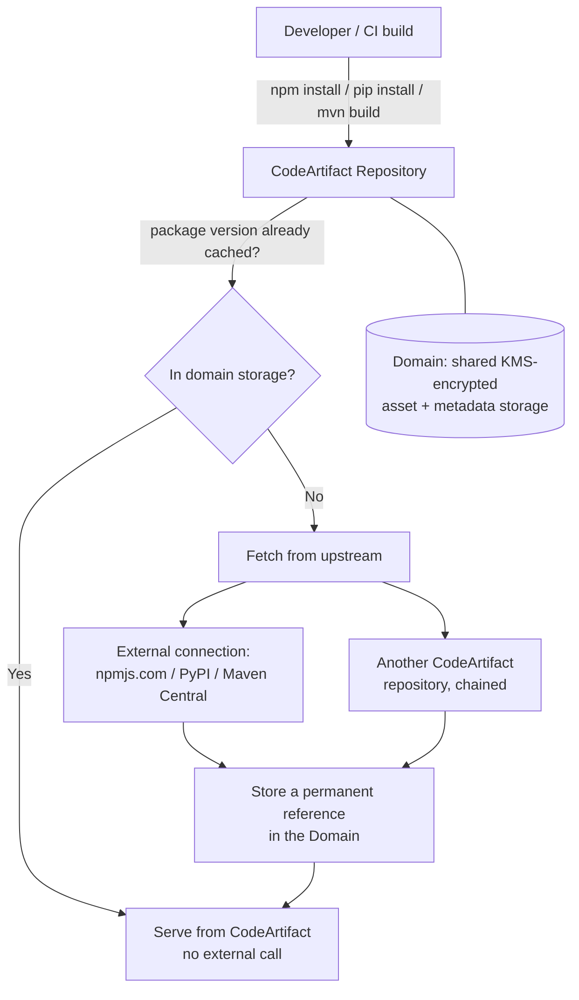
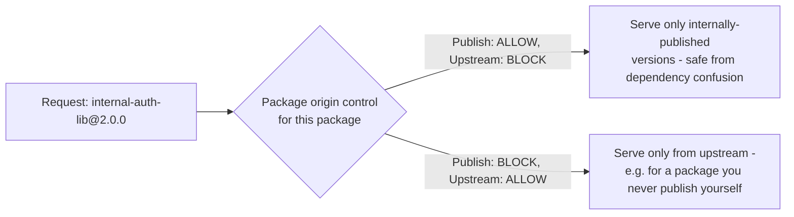

# AWS CodeArtifact

> **Appears in:** [DVA-C03](../../certifications/dva-c03/README.md) · [MLA-C02](../../certifications/mla-c02/README.md)


<!-- AWS Architecture Icons, Developer Tools category; see diagrams/README.md for the convention -->

## Definition

AWS CodeArtifact is a fully managed artifact repository: a secure, private place to store and
fetch the software packages your builds depend on — npm packages, Maven/Gradle artifacts, PyPI
packages, NuGet packages, Ruby gems, Swift packages, Generic — instead of pulling every single
dependency straight from the public internet on every build.

## Purpose

Every modern build pulls in dozens to thousands of third-party packages — `npm install`,
`pip install -r requirements.txt`, a Maven `pom.xml` resolving transitive dependencies. Doing
that by hitting the public npm/PyPI/Maven Central registry directly, every time, every build,
creates three real problems: **availability** (a public registry outage or an individual
package's removal breaks your build, at a moment you don't control), **security** (there's no
organizational control over which package versions your teams are actually allowed to pull, and
no audit trail of what was fetched when), and **speed/cost** (every build re-downloading the same
dependencies from the public internet is slower and chattier than fetching from inside your own
network). CodeArtifact exists to put a managed, private, cached layer between your builds and the
public package ecosystem — you get a repository your organization controls, that transparently
proxies and caches the public registry behind it, so builds are faster, more reliable, and
auditable, without giving up access to the open-source ecosystem.

## How It Works

Plain explanation: CodeArtifact repositories work like any package manager you already use
(npm, pip, Maven) — you just point your package manager's configuration at a CodeArtifact
repository endpoint instead of (or in addition to, via chaining) the public registry. The first
time a package is requested, if it's not already cached, CodeArtifact fetches it from the
configured **upstream** (which can itself be another CodeArtifact repository, or a direct
**external connection** to a public registry like npmjs.com, PyPI, or Maven Central), stores a
permanent reference to that exact version, and serves it. Every subsequent request for that same
version is served straight from CodeArtifact's own storage — no second trip to the public
internet required.



Step by step:
1. **Your build tool makes an ordinary package-manager request** (`npm install lodash@4.17.21`,
   `pip install requests==2.31.0`, a Maven dependency resolution) against a CodeArtifact
   repository endpoint, authenticated via a short-lived token obtained through IAM (`aws
   codeartifact get-authorization-token`).
2. **CodeArtifact checks whether that exact package version is already stored** in the repository
   (or any of its upstream repositories, see below) within the shared **domain**.
3. **If already cached, it's served immediately** — no external network call, no dependency on
   the public registry's availability at that moment.
4. **If not cached, CodeArtifact fetches it from the configured upstream** — either another
   CodeArtifact repository (an internal **upstream repository relationship**, letting you chain
   repositories — e.g., a team-specific repo upstream-of a shared org-wide repo) or an **external
   connection** directly to a public registry (npmjs.com, pypi.org, Maven Central, NuGet Gallery,
   RubyGems, and others, depending on package format).
5. **A permanent reference to that fetched version is retained** — once CodeArtifact has served
   a specific package version once, it keeps serving that exact version from its own storage
   indefinitely, even if the version is later removed or changed upstream (a real, documented
   protection against "left-pad" style incidents where a public package disappears out from
   under every build depending on it).
6. **All assets and metadata live in the domain**, encrypted with a single KMS key shared across
   every repository in that domain — this is what lets an organizational security policy (who can
   read, who can publish, which external connections are allowed) apply consistently across many
   repositories without configuring encryption/access per repository individually.

### Domains, repositories, and upstream chaining

The two-level structure (domain → repositories) and the upstream relationship between
repositories are the core concepts worth understanding visually, because almost every real
CodeArtifact design question is really a question about how repositories are chained:


*Figure: repository chaining — `my_repo`'s client requests are checked against `my_repo` itself
first, then against its upstream repositories in priority order, left to right, until the
package version is found or every upstream is exhausted (returning an HTTP 404 if nothing
matches). This is exactly how a large organization structures "team repo → shared org repo →
public registry" without giving every team repository its own direct external connection.
Source: AWS CodeArtifact User Guide, ["Requesting a package version with upstream
repositories"](https://docs.aws.amazon.com/codeartifact/latest/ug/repo-upstream-behavior.html).*


*Figure: the same chaining pattern with the external connection explicitly shown at the top of
the chain — only the repository with the external connection ever talks to the public internet;
every other repository in the chain only ever talks to CodeArtifact itself. This is the
architecture that lets a security team restrict "which repository is allowed to reach the public
internet at all" to a single, auditable, centrally-managed point, while every downstream team
repository inherits access to the public ecosystem through the chain without needing its own
direct external connection. Source: AWS CodeArtifact User Guide, ["Requesting a package version
with upstream
repositories"](https://docs.aws.amazon.com/codeartifact/latest/ug/repo-upstream-behavior.html).*

Walking through why this shape matters: without upstream chaining, every team's repository would
need its own direct external connection to npmjs.com/PyPI/Maven Central, multiplying the number
of places a security policy about "which public sources are we allowed to pull from" has to be
enforced and audited. With chaining, exactly one repository in the whole organization needs the
external connection; every other repository inherits access to the public ecosystem through the
chain, and a single policy change at that one upstream repository governs everyone downstream of
it.

### Package origin controls — blocking a specific upstream version

A real, tested security feature: **package origin controls** let you restrict, per package, per
repository, whether new versions are allowed to be published **internally** (by your own teams)
versus pulled from an **upstream** (external or chained) source — independently of each other.
Setting `upstream=BLOCK` for a specific package in a repository prevents CodeArtifact from ever
fetching a *new* version of that package from upstream again (existing cached versions remain
available), while leaving internal publishing of your own build of that same package name
unaffected. This is the mechanism behind a real, documented attack class called **dependency
confusion** — where an attacker publishes a malicious package to a public registry using the same
name as your organization's *internal*, never-publicly-published package, hoping a misconfigured
build resolves the public (malicious) version instead of the internal one. Package origin
controls set to prefer/require internal publishing for internally-named packages close this gap
directly.



## Key Features / Components

- **Domain** — the top-level container: all package assets and metadata for every repository in
  the domain are stored once (deduplicated) and encrypted with one shared KMS key. An
  organization typically runs a single production domain containing every repository, so a
  consistent security policy applies org-wide.
- **Repository** — holds a set of package versions and their assets; polyglot (one repository can
  hold npm, PyPI, Maven, NuGet, and other formats simultaneously, each exposed through its own
  format-specific endpoint). Every repository belongs to exactly one domain and can't move to a
  different one.
- **Upstream repository relationship** — chaining one repository "upstream" of another so the
  downstream repository transparently sees the upstream's packages too, merging their contents
  from a client's point of view. Up to 10 direct upstreams per repository, with multi-level
  chaining supported (chains have a maximum depth).
- **External connection** — a direct link from a repository to a public registry (npmjs.com,
  pypi.org, Maven Central, NuGet Gallery, RubyGems, SwiftPM) — the entry point through which
  public packages actually enter CodeArtifact at all.
- **Package origin controls** — per-package, per-repository rules governing whether new versions
  can be published internally, fetched from upstream, both, or neither — the primary defense
  against dependency confusion attacks.
- **Permanent version retention** — once CodeArtifact has served a specific package version, a
  reference to it is kept indefinitely, protecting builds from a public package being later
  deleted, yanked, or changed upstream.
- **Authorization tokens** — short-lived (default 12 hours, configurable) tokens obtained via
  `aws codeartifact get-authorization-token`, used to authenticate package manager clients against
  a repository — governed entirely by ordinary IAM permissions, no separate credential system.
- **Package groups** — apply origin control settings and other policies across many packages
  matching a naming pattern (e.g., everything under a company's npm scope) at once, instead of
  configuring each package individually.
- **Integration with native package manager clients** — npm, Yarn, pip, twine, Maven, Gradle,
  NuGet CLI, dotnet CLI, Cargo (Rust), SwiftPM, and a Generic format for arbitrary binary
  artifacts — CodeArtifact doesn't require a proprietary client; you configure your existing
  tooling to point at it.
- **CloudTrail integration** — every repository operation (publish, fetch-authorization,
  configuration change) is logged, giving a full audit trail of who published or accessed what,
  when.

## Common Architectures

**1. Single production domain, per-team repositories, one centralized external connection** —
the default recommended shape for most organizations: one domain holding every repository,
each team or service getting its own repository (or small cluster of repositories, one per
package format they use), all chained upstream of one or two shared repositories that hold the
actual external connections to npmjs.com/PyPI/Maven Central. This keeps exactly one enforcement
point for "which public sources are we allowed to pull from" while giving every team their own
publish/consume boundary.

**2. Internal shared-library distribution with dependency-confusion protection** — an internal
SDK or shared utility library is published to a dedicated internal repository with package
origin controls set to block upstream fetches for that package's exact name, closing the
dependency-confusion attack path described above, while every consuming team's repository has
that internal repository as an upstream so they can `npm install`/`pip install` the internal
package exactly like any public one.

**3. CI/CD pipeline integration** — a CodeBuild project's `buildspec.yml` `install`/`pre_build`
phase calls `aws codeartifact get-authorization-token` and configures the relevant package
manager (npm's `.npmrc`, pip's `pip.conf`, Maven's `settings.xml`) to point at the CodeArtifact
repository endpoint before running the actual build/test commands — the standard way
CodeArtifact plugs into an existing CI pipeline with minimal buildspec changes (see
`codebuild.md` for the fuller CI pipeline picture this slots into).

**4. Promotion pipeline across environments** — a stricter organizational pattern uses separate
repositories for "candidate" packages (published by CI on every merge) versus "approved"
packages (promoted into a separate repository only after passing a security scan or manual
review gate), giving a clear, auditable boundary between "built" and "approved for other teams
to depend on" rather than one repository serving both purposes.

## Use Cases — When to Use It

1. **CI/CD build reliability insulation (any engineering org with a CI pipeline).** Problem: a
   public registry outage or a yanked package version breaks CI builds at an unpredictable time.
   Why CodeArtifact fits: cached packages continue to be served from CodeArtifact's own storage
   regardless of the public registry's momentary availability. Tradeoff vs. pulling directly from
   the public registry — direct pulls are simpler to set up initially but have zero resilience to
   upstream outages or version removal, a real, recurring category of CI incident.
2. **Enforcing approved dependency versions org-wide (platform/security engineering).** Problem:
   different teams independently pull whatever package version happens to be latest at build
   time, with no central control over which versions are actually vetted/approved. Why
   CodeArtifact fits: package origin controls and a curated internal repository structure let a
   platform team gate which versions are available at all, rather than relying on every
   individual developer's `package-lock.json` discipline. Tradeoff vs. relying on lockfiles alone
   — lockfiles pin a version per-project but don't prevent a new project or a lockfile update from
   introducing an unvetted version; CodeArtifact's gate applies before any lockfile is even
   written.
3. **Defending against dependency confusion attacks (any org publishing internally-named
   packages).** Problem: an internal package name could be squatted on the public registry by an
   attacker, and a misconfigured build might resolve the malicious public version instead of the
   real internal one. Why CodeArtifact fits: package origin controls set to block upstream
   fetches for internally-namespaced packages close this exact attack path. Tradeoff vs. hoping
   naming conventions alone prevent collision — naming conventions reduce but don't eliminate the
   risk; origin controls are an enforced technical control, not a convention.
4. **Private internal library distribution (platform/shared-libraries team).** Problem: a
   company's internal shared libraries (an internal auth SDK, a shared UI component library) need
   a distribution mechanism other teams' builds can consume via ordinary `npm install`/`pip
   install`, without standing up and operating a self-hosted artifact server. Why CodeArtifact
   fits: publishing to a CodeArtifact repository and consuming it is indistinguishable, from a
   developer's workflow, from using any public package — zero custom tooling needed. Tradeoff vs.
   a self-hosted Nexus/Artifactory server — self-hosting gives more configuration control but adds
   real operational burden (patching, scaling, backup) CodeArtifact removes entirely.
5. **Multi-language monorepo dependency management (platform engineering).** Problem: a monorepo
   building npm, Python, and Java components each needs its own package ecosystem's dependency
   resolution, ideally through one consistent organizational policy layer. Why CodeArtifact fits:
   polyglot repositories mean one domain's security/origin-control policy applies consistently
   across npm, PyPI, and Maven repositories simultaneously. Tradeoff vs. three separate
   language-specific artifact tools — separate tools work but multiply the number of places
   access policy and audit logging have to be configured and reviewed.
6. **Regulated-industry build provenance/audit trail (fintech/healthcare compliance).** Problem:
   an auditor needs proof of exactly which dependency versions were used in a production build and
   when they were introduced. Why CodeArtifact fits: CloudTrail logging of every fetch/publish
   event, combined with permanent version retention, gives a durable, queryable record satisfying
   this requirement directly. Tradeoff vs. manually archiving a `package-lock.json` per release —
   a lockfile snapshot shows *what* was used but not *when it was first introduced* or *who
   published it*, which CodeArtifact's audit trail covers natively.
7. **Faster, cheaper CI builds at high build volume (cost-sensitive engineering org).** Problem:
   thousands of daily CI runs each re-downloading the same common dependencies from the public
   internet adds real latency and, at volume, real egress/time cost. Why CodeArtifact fits:
   cached packages are served from inside AWS's network, typically faster and without repeatedly
   round-tripping to the public internet for identical requests. Tradeoff vs. a self-managed
   package proxy cache (e.g., a self-hosted Verdaccio/devpi instance) — a self-managed cache can
   be cheaper at extreme scale but trades away CodeArtifact's zero-ops management and native IAM
   integration.
8. **Onboarding a new team to a consistent internal package source (fast-growing engineering
   org).** Problem: a newly formed team needs immediate access to both the public ecosystem and
   the company's internal shared packages, without manually wiring up credentials to two separate
   systems. Why CodeArtifact fits: one repository endpoint, authenticated via one IAM-governed
   token, transparently serves both internal packages and (via upstream chaining) the public
   ecosystem. Tradeoff vs. giving the new team direct public-registry access plus a separate
   internal artifact server login — that's strictly more systems to onboard a new team into, for
   no additional capability.
9. **ML model dependency reproducibility (MLA-C02-relevant, ML platform team).** Problem: an ML
   team's training environment depends on exact pinned versions of Python packages (a specific
   `scikit-learn`, `numpy`, and internal feature-engineering library version), and a public PyPI
   package being pulled or changed could silently break reproducibility of a training run months
   later. Why CodeArtifact fits: permanent version retention guarantees the exact pinned versions
   remain fetchable indefinitely, regardless of what happens to them on public PyPI, directly
   supporting reproducible training environments (a recurring MLA-C02 Domain 2/3 concern). Tradeoff
   vs. vendoring dependencies directly into a training container image — vendoring works but
   bloats image size and loses CodeArtifact's org-wide dependency visibility/audit trail.

## When NOT to Use It / Alternatives

- **You need generic binary artifact storage with no package-manager-specific protocol
  requirement** (build outputs, container images, arbitrary files) — CodeArtifact does have a
  **Generic** package format for exactly this, but for container images specifically, **Amazon
  ECR** is the purpose-built, more commonly used choice; don't force container images through
  CodeArtifact's Generic format when ECR exists specifically for that job.
- **You only ever pull directly from one public registry, with a single small team, and have no
  organizational policy/audit requirement** — the overhead of setting up domains/repositories/
  upstreams may simply not be worth it yet for a very small team with no compliance driver; direct
  public-registry access remains simpler until those needs materialize.
- **You need a full CI/CD orchestration platform** — CodeArtifact only manages dependency
  storage/resolution; it's one input to a build, not a build orchestrator. Pair it with
  **CodeBuild**/**CodePipeline** for the actual build/deploy orchestration (see those docs in
  this same category).
- **Your build artifacts are deployable application packages, not dependencies** (a Lambda
  deployment zip, a final compiled binary you intend to deploy) — those belong in **S3** or a
  deployment-specific service, not a dependency repository meant for *inputs* to a build.

## Why It's Important

**Real-world:** dependency supply-chain security has become a genuinely high-stakes concern —
real, damaging incidents have come from both public packages disappearing unexpectedly and from
dependency confusion attacks exploiting naming collisions between internal and public packages.
A managed, policy-enforced dependency layer is now considered a baseline hygiene practice for any
organization with meaningful engineering scale, not an optional nice-to-have.

**Exam relevance:**
- **DVA-C03** — CodeArtifact sits in Domain 1 "Development with AWS Services" and Domain 3
  "Testing and Deployment" territory: a developer-facing question describing a build pipeline
  that needs a private, managed package repository (as opposed to pulling straight from npm/PyPI)
  is pointing at CodeArtifact, often alongside CodeBuild/CodePipeline in the same scenario.
- **MLA-C02** — CodeArtifact is explicitly in scope as part of ML environment/dependency
  reproducibility tooling: a question about guaranteeing a training environment's exact package
  versions remain available and consistent over time, or about controlling which package versions
  an ML team is allowed to pull in, is CodeArtifact territory, distinct from the data/model
  concerns most of MLA-C02 otherwise tests.

## Limits & Quotas

- **Repositories per domain**: up to 1,000 — comfortably enough for even a large organization's
  per-team repository structure, but worth knowing as a real ceiling if an org considers a
  repository-per-microservice pattern at extreme scale.
- **Upstream repositories per repository**: up to 10 direct upstreams, with multi-level chaining
  supported up to a maximum chain depth — very deep chains (many hops) can slow down a
  "not found in any upstream" resolution, since every level in the chain must be checked before
  returning a 404.
- **Package versions per package**: a high but finite limit per package within a repository;
  relevant mainly for extremely high-churn internal packages with frequent, automated version
  publishes (e.g., a CI pipeline publishing a new version on every commit) that may eventually
  need a retention/cleanup policy.
- **Asset size**: a per-asset size ceiling (large compiled binaries, uncommonly large Maven
  artifacts) — most language-ecosystem packages are well under this, but a Generic-format
  artifact storing a large build output should check current limits before relying on it.
- **Domains per account**: a soft limit, raisable via support case — though AWS explicitly
  recommends a single production domain per organization rather than many, specifically to keep
  one consistent security/access policy surface instead of fragmenting it across domains.
- **Authorization token lifetime**: up to 12 hours by default (configurable shorter); a build
  pipeline running longer than the token's lifetime needs to refresh it mid-build, which is why
  CI build scripts typically fetch a fresh token at the start of every build rather than caching
  one across build runs.

## Troubleshooting / Common Issues

- **`403 Forbidden` fetching a package that clearly exists.** Almost always one of: the
  authorization token has expired (tokens are short-lived by design — re-run
  `get-authorization-token`), the calling principal's IAM policy doesn't grant
  `codeartifact:ReadFromRepository` on this specific repository, or a package origin control is
  set to `BLOCK` for the requested source (internal vs. upstream) for this specific package.
- **A package version used to resolve from upstream but now returns 404.** Check package origin
  controls first — if `upstream` was set to `BLOCK` for this package (often deliberately, as a
  dependency-confusion defense), CodeArtifact will no longer fetch *new* versions from upstream,
  though already-cached versions remain available; this is expected behavior once origin controls
  are configured, not a connectivity problem.
- **Builds suddenly slower after introducing CodeArtifact.** Check whether the repository actually
  has the needed packages cached yet — the *first* request for any given version still has to
  reach the external connection's upstream, so a freshly created repository's first few builds
  are not yet benefiting from caching; subsequent builds for the same versions should be faster,
  not slower.
- **A newly published internal package isn't visible to a downstream team's repository.** Confirm
  the upstream relationship is actually configured in the direction expected — "repo A is
  upstream of repo B" means B sees A's packages, not the reverse; a common setup mistake is
  configuring the relationship backwards.
- **External connection stopped returning new versions of a public package.** External
  connections occasionally need re-association after certain configuration changes, and some
  public registries' own availability affects what CodeArtifact can fetch *for the first time* —
  already-cached versions remain available via CodeArtifact's own storage regardless of the
  external connection's current state.
- **CI pipeline intermittently fails authentication.** Usually the authorization token wasn't
  refreshed for a long-running or restarted build process and expired mid-build — fetch a fresh
  token at the start of every build invocation rather than reusing one across separate build runs.

## Pricing Model (summary)

- **Storage** — billed per GB-month of unique package assets stored (deduplicated at the domain
  level — storing the same version in multiple repositories within one domain doesn't multiply
  storage cost).
- **Requests** — billed per package-version request beyond a free-tier allotment; both cached
  (internal) and upstream-fetched requests count, though sustained repeat requests for the same
  already-cached version don't incur additional *upstream* transfer cost since nothing leaves
  CodeArtifact after the first fetch.
- **Data transfer** — standard AWS data transfer rates apply for cross-region or internet-bound
  transfer where applicable; same-region requests from AWS compute (e.g., CodeBuild in the same
  Region) avoid most of this.
- **Free tier** — a monthly allotment of storage and requests is included free for new usage
  (check the official page for current thresholds).
- Official current pricing: https://aws.amazon.com/codeartifact/pricing/

## Hands-on Lab (Floci)

Floci (`awslocal`) supports the CodeArtifact API surface for domain/repository management,
though the real package-manager-protocol-level fetch/publish flow (actual `npm install` against a
CodeArtifact endpoint) depends on signed, protocol-specific interactions Floci doesn't fully
replicate — this lab exercises the control-plane shape, which is exactly what the exam expects
you to reason about.

```bash
# 1. Create a domain
awslocal codeartifact create-domain --domain my-company

# 2. Create a repository inside that domain
awslocal codeartifact create-repository \
  --domain my-company \
  --repository shared-npm-repo \
  --description "Shared npm packages for all teams"

# 3. Create a second, team-specific repository
awslocal codeartifact create-repository \
  --domain my-company \
  --repository team-a-npm-repo \
  --description "Team A's npm repository"

# 4. Chain team-a's repo upstream-of the shared repo (upstream relationship)
awslocal codeartifact update-repository \
  --domain my-company \
  --repository team-a-npm-repo \
  --upstreams repositoryName=shared-npm-repo

# 5. Add an external connection on the shared repo (points at the public npm registry)
awslocal codeartifact associate-external-connection \
  --domain my-company \
  --repository shared-npm-repo \
  --external-connection public:npmjs

# 6. Get a short-lived authorization token (what npm/pip actually authenticate with)
awslocal codeartifact get-authorization-token --domain my-company

# 7. Describe the repository endpoint a real npm client would be pointed at
awslocal codeartifact get-repository-endpoint \
  --domain my-company --repository team-a-npm-repo --format npm
```

See `labs-floci/README.md` for the shared setup. The exercise worth internalizing: step 4's
upstream chain means `team-a-npm-repo` transparently sees everything `shared-npm-repo` can see,
including (via step 5) the public npm registry — exactly the multi-level chaining shown in the
architecture diagrams above, built one API call at a time.

## Exam Tips

- **Domain vs. repository**: a domain is the shared storage/encryption/policy boundary;
  repositories are what clients actually point package managers at. A question about applying one
  security policy across many repositories at once is pointing at domain-level configuration, not
  per-repository settings.
- **Upstream repository vs. external connection**: an upstream repository relationship chains two
  CodeArtifact repositories together; an external connection links a repository directly to a
  public registry. A question describing "give every team's repo access to the public registry
  without every repo needing its own direct connection" is describing upstream chaining through
  one repository that holds the external connection.
- **Permanent version retention is a named, tested behavior** — "a public package we depend on
  was deleted/changed upstream, but our build still works" describes CodeArtifact's retention of
  previously-fetched versions, not a coincidence.
- **Package origin controls are the dependency-confusion defense** — a question describing
  protecting against a malicious public package impersonating an internal package name by the
  same name is pointing at origin controls (block upstream fetches for internally-namespaced
  packages), not a naming convention alone.
- **Don't confuse CodeArtifact with ECR** — CodeArtifact is for language-ecosystem *dependencies*
  (npm, PyPI, Maven, etc.); ECR is specifically for container images. A scenario about container
  image storage should point at ECR even though CodeArtifact's Generic format could technically
  hold arbitrary files.
- **Authorization is ordinary IAM, time-limited by a token** — a question implying CodeArtifact
  has its own separate user/credential system distinct from IAM is wrong; access control is
  standard IAM policy, and the authorization token is just a short-lived credential a package
  manager client presents, not a separate identity system.
- **In-scope for both DVA-C03 and MLA-C02** — DVA-C03 tests it as general build-pipeline
  dependency management; MLA-C02 tests it specifically around reproducible ML training
  environment dependencies — recognize which framing a question is using.

### Sample exam scenario, worked

**Scenario:** "A company recently discovered that an attacker published a malicious package to
the public npm registry using the exact same name as one of the company's internal, never-
publicly-published npm packages. Several internal builds pulled the malicious version instead of
the real internal one before the issue was caught. What should the company configure to prevent
this from happening again?"

*Answer:* This is describing a **dependency confusion attack**, and the fix is **CodeArtifact
package origin controls** — specifically, setting the upstream fetch behavior for that exact
package name to `BLOCK` in every repository that should only ever resolve it internally, so
CodeArtifact will never again fetch a version of that package name from any external/upstream
source, regardless of what gets published there. A plausible-sounding but incomplete answer
("just rename the internal package" or "tell developers to double-check versions manually") is
an organizational mitigation, not a technical control enforced by the dependency resolution
system itself — the giveaway in the question is that the fix needs to prevent *automated build
tooling* from resolving the wrong source, which only a configured technical control (origin
controls), not a naming convention or manual review step, can guarantee going forward.

## Further Reading

- [What is AWS CodeArtifact? (User Guide)](https://docs.aws.amazon.com/codeartifact/latest/ug/)
- [AWS CodeArtifact concepts](https://docs.aws.amazon.com/codeartifact/latest/ug/codeartifact-concepts.html)
- [Requesting a package version with upstream repositories](https://docs.aws.amazon.com/codeartifact/latest/ug/repo-upstream-behavior.html)
- [Package origin controls](https://docs.aws.amazon.com/codeartifact/latest/ug/package-origin-controls.html)
- [AWS CodeArtifact pricing](https://aws.amazon.com/codeartifact/pricing/)

## Related Terms

- [`codebuild.md`](codebuild.md) — the build service that typically authenticates against a
  CodeArtifact repository to resolve dependencies during the `install`/`pre_build` phase
- [`codepipeline.md`](codepipeline.md) — orchestrates a build (often a CodeBuild project using
  CodeArtifact) as one stage of a larger release pipeline
- `services/containers/ecr.md` — the equivalent managed repository concept for container images
  rather than language-ecosystem dependencies
- `glossary/README.md` — package manager, dependency, supply-chain security definitions
